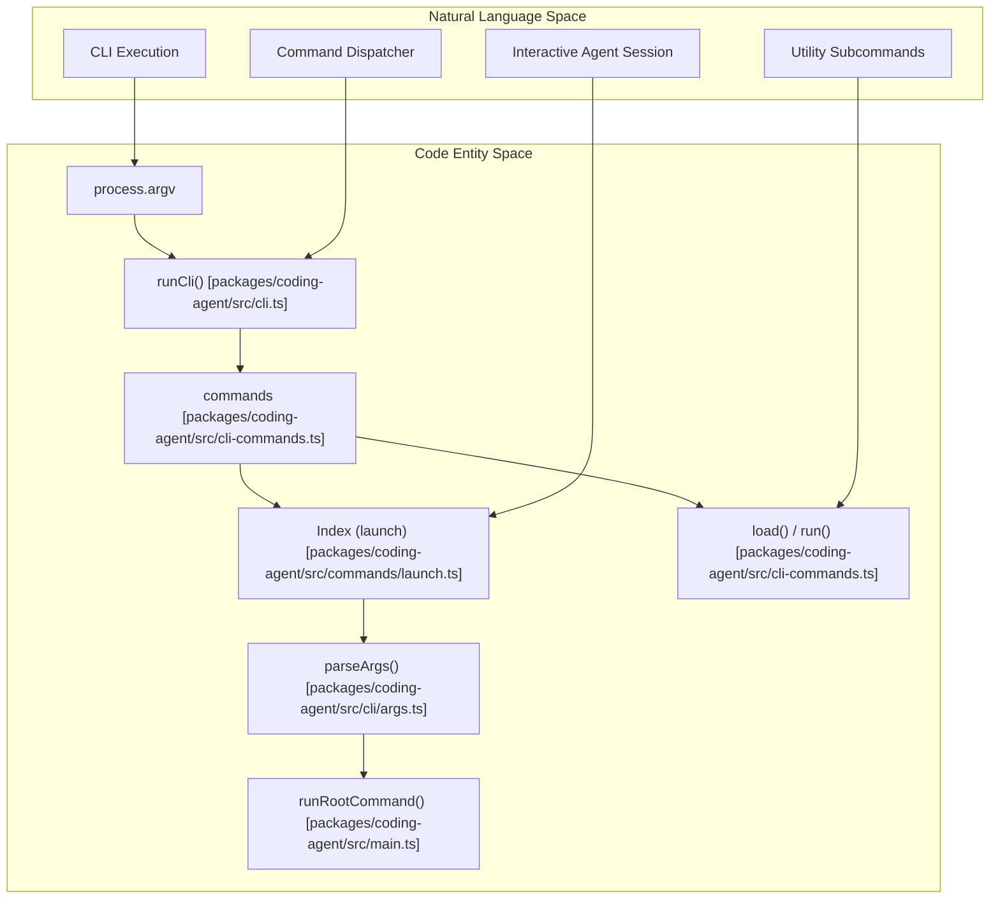
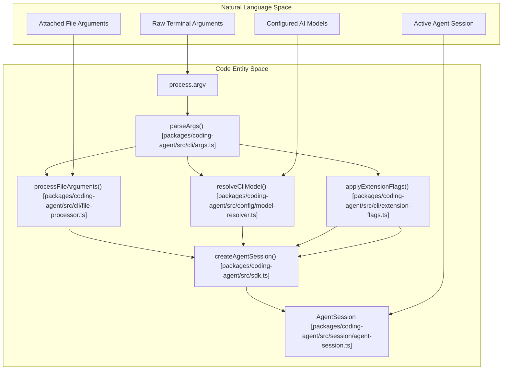

<!-- source: DeepWiki mcp.deepwiki.com · repo can1357/oh-my-pi · page 5.1 Command-Line Options · fetched 2026-10-30 -->

# Command-Line Options

Relevant source files

The following files were used as context for generating this wiki page:

- [packages/coding-agent/src/cli-commands.ts](packages/coding-agent/src/cli-commands.ts)
- [packages/coding-agent/src/cli/args.ts](packages/coding-agent/src/cli/args.ts)
- [packages/coding-agent/src/cli/bench-cli.ts](packages/coding-agent/src/cli/bench-cli.ts)
- [packages/coding-agent/src/cli/bench-runtime.ts](packages/coding-agent/src/cli/bench-runtime.ts)
- [packages/coding-agent/src/cli/command-help.ts](packages/coding-agent/src/cli/command-help.ts)
- [packages/coding-agent/src/cli/dry-balance-cli.ts](packages/coding-agent/src/cli/dry-balance-cli.ts)
- [packages/coding-agent/src/cli/extension-flags.ts](packages/coding-agent/src/cli/extension-flags.ts)
- [packages/coding-agent/src/cli/flag-tables.ts](packages/coding-agent/src/cli/flag-tables.ts)
- [packages/coding-agent/src/cli/npm-registry.ts](packages/coding-agent/src/cli/npm-registry.ts)
- [packages/coding-agent/src/cli/update-cli.ts](packages/coding-agent/src/cli/update-cli.ts)
- [packages/coding-agent/src/commands/bench.ts](packages/coding-agent/src/commands/bench.ts)
- [packages/coding-agent/src/commands/commit.ts](packages/coding-agent/src/commands/commit.ts)
- [packages/coding-agent/src/commands/config.ts](packages/coding-agent/src/commands/config.ts)
- [packages/coding-agent/src/commands/dry-balance.ts](packages/coding-agent/src/commands/dry-balance.ts)
- [packages/coding-agent/src/commands/grep.ts](packages/coding-agent/src/commands/grep.ts)
- [packages/coding-agent/src/commands/install.ts](packages/coding-agent/src/commands/install.ts)
- [packages/coding-agent/src/commands/launch.ts](packages/coding-agent/src/commands/launch.ts)
- [packages/coding-agent/src/commands/plugin.ts](packages/coding-agent/src/commands/plugin.ts)
- [packages/coding-agent/src/commands/setup.ts](packages/coding-agent/src/commands/setup.ts)
- [packages/coding-agent/src/commands/shell.ts](packages/coding-agent/src/commands/shell.ts)
- [packages/coding-agent/src/commands/stats.ts](packages/coding-agent/src/commands/stats.ts)
- [packages/coding-agent/src/commands/update.ts](packages/coding-agent/src/commands/update.ts)
- [packages/coding-agent/src/commands/web-search.ts](packages/coding-agent/src/commands/web-search.ts)
- [packages/coding-agent/src/if-bench/actions.ts](packages/coding-agent/src/if-bench/actions.ts)
- [packages/coding-agent/src/if-bench/index.ts](packages/coding-agent/src/if-bench/index.ts)
- [packages/coding-agent/src/if-bench/prompts/system.md](packages/coding-agent/src/if-bench/prompts/system.md)
- [packages/coding-agent/src/if-bench/runner.ts](packages/coding-agent/src/if-bench/runner.ts)
- [packages/coding-agent/src/main.ts](packages/coding-agent/src/main.ts)
- [packages/coding-agent/src/prompts/bench/chat.md](packages/coding-agent/src/prompts/bench/chat.md)
- [packages/coding-agent/src/prompts/bench/generation.md](packages/coding-agent/src/prompts/bench/generation.md)
- [packages/coding-agent/src/prompts/bench/prefill-instruction.md](packages/coding-agent/src/prompts/bench/prefill-instruction.md)
- [packages/coding-agent/src/prompts/dry-balance-bench.md](packages/coding-agent/src/prompts/dry-balance-bench.md)
- [packages/coding-agent/src/session/session-manager.ts](packages/coding-agent/src/session/session-manager.ts)
- [packages/coding-agent/test/acp-mcp-isolation.test.ts](packages/coding-agent/test/acp-mcp-isolation.test.ts)
- [packages/coding-agent/test/acp-session-effects.test.ts](packages/coding-agent/test/acp-session-effects.test.ts)
- [packages/coding-agent/test/bench-auth-fallback.test.ts](packages/coding-agent/test/bench-auth-fallback.test.ts)
- [packages/coding-agent/test/bench-cache.test.ts](packages/coding-agent/test/bench-cache.test.ts)
- [packages/coding-agent/test/bench-profiles.test.ts](packages/coding-agent/test/bench-profiles.test.ts)
- [packages/coding-agent/test/cli-argv-routing.test.ts](packages/coding-agent/test/cli-argv-routing.test.ts)
- [packages/coding-agent/test/cli-explicit-extension-isolation.test.ts](packages/coding-agent/test/cli-explicit-extension-isolation.test.ts)
- [packages/coding-agent/test/cli-unknown-flag.test.ts](packages/coding-agent/test/cli-unknown-flag.test.ts)
- [packages/coding-agent/test/cli/npm-registry.test.ts](packages/coding-agent/test/cli/npm-registry.test.ts)
- [packages/coding-agent/test/cli/update-cli.test.ts](packages/coding-agent/test/cli/update-cli.test.ts)
- [packages/coding-agent/test/cli/update-rename-migration.integration.test.ts](packages/coding-agent/test/cli/update-rename-migration.integration.test.ts)
- [packages/coding-agent/test/commit-command-exit.test.ts](packages/coding-agent/test/commit-command-exit.test.ts)
- [packages/coding-agent/test/commit-extension-providers.test.ts](packages/coding-agent/test/commit-extension-providers.test.ts)
- [packages/coding-agent/test/commit-fallback-exit.test.ts](packages/coding-agent/test/commit-fallback-exit.test.ts)
- [packages/coding-agent/test/dry-balance-config.test.ts](packages/coding-agent/test/dry-balance-config.test.ts)
- [packages/coding-agent/test/dry-balance-runtime.test.ts](packages/coding-agent/test/dry-balance-runtime.test.ts)
- [packages/coding-agent/test/extension-flag-dispatch.test.ts](packages/coding-agent/test/extension-flag-dispatch.test.ts)
- [packages/coding-agent/test/extension-flag-initial-message.test.ts](packages/coding-agent/test/extension-flag-initial-message.test.ts)
- [packages/coding-agent/test/flag-tables.test.ts](packages/coding-agent/test/flag-tables.test.ts)
- [packages/coding-agent/test/if-bench.test.ts](packages/coding-agent/test/if-bench.test.ts)
- [packages/coding-agent/test/initial-message.test.ts](packages/coding-agent/test/initial-message.test.ts)
- [packages/coding-agent/test/install-command.test.ts](packages/coding-agent/test/install-command.test.ts)
- [packages/coding-agent/test/main-session-resolution-error.test.ts](packages/coding-agent/test/main-session-resolution-error.test.ts)
- [packages/coding-agent/test/plugin-verb-launch-leak.test.ts](packages/coding-agent/test/plugin-verb-launch-leak.test.ts)
- [packages/coding-agent/test/session-manager/move-to.test.ts](packages/coding-agent/test/session-manager/move-to.test.ts)
- [packages/coding-agent/test/session-manager/title-source-persistence.test.ts](packages/coding-agent/test/session-manager/title-source-persistence.test.ts)
- [packages/coding-agent/test/update-cli.test.ts](packages/coding-agent/test/update-cli.test.ts)

This page provides a comprehensive technical reference for the `omp` command-line interface of the oh-my-pi coding agent, covering the full range of CLI arguments, flag classifications, extension flag handling, subcommands, operational modes, and environment variable configuration.

The `omp` CLI translates command-line arguments into structured options for creating agent sessions or running utility commands. The core parsing logic is designed to be data-driven, enabling consistent interpretation both at early bootstrap and later extension-aware phases.

---

## Command Dispatch and Routing

The CLI entrypoint dispatches commands by examining the first non-flag argument against a centralized command entry table. Registered subcommands handle maintenance, benchmarking, extension management, and utility tasks, while the absence of a subcommand defaults to launching an interactive agent session via the `launch` root command handler.

- The CLI routes through `runCli()` implemented in `[packages/coding-agent/src/cli.ts]()`.
- Subcommands are mapped in a static table defined in `[packages/coding-agent/src/cli-commands.ts]()`.
- The default `launch` command executes the main agent session lifecycle via `runRootCommand()` in `[packages/coding-agent/src/commands/launch.ts:39]()` and `[packages/coding-agent/src/main.ts:40]()` (via `loadRunRootCommand` `[packages/coding-agent/src/commands/launch.ts:11-15]()`).

**Description:**

1. `process.argv` is passed to `runCli()` in `[packages/coding-agent/src/cli.ts]()`.
2. `runCli()` inspects arguments, querying the static `commands` array in `[packages/coding-agent/src/cli-commands.ts]()`.
3. If a subcommand matches (e.g., `update`, `gc`, `stats`), its loader promise resolves and runs.
4. If no subcommand matches, execution falls back to the `launch` command `[packages/coding-agent/src/commands/launch.ts:17-21]()`.
5. `parseArgs()` in `[packages/coding-agent/src/cli/args.ts]()` converts the remaining argv into structured `Args`, which `runRootCommand` in `[packages/coding-agent/src/main.ts]()` consumes.

Sources: `[packages/coding-agent/src/main.ts:1-154]()`, `[packages/coding-agent/src/cli.ts:1-157]()`, `[packages/coding-agent/src/commands/launch.ts:1-50]()`, `[packages/coding-agent/src/cli/args.ts:1-184]()`

---

## Profile Bootstrapping and Aliasing

Profile selection occurs early, prior to loading environment files, due to eager `.env` imports in the utility layers. 

- `extractProfileFlags()` extracts `--profile` and `--alias` flags for early processing in `[packages/coding-agent/src/cli/profile-bootstrap.ts]()`.
- Profile aliases simplify shell profile switching by generating shell functions or scripts in `[packages/coding-agent/src/cli/profile-alias.ts]()`.
- Profile names are validated and normalized in `normalizeProfileName()` `[packages/utils/src/dirs.ts:63-80]()`, enforcing rules such as disallowing reserved Windows names and restricting characters.

This bootstrap step ensures the correct configuration and session directories are loaded under the target profile context.

Sources: `[packages/coding-agent/src/cli/profile-bootstrap.ts]()`, `[packages/coding-agent/src/cli/profile-alias.ts]()`, `[packages/utils/src/dirs.ts:63-80]()`

---

## Core CLI Flags and Options

The CLI argument parser is implemented in `parseArgs()` `[packages/coding-agent/src/commands/launch.ts:30]()` (which calls `parseArgs` from `[packages/coding-agent/src/cli/args.ts:30]()`), which uses explicit flag setter tables in `[packages/coding-agent/src/cli/flag-tables.ts:118-182]()` to dispatch recognized flags into the `Args` object. The parsing logic supports:

- Boolean flags (e.g., `--no-session`, `--no-tools`).
- String-valued flags (e.g., `--model`, `--cwd`).
- Optional-value flags (e.g., `--resume`).

### Important Flags Overview

| Flag | Arg Type | Description / Implementation Notes |
|---|---|---|
| `--model` | Pattern string | Sets the primary AI model with fuzzy matching via `ModelRegistry` `[packages/coding-agent/src/main.ts:48]()` |
| `--smol` | Pattern string | Overrides the fast/cheap reasoning model selector `[packages/coding-agent/src/cli/args.ts:35]()` |
| `--slow` | Pattern string | Overrides the slow/high-effort model selector `[packages/coding-agent/src/cli/args.ts:36]()` |
| `--plan` | Pattern string | Overrides the architectural planning model `[packages/coding-agent/src/cli/args.ts:37]()` |
| `--thinking` | Thinking level | Sets reasoning effort via `parseCliThinkingLevel()` `[packages/coding-agent/src/cli/args.ts:50]()` |
| `--mode` | Enumeration | Selects operation mode: `text`, `json`, `rpc`, `acp`, `rpc-ui` `[packages/coding-agent/src/cli/args.ts:23-25]()` |
| `--profile` | String | Sets the active profile, isolating credentials and config `[packages/coding-agent/src/cli/args.ts:29]()` |
| `--cwd` | Directory path | Sets project root directory for the agent session `[packages/coding-agent/src/cli/args.ts:26]()` |
| `--config` | File path(s) | One-shot config file overlays to load `[packages/coding-agent/src/cli/flag-tables.ts:121-124]()` |
| `--add-dir` | Directory path | Additional workspace directories beyond `--cwd` `[packages/coding-agent/src/cli/args.ts:28]()` |
| `--system-prompt` | Prompt string | Overwrites the system prompt `[packages/coding-agent/src/cli/args.ts:45]()` |
| `--append-system-prompt` | Prompt string | Appends to system prompt `[packages/coding-agent/src/cli/args.ts:47]()` |
| `--api-key` | API key string | Injects raw API key for AI provider `[packages/coding-agent/src/cli/args.ts:44]()` |
| `--provider` | Provider string | Select AI provider to use `[packages/coding-agent/src/cli/args.ts:32]()` |
| `--service-tier` | Tier string | Select OpenAI service tier `[packages/coding-agent/src/cli/args.ts:49]()` |
| `--hide-thinking` | Boolean | Suppresses thinking output `[packages/coding-agent/src/cli/args.ts:50]()` |
| `--advisor` | Boolean | Enables autonomous Advisor guidance `[packages/coding-agent/src/cli/args.ts:51]()` |
| `--external-thinking` | Boolean | Delegate thinking externally `[packages/coding-agent/src/cli/args.ts:52]()` |
| `--prewalk` / `--no-prewalk` | Boolean | Enable/disable pre-analysis workspace prewalk `[packages/coding-agent/src/cli/args.ts:38-39]()` |
| `--plan-yolo` / `--plan-yolo-into` | Boolean / Directory | Plan execution bypassing approval `[packages/coding-agent/src/cli/args.ts:41-42]()` |
| `--help` / `--version` | Boolean | Displays usage or version info `[packages/coding-agent/src/cli/args.ts:56-58]()` |
| `--tools` | CSV list | Comma-separated enabled tools `[packages/coding-agent/src/cli/args.ts:68]()` |
| `--no-tools` | Boolean | Disable tool-calling entirely `[packages/coding-agent/src/cli/args.ts:71]()` |
| `--no-lsp` | Boolean | Disable Language Server Protocol `[packages/coding-agent/src/cli/args.ts:72]()` |
| `--no-pty` | Boolean | Disable pseudo-terminal usage `[packages/coding-agent/src/cli/args.ts:73]()` |
| `--extensions` | CSV list | Load specific extensions `[packages/coding-agent/src/cli/args.ts:75]()` |
| `--print` | Boolean | Print mode enabled `[packages/coding-agent/src/cli/args.ts:79]()` |

Sources: `[packages/coding-agent/src/cli/args.ts:23-103]()`, `[packages/coding-agent/src/cli/flag-tables.ts:118-182]()`, `[packages/coding-agent/src/commands/launch.ts:30]()`, `[packages/coding-agent/src/main.ts:48]()`

---

## Session and Persistence Options

Session lifecycle and persistence options are parsed from CLI args and environment, supporting resumption, forking, export, and ephemeral modes.

| Option | Shortcut | Description |
|---|---|---|
| `--resume` | `-r` | Resume a session by UUID prefix, or open selection UI if unspecified `[packages/coding-agent/src/cli/flag-tables.ts:85-88]()` |
| `--continue` | `-c` | Continue the most recent session in the current project directory `[packages/coding-agent/src/cli/args.ts:55]()` |
| `--fork` | None | Fork an existing session to create a variant `[packages/coding-agent/src/cli/args.ts:66]()` |
| `--no-session` | None | Run an ephemeral session without persistence `[packages/coding-agent/src/cli/args.ts:62]()` |
| `--export` | None | Export session transcript to standalone HTML or JSON `[packages/coding-agent/src/cli/args.ts:81]()` |
| `--session-dir` | None | Override default session storage directory `[packages/coding-agent/src/cli/args.ts:63]()` |

Session persistence mechanics are JSONL-based and managed by `SessionManager` `[packages/coding-agent/src/session/session-manager.ts:118]()`.

Sources: `[packages/coding-agent/src/cli/args.ts:55-66]()`, `[packages/coding-agent/src/cli/flag-tables.ts:85-88]`, `[packages/coding-agent/src/session/session-manager.ts:118]()`

---

## Subcommands Reference

Apart from launching interactive sessions, `omp` supports specialized subcommands mapped in `[packages/coding-agent/src/cli-commands.ts]()`.

| Subcommand | Purpose | Implementation File |
|---|---|---|
| `gc` | Run storage garbage collection (blobs, archives, WAL) | `[packages/coding-agent/src/commands/gc.ts]()` |
| `update` | Check for and install updates via npm or binary installer | `[packages/coding-agent/src/cli/update-cli.ts:46]()` |
| `install` | Install or link extension packages | `[packages/coding-agent/src/commands/install.ts]()` |
| `share` | Share a saved session via an encrypted link | `[packages/coding-agent/src/commands/share.ts]()` |
| `worktree` | Manage git worktrees for parallel agent tasks | `[packages/coding-agent/src/commands/git.ts]()` |
| `stats` | View usage statistics and telemetry dashboard | `[packages/coding-agent/src/commands/stats.ts]()` |
| `models` | List, search, and refresh available AI models | `[packages/coding-agent/src/commands/models.ts]()` |
| `usage` | Fetches provider usage reports for every authenticated account | `[packages/coding-agent/src/cli/usage-cli.ts:1-84]()` |

Sources: `[packages/coding-agent/src/cli-commands.ts]()`, `[packages/coding-agent/src/cli/update-cli.ts:46]()`, `[packages/coding-agent/src/commands/gc.ts]()`, `[packages/coding-agent/src/commands/install.ts]()`, `[packages/coding-agent/src/commands/share.ts]`, `[packages/coding-agent/src/commands/git.ts]()`, `[packages/coding-agent/src/commands/stats.ts]()`, `[packages/coding-agent/src/commands/models.ts]()`, `[packages/coding-agent/src/cli/usage-cli.ts:1-84]()`

---

## Extension-Registered Flags

The extension system dynamically registers CLI flags which extend or override built-in options:

- Extension flags can shadow built-in flags of the same name to prevent misinterpretation.
- During early startup, CLI parsing occurs without extension flags known; after loading extensions, `applyExtensionFlags()` re-parses with extension knowledge `[packages/coding-agent/src/main.ts:39]()`.
- Extension flags support boolean or string value types and consume associated arguments correctly `[packages/coding-agent/src/cli/extension-flags.ts:1-44]()`.
- This process avoids extension flags leaking into prompt generation or throwing unrecognized flag errors.

Sources: `[packages/coding-agent/src/cli/args.ts:98-103]()`, `[packages/coding-agent/src/main.ts:39]()`, `[packages/coding-agent/src/cli/extension-flags.ts]()`

---

## Environment Variables

The agent CLI utilizes several environment variables for configuration, profile selection, and runtime execution behavior:

| Variable Name | Description |
|---|---|
| `OMP_PROFILE` | Active profile name, selects credentials, session, and config `[packages/utils/src/dirs.ts:90]()` |
| `PI_PROFILE` | Legacy fallback profile `[packages/utils/src/dirs.ts:90]()` |
| `PI_CONFIG_DIR` | Override for the config root directory (default `.omp`) `[packages/utils/src/dirs.ts:3]()` |
| `PI_CODING_AGENT_DIR` | Override for agent directory inside config root `[packages/utils/src/dirs.ts:3]()` |
| `PI_CODING_AGENT_SESSION_DIR` | Session storage directory override `[packages/coding-agent/src/cli/args.ts:63]()` |
| `OPENAI_API_KEY` | API key for OpenAI-compatible providers |
| `ANTHROPIC_API_KEY` | API key for Anthropic provider |
| `GITHUB_TOKEN` / `GH_TOKEN` | GitHub authentication token for updates |
| `CI` | Indicates non-interactive CI execution environment |
| `PI_BASH_NO_CI` | Suppresses injection of `CI=true` environment variable |

Sources: `[packages/coding-agent/src/cli/args.ts:63]()`, `[packages/utils/src/dirs.ts:1-19]()`, `[packages/utils/src/dirs.ts:90]()`

---

## Argument Processing Pipeline

The argument processing pipeline bridges raw command-line input to instantiated agent sessions through multi-stage parsing, file resolution, and extension adjustments.

**Description:**

- `parseArgs()` in `[packages/coding-agent/src/cli/args.ts]()` performs the primary parse of `process.argv` against built-in flag tables.
- `processFileArguments()` processes any `@file` arguments in `[packages/coding-agent/src/cli/file-processor.ts]()`.
- `resolveCliModel()` matches model patterns against the `ModelRegistry` `[packages/coding-agent/src/main.ts:55]()`.
- `applyExtensionFlags()` re-evaluates custom extension flags loaded at runtime `[packages/coding-agent/src/main.ts:39]()`.
- `createAgentSession()` in `[packages/coding-agent/src/sdk.ts]()` consolidates all options to instantiate an `AgentSession` object `[packages/coding-agent/src/main.ts:101]()`.

Sources: `[packages/coding-agent/src/main.ts:1-154]()`, `[packages/coding-agent/src/cli/args.ts:147-192]()`, `[packages/coding-agent/src/main.ts:101]()`, `[packages/coding-agent/src/session/agent-session.ts]()`, `[packages/coding-agent/src/cli/file-processor.ts]()`, `[packages/coding-agent/src/main.ts:55]()`, `[packages/coding-agent/src/main.ts:39]()`

---

## Summary

This page serves as the definitive technical reference for the `omp` command-line interface, detailing:

- Subcommand routing via `[packages/coding-agent/src/cli-commands.ts]()`.
- Profile bootstrapping and alias resolution.
- Comprehensive table of CLI flags and data-driven flag setters (`[packages/coding-agent/src/cli/flag-tables.ts:118-182]()`).
- Session management and persistence flags (`SessionManager`).
- Subcommands including `gc`, `update`, `install`, `share`, `worktree`, `stats`, `models`, and `usage`.
- Dynamic extension-registered flag handling (`applyExtensionFlags`).
- Environment variable configuration.
- End-to-end argument processing flow culminating in SDK session creation.

Sources: All cited files above.

---

