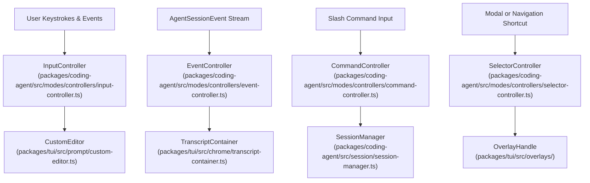
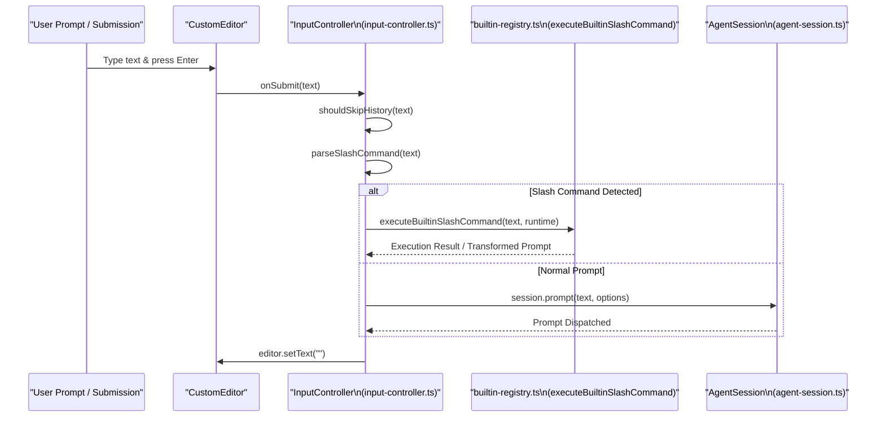

<!-- source: DeepWiki mcp.deepwiki.com · repo can1357/oh-my-pi · page 5.2 Interactive Mode · fetched 2026-10-30 -->

# Interactive Mode

Relevant source files

The following files were used as context for generating this wiki page:

- [packages/coding-agent/src/modes/controllers/command-controller.ts](packages/coding-agent/src/modes/controllers/command-controller.ts)
- [packages/coding-agent/src/modes/controllers/event-controller.ts](packages/coding-agent/src/modes/controllers/event-controller.ts)
- [packages/coding-agent/src/modes/controllers/input-controller.ts](packages/coding-agent/src/modes/controllers/input-controller.ts)
- [packages/coding-agent/src/modes/controllers/selector-controller.ts](packages/coding-agent/src/modes/controllers/selector-controller.ts)
- [packages/coding-agent/src/modes/controllers/session-focus-controller.ts](packages/coding-agent/src/modes/controllers/session-focus-controller.ts)
- [packages/coding-agent/src/modes/controllers/tool-args-reveal.ts](packages/coding-agent/src/modes/controllers/tool-args-reveal.ts)
- [packages/coding-agent/src/modes/interactive-mode.ts](packages/coding-agent/src/modes/interactive-mode.ts)
- [packages/coding-agent/src/modes/skill-command.ts](packages/coding-agent/src/modes/skill-command.ts)
- [packages/coding-agent/src/modes/types.ts](packages/coding-agent/src/modes/types.ts)
- [packages/coding-agent/src/modes/utils/ui-helpers.ts](packages/coding-agent/src/modes/utils/ui-helpers.ts)
- [packages/coding-agent/src/modes/warp-events.ts](packages/coding-agent/src/modes/warp-events.ts)
- [packages/coding-agent/src/session/cache-warmer.ts](packages/coding-agent/src/session/cache-warmer.ts)
- [packages/coding-agent/src/slash-commands/builtin-registry.ts](packages/coding-agent/src/slash-commands/builtin-registry.ts)
- [packages/coding-agent/test/cache-warmer.test.ts](packages/coding-agent/test/cache-warmer.test.ts)
- [packages/coding-agent/test/event-controller-abort-render.test.ts](packages/coding-agent/test/event-controller-abort-render.test.ts)
- [packages/coding-agent/test/event-controller-message-update-coalesce.test.ts](packages/coding-agent/test/event-controller-message-update-coalesce.test.ts)
- [packages/coding-agent/test/input-controller-escape.test.ts](packages/coding-agent/test/input-controller-escape.test.ts)
- [packages/coding-agent/test/input-controller-keybindings.test.ts](packages/coding-agent/test/input-controller-keybindings.test.ts)
- [packages/coding-agent/test/input-controller-skill-queue.test.ts](packages/coding-agent/test/input-controller-skill-queue.test.ts)
- [packages/coding-agent/test/job-poll-displacement.test.ts](packages/coding-agent/test/job-poll-displacement.test.ts)
- [packages/coding-agent/test/modes/controllers/event-controller-abort-guard.test.ts](packages/coding-agent/test/modes/controllers/event-controller-abort-guard.test.ts)
- [packages/coding-agent/test/modes/controllers/event-controller-args-reveal.test.ts](packages/coding-agent/test/modes/controllers/event-controller-args-reveal.test.ts)
- [packages/coding-agent/test/modes/controllers/event-controller-idle-compaction.test.ts](packages/coding-agent/test/modes/controllers/event-controller-idle-compaction.test.ts)
- [packages/coding-agent/test/modes/controllers/event-controller-interrupt.test.ts](packages/coding-agent/test/modes/controllers/event-controller-interrupt.test.ts)
- [packages/coding-agent/test/modes/controllers/event-controller-loader-recovery.test.ts](packages/coding-agent/test/modes/controllers/event-controller-loader-recovery.test.ts)
- [packages/coding-agent/test/modes/controllers/event-controller-message-start.test.ts](packages/coding-agent/test/modes/controllers/event-controller-message-start.test.ts)
- [packages/coding-agent/test/modes/controllers/event-controller-read-grouping.test.ts](packages/coding-agent/test/modes/controllers/event-controller-read-grouping.test.ts)
- [packages/coding-agent/test/modes/controllers/event-controller-superseded-agent-end.test.ts](packages/coding-agent/test/modes/controllers/event-controller-superseded-agent-end.test.ts)
- [packages/coding-agent/test/modes/controllers/event-controller-toolcall-finalize.test.ts](packages/coding-agent/test/modes/controllers/event-controller-toolcall-finalize.test.ts)
- [packages/coding-agent/test/modes/warp-events.test.ts](packages/coding-agent/test/modes/warp-events.test.ts)
- [packages/coding-agent/test/session-focus-controller.test.ts](packages/coding-agent/test/session-focus-controller.test.ts)
- [packages/coding-agent/test/session/rpc-auto-maintenance-scope.test.ts](packages/coding-agent/test/session/rpc-auto-maintenance-scope.test.ts)
- [packages/coding-agent/test/tool-args-reveal.test.ts](packages/coding-agent/test/tool-args-reveal.test.ts)

Interactive Mode is the primary terminal user interface (TUI) mode for the `oh-my-pi` coding agent, implemented mainly in `packages/coding-agent/src/modes/interactive-mode.ts` [packages/coding-agent/src/modes/interactive-mode.ts:1-160](). It provides a robust, real-time development environment integrating a custom multiline editor (`CustomEditor`), streaming message rendering, append-only transcript management (`TranscriptContainer`), live status telemetry, and modal navigation overlays. This mode orchestrates user input, session interaction, and display updates in a cohesive TUI experience.

Sources:
[packages/coding-agent/src/modes/interactive-mode.ts:1-160]()

---

## Orchestration and Controllers

At the core is the `InteractiveMode` class which handles TUI initialization, terminal sizing, session control, and event dispatching. It connects keyboard input, agent session events (`AgentSessionEvent`), command invocations, and selector overlays.

### Main Controllers

- **InteractiveMode**
  The central orchestrator managing the TUI layout, session lifecycle, and update loops [packages/coding-agent/src/modes/interactive-mode.ts:1-160]().

- **InputController**
  Handles user keystroke capture, multi-line prompt editing, history navigation, slash command parsing, and dispatching prompt submissions to `AgentSession` [packages/coding-agent/src/modes/controllers/input-controller.ts:1-136]().

- **EventController**
  Subscribes to `AgentSessionEvent` streams, rendering assistant messages, tool executions, and usage telemetry dynamically in the transcript [packages/coding-agent/src/modes/controllers/event-controller.ts:1-155]().

- **CommandController**
  Executes builtin slash commands for environment control (e.g., export, workspace migration) and manages command outputs and errors [packages/coding-agent/src/modes/controllers/command-controller.ts:1-155]().

- **SelectorController**
  Manages fullscreen modal overlays for model selection, settings, history search, and other navigation interfaces [packages/coding-agent/src/modes/controllers/selector-controller.ts:1-125]().

### Diagram: Natural Language Space to Code Entity Space — Orchestration Components

This diagram maps conceptual user actions and events (Natural Language Space) directly to their implementing classes and modules in the codebase (Code Entity Space).

Sources:
[packages/coding-agent/src/modes/interactive-mode.ts:1-160](),
[packages/coding-agent/src/modes/controllers/input-controller.ts:1-136](),
[packages/coding-agent/src/modes/controllers/event-controller.ts:1-155](),
[packages/coding-agent/src/modes/controllers/command-controller.ts:1-155](),
[packages/coding-agent/src/modes/controllers/selector-controller.ts:1-125]()

---

## Input Handling and Editor Subsystem

The `InputController` manages the multiline text editor where users compose prompts or commands. It intercepts submissions, interprets execution prefixes, checks for sensitive or shell-command patterns, and routes input appropriately.

### Key Features

- **Slash Command Detection and Execution**
  On submission, input is parsed using `parseSlashCommand()`. Recognized slash commands invoke `executeBuiltinSlashCommand()` which dispatches registered commands, returning transformed prompts or consuming input outright [packages/coding-agent/src/slash-commands/builtin-registry.ts:141-161]().

- **Security: History Skipping for Sensitive Commands**
  Commands like `/login`, `/join`, and `/mcp add --token` that carry credentials are flagged by `shouldSkipHistory()` to prevent those inputs from entering persistent shell history or logs [packages/coding-agent/src/modes/controllers/input-controller.ts:103-120]().

- **Shell Prompt Snippet Detection**
  The controller inspects input lines against regexes such as `SHELL_PROMPT_COMMAND_RE` and `SHELL_PROMPT_OPERATOR_RE` to heuristically detect pasted shell prompts or command snippets [packages/coding-agent/src/modes/controllers/input-controller.ts:1-136]().

### Diagram: Natural Language Space to Code Entity Space — Input Flow

This diagram bridges user prompt submission concepts to the exact functions and classes handling input processing, command routing, and session dispatch.

Sources:
[packages/coding-agent/src/modes/controllers/input-controller.ts:103-120](),
[packages/coding-agent/src/modes/controllers/input-controller.ts:1-136](),
[packages/coding-agent/src/slash-commands/builtin-registry.ts:141-161]()

---

## Transcript Rendering and Management

The transcript is visualized and updated via components managed by `TranscriptContainer`. It presents a continuous, append-only log of user inputs, assistant messages, tool executions, and system events.

### Transcript Container and Blocks

- The `TranscriptContainer` manages child components representing blocks such as user messages, assistant messages, tool executions, and custom content [packages/coding-agent/src/modes/types.ts:49]().
- Event dispatching and incremental chunk updates are handled by `EventController`, converting `AgentSessionEvent` stream items into rendered TUI components [packages/coding-agent/src/modes/controllers/event-controller.ts:1-148]().

Sources:
[packages/coding-agent/src/modes/types.ts:49](),
[packages/coding-agent/src/modes/controllers/event-controller.ts:1-148]()

---

## Status Line and Navigation

The bottom status line shows real-time metrics and mode state summaries across the active terminal composer bottom margin.

### Status Line and Overlays

- The status line component presents current session token usage, model configurations, network status, and loop condition indicators [packages/coding-agent/src/modes/types.ts:49]().
- The `SelectorController` manages modal overlays like the Model Hub, Settings, History Search, and extension dashboards with managed focus and keyboard-driven selection [packages/coding-agent/src/modes/controllers/selector-controller.ts:1-127]().

Sources:
[packages/coding-agent/src/modes/types.ts:49](),
[packages/coding-agent/src/modes/controllers/selector-controller.ts:1-127]()

---

# Summary

Interactive Mode in `oh-my-pi` tightly integrates user input handling, session event streaming, transcript rendering, and modal navigation. Its modular controller architecture ensures clear separation between event consumption (`EventController`), input management (`InputController`), command execution (`CommandController`), and overlay navigation (`SelectorController`), orchestrated centrally by `InteractiveMode`.

# End of page.

---

