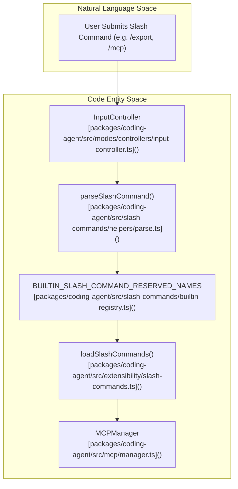
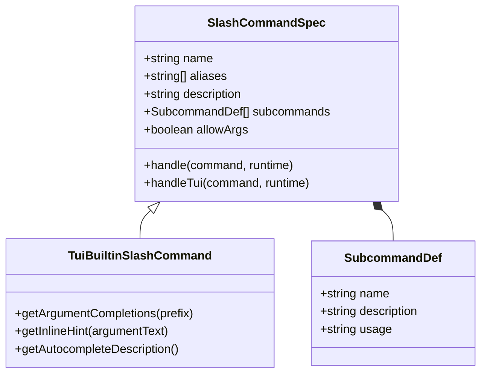
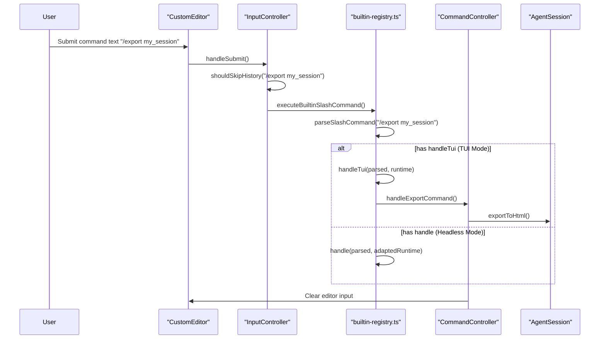
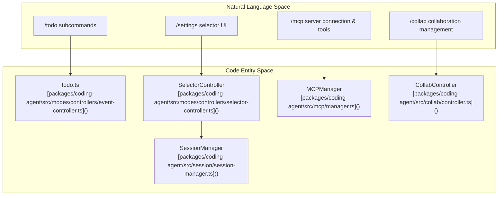

<!-- source: DeepWiki mcp.deepwiki.com · repo can1357/oh-my-pi · page 5.3 Slash Commands · fetched 2026-10-30 -->

# Slash Commands

Relevant source files

The following files were used as context for generating this wiki page:

- [packages/coding-agent/src/mcp/oauth-reauth.ts](packages/coding-agent/src/mcp/oauth-reauth.ts)
- [packages/coding-agent/src/modes/startup-composer.ts](packages/coding-agent/src/modes/startup-composer.ts)
- [packages/coding-agent/src/session/model-controls.ts](packages/coding-agent/src/session/model-controls.ts)
- [packages/coding-agent/src/slash-commands/builtin-completions.ts](packages/coding-agent/src/slash-commands/builtin-completions.ts)
- [packages/coding-agent/src/slash-commands/builtin-lifecycle.ts](packages/coding-agent/src/slash-commands/builtin-lifecycle.ts)
- [packages/coding-agent/src/slash-commands/builtin-modes.ts](packages/coding-agent/src/slash-commands/builtin-modes.ts)
- [packages/coding-agent/src/slash-commands/builtin-session.ts](packages/coding-agent/src/slash-commands/builtin-session.ts)
- [packages/coding-agent/src/slash-commands/helpers/effort.ts](packages/coding-agent/src/slash-commands/helpers/effort.ts)
- [packages/coding-agent/src/slash-commands/helpers/mcp.ts](packages/coding-agent/src/slash-commands/helpers/mcp.ts)
- [packages/coding-agent/src/slash-commands/helpers/parse.ts](packages/coding-agent/src/slash-commands/helpers/parse.ts)
- [packages/coding-agent/src/slash-commands/types.ts](packages/coding-agent/src/slash-commands/types.ts)
- [packages/coding-agent/test/acp-builtins.test.ts](packages/coding-agent/test/acp-builtins.test.ts)
- [packages/coding-agent/test/agent-session-before-agent-start-attribution.test.ts](packages/coding-agent/test/agent-session-before-agent-start-attribution.test.ts)
- [packages/coding-agent/test/agent-session-manual-retry.test.ts](packages/coding-agent/test/agent-session-manual-retry.test.ts)
- [packages/coding-agent/test/agent-session-role-thinking.test.ts](packages/coding-agent/test/agent-session-role-thinking.test.ts)
- [packages/coding-agent/test/agent-session-title-generation-dispose.test.ts](packages/coding-agent/test/agent-session-title-generation-dispose.test.ts)
- [packages/coding-agent/test/interactive-mode-working-accent.test.ts](packages/coding-agent/test/interactive-mode-working-accent.test.ts)
- [packages/coding-agent/test/issue-9597-cold-launch-double-clear.test.ts](packages/coding-agent/test/issue-9597-cold-launch-double-clear.test.ts)
- [packages/coding-agent/test/mcp-command-reauth-acp.test.ts](packages/coding-agent/test/mcp-command-reauth-acp.test.ts)
- [packages/coding-agent/test/mcp/oauth-reauth-client-auth.test.ts](packages/coding-agent/test/mcp/oauth-reauth-client-auth.test.ts)
- [packages/coding-agent/test/modes/controllers/handoff-command.test.ts](packages/coding-agent/test/modes/controllers/handoff-command.test.ts)
- [packages/coding-agent/test/modes/print-builtin-failure.test.ts](packages/coding-agent/test/modes/print-builtin-failure.test.ts)
- [packages/coding-agent/test/move-directory-autocomplete.test.ts](packages/coding-agent/test/move-directory-autocomplete.test.ts)
- [packages/coding-agent/test/slash-commands/effort.test.ts](packages/coding-agent/test/slash-commands/effort.test.ts)
- [packages/coding-agent/test/slash-commands/handoff.test.ts](packages/coding-agent/test/slash-commands/handoff.test.ts)
- [packages/coding-agent/test/slash-commands/rename.test.ts](packages/coding-agent/test/slash-commands/rename.test.ts)
- [packages/coding-agent/test/slash-commands/retry.test.ts](packages/coding-agent/test/slash-commands/retry.test.ts)
- [packages/coding-agent/test/slash-commands/shake.test.ts](packages/coding-agent/test/slash-commands/shake.test.ts)
- [packages/coding-agent/test/startup-composer.test.ts](packages/coding-agent/test/startup-composer.test.ts)
- [packages/tui/src/prompt/composer-cache.ts](packages/tui/src/prompt/composer-cache.ts)
- [packages/tui/test/composer-cache.test.ts](packages/tui/test/composer-cache.test.ts)
- [packages/tui/test/selector-picker-native.test.ts](packages/tui/test/selector-picker-native.test.ts)

## Purpose and Scope
This page documents the built-in slash commands, the builtin command registry, execution mechanics, command safety rules, and custom command extension points in `oh-my-pi`. Slash commands provide a textual interface for controlling agent sessions, runtime options, settings, and workflows without sending messages to the LLM.

---

## 1. Command Types and Discovery

The system supports multiple categories of slash commands from built-in specifications, extensions, and Model Context Protocol (MCP) servers. The input controller parses user entries with `parseSlashCommand()`, checks the registry, and dispatches them.

**Diagram: Natural Language Space to Code Entity Space for Command Discovery**

Sources:
[packages/coding-agent/src/modes/interactive-mode.ts:90-91](),
[packages/coding-agent/src/extensibility/slash-commands.ts:1-100]()

---

## 2. Built-in Command Registry

Built-in commands are registered via `BUILTIN_SLASH_COMMAND_REGISTRY`, aggregating command specs from groups such as lifecycle, modes, control, and session commands.

Each entry conforms to `SlashCommandSpec` [packages/coding-agent/src/slash-commands/types.ts:28-32](), defining names, aliases, descriptions, subcommands, and execution handlers (`handle` for headless/ACP, `handleTui` for interactive mode).

**Class Diagram: Slash Command Registry Structure**

Sources:
[packages/coding-agent/src/slash-commands/types.ts:28-32](),
[packages/coding-agent/src/slash-commands/builtin-lifecycle.ts:135-157]()

---

## 3. Command Execution Pipeline and History Safety

### Execution Pipeline
User input in the editor is analyzed by `InputController`. If it begins with `/`, `executeBuiltinSlashCommand()` parses and executes the command:
1. `parseSlashCommand()` separates the command name and arguments.
2. The registry resolves the command spec.
3. Handlers execute based on the runtime context (TUI `handleTui` or headless `handle`).
4. Editor input buffers are cleared upon completion.

### History Safety
Commands containing tokens or sensitive parameters (`/login`, `/join`, `/mcp add --token`) are filtered using history-skipping checks to prevent secret leakage in logs or prompt history files.

**Execution Flow Diagram**

Sources:
[packages/coding-agent/src/slash-commands/builtin-lifecycle.ts:43](),
[packages/coding-agent/src/slash-commands/acp-builtins.ts:18]()

---

## 4. Built-in Commands Reference

### Session & Mode Control
| Command | Syntax | Description |
|---|---|---|
| `/settings` | `/settings` | Open settings menu selector for themes, thinking levels, and options. |
| `/plan` | `/plan` | Toggle plan mode for generating and approving execution plans. [packages/coding-agent/src/plan-mode/settings.ts:1-62]() |
| `/session` | `/session` | Open session selector dialog to switch or manage historical sessions. |
| `/model` | `/model [id]` | Open model picker or switch active model. [packages/coding-agent/src/session/model-controls.ts:1-100]() |
| `/new` | `/new` | Start a new session. [packages/coding-agent/src/slash-commands/builtin-lifecycle.ts:159-166]() |
| `/fresh` | `/fresh` | Reset provider stream state without altering local transcript. [packages/coding-agent/src/slash-commands/builtin-lifecycle.ts:167-176]() |
| `/fast` | `/fast [on\|ultra\|off\|status]` | Control fast mode for active model. [packages/coding-agent/src/slash-commands/builtin-modes.ts:117-151]() |
| `/slow` | `/slow [on\|off\|status]` | Control slow mode for active model. [packages/coding-agent/src/slash-commands/builtin-modes.ts:153-165]() |
| `/thinking` | `/thinking [level]` | Set reasoning thinking level. [packages/coding-agent/src/slash-commands/helpers/effort.ts:1-27]() |
| `/rename` | `/rename [title]` | Rename current session. [packages/coding-agent/test/slash-commands/rename.test.ts:106-126]() |
| `/move` | `/move <path>` | Move current session to a new working directory. [packages/coding-agent/src/slash-commands/builtin-lifecycle.ts:92-132]() |
| `/ssh` | `/ssh <subcommand>` | Manage SSH hosts. [packages/coding-agent/src/slash-commands/builtin-lifecycle.ts:135-157]() |

### Export & Sharing
| Command | Syntax | Description |
|---|---|---|
| `/export` | `/export [path]` | Export transcript to standalone HTML file. |
| `/dump` | `/dump` | Copy session transcript as plain text to clipboard. |
| `/share` | `/share` | Upload session to a shared relay or remote endpoint. |
| `/collab` | `/collab [sub]` | Start or manage live multi-user collaboration sessions. |

### Tools & Integration
| Command | Syntax | Description |
|---|---|---|
| `/memory` | `/memory <subcmd>` | Interact with autonomous memory (`mnemopi`). [packages/coding-agent/src/memory-backend/settings.ts:1-40]() |
| `/mcp` | `/mcp <subcmd>` | Manage Model Context Protocol servers and tools. |
| `/todo` | `/todo <subcmd>` | Manage session task lists and phase progression. |
| `/plugins` | `/plugins <subcmd>` | Manage installed plugins. [packages/coding-agent/src/slash-commands/builtin-marketplace.ts:1-100]() |
| `/jobs` | `/jobs <subcmd>` | Manage asynchronous background jobs. [packages/coding-agent/test/modes/controllers/jobs-command.test.ts:1-100]() |
| `/security` | `/security <subcmd>` | Manage security controls. [packages/coding-agent/src/slash-commands/helpers/security.ts:1-100]() |

Sources:
[packages/coding-agent/src/slash-commands/builtin-lifecycle.ts:13-176](),
[packages/coding-agent/src/slash-commands/builtin-modes.ts:117-165](),
[packages/coding-agent/src/slash-commands/builtin-marketplace.ts:1-100]()

---

## 5. Specialized Command Handlers and Subsystems

**Diagram: Natural Language Space to Code Entity Space for Specialized Subsystems**

Sources:
[packages/coding-agent/src/mcp/manager.ts:1-50]()

---

## 6. Custom Commands and Extensions

Extensions register custom commands through the `loadSlashCommands()` pipeline [packages/coding-agent/src/extensibility/slash-commands.ts:1-100](). Handlers receive runtime context containing session handles, project directories, and output streams.

Sources:
[packages/coding-agent/src/extensibility/slash-commands.ts:1-100]()

---

