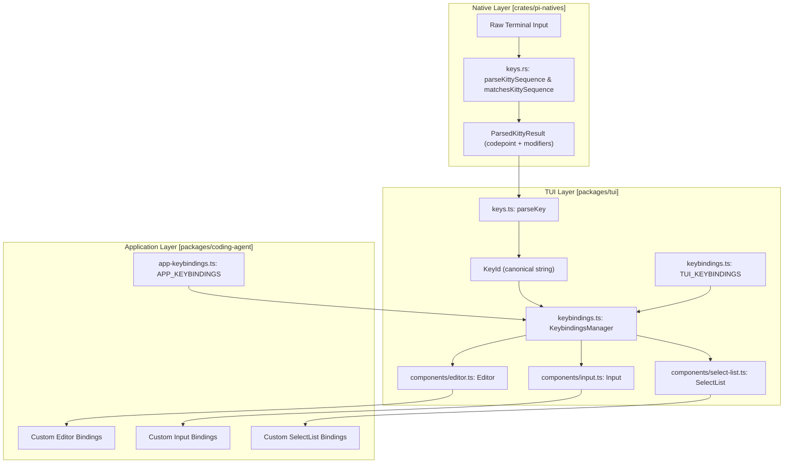
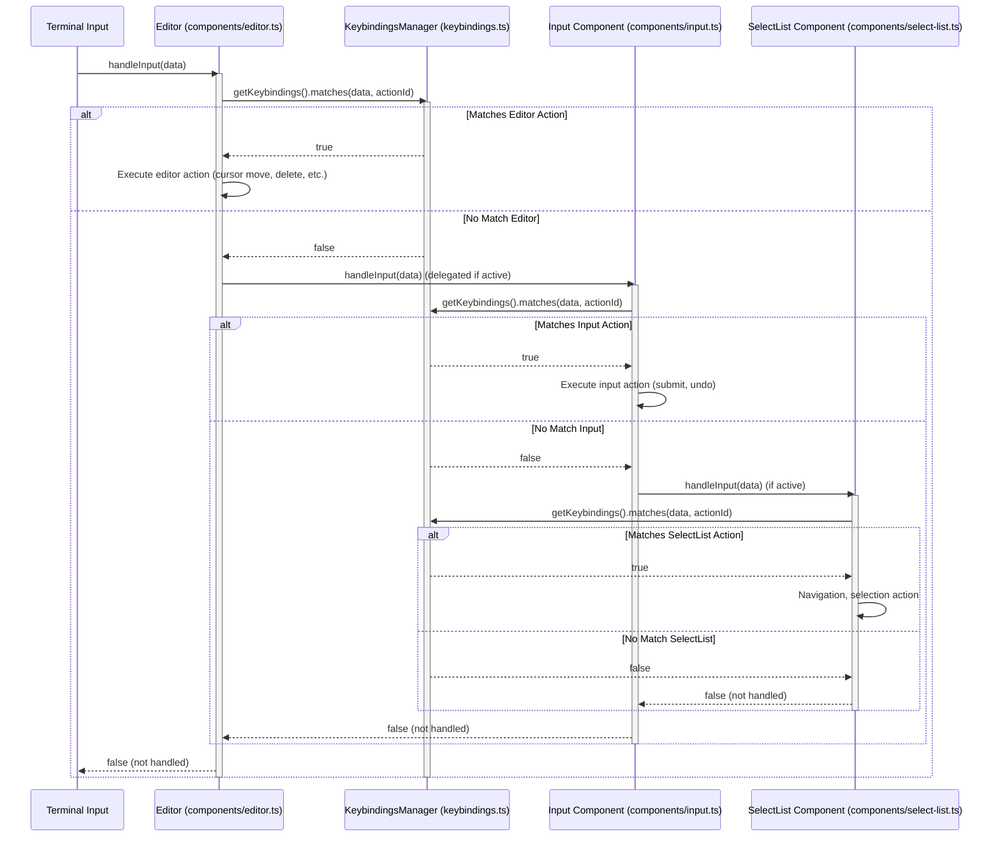

<!-- source: DeepWiki mcp.deepwiki.com · repo can1357/oh-my-pi · page 5.4 Keyboard Shortcuts · fetched 2026-10-30 -->

# Keyboard Shortcuts

<details>
<summary>Relevant source files</summary>

The following files were used as context for generating this wiki page:

- [docs/keybindings.md](docs/keybindings.md)
- [docs/tree.md](docs/tree.md)
- [packages/coding-agent/src/config/compaction-threshold.ts](packages/coding-agent/src/config/compaction-threshold.ts)
- [packages/coding-agent/src/config/registry.ts](packages/coding-agent/src/config/registry.ts)
- [packages/coding-agent/src/modes/agents-hub-deps.ts](packages/coding-agent/src/modes/agents-hub-deps.ts)
- [packages/coding-agent/src/session/model-compaction-threshold.ts](packages/coding-agent/src/session/model-compaction-threshold.ts)
- [packages/coding-agent/test/config/compaction-threshold.test.ts](packages/coding-agent/test/config/compaction-threshold.test.ts)
- [packages/coding-agent/test/config/settings-entry-writes.test.ts](packages/coding-agent/test/config/settings-entry-writes.test.ts)
- [packages/coding-agent/test/keybindings-selector-navigation.test.ts](packages/coding-agent/test/keybindings-selector-navigation.test.ts)
- [packages/coding-agent/test/model-hub.test.ts](packages/coding-agent/test/model-hub.test.ts)
- [packages/coding-agent/test/modes/controllers/selector-controller-model-writes.test.ts](packages/coding-agent/test/modes/controllers/selector-controller-model-writes.test.ts)
- [packages/tui/src/app-keybindings.ts](packages/tui/src/app-keybindings.ts)
- [packages/tui/src/bracketed-paste.ts](packages/tui/src/bracketed-paste.ts)
- [packages/tui/src/hotkeys-markdown.ts](packages/tui/src/hotkeys-markdown.ts)
- [packages/tui/src/keybinding-matchers.ts](packages/tui/src/keybinding-matchers.ts)
- [packages/tui/src/keybindings.ts](packages/tui/src/keybindings.ts)
- [packages/tui/src/loop-watchdog.ts](packages/tui/src/loop-watchdog.ts)
- [packages/tui/src/overlays/agents-hub.ts](packages/tui/src/overlays/agents-hub.ts)
- [packages/tui/src/overlays/history-search.ts](packages/tui/src/overlays/history-search.ts)
- [packages/tui/src/overlays/hub-frame.ts](packages/tui/src/overlays/hub-frame.ts)
- [packages/tui/src/overlays/model-hub.ts](packages/tui/src/overlays/model-hub.ts)
- [packages/tui/src/overlays/settings-defs.ts](packages/tui/src/overlays/settings-defs.ts)
- [packages/tui/src/overlays/settings-selector.ts](packages/tui/src/overlays/settings-selector.ts)
- [packages/tui/src/overlays/tree-selector.ts](packages/tui/src/overlays/tree-selector.ts)
- [packages/tui/src/stdin-buffer.ts](packages/tui/src/stdin-buffer.ts)
- [packages/tui/src/terminal.ts](packages/tui/src/terminal.ts)
- [packages/tui/src/vim.ts](packages/tui/src/vim.ts)
- [packages/tui/src/windows-input-mode.ts](packages/tui/src/windows-input-mode.ts)
- [packages/tui/test/agents-hub.test.ts](packages/tui/test/agents-hub.test.ts)
- [packages/tui/test/bracketed-paste.test.ts](packages/tui/test/bracketed-paste.test.ts)
- [packages/tui/test/editor-vim.test.ts](packages/tui/test/editor-vim.test.ts)
- [packages/tui/test/issue-2034-repro.test.ts](packages/tui/test/issue-2034-repro.test.ts)
- [packages/tui/test/keybindings-migration.test.ts](packages/tui/test/keybindings-migration.test.ts)
- [packages/tui/test/keybindings.test.ts](packages/tui/test/keybindings.test.ts)
- [packages/tui/test/loop-watchdog-wiring.test.ts](packages/tui/test/loop-watchdog-wiring.test.ts)
- [packages/tui/test/loop-watchdog.test.ts](packages/tui/test/loop-watchdog.test.ts)
- [packages/tui/test/select-filter-breadcrumb.test.ts](packages/tui/test/select-filter-breadcrumb.test.ts)
- [packages/tui/test/settings-prefs-native.test.ts](packages/tui/test/settings-prefs-native.test.ts)
- [packages/tui/test/stdin-buffer.test.ts](packages/tui/test/stdin-buffer.test.ts)
- [packages/tui/test/terminal-appearance.test.ts](packages/tui/test/terminal-appearance.test.ts)
- [packages/tui/test/windows-input-mode.test.ts](packages/tui/test/windows-input-mode.test.ts)
- [packages/utils/src/loop-phase.ts](packages/utils/src/loop-phase.ts)
- [packages/utils/test/loop-phase.test.ts](packages/utils/test/loop-phase.test.ts)

</details>


This page details the keyboard shortcuts and the underlying keybinding subsystem within the interactive terminal UI of `oh-my-pi`. The input pipeline provides high-fidelity event routing across legacy terminal sequences and the modern Kitty keyboard protocol `[packages/tui/src/keys.ts:1-19]()`, managing application commands, cursor navigation, and custom editor bindings `[packages/tui/src/components/editor.ts:14-15]()`.

Sources: `[packages/tui/src/keys.ts:1-19]`, `[packages/tui/src/components/editor.ts:14-15]`

---

## Keybinding System Architecture

The keybinding subsystem translates raw terminal input bytes into application-level actions. It is implemented as a layered system involving native Rust bindings, TypeScript UI components, and the coding agent's core logic.



### Explanation
- **Native Layer:** In `crates/pi-natives`, `keys.rs` parses both the legacy terminal byte sequences and Kitty keyboard protocol sequences, producing a structured `ParsedKittyResult` that describes the base key codepoint and active modifier keys (`Ctrl`, `Shift`, `Alt`, and `Super`) `[crates/pi-natives/src/keys.rs:1-156]()`.
- **TUI Layer:** The TypeScript package `@oh-my-pi/pi-tui` processes these parsed results with `parseKey` in `keys.ts` to get a canonical `KeyId` string. The `KeybindingsManager` orchestrates mapping these keys to registered action IDs and handlers `[packages/tui/src/keys.ts:14-205]()`, `[packages/tui/src/keybindings.ts:14-15]()`.
- **Application Layer:** Application default bindings (`APP_KEYBINDINGS` in `app-keybindings.ts`) provide higher-level semantics, overridable by user config and active profiles `[packages/tui/src/app-keybindings.ts:1-10]()`. The editor, input, and select list components each have their own sets of keybinding handlers.

Sources: `[crates/pi-natives/src/keys.rs:1-156]`, `[packages/tui/src/keys.ts:14-205]`, `[packages/tui/src/keybindings.ts:10-20]`, `[packages/tui/src/app-keybindings.ts:1-10]`, `[packages/tui/src/components/editor.ts:10-20]`

---

## Key Input Processing Flow

Input handling follows a layered dispatch where terminal input bytes flow through the editor component and its subcomponents, matching against keybindings and executing associated actions.



### Details
- The editor component's `handleInput` method is the entry point for all key data `[packages/tui/src/components/editor.ts:1400-1410]()`.
- It handles bracketed paste mode first (special paste sequences), then tries to match configured keybindings.
- If the editor does not consume the key, it delegates to the `Input` component (single-line text entry) or a `SelectList` (for menus/selectors), which also check keybindings.
- The matches use `matchesKey(data, keyId)` to test if the input sequence corresponds to a known action binding, supporting both legacy and modern sequences `[packages/tui/src/keys.ts:10-75]()`.

Sources: `[packages/tui/src/components/editor.ts:1400-1410]`, `[packages/tui/src/components/input.ts:140-160]`, `[packages/tui/src/components/select-list.ts:500-525]`, `[packages/tui/src/keys.ts:10-75]`

---

## Navigation and Custom Editor Component Bindings

The multi-line editor component (`Editor` in `components/editor.ts`) implements a rich set of navigation and editing shortcuts enabling Emacs-style text manipulation, word navigation, and history.

| Key Combination             | Action                                | Action ID / Source Location                                               |
|-----------------------------|-------------------------------------|--------------------------------------------------------------------------|
| Arrow Up / Arrow Down        | Move cursor vertically or browse history | `tui.editor.cursorUp` / `tui.editor.cursorDown` `[packages/tui/src/components/editor.ts:1090-1095]()` |
| Alt + Left / Alt + Right     | Move by word left/right              | `tui.editor.cursorWordLeft` / `tui.editor.cursorWordRight` `[packages/tui/src/components/editor.ts:1102-1107]()` |
| Ctrl + A / Home              | Move cursor to start of line        | `tui.editor.cursorLineStart` `[packages/tui/src/components/editor.ts:1096-1099]()` |
| Ctrl + E / End               | Move cursor to end of line          | `tui.editor.cursorLineEnd` `[packages/tui/src/components/editor.ts:1100-1103]()` |
| Ctrl + W                    | Delete word backward                | `tui.editor.deleteWordBackward` `[packages/tui/src/components/editor.ts:1050-1055]()` |
| Ctrl + K                    | Kill to end of line                 | `tui.editor.deleteToLineEnd` `[packages/tui/src/components/editor.ts:1060-1063]()` |
| Ctrl + U                    | Kill to start of line (emacs-style) | `[packages/tui/src/components/editor.ts:1064-1070]()` unspecified but implied |
| Ctrl + / (Undo)             | Undo last change                   | `tui.editor.undo` `[packages/tui/src/components/editor.ts:1070-1082]()` |
| Ctrl + Y (Yank / Paste)     | Yank last killed text               | `tui.editor.yank` `[packages/tui/src/components/editor.ts:1083-1089]()` |

- The editor integrates a kill ring for capturing and yanking text, inspired by Emacs behavior `[packages/tui/src/components/editor.ts:16]()` and `[packages/tui/src/components/editor.ts:100-120]()` conceptual.
- Bidirectional cursor movement respects visual graphemes, Unicode combining chars, and soft word breaks.
- History browsing and prompt recall are enabled via Up/Down keys with bound key handlers `[packages/tui/test/editor.test.ts:170-185]()`.
- Editors support multiline input with undo/redo stacks and smart paste handling.

Sources: `[packages/tui/src/components/editor.ts:1040-1107]`, `[packages/tui/test/editor.test.ts:25-70]`, `[packages/tui/test/editor.test.ts:170-185]`

---

## Deletion and Clipboard Integration

Beyond navigation, important keybindings for text editing and clipboard operations include:

| Key Combination          | Action                                      | Action ID / Location                                              |
|--------------------------|---------------------------------------------|------------------------------------------------------------------|
| Ctrl + W                 | Delete word backward                        | `tui.editor.deleteWordBackward` `[packages/tui/src/components/editor.ts:1050-1055]()` |
| Ctrl + U                 | Delete to start of line                     | Embedded in editor undo/kill logic                                |
| Ctrl + K                 | Kill to end of line                         | `tui.editor.deleteToLineEnd` `[packages/tui/src/components/editor.ts:1060-1063]()`       |
| Alt + Shift + L          | Copy current line to clipboard              | `app.clipboard.copyLine` `[packages/tui/src/app-keybindings.ts:50-55]()` |
| Alt + Shift + C          | Copy full prompt                            | `app.clipboard.copyPrompt` `[packages/tui/src/app-keybindings.ts:56-61]()` |
| Ctrl + V                 | Paste image or text from clipboard         | `app.clipboard.pasteImage` `[packages/tui/src/app-keybindings.ts:44-49]()` |

- **Smart Paste Handling:** The editor's bracketed paste mode handler manages detection of pasted multi-line text and re-encodes control chars before insertion `[packages/tui/src/components/editor.ts:1005-1015]()`.
- **Push-to-Talk Feature:** The Input component supports SpaceHoldGesture, enabling usage of space bar for push-to-talk while allowing deletion via keyboard shortcuts `[packages/tui/src/components/input.ts:77-80]()`.
  
Sources: `[packages/tui/src/components/editor.ts:1000-1020]`, `[packages/tui/src/app-keybindings.ts:40-70]`, `[packages/tui/src/components/input.ts:77-80]`

---

## Application-Specific Shortcuts

Application-level bindings defined in `APP_KEYBINDINGS` provide commands for AI model management, session control, and agent interaction:

### AI and Model Control

| Action ID               | Default Key(s)      | Description                                                       |
|-------------------------|---------------------|------------------------------------------------------------------|
| `app.thinking.cycle`    | Shift + Tab          | Cycle assistant’s reasoning effort level                         |
| `app.thinking.toggle`   | Ctrl + T             | Toggle thinking block visibility                                 |
| `app.model.cycleForward`| Ctrl + P             | Cycle AI models forward                                          |
| `app.model.cycleBackward`| Shift + Ctrl + P    | Cycle AI models backward                                         |
| `app.model.selectTemporary`| Alt + P            | Select a model temporarily                                       |
| `app.model.select`      | Alt + M              | Open AI model selector popup                                    |
| `app.plan.toggle`       | Alt + Shift + P      | Toggle Plan Mode overlay                                         |

### Session and UI Management

| Action ID               | Default Key(s)          | Description                                                       |
|-------------------------|-------------------------|------------------------------------------------------------------|
| `app.interrupt`         | Escape                  | Interrupt active agent turn                                      |
| `app.editor.external`   | Ctrl + G                | Edit draft externally in `$VISUAL`/`$EDITOR`                    |
| `app.history.search`    | Ctrl + R                | Open history search                                              |
| `app.message.followUp`  | Ctrl + Q or Ctrl + Enter| Queue a follow-up message                                        |
| `app.message.dequeue`   | Alt + Up or Shift + Up  | Dequeue a queued message into the input editor                  |
| `app.retry`             | F5 or Alt + R           | Retry last failed turn                                           |
| `app.display.reset`     | Alt + L                 | Reset terminal display                                           |
| `app.clipboard.copyLine`| Alt + Shift + L         | Copy current line                                               |
| `app.clipboard.copyPrompt`| Alt + Shift + C       | Copy the entire prompt                                          |
| `app.clipboard.pasteImage`| Ctrl + V              | Paste image/text from clipboard                                 |

These keybindings support seamless control of interactive AI sessions within the terminal UI.

Sources: `[packages/tui/src/app-keybindings.ts:1-97]`

---

## Configuration Format, Customization, and Migration

### Keybinding Override Files

User-customizable keybindings live in the file:

```
~/.omp/agent/keybindings.yml
```

or equivalently `.json` format.

This file maps action IDs (e.g., `app.model.cycleForward`) to key chord strings or arrays thereof. Example:

```yaml
app.model.cycleForward: Ctrl+P
app.model.selectTemporary: Alt+P
app.plan.toggle: Alt+Shift+P
app.history.search: []
```

- **Disable Binding:** Setting an action's value to an empty array disables it (`app.history.search: []` disables search).
- **Case-insensitive and standard chord naming:** Chords use notation like `Ctrl+P`, `Alt+Shift+P`, `Shift+Enter`.

### Migration Support

Legacy or alternate action IDs are rewritten transparently on load via `KEYBINDINGS_MIGRATIONS`, a mapping defined in `[packages/tui/src/keybindings-migration.ts:1-10]()`. This ensures backward compatibility with earlier config formats.

Sources: `[docs/keybindings.md:13-25]`, `[packages/tui/src/keybindings-migration.ts:1-10]`

---

## Custom Editor Component Keybindings

The core multi-line `Editor` component [`packages/tui/src/components/editor.ts`] implements a full key handling system that respects user customizations and presets:

- Uses `matchesKey(data, keyId)` and `parseKey(data)` from `keys.ts` to recognize key chords, supporting the modern Kitty keyboard protocol encoding and older escape codes `[packages/tui/src/keys.ts:14-205]()`.
- Resolves configured keybindings via `KeybindingsManager` loaded with default and user overrides `[packages/tui/src/keybindings.ts:14-15]()`.
- Provides advanced text editing commands — cursor movement, deletion, undo/redo, kill and yank, history browsing.
- Includes handling of bracketed paste mode and re-encoded paste control sequences to ensure consistent multi-line paste behavior `[packages/tui/src/components/editor.ts:1005-1015]()`.
- Tests in `editor.test.ts` verify keybinding remapping and core editing command behavior, ensuring reliability `[packages/tui/test/editor.test.ts:26-63]()`, `[packages/tui/test/editor.test.ts:96-185]()`.
- Supports capturing Input component and SelectList component input too, with their own keybinding contexts.

Sources: `[packages/tui/src/components/editor.ts:10-50]`, `[packages/tui/src/components/editor.ts:1000-1100]`, `[packages/tui/src/keys.ts:10-75]`, `[packages/tui/test/editor.test.ts:25-63]`

---

## Summary

- Keyboard shortcuts in `oh-my-pi` integrate deeply with a layered input processing system, starting with native terminal protocol parsing through Rust bindings, TypeScript key parsing, and app-level binding management.
- The default keybindings come from the TUI package and are augmented by application-specific keybindings in `app-keybindings.ts`.
- Users can override or disable bindings easily through `~/.omp/agent/keybindings.yml` or JSON.
- The primary input context is the `Editor` component, which supports rich, Emacs-inspired bindings, clipboard integration, history navigation, and bracketed paste processing.
- Other components such as single-line input and select lists also use the keybinding subsystem for consistent user interaction.

---

## Appendix: Key Classes and Functions

| Name                     | Location                                        | Description                                         |
|--------------------------|------------------------------------------------|---------------------------------------------------|
| `KeybindingsManager`     | `packages/tui/src/keybindings.ts`               | Tracks keybinding mappings and match queries       |
| `matchesKey(data, keyId)`| `packages/tui/src/keys.ts`                      | Check if input sequence matches an action's key   |
| `parseKey(data)`          | `packages/tui/src/keys.ts`                      | Parse raw data into a canonical key string         |
| `Editor.handleInput(data)`| `packages/tui/src/components/editor.ts`         | Core processing method for editor input            |
| `Input.handleInput(data)` | `packages/tui/src/components/input.ts`          | Single-line input component keyboard dispatch      |
| `SelectList.handleInput(data)` | `packages/tui/src/components/select-list.ts` | SelectList navigation and action input handling    |
| `APP_KEYBINDINGS`         | `packages/tui/src/app-keybindings.ts`          | Application-specific default keybindings           |
| `KEYBINDINGS_MIGRATIONS` | `packages/tui/src/keybindings-migration.ts`   | Mapping of legacy action IDs to current IDs        |

Sources:  
`[packages/tui/src/keybindings.ts:10-20]`, `[packages/tui/src/keys.ts:10-75]`, `[packages/tui/src/components/editor.ts:1000-1100]`, `[packages/tui/src/components/input.ts:140-160]`, `[packages/tui/src/components/select-list.ts:500-525]`, `[packages/tui/src/app-keybindings.ts:1-97]`, `[packages/tui/src/keybindings-migration.ts:1-10]`

---

# End of Keyboard Shortcuts page.

---

