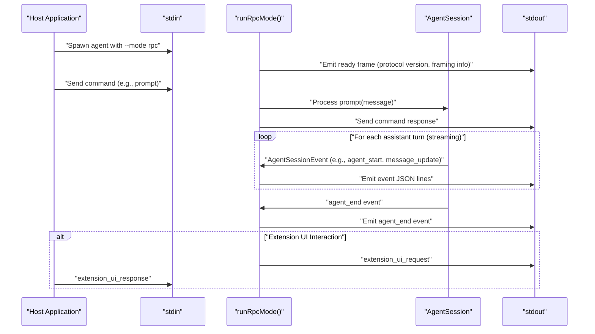
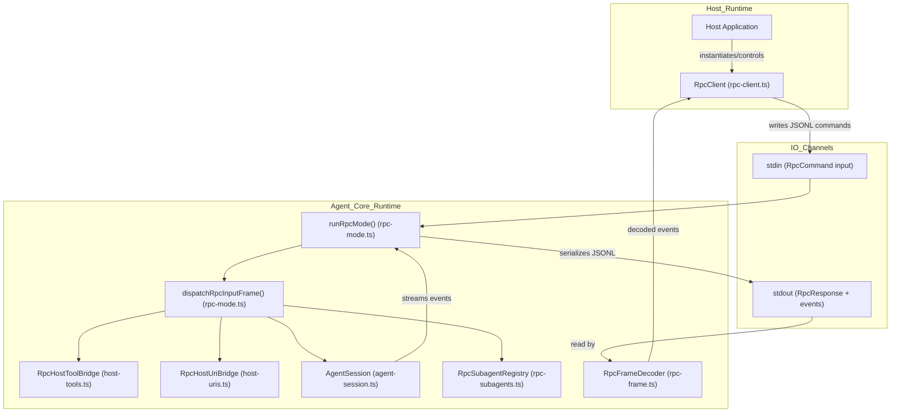

<!-- source: DeepWiki mcp.deepwiki.com · repo can1357/oh-my-pi · page 5.5 RPC Mode · fetched 2026-10-30 -->

# RPC Mode

<details>
<summary>Relevant source files</summary>

The following files were used as context for generating this wiki page:

- [docs/rpc.md](docs/rpc.md)
- [packages/coding-agent/src/eval/kernel-base.ts](packages/coding-agent/src/eval/kernel-base.ts)
- [packages/coding-agent/src/index.ts](packages/coding-agent/src/index.ts)
- [packages/coding-agent/src/modes/rpc/rpc-client.ts](packages/coding-agent/src/modes/rpc/rpc-client.ts)
- [packages/coding-agent/src/modes/rpc/rpc-compat.ts](packages/coding-agent/src/modes/rpc/rpc-compat.ts)
- [packages/coding-agent/src/modes/rpc/rpc-frame.ts](packages/coding-agent/src/modes/rpc/rpc-frame.ts)
- [packages/coding-agent/src/modes/rpc/rpc-messages.ts](packages/coding-agent/src/modes/rpc/rpc-messages.ts)
- [packages/coding-agent/src/modes/rpc/rpc-mode.ts](packages/coding-agent/src/modes/rpc/rpc-mode.ts)
- [packages/coding-agent/src/modes/rpc/rpc-types.ts](packages/coding-agent/src/modes/rpc/rpc-types.ts)
- [packages/coding-agent/test/eval/kernel-process-group.test.ts](packages/coding-agent/test/eval/kernel-process-group.test.ts)
- [packages/coding-agent/test/fixtures/mock-rpc-agent.ts](packages/coding-agent/test/fixtures/mock-rpc-agent.ts)
- [packages/coding-agent/test/rpc-client.restart.test.ts](packages/coding-agent/test/rpc-client.restart.test.ts)
- [packages/coding-agent/test/rpc-client.start.test.ts](packages/coding-agent/test/rpc-client.start.test.ts)
- [packages/coding-agent/test/rpc-compatible-primitives.test.ts](packages/coding-agent/test/rpc-compatible-primitives.test.ts)
- [packages/coding-agent/test/rpc-frame.test.ts](packages/coding-agent/test/rpc-frame.test.ts)
- [packages/coding-agent/test/rpc-input-frame.test.ts](packages/coding-agent/test/rpc-input-frame.test.ts)
- [packages/coding-agent/test/rpc.test.ts](packages/coding-agent/test/rpc.test.ts)

</details>


RPC Mode provides a JSON-based protocol for programmatic control of the coding agent through line-delimited JSON communication over standard input/output (`stdin`/`stdout`) [docs/rpc.md:1-7](). This mode enables embedding the agent in external applications, IDE integrations, or automation workflows without requiring interactive terminal UI.

For interactive terminal usage, see **Interactive Mode**. For single-shot scripting, see **Print Mode**.

---

## Overview

RPC Mode runs the coding agent as a headless service communicating via a JSONL (newline-delimited JSON) protocol on `stdin` and `stdout` [docs/rpc.md:3-7](). Key features include:

- **Headless Operation**: Disabled terminal UI, no rendering, focusing on command/event transport only [packages/coding-agent/src/modes/rpc/rpc-mode.ts:2-6]().
- **Bidirectional JSONL Protocol**: Commands with optional correlation IDs arrive on `stdin`; responses and streaming events emit on `stdout` [docs/rpc.md:3-12]().
- **Extension UI Abstraction**: For extension-interactive dialogs (`ask_dialog`), selection widgets, and messages, the agent sends requests to the host application, which replies asynchronously [packages/coding-agent/src/modes/rpc/rpc-mode.ts:24-34](), [packages/coding-agent/src/modes/rpc/rpc-types.ts:90-94]().
- **Host Tool and URI Integration**: Host applications can provide custom tools and URI handlers that the agent invokes remotely via `RpcHostToolBridge` and `RpcHostUriBridge` [packages/coding-agent/src/modes/rpc/rpc-mode.ts:70-75]().
- **Subagent Support**: Tracks subagents (parallel delegated agents) and streams lifecycle, events, and progress frames based on subscription level for fine-grained monitoring [packages/coding-agent/src/modes/rpc/rpc-mode.ts:82-87](), [packages/coding-agent/src/modes/rpc/rpc-types.ts:99-105]().

### Protocol Characteristics

- Communication occurs as single JSON objects per line [docs/rpc.md:34]().
- Commands and responses follow a well-defined schema (`RpcCommand`, `RpcResponse`) [docs/rpc.md:5-6]().
- Streaming events reflect agent session state changes (`AgentSessionEvent`) [docs/rpc.md:6]().
- Prompts produce `prompt_result` events correlated via command IDs [docs/rpc.md:91]().
- Extension UI interactions transmit asynchronous UI requests and await user input via the host [docs/rpc.md:5]().

Sources: [packages/coding-agent/src/modes/rpc/rpc-mode.ts:1-87](), [docs/rpc.md:1-30](), [packages/coding-agent/src/modes/rpc/rpc-types.ts:1-100]()

---

## Protocol Architecture

### Communication Flow

The diagram below shows the overall sequence of communication in RPC Mode:



Sources: [packages/coding-agent/src/modes/rpc/rpc-mode.ts:7-12](), [packages/coding-agent/src/modes/rpc/rpc-types.ts:28-94](), [docs/rpc.md:16-30]()

---

### Component Architecture

Mapping natural language components to code entities aids understanding:



Sources: [packages/coding-agent/src/modes/rpc/rpc-mode.ts:37-82](), [packages/coding-agent/src/modes/rpc/rpc-client.ts:20-130](), [packages/coding-agent/src/modes/rpc/rpc-frame.ts:1-180]()

---

## Transport and Framing

### Protocol Versioning and Negotiation

At startup, the agent emits a `ready` frame on `stdout` advertising:

- `protocolVersion: 1`
- Supported versions: `1` and `2`
- Frame size limits: 
  - Max physical frame size: 1 MiB (`maxFrameBytes`) [packages/coding-agent/src/modes/rpc/rpc-frame.ts:6]()
  - Max logical frame size after reassembly: 64 MiB (`maxReassembledFrameBytes`) [packages/coding-agent/src/modes/rpc/rpc-frame.ts:8]()

Clients supporting v2 then send a negotiation command:

```json
{ "id": "protocol-1", "type": "negotiate_protocol", "protocolVersion": 2 }
```

Successful negotiation upgrades the session to protocol v2, enabling lossless chunked transport of large frames.

Sources: [docs/rpc.md:32-56](), [packages/coding-agent/src/modes/rpc/rpc-frame.ts:6-11]()

---

### Lossless Chunking and Frame Encoding

Large JSON responses exceeding the 1 MiB limit are split into multiple `rpc_chunk` frames with these fields:

- `chunkId`: unique ID identifying the chunk sequence [docs/rpc.md:63]().
- `index`: zero-based chunk sequence number [docs/rpc.md:64]().
- `count`: total number of chunks [docs/rpc.md:65]().
- `byteLength`: total byte length once reassembled [docs/rpc.md:66]().
- `data`: base64-encoded JSON slice [docs/rpc.md:67]().

The client must validate chunk consistency, enforce ordering, and reconstruct the full JSON object before processing [packages/coding-agent/src/modes/rpc/rpc-frame.ts:140-180](). 

The TypeScript class `RpcFrameDecoder` provides decoding and validation logic [docs/rpc.md:71](). This chunked framing mechanism prevents truncation and data loss in large message or event payloads.

If a frame exceeds 64 MiB after all compactions, fallback behaviors trigger (error responses, truncated events) to maintain stability [docs/rpc.md:55-75]().

Sources: [packages/coding-agent/src/modes/rpc/rpc-frame.ts:140-177](), [docs/rpc.md:52-75]()

---

## Command Protocol and Dispatch

Commands sent from the host to the agent are JSON objects typed by the union `RpcCommand` [packages/coding-agent/src/modes/rpc/rpc-types.ts:31-132](). This union covers:

| Command Category             | Example Commands                                                             |
|-----------------------------|------------------------------------------------------------------------------|
| Protocol control             | `negotiate_protocol` [packages/coding-agent/src/modes/rpc/rpc-types.ts:37]() |
| Prompting                   | `prompt`, `steer`, `follow_up`, `abort`, `abort_and_prompt`, `new_session` [packages/coding-agent/src/modes/rpc/rpc-types.ts:40-48]() |
| State queries/control       | `get_state`, `set_fast_mode`, `get_available_commands`, `set_todos` [packages/coding-agent/src/modes/rpc/rpc-types.ts:52-66]() |
| Host environment            | `set_host_tools`, `set_host_uri_schemes`, `set_subagent_subscription` [packages/coding-agent/src/modes/rpc/rpc-types.ts:67-69]() |
| Subagent commands           | `get_subagents`, `get_subagent_messages`, `cancel_subagent`, `steer_subagent` [packages/coding-agent/src/modes/rpc/rpc-types.ts:71-74]() |
| Model configuration         | `set_model`, `cycle_model`, `get_available_models` [packages/coding-agent/src/modes/rpc/rpc-types.ts:81-83]() |
| Thinking level control      | `set_thinking_level`, `cycle_thinking_level`, `get_available_thinking_levels` [packages/coding-agent/src/modes/rpc/rpc-types.ts:86-88]() |
| Queue modes                 | `set_steering_mode`, `set_follow_up_mode`, `set_interrupt_mode` [packages/coding-agent/src/modes/rpc/rpc-types.ts:91-93]() |
| Compaction & retry          | `compact`, `set_auto_compaction`, `set_auto_retry`, `abort_retry` [packages/coding-agent/src/modes/rpc/rpc-types.ts:96-104]() |
| Bash shell execution        | `bash`, `abort_bash` [packages/coding-agent/src/modes/rpc/rpc-types.ts:107-108]() |
| Session management          | `get_session_stats`, `export_html`, `switch_session`, `branch`, `handoff` [packages/coding-agent/src/modes/rpc/rpc-types.ts:111-120]() |
| Message retrieval           | `get_messages`, `get_messages_page` [packages/coding-agent/src/modes/rpc/rpc-types.ts:123-124]() |
| Login & authentication      | `get_login_providers`, `login`, `logout` [packages/coding-agent/src/modes/rpc/rpc-types.ts:126-129]() |
| Word prediction             | `predict_word`, `predict_word_feedback` [packages/coding-agent/src/modes/rpc/rpc-types.ts:132-140]() |

---

### Asynchronous Dispatch and Command Preemption

- Commands such as `bash` run asynchronously in the background so that long-running shell executions do not block processing. This is handled by background dispatch in `dispatchRpcInputFrame()` [packages/coding-agent/test/rpc-input-frame.test.ts:90-130]().

- Preemptive cancellation commands like `abort_bash` are dispatched serially and supersede running operations, ensuring proper task cancellation and client responsiveness [packages/coding-agent/test/rpc-input-frame.test.ts:99-105]().

- Other commands are dispatched and responded to serially, preserving a strict request-response order to maintain consistency.

Sources: [packages/coding-agent/src/modes/rpc/rpc-types.ts:31-132](), [packages/coding-agent/test/rpc-input-frame.test.ts:81-142]()

---

## Extension UI Context and Interaction

Extensions needing user input do not render UI locally in RPC Mode. Instead, the agent emits `extension_ui_request` frames with dialog or widget metadata to the host, which must respond with an `extension_ui_response` [packages/coding-agent/src/modes/rpc/rpc-mode.ts:24-34](), [packages/coding-agent/src/modes/rpc/rpc-types.ts:90-94]().

Common UI requests include:

- `ask_dialog`: requests a text input dialog [packages/coding-agent/src/modes/rpc/rpc-mode.ts:25-33]().
- `select_item`: requests a single choice selection [packages/coding-agent/src/modes/rpc/rpc-mode.ts:30]().
- `show_widget`: provides interactive widgets [packages/coding-agent/src/modes/rpc/rpc-mode.ts:31]().
- `show_message`: displays informational messages.

User input lifecycle:

1. Agent emits `extension_ui_request` on stdout [docs/rpc.md:6]().
2. Host renders appropriate UI.
3. Host replies with `extension_ui_response` on stdin [docs/rpc.md:5]().
4. Agent resumes execution based on the input collected.

This abstraction decouples agent logic from the embedding application's rendering technology.

Sources: [packages/coding-agent/src/modes/rpc/rpc-mode.ts:24-34](), [packages/coding-agent/src/modes/rpc/rpc-types.ts:90-94]()

---

## Subagent Monitoring

RPC Mode includes support for monitoring **subagents** — delegated agents running in parallel for task delegation [packages/coding-agent/src/modes/rpc/rpc-mode.ts:82-87]().

### Subscription Levels:

| Level    | Emitted Events [packages/coding-agent/src/modes/rpc/rpc-types.ts:69]() |
|----------|-------------------------------------------------------------|
| `off`    | No subagent frames emitted.                                 |
| `progress` | Lifecycle and progress update frames (`subagent_lifecycle`, `subagent_progress`) [packages/coding-agent/src/modes/rpc/rpc-types.ts:50-54](). |
| `events` | Additionally streams detailed subagent events (`subagent_event`) [packages/coding-agent/src/modes/rpc/rpc-types.ts:50](). |

The host can control subscription level via the `set_subagent_subscription` command [packages/coding-agent/src/modes/rpc/rpc-types.ts:69]().

### Subagent Transcript Access

Hosts may request subagent message transcripts via:

- `get_subagent_messages` command, optionally specifying subagent ID, session file, and offset [packages/coding-agent/src/modes/rpc/rpc-types.ts:72]().
- The agent streams paginated transcript frames, enabling clients to render subagent history.

Sources: [packages/coding-agent/src/modes/rpc/rpc-mode.ts:82-87](), [packages/coding-agent/src/modes/rpc/rpc-types.ts:69-105]()

---

## Client Implementations

### TypeScript RpcClient

- Resides in `packages/coding-agent/src/modes/rpc/rpc-client.ts` [packages/coding-agent/src/modes/rpc/rpc-client.ts:1-137]().
- Implements subprocess spawning with `--mode rpc` [packages/coding-agent/src/modes/rpc/rpc-client.ts:4]().
- Provides typed APIs for all RPC commands and event listeners [packages/coding-agent/src/modes/rpc/rpc-client.ts:4-5]().
- Manages command dispatching, response correlation, and event streaming.
- Supports registering custom host tools for the embedding environment [packages/coding-agent/src/modes/rpc/rpc-client.ts:104-106]().

Example usage:

```typescript
import { RpcClient } from "@oh-my-pi/pi-coding-agent/modes/rpc/rpc-client";

const client = new RpcClient({
  provider: "anthropic",
  model: "claude-sonnet-4-5",
});

await client.start();
const state = await client.getState();
console.log(state.model);
```

Sources: [packages/coding-agent/src/modes/rpc/rpc-client.ts:1-150](), [packages/coding-agent/test/rpc.test.ts:30-180]()

### Python Client (`omp-rpc`)

- Located in the python SDK integration package [docs/rpc.md:71]().
- Manages multi-threaded `stdin` and `stdout` readers with line-based JSON parsing.
- Supports protocol v2 chunk frame decoding.
- Provides decorators to register host tools and URI handlers for embedding.
- Defines strongly typed event listeners for agent lifecycle, messages, tools, retries, and prompt results.
- Supports asynchronous command sending with background thread handling.

Example usage:

```python
from omp_rpc import RpcClient

client = RpcClient(cli_path="omp")
client.start()
state = client.get_state()
print(state)
```

Sources: [docs/rpc.md:71]()

---

## Summary

RPC Mode in oh-my-pi exposes the coding agent as a fully programmatic, headless service controlled via a robust JSONL streaming protocol. It provides:

- Reliable command execution with consistent request-response correlation [packages/coding-agent/src/modes/rpc/rpc-mode.ts:8-11]().
- Streaming event updates reflecting agent state and turn progress [packages/coding-agent/src/modes/rpc/rpc-mode.ts:10]().
- Extension UI delegation to host applications [packages/coding-agent/src/modes/rpc/rpc-mode.ts:12]().
- Host tool and URI integration bridges [packages/coding-agent/src/modes/rpc/rpc-mode.ts:73-74]().
- Subagent parallel execution monitoring [packages/coding-agent/src/modes/rpc/rpc-mode.ts:90]().
- Support for large payloads via chunked framing [packages/coding-agent/src/modes/rpc/rpc-frame.ts:153-176]().
- Multiple client implementations (TypeScript, Python) [packages/coding-agent/src/modes/rpc/rpc-client.ts:1-5]().

This mode is foundational for embedding oh-my-pi in IDEs, automation workflows, and remote control scenarios.

---

## Appendix: Key RPC Entities and Files

| Concept                        | Code Entity / File                                            |
|-------------------------------|--------------------------------------------------------------|
| RPC mode main function         | `runRpcMode()` in `packages/coding-agent/src/modes/rpc/rpc-mode.ts` [packages/coding-agent/src/modes/rpc/rpc-mode.ts:1-12]|
| RPC command and response types | `rpc-types.ts` [packages/coding-agent/src/modes/rpc/rpc-types.ts:1-6] |
| Input command dispatch         | `dispatchRpcInputFrame()` in `rpc-mode.ts` [packages/coding-agent/test/rpc-input-frame.test.ts:9-15] |
| Output framing and decoder    | `RpcFrameDecoder` in `rpc-frame.ts` [packages/coding-agent/src/modes/rpc/rpc-frame.ts:1-20] |
| Host tool bridge               | `RpcHostToolBridge` in `host-tools.ts` [packages/coding-agent/src/modes/rpc/rpc-mode.ts:73] |
| Host URI bridge               | `RpcHostUriBridge` in `host-uris.ts` [packages/coding-agent/src/modes/rpc/rpc-mode.ts:74] |
| Subagent registry             | `RpcSubagentRegistry` in `rpc-subagents.ts` [packages/coding-agent/src/modes/rpc/rpc-mode.ts:90] |
| TypeScript RPC client          | `rpc-client.ts` [packages/coding-agent/src/modes/rpc/rpc-client.ts:1-5] |
| Python RPC client              | Python package wrappers [docs/rpc.md:71] |

Sources: All files cited throughout this document.

---

