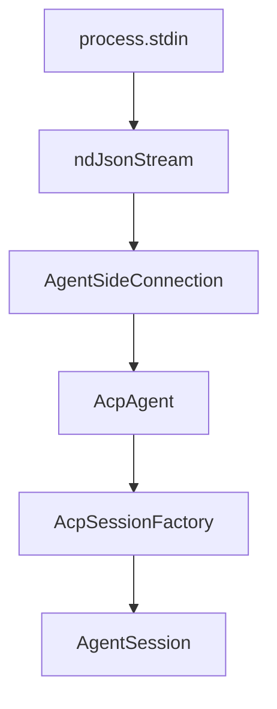
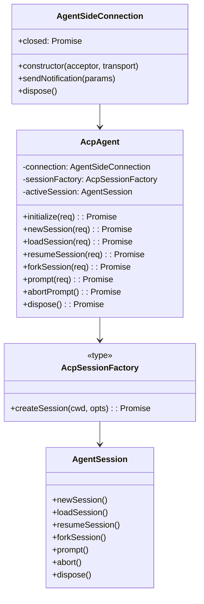
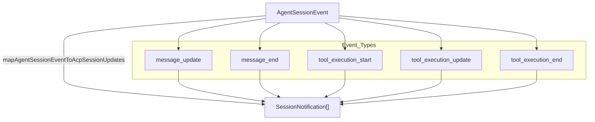
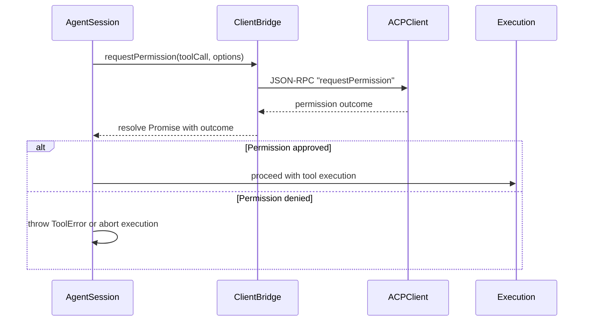
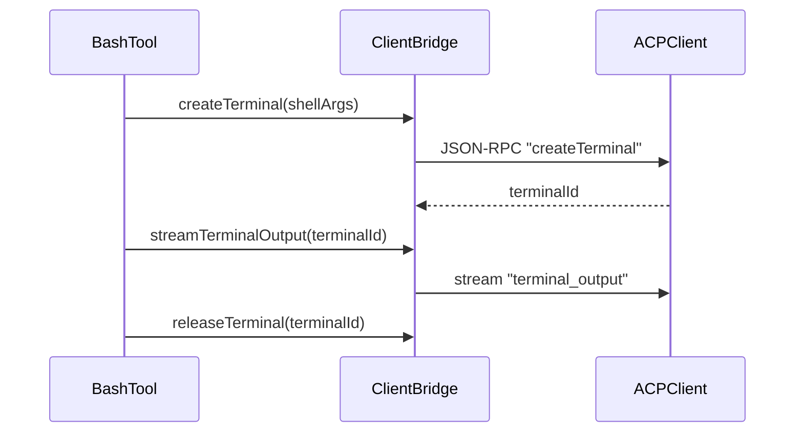
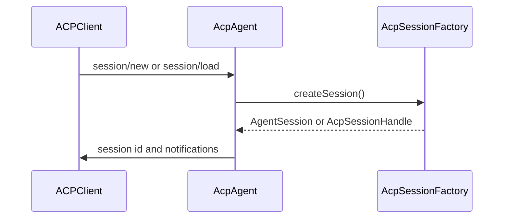
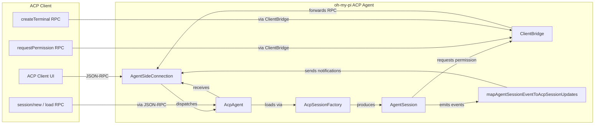

<!-- source: DeepWiki mcp.deepwiki.com · repo can1357/oh-my-pi · page 5.6 ACP Mode · fetched 2026-10-30 -->

# ACP Mode

Relevant source files

The following files were used as context for generating this wiki page:

- [packages/ai/test/auth-storage-credential-disabled-event.test.ts](packages/ai/test/auth-storage-credential-disabled-event.test.ts)
- [packages/coding-agent/src/cli/ssh-cli.ts](packages/coding-agent/src/cli/ssh-cli.ts)
- [packages/coding-agent/src/commands/ssh.ts](packages/coding-agent/src/commands/ssh.ts)
- [packages/coding-agent/src/modes/acp/acp-agent.ts](packages/coding-agent/src/modes/acp/acp-agent.ts)
- [packages/coding-agent/src/modes/acp/acp-event-mapper.ts](packages/coding-agent/src/modes/acp/acp-event-mapper.ts)
- [packages/coding-agent/src/modes/acp/acp-mode.ts](packages/coding-agent/src/modes/acp/acp-mode.ts)
- [packages/coding-agent/src/prompts/system/mcp-xdev-guidance.md](packages/coding-agent/src/prompts/system/mcp-xdev-guidance.md)
- [packages/coding-agent/src/session/session-tools.ts](packages/coding-agent/src/session/session-tools.ts)
- [packages/coding-agent/src/ssh/config-writer.ts](packages/coding-agent/src/ssh/config-writer.ts)
- [packages/coding-agent/src/task/prompt-policy.ts](packages/coding-agent/src/task/prompt-policy.ts)
- [packages/coding-agent/src/tools/context.ts](packages/coding-agent/src/tools/context.ts)
- [packages/coding-agent/test/acp-agent.test.ts](packages/coding-agent/test/acp-agent.test.ts)
- [packages/coding-agent/test/acp-event-mapper.test.ts](packages/coding-agent/test/acp-event-mapper.test.ts)
- [packages/coding-agent/test/acp-initialize-conformance.test.ts](packages/coding-agent/test/acp-initialize-conformance.test.ts)
- [packages/coding-agent/test/acp-lazy-startup.test.ts](packages/coding-agent/test/acp-lazy-startup.test.ts)
- [packages/coding-agent/test/agent-session-acp-permission.test.ts](packages/coding-agent/test/agent-session-acp-permission.test.ts)
- [packages/coding-agent/test/agent-session-prompt-abort-race.test.ts](packages/coding-agent/test/agent-session-prompt-abort-race.test.ts)
- [packages/coding-agent/test/agent-session-tool-rebuild-skip.test.ts](packages/coding-agent/test/agent-session-tool-rebuild-skip.test.ts)
- [packages/coding-agent/test/fixtures/instructions-mcp.ts](packages/coding-agent/test/fixtures/instructions-mcp.ts)
- [packages/coding-agent/test/fixtures/mcp-refresh-retention-probe.ts](packages/coding-agent/test/fixtures/mcp-refresh-retention-probe.ts)
- [packages/coding-agent/test/mcp-refresh-retention.test.ts](packages/coding-agent/test/mcp-refresh-retention.test.ts)
- [packages/coding-agent/test/prefix-binding-tool-roster.test.ts](packages/coding-agent/test/prefix-binding-tool-roster.test.ts)
- [packages/coding-agent/test/sdk-credential-disabled-bridge.test.ts](packages/coding-agent/test/sdk-credential-disabled-bridge.test.ts)
- [packages/coding-agent/test/sdk-generate-image-tool-gating.test.ts](packages/coding-agent/test/sdk-generate-image-tool-gating.test.ts)
- [packages/coding-agent/test/sdk-mcp-instructions.test.ts](packages/coding-agent/test/sdk-mcp-instructions.test.ts)
- [packages/coding-agent/test/sdk-tool-activation.test.ts](packages/coding-agent/test/sdk-tool-activation.test.ts)
- [packages/coding-agent/test/system-prompt-model.test.ts](packages/coding-agent/test/system-prompt-model.test.ts)
- [packages/coding-agent/test/tools/approval-mode.test.ts](packages/coding-agent/test/tools/approval-mode.test.ts)
- [packages/utils/src/acp/connection.ts](packages/utils/src/acp/connection.ts)
- [packages/utils/src/acp/transport.ts](packages/utils/src/acp/transport.ts)
- [packages/utils/test/acp.test.ts](packages/utils/test/acp.test.ts)

## Purpose and Scope
The Agent Client Protocol (ACP) mode in `oh-my-pi` implements a JSON-based protocol that connects the coding agent with external editor or IDE clients, such as Zed. This protocol enables rich, bidirectional session management, interactive message streaming, tool invocation, terminal integration, permission dialogs, and editor file operations. ACP mode facilitates embedding the agent within an editor or IDE environment, providing advanced UI features and session lifecycle control remotely.

This page provides an in-depth technical documentation of:

- The central `AcpAgent` class implementing the ACP server.
- The event mapping pipeline in `mapAgentSessionEventToAcpSessionUpdates` that translates internal session events to ACP notifications.
- The lazy startup approach for efficient agent session initialization.
- The permission bridging mechanism (`ClientBridge`, `requestPermission`) that proxies permission requests to the client.
- Terminal and filesystem bridging concepts enabling remote terminal sessions and file operations.
- Editor integration aspects within the ACP protocol context.

Sources: `[packages/coding-agent/src/modes/acp/acp-agent.ts:1-115]`, `[packages/coding-agent/src/modes/acp/acp-mode.ts:1-63]`

---

## 1. Core Architecture and Startup

### Key Components
- **`AgentSideConnection`**: Encapsulates the JSON-RPC transport over stdio using nd-json streaming (`ndJsonStream`), handling incoming ACP requests and dispatching notifications back to the client (`[packages/coding-agent/src/modes/acp/acp-agent.ts:8-46]`).
- **`AcpAgent`**: Implements the ACP protocol server-side logic in `packages/coding-agent/src/modes/acp/acp-agent.ts`. This class translates ACP RPC requests from the client (e.g., `NewSessionRequest`, `PromptRequest`, `LoadSessionRequest`) into calls into the internal `AgentSession`. It manages the active session context, permission requests, and communicates updates back to the client (`[packages/coding-agent/src/modes/acp/acp-agent.ts:7-165]`).
- **`AcpSessionFactory`**: An abstract factory function type that asynchronously provides initialized `AgentSession` objects on demand. This allows lazy session creation triggered by ACP client operations such as session creation, load, resume, or fork (`[packages/coding-agent/src/modes/acp/acp-mode.ts:10-24]`).

### Startup Flow Overview

Sources: `[packages/coding-agent/src/modes/acp/acp-mode.ts:26-63]`, `[packages/coding-agent/src/modes/acp/acp-agent.ts:1-165]`

Sources: `[packages/coding-agent/src/modes/acp/acp-mode.ts:26-63]`, `[packages/coding-agent/src/modes/acp/acp-agent.ts:1-165]`

---

## 2. Event Mapping Pipeline

ACP clients require structured session updates reflecting assistant messages, tool execution status, plans, and configuration changes. Internally, the agent generates `AgentSessionEvent` objects representing these state changes.

The ACP event mapper translates these internal events into ACP protocol-compliant `SessionNotification` messages for client consumption.

### Event-to-Notification Flow

Sources: `[packages/coding-agent/src/modes/acp/acp-event-mapper.ts:188-237]`, `[packages/coding-agent/test/acp-event-mapper.test.ts:1-207]`

### Key Functions and Logic
- **`mapAgentSessionEventToAcpSessionUpdates(event, sessionId, options)`**: Inspects `event.type` and produces suitable `SessionNotification` objects (`[packages/coding-agent/src/modes/acp/acp-event-mapper.ts:188-237]`).
- **`mapToolKind(toolName, args)`**: Classifies tools for ACL and UI purposes into kinds like `"read"`, `"edit"`, `"execute"`, `"search"`, `"fetch"`, `"think"`, and `"other"` (`[packages/coding-agent/src/modes/acp/acp-event-mapper.ts:154-186]`).
- Paths in tool call arguments are resolved against the session's current working directory for absolute URI linking in the client editor.

Sources: `[packages/coding-agent/src/modes/acp/acp-event-mapper.ts:188-237]`, `[packages/coding-agent/test/acp-event-mapper.test.ts:1-207]`

---

## 3. Permission Bridging

ACP mode enforces operation permission controls where the agent seeks explicit user approval via the client UI before performing potentially unsafe operations such as shell execution, file writes, or external network fetches.

### Permission Request Lifecycle

Sources: `[packages/coding-agent/test/agent-session-acp-permission.test.ts:1-126]`, `[packages/coding-agent/src/session/session-tools.ts:125-127]`, `[packages/coding-agent/src/modes/acp/acp-client-bridge.ts:1-50]`

- The `ClientBridge` acts as a relay proxy, forwarding permission requests received from `AgentSession` to the ACP client over JSON-RPC.
- The client responds asynchronously with user decisions on permission, which the bridge resolves on the agent side.
- Approval modes such as `always-ask`, `yolo` (always allow), or `write` govern whether prompts are dispatched.

Sources: `[packages/coding-agent/test/agent-session-acp-permission.test.ts:1-126]`, `[packages/coding-agent/src/modes/acp/acp-client-bridge.ts:1-50]`, `[packages/coding-agent/test/acp-lazy-startup.test.ts:63-65]`

---

## 4. Client Terminal and Filesystem Bridge

ACP mode allows embedding terminals and filesystem operations inside the editor via the ACP connection.

### Terminal Integration

- Shell execution tools (`bash`, `shell`) use the client bridge to request terminal creation by sending a `createTerminal` JSON-RPC command with shell arguments.
- The ACP client creates a terminal instance and replies with a `terminalId`.
- Terminal output is streamed back to the ACP client in structured chunks.
- Handles are released when shell commands finish or are aborted.

Sources: `[packages/coding-agent/test/acp-lazy-startup.test.ts:60-75]`

---

## 5. Editor Integration and Lazy Startup

ACP mode implements lazy agent session startup to optimize resource usage and reduce editor startup latency.

- `AcpAgent` defers creation and loading of `AgentSession` objects using the injected `AcpSessionFactory`.
- Sessions are created only upon explicit client requests like `session/new`, `session/load`, or `session/resume`.
- The factory may return either an `AgentSession` or an extended `AcpSessionHandle`.

Sources: `[packages/coding-agent/src/modes/acp/acp-agent.ts:1-115]`, `[packages/coding-agent/test/acp-lazy-startup.test.ts:1-210]`

---

## 6. Thinking Level and Effort Management

ACP mode supports dynamic control over the agent's "thinking level" which governs reasoning depth, model effort, and resource consumption.

### Thinking Level Handling in ACP

- `AcpAgent` manages thinking levels configurable as `off`, `auto`, or effort tiers (`low`, `medium`, `high`) (`[packages/coding-agent/src/modes/acp/acp-agent.ts:76-109]`).
- Setting the thinking level triggers internal events in `AgentSession`.
- Available thinking levels are exposed to the client for selection via ACP methods.

Sources: `[packages/coding-agent/src/modes/acp/acp-agent.ts:76-109]`, `[packages/coding-agent/test/acp-agent.test.ts:180-201]`

---

## Summary Diagram: ACP Mode Components and Data Flow

Sources: `[packages/coding-agent/src/modes/acp/acp-agent.ts:1-115]`, `[packages/coding-agent/src/modes/acp/acp-mode.ts:1-63]`, `[packages/coding-agent/src/modes/acp/acp-event-mapper.ts:1-237]`

---

