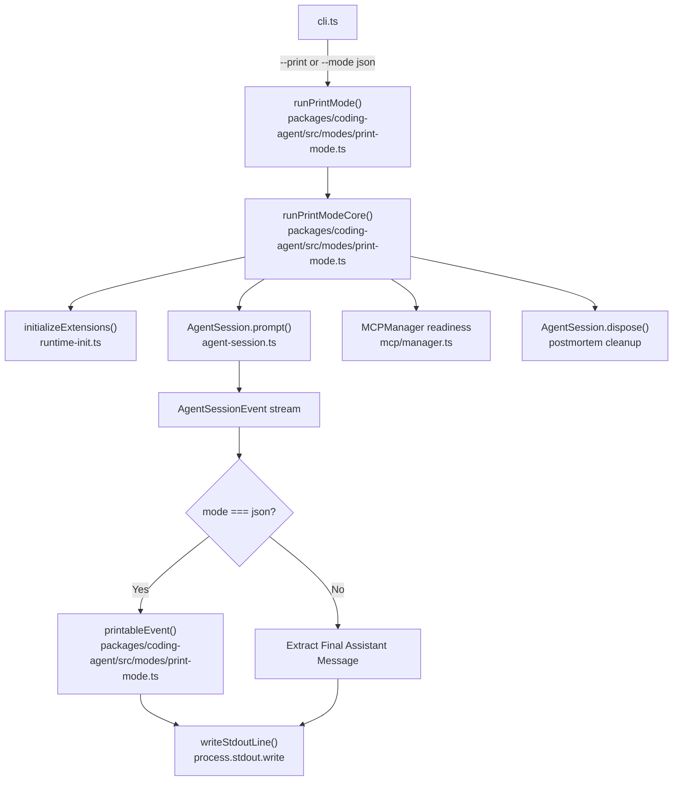
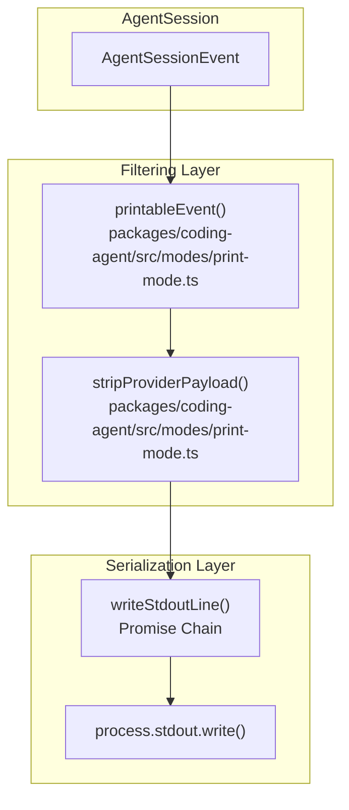

<!-- source: DeepWiki mcp.deepwiki.com · repo can1357/oh-my-pi · page 5.7 Print Mode · fetched 2026-10-30 -->

# Print Mode

<details>
<summary>Relevant source files</summary>

The following files were used as context for generating this wiki page:

- [packages/coding-agent/src/modes/persistence-failure.ts](packages/coding-agent/src/modes/persistence-failure.ts)
- [packages/coding-agent/src/modes/print-mode.ts](packages/coding-agent/src/modes/print-mode.ts)
- [packages/coding-agent/test/fixtures/print-mode-signal.js](packages/coding-agent/test/fixtures/print-mode-signal.js)
- [packages/coding-agent/test/mcp-print-readiness.test.ts](packages/coding-agent/test/mcp-print-readiness.test.ts)
- [packages/coding-agent/test/modes/noninteractive-dispose.test.ts](packages/coding-agent/test/modes/noninteractive-dispose.test.ts)
- [packages/coding-agent/test/modes/print-persistence-failure.test.ts](packages/coding-agent/test/modes/print-persistence-failure.test.ts)
- [packages/coding-agent/test/print-mode-json-flush.test.ts](packages/coding-agent/test/print-mode-json-flush.test.ts)
- [packages/coding-agent/test/print-mode-working-indicator.test.ts](packages/coding-agent/test/print-mode-working-indicator.test.ts)
- [packages/coding-agent/test/silent-abort-print-mode.test.ts](packages/coding-agent/test/silent-abort-print-mode.test.ts)

</details>


Print Mode provides a single-shot, non-interactive execution mode designed primarily for scripting, CI/CD pipelines, and command-line automation. It processes a single prompt or series of messages, outputs the result, and exits immediately without maintaining an ongoing interactive conversation or TUI session.

---

## Overview

Print Mode takes a one-time prompt (or multiple prompts) submitted to an `AgentSession`, processes them to completion, and outputs the results to the console in one of two formats:

- **Text output mode**: Prints only the final assistant response as plain text.
- **JSON output mode**: Emits a complete, newline-delimited JSON event stream representing all session events for detailed logging or machine consumption.

Typical CLI usage includes:
- `omp -p "prompt"` or `omp --print "prompt"` for plain text result.
- `omp --mode json "prompt"` for JSON event stream output.

The main implementation entrypoint is located in `packages/coding-agent/src/modes/print-mode.ts`, which orchestrates prompt delivery, output shaping, session lifecycle, and graceful shutdown `[packages/coding-agent/src/modes/print-mode.ts:1-7]()`.

Sources: `[packages/coding-agent/src/modes/print-mode.ts:1-7]()`

---

## Architecture and Implementation Detail

Print Mode's core functionality centers around the asynchronous orchestrator function `runPrintMode` which wraps `runPrintModeCore`:

```ts
export async function runPrintMode(session: AgentSession, options: PrintModeOptions): Promise<number>;
```

This function runs a full single-turn conversation session and returns a numeric exit code indicating success or failure `[packages/coding-agent/src/modes/print-mode.ts:117-131]()`.

### Key steps in `runPrintMode` include:

- **Signal handling**: Registers listeners for OS signals (`SIGINT`, `SIGTERM`, `SIGHUP`) via the `postmortem` utility. This ensures that the session is cleanly disposed with a bounded timeout (`SHUTDOWN_CONSOLIDATE_BUDGET_MS`), capturing signal reason codes `[packages/coding-agent/src/modes/print-mode.ts:118-131]()`.
- **Event subscription & output**: Subscribes to session events to output either the filtered JSON event stream or final assistant text. Serialization is carefully ordered via a promise chain to prevent output truncation due to backpressure `[packages/coding-agent/src/modes/print-mode.ts:147-157]()`.
- **MCP Server Readiness**: If an `mcpManager` is passed in options, print mode coordinates server initialization and readiness checks before dispatching the prompt `[packages/coding-agent/test/mcp-print-readiness.test.ts:113-132]()`.
- **Session disposal**: Awaits disposal of the `AgentSession` to release resources and flush telemetry before the process terminates `[packages/coding-agent/src/modes/print-mode.ts:122-130]()`.

### PrintModeOptions Interface

```ts
export interface PrintModeOptions {
	mode: "text" | "json";
	messages?: string[];
	initialMessage?: string;
	initialImages?: ImageContent[];
	printThoughts?: boolean;
	planYolo?: boolean;
	mcpManager?: MCPManager;
}
```
Sources: `[packages/coding-agent/src/modes/print-mode.ts:34-49]()`, `[packages/coding-agent/src/modes/print-mode.ts:117-131]()`

---

### Diagram: Print Mode Execution Bridge (Code Entity Space)



Sources: `[packages/coding-agent/src/modes/print-mode.ts:1-165]()`

---

## Output Formats and Serialization

### Text Output Mode

- Displays **only the final assistant message's** plain textual content.
- Optional display of "thinking" or internal reasoning blocks controlled by the `printThoughts` flag.
- Suppresses reporting silent abort markers or internal sentinel errors on `stderr`.
- Writes actual error messages to `stderr` when the stop reason signals failure.
- Process exit code is `0` on success, `1` on error `[packages/coding-agent/test/silent-abort-print-mode.test.ts:98-162]()`.

### JSON Mode

- Outputs the complete session event stream as newline-delimited JSON objects for all relevant `AgentSessionEvent`s.
- Eliminates redundant intermediate snapshots (`message_update` partial deltas), printing only incremental deltas and authoritative final states via `printableEvent()` `[packages/coding-agent/src/modes/print-mode.ts:80-109]`.
- Removes large, opaque `providerPayload` fields via `stripProviderPayload()` that are only useful within the local transport `[packages/coding-agent/src/modes/print-mode.ts:61-66]()`.
- Uses a promise chain (`stdoutTail`) to serialize writes to `process.stdout`, awaiting each write's completion callback before issuing the next write. This guarantees proper ordering and that large final payloads (e.g. multi-MB `agent_end`) fully flush before exit `[packages/coding-agent/src/modes/print-mode.ts:147-157]()`, `[packages/coding-agent/test/print-mode-json-flush.test.ts:97-155]()`.

Sources: `[packages/coding-agent/src/modes/print-mode.ts:61-109]`, `[packages/coding-agent/src/modes/print-mode.ts:147-157]`, `[packages/coding-agent/test/silent-abort-print-mode.test.ts:98-162]`, `[packages/coding-agent/test/print-mode-json-flush.test.ts:97-155]()`

---

### Diagram: Event Filtering and Output Flow



Sources: `[packages/coding-agent/src/modes/print-mode.ts:61-109]`, `[packages/coding-agent/src/modes/print-mode.ts:147-157]()`

---

## MCP Readiness and Tooling Integration

When Model Context Protocol (MCP) servers are configured, Print Mode can take an optional `mcpManager` in `PrintModeOptions` `[packages/coding-agent/src/modes/print-mode.ts:48]()`. 

- **Readiness Checks**: Print mode waits for MCP tool registrations and server handshakes. If servers fail to reach a ready state within the timeout window (`OMP_MCP_TIMEOUT_MS`), strict readiness mode (`OMP_MCP_REQUIRE_READY=1`) causes print mode to output a warning to `stderr` and abort the run with a non-zero exit code `[packages/coding-agent/test/mcp-print-readiness.test.ts:134-155]()`.
- **Graceful Cleanup**: Upon session disposal, all connected MCP servers are safely disconnected `[packages/coding-agent/test/mcp-print-readiness.test.ts:104-107]()`.

Sources: `[packages/coding-agent/src/modes/print-mode.ts:48]`, `[packages/coding-agent/test/mcp-print-readiness.test.ts:113-155]()`

---

## Startup and Plan Mode Behavior

- Print Mode disables the `plan.defaultOnStartup` behavior active in Interactive Mode to avoid deadlocks or stranded execution in headless, non-interactive contexts `[packages/coding-agent/test/print-mode-working-indicator.test.ts:186-192]()`.
- This ensures the plan approval flow, which requires UI and human interaction, is automatically bypassed.
- Instead, `planYolo` is supported for forcibly enabling autonomous plan execution without human review in print mode `[packages/coding-agent/src/modes/print-mode.ts:46]()`.

Sources: `[packages/coding-agent/src/modes/print-mode.ts:46]`, `[packages/coding-agent/test/print-mode-working-indicator.test.ts:186-192]()`

---

## Error Handling, Silent Aborts, and Lifecycle

### Clean Disposal and Exit

- Print Mode always awaits `AgentSession.dispose()` to guarantee proper resource release before termination `[packages/coding-agent/src/modes/print-mode.ts:117-131]()`.
- Disposal includes a bounded timeout for memory consolidation (`SHUTDOWN_CONSOLIDATE_BUDGET_MS`) to prevent shutdown hangs `[packages/coding-agent/test/silent-abort-print-mode.test.ts:116-125]()`.
- The execution functions do not call `process.exit()` directly, but instead return an exit code for the caller to handle (`0` on success, `1` on failure) `[packages/coding-agent/test/modes/noninteractive-dispose.test.ts:1-76]()`.

### Silent Abort Suppression

- If the assistant message `stopReason` is `"aborted"` and carries the internal silent abort marker or error ID (`AIError.Flag.SilentAbort`), no error message is printed to `stderr` `[packages/coding-agent/test/silent-abort-print-mode.test.ts:98-140]()`.
- The exit code returned is `0` (success), preventing noise in automated scripts.

### Persistence Failure Reporting

- Print Mode listens for session store persistence events.
- Using `formatPersistenceFailure()` and `formatPersistenceDurabilityFailure()`, store errors are captured, sanitized, and reported to `stderr` with a non-zero exit code if writes fail permanently `[packages/coding-agent/src/modes/persistence-failure.ts:1-25]`, `[packages/coding-agent/test/modes/print-persistence-failure.test.ts:89-132]()`.

Sources: `[packages/coding-agent/src/modes/print-mode.ts:117-131]`, `[packages/coding-agent/src/modes/persistence-failure.ts:1-25]`, `[packages/coding-agent/test/silent-abort-print-mode.test.ts:98-140]`, `[packages/coding-agent/test/modes/noninteractive-dispose.test.ts:1-76]`, `[packages/coding-agent/test/modes/print-persistence-failure.test.ts:89-132]()`

---

## Summary Table: Print Mode Behavior Overview

| Aspect | Detail | Relevant Code/Tests |
|---|---|---|
| Invocation | Via `runPrintMode(session, options)` called by CLI handlers | `[packages/coding-agent/src/modes/print-mode.ts:117-131]()` |
| Output Options | Text (`mode: "text"`) or JSON stream (`mode: "json"`) | `[packages/coding-agent/src/modes/print-mode.ts:34-36]()` |
| Output Content | Text: final assistant message; JSON: filtered session events | `[packages/coding-agent/src/modes/print-mode.ts:80-109]()` |
| Output Serialization | Promise-chained writes to `process.stdout` to avoid truncation | `[packages/coding-agent/src/modes/print-mode.ts:147-157]()` |
| MCP Integration | Optional `mcpManager` with strict readiness flags (`OMP_MCP_REQUIRE_READY`) | `[packages/coding-agent/test/mcp-print-readiness.test.ts:113-155]()` |
| Plan Mode Startup | Disabled by default; enabled headless with `planYolo` | `[packages/coding-agent/src/modes/print-mode.ts:46]()` |
| Session Lifecycle | Disposes session before returning exit code | `[packages/coding-agent/src/modes/print-mode.ts:117-131]()` |
| Silent Abort Handling | Suppress messages and return success exit code | `[packages/coding-agent/test/silent-abort-print-mode.test.ts:98-140]()` |
| Persistence Failures | Report via `formatPersistenceFailure`, return exit code 1 | `[packages/coding-agent/src/modes/persistence-failure.ts:12-25]()`, `[packages/coding-agent/test/modes/print-persistence-failure.test.ts:89-132]()` |

Sources: `[packages/coding-agent/src/modes/print-mode.ts:34-157]`, `[packages/coding-agent/src/modes/persistence-failure.ts:12-25]`, `[packages/coding-agent/test/silent-abort-print-mode.test.ts:98-140]`, `[packages/coding-agent/test/modes/print-persistence-failure.test.ts:89-132]`, `[packages/coding-agent/test/mcp-print-readiness.test.ts:113-155]()`

---

