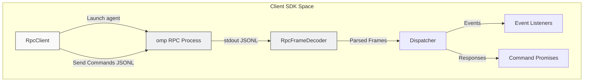
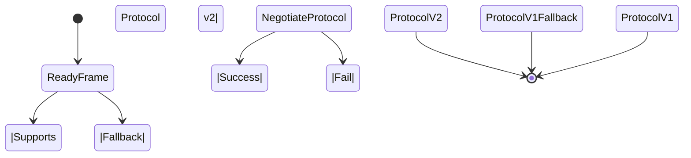
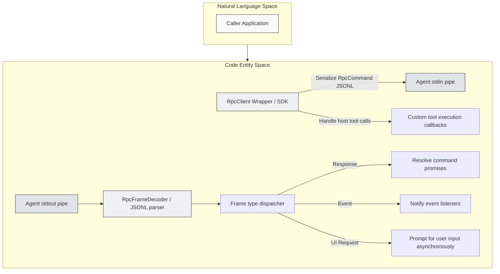

<!-- source: DeepWiki mcp.deepwiki.com · repo can1357/oh-my-pi · page 5.9 Client SDKs (Go, Python, Rust) · fetched 2026-10-30 -->

# Client SDKs (Go, Python, Rust)

<details>
<summary>Relevant source files</summary>

The following files were used as context for generating this wiki page:

- [docs/rpc.md](docs/rpc.md)
- [packages/coding-agent/src/eval/kernel-base.ts](packages/coding-agent/src/eval/kernel-base.ts)
- [packages/coding-agent/src/index.ts](packages/coding-agent/src/index.ts)
- [packages/coding-agent/src/modes/rpc/rpc-client.ts](packages/coding-agent/src/modes/rpc/rpc-client.ts)
- [packages/coding-agent/src/modes/rpc/rpc-compat.ts](packages/coding-agent/src/modes/rpc/rpc-compat.ts)
- [packages/coding-agent/src/modes/rpc/rpc-frame.ts](packages/coding-agent/src/modes/rpc/rpc-frame.ts)
- [packages/coding-agent/src/modes/rpc/rpc-messages.ts](packages/coding-agent/src/modes/rpc/rpc-messages.ts)
- [packages/coding-agent/src/modes/rpc/rpc-mode.ts](packages/coding-agent/src/modes/rpc/rpc-mode.ts)
- [packages/coding-agent/src/modes/rpc/rpc-types.ts](packages/coding-agent/src/modes/rpc/rpc-types.ts)
- [packages/coding-agent/test/eval/kernel-process-group.test.ts](packages/coding-agent/test/eval/kernel-process-group.test.ts)
- [packages/coding-agent/test/fixtures/mock-rpc-agent.ts](packages/coding-agent/test/fixtures/mock-rpc-agent.ts)
- [packages/coding-agent/test/rpc-client.restart.test.ts](packages/coding-agent/test/rpc-client.restart.test.ts)
- [packages/coding-agent/test/rpc-client.start.test.ts](packages/coding-agent/test/rpc-client.start.test.ts)
- [packages/coding-agent/test/rpc-compatible-primitives.test.ts](packages/coding-agent/test/rpc-compatible-primitives.test.ts)
- [packages/coding-agent/test/rpc-frame.test.ts](packages/coding-agent/test/rpc-frame.test.ts)
- [packages/coding-agent/test/rpc-input-frame.test.ts](packages/coding-agent/test/rpc-input-frame.test.ts)
- [packages/coding-agent/test/rpc.test.ts](packages/coding-agent/test/rpc.test.ts)

</details>


The `sdk/` directory within the oh-my-pi monorepo contains the core client libraries that enable communication with the `omp` coding agent when running in RPC mode. These SDKs—implemented in Go, Python, and Rust—provide language-native bindings that wrap the JSONL framing protocol and allow driving the agent programmatically. They abstract the underlying JSON-RPC communication over standard I/O, offering typed method calls, event subscriptions, and lifecycle management to consumers.

This page documents the architecture, data flow, key abstractions, and version compatibility of these SDKs, using the TypeScript `RpcClient` as the primary reference implementation.

---

## Purpose and Scope

These SDKs serve as the programmatic clients for the `omp` agent operating in RPC mode (`--mode rpc`). They:

- Launch or connect to an `omp` agent subprocess (or custom transport).
- Send RPC commands (e.g., `prompt`, `get_state`, `bash`) as newline-delimited JSON objects on `stdin`.
- Receive and decode structured responses, events, and extension UI requests on `stdout`.
- Handle protocol framing, including chunked messages in protocol v2.
- Allow definition of host tools callable by the agent.
- Provide event listeners for asynchronous stream events.

Because the `sdk/` clients speak the same underlying protocol defined in `packages/coding-agent/src/modes/rpc/rpc-types.ts`, all supported languages enforce consistent version compatibility and schema validation.

Sources: [docs/rpc.md:3-97](), [packages/coding-agent/src/modes/rpc/rpc-types.ts:1-146]()

---

## RPC Protocol and Communication

### Overview

The RPC communication is a newline-delimited JSON protocol streamed over the agent's standard input (`stdin`) and output (`stdout`):

- **Client → Agent (stdin):** Commands (`RpcCommand`), extension UI responses, host-tool call results.
- **Agent → Client (stdout):** Ready frame, command responses (`RpcResponse`), asynchronous session/agent events (`AgentSessionEvent`), extension UI requests, host tool requests, subagent events.

The protocol supports two framing versions:

- **Protocol v1:** Single JSON objects capped at ~1 MiB.
- **Protocol v2:** Supports chunking of oversized messages into `rpc_chunk` frames encoded in base64, allowing logical frames up to 64 MiB.

Clients negotiate the protocol version on startup by inspecting the agent's `ready` frame and issuing a `negotiate_protocol` command if v2 is supported.

### Important Message Categories

The main frame types emitted by the agent are:

| Frame Type | Description |
|---|---|
| `ready` | Initial handshake indicating protocol versions and limits |
| `response` | Command acknowledgment with `success` or `error` |
| `agent_start` / `agent_end` | Marks the start and end of agent processing in a session |
| `message_update`, `message_end` | Streaming assistant messages as they are generated |
| `tool_execution_*` | Notification of embedded tool call lifecycle |
| `extension_ui_request` | UI input dialog requests from extensions |
| `host_tool_call`, `host_tool_cancel` | Host tool invocation requests |
| `available_commands_update` | Notification for slash command metadata changes |
| `prompt_result` | Final completion of a prompt turn |
| `session_settled` | Session quiescence (no pending work) |
| `subagent_*` | Subagent lifecycle and progress events |
| `rpc_frame_error` | Transport overflow or framing error notifications |
| `live_*` | Live voice transcription and speaking phase data |

Sources: [docs/rpc.md:3-97](), [packages/coding-agent/src/modes/rpc/rpc-types.ts:1-146]()

---

## Package Layout and Key Files

The main TypeScript client implementation, which serves as the reference pattern for SDKs, is in:

- `packages/coding-agent/src/modes/rpc/rpc-client.ts` — Implements `RpcClient` managing the connection, message framing, sending commands, and event handling.
- `packages/coding-agent/src/modes/rpc/rpc-types.ts` — Defines all RPC command, response, and event TypeScript types.
- `packages/coding-agent/src/modes/rpc/rpc-frame.ts` — Implements RPC frame encoding and decoding, including protocol v2 chunking.
- `packages/coding-agent/src/modes/rpc/rpc-mode.ts` — Contains the main agent RPC mode server-side logic.
- `docs/rpc.md` — Protocol reference documentation.

The SDKs in Go, Python, and Rust mirror these functionalities by implementing JSON serialization/deserialization, subprocess management, and protocol framing consistent with these types and framing rules.

Sources: [packages/coding-agent/src/modes/rpc/rpc-client.ts:1-191](), [packages/coding-agent/src/modes/rpc/rpc-types.ts:1-146](), [packages/coding-agent/src/modes/rpc/rpc-frame.ts:1-178](), [docs/rpc.md:3-97]()

---

## Connection Setup and Lifecycle Management

The client SDKs abstract launching or connecting to the `omp` subprocess and managing the bidirectional pipe communication:

- **Starting the RPC client** launches the `omp` agent with `--mode rpc` and provider/model options.
- The client reads and buffers lines from the agent's `stdout`.
- Upon seeing the initial `{ type: "ready" }` frame, the client verifies protocol versions and optionally negotiates protocol v2.
- The client dispatches incoming JSON messages to appropriate internal handlers — resolving command promises or emitting events.
- On `stop()`, the client signals and cleans up resources, killing the agent process if needed and rejecting pending commands.

The `RpcAgentProcess` interface abstracts the process transport, allowing custom transports such as SSH tunnels or remote connections.

Diagram: Client SDK Launch and Subprocess Architecture bridging to `RpcClient` and `RpcFrameDecoder`.



Sources: [packages/coding-agent/src/modes/rpc/rpc-client.ts:64-110](), [packages/coding-agent/test/rpc-client.restart.test.ts:18-96]()

---

## Command API and Message Flow

The SDK exposes methods corresponding to command types described in `packages/coding-agent/src/modes/rpc/rpc-types.ts`. Examples include:

| Method | RPC Command Type | Description |
|---|---|---|
| `promptAndWait()` | `prompt` | Sends a prompt message and waits for turn completion (collects events) |
| `getState()` | `get_state` | Fetches current session state |
| `bash()` | `bash` | Executes a shell command via the bash tool |
| `compact()` | `compact` | Requests session compaction |
| `getMessages()` | `get_messages` | Retrieves full message history snapshot |
| `getMessagesPage()` | `get_messages_page` | Retrieves message page for large session logs |
| `login()` | `login` | Initiates login flow |
| `defineRpcClientTool()` | Custom tools | Registers host-defined tools callable by the agent |

Command message sending is asynchronous with promises resolving upon matching response frames. Events are streamed asynchronously and passed to registered listeners.

### Message Pagination Support

The `getMessagesPage()` API supports efficient paging of large session histories. The server-side logic in `packages/coding-agent/src/modes/rpc/rpc-messages.ts` slices message output so frames observe transport limits, rejecting if cursors are stale.

```
Client                   Agent
   | get_messages_page(request)  --->
   |                             |
   | <--- messages_page(response)|
   | use nextCursor              |
   | get_messages_page(nextCursor) --->
   |                             |
```

Sources: [packages/coding-agent/src/modes/rpc/rpc-client.ts:100-130](), [packages/coding-agent/src/modes/rpc/rpc-messages.ts]()

---

## Event Types and Listeners

Clients can subscribe to event streams to monitor agent progress and state:

| Event Name | Description |
|---|---|
| `agentEvent` | Core agent lifecycle events (`agent_start`, `message_start`, `tool_execution_start`, etc.) |
| `sessionEvent` | Extended session scoped events including compaction, retry, todo reminders, model or goal changes |
| `promptResult` | Final prompt completion event |
| `subagentLifecycle` | Subagent lifecycle updates |
| `subagentProgress` | Subagent progress frames |
| `subagentEvent` | Subagent emitted events |

Listeners receive strongly-typed event objects as defined in `packages/coding-agent/src/modes/rpc/rpc-types.ts`.

Sources: [packages/coding-agent/src/modes/rpc/rpc-client.ts:140-178]()

---

## Version Compatibility and Protocol Negotiation

The protocol version negotiation is crucial for forward compatibility:

- The agent sends its supported protocol versions in the initial `ready` frame.
- The client examines this and sends a `{ type: "negotiate_protocol", protocolVersion: 2 }` command if it supports v2.
- Upon a successful upgrade, both sides switch to Protocol v2 framing, enabling chunked messages.
- If negotiation fails or is omitted, fallback to Protocol v1 occurs.

The shared TypeScript `packages/coding-agent/src/modes/rpc/rpc-types.ts` constitutes the canonical schema for commands, events, and responses, ensuring clients across languages remain compatible as the protocol evolves.

Diagram: Protocol Version Negotiation State Machine.



Sources: [docs/rpc.md:42-79](), [packages/coding-agent/src/modes/rpc/rpc-client.ts:180-190]()

---

## Word Prediction via RPC (Go, Python, Rust SDKs)

The `RpcWordPredictor` class in `packages/coding-agent/src/modes/rpc/rpc-mode.ts` demonstrates composition of the `predict_word` command for word completion:

- Limits concurrent requests to avoid flooding the daemon.
- Allows cancellation and superseding of pending predictions.
- Caps predictions to precise line-end offsets for prose word completions.

This helper pattern can be adopted in other SDKs to provide guided typing suggestions embedded in language clients or editors.

Sources: [packages/coding-agent/src/modes/rpc/rpc-mode.ts:140-163]()

---

## Data Flow Summary

Diagram: End-to-end Data Flow mapping Natural Language Space to `RpcClient` and `RpcFrameDecoder`.



---

## References and Sources

- [docs/rpc.md:1-98]()
- [packages/coding-agent/src/modes/rpc/rpc-client.ts:1-191]()
- [packages/coding-agent/src/modes/rpc/rpc-types.ts:1-146]()
- [packages/coding-agent/src/modes/rpc/rpc-frame.ts:1-178]()
- [packages/coding-agent/src/modes/rpc/rpc-mode.ts:1-163]()
- [packages/coding-agent/src/modes/rpc/rpc-messages.ts]()
- [packages/coding-agent/test/rpc.test.ts:1-180]()
- [packages/coding-agent/test/rpc-client.restart.test.ts:1-144]()

---

