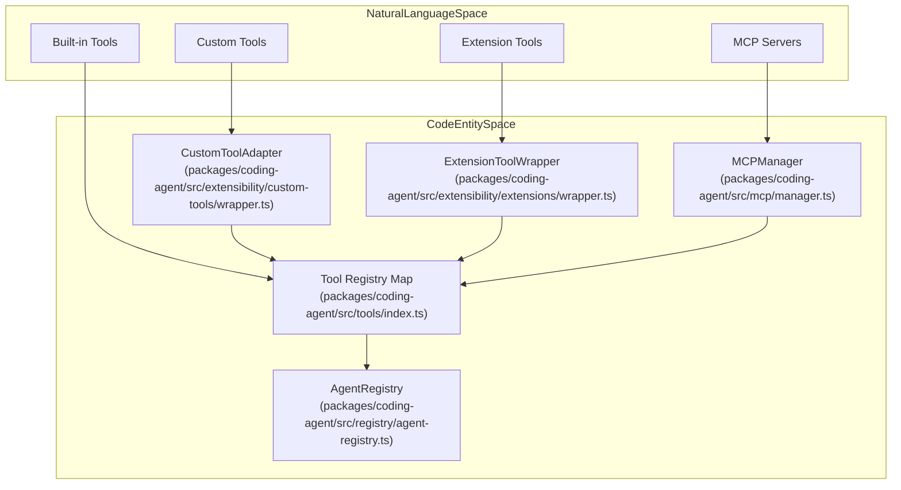
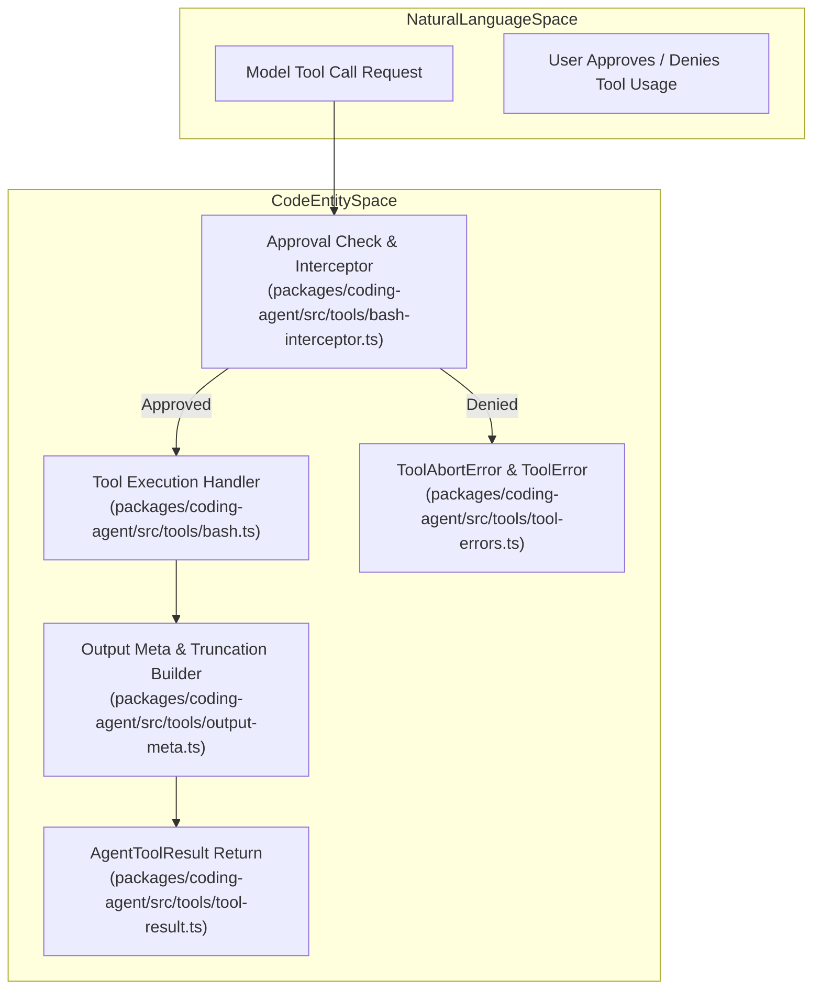

<!-- source: DeepWiki mcp.deepwiki.com · repo can1357/oh-my-pi · page 6 Tool System · fetched 2026-10-30 -->

# Tool System

Relevant source files

The following files were used as context for generating this wiki page:

- [docs/approval-mode.md](docs/approval-mode.md)
- [docs/extensions.md](docs/extensions.md)
- [docs/hooks.md](docs/hooks.md)
- [docs/skills/authoring-hooks.md](docs/skills/authoring-hooks.md)
- [packages/agent/test/utils/get-current-time.ts](packages/agent/test/utils/get-current-time.ts)
- [packages/coding-agent/src/cli/grep-cli.ts](packages/coding-agent/src/cli/grep-cli.ts)
- [packages/coding-agent/src/eval/preludes.ts](packages/coding-agent/src/eval/preludes.ts)
- [packages/coding-agent/src/extensibility/custom-tools/types.ts](packages/coding-agent/src/extensibility/custom-tools/types.ts)
- [packages/coding-agent/src/extensibility/custom-tools/wrapper.ts](packages/coding-agent/src/extensibility/custom-tools/wrapper.ts)
- [packages/coding-agent/src/extensibility/extensions/loader.ts](packages/coding-agent/src/extensibility/extensions/loader.ts)
- [packages/coding-agent/src/extensibility/extensions/runner.ts](packages/coding-agent/src/extensibility/extensions/runner.ts)
- [packages/coding-agent/src/extensibility/extensions/types.ts](packages/coding-agent/src/extensibility/extensions/types.ts)
- [packages/coding-agent/src/extensibility/extensions/wrapper.ts](packages/coding-agent/src/extensibility/extensions/wrapper.ts)
- [packages/coding-agent/src/extensibility/hooks/runner.ts](packages/coding-agent/src/extensibility/hooks/runner.ts)
- [packages/coding-agent/src/extensibility/hooks/tool-wrapper.ts](packages/coding-agent/src/extensibility/hooks/tool-wrapper.ts)
- [packages/coding-agent/src/extensibility/hooks/types.ts](packages/coding-agent/src/extensibility/hooks/types.ts)
- [packages/coding-agent/src/extensibility/shared-events.ts](packages/coding-agent/src/extensibility/shared-events.ts)
- [packages/coding-agent/src/extensibility/tool-event-input.ts](packages/coding-agent/src/extensibility/tool-event-input.ts)
- [packages/coding-agent/src/extensibility/tool-proxy.ts](packages/coding-agent/src/extensibility/tool-proxy.ts)
- [packages/coding-agent/src/modes/controllers/extension-ui-controller.ts](packages/coding-agent/src/modes/controllers/extension-ui-controller.ts)
- [packages/coding-agent/src/prompts/tools/ask.md](packages/coding-agent/src/prompts/tools/ask.md)
- [packages/coding-agent/src/prompts/tools/ast-edit.md](packages/coding-agent/src/prompts/tools/ast-edit.md)
- [packages/coding-agent/src/prompts/tools/ast-grep.md](packages/coding-agent/src/prompts/tools/ast-grep.md)
- [packages/coding-agent/src/prompts/tools/bash.md](packages/coding-agent/src/prompts/tools/bash.md)
- [packages/coding-agent/src/prompts/tools/find.md](packages/coding-agent/src/prompts/tools/find.md)
- [packages/coding-agent/src/prompts/tools/grep.md](packages/coding-agent/src/prompts/tools/grep.md)
- [packages/coding-agent/src/prompts/tools/lsp.md](packages/coding-agent/src/prompts/tools/lsp.md)
- [packages/coding-agent/src/prompts/tools/read.md](packages/coding-agent/src/prompts/tools/read.md)
- [packages/coding-agent/src/prompts/tools/web-search.md](packages/coding-agent/src/prompts/tools/web-search.md)
- [packages/coding-agent/src/prompts/tools/write.md](packages/coding-agent/src/prompts/tools/write.md)
- [packages/coding-agent/src/tools/approval.ts](packages/coding-agent/src/tools/approval.ts)
- [packages/coding-agent/src/tools/ask.ts](packages/coding-agent/src/tools/ask.ts)
- [packages/coding-agent/src/tools/ast-edit.ts](packages/coding-agent/src/tools/ast-edit.ts)
- [packages/coding-agent/src/tools/ast-grep.ts](packages/coding-agent/src/tools/ast-grep.ts)
- [packages/coding-agent/src/tools/bash.ts](packages/coding-agent/src/tools/bash.ts)
- [packages/coding-agent/src/tools/grep.ts](packages/coding-agent/src/tools/grep.ts)
- [packages/coding-agent/src/tools/output-meta.ts](packages/coding-agent/src/tools/output-meta.ts)
- [packages/coding-agent/src/tools/path-utils.ts](packages/coding-agent/src/tools/path-utils.ts)
- [packages/coding-agent/src/tools/read.ts](packages/coding-agent/src/tools/read.ts)
- [packages/coding-agent/test/ask-timeout.test.ts](packages/coding-agent/test/ask-timeout.test.ts)
- [packages/coding-agent/test/extensibility/tool-proxy.test.ts](packages/coding-agent/test/extensibility/tool-proxy.test.ts)
- [packages/coding-agent/test/extensions-runner.test.ts](packages/coding-agent/test/extensions-runner.test.ts)
- [packages/coding-agent/test/hook-tool-wrapper-input.test.ts](packages/coding-agent/test/hook-tool-wrapper-input.test.ts)
- [packages/coding-agent/test/modes/controllers/extension-ui-controller.test.ts](packages/coding-agent/test/modes/controllers/extension-ui-controller.test.ts)
- [packages/coding-agent/test/streaming-output.test.ts](packages/coding-agent/test/streaming-output.test.ts)
- [packages/coding-agent/test/tools.test.ts](packages/coding-agent/test/tools.test.ts)
- [packages/coding-agent/test/tools/approval.test.ts](packages/coding-agent/test/tools/approval.test.ts)
- [packages/coding-agent/test/tools/ask.test.ts](packages/coding-agent/test/tools/ask.test.ts)
- [packages/coding-agent/test/tools/ast-edit.test.ts](packages/coding-agent/test/tools/ast-edit.test.ts)
- [packages/coding-agent/test/tools/ast-grep.test.ts](packages/coding-agent/test/tools/ast-grep.test.ts)
- [packages/coding-agent/test/tools/glob-validate-paths.test.ts](packages/coding-agent/test/tools/glob-validate-paths.test.ts)
- [packages/coding-agent/test/tools/grep-internal-urls.test.ts](packages/coding-agent/test/tools/grep-internal-urls.test.ts)
- [packages/coding-agent/test/tools/path-literal-colon-selector.test.ts](packages/coding-agent/test/tools/path-literal-colon-selector.test.ts)
- [packages/coding-agent/test/tools/strip-output-notice.test.ts](packages/coding-agent/test/tools/strip-output-notice.test.ts)
- [packages/tui/src/overlays/approval-dialog.ts](packages/tui/src/overlays/approval-dialog.ts)
- [packages/tui/src/tools/output-meta.ts](packages/tui/src/tools/output-meta.ts)
- [packages/tui/src/tools/streaming-output.ts](packages/tui/src/tools/streaming-output.ts)
- [packages/tui/test/dialogs-native.test.ts](packages/tui/test/dialogs-native.test.ts)

The tool system equips the `oh-my-pi` coding agent (`omp`) with modular capabilities to handle diverse software development tasks. It manages tools that interact with the filesystem, execute shell commands and code snippets, conduct code search and structural edits, delegate parallel work to subagents, access web services, and coordinate session-level workflows.

This system unifies tools from multiple origins: built-in implementations, user or extension custom tools, and external tools proxied via Model Context Protocol (MCP) servers. The tool system oversees dynamic discovery, schema validation, execution context provisioning, approval gating, and integrates tightly with the session runtime to provide controlled, extensible functionality.

For detailed information, see these specialized subpages:  
- [File Operations Tools](#6.1)  
- [Code Execution Tools](#6.2)  
- [Search and Discovery Tools](#6.3)  
- [Task Delegation Tool](#6.4)  
- [Remote and Web Tools](#6.5)  
- [Session and Coordination Tools](#6.6)  

---

## Architecture and Tool Registry Overview

At the heart of the system, tools are defined as `AgentTool` instances within the SDK layer. When an `AgentSession` is created, it builds a `ToolSession` context exposing essential capabilities such as current working directory, workspace tree snapshots, UI hooks for streaming outputs, and permissions metadata. This context is passed to each tool's execution handler, enabling contextualized operation within the session environment [packages/coding-agent/src/sdk.ts:7-11](), [packages/coding-agent/src/session/session-tools.ts:64-92]().

Tools can come from the following sources:
- **Built-In Tools** implemented directly in the core codebase.
- **Custom Tools** created at runtime or registered by extensions.
- **Extension Tools** contributed by extensions and dynamically loaded.
- **MCP Tools** provided by remote MCP servers integrated via a bridge.

The system maintains a centralized **Tool Registry** consolidating all active tools, enabling unified lookups, session-wide execution management, and consistent approval policy enforcement.

### Natural Language to Code Entity Mapping: Tool Sources and Registry

Title: Tool Sources to Registry Mapping

Sources:  
`[packages/coding-agent/src/sdk.ts:7-11]()`,  
`[packages/coding-agent/src/session/agent-session.ts:26-34]()`,  
`[packages/coding-agent/src/tools/index.ts:152-160]()`,  
`[packages/coding-agent/src/registry/agent-registry.ts]()`  

---

## Tool Discovery, Creation, and Approval Workflow

Tool definitions include a parameter schema for input validation and an asynchronous execution function. Many tools also define UI hooks used in the terminal UI for presenting interactive or streaming results [packages/coding-agent/src/tools/read.ts:1-17]().

When the agent starts or extensions enable new tools, the tool registry reconciles its contents according to current settings and loaded extensions [packages/coding-agent/src/session/session-tools.ts:52-129](). Tools may be flagged `defaultInactive` in extensions, controlling their initial activation status for user safety. This mechanism ensures tools not always safe or intended for default use do not clutter the active set [packages/coding-agent/test/sdk-tool-activation.test.ts:38-160]().

The tool system enforces an approval tier scheme to manage security and user consent. These tiers include:  
- `read` tools that have minimal effect and mostly provide data access.  
- `write` tools requiring elevated trust for data mutation.  
- `exec` tools for executing arbitrary code or shell commands requiring the highest scrutiny.  
- `internal` tools used only by the system itself.

The `bash` tool exemplifies strict approval gating, employing shell command control character detection and interception patterns to prevent hazardous commands, prompting user approval when needed [packages/coding-agent/src/tools/bash.ts:1-170]().

### Natural Language to Code Entity Mapping: Execution and Approval Pipeline

Title: Tool Execution and Approval Pipeline

Sources:  
`[packages/coding-agent/src/tools/bash-interceptor.ts]()`,  
`[packages/coding-agent/src/tools/bash.ts:1-170]()`,  
`[packages/coding-agent/src/tools/output-meta.ts:1-100]()`,  
`[packages/coding-agent/src/tools/tool-result.ts]()`  

---

## Tool Categories and Child Pages

### 6.1 File Operations Tools  
Contains the core `read`, `write`, and `edit` tools responsible for file and directory operations [packages/coding-agent/src/tools/read.ts:1-170](), [packages/coding-agent/src/tools/write.ts](), [packages/coding-agent/src/edit/index.ts](). They provide rich support for resolving local filesystem paths including archives, SQLite databases, images, and internal URL schemes (`artifact://`, `xd://`, etc.) [packages/coding-agent/src/tools/path-utils.ts:1-130](). Fine-grained selectors allow reading file ranges by line numbers, raw content, or conflict blocks [packages/coding-agent/src/tools/read-selector.ts:118](). Conflict detection features assist collaborative workflows by identifying unresolved merge conflicts [packages/coding-agent/src/tools/conflict-detect.ts]().  
For full details, see [File Operations Tools](#6.1).

Sources:  
`[packages/coding-agent/src/tools/read.ts:1-170]()`,  
`[packages/coding-agent/src/tools/path-utils.ts:1-130]()`,  
`[packages/coding-agent/src/edit/index.ts]()`  

### 6.2 Code Execution Tools  
Includes the `bash` tool featuring complex approval logic, shell command wrapping for ACP-compliant terminal execution, PTY support, background job control, and output streaming [packages/coding-agent/src/tools/bash.ts:1-170](). The `eval` tool supports evaluating JS and Python code via embedded kernels, tightly integrated with code mode [packages/coding-agent/src/tools/eval.ts](). The `debug` tool adds support for the Debug Adapter Protocol (DAP) for interactive debugging sessions [packages/coding-agent/src/tools/debug.ts]().  
For implementation details, see [Code Execution Tools](#6.2).

Sources:  
`[packages/coding-agent/src/tools/bash.ts:1-170]()`,  
`[packages/coding-agent/src/tools/eval.ts]()`,  
`[packages/coding-agent/src/tools/debug.ts]()`  

### 6.3 Search and Discovery Tools  
Encompasses native Rust-backed tools offering powerful file and code search capabilities. The `grep` tool handles regex searches over multiple files with pagination and filtering [packages/coding-agent/src/tools/grep.ts:1-148](). The `glob` tool provides pattern matching support. Structural analysis tools `ast_grep` and `ast_edit` enable syntax-aware code searching and applying AST-level refactorings [packages/coding-agent/src/tools/ast-edit.ts:1-40](). They support multi-path traversal, selector-based filtering, and incremental preview staging for performance.  
See [Search and Discovery Tools](#6.3) for full details.

Sources:  
`[packages/coding-agent/src/tools/grep.ts:1-148]()`,  
`[packages/coding-agent/src/tools/glob.ts]()`,  
`[packages/coding-agent/src/tools/ast-edit.ts:1-40]()`  

### 6.4 Task Delegation Tool  
The `task` tool coordinates delegation of work to parallel subagents, enabling concurrent, isolated task execution for scaling complex workflows [packages/coding-agent/src/task/index.ts](), [packages/coding-agent/src/task/executor.ts](). It implements a batch schema, spawn policies with read-only guarantees, and rich output streaming including yield semantics. Isolation modes include filesystem-level strategies such as worktree clones, overlay filesystems, and macOS APFS cloning under the `pi-iso` crate [packages/coding-agent/src/task/types.ts](). Concurrency controls and progress reporting are supported for efficient management.  
For details, see [Task Delegation Tool](#6.4).

Sources:  
`[packages/coding-agent/src/task/index.ts]()`,  
`[packages/coding-agent/src/task/executor.ts]()`,  
`[packages/coding-agent/src/task/types.ts]()`  

### 6.5 Remote and Web Tools  
This category integrates web search and scraping tools, including provider-specific implementations (`web_search`, `fetch`) supporting APIs from Perplexity, Exa, Tavily, SearXNG, and more [packages/coding-agent/src/tools/web/search/index.ts](). The `browser` tool interfaces with Chrome to drive interactive navigation via the `browser-relay` extension [packages/coding-agent/src/tools/browser.ts](). A `computer-use` tool supervises direct system interactions. These tools facilitate wide external knowledge access and browsing capabilities.  
For details, see [Remote and Web Tools](#6.5).

Sources:  
`[packages/coding-agent/src/tools/web/search/index.ts]()`,  
`[packages/coding-agent/src/tools/browser.ts]()`,  
`[packages/coding-agent/src/tools/computer.ts]()`  

### 6.6 Session and Coordination Tools  
Manages session-level utilities and coordination primitives like `todo` task lists, interactive `ask` commands [packages/coding-agent/src/tools/ask.ts](), the `hub` IRC event bus [packages/coding-agent/src/tools/hub/index.ts](), goal tracking, and checkpoint/rewind tools [packages/coding-agent/src/tools/checkpoint.ts](). Integrations with GitHub (`gh` tool) and cross-development tooling (`xdev`) provide meta-workflow capabilities [packages/coding-agent/src/tools/xdev.ts](). These tools focus on orchestrating session metadata and distributed workflows rather than direct code manipulation.  
For details, see [Session and Coordination Tools](#6.6).

Sources:  
`[packages/coding-agent/src/tools/ask.ts]()`,  
`[packages/coding-agent/src/tools/hub/index.ts]()`,  
`[packages/coding-agent/src/tools/checkpoint.ts]()`,  
`[packages/coding-agent/src/tools/xdev.ts]()`  

---

Sources:  
- `[packages/coding-agent/src/sdk.ts:7-11]()`  
- `[packages/coding-agent/src/session/agent-session.ts:26-34]()`  
- `[packages/coding-agent/src/tools/index.ts:152-160]()`  
- `[packages/coding-agent/src/registry/agent-registry.ts]()`  
- `[packages/coding-agent/src/tools/bash.ts:1-170]()`  
- `[packages/coding-agent/src/tools/bash-interceptor.ts]()`  
- `[packages/coding-agent/src/tools/output-meta.ts:1-100]()`  
- `[packages/coding-agent/src/tools/tool-result.ts]()`  
- `[packages/coding-agent/src/tools/read.ts:1-170]()`  
- `[packages/coding-agent/src/tools/write.ts]()`  
- `[packages/coding-agent/src/edit/index.ts]()`  
- `[packages/coding-agent/src/tools/eval.ts]()`  
- `[packages/coding-agent/src/tools/debug.ts]()`  
- `[packages/coding-agent/src/tools/grep.ts:1-148]()`  
- `[packages/coding-agent/src/tools/glob.ts]()`  
- `[packages/coding-agent/src/tools/ast-edit.ts:1-40]()`  
- `[packages/coding-agent/src/task/index.ts]()`  
- `[packages/coding-agent/src/task/executor.ts]()`  
- `[packages/coding-agent/src/task/types.ts]()`  
- `[packages/coding-agent/src/tools/web/search/index.ts]()`  
- `[packages/coding-agent/src/tools/browser.ts]()`  
- `[packages/coding-agent/src/tools/computer.ts]()`  
- `[packages/coding-agent/src/tools/ask.ts]()`  
- `[packages/coding-agent/src/tools/hub/index.ts]()`  
- `[packages/coding-agent/src/tools/checkpoint.ts]()`  
- `[packages/coding-agent/src/tools/xdev.ts]()`  
- `[packages/coding-agent/test/sdk-tool-activation.test.ts:38-160]()`

---

