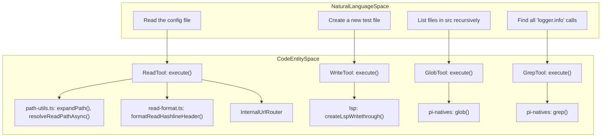
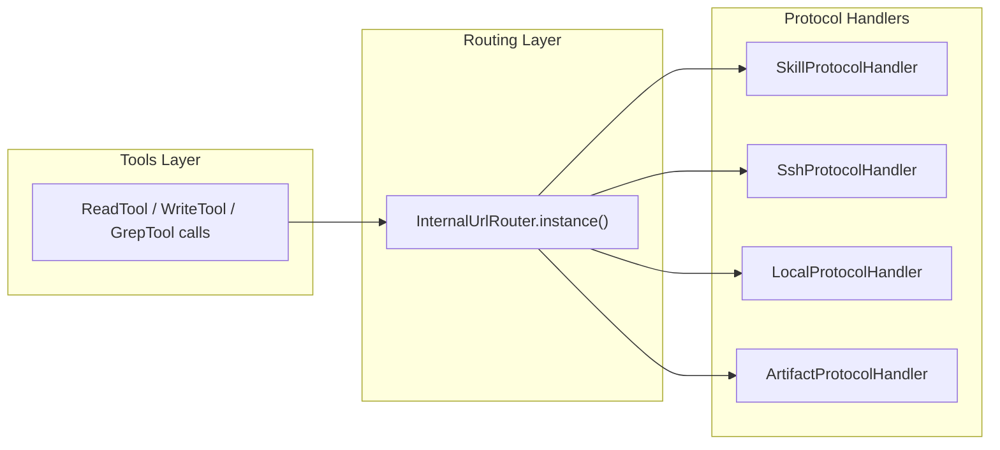
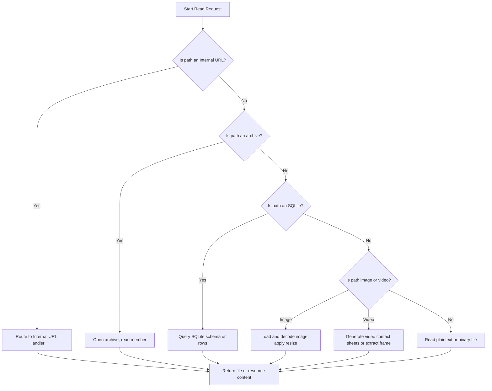

<!-- source: DeepWiki mcp.deepwiki.com · repo can1357/oh-my-pi · page 6.1 File Operations Tools · fetched 2026-10-30 -->

# File Operations Tools

Relevant source files

The following files were used as context for generating this wiki page:

- [docs/mcp-server-tool-authoring.md](docs/mcp-server-tool-authoring.md)
- [docs/tools/read.md](docs/tools/read.md)
- [packages/coding-agent/src/cli/grep-cli.ts](packages/coding-agent/src/cli/grep-cli.ts)
- [packages/coding-agent/src/edit/index.ts](packages/coding-agent/src/edit/index.ts)
- [packages/coding-agent/src/internal-urls/index.ts](packages/coding-agent/src/internal-urls/index.ts)
- [packages/coding-agent/src/internal-urls/local-protocol.ts](packages/coding-agent/src/internal-urls/local-protocol.ts)
- [packages/coding-agent/src/internal-urls/router.ts](packages/coding-agent/src/internal-urls/router.ts)
- [packages/coding-agent/src/internal-urls/types.ts](packages/coding-agent/src/internal-urls/types.ts)
- [packages/coding-agent/src/mcp/tool-bridge.ts](packages/coding-agent/src/mcp/tool-bridge.ts)
- [packages/coding-agent/src/prompts/tools/ask.md](packages/coding-agent/src/prompts/tools/ask.md)
- [packages/coding-agent/src/prompts/tools/ast-edit.md](packages/coding-agent/src/prompts/tools/ast-edit.md)
- [packages/coding-agent/src/prompts/tools/ast-grep.md](packages/coding-agent/src/prompts/tools/ast-grep.md)
- [packages/coding-agent/src/prompts/tools/bash.md](packages/coding-agent/src/prompts/tools/bash.md)
- [packages/coding-agent/src/prompts/tools/find.md](packages/coding-agent/src/prompts/tools/find.md)
- [packages/coding-agent/src/prompts/tools/grep.md](packages/coding-agent/src/prompts/tools/grep.md)
- [packages/coding-agent/src/prompts/tools/lsp.md](packages/coding-agent/src/prompts/tools/lsp.md)
- [packages/coding-agent/src/prompts/tools/read.md](packages/coding-agent/src/prompts/tools/read.md)
- [packages/coding-agent/src/prompts/tools/web-search.md](packages/coding-agent/src/prompts/tools/web-search.md)
- [packages/coding-agent/src/prompts/tools/write.md](packages/coding-agent/src/prompts/tools/write.md)
- [packages/coding-agent/src/tools/ast-edit.ts](packages/coding-agent/src/tools/ast-edit.ts)
- [packages/coding-agent/src/tools/ast-grep.ts](packages/coding-agent/src/tools/ast-grep.ts)
- [packages/coding-agent/src/tools/bash.ts](packages/coding-agent/src/tools/bash.ts)
- [packages/coding-agent/src/tools/grep.ts](packages/coding-agent/src/tools/grep.ts)
- [packages/coding-agent/src/tools/output-meta.ts](packages/coding-agent/src/tools/output-meta.ts)
- [packages/coding-agent/src/tools/path-utils.ts](packages/coding-agent/src/tools/path-utils.ts)
- [packages/coding-agent/src/tools/read-sqlite.ts](packages/coding-agent/src/tools/read-sqlite.ts)
- [packages/coding-agent/src/tools/read.ts](packages/coding-agent/src/tools/read.ts)
- [packages/coding-agent/src/tools/sqlite-reader.ts](packages/coding-agent/src/tools/sqlite-reader.ts)
- [packages/coding-agent/src/tools/write.ts](packages/coding-agent/src/tools/write.ts)
- [packages/coding-agent/src/tools/xdev.ts](packages/coding-agent/src/tools/xdev.ts)
- [packages/coding-agent/src/utils/cpuprofile.ts](packages/coding-agent/src/utils/cpuprofile.ts)
- [packages/coding-agent/src/utils/profile-tree.ts](packages/coding-agent/src/utils/profile-tree.ts)
- [packages/coding-agent/src/utils/sample-profile.ts](packages/coding-agent/src/utils/sample-profile.ts)
- [packages/coding-agent/test/cpuprofile.test.ts](packages/coding-agent/test/cpuprofile.test.ts)
- [packages/coding-agent/test/internal-urls/local-protocol.test.ts](packages/coding-agent/test/internal-urls/local-protocol.test.ts)
- [packages/coding-agent/test/mcp-reconnect.test.ts](packages/coding-agent/test/mcp-reconnect.test.ts)
- [packages/coding-agent/test/mcp-tool-name-canonicalization.test.ts](packages/coding-agent/test/mcp-tool-name-canonicalization.test.ts)
- [packages/coding-agent/test/read-supersede-prune.test.ts](packages/coding-agent/test/read-supersede-prune.test.ts)
- [packages/coding-agent/test/sample-profile.test.ts](packages/coding-agent/test/sample-profile.test.ts)
- [packages/coding-agent/test/streaming-output.test.ts](packages/coding-agent/test/streaming-output.test.ts)
- [packages/coding-agent/test/tools.test.ts](packages/coding-agent/test/tools.test.ts)
- [packages/coding-agent/test/tools/ast-edit.test.ts](packages/coding-agent/test/tools/ast-edit.test.ts)
- [packages/coding-agent/test/tools/ast-grep.test.ts](packages/coding-agent/test/tools/ast-grep.test.ts)
- [packages/coding-agent/test/tools/glob-validate-paths.test.ts](packages/coding-agent/test/tools/glob-validate-paths.test.ts)
- [packages/coding-agent/test/tools/grep-internal-urls.test.ts](packages/coding-agent/test/tools/grep-internal-urls.test.ts)
- [packages/coding-agent/test/tools/path-literal-colon-selector.test.ts](packages/coding-agent/test/tools/path-literal-colon-selector.test.ts)
- [packages/coding-agent/test/tools/read-local-image.test.ts](packages/coding-agent/test/tools/read-local-image.test.ts)
- [packages/coding-agent/test/tools/read-special-files.test.ts](packages/coding-agent/test/tools/read-special-files.test.ts)
- [packages/coding-agent/test/tools/read-truncation-metadata.test.ts](packages/coding-agent/test/tools/read-truncation-metadata.test.ts)
- [packages/coding-agent/test/tools/sqlite.test.ts](packages/coding-agent/test/tools/sqlite.test.ts)
- [packages/coding-agent/test/tools/strip-output-notice.test.ts](packages/coding-agent/test/tools/strip-output-notice.test.ts)
- [packages/coding-agent/test/write-acp-fs.test.ts](packages/coding-agent/test/write-acp-fs.test.ts)
- [packages/coding-agent/test/write-read-projection.test.ts](packages/coding-agent/test/write-read-projection.test.ts)
- [packages/coding-agent/test/write-streaming-preview-expand.test.ts](packages/coding-agent/test/write-streaming-preview-expand.test.ts)
- [packages/coding-agent/test/write-xdev-dispatch.test.ts](packages/coding-agent/test/write-xdev-dispatch.test.ts)
- [packages/tui/src/tools/output-meta.ts](packages/tui/src/tools/output-meta.ts)
- [packages/tui/src/tools/streaming-output.ts](packages/tui/src/tools/streaming-output.ts)
- [packages/tui/src/tools/xdev.ts](packages/tui/src/tools/xdev.ts)
- [packages/tui/test/tool-execution-xdev-render.test.ts](packages/tui/test/tool-execution-xdev-render.test.ts)

## Purpose and Scope

This page documents the core file operation tools within the `oh-my-pi` coding agent, including `read`, `write`, `grep`, `glob`, `ast_grep`, and `ast_edit`. It focuses on advanced path resolution mechanisms, selector processing, internal URL routing, hashline-based addressing, specialized handling for archives, SQLite, images and videos, and conflict detection features.

Sources: [docs/tools/read.md:1-23](), [packages/coding-agent/src/tools/read.ts:1-50]()

---

## 1. Overview and Architecture

The file operations tools provide a unified interface to interact with physical and virtual file systems. They support complex query selectors and protocols, enabling sophisticated read, write, and search behaviors.

### Key Architectural Capabilities

- **Advanced Path Resolution**: Handles tilde (`~`) expansion, Unicode normalization (NFD for macOS), spurious path prefixes (like stray colons), extended Windows path prefixes, shell escaping, and fallback suffix matching for literal paths not found [packages/coding-agent/src/tools/path-utils.ts:1-133]().
- **Internal URL Routing**: Supports multiple virtual schemes (`agent://`, `skill://`, `artifact://`, `local://`, `ssh://`), routed via a singleton `InternalUrlRouter` enabling virtual device interaction [packages/coding-agent/src/tools/read.ts:41-46]().
- **Selectors and Hashlines**: Implements stable hashline addressing like `[FILENAME#TAG]` for precise line anchoring, supporting ranges (`:50-60`), raw (`:raw`), conflicts, images (`:img`), video timestamps, and multi-range selectors [packages/coding-agent/src/prompts/tools/read.md:1-12](), [packages/coding-agent/src/tools/read.ts:90-110]().
- **Truncation and Pagination**: Manages byte and line limits with explicit truncation metadata and notices for safe handling of huge files [packages/coding-agent/src/tools/output-meta.ts:55-190]().
- **Multi-format Support**: Enables reading from archives (ZIP, TAR, RAR, etc.), SQLite databases with table and row queries, editable notebooks, inline images (with binary sniffing), and video frame/contact sheet rendering [packages/coding-agent/src/tools/read.ts:108-167]().
- **Conflict Detection**: Scans files for Git merge conflict markers and produces summarized conflict reports to aid user understanding [packages/coding-agent/src/tools/read.ts:78-85]().

### File Operations Mapping: From Natural Language Requests to Code Entities

Sources: [packages/coding-agent/src/tools/read.ts:1-143](), [packages/coding-agent/src/tools/write.ts:1-58](), [packages/coding-agent/src/tools/grep.ts:1-59](), [packages/coding-agent/src/tools/path-utils.ts:1-133]()

---

## 2. Path Resolution, Selectors, and Internal URL Routing

### 2.1 Path Expansion and Normalization

Path input normalization is handled primarily by `expandPath()` in `path-utils.ts`. The normalization pipeline includes:

- Removing accidental leading colons (e.g., `:/foo/bar`).
- Stripping Windows extended-length prefixes like `\\?\`.
- Normalizing a broad set of Unicode space characters to ASCII spaces.
- Expanding leading tilde (`~`) to the user’s home directory.
- For Windows drive aliases and WSL environments, translating `/c/...` style paths to native Windows-style paths or WSL mount paths.
- macOS-specific normalization applying Unicode NFD and handling curly apostrophes in filenames like screenshots.
- Stripping `file://` URL schemas for local filesystem paths.
- Delegating recognized internal URL schemes to the `InternalUrlRouter` for virtual resource resolution [packages/coding-agent/src/tools/path-utils.ts:25-133]().

Sources: [packages/coding-agent/src/tools/path-utils.ts:25-133]()

### 2.2 Selectors and Addressing

File tools support fine-grained addressing through selectors appended after colons `:`:

- **Line ranges**: e.g., `file.txt:50-100`, or comma-delimited ranges (`file.txt:10-20,30-40`).
- **Tail selectors**: e.g., `file.txt:-60` to read last 60 lines.
- **Special selectors**: `raw` for raw file view, `conflicts` for unresolved merge conflict lines, `img` to render inline images, `video` frames or timestamps [packages/coding-agent/src/prompts/tools/read.md:1-15](), [docs/tools/read.md:37-50]().
- Selectors are parsed and validated via `splitPathAndSel()` and `parseSel()` utilities shared between `read` and `grep` tools to keep grammar consistency [packages/coding-agent/src/tools/read.ts:107](), [packages/coding-agent/src/tools/grep.ts:53]().

Sources: [packages/coding-agent/src/prompts/tools/read.md:1-15](), [docs/tools/read.md:37-50]()

### 2.3 Internal URL Routing

The singleton `InternalUrlRouter` enables dispatching on specialized URI schemes such as `agent://`, `skill://`, `artifact://`, `local://`, and `ssh://`. Each scheme is handled by a dedicated protocol driver module, allowing transparent access to diverse resource types under a uniform interface [packages/coding-agent/src/internal-urls/router.ts]().

Sources: [packages/coding-agent/src/internal-urls/router.ts](), [packages/coding-agent/src/tools/read.ts:41-46]()

---

## 3. Read Tool and Specialized Handlers

### 3.1 Read Tool Overview

The `ReadTool` class implements flexible reads spanning physical files, directory listings, archives (ZIP, TAR, etc.) via `@oh-my-pi/pi-utils/ar`, SQLite databases via `bun:sqlite`, editable notebooks, inline images with binary sniffing, video frames using ffmpeg, and conflict detection scans [packages/coding-agent/src/tools/read.ts:108-167]().

Sources: [packages/coding-agent/src/tools/read.ts:108-167](), [docs/tools/read.md:1-23]()

### 3.2 Whole-File Buffering and Bracket Context

For efficiency, the tool buffers entire files up to 4 MiB (`SNAPSHOT_MAX_BYTES`). This cache layer serves binary vs. text detection, structural content summaries, hashline header context generation, and bracket context extraction without redundant I/O [packages/coding-agent/src/tools/read.ts:190-202]().

Sources: [packages/coding-agent/src/tools/read.ts:190-202]()

### 3.3 Specialized Format Handling Details

- **Archives**: Accessed with member-path parsing (`archive.ext:member/path/to/file`) and shared archive-reading abstractions [packages/coding-agent/src/tools/read.ts:108]().
- **SQLite**: Reads with table and row selectors yield schema details or filtered rows [packages/coding-agent/src/tools/read.ts:166]().
- **Images**: Uses sniffing against header bytes and metadata to embed safe previews, supporting format conversions and interactive image questions [packages/coding-agent/src/tools/read.ts:20-30]().
- **Video**: Integrates ffmpeg extractors to produce video previews, contact sheets, and frame grabs [packages/coding-agent/src/tools/read.ts:143-154]().
- **Conflict Detection**: Scans for Git conflict markers indicating merge conflicts, formatting summaries or detailed conflict block contents [packages/coding-agent/src/tools/read.ts:78-85]().

Sources: [packages/coding-agent/src/tools/read.ts:20-167]()

---

## 4. Write Tool and Conflict Detection

### 4.1 Write Target Addressability and Validation

The `WriteTool` enforces strict write target addressability to avoid errors such as accidental file creation or misrouted writes:
- Accepts absolute disk paths or well-formed internal URLs.
- Rejects unknown or malformed URI-like schemas with typo suggestions [packages/coding-agent/src/tools/write.ts:95-126]().
- Prevents writes to filename targets containing read selectors when no content is supplied [packages/coding-agent/src/tools/write.ts:145-156]().

Sources: [packages/coding-agent/src/tools/write.ts:95-156]()

### 4.2 LSP Writethrough and Diagnostics Integration

The tool integrates an optional Language Server Protocol (LSP) writethrough layer to perform format-on-write, trigger diagnostics refresh and overlay updates, and manage virtual file watching [packages/coding-agent/src/tools/write.ts:27-32]().

Sources: [packages/coding-agent/src/tools/write.ts:27-32]()

### 4.3 xdev Device Dispatch

The `xd://` URL scheme provides a virtual namespace for tool-device dispatching, where writes are validated against tool schemas and delegated to native agent tools internally [packages/coding-agent/src/tools/xdev.ts]().

Sources: [packages/coding-agent/src/tools/xdev.ts]()

---

## 5. Search and Discovery Tools

### 5.1 Glob, Grep, AST Grep, and AST Edit Tools

- **GlobTool**: Wraps `pi-natives` native globbing to efficiently expand patterns across directories [packages/coding-agent/test/tools.test.ts:21]().
- **GrepTool**: Native regex search with support for multi-file pagination, pattern flags, case-sensitivity, `.gitignore`, per-file match caps, a 30-second wall time budget, and safe abort mechanisms [packages/coding-agent/src/tools/grep.ts:70-96]().
- **AstGrepTool**: Structural pattern search using Tree-sitter AST parsing wrapped in native execution [packages/coding-agent/src/tools/ast-grep.ts]().
- **AstEditTool**: AST-aware source rewrites with native bindings, supporting dry-runs, batch files, and error handling [packages/coding-agent/src/tools/ast-edit.ts]().

Sources: [packages/coding-agent/test/tools.test.ts:21](), [packages/coding-agent/src/tools/grep.ts:70-96](), [packages/coding-agent/src/tools/ast-grep.ts](), [packages/coding-agent/src/tools/ast-edit.ts]()

---

# Summary

The file operations tools in `oh-my-pi` provide foundational capabilities for reading, writing, searching, and editing files and virtual resources in a unified manner. They support sophisticated selector and internal URL schemes, rich multi-format content handling, conflict detection, and integration with native libraries and LSP features.

Sources: [packages/coding-agent/src/tools/read.ts:1-50](), [packages/coding-agent/src/tools/write.ts:1-40]()

---

