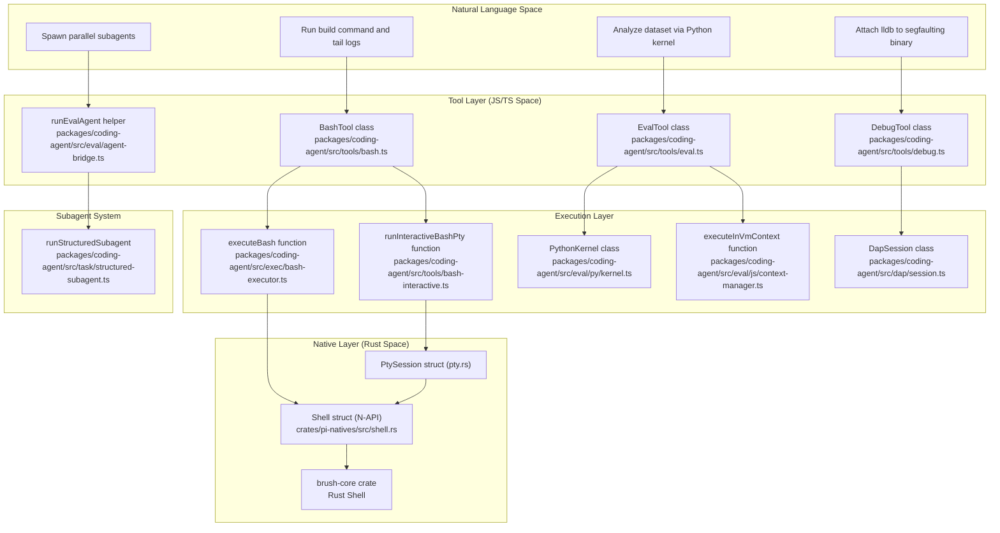
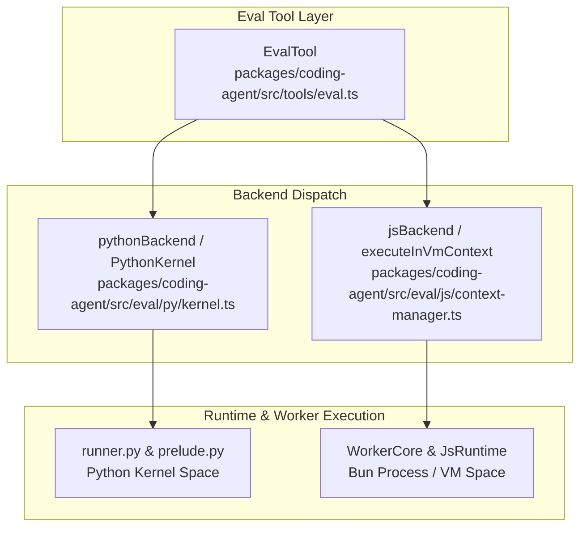
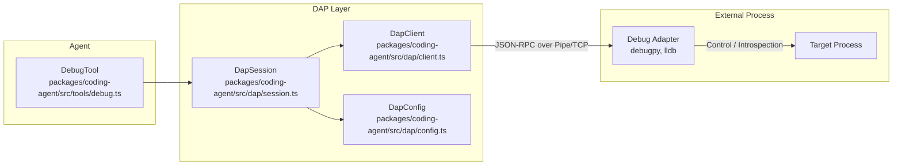

<!-- source: DeepWiki mcp.deepwiki.com · repo can1357/oh-my-pi · page 6.2 Code Execution Tools · fetched 2026-10-30 -->

# Code Execution Tools

Relevant source files

The following files were used as context for generating this wiki page:

- [docs/lsp-config.md](docs/lsp-config.md)
- [docs/python-repl.md](docs/python-repl.md)
- [docs/tools/debug.md](docs/tools/debug.md)
- [docs/tools/eval.md](docs/tools/eval.md)
- [packages/agent/test/speculative-transform-once.test.ts](packages/agent/test/speculative-transform-once.test.ts)
- [packages/coding-agent/src/cli/grep-cli.ts](packages/coding-agent/src/cli/grep-cli.ts)
- [packages/coding-agent/src/dap/client.ts](packages/coding-agent/src/dap/client.ts)
- [packages/coding-agent/src/dap/config.ts](packages/coding-agent/src/dap/config.ts)
- [packages/coding-agent/src/dap/defaults.json](packages/coding-agent/src/dap/defaults.json)
- [packages/coding-agent/src/dap/session.ts](packages/coding-agent/src/dap/session.ts)
- [packages/coding-agent/src/dap/types.ts](packages/coding-agent/src/dap/types.ts)
- [packages/coding-agent/src/eval/agent-bridge.ts](packages/coding-agent/src/eval/agent-bridge.ts)
- [packages/coding-agent/src/eval/backend.ts](packages/coding-agent/src/eval/backend.ts)
- [packages/coding-agent/src/eval/bridge-timeout.ts](packages/coding-agent/src/eval/bridge-timeout.ts)
- [packages/coding-agent/src/eval/completion-bridge.ts](packages/coding-agent/src/eval/completion-bridge.ts)
- [packages/coding-agent/src/eval/executor-base.ts](packages/coding-agent/src/eval/executor-base.ts)
- [packages/coding-agent/src/eval/js/context-manager.ts](packages/coding-agent/src/eval/js/context-manager.ts)
- [packages/coding-agent/src/eval/js/executor.ts](packages/coding-agent/src/eval/js/executor.ts)
- [packages/coding-agent/src/eval/js/index.ts](packages/coding-agent/src/eval/js/index.ts)
- [packages/coding-agent/src/eval/js/process-entry.ts](packages/coding-agent/src/eval/js/process-entry.ts)
- [packages/coding-agent/src/eval/js/shared/helpers.ts](packages/coding-agent/src/eval/js/shared/helpers.ts)
- [packages/coding-agent/src/eval/js/shared/indirect-eval.ts](packages/coding-agent/src/eval/js/shared/indirect-eval.ts)
- [packages/coding-agent/src/eval/js/shared/local-module-loader.ts](packages/coding-agent/src/eval/js/shared/local-module-loader.ts)
- [packages/coding-agent/src/eval/js/shared/prelude.txt](packages/coding-agent/src/eval/js/shared/prelude.txt)
- [packages/coding-agent/src/eval/js/shared/rewrite-imports.ts](packages/coding-agent/src/eval/js/shared/rewrite-imports.ts)
- [packages/coding-agent/src/eval/js/shared/runtime.ts](packages/coding-agent/src/eval/js/shared/runtime.ts)
- [packages/coding-agent/src/eval/js/worker-core.ts](packages/coding-agent/src/eval/js/worker-core.ts)
- [packages/coding-agent/src/eval/js/worker-entry.ts](packages/coding-agent/src/eval/js/worker-entry.ts)
- [packages/coding-agent/src/eval/js/worker-protocol.ts](packages/coding-agent/src/eval/js/worker-protocol.ts)
- [packages/coding-agent/src/eval/kernel-session-registry.ts](packages/coding-agent/src/eval/kernel-session-registry.ts)
- [packages/coding-agent/src/eval/py/executor.ts](packages/coding-agent/src/eval/py/executor.ts)
- [packages/coding-agent/src/eval/py/index.ts](packages/coding-agent/src/eval/py/index.ts)
- [packages/coding-agent/src/eval/py/kernel.ts](packages/coding-agent/src/eval/py/kernel.ts)
- [packages/coding-agent/src/eval/py/prelude.py](packages/coding-agent/src/eval/py/prelude.py)
- [packages/coding-agent/src/eval/py/runner.py](packages/coding-agent/src/eval/py/runner.py)
- [packages/coding-agent/src/eval/py/spawn-options.ts](packages/coding-agent/src/eval/py/spawn-options.ts)
- [packages/coding-agent/src/eval/py/tool-bridge.ts](packages/coding-agent/src/eval/py/tool-bridge.ts)
- [packages/coding-agent/src/jsonrpc/message-framing.ts](packages/coding-agent/src/jsonrpc/message-framing.ts)
- [packages/coding-agent/src/lsp/config.ts](packages/coding-agent/src/lsp/config.ts)
- [packages/coding-agent/src/lsp/defaults.json](packages/coding-agent/src/lsp/defaults.json)
- [packages/coding-agent/src/prompts/system/workflow-notice.md](packages/coding-agent/src/prompts/system/workflow-notice.md)
- [packages/coding-agent/src/prompts/tools/ask.md](packages/coding-agent/src/prompts/tools/ask.md)
- [packages/coding-agent/src/prompts/tools/ast-edit.md](packages/coding-agent/src/prompts/tools/ast-edit.md)
- [packages/coding-agent/src/prompts/tools/ast-grep.md](packages/coding-agent/src/prompts/tools/ast-grep.md)
- [packages/coding-agent/src/prompts/tools/bash.md](packages/coding-agent/src/prompts/tools/bash.md)
- [packages/coding-agent/src/prompts/tools/debug.md](packages/coding-agent/src/prompts/tools/debug.md)
- [packages/coding-agent/src/prompts/tools/eval.md](packages/coding-agent/src/prompts/tools/eval.md)
- [packages/coding-agent/src/prompts/tools/find.md](packages/coding-agent/src/prompts/tools/find.md)
- [packages/coding-agent/src/prompts/tools/grep.md](packages/coding-agent/src/prompts/tools/grep.md)
- [packages/coding-agent/src/prompts/tools/lsp.md](packages/coding-agent/src/prompts/tools/lsp.md)
- [packages/coding-agent/src/prompts/tools/read.md](packages/coding-agent/src/prompts/tools/read.md)
- [packages/coding-agent/src/prompts/tools/web-search.md](packages/coding-agent/src/prompts/tools/web-search.md)
- [packages/coding-agent/src/prompts/tools/write.md](packages/coding-agent/src/prompts/tools/write.md)
- [packages/coding-agent/src/task/commands.ts](packages/coding-agent/src/task/commands.ts)
- [packages/coding-agent/src/task/parallel.ts](packages/coding-agent/src/task/parallel.ts)
- [packages/coding-agent/src/tools/ast-edit.ts](packages/coding-agent/src/tools/ast-edit.ts)
- [packages/coding-agent/src/tools/ast-grep.ts](packages/coding-agent/src/tools/ast-grep.ts)
- [packages/coding-agent/src/tools/bash.ts](packages/coding-agent/src/tools/bash.ts)
- [packages/coding-agent/src/tools/debug.ts](packages/coding-agent/src/tools/debug.ts)
- [packages/coding-agent/src/tools/eval-backends.ts](packages/coding-agent/src/tools/eval-backends.ts)
- [packages/coding-agent/src/tools/eval.ts](packages/coding-agent/src/tools/eval.ts)
- [packages/coding-agent/src/tools/grep.ts](packages/coding-agent/src/tools/grep.ts)
- [packages/coding-agent/src/tools/output-meta.ts](packages/coding-agent/src/tools/output-meta.ts)
- [packages/coding-agent/src/tools/path-utils.ts](packages/coding-agent/src/tools/path-utils.ts)
- [packages/coding-agent/src/tools/read.ts](packages/coding-agent/src/tools/read.ts)
- [packages/coding-agent/src/utils/config-file-sources.ts](packages/coding-agent/src/utils/config-file-sources.ts)
- [packages/coding-agent/test/agent-session-python-cleanup.test.ts](packages/coding-agent/test/agent-session-python-cleanup.test.ts)
- [packages/coding-agent/test/core/eval-workflow-helpers.integration.test.ts](packages/coding-agent/test/core/eval-workflow-helpers.integration.test.ts)
- [packages/coding-agent/test/core/js-static-import-rewrite.test.ts](packages/coding-agent/test/core/js-static-import-rewrite.test.ts)
- [packages/coding-agent/test/core/python-executor-owner-cleanup.test.ts](packages/coding-agent/test/core/python-executor-owner-cleanup.test.ts)
- [packages/coding-agent/test/core/python-runner.integration.test.ts](packages/coding-agent/test/core/python-runner.integration.test.ts)
- [packages/coding-agent/test/core/python-tool-bridge.test.ts](packages/coding-agent/test/core/python-tool-bridge.test.ts)
- [packages/coding-agent/test/dap-config-precedence.test.ts](packages/coding-agent/test/dap-config-precedence.test.ts)
- [packages/coding-agent/test/debug/dap-config.test.ts](packages/coding-agent/test/debug/dap-config.test.ts)
- [packages/coding-agent/test/debug/dap-launch-failures.test.ts](packages/coding-agent/test/debug/dap-launch-failures.test.ts)
- [packages/coding-agent/test/debug/dap-multi-session.test.ts](packages/coding-agent/test/debug/dap-multi-session.test.ts)
- [packages/coding-agent/test/eval/bridge-timeout.test.ts](packages/coding-agent/test/eval/bridge-timeout.test.ts)
- [packages/coding-agent/test/eval/completion-bridge.test.ts](packages/coding-agent/test/eval/completion-bridge.test.ts)
- [packages/coding-agent/test/eval/helpers-local-roots.test.ts](packages/coding-agent/test/eval/helpers-local-roots.test.ts)
- [packages/coding-agent/test/eval/js-cell-syntax-error.test.ts](packages/coding-agent/test/eval/js-cell-syntax-error.test.ts)
- [packages/coding-agent/test/eval/kernel-session-registry.test.ts](packages/coding-agent/test/eval/kernel-session-registry.test.ts)
- [packages/coding-agent/test/eval/kernel-spawn.test.ts](packages/coding-agent/test/eval/kernel-spawn.test.ts)
- [packages/coding-agent/test/eval/prelude-agent.test.ts](packages/coding-agent/test/eval/prelude-agent.test.ts)
- [packages/coding-agent/test/eval/py/prelude.test.ts](packages/coding-agent/test/eval/py/prelude.test.ts)
- [packages/coding-agent/test/eval/py/runner-request-dispatch.test.ts](packages/coding-agent/test/eval/py/runner-request-dispatch.test.ts)
- [packages/coding-agent/test/eval/py/runner-shell-output.test.ts](packages/coding-agent/test/eval/py/runner-shell-output.test.ts)
- [packages/coding-agent/test/eval/runtime-global-dispose.test.ts](packages/coding-agent/test/eval/runtime-global-dispose.test.ts)
- [packages/coding-agent/test/eval/session-tool-timeout.test.ts](packages/coding-agent/test/eval/session-tool-timeout.test.ts)
- [packages/coding-agent/test/eval/worker-core.test.ts](packages/coding-agent/test/eval/worker-core.test.ts)
- [packages/coding-agent/test/fixtures/js-process-entry-import.ts](packages/coding-agent/test/fixtures/js-process-entry-import.ts)
- [packages/coding-agent/test/issue-1528-discovery-default-max-tokens.test.ts](packages/coding-agent/test/issue-1528-discovery-default-max-tokens.test.ts)
- [packages/coding-agent/test/lsp/idle.test.ts](packages/coding-agent/test/lsp/idle.test.ts)
- [packages/coding-agent/test/streaming-output.test.ts](packages/coding-agent/test/streaming-output.test.ts)
- [packages/coding-agent/test/task/commands.test.ts](packages/coding-agent/test/task/commands.test.ts)
- [packages/coding-agent/test/task/parallel.test.ts](packages/coding-agent/test/task/parallel.test.ts)
- [packages/coding-agent/test/task/task-spawn.test.ts](packages/coding-agent/test/task/task-spawn.test.ts)
- [packages/coding-agent/test/tools.test.ts](packages/coding-agent/test/tools.test.ts)
- [packages/coding-agent/test/tools/ast-edit.test.ts](packages/coding-agent/test/tools/ast-edit.test.ts)
- [packages/coding-agent/test/tools/ast-grep.test.ts](packages/coding-agent/test/tools/ast-grep.test.ts)
- [packages/coding-agent/test/tools/eval-description.test.ts](packages/coding-agent/test/tools/eval-description.test.ts)
- [packages/coding-agent/test/tools/eval-display-text.test.ts](packages/coding-agent/test/tools/eval-display-text.test.ts)
- [packages/coding-agent/test/tools/eval-fallback.test.ts](packages/coding-agent/test/tools/eval-fallback.test.ts)
- [packages/coding-agent/test/tools/eval-timeout.test.ts](packages/coding-agent/test/tools/eval-timeout.test.ts)
- [packages/coding-agent/test/tools/glob-validate-paths.test.ts](packages/coding-agent/test/tools/glob-validate-paths.test.ts)
- [packages/coding-agent/test/tools/grep-internal-urls.test.ts](packages/coding-agent/test/tools/grep-internal-urls.test.ts)
- [packages/coding-agent/test/tools/path-literal-colon-selector.test.ts](packages/coding-agent/test/tools/path-literal-colon-selector.test.ts)
- [packages/coding-agent/test/tools/strip-output-notice.test.ts](packages/coding-agent/test/tools/strip-output-notice.test.ts)
- [packages/collab-web/src/tool-render/tools/eval.tsx](packages/collab-web/src/tool-render/tools/eval.tsx)
- [packages/tui/src/tools/output-meta.ts](packages/tui/src/tools/output-meta.ts)
- [packages/tui/src/tools/streaming-output.ts](packages/tui/src/tools/streaming-output.ts)

This page documents the code execution subsystem of the `oh-my-pi` coding agent, focusing on four key components:

- The `bash` tool: shell command execution with approval policies, command interception, PTY support for interactive sessions, and background job management [packages/coding-agent/src/tools/bash.ts:1-170]().
- The `eval` tool: multi-language code execution with persistent Python and JavaScript kernels, including schema definition and session lifecycle [packages/coding-agent/src/tools/eval.ts:1-147]().
- Code mode orchestration: tooling to expose eval tools natively with language declarations and subagent delegation [packages/coding-agent/src/eval/agent-bridge.ts:1-173]().
- The `debug` tool: interactive debugging powered by the Debug Adapter Protocol (DAP) with its session and client management [packages/coding-agent/src/dap/session.ts:1-40]().

These tools provide a rich, persistent runtime environment to translate natural language requests into safe, interactive, or programmatic code execution workflows with streaming outputs, cancellation, and artifact preservation.

Sources: [packages/coding-agent/src/tools/bash.ts:1-170](), [packages/coding-agent/src/tools/eval.ts:1-147](), [packages/coding-agent/src/eval/agent-bridge.ts:1-173](), [packages/coding-agent/src/dap/session.ts:1-40]()

---

## 1. Overview and Architecture

The code execution tools convert high-level model intents into commands and code, executing them either as shell commands or within persistent language kernels, or attaching to debugging sessions. They integrate tightly with native Rust implementations for shell execution and PTY management, leverage asynchronous concurrency patterns for lifecycle and cancellation control, and use agent session state to maintain persistent contexts.

| Tool    | Purpose                       | Execution Model                           | State Persistence                        |
|---------|-------------------------------|------------------------------------------|-----------------------------------------|
| `bash`  | Shell command execution       | brush-core-based shell, with optional PTY | Persistent session environment          |
| `eval`  | Multi-language code execution | Persistent kernels (Python, JS)          | Stateful kernel sessions per language   |
| `debug` | Interactive Debugging         | Debug Adapter Protocol (DAP) client/server | Stateful debug session                   |

Key aspects across these tools:
- **Approval and Interception**: Command filtering and rewriting to enforce security and route to optimal tools [packages/coding-agent/src/tools/bash.ts:40-138]().
- **PTY Support**: Interactive terminal sessions for commands needing terminal features [packages/coding-agent/src/tools/bash-interactive.ts:1-50]().
- **Background Jobs**: Detected long-running shell commands are backgrounded with lightweight notifications [packages/coding-agent/src/tools/bash.ts:68-76]().
- **Persistent Kernels**: Retain language state across calls with session-based execution context [packages/coding-agent/src/tools/eval.ts:108-118]().
- **Streaming Output**: Incremental output with byte and line caps, image extraction, and native minimization [packages/coding-agent/src/tools/output-meta.ts:91-190]().
- **Cancellation and Timeouts**: Built-in timeout clamps and abort signals ensure responsiveness [packages/coding-agent/src/tools/tool-timeouts.ts:1-50]().
- **DAP Integration**: Full lifecycle and concurrency management for debug sessions [packages/coding-agent/src/dap/session.ts:1-40]().

Sources: [packages/coding-agent/src/tools/bash.ts:1-170](), [packages/coding-agent/src/tools/eval.ts:1-147](), [packages/coding-agent/src/dap/session.ts:1-40](), [packages/coding-agent/src/tools/output-meta.ts:91-190]()

---

## 2. Natural Language to Code Entity Mapping

This diagram depicts the flow from natural language requests to the concrete code entities supporting execution across multiple layers and languages.

### Diagram: NaturalLanguageToExecutionEntities

Sources: [packages/coding-agent/src/tools/bash.ts:1-170](), [packages/coding-agent/src/tools/eval.ts:1-147](), [packages/coding-agent/src/eval/agent-bridge.ts:1-173](), [packages/coding-agent/src/dap/session.ts:1-40]()

---

## 3. Bash Tool

The `bash` tool provides shell command execution with sophisticated control, leveraging the Rust-based `brush-core` shell and native bindings for performance, safety, and extensibility [packages/coding-agent/src/tools/bash.ts:1-170]().

### 3.1 Approval and Command Interception
- **Approval Logic**: The `hasBashApprovalShellControl` predicate analyzes commands for dangerous shell control characters (pipes, redirections) or manipulation of execution modes (`-c`, `--eval` options). If detected, the tool requires explicit approval before running [packages/coding-agent/src/tools/bash.ts:96-138]().
- **Command Interception**: The `checkBashInterception` function intercepts specific shell commands and redirects them to optimized tools (e.g., file operations, grep/find) or rewrites git worktree commands [packages/coding-agent/src/tools/bash.ts:40-45]().
- **Internal URL Expansion**: Internal URLs (`skill://`, `agent://`, `artifact://`) are expanded to absolute filesystem paths prior to execution [packages/coding-agent/src/tools/bash.ts:25-27]().

### 3.2 Execution and PTY Support
- **Execution Core**: The `executeBash` function wraps the native Rust shell session interface to synchronously run a shell command with streaming output, cancellation, and timeout support [packages/coding-agent/src/exec/bash-executor.ts:1-162](). It sets up environment variables, applies direnv-based environment overlays, and handles output minimization.
- **PTY Mode**: For interactive commands requiring terminal control, `runInteractiveBashPty` manages a full pseudo-terminal session using the `PtySession` native binding, supporting bidirectional streaming input/output and window resizing [packages/coding-agent/src/tools/bash-interactive.ts:1-50]().

### 3.3 Background Job Management and Other Features
- **Automatic Backgrounding**: When commands run longer than a configured threshold (`AUTO_BACKGROUND_THRESHOLD_MS`), the system races job completion in the background while streaming output [packages/coding-agent/src/tools/bash.ts:22-24]().
- **ACP Terminal Wrapping**: The helper `wrapShellLineForClientTerminal` formats command metadata for ACP terminal mode communication [packages/coding-agent/src/tools/bash.ts:162-168]().

Sources: [packages/coding-agent/src/tools/bash.ts:1-170](), [packages/coding-agent/src/exec/bash-executor.ts:1-162](), [packages/coding-agent/src/tools/bash-interactive.ts:1-50]()

---

## 4. Eval Tool with JS/Python Backends and Kernels

The `eval` tool provides multi-language code execution with persistent kernels for Python and JavaScript, modeled after Jupyter-like environments [packages/coding-agent/src/tools/eval.ts:1-147]().

### 4.1 Language Support and Schema
- **Supported Languages**: 
  - Python (`py`): Persistent IPython-like kernel running in a Python subprocess with a custom runner (`runner.py`) communicating NDJSON frames [packages/coding-agent/src/eval/py/kernel.ts:1-50]().
  - JavaScript (`js`): Executes code inside a persistent Bun worker runtime managed by isolated VM contexts [packages/coding-agent/src/eval/js/context-manager.ts:40-164]().
- **Dynamic Schema**: The tool holds a dynamic schema exposing language tokens reflecting active backends so the LLM only sees enabled runtimes [packages/coding-agent/src/tools/eval.ts:129-135]().

### 4.2 Python Kernel Implementation
- The `PythonKernel` class manages execution within a background Python subprocess started with `runner.py`, handling communication, stdout/stderr capture, exceptions, and import preludes [packages/coding-agent/src/eval/py/kernel.ts:1-50]().

### 4.3 JavaScript Kernel Implementation
- The JavaScript kernel runs in a long-lived Bun worker (`JsEvalWorkerHandle`) managing isolated runtime state, import rewriting, prelude injection, and asynchronous tool call bridges [packages/coding-agent/src/eval/js/context-manager.ts:40-164]().

### Diagram: EvalExecutionFlowAndKernelArchitecture

Sources: [packages/coding-agent/src/tools/eval.ts:1-147](), [packages/coding-agent/src/eval/py/kernel.ts:1-50](), [packages/coding-agent/src/eval/js/context-manager.ts:40-164]()

---

## 5. Code Mode

Code mode is a special interactive mode enhancing the `eval` tool with:
- **Native Invocation Declarations**: Generates runtime declarations exposing tool calls as native functions to the persistent kernels [packages/coding-agent/src/tools/eval.ts:45-55]().
- **Subagent Delegation**: Via the `runEvalAgent` helper in the eval context, code can spawn parallel background subagents with controlled concurrency and lifetime [packages/coding-agent/src/eval/agent-bridge.ts:169-173]().
- **Workflow Integrations**: Supports the `workpool()` helper for bounded concurrency parallelism embedded in workflow preludes [packages/coding-agent/src/prompts/system/workflow-notice.md:1-111]().

Sources: [packages/coding-agent/src/tools/eval.ts:45-55](), [packages/coding-agent/src/eval/agent-bridge.ts:169-173](), [packages/coding-agent/src/prompts/system/workflow-notice.md:1-111]()

---

## 6. Debug Tool (DAP Integration)

The `debug` tool enables interactive debugging through Debug Adapter Protocol (DAP) support, offering pause, step, inspect, breakpoint, and attach/detach capabilities [packages/coding-agent/src/tools/debug.ts:1-60]().

### 6.1 Core Components
- **Debug Interface**: The `DebugTool` class implements tool interface methods converting model requests into DAP operations [packages/coding-agent/src/tools/debug.ts:1-60]().
- **DAP Session Management**: `DapSession` manages connection lifecycles, breakpoint sets, thread states, stack frames, and output buffering [packages/coding-agent/src/dap/session.ts:1-40]().
- **DAP Client**: Handles JSON-RPC message framing, request/response matching, event dispatch, and managing adapter process lifecycle [packages/coding-agent/src/dap/client.ts:1-30]().
- **Adapter Configuration**: `DapConfig` resolves debug adapter launch and attach configurations from workspace settings [packages/coding-agent/src/dap/config.ts:1-20]().

### Diagram: DebugToolAndDapDataFlow

Sources: [packages/coding-agent/src/tools/debug.ts:1-60](), [packages/coding-agent/src/dap/session.ts:1-40](), [packages/coding-agent/src/dap/client.ts:1-30](), [packages/coding-agent/src/dap/config.ts:1-20]()

---

## 7. Output Management and Truncation

The execution tools apply output capping and minimization strategies to maintain responsive and manageable interaction contexts.
- **Streaming Output Limits**: Output is streamed incrementally using `TailBuffer` and related utilities to enforce byte and line limits (`DEFAULT_MAX_BYTES`) [packages/coding-agent/src/tools/output-meta.ts:91-190]().
- **Artifact System**: Truncated outputs are stored as full-text artifacts referenced via `artifact://` URIs [packages/coding-agent/src/tools/output-meta.ts:91-190]().
- **Terminal Graphics Decoding**: The bash executor extracts and sanitizes embedded terminal image protocols (Sixel, iTerm2 images) and surfaces them as structured image content [packages/coding-agent/src/tools/bash.ts:37-38]().

Sources: [packages/coding-agent/src/tools/output-meta.ts:91-190](), [packages/coding-agent/src/tools/bash.ts:37-38]()

---

