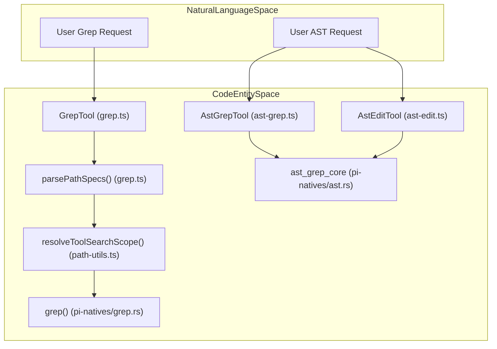
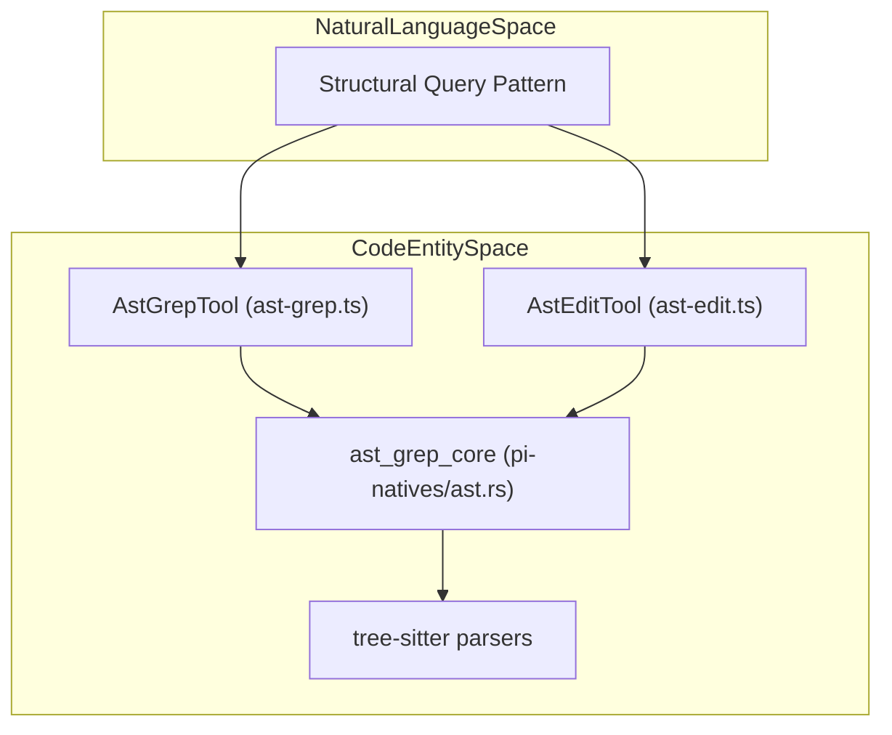

<!-- source: DeepWiki mcp.deepwiki.com · repo can1357/oh-my-pi · page 6.3 Search and Discovery Tools · fetched 2026-10-30 -->

# Search and Discovery Tools

Relevant source files

The following files were used as context for generating this wiki page:

- [crates/pi-natives/Cargo.toml](crates/pi-natives/Cargo.toml)
- [crates/pi-natives/src/ast.rs](crates/pi-natives/src/ast.rs)
- [crates/pi-natives/src/fd.rs](crates/pi-natives/src/fd.rs)
- [crates/pi-natives/src/glob.rs](crates/pi-natives/src/glob.rs)
- [crates/pi-natives/src/glob_util.rs](crates/pi-natives/src/glob_util.rs)
- [crates/pi-natives/src/grep.rs](crates/pi-natives/src/grep.rs)
- [crates/pi-natives/src/highlight.rs](crates/pi-natives/src/highlight.rs)
- [crates/pi-natives/src/pty.rs](crates/pi-natives/src/pty.rs)
- [crates/pi-natives/src/shell.rs](crates/pi-natives/src/shell.rs)
- [crates/pi-shell/Cargo.toml](crates/pi-shell/Cargo.toml)
- [crates/pi-shell/src/lib.rs](crates/pi-shell/src/lib.rs)
- [crates/pi-shell/src/output_decode.rs](crates/pi-shell/src/output_decode.rs)
- [crates/pi-shell/src/shell.rs](crates/pi-shell/src/shell.rs)
- [packages/coding-agent/src/cli/grep-cli.ts](packages/coding-agent/src/cli/grep-cli.ts)
- [packages/coding-agent/src/exec/bash-executor.ts](packages/coding-agent/src/exec/bash-executor.ts)
- [packages/coding-agent/src/prompts/tools/ask.md](packages/coding-agent/src/prompts/tools/ask.md)
- [packages/coding-agent/src/prompts/tools/ast-edit.md](packages/coding-agent/src/prompts/tools/ast-edit.md)
- [packages/coding-agent/src/prompts/tools/ast-grep.md](packages/coding-agent/src/prompts/tools/ast-grep.md)
- [packages/coding-agent/src/prompts/tools/bash.md](packages/coding-agent/src/prompts/tools/bash.md)
- [packages/coding-agent/src/prompts/tools/find.md](packages/coding-agent/src/prompts/tools/find.md)
- [packages/coding-agent/src/prompts/tools/grep.md](packages/coding-agent/src/prompts/tools/grep.md)
- [packages/coding-agent/src/prompts/tools/lsp.md](packages/coding-agent/src/prompts/tools/lsp.md)
- [packages/coding-agent/src/prompts/tools/read.md](packages/coding-agent/src/prompts/tools/read.md)
- [packages/coding-agent/src/prompts/tools/web-search.md](packages/coding-agent/src/prompts/tools/web-search.md)
- [packages/coding-agent/src/prompts/tools/write.md](packages/coding-agent/src/prompts/tools/write.md)
- [packages/coding-agent/src/tools/ast-edit.ts](packages/coding-agent/src/tools/ast-edit.ts)
- [packages/coding-agent/src/tools/ast-grep.ts](packages/coding-agent/src/tools/ast-grep.ts)
- [packages/coding-agent/src/tools/bash-interactive.ts](packages/coding-agent/src/tools/bash-interactive.ts)
- [packages/coding-agent/src/tools/bash-pty-selection.ts](packages/coding-agent/src/tools/bash-pty-selection.ts)
- [packages/coding-agent/src/tools/bash.ts](packages/coding-agent/src/tools/bash.ts)
- [packages/coding-agent/src/tools/grep.ts](packages/coding-agent/src/tools/grep.ts)
- [packages/coding-agent/src/tools/output-meta.ts](packages/coding-agent/src/tools/output-meta.ts)
- [packages/coding-agent/src/tools/path-utils.ts](packages/coding-agent/src/tools/path-utils.ts)
- [packages/coding-agent/src/tools/read.ts](packages/coding-agent/src/tools/read.ts)
- [packages/coding-agent/test/bash-executor.test.ts](packages/coding-agent/test/bash-executor.test.ts)
- [packages/coding-agent/test/streaming-output.test.ts](packages/coding-agent/test/streaming-output.test.ts)
- [packages/coding-agent/test/tools.test.ts](packages/coding-agent/test/tools.test.ts)
- [packages/coding-agent/test/tools/ast-edit.test.ts](packages/coding-agent/test/tools/ast-edit.test.ts)
- [packages/coding-agent/test/tools/ast-grep.test.ts](packages/coding-agent/test/tools/ast-grep.test.ts)
- [packages/coding-agent/test/tools/bash-interactive.test.ts](packages/coding-agent/test/tools/bash-interactive.test.ts)
- [packages/coding-agent/test/tools/bash-pty-selection.test.ts](packages/coding-agent/test/tools/bash-pty-selection.test.ts)
- [packages/coding-agent/test/tools/glob-validate-paths.test.ts](packages/coding-agent/test/tools/glob-validate-paths.test.ts)
- [packages/coding-agent/test/tools/grep-internal-urls.test.ts](packages/coding-agent/test/tools/grep-internal-urls.test.ts)
- [packages/coding-agent/test/tools/path-literal-colon-selector.test.ts](packages/coding-agent/test/tools/path-literal-colon-selector.test.ts)
- [packages/coding-agent/test/tools/strip-output-notice.test.ts](packages/coding-agent/test/tools/strip-output-notice.test.ts)
- [packages/natives/bench/grep.ts](packages/natives/bench/grep.ts)
- [packages/natives/test/native.test.ts](packages/natives/test/native.test.ts)
- [packages/tui/src/tools/output-meta.ts](packages/tui/src/tools/output-meta.ts)
- [packages/tui/src/tools/streaming-output.ts](packages/tui/src/tools/streaming-output.ts)

This page documents the search and discovery tools that enable text pattern matching, file discovery, structural code search, and file path resolution within the oh-my-pi coding agent. These tools leverage high-performance native Rust implementations via N-API bindings to minimize overhead across large codebases.

---

## Overview

The search and discovery subsystem consists of specialized tools designed for different query patterns:

| Tool        | Purpose               | Implementation       | Key Features                                                                             |
|-------------|-----------------------|----------------------|------------------------------------------------------------------------------------------|
| `grep`      | Text pattern search   | Native `grep-searcher` (Rust) via N-API | Regex patterns, line-range selectors, context lines, gitignore support, multi-path search, pagination with `skip`  |
| `glob`      | File discovery        | Native Rust `globset` via N-API          | Flexible glob patterns, hidden files, performance limits                                |
| `find`      | Enhanced path search  | Wrapper around native `glob` + file system enumeration | Multi-directory, glob pattern combos                                                    |
| `ast_grep`  | Structural code search| Native `ast-grep-core` (Rust)             | AST pattern matching, metavariables, language aware, line positioning                   |
| `ast_edit`  | Structural code rewrite| Native `ast-grep-core` (Rust)            | Structural source transformation, pattern-based rewriting, preview/dry-run staging      |

These tools support multi-path search, glob expansion, internal URL routing (`artifact://`, `agent://`, `skill://`), and streaming output limits.

Sources:  
[packages/coding-agent/src/tools/grep.ts:1-90](),  
[packages/coding-agent/src/tools/path-utils.ts:1-130](),  
[crates/pi-natives/src/grep.rs:1-144]()

---

## Tool Architecture and Data Flow

The architecture bridges the natural language agent context to high-performance native Rust execution modules through N-API bindings.

### Natural Language to Code Entity Mapping: Search Pipeline

Sources:  
[packages/coding-agent/src/tools/grep.ts:60-149](),  
[packages/coding-agent/src/tools/path-utils.ts:25-100](),  
[crates/pi-natives/src/grep.rs:72-143]()

---

## Grep Tool: Text Pattern Search

`GrepTool` implements regex content search across directories, files, and archives with support for advanced features such as multi-path and internal URL semantics.

### Implementation and Options

- **Input Validation**: Validates a regex `pattern`, optional `path` entries (multi-path allowed as semicolon-separated strings), case sensitivity (`case` flag), gitignore consideration, and `skip` offset for pagination. [packages/coding-agent/src/tools/grep.ts:60-68]()

- **Multi-Path Parsing**: Uses `parsePathSpecs` to handle path entries which may include line range selectors (e.g. `src/file.ts:10-20`), optionally semantic selectors (`raw`, `conflicts`), carefully preserving literal colon filenames over selector splits. This ensures precise targeting of files and line ranges during search. [packages/coding-agent/src/tools/grep.ts:134-149]()

- **Native Invocation**: Calls the native `grep()` Rust binding with a wall-clock timeout (hardcoded to 30 seconds) to avoid runaway or hung searches on slow or networked filesystems. This native code leverages the `ripgrep` crate ecosystem for efficient regex search with file system walking, glob filtering, and match streaming. [packages/coding-agent/src/tools/grep.ts:90-94](), [crates/pi-natives/src/grep.rs:80-143]()

- **Match Caps and Pagination**: Caps the total results fetched to 2000 matches across files to keep response sizes manageable. Limits per-file matches to 20 in multi-file search scopes to avoid skew from hot files. Single-file searches allow more matches (up to 200). Pagination is implemented by skipping initial matches. [packages/coding-agent/src/tools/grep.ts:71-84]()

- **Result Formatting**: After native search completes, matches are rebased relative to the workspace common base path, formatted with context lines, and can be paged or truncated before replying to the agent session.

### Key Functions

- `parsePathSpecs(rawEntries, cwd)`: Parse input path strings into literal paths plus optional line-range selectors, distinguishing raw selectors, ranges, and preference for literal colon filenames. Returns `GrepPathSpec[]`.  
- `resolveToolSearchScope(rawPaths, cwd)`: Expands multi-path entries into base paths plus glob filters usable by native grep and other tools.  
- `grep(options)`: Native Rust function performing regex searches and returning structured matches.  

Sources:  
[packages/coding-agent/src/tools/grep.ts:60-149](),  
[crates/pi-natives/src/grep.rs:50-143]()

---

## AST Search and Edit Tools: Structural Code Analysis

These specialized tools perform syntax-aware code discovery and transformations using ASTs and tree-sitter grammars, enabling powerful semantic queries and safe code rewrites.

### AST Grep Tool

- **Purpose**: Perform structural pattern matching on source code using AST queries which support metavariables and language overrides.  
- **Implementation**: The `AstGrepTool` wraps the native `astGrep()` function exposed via the `pi-natives` Rust crate that integrates `ast-grep-core` and tree-sitter parsers.  
- **Data Flow**: Inputs include AST patterns (`pat`), optional path(s) (as array or semicolon-separated strings), language hints, skip counts, and limits. Multi-target searching aggregates results, applies pagination, and collects parse errors if any occur.  
- **Example Queries**: Matching specific method calls, named imports, arrow functions, or simple symbol existence.  
- **Native Layer**: native ast-grep-core does the parsing, matching, and returns byte and line-aligned match data. [packages/coding-agent/src/tools/ast-grep.ts:30-130](), [crates/pi-natives/src/ast.rs:1-115]()

### AST Edit Tool

- **Purpose**: Apply AST-aware source code rewrites based on pattern/replacement pairs allowing structural refactoring without brittle textual diffs.  
- **Implementation**: `AstEditTool` uses native `astEdit()` calls that apply multiple rewrite operations over files or directories subject to glob filters.  
- **Preview/Dry-Run Staging**: Supports dry-run mode where changes are computed but not applied on disk; enabling agent preview and review workflows.  
- **Aggregated Results**: Returns total replacements, files touched/searched, parse errors, and flags for limit reached.  
- **Multi-target Processing**: Supports batch invocation over multiple base paths with glob filters, accumulating results. [packages/coding-agent/src/tools/ast-edit.ts:40-130]()

### Natural Language to Code Entity Mapping: AST Engine

Sources:  
[packages/coding-agent/src/tools/ast-grep.ts:1-60](),  
[packages/coding-agent/src/tools/ast-edit.ts:40-130](),  
[crates/pi-natives/src/ast.rs:1-115]()

---

## Glob and Find Tools: File Discovery

### Glob Tool

- Wraps the native Rust `globset` crate via the `pi-natives` bindings to match filesystem paths against glob patterns effectively.  
- Supports options for including hidden files and maximum match thresholds to ensure performance at scale.  
- Facilitates scoped path discovery for other tools like `grep` and `ast_grep`.  

### Find Tool

- Builds on `glob` capabilities by enumerating and filtering filesystem entries across directories and potentially multiple roots.  
- Integrates with internal URL routers to support virtual or special scheme paths.  

Sources:  
[packages/coding-agent/src/tools/glob.ts](),  
[packages/coding-agent/src/tools/path-utils.ts:1-60](),  
[crates/pi-natives/src/glob.rs:1-100]()

---

## Path and Selector Utilities

Utilities support consistent, error-resistant resolution of file and resource paths with support for selector suffixes:

- **`expandPath(filePath: string): string`**  
  Normalizes user input paths: expands tilde (`~`), strips Windows extended-length prefixes, transforms colon-prefixed paths (e.g., `:/abs/path`) for compatibility, normalizes Unicode whitespace, and adjusts for macOS filename variants.  
- **`normalizeWindowsDriveAliasPath()`**  
  Converts paths between native Windows drive forms and WSL mount forms, enabling transparent path translation depending on the host environment.  
- **`splitPathAndSelPreferringLiteral()`**  
  Handles ambiguous colon-separated selectors by preferring existing literal filenames over selector interpretation, enabling correct line-range targeting without confusion from colon characters in filenames.  
- **InternalUrlRouter Integration**  
  Delegates `scheme://` URIs (e.g., `artifact://`, `agent://`) to specialized handlers supporting virtual filesystem access and discovery.  

Sources:  
[packages/coding-agent/src/tools/path-utils.ts:1-130](),  
[packages/coding-agent/test/tools/path-literal-colon-selector.test.ts:1-153]()

---

## Multi-Path Search and Preview/Resolve Staging

All search tools support multi-path inputs allowing batch queries across multiple directories, globs, or virtual URLs in a single call. The input can be semicolon-delimited strings or arrays.

A two-phase approach is adopted for edits and some searches:

1. **Preview (Dry-Run) Phase**  
   Tools like `ast_edit` compute candidate changes without disk writes, enabling the agent to preview, ask for confirmation, or plan.

2. **Resolve (Commit) Phase**  
   Confirmed changes are persisted atomically, with internal utilities handling staging, conflict detection, and resolution.

This separation enhances correctness, user control, and collaboration workflows.

Sources:  
[packages/coding-agent/src/tools/ast-edit.ts:54-135]()

---

## Native Rust Implementations and Performance

Performance-critical components live in the `pi-natives` Rust crate, exported via N-API bindings, providing near-native speed in JavaScript environments.

| Module / File                | Responsibility                                     | Key Dependencies                 |
|-----------------------------|--------------------------------------------------|---------------------------------|
| `crates/pi-natives/src/grep.rs` | Efficient regex search and filesystem traversal | `grep-searcher`, `grep-regex`, `grep-pcre2` |
| `crates/pi-natives/src/ast.rs`  | AST matching and tree-sitter integration        | `ast-grep-core`, `tree-sitter`  |
| `crates/pi-natives/src/glob.rs` | Glob pattern matching and path filtering        | `globset`, `ignore`              |

### Key Native Features

- **File Size Limits**: Restricts regex search to first 4 MiB of files to manage memory and performance. [crates/pi-natives/src/grep.rs:41-41]()

- **PCRE2 JIT**: Enabled by default (except on macOS), dynamically controls regex compilation for better runtime speed. [crates/pi-natives/src/grep.rs:42-48]()

- **Streaming and Batching**: Matches are streamed in batches to JavaScript with backpressure, allowing progressive delivery and responsive UIs.

- **AST Pattern Matching**: Integrates powerful structural search capabilities with language-sensitive tree-sitter grammars and metavariables. [crates/pi-natives/src/ast.rs:1-115]()

Sources:  
[crates/pi-natives/src/grep.rs:1-144](),  
[crates/pi-natives/src/ast.rs:1-115](),  
[crates/pi-natives/src/glob.rs:1-100]()

---

# Appendix

### Key TypeScript Files
- `packages/coding-agent/src/tools/grep.ts` — Grep tool implementation and multi-path scope parsing.
- `packages/coding-agent/src/tools/path-utils.ts` — Path normalization, tilde expansion, and search scope resolution.
- `packages/coding-agent/src/tools/ast-grep.ts` — AST pattern matching tool.
- `packages/coding-agent/src/tools/ast-edit.ts` — AST rewrite and preview tool.

### Key Rust Files
- `crates/pi-natives/src/grep.rs` — N-API bindings for ripgrep-backed search.
- `crates/pi-natives/src/ast.rs` — N-API bindings for `ast-grep-core`.
- `crates/pi-natives/src/glob.rs` — N-API bindings for glob patterns.

---

# References

- [packages/coding-agent/src/tools/grep.ts:1-149]()
- [packages/coding-agent/src/tools/path-utils.ts:1-130]()
- [crates/pi-natives/src/grep.rs:1-144]()
- [crates/pi-natives/src/ast.rs:1-115]()
- [crates/pi-natives/src/glob.rs:1-100]()

---

