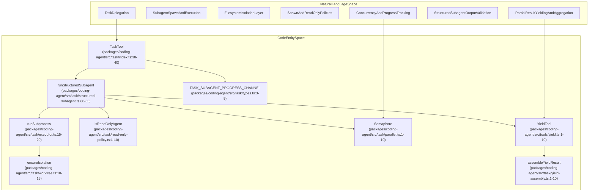
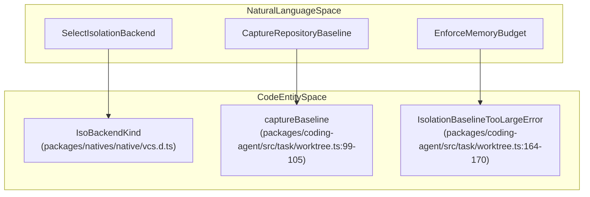

<!-- source: DeepWiki mcp.deepwiki.com · repo can1357/oh-my-pi · page 6.4 Task Delegation Tool · fetched 2026-10-30 -->

# Task Delegation Tool

Relevant source files

The following files were used as context for generating this wiki page:

- [docs/task-agent-discovery.md](docs/task-agent-discovery.md)
- [docs/tools/task.md](docs/tools/task.md)
- [packages/coding-agent/DEVELOPMENT.md](packages/coding-agent/DEVELOPMENT.md)
- [packages/coding-agent/src/autoresearch/git.ts](packages/coding-agent/src/autoresearch/git.ts)
- [packages/coding-agent/src/cli/worktree-cli.ts](packages/coding-agent/src/cli/worktree-cli.ts)
- [packages/coding-agent/src/commands/worktree.ts](packages/coding-agent/src/commands/worktree.ts)
- [packages/coding-agent/src/commit/execute.ts](packages/coding-agent/src/commit/execute.ts)
- [packages/coding-agent/src/prompts/tools/task.md](packages/coding-agent/src/prompts/tools/task.md)
- [packages/coding-agent/src/sdk.ts](packages/coding-agent/src/sdk.ts)
- [packages/coding-agent/src/session/agent-session.ts](packages/coding-agent/src/session/agent-session.ts)
- [packages/coding-agent/src/session/session-entries.ts](packages/coding-agent/src/session/session-entries.ts)
- [packages/coding-agent/src/task/executor.ts](packages/coding-agent/src/task/executor.ts)
- [packages/coding-agent/src/task/index.ts](packages/coding-agent/src/task/index.ts)
- [packages/coding-agent/src/task/isolation-ownership.ts](packages/coding-agent/src/task/isolation-ownership.ts)
- [packages/coding-agent/src/task/isolation-runner.ts](packages/coding-agent/src/task/isolation-runner.ts)
- [packages/coding-agent/src/task/persisted-revive.ts](packages/coding-agent/src/task/persisted-revive.ts)
- [packages/coding-agent/src/task/structured-subagent.ts](packages/coding-agent/src/task/structured-subagent.ts)
- [packages/coding-agent/src/task/types.ts](packages/coding-agent/src/task/types.ts)
- [packages/coding-agent/src/task/worktree.ts](packages/coding-agent/src/task/worktree.ts)
- [packages/coding-agent/src/tools/index.ts](packages/coding-agent/src/tools/index.ts)
- [packages/coding-agent/test/agent-session-prompt-dispatch-race.test.ts](packages/coding-agent/test/agent-session-prompt-dispatch-race.test.ts)
- [packages/coding-agent/test/autoresearch-git.test.ts](packages/coding-agent/test/autoresearch-git.test.ts)
- [packages/coding-agent/test/cli/worktree-add-hook.test.ts](packages/coding-agent/test/cli/worktree-add-hook.test.ts)
- [packages/coding-agent/test/cli/worktree-clear-isolation.test.ts](packages/coding-agent/test/cli/worktree-clear-isolation.test.ts)
- [packages/coding-agent/test/commit-execute.test.ts](packages/coding-agent/test/commit-execute.test.ts)
- [packages/coding-agent/test/git-reftable.test.ts](packages/coding-agent/test/git-reftable.test.ts)
- [packages/coding-agent/test/sdk-workpool-yield-schema.test.ts](packages/coding-agent/test/sdk-workpool-yield-schema.test.ts)
- [packages/coding-agent/test/status-line-vcs-refresh.test.ts](packages/coding-agent/test/status-line-vcs-refresh.test.ts)
- [packages/coding-agent/test/task/autoload-skills.test.ts](packages/coding-agent/test/task/autoload-skills.test.ts)
- [packages/coding-agent/test/task/executor-async-quiescence.test.ts](packages/coding-agent/test/task/executor-async-quiescence.test.ts)
- [packages/coding-agent/test/task/executor-launch-startup.test.ts](packages/coding-agent/test/task/executor-launch-startup.test.ts)
- [packages/coding-agent/test/task/executor-pass-through.test.ts](packages/coding-agent/test/task/executor-pass-through.test.ts)
- [packages/coding-agent/test/task/executor-prewalk.test.ts](packages/coding-agent/test/task/executor-prewalk.test.ts)
- [packages/coding-agent/test/task/executor-recent-output.test.ts](packages/coding-agent/test/task/executor-recent-output.test.ts)
- [packages/coding-agent/test/task/executor-soft-budget.test.ts](packages/coding-agent/test/task/executor-soft-budget.test.ts)
- [packages/coding-agent/test/task/executor-subagent-reminders.test.ts](packages/coding-agent/test/task/executor-subagent-reminders.test.ts)
- [packages/coding-agent/test/task/executor-wall-clock.test.ts](packages/coding-agent/test/task/executor-wall-clock.test.ts)
- [packages/coding-agent/test/task/executor-yield-loop.test.ts](packages/coding-agent/test/task/executor-yield-loop.test.ts)
- [packages/coding-agent/test/task/isolation-ownership.test.ts](packages/coding-agent/test/task/isolation-ownership.test.ts)
- [packages/coding-agent/test/task/persisted-revive.test.ts](packages/coding-agent/test/task/persisted-revive.test.ts)
- [packages/coding-agent/test/task/structured-subagent.test.ts](packages/coding-agent/test/task/structured-subagent.test.ts)
- [packages/coding-agent/test/task/subagent-lsp.test.ts](packages/coding-agent/test/task/subagent-lsp.test.ts)
- [packages/coding-agent/test/task/task-batch.test.ts](packages/coding-agent/test/task/task-batch.test.ts)
- [packages/coding-agent/test/task/task-guards.test.ts](packages/coding-agent/test/task/task-guards.test.ts)
- [packages/coding-agent/test/task/task-schema.test.ts](packages/coding-agent/test/task/task-schema.test.ts)
- [packages/coding-agent/test/task/wire-schema.test.ts](packages/coding-agent/test/task/wire-schema.test.ts)
- [packages/coding-agent/test/task/worktree.test.ts](packages/coding-agent/test/task/worktree.test.ts)
- [packages/coding-agent/test/tools/index.test.ts](packages/coding-agent/test/tools/index.test.ts)
- [packages/coding-agent/test/tools/schema-validation.test.ts](packages/coding-agent/test/tools/schema-validation.test.ts)
- [packages/coding-agent/test/utils/jj.test.ts](packages/coding-agent/test/utils/jj.test.ts)
- [packages/natives/native/vcs.d.ts](packages/natives/native/vcs.d.ts)
- [packages/natives/native/vcs.js](packages/natives/native/vcs.js)

## Purpose and Scope

The Task Delegation Tool (`TaskTool`) enables decomposition and parallelization of complex software development tasks by spawning multiple specialized subagents. Each subagent runs its own isolated agent session, optionally within filesystem-backed isolation contexts, enforcing concurrency limits and spawn policies. The tool supports batch schemas, structured subagent output validated by JSON schemas, partial yielding of results, and controlled execution with progress reporting.

By delegating subtasks concurrently, the main agent can manage large refactorings, exploratory code analysis, or coordinated investigation workflows effectively. This system integrates tightly with budgeting, structured yields, async/background execution, and isolation backends for safe and scalable multi-agent collaboration.

Related topics include [3.4 System Prompts](), [11.2 Async Jobs and Background Execution](), and [8.3 LSP Integration]().

Sources:  
`[packages/coding-agent/src/task/index.ts:1-70]()`  
`[packages/coding-agent/src/task/structured-subagent.ts:1-50]()`  

---

## Architecture and Execution Pipeline

The `TaskTool` orchestrates the lifecycle of subagent tasks: managing concurrency, runtime policies, isolation environments, progress events, and results aggregation.

### Core Functional Components Diagram

This diagram maps natural language concepts of delegation, isolation, policy, concurrency, and result handling to their concrete code entities.

Sources:  
`[packages/coding-agent/src/task/index.ts:1-171]()`  
`[packages/coding-agent/src/task/structured-subagent.ts:1-99]()`  
`[packages/coding-agent/src/task/executor.ts:1-150]()`  
`[packages/coding-agent/src/task/worktree.ts:1-160]()`  
`[packages/coding-agent/src/task/types.ts:3-10]()`  

---

## Batch Schema and Parameters

The `TaskTool` accepts single or batch invocation with flexible parameters described by typed JSON schemas via ArkType (`omptype`). This schema-driven design allows the spawning of multiple tasks concurrently with shared context.

### Key Parameters

| Parameter             | Type                            | Description                                                                                                   |
|-----------------------|--------------------------------|--------------------------------------------------------------------------------------------------------------|
| `name`                | `string`                       | CamelCase identifier (max 32 chars) for addressing subagents in UI or IRC. Auto-generated if omitted.       |
| `agent`               | `string`                       | Agent definition name to spawn (e.g., `"scout"`, `"reviewer"`).                                              |
| `task`                | `string`                       | The task prompt/instructions including target files, changes required, and acceptance criteria.              |
| `effort`              | `"lo" \| "med" \| "hi"`        | Indicates task complexity and guides subagent thinking effort.                                               |
| `model`               | `string \| string[]`           | Overrides for the agent’s default model(s) for this invocation.                                              |
| `outputSchema`        | `unknown`                     | JSON schema for validating the subagent’s structured output, overriding default agent/session schemas.       |
| `schemaMode`          | `"permissive" \| "strict"`     | Validation mode: permissive warns on invalid output, strict fails the task immediately.                      |
| `tools`               | `string[]`                     | Custom tools explicitly exposed to the subagent during execution.                                           |
| `isolated`            | `boolean`                     | Enables filesystem-based isolation for the subagent’s environment (worktree clones, overlays, APFS clones).  |
| `context`             | `string`                     | Shared context string for batch invocations, preventing context duplication per task.                        |

### Batch Mode

- When batch is enabled, multiple tasks are passed as an array `tasks[]` validated against `taskSchemaBatch` [packages/coding-agent/src/task/types.ts:103-109]().
- The shared `context` is appended once for all, optimizing prompt size [packages/coding-agent/src/prompts/tools/task.md:29-30]().
- Non-batch mode calls spawn a single subagent task with individual context.

Sources:  
`[packages/coding-agent/src/task/types.ts:48-120]()`  
`[packages/coding-agent/src/prompts/tools/task.md:1-36]()`  

---

## Spawn Policy and Read-Only Enforcement

### Spawn Policy

- Governs agent spawning eligibility based on configuration and runtime context.
- Controls enablement flags, allowed agent lists, and default spawn behavior.
- Implemented via `resolveSpawnPolicy()` and predicate functions like `isScoutSpawnable()` to gate specialized agents [packages/coding-agent/src/task/index.ts:44-47]().

### Read-Only Policy

- Certain agents (like `"scout"`) are read-only exploration agents and prohibited from making workspace changes.
- The function `isReadOnlyAgent(agentName: string): boolean` enforces this semantic [packages/coding-agent/src/task/read-only-policy.ts:1-28]().
- Prevents concurrent edits, preserving repository state integrity during delegation.

Sources:  
`[packages/coding-agent/src/task/index.ts:125-165]()`  
`[packages/coding-agent/src/task/read-only-policy.ts:1-28]()`  

---

## Executor and Subagent Lifecycles

The executor subsystem (`packages/coding-agent/src/task/executor.ts`) manages spawning and running subagent sessions with these responsibilities:

- Creates subagent `AgentSession`s, initializing their prompt context based on identity, assignment, and system prompts [packages/coding-agent/src/task/executor.ts:60-70]().
- Enforces soft request budgets limiting how many LLM calls the subagent may make before forced yielding.
- Injects steering messages requesting the subagent to wrap up work when budget is exceeded.
- Chooses execution mode: in-process or subprocess spawning.
- Supports graceful cancellation and resource cleanup on abort signals.
- Emits progress events and collates final outputs with error status.

Sources:  
`[packages/coding-agent/src/task/executor.ts:1-120]()`  
`[packages/coding-agent/test/task/executor-subagent-reminders.test.ts:1-40]()`  

---

## Structured Subagent Output and Yield Tool

### Structured Output

- Subagents produce structured JSON results validated against configured schemas via `buildOutputValidator()` [packages/coding-agent/src/task/executor.ts:95-96]().
- The output metadata includes schema source, validation enforcement mode, validity, parsed payload, and validation errors [packages/coding-agent/src/task/structured-subagent.ts:75-90]().

### Yield Tool

- The `YieldTool` is exposed to subagents during a turn, capturing partial results incrementally [packages/coding-agent/src/tools/yield.ts:1-79]().
- Supports concurrent, safe streaming of results without waiting for full task completion.
- Parent agents use `assembleYieldResult()` to aggregate incremental yield payloads into a complete summary [packages/coding-agent/src/task/executor.ts:133-134]().

Sources:  
`[packages/coding-agent/src/task/structured-subagent.ts:75-103]()`  
`[packages/coding-agent/src/tools/yield.ts:1-79]()`  

---

## Isolation Modes and pi-iso Integration

To avoid workspace clobbering and ensure isolated environments for subagents, the tool supports filesystem-level isolation.

### Supported Isolation Backends

Handled by the native `pi-iso` crate (exposed via `pi-natives`), available isolation backends include `Apfs`, `Btrfs`, `Zfs`, `LinuxReflink`, `Overlayfs`, `Projfs`, `WindowsBlockClone`, and `Rcopy` [packages/coding-agent/test/task/worktree.test.ts:66-76]().

### Baseline Capture and Limits

- Before spawning isolated subagents, the current working-tree baseline is captured via `captureBaseline()` [packages/coding-agent/src/task/worktree.ts:34-41]().
- A strict upper limit (`ISOLATION_BASELINE_MAX_CONTENT_BYTES`, ~1GB) caps baseline total to avoid OOM crashes [packages/coding-agent/src/task/worktree.ts:134-153]().
- If exceeded, an `IsolationBaselineTooLargeError` is thrown, stopping isolated task runs [packages/coding-agent/src/task/worktree.ts:154-164]().

### Isolation Execution Flow Diagram

Sources:  
`[packages/coding-agent/src/task/worktree.ts:1-164]()`  
`[packages/coding-agent/test/task/worktree.test.ts:40-140]()`  

---

## Concurrency Control and Progress Rendering

### Throttling with Semaphore

- The tool enforces a concurrency limit on subagent spawn using a `Semaphore` [packages/coding-agent/src/task/parallel.ts:45-60]().
- The utility function `mapWithConcurrencyLimitAllSettled()` schedules work respecting concurrency bounds [packages/coding-agent/src/task/parallel.ts:45-60]().

### Progress Reporting

- Subagent progress events and lifecycle signals broadcast on `TASK_SUBAGENT_PROGRESS_CHANNEL` and `TASK_SUBAGENT_EVENT_CHANNEL` [packages/coding-agent/src/task/types.ts:35-42]().
- The terminal UI tooling consumes these channels to render task states, counts, and token usage statistics [packages/coding-agent/src/task/index.ts:1-58]().

Sources:  
`[packages/coding-agent/src/task/parallel.ts:45-60]()`  
`[packages/coding-agent/src/task/types.ts:35-45]()`  

---

# References

- Main Task Tool: `packages/coding-agent/src/task/index.ts` [1-171]()
- Structured Subagent: `packages/coding-agent/src/task/structured-subagent.ts` [1-99]()
- Subagent Executor: `packages/coding-agent/src/task/executor.ts` [1-150]()
- Isolation System: `packages/coding-agent/src/task/worktree.ts` [1-160]()
- Spawn & Read-Only Policies: `packages/coding-agent/src/task/read-only-policy.ts` [1-28]()
- Yield Tool: `packages/coding-agent/src/tools/yield.ts` [1-60]()
- Concurrency: `packages/coding-agent/src/task/parallel.ts` [45-60]()
- Task Parameter Schemas: `packages/coding-agent/src/task/types.ts` [100-152]()

---

