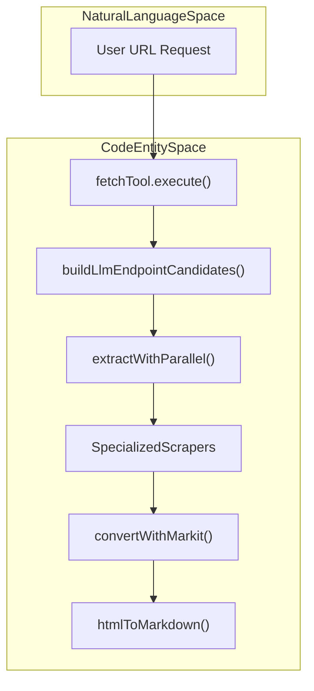
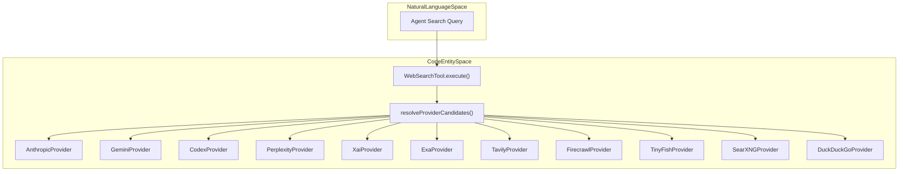
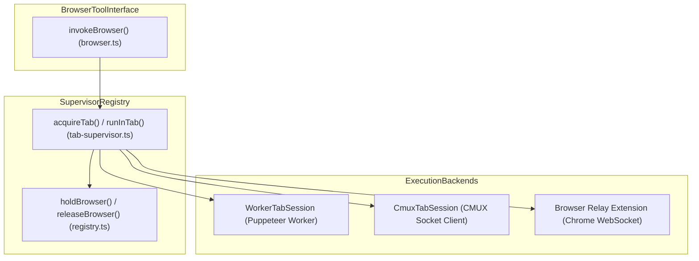

<!-- source: DeepWiki mcp.deepwiki.com · repo can1357/oh-my-pi · page 6.5 Remote and Web Tools · fetched 2026-10-30 -->

# Remote and Web Tools

<details>
<summary>Relevant source files</summary>

The following files were used as context for generating this wiki page:

- [crates/pi-natives/src/desktop/applications.rs](crates/pi-natives/src/desktop/applications.rs)
- [crates/pi-natives/src/desktop/backend.rs](crates/pi-natives/src/desktop/backend.rs)
- [crates/pi-natives/src/desktop/control.rs](crates/pi-natives/src/desktop/control.rs)
- [crates/pi-natives/src/desktop/control/macos.rs](crates/pi-natives/src/desktop/control/macos.rs)
- [crates/pi-natives/src/desktop/macos/applications.rs](crates/pi-natives/src/desktop/macos/applications.rs)
- [crates/pi-natives/src/desktop/macos/ax.rs](crates/pi-natives/src/desktop/macos/ax.rs)
- [crates/pi-natives/src/desktop/macos/ax/menus.rs](crates/pi-natives/src/desktop/macos/ax/menus.rs)
- [crates/pi-natives/src/desktop/macos/ax/open_menu.rs](crates/pi-natives/src/desktop/macos/ax/open_menu.rs)
- [crates/pi-natives/src/desktop/macos/capture.rs](crates/pi-natives/src/desktop/macos/capture.rs)
- [crates/pi-natives/src/desktop/macos/input.rs](crates/pi-natives/src/desktop/macos/input.rs)
- [crates/pi-natives/src/desktop/macos/mod.rs](crates/pi-natives/src/desktop/macos/mod.rs)
- [crates/pi-natives/src/desktop/macos/skylight.rs](crates/pi-natives/src/desktop/macos/skylight.rs)
- [crates/pi-natives/src/desktop/macos/spaces.rs](crates/pi-natives/src/desktop/macos/spaces.rs)
- [crates/pi-natives/src/desktop/mod.rs](crates/pi-natives/src/desktop/mod.rs)
- [crates/pi-natives/src/lib.rs](crates/pi-natives/src/lib.rs)
- [docs/computer-use.md](docs/computer-use.md)
- [docs/tools/browser.md](docs/tools/browser.md)
- [docs/tools/computer.md](docs/tools/computer.md)
- [docs/tools/web_search.md](docs/tools/web_search.md)
- [packages/ai/src/providers/anthropic-user-profiles.ts](packages/ai/src/providers/anthropic-user-profiles.ts)
- [packages/ai/src/registry/api-key-validation.ts](packages/ai/src/registry/api-key-validation.ts)
- [packages/ai/src/registry/oauth/perplexity.ts](packages/ai/src/registry/oauth/perplexity.ts)
- [packages/ai/test/anthropic-api-version.test.ts](packages/ai/test/anthropic-api-version.test.ts)
- [packages/ai/test/api-key-validation.test.ts](packages/ai/test/api-key-validation.test.ts)
- [packages/ai/test/perplexity-login.test.ts](packages/ai/test/perplexity-login.test.ts)
- [packages/browser-relay/CHANGELOG.md](packages/browser-relay/CHANGELOG.md)
- [packages/browser-relay/extension/background.ts](packages/browser-relay/extension/background.ts)
- [packages/catalog/test/outlier-model-policies.test.ts](packages/catalog/test/outlier-model-policies.test.ts)
- [packages/coding-agent/src/blob-broker/provider-files-anthropic.ts](packages/coding-agent/src/blob-broker/provider-files-anthropic.ts)
- [packages/coding-agent/src/cli/web-search-cli.ts](packages/coding-agent/src/cli/web-search-cli.ts)
- [packages/coding-agent/src/exa/index.ts](packages/coding-agent/src/exa/index.ts)
- [packages/coding-agent/src/exa/mcp-client.ts](packages/coding-agent/src/exa/mcp-client.ts)
- [packages/coding-agent/src/exa/types.ts](packages/coding-agent/src/exa/types.ts)
- [packages/coding-agent/src/exec/exec.ts](packages/coding-agent/src/exec/exec.ts)
- [packages/coding-agent/src/launch/ensure.ts](packages/coding-agent/src/launch/ensure.ts)
- [packages/coding-agent/src/mcp/json-rpc.ts](packages/coding-agent/src/mcp/json-rpc.ts)
- [packages/coding-agent/src/modes/rpc/rpc-output.ts](packages/coding-agent/src/modes/rpc/rpc-output.ts)
- [packages/coding-agent/src/prompts/tools/browser.md](packages/coding-agent/src/prompts/tools/browser.md)
- [packages/coding-agent/src/prompts/tools/computer.md](packages/coding-agent/src/prompts/tools/computer.md)
- [packages/coding-agent/src/tools/browser.ts](packages/coding-agent/src/tools/browser.ts)
- [packages/coding-agent/src/tools/browser/attach.ts](packages/coding-agent/src/tools/browser/attach.ts)
- [packages/coding-agent/src/tools/browser/downloads.ts](packages/coding-agent/src/tools/browser/downloads.ts)
- [packages/coding-agent/src/tools/browser/frames.ts](packages/coding-agent/src/tools/browser/frames.ts)
- [packages/coding-agent/src/tools/browser/interactions.ts](packages/coding-agent/src/tools/browser/interactions.ts)
- [packages/coding-agent/src/tools/browser/launch.ts](packages/coding-agent/src/tools/browser/launch.ts)
- [packages/coding-agent/src/tools/browser/op-timeouts.ts](packages/coding-agent/src/tools/browser/op-timeouts.ts)
- [packages/coding-agent/src/tools/browser/orphan-registry.ts](packages/coding-agent/src/tools/browser/orphan-registry.ts)
- [packages/coding-agent/src/tools/browser/prelude.js](packages/coding-agent/src/tools/browser/prelude.js)
- [packages/coding-agent/src/tools/browser/prelude.py](packages/coding-agent/src/tools/browser/prelude.py)
- [packages/coding-agent/src/tools/browser/registry.ts](packages/coding-agent/src/tools/browser/registry.ts)
- [packages/coding-agent/src/tools/browser/relay/bridge.ts](packages/coding-agent/src/tools/browser/relay/bridge.ts)
- [packages/coding-agent/src/tools/browser/relay/daemon.ts](packages/coding-agent/src/tools/browser/relay/daemon.ts)
- [packages/coding-agent/src/tools/browser/relay/extension-assets/background.js.txt](packages/coding-agent/src/tools/browser/relay/extension-assets/background.js.txt)
- [packages/coding-agent/src/tools/browser/relay/probe.ts](packages/coding-agent/src/tools/browser/relay/probe.ts)
- [packages/coding-agent/src/tools/browser/relay/protocol.ts](packages/coding-agent/src/tools/browser/relay/protocol.ts)
- [packages/coding-agent/src/tools/browser/relay/server.ts](packages/coding-agent/src/tools/browser/relay/server.ts)
- [packages/coding-agent/src/tools/browser/screenshot.ts](packages/coding-agent/src/tools/browser/screenshot.ts)
- [packages/coding-agent/src/tools/browser/shared-daemon.ts](packages/coding-agent/src/tools/browser/shared-daemon.ts)
- [packages/coding-agent/src/tools/browser/tab-protocol.ts](packages/coding-agent/src/tools/browser/tab-protocol.ts)
- [packages/coding-agent/src/tools/browser/tab-supervisor.ts](packages/coding-agent/src/tools/browser/tab-supervisor.ts)
- [packages/coding-agent/src/tools/browser/tab-worker.ts](packages/coding-agent/src/tools/browser/tab-worker.ts)
- [packages/coding-agent/src/tools/browser/upload-files.ts](packages/coding-agent/src/tools/browser/upload-files.ts)
- [packages/coding-agent/src/tools/computer.ts](packages/coding-agent/src/tools/computer.ts)
- [packages/coding-agent/src/tools/computer/call.ts](packages/coding-agent/src/tools/computer/call.ts)
- [packages/coding-agent/src/tools/computer/prelude.js](packages/coding-agent/src/tools/computer/prelude.js)
- [packages/coding-agent/src/tools/computer/prelude.py](packages/coding-agent/src/tools/computer/prelude.py)
- [packages/coding-agent/src/tools/computer/protocol.ts](packages/coding-agent/src/tools/computer/protocol.ts)
- [packages/coding-agent/src/tools/computer/supervisor.ts](packages/coding-agent/src/tools/computer/supervisor.ts)
- [packages/coding-agent/src/tools/computer/worker.ts](packages/coding-agent/src/tools/computer/worker.ts)
- [packages/coding-agent/src/tools/fetch.ts](packages/coding-agent/src/tools/fetch.ts)
- [packages/coding-agent/src/tools/read-pdf.ts](packages/coding-agent/src/tools/read-pdf.ts)
- [packages/coding-agent/src/utils/browser-session.ts](packages/coding-agent/src/utils/browser-session.ts)
- [packages/coding-agent/src/web/kagi.ts](packages/coding-agent/src/web/kagi.ts)
- [packages/coding-agent/src/web/parallel.ts](packages/coding-agent/src/web/parallel.ts)
- [packages/coding-agent/src/web/scrapers/types.ts](packages/coding-agent/src/web/scrapers/types.ts)
- [packages/coding-agent/src/web/scrapers/utils.ts](packages/coding-agent/src/web/scrapers/utils.ts)
- [packages/coding-agent/src/web/scrapers/youtube.ts](packages/coding-agent/src/web/scrapers/youtube.ts)
- [packages/coding-agent/src/web/search/index.ts](packages/coding-agent/src/web/search/index.ts)
- [packages/coding-agent/src/web/search/provider.ts](packages/coding-agent/src/web/search/provider.ts)
- [packages/coding-agent/src/web/search/providers/anthropic.ts](packages/coding-agent/src/web/search/providers/anthropic.ts)
- [packages/coding-agent/src/web/search/providers/base.ts](packages/coding-agent/src/web/search/providers/base.ts)
- [packages/coding-agent/src/web/search/providers/brave.ts](packages/coding-agent/src/web/search/providers/brave.ts)
- [packages/coding-agent/src/web/search/providers/codex.ts](packages/coding-agent/src/web/search/providers/codex.ts)
- [packages/coding-agent/src/web/search/providers/exa.ts](packages/coding-agent/src/web/search/providers/exa.ts)
- [packages/coding-agent/src/web/search/providers/firecrawl.ts](packages/coding-agent/src/web/search/providers/firecrawl.ts)
- [packages/coding-agent/src/web/search/providers/gemini.ts](packages/coding-agent/src/web/search/providers/gemini.ts)
- [packages/coding-agent/src/web/search/providers/jina.ts](packages/coding-agent/src/web/search/providers/jina.ts)
- [packages/coding-agent/src/web/search/providers/kagi.ts](packages/coding-agent/src/web/search/providers/kagi.ts)
- [packages/coding-agent/src/web/search/providers/openai.ts](packages/coding-agent/src/web/search/providers/openai.ts)
- [packages/coding-agent/src/web/search/providers/parallel.ts](packages/coding-agent/src/web/search/providers/parallel.ts)
- [packages/coding-agent/src/web/search/providers/perplexity-auth.ts](packages/coding-agent/src/web/search/providers/perplexity-auth.ts)
- [packages/coding-agent/src/web/search/providers/perplexity.ts](packages/coding-agent/src/web/search/providers/perplexity.ts)
- [packages/coding-agent/src/web/search/providers/searxng.ts](packages/coding-agent/src/web/search/providers/searxng.ts)
- [packages/coding-agent/src/web/search/providers/tavily.ts](packages/coding-agent/src/web/search/providers/tavily.ts)
- [packages/coding-agent/src/web/search/providers/tinyfish.ts](packages/coding-agent/src/web/search/providers/tinyfish.ts)
- [packages/coding-agent/src/web/search/providers/utils.ts](packages/coding-agent/src/web/search/providers/utils.ts)
- [packages/coding-agent/src/web/search/providers/xai.ts](packages/coding-agent/src/web/search/providers/xai.ts)
- [packages/coding-agent/src/web/search/types.ts](packages/coding-agent/src/web/search/types.ts)
- [packages/coding-agent/test/agent-session-auto-compaction-progress-guard.test.ts](packages/coding-agent/test/agent-session-auto-compaction-progress-guard.test.ts)
- [packages/coding-agent/test/eval/browser-prelude-facade.test.ts](packages/coding-agent/test/eval/browser-prelude-facade.test.ts)
- [packages/coding-agent/test/exec-command.test.ts](packages/coding-agent/test/exec-command.test.ts)
- [packages/coding-agent/test/fixtures/browser-executable-probe.ts](packages/coding-agent/test/fixtures/browser-executable-probe.ts)
- [packages/coding-agent/test/mcp-json-rpc.test.ts](packages/coding-agent/test/mcp-json-rpc.test.ts)
- [packages/coding-agent/test/model-registry-command-values.test.ts](packages/coding-agent/test/model-registry-command-values.test.ts)
- [packages/coding-agent/test/security/slash-command.test.ts](packages/coding-agent/test/security/slash-command.test.ts)
- [packages/coding-agent/test/session-storage-fd-inheritance.test.ts](packages/coding-agent/test/session-storage-fd-inheritance.test.ts)
- [packages/coding-agent/test/slash-commands/computer.test.ts](packages/coding-agent/test/slash-commands/computer.test.ts)
- [packages/coding-agent/test/tools/browser-attach.test.ts](packages/coding-agent/test/tools/browser-attach.test.ts)
- [packages/coding-agent/test/tools/browser-freeze-settle.test.ts](packages/coding-agent/test/tools/browser-freeze-settle.test.ts)
- [packages/coding-agent/test/tools/browser-interactions.test.ts](packages/coding-agent/test/tools/browser-interactions.test.ts)
- [packages/coding-agent/test/tools/browser-launch.test.ts](packages/coding-agent/test/tools/browser-launch.test.ts)
- [packages/coding-agent/test/tools/browser-open-lease.test.ts](packages/coding-agent/test/tools/browser-open-lease.test.ts)
- [packages/coding-agent/test/tools/browser-open-options.test.ts](packages/coding-agent/test/tools/browser-open-options.test.ts)
- [packages/coding-agent/test/tools/browser-orphan-registry.test.ts](packages/coding-agent/test/tools/browser-orphan-registry.test.ts)
- [packages/coding-agent/test/tools/browser-profile-cleanup.test.ts](packages/coding-agent/test/tools/browser-profile-cleanup.test.ts)
- [packages/coding-agent/test/tools/browser-relay-bridge.test.ts](packages/coding-agent/test/tools/browser-relay-bridge.test.ts)
- [packages/coding-agent/test/tools/browser-relay-daemon.test.ts](packages/coding-agent/test/tools/browser-relay-daemon.test.ts)
- [packages/coding-agent/test/tools/browser-relay-probe.test.ts](packages/coding-agent/test/tools/browser-relay-probe.test.ts)
- [packages/coding-agent/test/tools/browser-relay-server.test.ts](packages/coding-agent/test/tools/browser-relay-server.test.ts)
- [packages/coding-agent/test/tools/browser-relay-tab-isolation.test.ts](packages/coding-agent/test/tools/browser-relay-tab-isolation.test.ts)
- [packages/coding-agent/test/tools/browser-screenshot-session-abort.test.ts](packages/coding-agent/test/tools/browser-screenshot-session-abort.test.ts)
- [packages/coding-agent/test/tools/browser-shared-wedge.test.ts](packages/coding-agent/test/tools/browser-shared-wedge.test.ts)
- [packages/coding-agent/test/tools/browser-tab-worker-startup.test.ts](packages/coding-agent/test/tools/browser-tab-worker-startup.test.ts)
- [packages/coding-agent/test/tools/browser-upload-chooser.test.ts](packages/coding-agent/test/tools/browser-upload-chooser.test.ts)
- [packages/coding-agent/test/tools/browser-upload-contents.test.ts](packages/coding-agent/test/tools/browser-upload-contents.test.ts)
- [packages/coding-agent/test/tools/browser-upload-drop.test.ts](packages/coding-agent/test/tools/browser-upload-drop.test.ts)
- [packages/coding-agent/test/tools/browser-worker-exit.test.ts](packages/coding-agent/test/tools/browser-worker-exit.test.ts)
- [packages/coding-agent/test/tools/computer.test.ts](packages/coding-agent/test/tools/computer.test.ts)
- [packages/coding-agent/test/tools/fetch-http-status.test.ts](packages/coding-agent/test/tools/fetch-http-status.test.ts)
- [packages/coding-agent/test/tools/fetch-kagi-toggle.test.ts](packages/coding-agent/test/tools/fetch-kagi-toggle.test.ts)
- [packages/coding-agent/test/tools/fetch-raw-mode.test.ts](packages/coding-agent/test/tools/fetch-raw-mode.test.ts)
- [packages/coding-agent/test/tools/fetch-user-agent-retry.test.ts](packages/coding-agent/test/tools/fetch-user-agent-retry.test.ts)
- [packages/coding-agent/test/tools/multi-path-missing.test.ts](packages/coding-agent/test/tools/multi-path-missing.test.ts)
- [packages/coding-agent/test/tools/root-path-alias.test.ts](packages/coding-agent/test/tools/root-path-alias.test.ts)
- [packages/coding-agent/test/tools/search-url-paths.test.ts](packages/coding-agent/test/tools/search-url-paths.test.ts)
- [packages/coding-agent/test/tools/web-scrapers/youtube.test.ts](packages/coding-agent/test/tools/web-scrapers/youtube.test.ts)
- [packages/coding-agent/test/tools/web-search-codex.test.ts](packages/coding-agent/test/tools/web-search-codex.test.ts)
- [packages/coding-agent/test/tools/web-search-exa.test.ts](packages/coding-agent/test/tools/web-search-exa.test.ts)
- [packages/coding-agent/test/tools/web-search-firecrawl.test.ts](packages/coding-agent/test/tools/web-search-firecrawl.test.ts)
- [packages/coding-agent/test/tools/web-search-gemini.test.ts](packages/coding-agent/test/tools/web-search-gemini.test.ts)
- [packages/coding-agent/test/tools/web-search-kagi.test.ts](packages/coding-agent/test/tools/web-search-kagi.test.ts)
- [packages/coding-agent/test/tools/web-search-parallel.test.ts](packages/coding-agent/test/tools/web-search-parallel.test.ts)
- [packages/coding-agent/test/tools/web-search-searxng.test.ts](packages/coding-agent/test/tools/web-search-searxng.test.ts)
- [packages/coding-agent/test/tools/web-search-tavily.test.ts](packages/coding-agent/test/tools/web-search-tavily.test.ts)
- [packages/coding-agent/test/tools/web-search-tinyfish.test.ts](packages/coding-agent/test/tools/web-search-tinyfish.test.ts)
- [packages/coding-agent/test/tools/web-search-xai.test.ts](packages/coding-agent/test/tools/web-search-xai.test.ts)
- [packages/coding-agent/test/utils/browser-session.test.ts](packages/coding-agent/test/utils/browser-session.test.ts)
- [packages/coding-agent/test/web/search/abort-and-timeout.test.ts](packages/coding-agent/test/web/search/abort-and-timeout.test.ts)
- [packages/coding-agent/test/web/search/anthropic.test.ts](packages/coding-agent/test/web/search/anthropic.test.ts)
- [packages/coding-agent/test/web/search/cli-provider-settings.test.ts](packages/coding-agent/test/web/search/cli-provider-settings.test.ts)
- [packages/coding-agent/test/web/search/codex-broker.test.ts](packages/coding-agent/test/web/search/codex-broker.test.ts)
- [packages/coding-agent/test/web/search/openai.test.ts](packages/coding-agent/test/web/search/openai.test.ts)
- [packages/coding-agent/test/web/search/perplexity.test.ts](packages/coding-agent/test/web/search/perplexity.test.ts)
- [packages/coding-agent/test/web/search/provider-chain.test.ts](packages/coding-agent/test/web/search/provider-chain.test.ts)
- [packages/coding-agent/test/web/search/xai.test.ts](packages/coding-agent/test/web/search/xai.test.ts)
- [packages/natives/CHANGELOG.md](packages/natives/CHANGELOG.md)
- [packages/natives/native/index.d.ts](packages/natives/native/index.d.ts)
- [packages/natives/native/index.js](packages/natives/native/index.js)
- [packages/utils/src/fs-open.ts](packages/utils/src/fs-open.ts)
- [packages/utils/test/fs-open.test.ts](packages/utils/test/fs-open.test.ts)

</details>


## Purpose and Scope

This page documents the tools for remote operations, web content retrieval, internet research, browser automation, and desktop computer control in `oh-my-pi`. These components enable the agent to fetch external data, execute AI-powered web searches across multiple provider integrations, interact with complex web pages via browser tabs and relay extensions, and perform scriptable host desktop automation.

Sources: [packages/coding-agent/src/tools/fetch.ts:37-85](), [docs/tools/web_search.md:1-4](), [packages/coding-agent/src/tools/browser.ts:91-134](), [docs/computer-use.md:1-10]()

---

## Overview

The remote and web tool suite provides unified capabilities for external interactions:

| Tool         | Purpose                          | Key Features                                                                                                     |
|--------------|---------------------------------|----------------------------------------------------------------------------------------------------------------|
| `fetch`      | Retrieve and convert web content| HTML-to-Markdown conversion via native bindings, document format handling, `.well-known/llms.txt` support. Integrated into `ReadTool`. [packages/coding-agent/src/tools/fetch.ts:99-120]() |
| `web_search` | Search the web via AI providers  | Unified interface supporting Anthropic, Perplexity, Exa, Brave, Jina, Kimi, Gemini, Codex, Tavily, Kagi, Z.AI, SearXNG, and xAI. [docs/tools/web_search.md:1-40]() |
| `browser`    | Stateful multi-tab browsing      | Control headless, spawned, or attached Chromium/Electron browsers via Puppeteer, CMUX socket client, or Browser Relay extension. [packages/coding-agent/src/tools/browser.ts:91-134]() |
| `computer`   | Desktop automation (Eval prelude)| Screen capture, mouse, keyboard, and window control via persistent background workers backed by native desktop bindings (`DesktopSession`). [docs/tools/computer.md:1-20]() |

Sources: [packages/coding-agent/src/tools/fetch.ts:37-85](), [docs/tools/web_search.md:1-40](), [packages/coding-agent/src/tools/browser.ts:91-134](), [docs/tools/computer.md:1-20]()

---

## Fetch Tool

### Purpose and Schema

The `fetch` tool handles URL content retrieval and conversion. It supports targets with line range selectors (`:50-100`), raw content flags (`:raw`), and embedded structural fragment selectors.

The primary parsing function is `parseReadUrlTarget()`, which normalizes URLs and splits out trailing query/selector suffixes, performing URL repair and validation.

```ts
// parseReadUrlTarget(readPath: string): ParsedReadUrlTarget | null
```

Sources: [packages/coding-agent/src/tools/fetch.ts:37-85]()

### Content Retrieval Flow

The fetch implementation employs a staged waterfall pipeline:
1. **LLM Endpoint Detection:** Locates `.well-known/llms.txt` or structured markdown metadata using `buildLlmEndpointCandidates()`.
2. **Parallel Extraction:** Attempts structured parallel extraction via `extractWithParallel()`.
3. **Specialized Scrapers:** Applies platform-specific extractors for media platforms and rich documents.
4. **Document Conversion:** Translates recognized document formats (PDF, DOCX, PPTX, XLSX, EPUB) via `convertWithMarkit()`.
5. **HTML-to-Markdown Conversion:** Converts generic HTML markup using native Rust bindings via `htmlToMarkdown()`.


Sources: [packages/coding-agent/src/tools/fetch.ts:45-87]()

### Document and Image Handling

The tool categorizes files by MIME types and extensions:
- **Convertible Documents:** Converted to Markdown via Markit converters.
- **Jupyter Notebooks:** MIME `application/x-ipynb+json` rendered as editable text.
- **SQLite Databases:** Inspected via embedded SQLite reader utilities.
- **Archives:** ZIP, TAR, and GZIP inspected to list directory roots.
- **Images:** PNG, JPEG, GIF, WEBP optimized via `resizeImage()` for agent context limits.

Sources: [packages/coding-agent/src/tools/fetch.ts:45-120]()

---

## Web Search Tool and Provider Integrations

### Unified Search Interface

The `web_search` tool exposes a unified schema accepting parameters like `query`, `recency`, `limit`, `max_tokens`, `temperature`, and `num_search_results`.

```ts
// webSearchSchema parameters: query, recency, limit, max_tokens, temperature, num_search_results
```

When invoked, the tool executes the following pipeline:
- Resolves search providers via `resolveProviderCandidates()`.
- Maps placeholders like `web/hosted` to active session models.
- Dispatches execution to provider-specific adapters with appropriate credential routing.
- Returns normalized structured responses containing answers, source citations, related questions, and metadata.


Sources: [packages/coding-agent/src/web/search/index.ts:1-173](), [docs/tools/web_search.md:1-83]()

### Supported Providers

Provider integrations include Anthropic, Google Gemini, OpenAI Codex, Perplexity, xAI (Grok), Exa, Firecrawl, Tavily, TinyFish, SearXNG, DuckDuckGo, and synthetic aggregators. Each provider adapter implements unified request/response normalization.

Sources: [packages/coding-agent/src/web/search/index.ts:1-100]()

---

## Browser Tool and Browser Relay

### Architecture and Lifecycle

The `browser` tool enables programmatic control over Chromium and Electron browser instances. It supports opening, closing, script execution, navigation, and detailed interaction primitives.

Tabs are referenced by string identifiers (default `"main"`).


Sources: [packages/coding-agent/src/tools/browser.ts:91-134](), [packages/coding-agent/src/tools/browser/tab-supervisor.ts:85-125]()

### Execution Backends

1. **Worker Backend:** Runs Puppeteer within isolated worker processes controlling headless Chromium or Electron, supporting page lifecycle freezing (`Page.setWebLifecycleState`).
2. **CMUX Backend:** Connects via a multiplexed socket client to shared browser surfaces.
3. **Browser Relay:** Connects to the user's live Chrome browser using a Chrome extension that exposes a CDP WebSocket façade, enabling authenticated interaction on existing browser tabs.

Sources: [packages/coding-agent/src/tools/browser/tab-supervisor.ts:120-165]()

---

## Computer-Use Tool

### Purpose and Operation

The `computer` tool is an Eval prelude (`computer`) that drives real host operating system GUIs. It uses persistent background supervisor workers (`ComputerSupervisor`) communicating with the native addon (`DesktopSession` defined in `crates/pi-natives/src/desktop/mod.rs` and exposed via `packages/natives/native/index.js`).

Key capabilities include:
- Display and window enumeration (`computer.displays()`, `computer.window()`).
- Screenshot capture with native coordinate scaling (`win.screenshot()`).
- Accessibility tree inspection and element handles (`win.ax()`, `computer.ref()`).
- Simulated input operations (mouse clicks, dragging, scrolling, key chords, typing).
- Multi-step execution via `computer.run(fnOrCode, options)`.

Sources: [docs/computer-use.md:1-75](), [docs/tools/computer.md:1-68](), [packages/coding-agent/src/tools/computer.ts]()

### Safety and Approval

The tool respects `tools.approvalMode: write` and `computer.backgroundFallback` (`takeover` or `refuse`), restricting unprompted writes and managing focus interventions when running background window inputs.

Sources: [docs/computer-use.md:8-38](), [docs/tools/computer.md:28-40]()

---

# Summary

The Remote and Web Tools suite provides a robust set of network and system automation interfaces:
- **`fetch`** retrieves and converts web documents and data feeds into agent-readable Markdown.
- **`web_search`** aggregates AI-powered search services into a single invocation interface.
- **`browser`** provides structured multi-tab automation via Puppeteer, CMUX, and live Chrome relays.
- **`computer`** enables native host GUI control via an Eval prelude backed by native Rust OS bindings.

Sources:
[packages/coding-agent/src/tools/fetch.ts](),
[docs/tools/web_search.md](),
[packages/coding-agent/src/web/search/index.ts](),
[packages/coding-agent/src/tools/browser.ts](),
[packages/coding-agent/src/tools/browser/tab-supervisor.ts](),
[docs/computer-use.md](),
[docs/tools/computer.md]()

---

