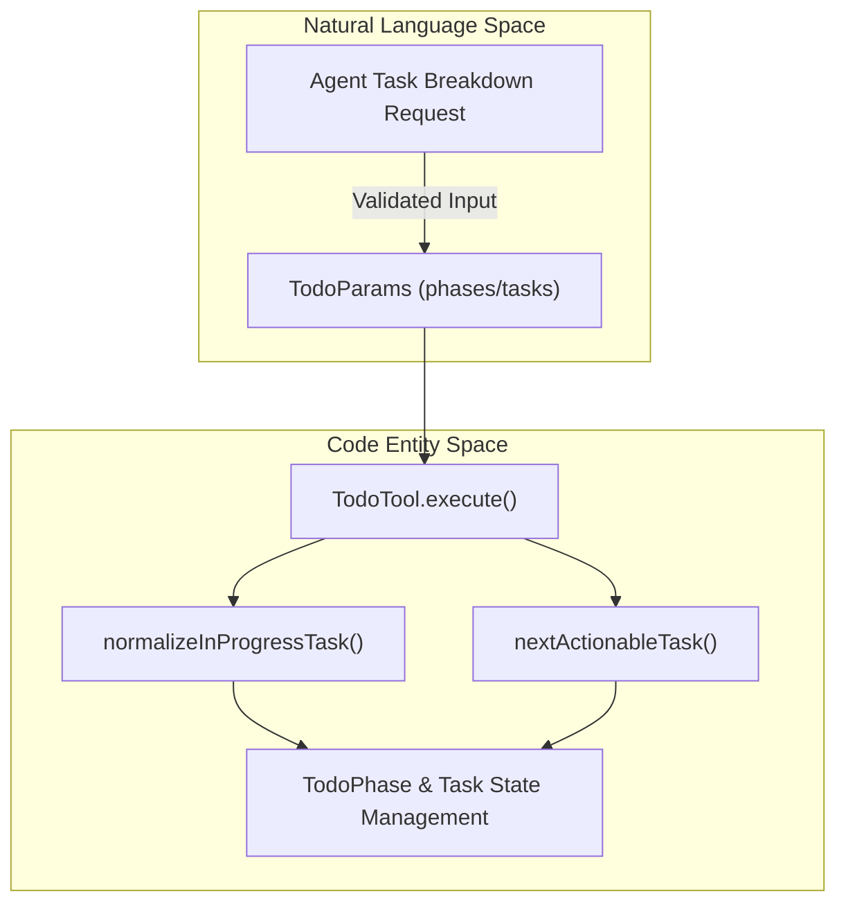
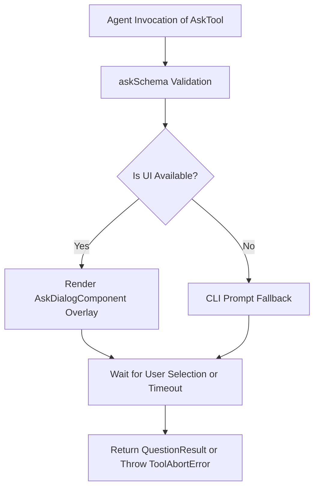
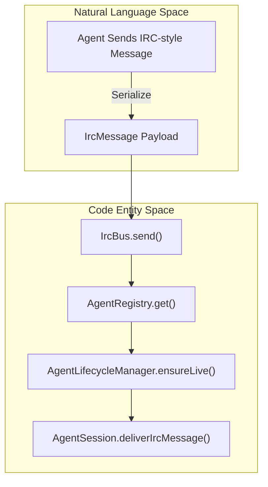
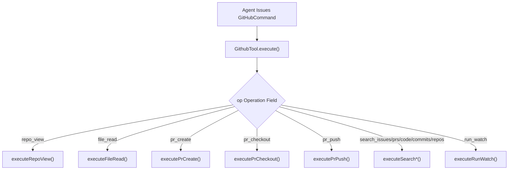
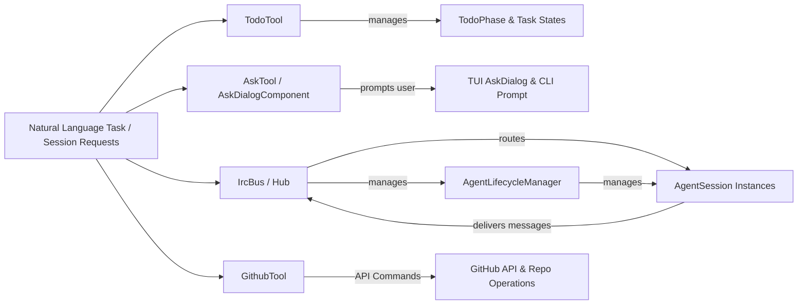

<!-- source: DeepWiki mcp.deepwiki.com · repo can1357/oh-my-pi · page 6.6 Session and Coordination Tools · fetched 2026-10-30 -->

# Session and Coordination Tools

Relevant source files

The following files were used as context for generating this wiki page:

- [docs/tools/github.md](docs/tools/github.md)
- [docs/tools/todo.md](docs/tools/todo.md)
- [packages/coding-agent/scripts/format-prompts.ts](packages/coding-agent/scripts/format-prompts.ts)
- [packages/coding-agent/src/cli/grievances-cli.ts](packages/coding-agent/src/cli/grievances-cli.ts)
- [packages/coding-agent/src/commands/grievances.ts](packages/coding-agent/src/commands/grievances.ts)
- [packages/coding-agent/src/goals/runtime.ts](packages/coding-agent/src/goals/runtime.ts)
- [packages/coding-agent/src/goals/state.ts](packages/coding-agent/src/goals/state.ts)
- [packages/coding-agent/src/goals/tools/goal-tool.ts](packages/coding-agent/src/goals/tools/goal-tool.ts)
- [packages/coding-agent/src/internal-urls/forge-diff.ts](packages/coding-agent/src/internal-urls/forge-diff.ts)
- [packages/coding-agent/src/internal-urls/issue-pr-protocol.ts](packages/coding-agent/src/internal-urls/issue-pr-protocol.ts)
- [packages/coding-agent/src/internal-urls/mr-protocol.ts](packages/coding-agent/src/internal-urls/mr-protocol.ts)
- [packages/coding-agent/src/internal-urls/xd-protocol.ts](packages/coding-agent/src/internal-urls/xd-protocol.ts)
- [packages/coding-agent/src/irc/bus.ts](packages/coding-agent/src/irc/bus.ts)
- [packages/coding-agent/src/modes/controllers/todo-command-controller.ts](packages/coding-agent/src/modes/controllers/todo-command-controller.ts)
- [packages/coding-agent/src/prompts/agents/init.md](packages/coding-agent/src/prompts/agents/init.md)
- [packages/coding-agent/src/prompts/agents/reviewer.md](packages/coding-agent/src/prompts/agents/reviewer.md)
- [packages/coding-agent/src/prompts/agents/task.md](packages/coding-agent/src/prompts/agents/task.md)
- [packages/coding-agent/src/prompts/goals/goal-mode-context.md](packages/coding-agent/src/prompts/goals/goal-mode-context.md)
- [packages/coding-agent/src/prompts/goals/goal-todo-context.md](packages/coding-agent/src/prompts/goals/goal-todo-context.md)
- [packages/coding-agent/src/prompts/internal-urls/mr.md](packages/coding-agent/src/prompts/internal-urls/mr.md)
- [packages/coding-agent/src/prompts/review-request.md](packages/coding-agent/src/prompts/review-request.md)
- [packages/coding-agent/src/prompts/system/irc-incoming.md](packages/coding-agent/src/prompts/system/irc-incoming.md)
- [packages/coding-agent/src/prompts/system/rewind-report.md](packages/coding-agent/src/prompts/system/rewind-report.md)
- [packages/coding-agent/src/prompts/tools/approval-folder.md](packages/coding-agent/src/prompts/tools/approval-folder.md)
- [packages/coding-agent/src/prompts/tools/eval-agents.md](packages/coding-agent/src/prompts/tools/eval-agents.md)
- [packages/coding-agent/src/prompts/tools/github.md](packages/coding-agent/src/prompts/tools/github.md)
- [packages/coding-agent/src/prompts/tools/goal.md](packages/coding-agent/src/prompts/tools/goal.md)
- [packages/coding-agent/src/prompts/tools/rewind.md](packages/coding-agent/src/prompts/tools/rewind.md)
- [packages/coding-agent/src/prompts/tools/todo.md](packages/coding-agent/src/prompts/tools/todo.md)
- [packages/coding-agent/src/registry/agent-lifecycle.ts](packages/coding-agent/src/registry/agent-lifecycle.ts)
- [packages/coding-agent/src/registry/agent-registry.ts](packages/coding-agent/src/registry/agent-registry.ts)
- [packages/coding-agent/src/registry/persisted-agents.ts](packages/coding-agent/src/registry/persisted-agents.ts)
- [packages/coding-agent/src/session/checkpoint-entries.ts](packages/coding-agent/src/session/checkpoint-entries.ts)
- [packages/coding-agent/src/session/irc-bridge.ts](packages/coding-agent/src/session/irc-bridge.ts)
- [packages/coding-agent/src/session/queued-messages.ts](packages/coding-agent/src/session/queued-messages.ts)
- [packages/coding-agent/src/slash-commands/helpers/todo.ts](packages/coding-agent/src/slash-commands/helpers/todo.ts)
- [packages/coding-agent/src/tools/checkpoint.ts](packages/coding-agent/src/tools/checkpoint.ts)
- [packages/coding-agent/src/tools/gh-cache-invalidation.ts](packages/coding-agent/src/tools/gh-cache-invalidation.ts)
- [packages/coding-agent/src/tools/gh-common.ts](packages/coding-agent/src/tools/gh-common.ts)
- [packages/coding-agent/src/tools/gh.ts](packages/coding-agent/src/tools/gh.ts)
- [packages/coding-agent/src/tools/github-cache.ts](packages/coding-agent/src/tools/github-cache.ts)
- [packages/coding-agent/src/tools/glab-mr.ts](packages/coding-agent/src/tools/glab-mr.ts)
- [packages/coding-agent/src/tools/report-tool-issue.ts](packages/coding-agent/src/tools/report-tool-issue.ts)
- [packages/coding-agent/src/tools/todo.ts](packages/coding-agent/src/tools/todo.ts)
- [packages/coding-agent/src/utils/gitlab.ts](packages/coding-agent/src/utils/gitlab.ts)
- [packages/coding-agent/test/agent-hub-activate.test.ts](packages/coding-agent/test/agent-hub-activate.test.ts)
- [packages/coding-agent/test/agent-hub-ordering.test.ts](packages/coding-agent/test/agent-hub-ordering.test.ts)
- [packages/coding-agent/test/agent-session-aside-delivery.test.ts](packages/coding-agent/test/agent-session-aside-delivery.test.ts)
- [packages/coding-agent/test/agent-session-checkpoint-rewind-branch.test.ts](packages/coding-agent/test/agent-session-checkpoint-rewind-branch.test.ts)
- [packages/coding-agent/test/agent-session-queue-update-events.test.ts](packages/coding-agent/test/agent-session-queue-update-events.test.ts)
- [packages/coding-agent/test/agent-session-queued-steer-delivery.test.ts](packages/coding-agent/test/agent-session-queued-steer-delivery.test.ts)
- [packages/coding-agent/test/agent-session-video-attachment.test.ts](packages/coding-agent/test/agent-session-video-attachment.test.ts)
- [packages/coding-agent/test/event-controller-todo-reminder.test.ts](packages/coding-agent/test/event-controller-todo-reminder.test.ts)
- [packages/coding-agent/test/goals/goal-mode-integration.test.ts](packages/coding-agent/test/goals/goal-mode-integration.test.ts)
- [packages/coding-agent/test/goals/goal-runtime.test.ts](packages/coding-agent/test/goals/goal-runtime.test.ts)
- [packages/coding-agent/test/goals/goal-tool.test.ts](packages/coding-agent/test/goals/goal-tool.test.ts)
- [packages/coding-agent/test/input-controller-followup-image.test.ts](packages/coding-agent/test/input-controller-followup-image.test.ts)
- [packages/coding-agent/test/interactive-mode-todo-clear.test.ts](packages/coding-agent/test/interactive-mode-todo-clear.test.ts)
- [packages/coding-agent/test/internal-urls/issue-pr-protocol.test.ts](packages/coding-agent/test/internal-urls/issue-pr-protocol.test.ts)
- [packages/coding-agent/test/internal-urls/mr-protocol.test.ts](packages/coding-agent/test/internal-urls/mr-protocol.test.ts)
- [packages/coding-agent/test/issue-interrupt-and-flush-empty-messages.test.ts](packages/coding-agent/test/issue-interrupt-and-flush-empty-messages.test.ts)
- [packages/coding-agent/test/modes/controllers/todo-command-controller.test.ts](packages/coding-agent/test/modes/controllers/todo-command-controller.test.ts)
- [packages/coding-agent/test/registry/agent-lifecycle.test.ts](packages/coding-agent/test/registry/agent-lifecycle.test.ts)
- [packages/coding-agent/test/registry/persisted-roster-latch.test.ts](packages/coding-agent/test/registry/persisted-roster-latch.test.ts)
- [packages/coding-agent/test/sdk-edit-store-reset.test.ts](packages/coding-agent/test/sdk-edit-store-reset.test.ts)
- [packages/coding-agent/test/session/irc-bridge-relay.test.ts](packages/coding-agent/test/session/irc-bridge-relay.test.ts)
- [packages/coding-agent/test/slash-commands/mode-attachments.test.ts](packages/coding-agent/test/slash-commands/mode-attachments.test.ts)
- [packages/coding-agent/test/tools/gh-cache-invalidation.test.ts](packages/coding-agent/test/tools/gh-cache-invalidation.test.ts)
- [packages/coding-agent/test/tools/gh.test.ts](packages/coding-agent/test/tools/gh.test.ts)
- [packages/coding-agent/test/tools/github-cache.test.ts](packages/coding-agent/test/tools/github-cache.test.ts)
- [packages/coding-agent/test/tools/irc.test.ts](packages/coding-agent/test/tools/irc.test.ts)
- [packages/coding-agent/test/tools/report-tool-issue-consent.test.ts](packages/coding-agent/test/tools/report-tool-issue-consent.test.ts)
- [packages/coding-agent/test/tools/report-tool-issue.test.ts](packages/coding-agent/test/tools/report-tool-issue.test.ts)
- [packages/coding-agent/test/tools/todo.test.ts](packages/coding-agent/test/tools/todo.test.ts)
- [packages/tui/src/tools/todo.ts](packages/tui/src/tools/todo.ts)

## Purpose and Scope
This page documents the tools and utilities in `oh-my-pi` that manage session state, task breakdown, user interaction, inter-agent communication, and external platform integration. These components govern agent workflows, inter-session messaging via the Hub/IRC bus [packages/coding-agent/src/irc/bus.ts:1-171](), structured task queues (`todo.ts`) [packages/coding-agent/src/tools/todo.ts:1-186](), interactive user queries (`ask.ts`), goal alignment, checkpointing/rewind mechanics, and code operations through GitHub (`gh.ts`) [packages/coding-agent/src/tools/gh.ts:1-191]().

---

## 1. Todo Management (`todo.ts`)

The `TodoTool` provides structured task tracking within agent sessions. Tasks are organized into *phases* and each task tracks a lifecycle state, enabling explicit progress control and delegation.

### Implementation and Data Flow
- Tasks are grouped into phases, where each phase has a `name` and a list of `tasks` [packages/coding-agent/src/tools/todo.ts:21-33]().
- Each task in a phase has a `content` string and a `status` which can be one of: `"pending"`, `"in_progress"`, `"completed"`, `"abandoned"`, or `"blocked"`. Blocker information can be attached optionally [packages/coding-agent/src/tools/todo.ts:21-33]().
- The tool supports operations such as `init` (initialize full todo phases), `start` (mark a task as in-progress), `done` (complete a task), `rm`/`drop` (remove tasks), `block`/`unblock` (manage blockers), `append` (add tasks), and `view` (read-only snapshot) [packages/coding-agent/src/tools/todo.ts:53-70]().
- On every update, it ensures that at most one task is `in_progress` using `normalizeInProgressTask()`. If no tasks are in progress, the first pending task is promoted [packages/coding-agent/src/tools/todo.ts:128-146]().
- Completion transitions between task states are computed and can be used to trigger related UI or workflow changes [packages/coding-agent/src/tools/todo.ts:107-126]().
- The `nextActionableTask()` helper finds the next task the agent should execute, favoring `in_progress` tasks or falling back to the first `pending` task [packages/coding-agent/src/tools/todo.ts:146-158]().
- The tool commits todo phases to session state via side effects in the session manager.

### Key Classes and Functions
- `TodoTool` (implements `AgentTool` interface): Main entrypoint for todo state mutations and queries [packages/coding-agent/src/tools/todo.ts:136-191]().
- `nextActionableTask(phases: TodoPhase[])`: Returns the next task to work on [packages/coding-agent/src/tools/todo.ts:146-158]().
- `committedTodoPhases(result: AgentToolResult)`: Extracts committed todo phase state from tool execution results [packages/coding-agent/src/tools/todo.ts:42-47]().

### Diagram: Natural Language Task to Code Entity Mapping for Todo Tool

Sources: `packages/coding-agent/src/tools/todo.ts`

---

## 2. Interactive User Prompting (`ask.ts` and `ask-dialog.ts`)

The `AskTool` enables agent-session processes to gather interactive user input during execution. It supports multi-choice questions, free text responses, timeouts, default selections, and cancellation.

### Implementation and Data Flow
- The tool uses a strict argument schema for multiple *questions*, each with labeled *options* and configuration flags like multi-answer or recommended options [packages/coding-agent/src/tools/ask.ts:1-130]().
- The runtime decides if the user interface (UI) is available; if so, the `AskDialogComponent` displays questions in a modal interactive overlay supporting filtering and selection via tabs [packages/coding-agent/src/modes/components/ask-dialog.ts:1-380]().
- If no UI is available, a fallback CLI prompt sequence collects responses via standard input/output [packages/coding-agent/src/tools/ask.ts:1-150]().
- The tool handles timeout events, either auto-selecting recommended responses or signalling abort for user cancellation.
- Responses are returned as structured `QuestionResult` objects, producing tool execution results the session tracks.

### Key Classes and Functions
- `AskTool` (implements `AgentTool` interface): Controls validation, UI fallback, and collects user answers [packages/coding-agent/src/tools/ask.ts:1-200]().
- `AskDialogComponent`: Responsible for the TUI modal dialog rendering and input management [packages/coding-agent/src/modes/components/ask-dialog.ts:1-380]().
- `recoverAskQuestions()`: Handles rehydration of persisted question state on replay/rewind [packages/coding-agent/src/tools/ask.ts:1-100]().

### Diagram: AskTool Workflow

Sources: `packages/coding-agent/src/tools/ask.ts`, `packages/coding-agent/src/modes/components/ask-dialog.ts`

---

## 3. Hub and IRC Bus Coordination (`irc/bus.ts`)

Agent communication is coordinated through a process-global `IrcBus` facilitating message sending in an IRC-like style, with status-aware delivery outcomes such as live injection or parked revival.

### Architecture and Data Flow
- `IrcBus` maintains per-agent mailboxes and event queues, allowing asynchronous sending and waiting for messages with backpressure and bounded capacity [packages/coding-agent/src/irc/bus.ts:27-171]().
- Messages are delivered through agent session methods like `deliverIrcMessage()`. Failures record exceptions and delivery outcomes [packages/coding-agent/test/tools/irc.test.ts:39-53]().
- The bus can wake parked agents on demand using lifecycle revival mechanisms, or report failure for dead/unregistered targets [packages/coding-agent/test/tools/irc.test.ts:142-175]().
- A main UI agent session subscribes to sibling-to-sibling messages for relay display [packages/coding-agent/test/tools/irc.test.ts:126-141]().
- `AgentLifecycleManager` manages the lifecycle of agents, specifically for subagents:
  - When idle, it arms timers to park (dispose) agents after a TTL expires [packages/coding-agent/src/registry/agent-lifecycle.ts:71-86]().
  - Parked agents are revived by the manager on demand, restoring their session state before use [packages/coding-agent/src/registry/agent-lifecycle.ts:1-169]().
- The bus and lifecycle manager collaborate to deliver messages with minimal blocking and reconnection overhead [packages/coding-agent/src/irc/bus.ts:1-171]().

### Key Classes and Functions
- `IrcBus`: Processes `send()` and `wait()` operations, routes messages, handles parked and live agents [packages/coding-agent/src/irc/bus.ts:1-171]().
- `AgentLifecycleManager`: Parks idle agents, manages revive attempts and adoption lifecycles [packages/coding-agent/src/registry/agent-lifecycle.ts:113-171]().
- `AgentSession.deliverIrcMessage()`: Receives messages for delivery [packages/coding-agent/test/tools/irc.test.ts:39-53]().

### Diagram: IRC Bus Dispatch Flow Mapping

Sources: `packages/coding-agent/src/irc/bus.ts`, `packages/coding-agent/src/registry/agent-registry.ts`, `packages/coding-agent/src/registry/agent-lifecycle.ts`

---

## 4. GitHub Integration Tool (`gh.ts`)

`GithubTool` provides rich integration to GitHub repositories for viewing, pull requests, code searching, and CI workflows.

### Core Implementation
- A strict input schema defines supported operations (`op`), such as viewing repos and files, managing pull requests (create, checkout, push), searching issues, PRs, code, commits, repos, and watching Actions workflow runs [packages/coding-agent/src/tools/gh.ts:67-104]().
- Read-only ops are marked for reduced approval risk; write ops require higher approval level [packages/coding-agent/src/tools/gh.ts:67-142]().
- The `execute()` method dispatches to general-purpose handlers for each operation type [packages/coding-agent/src/tools/gh.ts:157-190]().
- Helpers parse repositories, PR numbers, and unify diff parsing to support PR operations [packages/coding-agent/src/tools/gh-common.ts:1-100]().
- Binary file reads detect and report fallback messages instead of raw UTF-8 bytes [packages/coding-agent/src/tools/gh.ts:120-135]().

### Key Classes and Functions
- `GithubTool` (implements `AgentTool`): Core class handling GitHub API commands and responses [packages/coding-agent/src/tools/gh.ts:136-191]().
- Operation-specific executors (`executeRepoView`, `executePrCreate`, `executeSearchIssues`, etc.) manage domain-specific logic and API calls [packages/coding-agent/src/tools/gh.ts:157-190]().

### Diagram: GitHubTool Operation Dispatch Flow

Sources: `packages/coding-agent/src/tools/gh.ts`

---

## 5. Checkpoint, Rewind, and Goal Tools

Critical coordination functions exist across `SessionManager` and specialized session modules:
- **Checkpointing & Rewind:** Manage branching, session history navigation, and restore previous conversation states [packages/coding-agent/test/agent-session-checkpoint-rewind-branch.test.ts:24-85]().
- **Goal Tracking:** Records and pursues main objectives for sessions and delegated subagents via `GoalTool` and `GoalRuntime` [packages/coding-agent/src/goals/runtime.ts:1-100]().
- **Session Persistence:** Employs append-only JSONL files with artifact management for durability, crash recovery, and export [packages/coding-agent/src/session/session-manager.ts:1-200]().

Sources: `packages/coding-agent/src/session/session-manager.ts`, `packages/coding-agent/src/goals/runtime.ts`

---

## 6. Development and Execution Utilities (`xdev`)

The `xdev` tools provide developer utilities and specialized commands designed for extension authors and maintainers. They support introspection, debugging, and test environment isolation [packages/coding-agent/test/agent-session-checkpoint-rewind-branch.test.ts:27-59]().

Sources: `packages/coding-agent/src/tools/gh.ts`, `packages/coding-agent/src/tools/todo.ts`

---

# Summary Diagram: Session and Coordination Tools Mapping

Sources: `packages/coding-agent/src/tools/todo.ts`, `packages/coding-agent/src/tools/ask.ts`, `packages/coding-agent/src/irc/bus.ts`, `packages/coding-agent/src/tools/gh.ts`

---

# References

- `packages/coding-agent/src/tools/todo.ts`  
- `packages/coding-agent/src/tools/ask.ts`  
- `packages/coding-agent/src/modes/components/ask-dialog.ts`  
- `packages/coding-agent/src/irc/bus.ts`  
- `packages/coding-agent/src/registry/agent-lifecycle.ts`  
- `packages/coding-agent/src/tools/gh.ts`  
- `packages/coding-agent/src/session/session-manager.ts`

---

