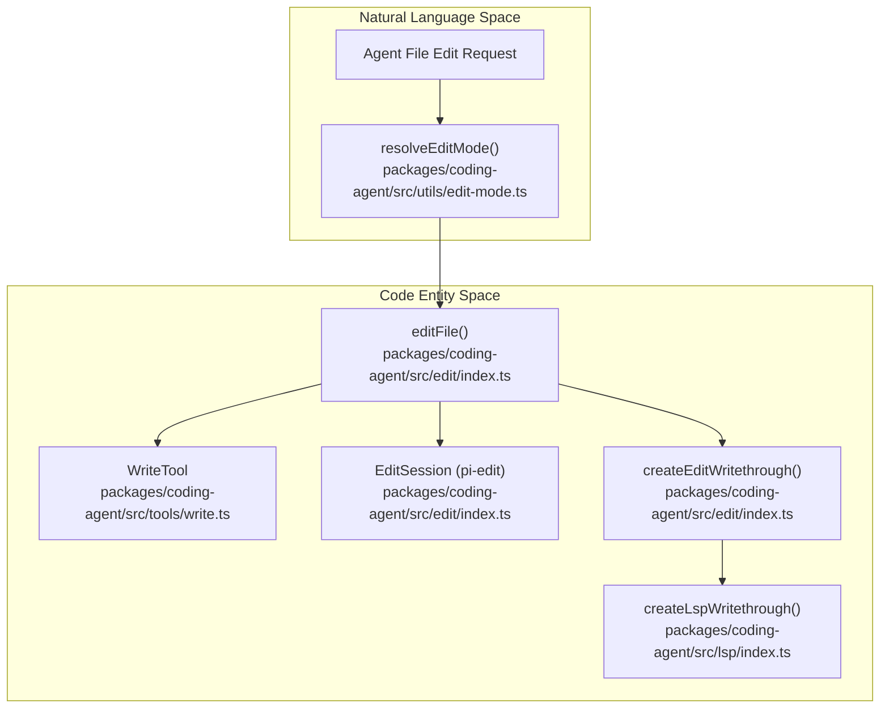
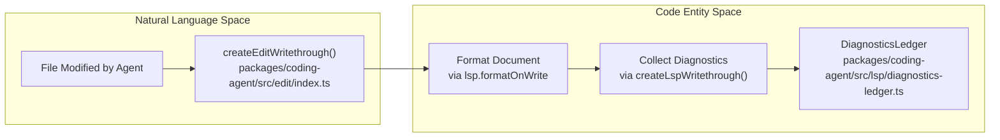

<!-- source: DeepWiki mcp.deepwiki.com · repo can1357/oh-my-pi · page 7 File Editing · fetched 2026-10-30 -->

# File Editing

<details>
<summary>Relevant source files</summary>

The following files were used as context for generating this wiki page:

- [crates/pi-edit/src/modes/hashline/apply.rs](crates/pi-edit/src/modes/hashline/apply.rs)
- [crates/pi-edit/src/modes/hashline/block.rs](crates/pi-edit/src/modes/hashline/block.rs)
- [crates/pi-edit/src/modes/hashline/clipboard.rs](crates/pi-edit/src/modes/hashline/clipboard.rs)
- [crates/pi-edit/src/modes/hashline/format.rs](crates/pi-edit/src/modes/hashline/format.rs)
- [crates/pi-edit/src/modes/hashline/input.rs](crates/pi-edit/src/modes/hashline/input.rs)
- [crates/pi-edit/src/modes/hashline/messages.rs](crates/pi-edit/src/modes/hashline/messages.rs)
- [crates/pi-edit/src/modes/hashline/mismatch.rs](crates/pi-edit/src/modes/hashline/mismatch.rs)
- [crates/pi-edit/src/modes/hashline/mod.rs](crates/pi-edit/src/modes/hashline/mod.rs)
- [crates/pi-edit/src/modes/hashline/parser.rs](crates/pi-edit/src/modes/hashline/parser.rs)
- [crates/pi-edit/src/modes/hashline/patcher.rs](crates/pi-edit/src/modes/hashline/patcher.rs)
- [crates/pi-edit/src/modes/hashline/preview.rs](crates/pi-edit/src/modes/hashline/preview.rs)
- [crates/pi-edit/src/modes/hashline/recovery.rs](crates/pi-edit/src/modes/hashline/recovery.rs)
- [crates/pi-edit/src/modes/hashline/tokenizer.rs](crates/pi-edit/src/modes/hashline/tokenizer.rs)
- [crates/pi-edit/src/session.rs](crates/pi-edit/src/session.rs)
- [crates/pi-edit/src/store.rs](crates/pi-edit/src/store.rs)
- [crates/pi-edit/tests/common/mod.rs](crates/pi-edit/tests/common/mod.rs)
- [crates/pi-edit/tests/fixtures/hashline/parity_boundary_repair.json](crates/pi-edit/tests/fixtures/hashline/parity_boundary_repair.json)
- [crates/pi-edit/tests/fixtures/hashline/parity_landing_shift.json](crates/pi-edit/tests/fixtures/hashline/parity_landing_shift.json)
- [crates/pi-edit/tests/fixtures/hashline/patcher.json](crates/pi-edit/tests/fixtures/hashline/patcher.json)
- [crates/pi-edit/tests/hashline_apply.rs](crates/pi-edit/tests/hashline_apply.rs)
- [crates/pi-edit/tests/hashline_parity.rs](crates/pi-edit/tests/hashline_parity.rs)
- [crates/pi-edit/tests/hashline_parse.rs](crates/pi-edit/tests/hashline_parse.rs)
- [crates/pi-edit/tests/hashline_patcher.rs](crates/pi-edit/tests/hashline_patcher.rs)
- [crates/pi-edit/tests/replace_parity.rs](crates/pi-edit/tests/replace_parity.rs)
- [docs/tools/edit.md](docs/tools/edit.md)
- [scripts/session-stats/README.md](scripts/session-stats/README.md)
- [scripts/session-stats/analyze.py](scripts/session-stats/analyze.py)
- [scripts/session-stats/harmony_backtest.py](scripts/session-stats/harmony_backtest.py)
- [scripts/session-stats/sync.py](scripts/session-stats/sync.py)

</details>


This wiki page provides an overview of the file editing architecture in `oh-my-pi`, focusing on the edit tool’s three primary modes—hashline, patch, and replace—and the `pi-edit` Rust crate that underpins these editing capabilities. It explains when and why to use each mode and outlines the integration with Language Server Protocol (LSP) for formatting and diagnostics.

For in-depth technical details, consult the child pages:
- [Hashline Mode](#7.1)
- [Patch and Replace Modes](#7.2)
- [LSP Integration](#7.3)

---

## Overview

The file editing subsystem offers a robust mechanism for modifying files within a codebase. The edit tool selectively routes requests through three core modes based on configuration or model preferences:

- **Hashline Mode**: Uses stable line addressing combined with cryptographic hashes to precisely localize edits for large files or multiple concurrent modifications.
- **Patch Mode**: Applies standard unified diffs, suitable for batch operations and familiar diff workflows.
- **Replace Mode**: Performs fuzzy text matching to find and replace content based on similarity thresholds, useful for simpler or less strictly-anchored edits.

These modes leverage native Rust bindings exposed via TypeScript wrappers, with shared semantics and prompt-driven edit operations backed by the `pi-edit` crate.

### Request Routing Architecture



The agent determines the editing mode, dispatches to the corresponding execution path, and applies writethrough hooks for formatting and diagnostics integration.

Sources: [docs/tools/edit.md:1-15](), [crates/pi-edit/src/session.rs:1-80]()

---

## Mode Comparison

The edit tool offers multiple modes, each suited to different scenarios:

| Feature                   | Hashline Mode                            | Patch Mode                           | Replace Mode                          |
|---------------------------|----------------------------------------|------------------------------------|-------------------------------------|
| **Addressing**             | Stable line numbers + 4-hex file hash  | Unified diff-format hunks           | Literal fuzzy text matching          |
| **Staleness Protection**  | Strict hash validation prevents drift  | Context lines anchor edits          | Fuzzy similarity with threshold     |
| **Use Case**              | Default for precise, compact, large edits | Classic patch application          | Simple substring search & replace    |

- Hashline mode excels in concurrency scenarios and parallel editing because of its stable, hash-anchored line addressing.
- Patch mode is ideal when standard diffs or batch mutations are available or preferred.
- Replace mode provides flexibility in loosely structured or simpler edits where exact line hashes or diffs aren't practical.

Sources: [docs/tools/edit.md:16-30](), [crates/pi-edit/src/session.rs:23-37]()

---

## Hashline Mode

Hashline is the default and most advanced editing mode, implemented as a compact domain-specific language (DSL). It uniquely combines line numbers with cryptographic file segment hashes in headers like:

```
[src/file.ts#1A2B]
```

Operations (`PUT`, `CUT`, `REM`, `MV`) specify fine-grained edits referencing these lines. This enforces strong staleness protection avoiding out-of-date changes from overwriting concurrent edits. The strict validation and embedded hash-based addressing guarantee safe parallel modifications.

For the grammar rules, validation logic, and operational details, see the dedicated [Hashline Mode](#7.1) child page.

Sources: [docs/tools/edit.md:31-75](), [crates/pi-edit/src/modes/hashline/patcher.rs:1-79]()

---

## Patch and Replace Modes

To accommodate various workflows, `oh-my-pi` supports:

- **Patch Mode**: Edits as unified diffs conforming to standard patch formats. This mode parses raw diffs, applies them sequentially, and supports multi-file patches. Useful when changes come from external diff generators or when the agent model prefers a familiar format.
  
- **Replace Mode**: Applies simpler text substitution edits found by fuzzy substring matching, guided by a configurable similarity threshold. This reduces complexity where precise anchoring is unnecessary or unavailable.

Both modes support streaming diff rendering to preview intermediate patches and facilitate interactive review.

Refer to [Patch and Replace Modes](#7.2) for detailed documentation on parser implementations, diff rendering, and fuzzy matching parameters.

Sources: [docs/tools/edit.md:122-130](), [crates/pi-edit/src/session.rs:23-37]()

---

## LSP Integration

File edits integrate tightly with the Language Server Protocol (LSP) to:

- Automatically format documents on write (`formatOnWrite`).
- Collect diagnostics during and after edit application.
- Batch multiple write and diagnostic requests efficiently.

The writethrough callback system (`createEditWritethrough`) links the native editing operations with LSP clients, enabling synchronous formatting and deferred diagnostics to surface inline to the user.

### LSP Writethrough & Diagnostics Pipeline



The pipeline ensures that file writes performed by the agent trigger LSP formatting and real-time diagnostics collection, maintaining high code quality and feedback fidelity.

For in-depth details on client lifecycle management, server configuration, batch optimizations, and write-through behavior, see the child page [LSP Integration](#7.3).

Sources: [docs/tools/edit.md:1-15](), [crates/pi-edit/src/session.rs:50-80]()

---

## pi-edit Rust Crate

At the heart of the file editing system is the `pi-edit` Rust crate, which implements the core parsing, applying, and validating of edit primitives across all modes, especially hashline.

- Provides a stateful line tokenizer and parser for hashline patches (`crates/pi-edit/src/modes/hashline/tokenizer.rs`).
- Supports parsing multi-file patch sections with lazy memoized parsing and file operations like moves and deletes (`crates/pi-edit/src/modes/hashline/patcher.rs`).
- Implements detailed error management and mismatch reporting for robust validation and recovery (`crates/pi-edit/src/modes/hashline/mismatch.rs`).

The crate exposes these functionalities as native libraries consumed by the TypeScript agent, enabling high-performance and correctness guarantees.

Sources: [crates/pi-edit/src/modes/hashline/patcher.rs:1-56](), [crates/pi-edit/src/store.rs:1-75]()

---

# Links to Child Pages

- **[Hashline Mode](#7.1)** — Detailed DSL, hash validation, edit operations, and safe concurrency management.
- **[Patch and Replace Modes](#7.2)** — Unified diff parsing, fuzzy text matching, and diff rendering.
- **[LSP Integration](#7.3)** — Client lifecycle, config defaults, format-on-write, diagnostics freshness, and batch request optimization.

---

Sources:
- [docs/tools/edit.md:1-130]()
- [crates/pi-edit/src/modes/hashline/patcher.rs:1-177]()
- [crates/pi-edit/src/store.rs:1-100]()
- [crates/pi-edit/src/session.rs:1-140]()

---

