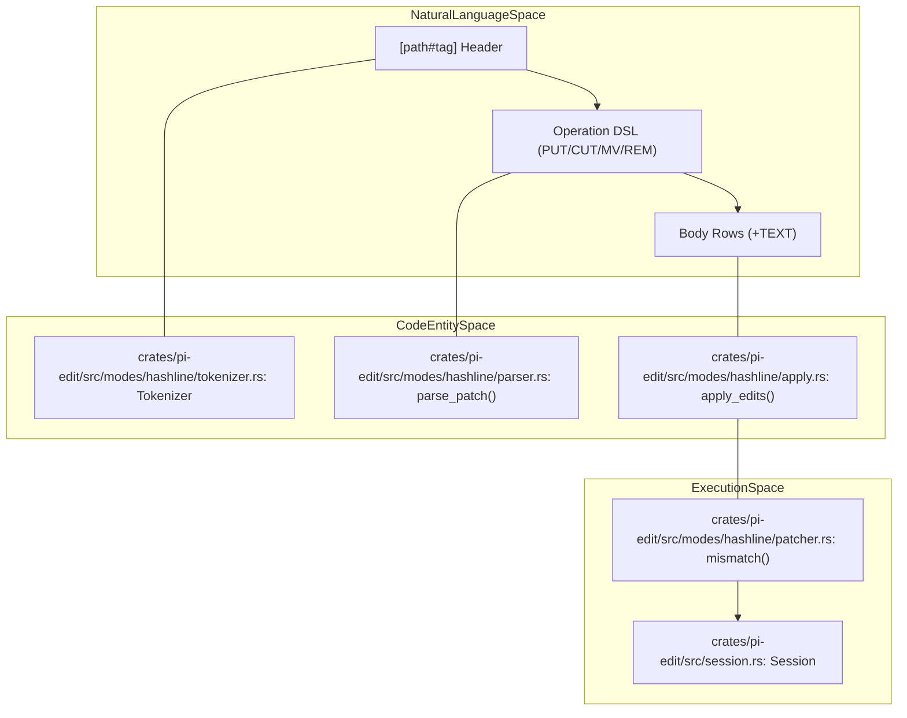
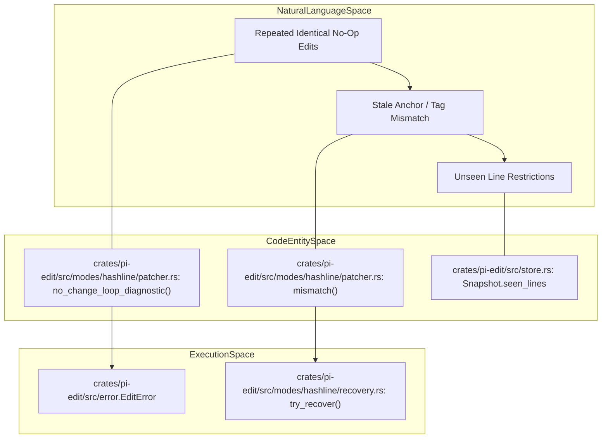

<!-- source: DeepWiki mcp.deepwiki.com · repo can1357/oh-my-pi · page 7.1 Hashline Mode · fetched 2026-10-30 -->

# Hashline Mode

Relevant source files

The following files were used as context for generating this wiki page:

- [crates/pi-edit/src/modes/hashline/apply.rs](crates/pi-edit/src/modes/hashline/apply.rs)
- [crates/pi-edit/src/modes/hashline/block.rs](crates/pi-edit/src/modes/hashline/block.rs)
- [crates/pi-edit/src/modes/hashline/clipboard.rs](crates/pi-edit/src/modes/hashline/clipboard.rs)
- [crates/pi-edit/src/modes/hashline/format.rs](crates/pi-edit/src/modes/hashline/format.rs)
- [crates/pi-edit/src/modes/hashline/input.rs](crates/pi-edit/src/modes/hashline/input.rs)
- [crates/pi-edit/src/modes/hashline/messages.rs](crates/pi-edit/src/modes/hashline/messages.rs)
- [crates/pi-edit/src/modes/hashline/mismatch.rs](crates/pi-edit/src/modes/hashline/mismatch.rs)
- [crates/pi-edit/src/modes/hashline/mod.rs](crates/pi-edit/src/modes/hashline/mod.rs)
- [crates/pi-edit/src/modes/hashline/parser.rs](crates/pi-edit/src/modes/hashline/parser.rs)
- [crates/pi-edit/src/modes/hashline/patcher.rs](crates/pi-edit/src/modes/hashline/patcher.rs)
- [crates/pi-edit/src/modes/hashline/preview.rs](crates/pi-edit/src/modes/hashline/preview.rs)
- [crates/pi-edit/src/modes/hashline/recovery.rs](crates/pi-edit/src/modes/hashline/recovery.rs)
- [crates/pi-edit/src/modes/hashline/tokenizer.rs](crates/pi-edit/src/modes/hashline/tokenizer.rs)
- [crates/pi-edit/src/session.rs](crates/pi-edit/src/session.rs)
- [crates/pi-edit/src/store.rs](crates/pi-edit/src/store.rs)
- [crates/pi-edit/tests/common/mod.rs](crates/pi-edit/tests/common/mod.rs)
- [crates/pi-edit/tests/fixtures/hashline/parity_boundary_repair.json](crates/pi-edit/tests/fixtures/hashline/parity_boundary_repair.json)
- [crates/pi-edit/tests/fixtures/hashline/parity_landing_shift.json](crates/pi-edit/tests/fixtures/hashline/parity_landing_shift.json)
- [crates/pi-edit/tests/fixtures/hashline/patcher.json](crates/pi-edit/tests/fixtures/hashline/patcher.json)
- [crates/pi-edit/tests/hashline_apply.rs](crates/pi-edit/tests/hashline_apply.rs)
- [crates/pi-edit/tests/hashline_parity.rs](crates/pi-edit/tests/hashline_parity.rs)
- [crates/pi-edit/tests/hashline_parse.rs](crates/pi-edit/tests/hashline_parse.rs)
- [crates/pi-edit/tests/hashline_patcher.rs](crates/pi-edit/tests/hashline_patcher.rs)
- [crates/pi-edit/tests/replace_parity.rs](crates/pi-edit/tests/replace_parity.rs)
- [docs/tools/edit.md](docs/tools/edit.md)
- [scripts/session-stats/README.md](scripts/session-stats/README.md)
- [scripts/session-stats/analyze.py](scripts/session-stats/analyze.py)
- [scripts/session-stats/harmony_backtest.py](scripts/session-stats/harmony_backtest.py)
- [scripts/session-stats/sync.py](scripts/session-stats/sync.py)

Hashline mode is a line-anchored file editing system designed for high precision in LLM-driven code manipulation. It uses stable line addressing combined with content-based file hashes (`file_hash` in `crates/pi-edit/src/store.rs`) to ensure that edits are applied to the exact version of the file the agent intended to modify.

Sources: [docs/tools/edit.md:1-15](), [crates/pi-edit/src/store.rs:74-95]()

---

## Overview and Architecture

Hashline mode represents file changes as a series of operation blocks anchored to specific line numbers or ranges. The implementation spans the Rust crate `pi-edit` (`crates/pi-edit/src/modes/hashline/`) and TypeScript binding layers (`packages/coding-agent/src/edit/index.ts`).

- **File-Version Binding**: Every file section starts with a `[PATH#TAG]` header. The `TAG` is a 4-hex-character snapshot tag computed via `file_hash()` in `crates/pi-edit/src/store.rs`, ensuring alignment with the content version the agent last observed.
- **Syntactic Blocks**: Supports operations on syntactic blocks such as `PUT N*:` to replace a tree-sitter-resolved block starting at line `N` (`crates/pi-edit/src/modes/hashline/block.rs`).
- **Stable Addressing**: All edits refer to stable original line numbers that do not shift as multiple hunks are applied within a single patch.

Sources: [docs/tools/edit.md:1-28](), [crates/pi-edit/src/store.rs:74-95]()

---

## Natural Language Space to Code Entity Space: Parsing and Application

The following diagram bridges the natural language patch representation to the corresponding Rust and TypeScript code entities responsible for parsing and applying changes.

Title: "Hashline Parsing and Application Pipeline"

Sources: [crates/pi-edit/src/modes/hashline/parser.rs:1-30](), [crates/pi-edit/src/modes/hashline/apply.rs:1-25](), [crates/pi-edit/src/session.rs:126-162]()

---

## Hash Computation and Stable Addressing

Hashline mode's reliability hinges on binding edits to stable line numbers and file content hashes implemented in `crates/pi-edit/src/store.rs`:

- **Content Hash (`file_hash`)**: Hashes the file text using `Xxh32`, stripping trailing spaces, tabs, and carriage returns (`\r`) from every line without building a full normalized copy in memory [crates/pi-edit/src/store.rs:79-95]().
- **Mandatory Validation**: If the file content on disk hashes to a different value than `TAG`, the patch is rejected with a mismatch error, preventing stale or conflicting writes [crates/pi-edit/src/modes/hashline/patcher.rs:97-145]().
- **Inclusive Ranges**: Range operations use a `.=` separator (e.g., `PUT 1.=3:`) indicating inclusive start and end lines [docs/tools/edit.md:45-55]().

Sources: [crates/pi-edit/src/store.rs:74-95](), [crates/pi-edit/src/modes/hashline/patcher.rs:97-145]()

---

## Edit Operations DSL

Hashline mode employs a DSL for expressing edits with explicit verbs and line-based addressing [docs/tools/edit.md:45-65]().

| Operation | Syntax Example | Body | Description |
| --- | --- | --- | --- |
| Replace inclusive range | `PUT 1.=3:` | `+` | Replace lines 1 through 3 (inclusive) with given content |
| Replace syntactic block | `PUT 5*:` | `+` | Replace the syntactic block starting at line 5 (tree-sitter resolved) |
| Insert before/after line | `PUT <4:` / `PUT >7:` | `+` | Insert lines before line 4 or after line 7 |
| Cut (delete) range | `CUT 15.=18 @name` | | Cut lines and store into a named register |
| Paste register | `PUT >20 @name` | | Paste text captured in a named register at gap |
| File Removal / Move | `REM` / `MV dest` | | Remove file or rename/move file with history migration |

Sources: [docs/tools/edit.md:45-65]()

---

## Natural Language Space to Code Entity Space: Validation and Safety

The following diagram maps high-level safety constraints and guard mechanisms to their implementation symbols in the codebase.

Title: "Validation and Safety Guards Mapping"

Sources: [crates/pi-edit/src/modes/hashline/patcher.rs:36-145](), [crates/pi-edit/src/store.rs:27-40](), [crates/pi-edit/src/modes/hashline/recovery.rs:1-38]()

---

## Validation, Recovery, and Safety Guards

Several safety guards are implemented in `crates/pi-edit` to ensure correctness and prevent data corruption:

- **No-Op Loop Escalation**: If an edit parses and applies cleanly but produces no byte-level change, `no_change_diagnostic` is emitted [crates/pi-edit/src/modes/hashline/patcher.rs:58-66](). After reaching `NOOP_HARD_LIMIT` (3 consecutive identical no-ops), `no_change_loop_diagnostic` escalates to a hard error [crates/pi-edit/src/store.rs:24-25](), [crates/pi-edit/src/modes/hashline/patcher.rs:69-78]().
- **Seen-Lines Guard**: `Snapshot.seen_lines` tracks which lines were actually displayed to the model during reads or mismatch contexts, restricting edits to observed line ranges when `enforce_seen_lines` is enabled [crates/pi-edit/src/store.rs:36-40](), [crates/pi-edit/tests/hashline_patcher.rs:101-130]().
- **Anchor Recovery**: `try_recover` in `crates/pi-edit/src/modes/hashline/recovery.rs` attempts to remap stale anchor line numbers using diff-based line tracking when file edits have shifted lines externally [crates/pi-edit/src/modes/hashline/recovery.rs:1-38]().

Sources: [crates/pi-edit/src/store.rs:24-40](), [crates/pi-edit/src/modes/hashline/patcher.rs:58-78](), [crates/pi-edit/src/modes/hashline/recovery.rs:1-38]()

---

# Summary Table of Key Classes/Functions

| Name | Role/Responsibility | Location |
| --- | --- | --- |
| `HashlineEngine` | Engine implementation for hashline edit mode | `crates/pi-edit/src/modes/hashline/mod.rs` |
| `apply_edits` | Applies parsed edits with boundary and indentation repair | `crates/pi-edit/src/modes/hashline/apply.rs` |
| `parse_patch` | Parses textual patch into structured edit operations | `crates/pi-edit/src/modes/hashline/parser.rs` |
| `file_hash` | Computes the 4-hex uppercase hashline content tag via xxh32 | `crates/pi-edit/src/store.rs:79-95` |
| `try_recover` | Attempts stale-tag anchor recovery against current file text | `crates/pi-edit/src/modes/hashline/recovery.rs` |
| `no_change_loop_diagnostic` | Generates escalated warning/error on repeated identical no-ops | `crates/pi-edit/src/modes/hashline/patcher.rs:69-78` |

Sources: [crates/pi-edit/src/modes/hashline/mod.rs](), [crates/pi-edit/src/modes/hashline/apply.rs:1-25](), [crates/pi-edit/src/modes/hashline/parser.rs:1-25](), [crates/pi-edit/src/store.rs:74-95](), [crates/pi-edit/src/modes/hashline/recovery.rs:1-38](), [crates/pi-edit/src/modes/hashline/patcher.rs:69-78]()

---

