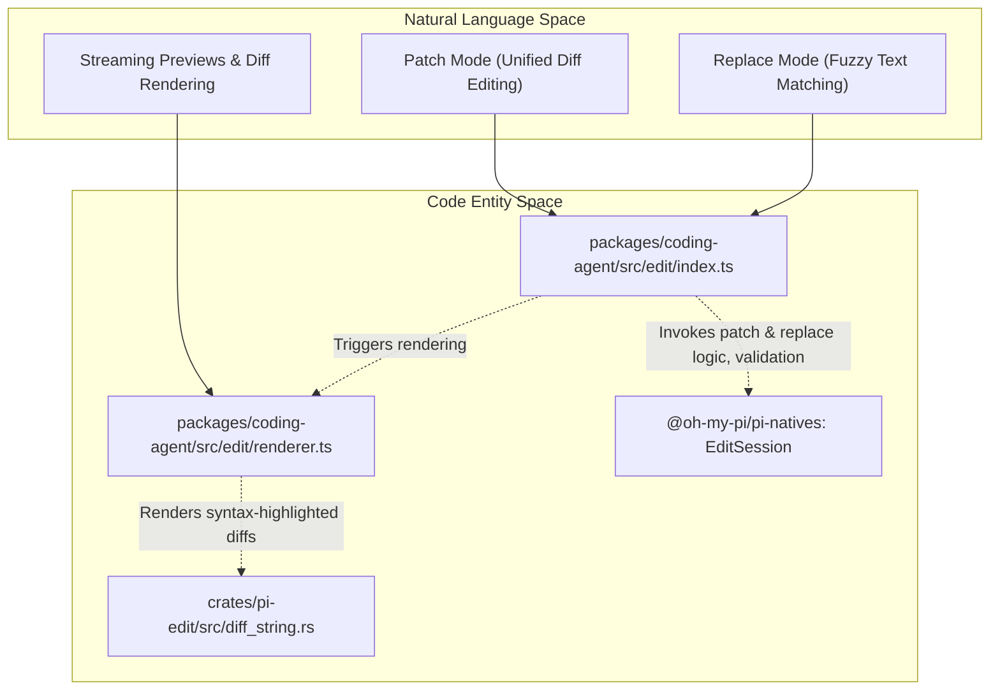
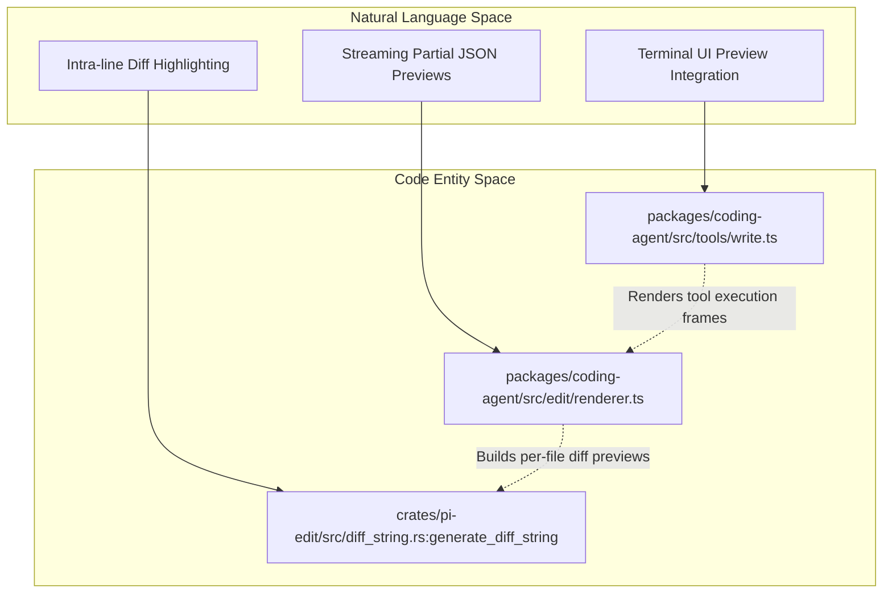

<!-- source: DeepWiki mcp.deepwiki.com · repo can1357/oh-my-pi · page 7.2 Patch and Replace Modes · fetched 2026-10-30 -->

# Patch and Replace Modes

<details>
<summary>Relevant source files</summary>

The following files were used as context for generating this wiki page:

- [crates/pi-edit/src/modes/hashline/apply.rs](crates/pi-edit/src/modes/hashline/apply.rs)
- [crates/pi-edit/src/modes/hashline/block.rs](crates/pi-edit/src/modes/hashline/block.rs)
- [crates/pi-edit/src/modes/hashline/clipboard.rs](crates/pi-edit/src/modes/hashline/clipboard.rs)
- [crates/pi-edit/src/modes/hashline/format.rs](crates/pi-edit/src/modes/hashline/format.rs)
- [crates/pi-edit/src/modes/hashline/input.rs](crates/pi-edit/src/modes/hashline/input.rs)
- [crates/pi-edit/src/modes/hashline/messages.rs](crates/pi-edit/src/modes/hashline/messages.rs)
- [crates/pi-edit/src/modes/hashline/mismatch.rs](crates/pi-edit/src/modes/hashline/mismatch.rs)
- [crates/pi-edit/src/modes/hashline/mod.rs](crates/pi-edit/src/modes/hashline/mod.rs)
- [crates/pi-edit/src/modes/hashline/parser.rs](crates/pi-edit/src/modes/hashline/parser.rs)
- [crates/pi-edit/src/modes/hashline/patcher.rs](crates/pi-edit/src/modes/hashline/patcher.rs)
- [crates/pi-edit/src/modes/hashline/preview.rs](crates/pi-edit/src/modes/hashline/preview.rs)
- [crates/pi-edit/src/modes/hashline/recovery.rs](crates/pi-edit/src/modes/hashline/recovery.rs)
- [crates/pi-edit/src/modes/hashline/tokenizer.rs](crates/pi-edit/src/modes/hashline/tokenizer.rs)
- [crates/pi-edit/src/session.rs](crates/pi-edit/src/session.rs)
- [crates/pi-edit/src/store.rs](crates/pi-edit/src/store.rs)
- [crates/pi-edit/tests/common/mod.rs](crates/pi-edit/tests/common/mod.rs)
- [crates/pi-edit/tests/fixtures/hashline/parity_boundary_repair.json](crates/pi-edit/tests/fixtures/hashline/parity_boundary_repair.json)
- [crates/pi-edit/tests/fixtures/hashline/parity_landing_shift.json](crates/pi-edit/tests/fixtures/hashline/parity_landing_shift.json)
- [crates/pi-edit/tests/fixtures/hashline/patcher.json](crates/pi-edit/tests/fixtures/hashline/patcher.json)
- [crates/pi-edit/tests/hashline_apply.rs](crates/pi-edit/tests/hashline_apply.rs)
- [crates/pi-edit/tests/hashline_parity.rs](crates/pi-edit/tests/hashline_parity.rs)
- [crates/pi-edit/tests/hashline_parse.rs](crates/pi-edit/tests/hashline_parse.rs)
- [crates/pi-edit/tests/hashline_patcher.rs](crates/pi-edit/tests/hashline_patcher.rs)
- [crates/pi-edit/tests/replace_parity.rs](crates/pi-edit/tests/replace_parity.rs)
- [docs/mcp-server-tool-authoring.md](docs/mcp-server-tool-authoring.md)
- [docs/tools/edit.md](docs/tools/edit.md)
- [packages/coding-agent/src/edit/index.ts](packages/coding-agent/src/edit/index.ts)
- [packages/coding-agent/src/mcp/tool-bridge.ts](packages/coding-agent/src/mcp/tool-bridge.ts)
- [packages/coding-agent/src/tools/write.ts](packages/coding-agent/src/tools/write.ts)
- [packages/coding-agent/src/tools/xdev.ts](packages/coding-agent/src/tools/xdev.ts)
- [packages/coding-agent/test/mcp-reconnect.test.ts](packages/coding-agent/test/mcp-reconnect.test.ts)
- [packages/coding-agent/test/mcp-tool-name-canonicalization.test.ts](packages/coding-agent/test/mcp-tool-name-canonicalization.test.ts)
- [packages/coding-agent/test/write-acp-fs.test.ts](packages/coding-agent/test/write-acp-fs.test.ts)
- [packages/coding-agent/test/write-read-projection.test.ts](packages/coding-agent/test/write-read-projection.test.ts)
- [packages/coding-agent/test/write-streaming-preview-expand.test.ts](packages/coding-agent/test/write-streaming-preview-expand.test.ts)
- [packages/coding-agent/test/write-xdev-dispatch.test.ts](packages/coding-agent/test/write-xdev-dispatch.test.ts)
- [packages/tui/src/tools/xdev.ts](packages/tui/src/tools/xdev.ts)
- [packages/tui/test/tool-execution-xdev-render.test.ts](packages/tui/test/tool-execution-xdev-render.test.ts)
- [scripts/session-stats/README.md](scripts/session-stats/README.md)
- [scripts/session-stats/analyze.py](scripts/session-stats/analyze.py)
- [scripts/session-stats/harmony_backtest.py](scripts/session-stats/harmony_backtest.py)
- [scripts/session-stats/sync.py](scripts/session-stats/sync.py)

</details>


This page documents the **patch mode** and **replace mode** editing operations of the `oh-my-pi` coding agent's `edit` tool. These modes enable powerful file modifications beyond simple line-addressed edits: patch mode supports unified diff representation for structured multi-line changes including creates, updates, renames, and deletes; replace mode provides fuzzy text matching for locating and substituting content based on approximate matches. We also detail the diff renderer used to display syntax-highlighted diffs with intra-line change visualization.

Sources:
[packages/coding-agent/src/edit/index.ts:1-136](),
[docs/tools/edit.md:1-130]()

---

## Overview

The `edit` tool supports multiple modes to handle file editing with different strategies and input formats, resolved dynamically via `resolveEditMode()` [packages/coding-agent/src/edit/index.ts:53]():

| Mode | Description | Use Case | Matching Strategy |
| --- | --- | --- | --- |
| **Patch Mode** | Uses unified diff "hunk" format to represent file changes | Modifying one or multiple files structurally: creating, updating, renaming, or deleting | Parses unified diffs with file/line anchors robust to whitespace/context changes and applies them via native `EditSession` APIs `[packages/coding-agent/src/edit/index.ts:100-127]()` |
| **Replace Mode** | Uses fuzzy text matching to locate and substitute old text with new text | Substitutions based on old snippet matching without precise line info | Applies fuzzy substring matches with configurable thresholds to replace oldText with newText `[packages/coding-agent/src/edit/index.ts:75-79]()` |
| **Apply Patch Mode** | Accepts combined multi-file patch strings for batch application | Bulk patching multiple files at once via a single combined patch input | Parses multi-file patch chunks and delegates to patch mode edits internally `[packages/coding-agent/src/edit/index.ts:129-136]()` |

Sources:
[packages/coding-agent/src/edit/index.ts:60-136](),
[docs/tools/edit.md:16-30]()

---

## Mode Architecture and Code Entities

The following diagram maps natural language concepts of patch and replace edit modes to relevant code entities responsible for their execution and rendering.


*Figure 1: Mapping edit mode concepts to code entities.*

Sources:
[packages/coding-agent/src/edit/index.ts:60-125](),
[crates/pi-edit/src/modes/hashline/patcher.rs:1-31]()

---

## Patch Mode

### Patch Format

Patch mode uses a structured unified diff representation describing changes within a file. The diff format supports:
- Operations (`op`): `"create"`, `"update"`, `"delete"`.
- Optional `rename` target indicating a filename change.
- `diff` string conforming to unified diff syntax with context and hunk headers.

```diff
@@ -startOld,countOld +startNew,countNew @@
-context lines
-lines removed prefixed with "-"
-lines added prefixed with "+"
```

Anchors in hunks locate matching lines in the existing file, allowing some context shifts or whitespace changes to be ignored.

### Patch Application Flow

- The patch string is parsed into internal structures representing file-level edit operations (`patchEditSchema`) [packages/coding-agent/src/edit/schemas.ts]().
- Validation checks anchor lines and ensures the patch applies cleanly on the target file state.
- Patch application and snapshot generation are delegated to the native `EditSession` Rust bindings, ensuring high performance and atomic update semantics.
- Multi-file patches combine edits per file and apply them batched inside one atomic operation.

Sources:
[packages/coding-agent/src/edit/index.ts:14-26](),
[packages/coding-agent/src/edit/index.ts:100-136]()

---

## Replace Mode

Replace mode performs approximate text replacements by fuzzy matching an old content snippet (`oldText`) inside a file and substituting it with `newText`.

- Inputs include the file `path`, `oldText`, `newText`, and an optional `allowFuzzy` flag (`replaceEditSchema`) [packages/coding-agent/src/edit/schemas.ts]().
- Thresholds for fuzzy matching are configurable via settings:
  - `cfgEditFuzzyMatch` enables fuzzy matching mode globally [packages/coding-agent/src/edit/index.ts:77]().
  - `cfgEditFuzzyThreshold` controls the strictness of allowed differences [packages/coding-agent/src/edit/index.ts:78]().
- When fuzzy mode is enabled, robust substring search algorithms find the closest matching region in the file to replace.

Sources:
[packages/coding-agent/src/edit/index.ts:64-79]()

---

## Streaming and Preview Rendering Architecture

The second architectural bridge maps streaming and preview rendering concepts to their concrete code entities.


*Figure 2: Streaming and preview rendering code mapping.*

Sources:
[packages/coding-agent/src/edit/index.ts:1-58](),
[crates/pi-edit/src/modes/hashline/patcher.rs:25-31]()

---

## Multi-File Edits and Result Aggregation

Patch mode supports batch patches modifying multiple files at once. The result types include:

| Type | Description |
| --- | --- |
| `EditToolPerFileResult` | Represents outcome of edits in a single file: path, diff strings, diagnostics, snapshots, error flags |
| `EditToolDetails` | Aggregates all per-file results into one container, including a combined diff for display |

Sources:
[packages/coding-agent/src/edit/index.ts:58-94]()

---

## Summary of Key Classes and Modules

| Name | Role | Location / Definition |
| --- | --- | --- |
| **EditSession** | Native editing session handling patch and replace operations, low-level edit APIs | Rust `@oh-my-pi/pi-natives` accessed via JS bindings `[packages/coding-agent/src/edit/index.ts:14-26]()` |
| **EditStore** | Native snapshot store tracking file states before and after edits | Rust-backed snapshot utility `[packages/coding-agent/src/edit/index.ts:70-85]()` |
| **editToolRenderer** | Terminal UI component rendering patch and replace mode edit previews and results | `packages/coding-agent/src/edit/index.ts:87-97]()` |
| **generate_diff_string** | Syntax-highlighted unified diff renderer with intra-line diff highlights | `crates/pi-edit/src/diff_string.rs` `[crates/pi-edit/src/modes/hashline/patcher.rs:25-31]()` |
| **createEditWritethrough** | Integrates edit operations with LSP batch requests and diagnostics during write-through | `packages/coding-agent/src/edit/index.ts:177-192]()` |

Sources:
[packages/coding-agent/src/edit/index.ts:14-192](),
[crates/pi-edit/src/modes/hashline/patcher.rs:25-31]()

---

# References

- `[packages/coding-agent/src/edit/index.ts:60-125]()` — Core editing mode definitions, schemas, and dispatch
- `[packages/coding-agent/src/edit/index.ts:158-184]()` — Replace mode fuzzy matching parameters and enforcement
- `[crates/pi-edit/src/modes/hashline/patcher.rs:25-31]()` — Diff string generation and native bridge utilities

---

