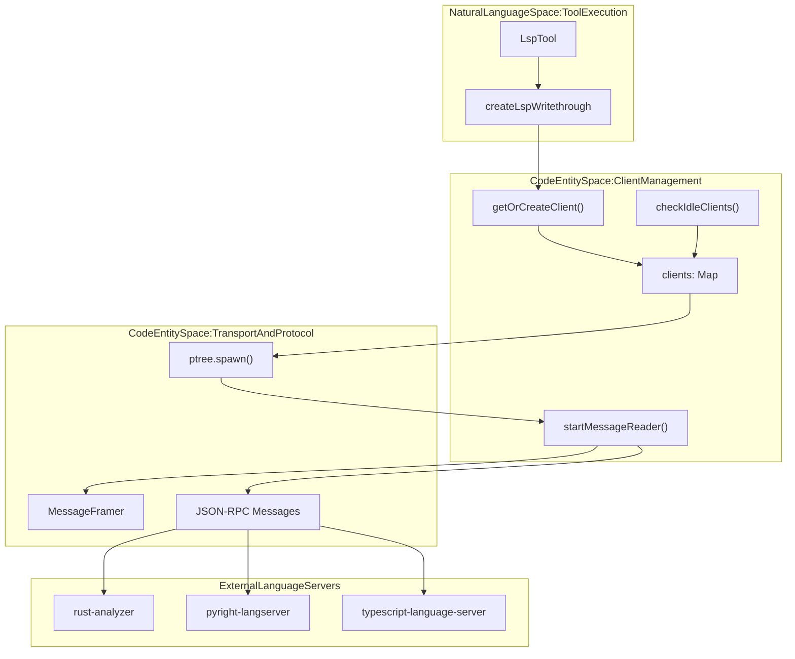
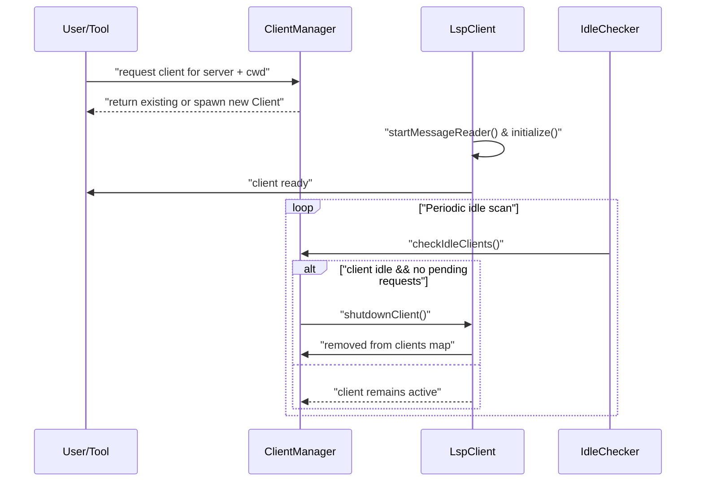
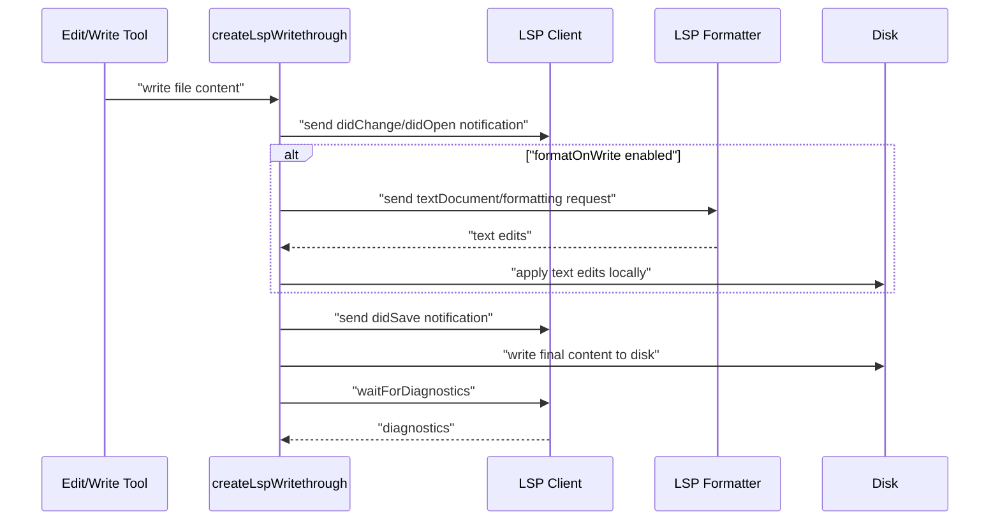
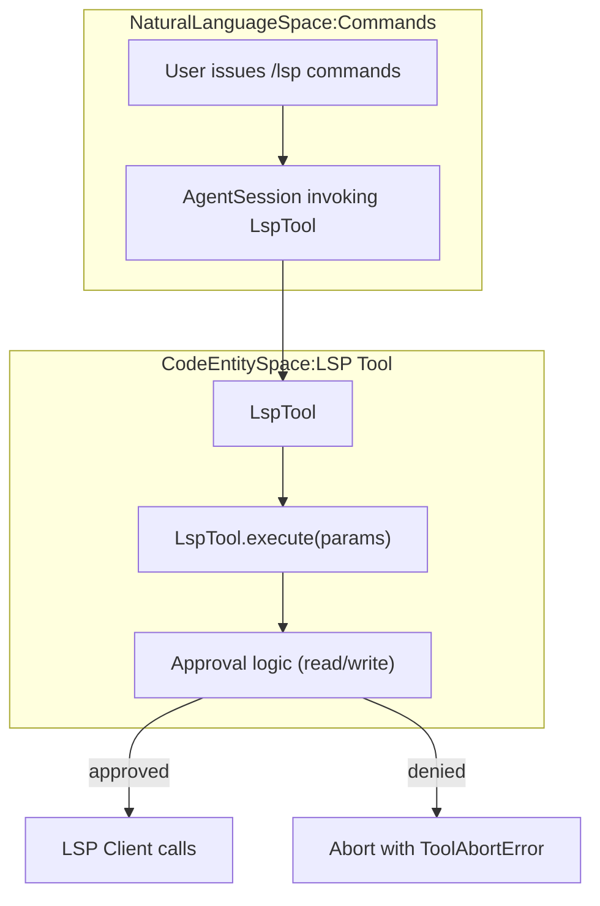

<!-- source: DeepWiki mcp.deepwiki.com · repo can1357/oh-my-pi · page 7.3 LSP Integration · fetched 2026-10-30 -->

# LSP Integration

Relevant source files

The following files were used as context for generating this wiki page:

- [docs/lsp-config.md](docs/lsp-config.md)
- [docs/sdk.md](docs/sdk.md)
- [docs/tools/debug.md](docs/tools/debug.md)
- [docs/tools/lsp.md](docs/tools/lsp.md)
- [packages/coding-agent/src/dap/client.ts](packages/coding-agent/src/dap/client.ts)
- [packages/coding-agent/src/dap/config.ts](packages/coding-agent/src/dap/config.ts)
- [packages/coding-agent/src/dap/defaults.json](packages/coding-agent/src/dap/defaults.json)
- [packages/coding-agent/src/dap/session.ts](packages/coding-agent/src/dap/session.ts)
- [packages/coding-agent/src/dap/types.ts](packages/coding-agent/src/dap/types.ts)
- [packages/coding-agent/src/jsonrpc/message-framing.ts](packages/coding-agent/src/jsonrpc/message-framing.ts)
- [packages/coding-agent/src/lsp/client.ts](packages/coding-agent/src/lsp/client.ts)
- [packages/coding-agent/src/lsp/clients/index.ts](packages/coding-agent/src/lsp/clients/index.ts)
- [packages/coding-agent/src/lsp/clients/swiftlint-client.ts](packages/coding-agent/src/lsp/clients/swiftlint-client.ts)
- [packages/coding-agent/src/lsp/config.ts](packages/coding-agent/src/lsp/config.ts)
- [packages/coding-agent/src/lsp/defaults.json](packages/coding-agent/src/lsp/defaults.json)
- [packages/coding-agent/src/lsp/diagnostics.ts](packages/coding-agent/src/lsp/diagnostics.ts)
- [packages/coding-agent/src/lsp/edits.ts](packages/coding-agent/src/lsp/edits.ts)
- [packages/coding-agent/src/lsp/index.ts](packages/coding-agent/src/lsp/index.ts)
- [packages/coding-agent/src/lsp/servers.ts](packages/coding-agent/src/lsp/servers.ts)
- [packages/coding-agent/src/lsp/settings.ts](packages/coding-agent/src/lsp/settings.ts)
- [packages/coding-agent/src/lsp/tool.ts](packages/coding-agent/src/lsp/tool.ts)
- [packages/coding-agent/src/lsp/types.ts](packages/coding-agent/src/lsp/types.ts)
- [packages/coding-agent/src/lsp/utils.ts](packages/coding-agent/src/lsp/utils.ts)
- [packages/coding-agent/src/lsp/workspace-diagnostics.ts](packages/coding-agent/src/lsp/workspace-diagnostics.ts)
- [packages/coding-agent/src/lsp/writethrough.ts](packages/coding-agent/src/lsp/writethrough.ts)
- [packages/coding-agent/src/prompts/tools/debug.md](packages/coding-agent/src/prompts/tools/debug.md)
- [packages/coding-agent/src/tools/debug.ts](packages/coding-agent/src/tools/debug.ts)
- [packages/coding-agent/src/tools/tool-timeouts.ts](packages/coding-agent/src/tools/tool-timeouts.ts)
- [packages/coding-agent/src/utils/config-file-sources.ts](packages/coding-agent/src/utils/config-file-sources.ts)
- [packages/coding-agent/test/dap-config-precedence.test.ts](packages/coding-agent/test/dap-config-precedence.test.ts)
- [packages/coding-agent/test/debug/dap-config.test.ts](packages/coding-agent/test/debug/dap-config.test.ts)
- [packages/coding-agent/test/debug/dap-launch-failures.test.ts](packages/coding-agent/test/debug/dap-launch-failures.test.ts)
- [packages/coding-agent/test/debug/dap-multi-session.test.ts](packages/coding-agent/test/debug/dap-multi-session.test.ts)
- [packages/coding-agent/test/edit-patch-unchanged-error.test.ts](packages/coding-agent/test/edit-patch-unchanged-error.test.ts)
- [packages/coding-agent/test/lsp/edits.test.ts](packages/coding-agent/test/lsp/edits.test.ts)
- [packages/coding-agent/test/lsp/idle.test.ts](packages/coding-agent/test/lsp/idle.test.ts)
- [packages/coding-agent/test/lsp/issue-4910-diagnostics-bounded.test.ts](packages/coding-agent/test/lsp/issue-4910-diagnostics-bounded.test.ts)
- [packages/coding-agent/test/lsp/reconcile-open-files.test.ts](packages/coding-agent/test/lsp/reconcile-open-files.test.ts)
- [packages/coding-agent/test/tools/lsp-batching.test.ts](packages/coding-agent/test/tools/lsp-batching.test.ts)
- [packages/coding-agent/test/tools/lsp-diagnostics-freshness.test.ts](packages/coding-agent/test/tools/lsp-diagnostics-freshness.test.ts)
- [packages/coding-agent/test/tools/lsp-regressions.test.ts](packages/coding-agent/test/tools/lsp-regressions.test.ts)
- [packages/coding-agent/test/tools/tool-timeouts.test.ts](packages/coding-agent/test/tools/tool-timeouts.test.ts)
- [packages/coding-agent/test/workspace-diagnostics.test.ts](packages/coding-agent/test/workspace-diagnostics.test.ts)

This page documents the Language Server Protocol (LSP) integration in the coding agent (`@oh-my-pi/pi-coding-agent`), enabling IDE-like code intelligence features such as diagnostics, formatting, symbol navigation, and refactors during file editing and write operations [packages/coding-agent/src/lsp/tool.ts:168-197]().

---

## Overview and Architecture

The LSP integration acts as an asynchronous bridge between the AI assistant and external language servers. It manages subprocess lifecycles, intercepts file writes with a *writethrough* mechanism to keep in-memory buffers synchronized, applies automatic format-on-write if enabled, and collects real-time diagnostics for files and projects [packages/coding-agent/src/lsp/client.ts:26-110](). Communication occurs via JSON-RPC over stdio pipes, with message framing and request-response correlation handled internally [packages/coding-agent/src/lsp/client.ts:26-51]().

### System Architecture and Code Entities

*Diagram illustrating the relationship between tool-level operations, client lifecycle management (`getOrCreateClient()`), JSON-RPC framing (`MessageFramer`), and external LSP servers.*

Sources: [packages/coding-agent/src/lsp/client.ts:26-110](), [packages/coding-agent/src/lsp/tool.ts:168-197]()

---

## Client Lifecycle & Management

LSP clients are centrally managed in a singleton map keyed by a composite of server command, workspace path, and initialization params (`clients: Map<string, LspClient>`) [packages/coding-agent/src/lsp/client.ts:27-37](). Client acquisition uses `getOrCreateClient()` which returns existing clients or spawns a new language server subprocess with proper initialization.

### Key Lifecycle Features

- **Initialization & Caching**: `getOrCreateClient()` applies a cache keyed on server config and workspace, creating clients lazily. A backoff system (`INIT_FAILURE_BACKOFF_MS` of 3 minutes) prevents repeated restart attempts on failure [packages/coding-agent/src/lsp/client.ts:28-50]().

- **Idle Timeout and Shutdown**: Clients track request activity via `lastActivity` timestamps. The background idle checker (`checkIdleClients()`) scans clients at intervals and shuts down those idle past configured timeouts with no pending requests [packages/coding-agent/src/lsp/client.ts:94-157]().

- **Request Tracking**: Requests sent over JSON-RPC have unique incremental IDs and are tracked in `pendingRequests` maps to resolve or reject responses properly [packages/coding-agent/src/lsp/client.ts:26-110]().

- **Shared Server Mode**: Optional broker-shared LSP servers multiplex multiple workspaces to reduce process count, controlled by `setSharedLspEnabled()`; fallback to private subprocess spawning if unavailable [packages/coding-agent/src/lsp/client.ts:62-68]().

### Idle Client Lifecycle Flow Diagram

Sources: [packages/coding-agent/src/lsp/client.ts:26-157]()

---

## Server Configuration (`defaults.json`)

The essential server configurations are loaded from a static JSON file (`packages/coding-agent/src/lsp/defaults.json`) containing built-in language server command lines, supported file types, root marker patterns, and initialization options [packages/coding-agent/src/lsp/defaults.json:1-235](). This default config is combined with overridable user or project configuration files parsed and normalized by the runtime config loader [packages/coding-agent/src/lsp/config.ts:10-198]().

### Configuration Pipeline

1. **Defaults Loading**: The JSON defines per-server configs, e.g., for `rust-analyzer`, `clangd`, `typescript-language-server`, `pyright`, etc. Each contains the executable command, file extensions (`fileTypes`), and root markers to detect the project root [packages/coding-agent/src/lsp/defaults.json:1-235]().

2. **Validation & Normalization**: The loader validates mandatory fields (`command`, `fileTypes`, `rootMarkers`), coerces argument arrays, and initializes defaults for optional values such as `languageId` or `initOptions` [packages/coding-agent/src/lsp/config.ts:35-103](). 

3. **Project Root Detection**: Workspace scanning for multiple root marker files supports precise project root discovery for multi-language projects. Both file basenames and glob patterns are supported as root markers [packages/coding-agent/src/lsp/config.ts:176-198]().

4. **Runtime Overrides**: Certain clients (e.g., `biome`, `swiftlint`) inject runtime-specific client factories for their servers to support CLI fallbacks or linters [packages/coding-agent/src/lsp/config.ts:150-167]().

Sources: [packages/coding-agent/src/lsp/defaults.json:1-235](), [packages/coding-agent/src/lsp/config.ts:35-198]()

---

## Format-on-Write and Write-Through

The *writethrough* mechanism intercepts file write calls and keeps the LSP server's in-memory views synchronized with on-disk contents, enabling format-on-save and up-to-date diagnostics without duplicating file writes [packages/coding-agent/src/lsp/writethrough.ts:1-10]().

### Writethrough Pipeline Overview

#### Important Details

- **Content Sync**: The writethrough uses `didOpen` or incremental `didChange` notifications to keep the server buffer updated with new content before formatting or saving [packages/coding-agent/src/lsp/servers.ts:130-160]().

- **Format-on-Write**: When enabled, sends a `textDocument/formatting` request to the server; applies edits after sorting and validating them to prevent overlapping changes [packages/coding-agent/src/lsp/edits.ts:29-128]().

- **Write and Notify**: Notifies the server of file save (`didSave`) only after all in-memory updates and formatting edits are applied; then waits for diagnostics asynchronously [packages/coding-agent/src/lsp/servers.ts:169-192]().

Sources: [packages/coding-agent/src/lsp/writethrough.ts:1-10](), [packages/coding-agent/src/lsp/edits.ts:29-128](), [packages/coding-agent/src/lsp/servers.ts:130-192]()

---

## Diagnostics Collection and Freshness

The system collects and manages diagnostics published by LSP servers, ensuring that the results are fresh and correspond to the correct document version seen by the server [packages/coding-agent/src/lsp/types.ts:73-82]().

### Diagnostic Freshness and Timeouts

- **Version Tracking**: Diagnostics are stored along with the file version number. The `waitForDiagnostics()` function correlates diagnostics version with current content version to guarantee freshness, avoiding stale result display [packages/coding-agent/src/lsp/diagnostics.ts:50-60]().

- **Timeout Budgets**: Different wait time budgets handle slow vs fast servers:
  - `SINGLE_DIAGNOSTICS_WAIT_TIMEOUT_MS` (3000 ms) standard wait for typical servers [packages/coding-agent/src/lsp/tool.ts:49]().
  - `PROJECT_DIAGNOSTICS_WAIT_TIMEOUT_MS` (10,000 ms) extended budget for project-aware servers that perform expensive on-demand analysis [packages/coding-agent/src/lsp/tool.ts:39-49]().
  
- **Virtual Time for Tests**: The test suite replaces real-time with a deterministic `VirtualClock` to simulate time progression and immediately trigger diagnostic publish callbacks, enabling precise, wall-clock independent testing of diagnostic delays and freshness races [packages/coding-agent/test/tools/lsp-diagnostics-freshness.test.ts:86-120]().

Sources: [packages/coding-agent/src/lsp/diagnostics.ts:34-72](), [packages/coding-agent/test/tools/lsp-diagnostics-freshness.test.ts:86-120](), [packages/coding-agent/src/lsp/tool.ts:39-52]()

---

## Batch Request Optimization

To optimize workflows that involve multiple related file writes or large batch edits, the LSP writethrough supports batching requests, minimizing restart costs and redundant operations [packages/coding-agent/src/lsp/index.ts:9-10]().

### Batch Write Coordination

- **Deferred Config and Client Spawn**: Clients and server configurations defer spawning until the first actual write in a batch, improving startup performance and reducing resource consumption when idle [packages/coding-agent/src/lsp/index.ts:9-10]().

- **File Change Notification Consolidation**: The batching layer accumulates file changes, consolidates overlapping ones, and only notifies the server once per batch flush.

- **Race Condition Mitigation**: Validations after batch writes ensure external file changes (e.g., by other tools or race scenarios) do not corrupt in-memory states before flushing diagnostics [packages/coding-agent/test/tools/lsp-diagnostics-freshness.test.ts:134-180]().

Sources: [packages/coding-agent/src/lsp/index.ts:9-10](), [packages/coding-agent/test/tools/lsp-diagnostics-freshness.test.ts:134-180]()

---

## Tool Interface & TUI Rendering

The `lsp` tool presents the language server protocol functionality as a structured tool to the agent with a strict schema (`lspSchema`), making LSP operations available via agent scripts or slash commands [packages/coding-agent/src/lsp/tool.ts:171-200](), [packages/coding-agent/src/lsp/types.ts:8-22]().

### Supported Actions

The tool supports a broad array of LSP actions:

- `diagnostics`: fetch diagnostics for a file or glob
- `definition`, `references`, `hover`, `symbols`: navigational queries and UI hover info
- `rename`, `rename_file`: perform symbol or file renames with safe workspace edits
- `code_actions`: code fixes, quickfixes, and refactors
- `type_definition`, `implementation`: additional navigation features
- `status`, `reload`, `capabilities`: query server status, reload server config, or fetch capabilities
- `request`: generic LSP request with arbitrary JSON payload for extensibility

### Safety & Approval Model

- Actions that mutate source code (e.g., `rename`, `code_actions` with apply) require *write* approval to enforce safe execution in agent environments [packages/coding-agent/src/lsp/tool.ts:174-178]().

- Read-only actions (e.g. `hover`, `diagnostics`) require only *read* approval, enabling safe information retrieval without risk of mutation [packages/coding-agent/src/lsp/tool.ts:174-178]().

### Tool and Natural Language Space Bridging

Sources: [packages/coding-agent/src/lsp/tool.ts:171-200](), [packages/coding-agent/src/lsp/types.ts:8-22]()

---

This completes the LSP Integration documentation for the oh-my-pi coding agent.

---

