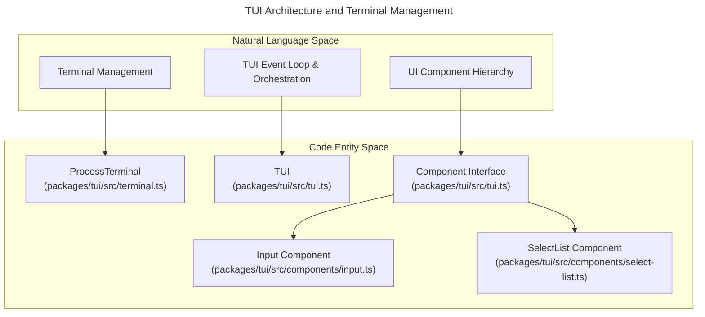

<!-- source: DeepWiki mcp.deepwiki.com · repo can1357/oh-my-pi · page 8 Terminal UI (TUI) · fetched 2026-10-30 -->

# Terminal UI (TUI)

Relevant source files

The following files were used as context for generating this wiki page:

- [packages/agent/CHANGELOG.md](packages/agent/CHANGELOG.md)
- [packages/ai/CHANGELOG.md](packages/ai/CHANGELOG.md)
- [packages/ai/src/registry/registry.ts](packages/ai/src/registry/registry.ts)
- [packages/catalog/CHANGELOG.md](packages/catalog/CHANGELOG.md)
- [packages/catalog/scripts/generate-models.ts](packages/catalog/scripts/generate-models.ts)
- [packages/catalog/scripts/generated-policies.ts](packages/catalog/scripts/generated-policies.ts)
- [packages/catalog/src/compat/axes.ts](packages/catalog/src/compat/axes.ts)
- [packages/catalog/src/compat/resolve.ts](packages/catalog/src/compat/resolve.ts)
- [packages/catalog/src/compat/rules.json](packages/catalog/src/compat/rules.json)
- [packages/catalog/src/compat/rules/classes/anthropic.kdl](packages/catalog/src/compat/rules/classes/anthropic.kdl)
- [packages/catalog/src/compat/rules/classes/openai.kdl](packages/catalog/src/compat/rules/classes/openai.kdl)
- [packages/catalog/src/model-thinking.ts](packages/catalog/src/model-thinking.ts)
- [packages/catalog/src/models.json](packages/catalog/src/models.json)
- [packages/catalog/src/provider-models/descriptors.ts](packages/catalog/src/provider-models/descriptors.ts)
- [packages/catalog/src/provider-models/openai-compat.ts](packages/catalog/src/provider-models/openai-compat.ts)
- [packages/catalog/src/types.ts](packages/catalog/src/types.ts)
- [packages/catalog/test/generated-policies.test.ts](packages/catalog/test/generated-policies.test.ts)
- [packages/catalog/test/model-thinking.test.ts](packages/catalog/test/model-thinking.test.ts)
- [packages/coding-agent/CHANGELOG.md](packages/coding-agent/CHANGELOG.md)
- [packages/tui/CHANGELOG.md](packages/tui/CHANGELOG.md)
- [packages/tui/src/bracketed-paste.ts](packages/tui/src/bracketed-paste.ts)
- [packages/tui/src/keybinding-matchers.ts](packages/tui/src/keybinding-matchers.ts)
- [packages/tui/src/keybindings.ts](packages/tui/src/keybindings.ts)
- [packages/tui/src/loop-watchdog.ts](packages/tui/src/loop-watchdog.ts)
- [packages/tui/src/stdin-buffer.ts](packages/tui/src/stdin-buffer.ts)
- [packages/tui/src/terminal-multiplexer.ts](packages/tui/src/terminal-multiplexer.ts)
- [packages/tui/src/terminal.ts](packages/tui/src/terminal.ts)
- [packages/tui/src/tui.ts](packages/tui/src/tui.ts)
- [packages/tui/src/windows-input-mode.ts](packages/tui/src/windows-input-mode.ts)
- [packages/tui/test/bracketed-paste.test.ts](packages/tui/test/bracketed-paste.test.ts)
- [packages/tui/test/helpers/terminal-multiplexer.ts](packages/tui/test/helpers/terminal-multiplexer.ts)
- [packages/tui/test/issue-2034-repro.test.ts](packages/tui/test/issue-2034-repro.test.ts)
- [packages/tui/test/keybindings-migration.test.ts](packages/tui/test/keybindings-migration.test.ts)
- [packages/tui/test/keybindings.test.ts](packages/tui/test/keybindings.test.ts)
- [packages/tui/test/loop-watchdog-wiring.test.ts](packages/tui/test/loop-watchdog-wiring.test.ts)
- [packages/tui/test/loop-watchdog.test.ts](packages/tui/test/loop-watchdog.test.ts)
- [packages/tui/test/overlay-scroll.test.ts](packages/tui/test/overlay-scroll.test.ts)
- [packages/tui/test/resize-multiplexer-anchor.test.ts](packages/tui/test/resize-multiplexer-anchor.test.ts)
- [packages/tui/test/resize-preserved-clear.test.ts](packages/tui/test/resize-preserved-clear.test.ts)
- [packages/tui/test/select-filter-breadcrumb.test.ts](packages/tui/test/select-filter-breadcrumb.test.ts)
- [packages/tui/test/stdin-buffer.test.ts](packages/tui/test/stdin-buffer.test.ts)
- [packages/tui/test/terminal-appearance.test.ts](packages/tui/test/terminal-appearance.test.ts)
- [packages/tui/test/windows-input-mode.test.ts](packages/tui/test/windows-input-mode.test.ts)
- [packages/utils/src/loop-phase.ts](packages/utils/src/loop-phase.ts)
- [packages/utils/test/loop-phase.test.ts](packages/utils/test/loop-phase.test.ts)

The Terminal UI (TUI) package is the foundational terminal presentation layer of `oh-my-pi`. It enables a rich, interactive command-line interface featuring a component-based architecture, differential rendering for minimal terminal updates, advanced overlay management, and comprehensive terminal protocol integration [packages/tui/src/tui.ts:1-17](). This allows for flicker-free screen updates and robust user interaction workflows optimized for complex terminal environments.

This page provides a high-level overview of the TUI package’s architecture, including its component system, differential rendering strategy, input event flow, and terminal lifecycle management. Technical details and API documentation for specific subsystems are covered in dedicated child pages.

---

## Architecture and Package Overview

The TUI package controls the entire terminal lifecycle starting from raw terminal I/O bytes, going through input buffering and parsing, event dispatch, component rendering, differential viewport updates, and explicit history management [packages/tui/src/terminal.ts:1-170](), [packages/tui/src/stdin-buffer.ts:1-20]().

- **Terminal I/O and Capability Management:** The `ProcessTerminal` class manages platform-specific terminal I/O, probes terminal capabilities, and handles input/output buffering. It supports advanced features like the Kitty graphics protocol and Win32 input decoding [packages/tui/src/terminal.ts:1-170]().
- **Input Buffering and Parsing:** Input streams from the terminal are buffered and parsed by `StdinBuffer`, which assembles fragmented escape sequences and raw input into full logical sequences [packages/tui/src/stdin-buffer.ts:1-130]().
- **Rendering Core:** The `TUI` class orchestrates rendering frames, input focus, overlays, and efficient cursor placement [packages/tui/src/tui.ts:50-180]().
- **Component Model:** UI elements implement a `Component` interface by rendering themselves to lines of ANSI markup [packages/tui/src/tui.ts:140-178]().

### System Architecture: Natural Language Concepts to Code Entities

### Core Classes Summary

| Class / Interface        | Role                                                   | Source Location                        |
|-------------------------|--------------------------------------------------------|-------------------------------------|
| `TUI`                   | Central rendering orchestrator managing frames, overlays, and cursor | [packages/tui/src/tui.ts:245-255]() |
| `Component`             | Interface for UI elements; responsible for rendering and invalidation | [packages/tui/src/tui.ts:140-178]() |
| `ProcessTerminal`       | Terminal I/O handler using stdio and capability probes  | [packages/tui/src/terminal.ts:1-170]() |
| `StdinBuffer`           | Input buffer handling fragmented bytes and escape sequences | [packages/tui/src/stdin-buffer.ts:1-130]() |
| `Input`                 | Single-line text input component with editing features  | [packages/tui/src/components/input.ts:27-49]() |
| `SelectList`            | Filterable multi-selection list component               | [packages/tui/src/components/select-list.ts:97-118]() |

Sources: [packages/tui/src/tui.ts:140-255](), [packages/tui/src/terminal.ts:1-170](), [packages/tui/src/stdin-buffer.ts:1-130](), [packages/tui/src/components/input.ts:27-49](), [packages/tui/src/components/select-list.ts:97-118]()

---

## Core Components and Editor

The TUI package provides a rich set of reusable building blocks, ranging from basic layout and text containers to complex interactive widgets. Components adhere to the stateless `Component` protocol, rendering themselves to arrays of ANSI-styled strings while managing local input focus and event propagation.

For details on core layout and presentation components, see [TUI Components](#8.1). For details on the advanced multi-line editing engine supporting Unicode handling, autocomplete, history, and undo/redo, see [Editor Component](#8.2).

Sources: [packages/tui/src/tui.ts:140-178]()

---

## Differential Rendering and Display

Differential rendering minimizes terminal network and painting overhead by computing and emitting only what has changed between consecutive frames [packages/tui/src/tui.ts:55-90](). The display engine maintains an immutable append-only backlog history alongside a mutable live viewport. 

Frames are synchronized using ANSI synchronized output control sequences (`CSI 2026`) to eliminate tearing, while platform-specific mitigations (such as chunked writes for Windows ConPTY) ensure reliable rendering across diverse terminal emulators [packages/tui/src/terminal.ts:72-147]().

For detailed information on the frame contract, overlays, image protocols, and capability detection, see [Rendering and Display](#8.3).

Sources: [packages/tui/src/tui.ts:55-90](), [packages/tui/src/terminal.ts:72-147]()

---

## Theming and Selectors

The TUI architecture supports rich customization through a centralized theme system and a variety of fullscreen modal overlays. Selectors such as the settings dialog, model browser, and agent hub allow users to interactively configure the agent environment with full mouse and keyboard navigation support.

For details on themes, settings selectors, and overlay panels, see [Theming and Selectors](#8.4).

Sources: [packages/tui/src/tui.ts:245-255]()

---

## Navigation to Child Pages

- [TUI Components](#8.1) — Document core TUI components (`Container`, `Text`, `Markdown`, `SelectList`, `Box`, `Loader`, `Image`, `ScrollView`, `SettingsList`, `Input`) and LaTeX/math rendering.
- [Editor Component](#8.2) — Explain the multi-line editor: Unicode handling, wrapping, autocomplete, history, undo/redo, kill ring, external editor integration.
- [Rendering and Display](#8.3) — Describe differential rendering, TranscriptContainer frame contract, overlays, cursor positioning, synchronized output, image protocols, capability detection.
- [Theming and Selectors](#8.4) — Document the theme system, settings selector, model hub/browser, agent hub, tree selector, and other fullscreen overlay UIs.

Sources: [packages/tui/src/tui.ts:1-17]()

---

