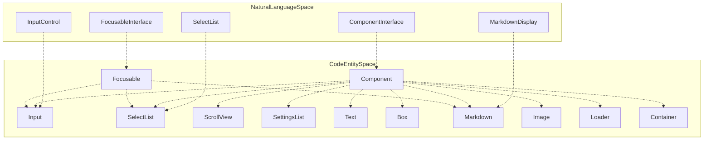
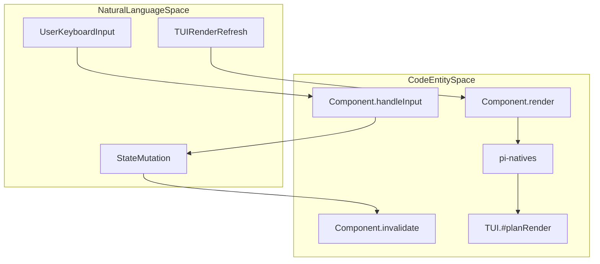

<!-- source: DeepWiki mcp.deepwiki.com · repo can1357/oh-my-pi · page 8.1 TUI Components · fetched 2026-10-30 -->

# TUI Components

<details>
<summary>Relevant source files</summary>

The following files were used as context for generating this wiki page:

- [crates/pi-natives/src/keys.rs](crates/pi-natives/src/keys.rs)
- [crates/pi-natives/src/text.rs](crates/pi-natives/src/text.rs)
- [packages/collab-web/src/components/transcript/math.ts](packages/collab-web/src/components/transcript/math.ts)
- [packages/tui/bench/markdown-stream.ts](packages/tui/bench/markdown-stream.ts)
- [packages/tui/src/autocomplete.ts](packages/tui/src/autocomplete.ts)
- [packages/tui/src/components/box.ts](packages/tui/src/components/box.ts)
- [packages/tui/src/components/editor.ts](packages/tui/src/components/editor.ts)
- [packages/tui/src/components/input.ts](packages/tui/src/components/input.ts)
- [packages/tui/src/components/loader.ts](packages/tui/src/components/loader.ts)
- [packages/tui/src/components/markdown.ts](packages/tui/src/components/markdown.ts)
- [packages/tui/src/components/scroll-view.ts](packages/tui/src/components/scroll-view.ts)
- [packages/tui/src/components/select-list.ts](packages/tui/src/components/select-list.ts)
- [packages/tui/src/components/text.ts](packages/tui/src/components/text.ts)
- [packages/tui/src/components/truncated-text.ts](packages/tui/src/components/truncated-text.ts)
- [packages/tui/src/index.ts](packages/tui/src/index.ts)
- [packages/tui/src/keys.ts](packages/tui/src/keys.ts)
- [packages/tui/src/theme/theme.ts](packages/tui/src/theme/theme.ts)
- [packages/tui/src/theme/tui-adapters.ts](packages/tui/src/theme/tui-adapters.ts)
- [packages/tui/src/utils.ts](packages/tui/src/utils.ts)
- [packages/tui/test/autocomplete.test.ts](packages/tui/test/autocomplete.test.ts)
- [packages/tui/test/editor-autocomplete-actions.test.ts](packages/tui/test/editor-autocomplete-actions.test.ts)
- [packages/tui/test/editor-text-assist.test.ts](packages/tui/test/editor-text-assist.test.ts)
- [packages/tui/test/editor.test.ts](packages/tui/test/editor.test.ts)
- [packages/tui/test/input.test.ts](packages/tui/test/input.test.ts)
- [packages/tui/test/keys.test.ts](packages/tui/test/keys.test.ts)
- [packages/tui/test/loader.test.ts](packages/tui/test/loader.test.ts)
- [packages/tui/test/markdown-incremental-lex.test.ts](packages/tui/test/markdown-incremental-lex.test.ts)
- [packages/tui/test/markdown.test.ts](packages/tui/test/markdown.test.ts)
- [packages/tui/test/notifications.test.ts](packages/tui/test/notifications.test.ts)
- [packages/tui/test/scroll-view.test.ts](packages/tui/test/scroll-view.test.ts)
- [packages/tui/test/select-list.test.ts](packages/tui/test/select-list.test.ts)
- [packages/tui/test/text-utils.test.ts](packages/tui/test/text-utils.test.ts)
- [packages/tui/test/text.test.ts](packages/tui/test/text.test.ts)
- [packages/utils/src/marked/core.ts](packages/utils/src/marked/core.ts)
- [packages/utils/src/marked/inline-closers.ts](packages/utils/src/marked/inline-closers.ts)
- [packages/utils/src/marked/inline-text.ts](packages/utils/src/marked/inline-text.ts)
- [packages/utils/src/math-delimiters.ts](packages/utils/src/math-delimiters.ts)
- [packages/utils/test/marked.test.ts](packages/utils/test/marked.test.ts)
- [packages/utils/test/math-delimiters.test.ts](packages/utils/test/math-delimiters.test.ts)

</details>


## Purpose and Scope

The TUI component system provides a lightweight, differential-rendering architecture optimized for terminal environments. It bridges asynchronous terminal events, state management, and high-performance Rust-based text layout routines (`pi-natives`) to render interactive assistant views, forms, and markdown transcripts.

Sources: [packages/tui/src/tui.ts:1-264](), [packages/tui/src/index.ts:1-54]()

---

## Component Interface

All TUI components implement the `Component` interface, defining the contract for differential rendering, focus management, and input handling.

```typescript
export interface Component {
    render(width: number): readonly string[];
    handleInput?(data: string): void;
    wantsKeyRelease?: boolean;
    invalidate?(): void;
    setIgnoreTight?(ignore: boolean): this;
}
```

### Core Methods

| Method | Required | Description |
| --- | --- | --- |
| `render(width: number): readonly string[]` | Yes | Renders the component to an array of strings for a given viewport width. Components must ensure no line exceeds this width. [packages/tui/src/tui.ts:155-160]() |
| `invalidate(): void` | No | Hook to invalidate cached rendering state, called when themes change or full re-renders are required. [packages/tui/src/tui.ts:170-173]() |
| `handleInput?(data: string): void` | No | Keyboard input handler when component has focus. [packages/tui/src/tui.ts:161-164]() |
| `wantsKeyRelease?: boolean` | No | If true, receives key release events (Kitty protocol). Defaults to false. [packages/tui/src/tui.ts:165-169]() |
| `setIgnoreTight?(ignore: boolean): this` | No | Optionally configures ignoring tight layout mode. [packages/tui/src/tui.ts:174-177]() |

### Focusable Interface and Cursor Positioning

Components that can receive focus and show a hardware cursor implement the `Focusable` interface. Such components embed a zero-width `CURSOR_MARKER` (`\x1b_pi:c\x07`) at the intended cursor position in their output. The TUI engine detects this, removes the marker, and sets the physical terminal cursor accordingly.

Sources: [packages/tui/src/tui.ts:180-196]()

---

## Component Hierarchy

The following diagram connects natural language UI concepts with their codebase counterparts — showing how interface and concrete classes relate.

### TUI Component Class Hierarchy



Sources: [packages/tui/src/tui.ts:148-232](), [packages/tui/src/components/markdown.ts:1-251](), [packages/tui/src/components/text.ts:22-184](), [packages/tui/src/components/loader.ts:22-117](), [packages/tui/src/components/select-list.ts:97-183](), [packages/tui/src/components/input.ts:27-66]()

---

## Core Components

### Structural and Layout Components

- **Container**  
  The `Container` manages an ordered array of child components. It recursively calls their `render` methods and coordinates subtree invalidation via `invalidate()`. Its `render(width)` concatenates children’s rendered lines vertically.  
  Implementation: [packages/tui/src/tui.ts:232-264]()

- **Box**  
  Wraps a child component with optional horizontal padding and a background color function (`bgFn`), plus an optional border. It publishes per-line visible widths via native utilities, optimizing layout and rendering paths.  
  Implementation: [packages/tui/src/utils.ts:55-77]()

- **ScrollView**  
  Provides a viewport with vertical scrolling for large components by clipping child output lines. It manages vertical offset and clip height state.  
  Implementation: [packages/tui/src/components/scroll-view.ts]()

Sources: [packages/tui/src/tui.ts:232-264](), [packages/tui/src/utils.ts:55-77](), [packages/tui/src/components/scroll-view.ts]()

---

### Text and Rendering Components

- **Text**  
  Multi-line ANSI-aware text renderer. Features tab replacement, word-wrapping, and visible character width handling using Rust-native `pi-natives` utilities for speed and correctness.  
  Implementation: [packages/tui/src/components/text.ts:22-184]()

- **Markdown**  
  Stateful Markdown renderer using extended `marked` lexer and parser with math delimiter support. It recognizes inline and block LaTeX math, Kitty OSC 66 text-sizing spans, and GFM tables with nested lists.  
  Uses LaTeX-to-Unicode and LaTeX-to-Block conversion for math rendering inside Markdown.  
  Implements incremental lexing with caching to allow streaming and progressive render consistency.  
  Implementation: [packages/tui/src/components/markdown.ts:1-192]()

- **Image**  
  Renders inline images supporting Kitty, iTerm2, and Sixel protocols, controlled by `ImageBudget` which limits concurrent live images to avoid terminal resource exhaustion. Older images are demoted to text fallback.  
  Implementation: [packages/tui/src/components/image.ts:1-166]()

- **Loader**  
  Displays animated spinner with smooth cadence (30fps). Uses a colorized frame sequence and restyles message text. It extends `Text` and carefully schedules re-renders for animation timing and backpressure.  
  Implementation: [packages/tui/src/components/loader.ts:22-117]()

Sources: [packages/tui/src/components/text.ts:22-184](), [packages/tui/src/components/markdown.ts:1-192](), [packages/tui/src/components/image.ts:1-166](), [packages/tui/src/components/loader.ts:22-117]()

---

### Interactive Controls

- **Input**  
  A single-line editable text input supporting horizontal scrolling, cursor movement, bracketed paste, undo/redo, and integration with a kill ring.  
  Renders with hardware cursor by embedding `CURSOR_MARKER`. Manages raw input sequences and updates internal text state.  
  Implementation: [packages/tui/src/components/input.ts:27-66]()

- **SelectList**  
  Scrollable selectable list supporting filtering, multi-line description, keyboard and mouse navigation, and ANSI-aware truncation/highlights.  
  Implementation: [packages/tui/src/components/select-list.ts:97-183]()

- **SettingsList**  
  Derived from `SelectList`, specialized for key–value settings editing with validation and interaction.

Sources: [packages/tui/src/components/input.ts:27-66](), [packages/tui/src/components/select-list.ts:97-183](), [packages/tui/src/index.ts:1-54]()

---

## LaTeX and Math Rendering

TUI supports math rendering by converting LaTeX expressions into terminal-friendly Unicode glyphs or boxed text blocks.

- **Math Delimiters**  
  Using utilities from `@oh-my-pi/pi-utils/math-delimiters` such as `mathBlockAt`, `mathBlockOpenerAt`, and `mathSpanInContext` to detect inline `$...$` and block `$$...$$` math segments in Markdown or text. These inform custom Markdown tokenizer extensions.  
  See: [packages/tui/src/components/markdown.ts:10-20]()

- **Unicode Conversion**  
  The `latexToUnicode` function converts a LaTeX-parsed AST into Unicode strings with superscripts, subscripts, Greek letters, symbols, etc., suitable for inline terminal display.

- **Box Blocks**  
  For multi-line complex math (matrices, fractions), `latexToBlock` generates box-drawing multi-line representations rendered as fixed-width text blocks in terminal. This preserves formula meaning visually in text-only environments.

Math extensions integrate tightly into the Markdown renderer tokenizer and renderer, enabling fluid mixing of math elements into prose.

Sources: [packages/tui/src/components/markdown.ts:10-20](), [packages/tui/src/latex-block.ts:1-38](), [packages/tui/src/latex-to-unicode.ts:1-25]()

---

## Rendering Data Flow

The TUI uses a differential rendering pipeline for minimal terminal updates output:



### Explanation of Flow

- **User Keyboard Input** invokes a component's `handleInput` handler.
- This handler triggers internal **State Mutation** (e.g., updating text).
- Mutation causes either explicit or implicit component **Invalidate** calls for cached render data.
- Periodically, the TUI engine schedules a **Render Refresh** tick invoking `render(width)` on affected components.
- The components produce arrays of ANSI escape-coded strings for the viewport width.
- These strings are processed with native-side ANSI-aware utilities (`pi-natives`) for efficient width measurement, slicing, and diffing before writing terminal output.
- Cursor placement is controlled by embedded cursor markers in that process.

Sources: [packages/tui/src/tui.ts:148-264](), [packages/tui/src/components/loader.ts:70-117](), [packages/tui/src/components/text.ts:100-105](), [crates/pi-natives/src/text.rs:1-64]()

---

---

