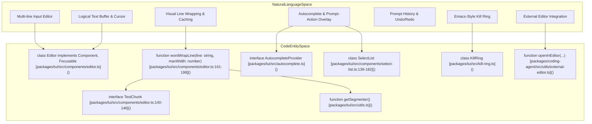
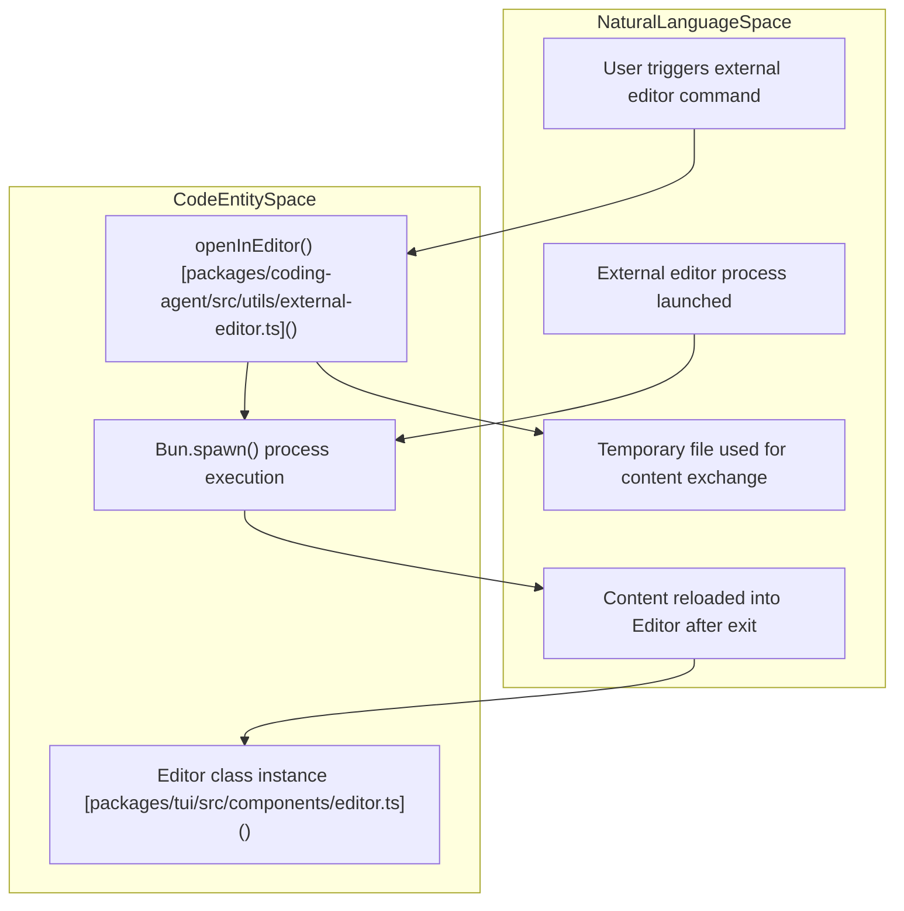
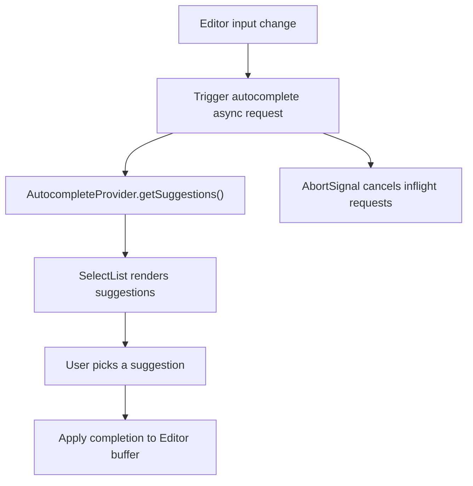

<!-- source: DeepWiki mcp.deepwiki.com · repo can1357/oh-my-pi · page 8.2 Editor Component · fetched 2026-10-30 -->

# Editor Component

Relevant source files

The following files were used as context for generating this wiki page:

- [crates/pi-natives/src/keys.rs](crates/pi-natives/src/keys.rs)
- [packages/tui/src/autocomplete.ts](packages/tui/src/autocomplete.ts)
- [packages/tui/src/components/editor.ts](packages/tui/src/components/editor.ts)
- [packages/tui/src/components/input.ts](packages/tui/src/components/input.ts)
- [packages/tui/src/components/select-list.ts](packages/tui/src/components/select-list.ts)
- [packages/tui/src/index.ts](packages/tui/src/index.ts)
- [packages/tui/src/keys.ts](packages/tui/src/keys.ts)
- [packages/tui/test/autocomplete.test.ts](packages/tui/test/autocomplete.test.ts)
- [packages/tui/test/editor-autocomplete-actions.test.ts](packages/tui/test/editor-autocomplete-actions.test.ts)
- [packages/tui/test/editor-text-assist.test.ts](packages/tui/test/editor-text-assist.test.ts)
- [packages/tui/test/editor.test.ts](packages/tui/test/editor.test.ts)
- [packages/tui/test/input.test.ts](packages/tui/test/input.test.ts)
- [packages/tui/test/keys.test.ts](packages/tui/test/keys.test.ts)
- [packages/tui/test/notifications.test.ts](packages/tui/test/notifications.test.ts)
- [packages/tui/test/select-list.test.ts](packages/tui/test/select-list.test.ts)

The Editor Component delivers a comprehensive multi-line editable text environment tailored for terminal-based interactive workflows. It supports Unicode-aware input and rendering, precise word wrapping, dynamic autocomplete with prompt-action suggestions, prompt history navigation for command recall, full undo/redo stacks, an Emacs-style kill ring for efficient text kills/yanks, and seamless integration with external text editors.

This component underpins textual input for user interactions throughout the oh-my-pi TUI and coding-agent packages, making it a core building block for user prompt composition and editing in the terminal.

---

## Component Architecture

At the core is the `Editor` class, which implements both the `Component` and `Focusable` interfaces, managing the logical text buffer, cursor state, input processing, and orchestrating rendering updates within the TUI framework [packages/tui/src/components/editor.ts]().

### Key Classes and Interfaces

| Entity | Role | Source |
|---|---|---|
| `Editor` | Multi-line editable text input with advanced editing and input handling | `[packages/tui/src/components/editor.ts]()` |
| `TextChunk` | Metadata for segments resulting from word wrapping, storing text and visible width | `[packages/tui/src/components/editor.ts:140-146]()` |
| `AutocompleteProvider` | Interface for providers supplying dynamic autocomplete suggestions | `[packages/tui/src/autocomplete.ts]()` |
| `SelectList` | UI component rendering autocomplete popups and prompt-action suggestion lists | `[packages/tui/src/components/select-list.ts]()` |
| `KillRing` | Emacs-style kill ring for managing kill/yank clipboard history | `[packages/tui/src/kill-ring.ts]()` |
| Unicode grapheme `Segmenter` | Utility leveraging `Intl.Segmenter` to safely handle Unicode grapheme clusters | `[packages/tui/src/utils.ts]()` |
| External Editor Utilities | Functions supporting launching editors like `vim`, `nano` and syncing buffer contents | `[packages/coding-agent/src/utils/external-editor.ts]()` |

### Architecture Overview

**Sources:**  
- `[packages/tui/src/components/editor.ts:140-146]()`  
- `[packages/tui/src/components/editor.ts:161-198]()`  
- `[packages/tui/src/autocomplete.ts]()`  
- `[packages/tui/src/components/select-list.ts]()`  
- `[packages/tui/src/kill-ring.ts]()`  
- `[packages/coding-agent/src/utils/external-editor.ts]()`  

---

## Text Layout and Word Wrapping

### Unicode-Aware Grapheme Segmentation

The editor uses the `Intl.Segmenter` API via the helper `getSegmenter()` function to segment text into Unicode grapheme clusters [packages/tui/src/components/editor.ts:132-132](). This precise segmentation ensures that cursor movements, insertions, and deletions operate on user-visible characters (graphemes) rather than raw code points or bytes, maintaining correct handling of composed characters, emoji, and combining marks.

### Word Wrapping Algorithm

The function `wordWrapLine(line: string, maxWidth: number, knownLineWidth?: number): TextChunk[]` breaks down a single logical line of text into multiple display chunks that fit within the provided `maxWidth` measured in character cells on screen [packages/tui/src/components/editor.ts:161-198]().

- It segments the line grapheme-by-grapheme and groups them into tokens classified as whitespace or non-whitespace [packages/tui/src/components/editor.ts:182-198]().
- The algorithm wraps preferably at token boundaries for words and spaces but falls back to splitting mid-token graphemes if the token is longer than the max width.
- Each chunk records the exact text slice, its indices in the original line, and its visible width, caching these values to avoid re-measuring on each render [packages/tui/src/components/editor.ts:140-146]().

This approach allows robust line-wrapping with consistent visual alignment and efficient rendering.

### Visual Layout Caching

The editor caches these wrapped lines and their widths to quickly map logical cursor positions into screen coordinates and vice versa during user interaction.

**Sources:**  
- `[packages/tui/src/components/editor.ts:132-132]()`  
- `[packages/tui/src/components/editor.ts:140-146]()`  
- `[packages/tui/src/components/editor.ts:161-198]()`  
- `[packages/tui/src/utils.ts]()`  

---

## Input Handling and Keybindings

The editor provides the `handleInput(data: string): boolean` method to process terminal input sequences. This includes:

- Handling bracketed paste mode for atomic large pastes, decoding re-encoded Ctrl keys from multiplexers like tmux [packages/tui/src/components/editor.ts:14-14]() [packages/tui/src/bracketed-paste.ts]().
- Parsing input keys into logical commands using the shared keybindings system (`KeybindingsManager`) which supports user remapping [packages/tui/src/keybindings.ts]().
- Supporting all common editing operations: single character insertions, backspace/delete, cursor motions by character and word, line start/end navigation.
- Emacs-style kill ring operations (cuts and yanks) [packages/tui/src/kill-ring.ts]().
- Undo/redo support with coalesced state snapshots to manage editing history.
- Submission and cancellation callbacks.

The editor handles keys including those from legacy terminal sequences and advanced protocols like the Kitty keyboard protocol, using parsing utilities (`parseKey` and `matchesKey`) to correctly interpret input data [packages/tui/src/keys.ts]() [crates/pi-natives/src/keys.rs]().

Unicode grapheme boundary awareness is applied to ensure edits never corrupt complex characters.

**Sources:**  
- `[packages/tui/src/components/editor.ts]()`  
- `[packages/tui/src/keybindings.ts]()`  
- `[packages/tui/src/bracketed-paste.ts]()`  
- `[packages/tui/src/keys.ts]()`  
- `[crates/pi-natives/src/keys.rs]()`  

---

## External Editor Integration

For complex multi-line editing scenarios, the editor supports integration with external editors (e.g. Vim, Nano).

### Integration Workflow

- When triggered, the current editor buffer is written to a temporary file.
- The `openInEditor` function synchronously launches the external editor program on this file with full terminal interactive access [packages/coding-agent/src/utils/external-editor.ts]().
- After the external editor exits, the file content is reloaded into the editor buffer.
- This enhances usability for users preferring their own editor for big text inputs beyond the terminal UI limitations.

**Sources:**  
- `[packages/coding-agent/src/utils/external-editor.ts]()`  
- `[packages/tui/src/components/editor.ts]()`  

---

## History and Undo/Redo Systems

### Prompt History Navigation

The editor maintains a prompt history with limits:

- Stores submitted prompts and allows traversal with Up/Down arrow keys [packages/tui/test/editor.test.ts:106-183]().
- Skips duplicate and empty entries.
- Maintains a recent window of up to 100 draft prompts in-memory without persistent reload [packages/tui/test/editor.test.ts:138-167]().
- Integrated with the editor state, allowing editing of recalled prompts or drafts before resubmission.

### Undo/Redo

- The editor captures snapshots of buffer state on edits.
- Undo and redo operations restore prior or subsequent states respectively.
- Input coalescing reduces redundant undo steps for smooth user experience.
- The undo stack size is capped to avoid memory bloat.

**Sources:**  
- `[packages/tui/src/components/editor.ts]()`  
- `[packages/tui/test/editor.test.ts:26-183]()`  

---

## Kill Ring and Clipboard Handling

The editor includes an Emacs-style kill ring implemented via the `KillRing` class [packages/tui/src/kill-ring.ts]():

- Kill commands append to or replace the kill ring buffer.
- Yank commands insert the latest kill ring entry.
- Yank-pop cycles through previous kills, enabling efficient reuse of multiple clippings.
- This kill ring operates independently from the undo stack and integrates smoothly with text manipulation commands.

**Sources:**  
- `[packages/tui/src/kill-ring.ts]()`  
- `[packages/tui/src/components/editor.ts]()`  

---

## Autocomplete and Prompt-Action Suggestions

### Autocomplete Framework

The editor uses asynchronous `AutocompleteProvider` instances to supply completion suggestions dynamically based on the current text context:

- Supports special triggers such as `/` for slash commands, `@` for file path completions, and `^` for model or mention completions [packages/tui/src/autocomplete.ts]().
- Uses fuzzy substring matching and ranked subsequence scoring for responsive and accurate matches [packages/tui/src/autocomplete.ts:168-210]().
- The autocomplete provider is queried asynchronously and supports inflight request cancellation to maintain UI responsiveness [packages/tui/test/editor-autocomplete-actions.test.ts:87-128]().

### UI Rendering and Interaction

- `SelectList` component renders autocomplete suggestions in a popup list with scroll support, keyboard and mouse interaction [packages/tui/src/components/select-list.ts]() [packages/tui/src/components/editor.ts:104-125]().
- Supports contextual filtering such as narrowing file path suggestions inline during slow directory walks [packages/tui/src/components/editor.ts:112-117]().
- The editor updates autocomplete state on input events and applies chosen completions to the editor buffer.

### Async Request Lifecycle

The editor schedules autocomplete queries upon input changes, canceling any previous pending requests to avoid stale UI updates and speed responsiveness.

**Sources:**  
- `[packages/tui/src/autocomplete.ts]()`  
- `[packages/tui/src/autocomplete.ts:168-210]()`  
- `[packages/tui/src/components/select-list.ts]()`  
- `[packages/tui/src/components/editor.ts:104-125]()`  
- `[packages/tui/test/editor-autocomplete-actions.test.ts:31-72]()`  
- `[packages/tui/test/editor-autocomplete-actions.test.ts:87-128]()`

---

