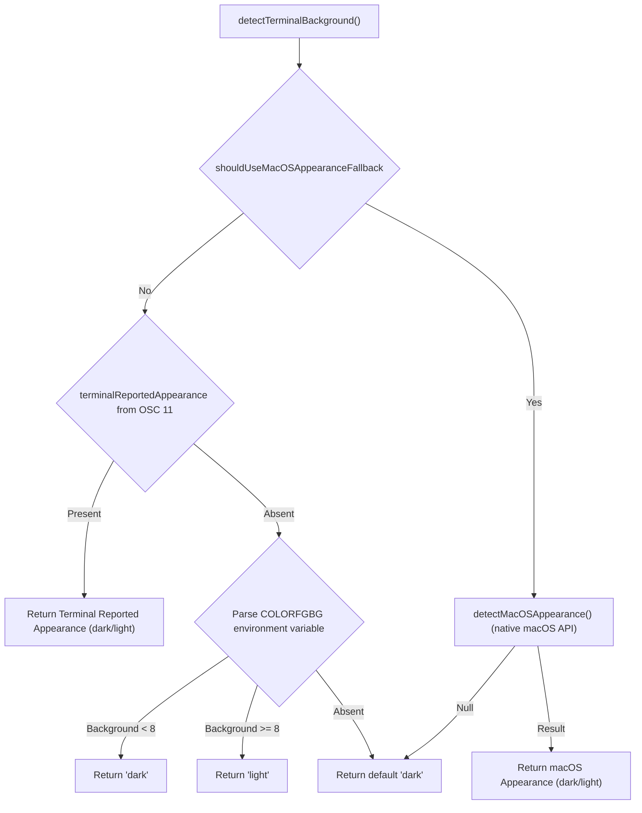
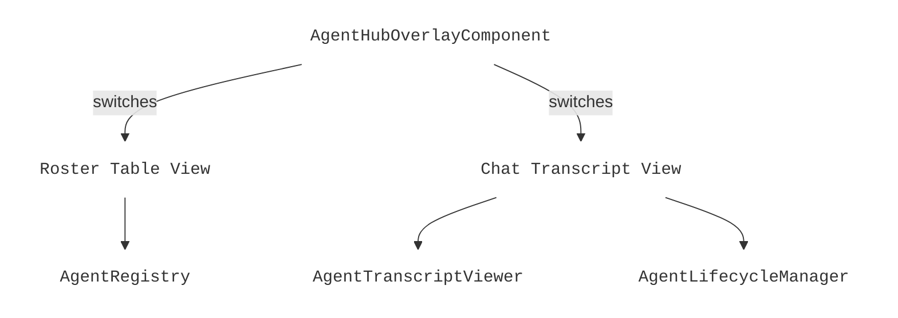

<!-- source: DeepWiki mcp.deepwiki.com · repo can1357/oh-my-pi · page 8.4 Theming and Selectors · fetched 2026-10-30 -->

# Theming and Selectors

<details>
<summary>Relevant source files</summary>

The following files were used as context for generating this wiki page:

- [docs/keybindings.md](docs/keybindings.md)
- [docs/tree.md](docs/tree.md)
- [packages/coding-agent/src/config/compaction-threshold.ts](packages/coding-agent/src/config/compaction-threshold.ts)
- [packages/coding-agent/src/config/registry.ts](packages/coding-agent/src/config/registry.ts)
- [packages/coding-agent/src/modes/agents-hub-deps.ts](packages/coding-agent/src/modes/agents-hub-deps.ts)
- [packages/coding-agent/src/session/model-compaction-threshold.ts](packages/coding-agent/src/session/model-compaction-threshold.ts)
- [packages/coding-agent/test/config/compaction-threshold.test.ts](packages/coding-agent/test/config/compaction-threshold.test.ts)
- [packages/coding-agent/test/config/settings-entry-writes.test.ts](packages/coding-agent/test/config/settings-entry-writes.test.ts)
- [packages/coding-agent/test/keybindings-selector-navigation.test.ts](packages/coding-agent/test/keybindings-selector-navigation.test.ts)
- [packages/coding-agent/test/model-hub.test.ts](packages/coding-agent/test/model-hub.test.ts)
- [packages/coding-agent/test/modes/controllers/selector-controller-model-writes.test.ts](packages/coding-agent/test/modes/controllers/selector-controller-model-writes.test.ts)
- [packages/tui/src/app-keybindings.ts](packages/tui/src/app-keybindings.ts)
- [packages/tui/src/bracketed-paste.ts](packages/tui/src/bracketed-paste.ts)
- [packages/tui/src/hotkeys-markdown.ts](packages/tui/src/hotkeys-markdown.ts)
- [packages/tui/src/keybinding-matchers.ts](packages/tui/src/keybinding-matchers.ts)
- [packages/tui/src/keybindings.ts](packages/tui/src/keybindings.ts)
- [packages/tui/src/loop-watchdog.ts](packages/tui/src/loop-watchdog.ts)
- [packages/tui/src/overlays/agents-hub.ts](packages/tui/src/overlays/agents-hub.ts)
- [packages/tui/src/overlays/history-search.ts](packages/tui/src/overlays/history-search.ts)
- [packages/tui/src/overlays/hub-frame.ts](packages/tui/src/overlays/hub-frame.ts)
- [packages/tui/src/overlays/model-hub.ts](packages/tui/src/overlays/model-hub.ts)
- [packages/tui/src/overlays/settings-defs.ts](packages/tui/src/overlays/settings-defs.ts)
- [packages/tui/src/overlays/settings-selector.ts](packages/tui/src/overlays/settings-selector.ts)
- [packages/tui/src/overlays/tree-selector.ts](packages/tui/src/overlays/tree-selector.ts)
- [packages/tui/src/stdin-buffer.ts](packages/tui/src/stdin-buffer.ts)
- [packages/tui/src/terminal.ts](packages/tui/src/terminal.ts)
- [packages/tui/src/vim.ts](packages/tui/src/vim.ts)
- [packages/tui/src/windows-input-mode.ts](packages/tui/src/windows-input-mode.ts)
- [packages/tui/test/agents-hub.test.ts](packages/tui/test/agents-hub.test.ts)
- [packages/tui/test/bracketed-paste.test.ts](packages/tui/test/bracketed-paste.test.ts)
- [packages/tui/test/editor-vim.test.ts](packages/tui/test/editor-vim.test.ts)
- [packages/tui/test/issue-2034-repro.test.ts](packages/tui/test/issue-2034-repro.test.ts)
- [packages/tui/test/keybindings-migration.test.ts](packages/tui/test/keybindings-migration.test.ts)
- [packages/tui/test/keybindings.test.ts](packages/tui/test/keybindings.test.ts)
- [packages/tui/test/loop-watchdog-wiring.test.ts](packages/tui/test/loop-watchdog-wiring.test.ts)
- [packages/tui/test/loop-watchdog.test.ts](packages/tui/test/loop-watchdog.test.ts)
- [packages/tui/test/select-filter-breadcrumb.test.ts](packages/tui/test/select-filter-breadcrumb.test.ts)
- [packages/tui/test/settings-prefs-native.test.ts](packages/tui/test/settings-prefs-native.test.ts)
- [packages/tui/test/stdin-buffer.test.ts](packages/tui/test/stdin-buffer.test.ts)
- [packages/tui/test/terminal-appearance.test.ts](packages/tui/test/terminal-appearance.test.ts)
- [packages/tui/test/windows-input-mode.test.ts](packages/tui/test/windows-input-mode.test.ts)
- [packages/utils/src/loop-phase.ts](packages/utils/src/loop-phase.ts)
- [packages/utils/test/loop-phase.test.ts](packages/utils/test/loop-phase.test.ts)

</details>


## Purpose and Scope
This document details the technical architecture of the terminal user interface (TUI) theme subsystem, appearance detection logic, and fullscreen overlay selectors in the `oh-my-pi` coding agent (`packages/tui`, `packages/coding-agent`). It covers color resolution, symbol presets, nerd fonts, light/dark detection, tui-adapters for theme integration, and interactive selectors including the settings selector, model hub/browser, agent hub, and the tree selector UI components.

Sources:  
`[packages/tui/src/theme/theme.ts:1-180]`,  
`[packages/coding-agent/src/modes/controllers/selector-controller.ts:1-241]`,  
`[packages/coding-agent/src/registry/agent-lifecycle.ts:89-147]`,  
`[packages/coding-agent/src/modes/components/tree-selector.ts:32-181]`,  
`[packages/coding-agent/src/modes/components/settings-defs.ts:35-157]`,  
`[packages/coding-agent/src/modes/components/settings-selector.ts:63-125]`,  
`[packages/tui/src/overlays/model-hub.ts:1-100]`,  
`[packages/tui/src/overlays/model-browser.ts:1-120]`,  
`[packages/coding-agent/src/modes/model-browser-source.ts:1-90]`

---

## 1. Theme System and Appearance Detection

### 1.1 Appearance Detection Strategy

The theme subsystem determines the terminal background appearance to optimize color usage and symbol sets, primarily to choose between dark and light mode variants.

The core function `detectTerminalBackground()` applies a multi-tier detection strategy as follows:

- **Tier 1:** Uses OSC 11 (Operating System Command 11) to asynchronously query the terminal's reported background color (`terminalReportedAppearance`). This is skipped on macOS when running inside multiplexers (like Zellij) since OSC passthrough can be broken.

- **Tier 2:** Parses the `COLORFGBG` environment variable, which some terminals use to indicate foreground/background colors. If the parsed background color index is less than 8 (indicating one of the ANSI dark colors), "dark" mode is selected; otherwise, "light".

- **Tier 3:** On macOS, or as a fallback on other platforms, it invokes a native macOS API wrapped in `detectMacOSAppearance()` to determine appearance ("dark" or "light").

- **Default:** If all above methods fail, default to `"dark"` mode.

This multi-source detection ensures more accurate theming preferences adapted to terminal and OS environment.

#### Appearance Detection Flowchart



*Figure 1: Appearance detection decision graph, mapping functional routines to code entities.*

Sources: `[packages/tui/src/theme/theme.ts:40-95]`

---

### 1.2 Theme Initialization and Data Flow

The theme is encapsulated in the `Theme` class instance which holds:

- **Color Palettes:** Foreground, background, selection, borders, markdown colors, synstyle colors, and custom highlights.

- **Symbols:** Glyph sets used for UI symbols such as arrows, bullets, and special control characters. Multiple predefined symbol packs exist, including Nerd Font variants.

- **Color-blind Mode Support:** Parameters for hue and saturation shifts are applied to support color-blind users.

- **Markdown Renderer Colors:** The theme provides colors and style guides for markdown elements rendered in the chat transcript.

The theme lifecycle functions include:

- `initTheme(settings?, previewThemeName?)` — asynchronously initializes a theme instance based on settings overrides or preview themes.

- `initThemeSync()` — synchronous initialization used for immediate theme data access.

The system detects font capabilities to select suitable symbol packs (e.g., Nerd Font vs ASCII fallback).

A global singleton `theme` exposes the active theme instance for all UI components.

#### TUI Theming Adapters

To integrate the theme with TUI components, adapter functions export parts of the theme structured for particular UI controls like lists, editors, markdown renders, and input areas:

- `themeAsSelectList()`  
- `themeAsSettingsList()`  
- `themeAsEditorTheme()`  
- `themeAsMarkdownTheme()`  
- `themeAsSymbols()`  

These adapters transform the theme data to the formats expected by various TUI widgets, allowing consistent, dynamic theming throughout the interface.

Sources:  
`[packages/tui/src/theme/theme.ts:1-180]`,  
`[packages/tui/src/theme/active-symbols.ts:1-50]`

---

## 2. Settings Selector

The settings selector is a fullscreen interactive overlay UI presenting user-configurable options driven by declarative schemas.

### 2.1 Settings Schema and Widget Types

Settings are described via multiple specialized definition types, representing diverse control kinds:

| Setting Type           | Description                              |
|------------------------|------------------------------------------|
| `BooleanSettingDef`    | On/off toggles                           |
| `EnumSettingDef`       | Single choice from string options       |
| `SubmenuSettingDef`    | Nested settings under submenu            |
| `TextInputSettingDef`  | Free text input, optionally secret       |
| `MultiSelectSettingDef`| Multiple selectable choices with ordering |
| `ProviderLimitsSettingDef` | Quotas and credit limits per service provider |

These are unified under:

```typescript
export type SettingDef =
	| BooleanSettingDef
	| EnumSettingDef
	| SubmenuSettingDef
	| TextInputSettingDef
	| ProviderLimitsSettingDef
	| MultiSelectSettingDef;
```

Conditional visibility of settings is controlled via `CONDITIONS`, a mapping from string keys to runtime predicates (e.g., platform checks, backend types). This allows dynamic UI adapting to environment and selection context.

### 2.2 Interaction and Rendering

The settings selector overlay renders this schema using components like `SelectList` and `SettingsList`. Users can navigate with keyboard/mouse, make selections, toggle switches, or enter text inputs inline.

When settings values change:

- UI is updated live.
- Cascading effects such as theme reinitialization or mode switches happen automatically.
- Changes persist to settings storage synchronously or asynchronously.

Sources:  
`[packages/coding-agent/src/modes/components/settings-defs.ts:35-157]`,  
`[packages/coding-agent/src/modes/components/settings-selector.ts:63-125]`

---

## 3. Model Hub and Browser

The Model Hub is a fullscreen overlay with extensive support for browsing, inspecting, and selecting supported AI models.

### 3.1 Features and Responsibilities

- **Model Discovery:** Lists models known via the catalog and extensions.
- **Provider Authentication:** Shows login status for providers; locked providers prompt login flows.
- **Metadata Display:** Context windows, pricing, reasoning capabilities, input types, and reasoning support.
- **Role Assignments:** Users assign models to logical roles and can override or clear role assignments.
- **Fallback Chains:** Users can edit model fallback chains for retry/fallback logic.
- **Presets:** Supports saving and switching sets of model assignments and thinking levels.

### 3.2 Model Browser Component

The integrated `ModelBrowser` component supports:

- Fuzzy search with tokenized queries.
- Role-based sorting and filtering by model kind and provider.
- Dynamic item ranking and MRU (most recently used) sorting.
- Detailed in-overlay preview of model info.
- Autocomplete providers for inline model mentions in prompt editors.

Sources:  
`[packages/tui/src/overlays/model-hub.ts:1-100]`,  
`[packages/tui/src/overlays/model-browser.ts:1-120]`,  
`[packages/coding-agent/test/model-browser.test.ts:1-189]`,  
`[packages/coding-agent/src/modes/model-browser-source.ts:1-90]`

---

## 4. Agent Hub

The Agent Hub overlay is a fullscreen selector interface specialized for managing subagents spawned within interactive sessions.

### 4.1 Dual View Design

This overlay features two main views:

- **Roster Table View:** Displays all currently active or parked subagents (i.e., agent instances other than the main agent).

- **Chat Transcript View:** Presents the chat transcript for the selected agent, showing ongoing or past interactions with input prompt support for user steering or queries.

### 4.2 Component Architecture

Implemented by the `AgentHubOverlayComponent`, the overlay controls the views and coordination with agent lifecycle management.



*Figure 2: Agent Hub component topology bridging natural language roles to code entities.*

### 4.3 Lifecycle Management

The `AgentLifecycleManager` implements timeout-based lifecycle policies for agent references:

- Agents inactive beyond a configured TTL (`idleTtlMs`) are "parked" — live sessions are disposed to conserve memory.

- Parked agents remain accessible by their `AgentRef` handle, reflecting their saved session state on disk.

- Users may revive or abort parked agents interactively via the Agent Hub UI.

This lifecycle mechanism transitions subagents to conserve resources while preserving user accessibility to session state.

Sources:  
`[packages/coding-agent/src/modes/components/agent-hub.ts:1-160]`,  
`[packages/coding-agent/src/registry/agent-lifecycle.ts:89-147]`

---

## 5. Tree Selector

The Tree Selector overlay provides hierarchical navigation of conversation trees or session branching histories.

### 5.1 Flattened Tree Layout

The selector accepts an array of session tree nodes (`SessionTreeNode[]`) and flattens them into `FlatNode[]` for rendering in a terminal environment.

Each `FlatNode` includes these attributes:

```typescript
interface FlatNode {
	node: SessionTreeNode;
	indent: number;               // zero-based indent level
	showConnector: boolean;       // whether to draw graphical connector lines
	isLast: boolean;              // is last sibling at this indent
	gutters: GutterInfo[];        // vertical line info for ancestor branches
	isVirtualRootChild: boolean;  // direct child of virtual tree root (top level)
}
```

This structure facilitates ASCII art visualization of branching using lines like `├─`, `│`, and `└─`.

### 5.2 Gutter Computation

`GutterInfo` marks columns where vertical bars (`│`) should be rendered, connecting sibling nodes vertically to represent branching ancestry visually. This is computed by analyzing ancestor nodes and their sibling positions to maintain tree shape consistency.

### 5.3 Active Path Highlighting

The Tree Selector highlights nodes part of the active path (root to current leaf) for orientation. The indentation, connectors, and gutter lines clarify branching and history progression.

Sources:  
`[packages/coding-agent/src/modes/components/tree-selector.ts:32-181]`

---

## 6. Additional Fullscreen Overlay Selectors

### 6.1 Settings Selector Overlay

Implemented as a fullscreen overlay driven by schema definitions with interactive controls, it allows users to configure settings naturally within the TUI.

### 6.2 Model Hub and Agent Hub

These overlays offer rich interfaces for browsing AI models, managing authentication, configuring role assignments, and controlling subagent sessions.

They provide integrated live-updating registries, detailed metadata presentation, and direct user control over agent and model states.

### 6.3 Tree Selector

Supports navigation of hierarchical session structures for branching conversations and history exploration, enabling users to jump to any point in a session tree and transition the agent leaf (current focus).

---

## Summary Table of Themes and Selector Components

| Component / Feature    | Code Entities / Files                                                  | Description                                                             |
|-----------------------|------------------------------------------------------------------------|-------------------------------------------------------------------------|
| Theme System          | `packages/tui/src/theme/theme.ts`                                    | Appearance detection, symbol sets, color palettes, nerd font support, and theme lifecycle. |
| Appearance Detection  | `packages/tui/src/theme/theme.ts`                                    | Multi-tiered terminal background detection logic.                      |
| TUI Adapters          | `packages/tui/src/theme/theme.ts`                                    | Bridges theme state into TUI component renderers.                      |
| Settings Selector     | `settings-defs.ts`, `settings-selector.ts`                          | Declarative schema with interactive setting widgets.                   |
| Model Hub / Browser   | `model-hub.ts`, `model-browser.ts`, `model-browser-source.ts`        | Model discovery, inspection, and selection overlay.                    |
| Agent Hub             | `agent-hub.ts`, `agent-lifecycle.ts`                                | Subagent management, transcript viewing, and lifecycle control.        |
| Tree Selector         | `tree-selector.ts`                                                   | Hierarchical conversation/session tree navigation.                     |

Sources:  
`[packages/tui/src/theme/theme.ts:1-180]`,  
`[packages/coding-agent/src/modes/components/settings-defs.ts:35-157]`,  
`[packages/coding-agent/src/modes/components/settings-selector.ts:63-125]`,  
`[packages/coding-agent/src/modes/components/agent-hub.ts:1-160]`,  
`[packages/coding-agent/src/registry/agent-lifecycle.ts:89-147]`,  
`[packages/coding-agent/src/modes/components/tree-selector.ts:32-181]`,  
`[packages/tui/src/overlays/model-hub.ts:1-100]`,  
`[packages/tui/src/overlays/model-browser.ts:1-120]`,  
`[packages/coding-agent/src/modes/model-browser-source.ts:1-57]`

---

# References

- `[packages/tui/src/theme/theme.ts:1-180]()`
- `[packages/coding-agent/src/modes/controllers/selector-controller.ts:1-241]()`
- `[packages/coding-agent/src/modes/components/agent-hub.ts:1-160]()`
- `[packages/coding-agent/src/registry/agent-lifecycle.ts:89-147]()`
- `[packages/coding-agent/src/modes/components/tree-selector.ts:32-181]()`
- `[packages/coding-agent/src/modes/components/settings-defs.ts:35-157]()`
- `[packages/coding-agent/src/modes/components/settings-selector.ts:63-125]()`
- `[packages/tui/src/overlays/model-hub.ts:1-100]()`
- `[packages/tui/src/overlays/model-browser.ts:1-120]()`
- `[packages/coding-agent/src/modes/model-browser-source.ts:1-57]()`

---

