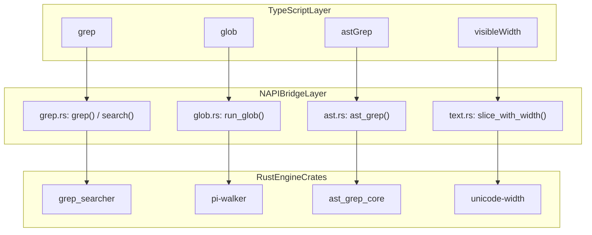
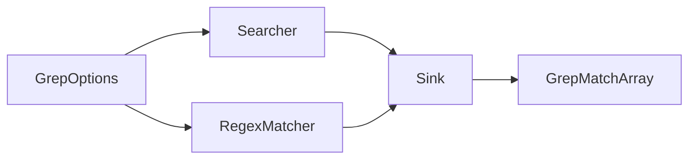
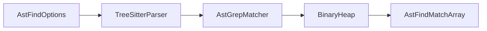
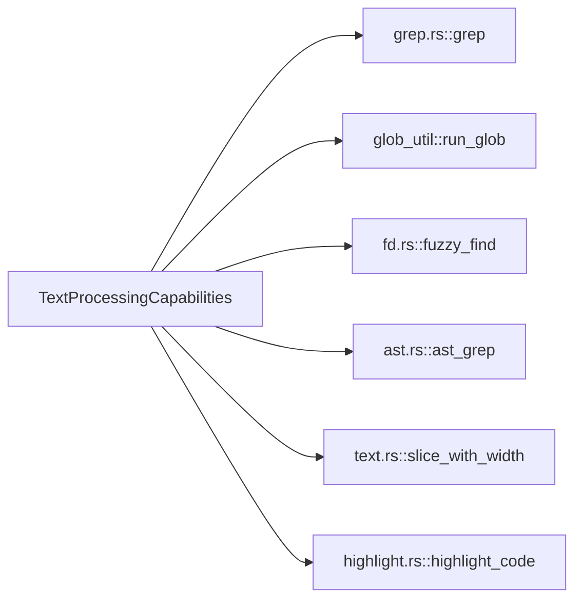
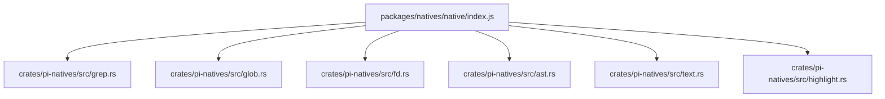

<!-- source: DeepWiki mcp.deepwiki.com · repo can1357/oh-my-pi · page 9.2 Text Processing · fetched 2026-10-30 -->

# Text Processing

Relevant source files

The following files were used as context for generating this wiki page:

- [crates/pi-natives/Cargo.toml](crates/pi-natives/Cargo.toml)
- [crates/pi-natives/src/ast.rs](crates/pi-natives/src/ast.rs)
- [crates/pi-natives/src/fd.rs](crates/pi-natives/src/fd.rs)
- [crates/pi-natives/src/glob.rs](crates/pi-natives/src/glob.rs)
- [crates/pi-natives/src/glob_util.rs](crates/pi-natives/src/glob_util.rs)
- [crates/pi-natives/src/grep.rs](crates/pi-natives/src/grep.rs)
- [crates/pi-natives/src/highlight.rs](crates/pi-natives/src/highlight.rs)
- [crates/pi-natives/src/pty.rs](crates/pi-natives/src/pty.rs)
- [crates/pi-natives/src/shell.rs](crates/pi-natives/src/shell.rs)
- [crates/pi-natives/src/text.rs](crates/pi-natives/src/text.rs)
- [crates/pi-shell/Cargo.toml](crates/pi-shell/Cargo.toml)
- [crates/pi-shell/src/lib.rs](crates/pi-shell/src/lib.rs)
- [crates/pi-shell/src/output_decode.rs](crates/pi-shell/src/output_decode.rs)
- [crates/pi-shell/src/shell.rs](crates/pi-shell/src/shell.rs)
- [packages/coding-agent/src/exec/bash-executor.ts](packages/coding-agent/src/exec/bash-executor.ts)
- [packages/coding-agent/src/tools/bash-interactive.ts](packages/coding-agent/src/tools/bash-interactive.ts)
- [packages/coding-agent/src/tools/bash-pty-selection.ts](packages/coding-agent/src/tools/bash-pty-selection.ts)
- [packages/coding-agent/test/bash-executor.test.ts](packages/coding-agent/test/bash-executor.test.ts)
- [packages/coding-agent/test/tools/bash-interactive.test.ts](packages/coding-agent/test/tools/bash-interactive.test.ts)
- [packages/coding-agent/test/tools/bash-pty-selection.test.ts](packages/coding-agent/test/tools/bash-pty-selection.test.ts)
- [packages/collab-web/src/components/transcript/math.ts](packages/collab-web/src/components/transcript/math.ts)
- [packages/natives/bench/grep.ts](packages/natives/bench/grep.ts)
- [packages/natives/test/native.test.ts](packages/natives/test/native.test.ts)
- [packages/tui/bench/markdown-stream.ts](packages/tui/bench/markdown-stream.ts)
- [packages/tui/src/components/box.ts](packages/tui/src/components/box.ts)
- [packages/tui/src/components/loader.ts](packages/tui/src/components/loader.ts)
- [packages/tui/src/components/markdown.ts](packages/tui/src/components/markdown.ts)
- [packages/tui/src/components/scroll-view.ts](packages/tui/src/components/scroll-view.ts)
- [packages/tui/src/components/text.ts](packages/tui/src/components/text.ts)
- [packages/tui/src/components/truncated-text.ts](packages/tui/src/components/truncated-text.ts)
- [packages/tui/src/theme/theme.ts](packages/tui/src/theme/theme.ts)
- [packages/tui/src/theme/tui-adapters.ts](packages/tui/src/theme/tui-adapters.ts)
- [packages/tui/src/utils.ts](packages/tui/src/utils.ts)
- [packages/tui/test/loader.test.ts](packages/tui/test/loader.test.ts)
- [packages/tui/test/markdown-incremental-lex.test.ts](packages/tui/test/markdown-incremental-lex.test.ts)
- [packages/tui/test/markdown.test.ts](packages/tui/test/markdown.test.ts)
- [packages/tui/test/scroll-view.test.ts](packages/tui/test/scroll-view.test.ts)
- [packages/tui/test/text-utils.test.ts](packages/tui/test/text-utils.test.ts)
- [packages/tui/test/text.test.ts](packages/tui/test/text.test.ts)
- [packages/utils/src/marked/core.ts](packages/utils/src/marked/core.ts)
- [packages/utils/src/marked/inline-closers.ts](packages/utils/src/marked/inline-closers.ts)
- [packages/utils/src/marked/inline-text.ts](packages/utils/src/marked/inline-text.ts)
- [packages/utils/src/math-delimiters.ts](packages/utils/src/math-delimiters.ts)
- [packages/utils/test/marked.test.ts](packages/utils/test/marked.test.ts)
- [packages/utils/test/math-delimiters.test.ts](packages/utils/test/math-delimiters.test.ts)

This document covers the native Rust-based text processing layer (`pi-natives`), specifically the high-performance grep, glob, fd, diff, syntax highlighting, and ANSI-aware text utilities that underpin search, rendering, and editor components. These native utilities offload computationally intensive text and filesystem operations to Rust, exposing APIs via N-API to the TypeScript codebase.

Sources: [crates/pi-natives/src/grep.rs:1-8](), [crates/pi-natives/src/glob.rs:1-8](), [crates/pi-natives/Cargo.toml:1-8](), [packages/natives/test/native.test.ts:1-10]()

---

## Overview

The text processing subsystem delivers search, measurement, and rendering features through Rust native bindings. It connects TypeScript layers and low-level Rust crates to implement:

- **Filesystem and in-memory regex search** (`grep()` / `search()`): Fast regex search supporting glob and type filters, context lines, offsets, and match limits with PCRE2 JIT optimization where applicable.  
- **Filesystem discovery** (`glob()` and `fd`): Efficient directory scanning with glob pattern filtering and fuzzy filename search prioritized by subsequence scoring. Obeys `.gitignore` and supports cancellation.  
- **Structural AST matching** (`astGrep()`): Syntax-aware search using `ast-grep-core` and Tree-sitter grammars. Supports pattern strictness levels and meta-variable capture.  
- **ANSI-aware text utilities** (`text.rs`): Single-pass ANSI code scanning and terminal cell counting for slicing, truncation, wrapping, and segment extraction tuned for UTF-16 JS interoperability.  
- **Syntax highlighting** (`highlight.rs`): Tokenization via the `syntect` crate producing ANSI-colored outputs for code blocks, driven by semantic color themes.

Sources: [crates/pi-natives/src/grep.rs:1-143](), [crates/pi-natives/Cargo.toml:30-87](), [packages/natives/test/native.test.ts:15-35]()

---

## Architecture and Data Flow

The native text processing layer acts as a bridge between TypeScript and Rust, exposing N-API bindings for all core functionality. The design integrates domain-specific Rust crates with optimized algorithms and exposes idiomatic async or synchronous interfaces for JS consumption.

Sources: [crates/pi-natives/src/grep.rs:20-40](), [crates/pi-natives/Cargo.toml:25-50]()

---

## Native Grep and Content Search

The `grep` implementation in `crates/pi-natives/src/grep.rs` offers two main functions exposed via N-API:

- `search(options: SearchOptions)`: Enables in-memory regex content search with configurable pattern, case sensitivity, multiline mode, match limiting (`max_count`), offset skipping, and context lines (before and after). Supports output modes (`Content`, `Count`, `FilesWithMatches`) to control result verbosity.  
- `grep(options: GrepOptions)`: Performs filesystem search under a specified path or absolute URL, integrating glob patterns, file type filters, hidden file inclusion, respect of `.gitignore`, and options for max matches per file. Supports cancellation and timeouts.  

### PCRE2 JIT and File Size Handling

- The engine leverages PCRE2 regex with optional JIT compilation controlled by the `OMP_PCRE2_JIT` environment variable. JIT is disabled by default on macOS due to known PCRE2 allocator faults and enabled otherwise for performance gains.
- Files larger than 4 MiB are skipped during filesystem scanning to optimize memory and speed.

### Grep Execution Pipeline

The grep subsystem uses the `grep_searcher` crate for efficient multi-threaded search with binary detection and chunked slicing. Regex compilation uses PCRE2 with fallback matching strategies.

Sources: [crates/pi-natives/src/grep.rs:40-143](), [crates/pi-natives/Cargo.toml:35-40]()

---

## Filesystem Discovery and Enumeration

Native file enumeration and fuzzy finding are implemented primarily across `glob.rs` and `fd.rs`:

- **Glob Searching** (`glob.rs`): Utilizes `pi-walker` for filesystem crawling combined with glob pattern filtering. Supports recursive scanning, hidden and gitignore-respecting filters, and file type restrictions. Supports cancellation, timeout, and sorting.  
- **Fuzzy Finding** (`fd.rs`): Implements subsequence fuzzy matching of filenames with scoring in a fixed-size max heap to retain top matches. Supports context cancellation and timeouts for responsiveness during large directory scans.  
- Both modules rely on `pi-vfs` abstractions for cross-platform file access and maintain scan caches for performance.

Sources: [crates/pi-natives/Cargo.toml:58-73](), [packages/natives/test/native.test.ts:12-25]()

---

## AST-Aware Structural Search

The AST search engine leverages the `ast-grep-core` and Tree-sitter integration via `pi-ast`:

- Entry point: `astGrep` accepts search patterns, language override, glob filters, selector-based rule application, and strictness levels.  
- Supports meta-variable capture groups that materialize as maps of matched texts keyed by variable names.  
- Results include exact matched source text, byte offsets, and line/column spans. Supports pagination with offset and limit.  

This enables semantic, language-aware code search beyond regex capabilities by structural matching on AST nodes.  

Sources: [crates/pi-natives/Cargo.toml:29-65](), [packages/natives/test/native.test.ts:6-10]()

---

## ANSI-Aware Text Measurement & Manipulation

The `text.rs` module provides zero-allocation, ANSI-aware text operations optimized for JavaScript UTF-16 strings:

- **`sliceWithWidth`**: Extracts terminal-visible portions of ANSI-encoded text lines, returning UTF-16 slices with exact visible widths accounting for escape sequences and grapheme clusters.  
- **`truncateToWidth`**: Truncates strings at terminal display column boundaries with configurable ellipsis strategies.  
- **`wrapTextWithAnsi`**: Wraps ANSI-colorized text lines preserving formatting spans correctly across terminal rows.  
- **`extractSegments`**: Splits line text before and after given overlay regions, returning segments and their respective widths.

Sources: [packages/tui/src/utils.ts:1-12](), [packages/natives/test/native.test.ts:30-36]()

---

## Syntax Highlighting and Text Utilities

The syntax highlighting integration uses the `syntect` crate:

- Bundles syntect's default syntaxes plus vendored grammars for various languages.  
- Defines semantic color categories covering comments, keywords, functions, variables, strings, numbers, types, operators, punctuation, insertions, and deletions.  
- Uses thread-local caches for scope-to-color mapping to accelerate repeated highlighting of small code fragments.  
- Outputs ANSI escape sequences for terminal compatibility consistent with TUI rendering.

Additional text utilities:

- **Code Summarization**: Language-aware code folding and summarization eliding long function bodies while preserving boundary info.  
- **Diffing & Patching**: Line-based diffs using Myers algorithm with streaming incremental feeding.

Sources: [crates/pi-natives/Cargo.toml:75-87](), [packages/natives/test/native.test.ts:165-207]()

---

## Bridging Natural Language to Code Entities

### Text Processing Entity Mapping

This diagram maps conceptual text processing capabilities to native Rust code entities to clarify the system's modular structure:

Sources: [crates/pi-natives/src/grep.rs:1-15](), [crates/pi-natives/Cargo.toml:25-87]()

---

### High-level API Surface

This diagram illustrates how the TypeScript native index exposes the Rust modules behind the text processing functionality:

Sources: [packages/natives/test/native.test.ts:1-35](), [crates/pi-natives/Cargo.toml:1-12]()

---

## Performance Characteristics Summary

| Feature                 | Implementation                  | Notes                                                      |
|-------------------------|--------------------------------|------------------------------------------------------------|
| **Content Search**       | `grep_searcher` & `grep_regex` | PCRE2 with JIT off by default on macOS                      |
| **Filesystem Walk**      | `pi-walker` & `ignore`          | `.gitignore` aware, supports scan caching and filtering     |
| **Fuzzy Search (`fd`)**  | Subsequence scoring + BinaryHeap| Bounded top-N results with abort & timeout support          |
| **Structural Search**    | `ast-grep-core` + `tree_sitter`| Multi-strictness, meta-variable capture                      |
| **ANSI Text Utilities**  | `text.rs` ANSI scanner          | Single-pass, zero-allocation, UTF-16 optimized               |
| **Syntax Highlighting**  | `syntect` via `highlight.rs`    | Semantic color themes with fast scope caching                |

Sources: [crates/pi-natives/Cargo.toml:25-87](), [packages/natives/test/native.test.ts:1-35]()

---

This completes the detailed documentation of the native text processing core in `pi-natives`, outlining the structure, key components, and integration endpoints for grep, glob, fd, diff, syntax highlighting, and ANSI-aware text utilities used throughout the oh-my-pi agent and TUI system.

---

