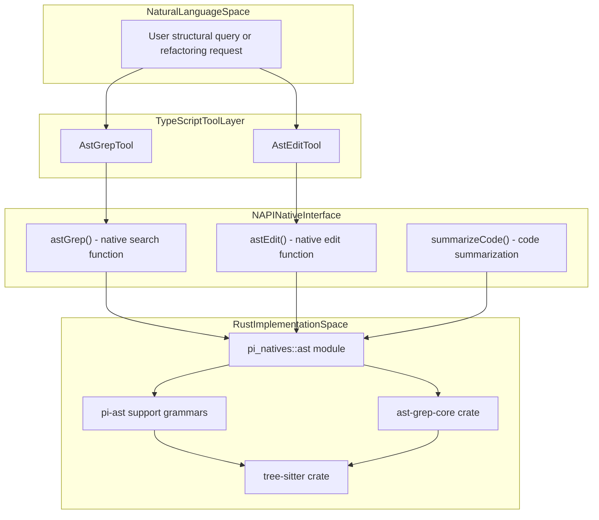
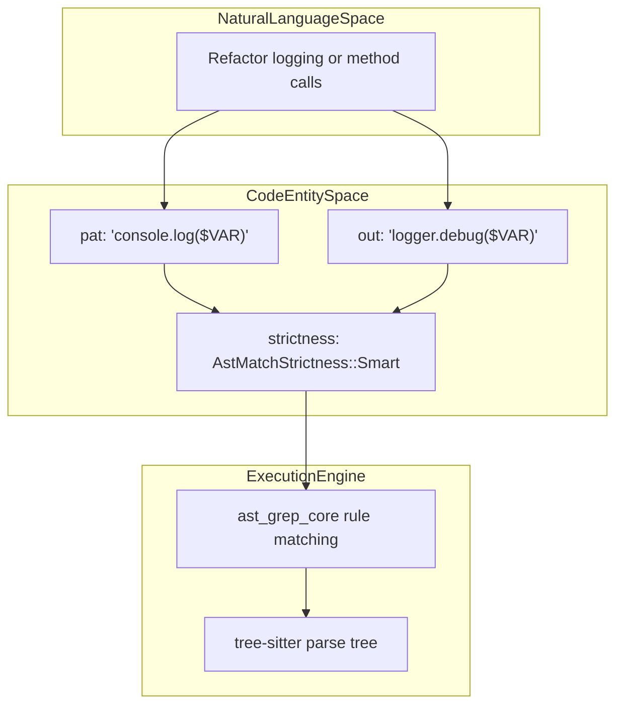

<!-- source: DeepWiki mcp.deepwiki.com · repo can1357/oh-my-pi · page 9.3 AST Tools · fetched 2026-10-30 -->

# AST Tools

Relevant source files

The following files were used as context for generating this wiki page:

- [crates/pi-edit/src/modes/hashline/apply.rs](crates/pi-edit/src/modes/hashline/apply.rs)
- [crates/pi-edit/src/modes/hashline/block.rs](crates/pi-edit/src/modes/hashline/block.rs)
- [crates/pi-edit/src/modes/hashline/clipboard.rs](crates/pi-edit/src/modes/hashline/clipboard.rs)
- [crates/pi-edit/src/modes/hashline/format.rs](crates/pi-edit/src/modes/hashline/format.rs)
- [crates/pi-edit/src/modes/hashline/input.rs](crates/pi-edit/src/modes/hashline/input.rs)
- [crates/pi-edit/src/modes/hashline/messages.rs](crates/pi-edit/src/modes/hashline/messages.rs)
- [crates/pi-edit/src/modes/hashline/mismatch.rs](crates/pi-edit/src/modes/hashline/mismatch.rs)
- [crates/pi-edit/src/modes/hashline/mod.rs](crates/pi-edit/src/modes/hashline/mod.rs)
- [crates/pi-edit/src/modes/hashline/parser.rs](crates/pi-edit/src/modes/hashline/parser.rs)
- [crates/pi-edit/src/modes/hashline/patcher.rs](crates/pi-edit/src/modes/hashline/patcher.rs)
- [crates/pi-edit/src/modes/hashline/preview.rs](crates/pi-edit/src/modes/hashline/preview.rs)
- [crates/pi-edit/src/modes/hashline/recovery.rs](crates/pi-edit/src/modes/hashline/recovery.rs)
- [crates/pi-edit/src/modes/hashline/tokenizer.rs](crates/pi-edit/src/modes/hashline/tokenizer.rs)
- [crates/pi-edit/src/session.rs](crates/pi-edit/src/session.rs)
- [crates/pi-edit/src/store.rs](crates/pi-edit/src/store.rs)
- [crates/pi-edit/tests/common/mod.rs](crates/pi-edit/tests/common/mod.rs)
- [crates/pi-edit/tests/fixtures/hashline/parity_boundary_repair.json](crates/pi-edit/tests/fixtures/hashline/parity_boundary_repair.json)
- [crates/pi-edit/tests/fixtures/hashline/parity_landing_shift.json](crates/pi-edit/tests/fixtures/hashline/parity_landing_shift.json)
- [crates/pi-edit/tests/fixtures/hashline/patcher.json](crates/pi-edit/tests/fixtures/hashline/patcher.json)
- [crates/pi-edit/tests/hashline_apply.rs](crates/pi-edit/tests/hashline_apply.rs)
- [crates/pi-edit/tests/hashline_parity.rs](crates/pi-edit/tests/hashline_parity.rs)
- [crates/pi-edit/tests/hashline_parse.rs](crates/pi-edit/tests/hashline_parse.rs)
- [crates/pi-edit/tests/hashline_patcher.rs](crates/pi-edit/tests/hashline_patcher.rs)
- [crates/pi-edit/tests/replace_parity.rs](crates/pi-edit/tests/replace_parity.rs)
- [crates/pi-natives/Cargo.toml](crates/pi-natives/Cargo.toml)
- [crates/pi-natives/src/ast.rs](crates/pi-natives/src/ast.rs)
- [crates/pi-natives/src/fd.rs](crates/pi-natives/src/fd.rs)
- [crates/pi-natives/src/glob.rs](crates/pi-natives/src/glob.rs)
- [crates/pi-natives/src/glob_util.rs](crates/pi-natives/src/glob_util.rs)
- [crates/pi-natives/src/grep.rs](crates/pi-natives/src/grep.rs)
- [crates/pi-natives/src/highlight.rs](crates/pi-natives/src/highlight.rs)
- [crates/pi-natives/src/pty.rs](crates/pi-natives/src/pty.rs)
- [crates/pi-natives/src/shell.rs](crates/pi-natives/src/shell.rs)
- [crates/pi-shell/Cargo.toml](crates/pi-shell/Cargo.toml)
- [crates/pi-shell/src/lib.rs](crates/pi-shell/src/lib.rs)
- [crates/pi-shell/src/output_decode.rs](crates/pi-shell/src/output_decode.rs)
- [crates/pi-shell/src/shell.rs](crates/pi-shell/src/shell.rs)
- [docs/tools/edit.md](docs/tools/edit.md)
- [packages/coding-agent/src/exec/bash-executor.ts](packages/coding-agent/src/exec/bash-executor.ts)
- [packages/coding-agent/src/tools/bash-interactive.ts](packages/coding-agent/src/tools/bash-interactive.ts)
- [packages/coding-agent/src/tools/bash-pty-selection.ts](packages/coding-agent/src/tools/bash-pty-selection.ts)
- [packages/coding-agent/test/bash-executor.test.ts](packages/coding-agent/test/bash-executor.test.ts)
- [packages/coding-agent/test/tools/bash-interactive.test.ts](packages/coding-agent/test/tools/bash-interactive.test.ts)
- [packages/coding-agent/test/tools/bash-pty-selection.test.ts](packages/coding-agent/test/tools/bash-pty-selection.test.ts)
- [packages/natives/bench/grep.ts](packages/natives/bench/grep.ts)
- [packages/natives/test/native.test.ts](packages/natives/test/native.test.ts)
- [scripts/session-stats/README.md](scripts/session-stats/README.md)
- [scripts/session-stats/analyze.py](scripts/session-stats/analyze.py)
- [scripts/session-stats/harmony_backtest.py](scripts/session-stats/harmony_backtest.py)
- [scripts/session-stats/sync.py](scripts/session-stats/sync.py)

## Purpose and Scope

This page details the structural code search and manipulation capabilities in `oh-my-pi`, powered by native Rust bindings to the `ast-grep-core` library and `tree-sitter` integration. The system uses the `pi-ast` and `pi-edit` grammars to provide precise syntax-aware operations. These features are exposed to the agent via the `ast_grep` and `ast_edit` TypeScript tools for structural code search and AST-aware refactoring. This wiki page explains the implementation, data flow, key classes/functions, and illustrates how the system bridges from natural language queries to code entity operations.

Sources: [crates/pi-natives/src/ast.rs:1-16](), [packages/coding-agent/src/tools/ast-grep.ts:1-5](), [packages/coding-agent/src/tools/ast-edit.ts:1-59]()

---

## Architecture and Crate Organization

The AST tooling subsystem is logically layered as follows:

- **Natural Language Space:** User or AI agent issues structural queries or code refactoring instructions in natural language or declarative AST pattern syntax.
- **TypeScript Agent Tools:** Tools `AstGrepTool` and `AstEditTool` parse, validate, and translate queries into strongly typed AST operations with pattern definitions, target path filters, and options.
- **Native Interface (`pi-natives`):** Exposes native Rust functions `astGrep` and `astEdit` through N-API for high-performance AST matching and rewriting.
- **Rust AST Layer:** The Rust crates leverage `ast-grep-core`, the `pi-ast` grammars, and `tree-sitter` for parsing source code, applying pattern matching, and executing structural edits at the AST level with full syntax awareness.

### AST Tooling Layers

Sources: [crates/pi-natives/src/ast.rs:1-16](), [packages/coding-agent/src/tools/ast-grep.ts:151-165](), [packages/coding-agent/src/tools/ast-edit.ts:1-59]()

---

## Structural Code Search (`ast_grep`)

The `ast_grep` tool provides structural search based on AST patterns rather than textual regex. This enables queries that match code syntax and semantics with rich language understanding.

### `AstGrepTool` Class

- Defined in TypeScript as `AstGrepTool` ([packages/coding-agent/src/tools/ast-grep.ts:131-172]()).
- Validates input using `astGrepSchema` which accepts:
  - `pat` — pattern string expressed in AST pattern syntax.
  - `path?` — files/directories/globs/internal URLs to target.
  - `lang?` — optional override of the target language grammar.
  - `skip` — for pagination, number of initial matches to skip.

### Execution Flow

1. The tool parses and validates the query parameters.
2. It resolves the search targets (e.g., directories or files, supporting glob patterns and internal URL paths).
3. Calls the native `astGrep` method, passing patterns, path scopes, skip/limit parameters, optional language override, abort signal, and a filesystem interface (`ShellFilesystem`) supporting virtual and remote files.
4. The native Rust `astGrep` executes structural AST matching across all targets, returning a list of `AstFindMatch` objects with file locations and matched code snippets.
5. The tool sorts matches (by file and offset) and aggregates results including total match counts, files searched, and any parse errors encountered.

### Key Types and Functions

| Symbol          | Description                                      |
|-----------------|------------------------------------------------|
| `astGrepSchema` | Zod-like schema validating tool input params.  |
| `AstGrepTool`   | Tool class exposing the structural search API. |
| `astGrep`       | Native Rust N-API function performing the search.|
| `AstFindMatch`  | Type representing a single AST match location. |

Sources: [packages/coding-agent/src/tools/ast-grep.ts:33-129](), [crates/pi-natives/src/ast.rs:63-90]()

---

## Structural Code Manipulation (`ast_edit`)

The `ast_edit` tool enables AST-aware source code rewriting by specifying rewrite rules replacing matched pattern occurrences.

### `AstEditTool` Class

- Defined in TypeScript as `AstEditTool` ([packages/coding-agent/src/tools/ast-edit.ts:151-184]()).
- Input validated with `astEditSchema` which specifies:
  - `ops` — array of rewrite operation objects each with `pat` (pattern) and `out` (replacement template).
  - `paths` — list of files, directories, globs, or internal URLs to modify.
  - Optional flags like `dryRun`, `maxFiles`, and `failOnParseError`.

### Execution Flow

1. The tool validates input rewrite operations and target paths.
2. It resolves paths and applies any glob-like filtering.
3. It invokes the native `astEdit` function with the mapping of patterns and replacements, the resolved file targets, dry-run flag, maximum files limit, and parse error tolerance.
4. The native Rust layer performs AST parsing, applies rewrite rules, and returns a summary of file modifications, counts of replacements, parse errors, and which files were changed.
5. The tool aggregates and returns structured information on the editing session, indicating success, failure, and detailed per-file results.

### Key Types and Functions

| Symbol              | Description                                    |
|---------------------|------------------------------------------------|
| `astEditSchema`     | Input validation schema for edit tool params.  |
| `AstEditTool`       | The tool class managing AST rewriting calls.   |
| `astEdit`           | Native Rust function that applies AST rewrites.|
| `AstReplaceChange`  | Represents a single AST rewrite change.         |
| `AstReplaceFileChange` | Aggregated results per file.                  |

Sources: [packages/coding-agent/src/tools/ast-edit.ts:40-146](), [crates/pi-natives/src/ast.rs:1-16]()

---

## Strictness Levels and Metavariables

The AST matching engine supports multiple strictness modes, controlling how literal or approximate the match must be. These are exposed as the `AstMatchStrictness` Rust enum.

### `AstMatchStrictness` Variants

| Variant     | Description                                      |
|-------------|------------------------------------------------|
| `Cst`       | Concrete syntax tree (CST)-level strict matching. Requires exact match of parsed syntax nodes. |
| `Smart`     | Default balanced mode, mixes structural and token-based matching. Suitable for general use cases. |
| `Ast`       | Abstract syntax tree level matching, focusing on semantic structure rather than raw tokens. |
| `Relaxed`   | Looser matching allowing approximate or partial matches, forgiving minor differences. |
| `Signature` | Signature-level matching, e.g. matching function headers without body details. |
| `Template`  | Template-based patterns for flexible matching with metavariables and placeholders.|

Each strictness level guides how the pattern-matching engine interprets and processes source code, facilitating trade-offs between precision and recall.

Sources: [crates/pi-natives/src/ast.rs:20-56]()

---

## Natural Language Space to Code Entity Space: Pattern Matching Bridge

The diagrams below illustrate how high-level natural language requests transform into AST-based pattern and rewrite queries executed by the native engine.

This graph shows the relation between user intent, AST pattern and replacement definitions, strictness mode configuration, and their execution on parsed syntax trees via the `ast-grep-core` engine.

Sources: [crates/pi-natives/src/ast.rs:22-60](), [packages/coding-agent/src/tools/ast-grep.ts:41-45]()

---

## Code Summarization and Block Range Analysis Utilities

Beyond search and edit, the native AST module exposes utilities for code summarization and block range detection:

- **Code Summarization (`summarizeCode`):** Traverses AST nodes to collapse function bodies and nested blocks, producing a reduced view with declarations and key signatures. Useful for presenting a concise overview of code to AI or users.
- **Block Range Detection (`blockRangeAt`):** Given a line offset, computes the start and end line numbers of the syntactic block that encloses that line. This aids folding, focused editing, or code navigation.

These utilities complement querying and rewriting by enabling structural analysis and contextualization based on AST.

Sources: [packages/natives/test/native.test.ts:165-207]()

---

## Summary

The `oh-my-pi` AST tools subsystem enables robust, performant, and precise structural code search and manipulation using the `ast-grep-core` Rust library and `tree-sitter` parser integration. The interface is exposed through native bindings in `pi-natives` and accessed by AI agent tools `ast_grep` and `ast_edit` implemented in TypeScript. This design allows AI-driven workflows to operate with semantic understanding of code, supporting advanced refactorings, queries, and structural code edits across multiple programming languages with full syntax correctness.

---

# References

- Native AST module and Rust implementation details: [crates/pi-natives/src/ast.rs:1-90]()
- `ast_grep` tool implementation: [packages/coding-agent/src/tools/ast-grep.ts:1-165]()
- `ast_edit` tool implementation: [packages/coding-agent/src/tools/ast-edit.ts:1-186]()
- Native tests showing usage of summarization and block range utilities: [packages/natives/test/native.test.ts:1-210]()

---

