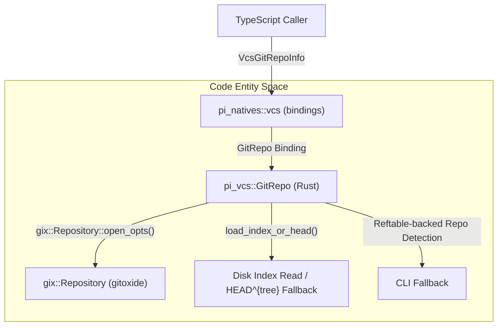
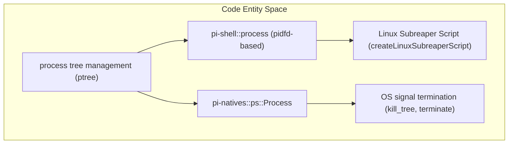
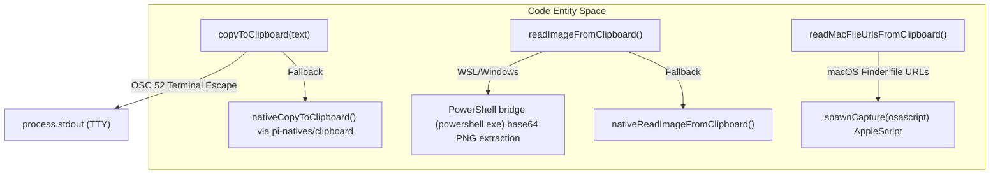
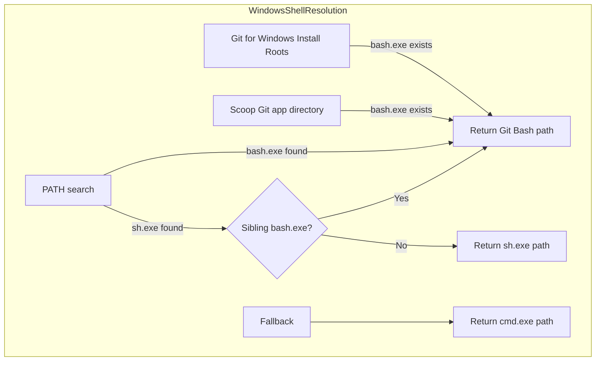
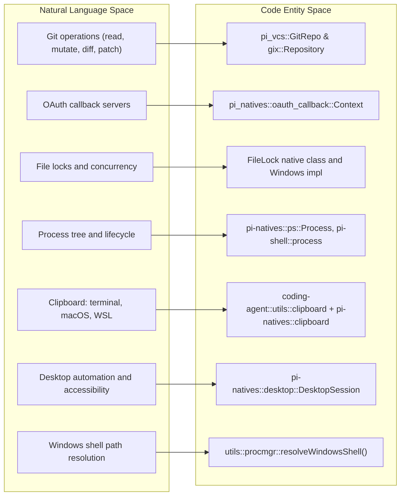

<!-- source: DeepWiki mcp.deepwiki.com · repo can1357/oh-my-pi · page 9.4 VCS, OS and Platform Bindings · fetched 2026-10-30 -->

# VCS, OS and Platform Bindings

Relevant source files

The following files were used as context for generating this wiki page:

- [crates/pi-natives/src/clipboard.rs](crates/pi-natives/src/clipboard.rs)
- [crates/pi-natives/src/desktop/applications.rs](crates/pi-natives/src/desktop/applications.rs)
- [crates/pi-natives/src/desktop/backend.rs](crates/pi-natives/src/desktop/backend.rs)
- [crates/pi-natives/src/desktop/control.rs](crates/pi-natives/src/desktop/control.rs)
- [crates/pi-natives/src/desktop/control/macos.rs](crates/pi-natives/src/desktop/control/macos.rs)
- [crates/pi-natives/src/desktop/macos/applications.rs](crates/pi-natives/src/desktop/macos/applications.rs)
- [crates/pi-natives/src/desktop/macos/ax.rs](crates/pi-natives/src/desktop/macos/ax.rs)
- [crates/pi-natives/src/desktop/macos/ax/menus.rs](crates/pi-natives/src/desktop/macos/ax/menus.rs)
- [crates/pi-natives/src/desktop/macos/ax/open_menu.rs](crates/pi-natives/src/desktop/macos/ax/open_menu.rs)
- [crates/pi-natives/src/desktop/macos/capture.rs](crates/pi-natives/src/desktop/macos/capture.rs)
- [crates/pi-natives/src/desktop/macos/input.rs](crates/pi-natives/src/desktop/macos/input.rs)
- [crates/pi-natives/src/desktop/macos/mod.rs](crates/pi-natives/src/desktop/macos/mod.rs)
- [crates/pi-natives/src/desktop/macos/skylight.rs](crates/pi-natives/src/desktop/macos/skylight.rs)
- [crates/pi-natives/src/desktop/macos/spaces.rs](crates/pi-natives/src/desktop/macos/spaces.rs)
- [crates/pi-natives/src/desktop/mod.rs](crates/pi-natives/src/desktop/mod.rs)
- [crates/pi-natives/src/html.rs](crates/pi-natives/src/html.rs)
- [crates/pi-natives/src/lib.rs](crates/pi-natives/src/lib.rs)
- [docs/computer-use.md](docs/computer-use.md)
- [docs/tools/computer.md](docs/tools/computer.md)
- [packages/coding-agent/src/autoresearch/git.ts](packages/coding-agent/src/autoresearch/git.ts)
- [packages/coding-agent/src/cli/worktree-cli.ts](packages/coding-agent/src/cli/worktree-cli.ts)
- [packages/coding-agent/src/commands/worktree.ts](packages/coding-agent/src/commands/worktree.ts)
- [packages/coding-agent/src/commit/execute.ts](packages/coding-agent/src/commit/execute.ts)
- [packages/coding-agent/src/prompts/tools/computer.md](packages/coding-agent/src/prompts/tools/computer.md)
- [packages/coding-agent/src/task/isolation-ownership.ts](packages/coding-agent/src/task/isolation-ownership.ts)
- [packages/coding-agent/src/task/isolation-runner.ts](packages/coding-agent/src/task/isolation-runner.ts)
- [packages/coding-agent/src/task/worktree.ts](packages/coding-agent/src/task/worktree.ts)
- [packages/coding-agent/src/tools/browser/readable.ts](packages/coding-agent/src/tools/browser/readable.ts)
- [packages/coding-agent/src/tools/computer.ts](packages/coding-agent/src/tools/computer.ts)
- [packages/coding-agent/src/tools/computer/call.ts](packages/coding-agent/src/tools/computer/call.ts)
- [packages/coding-agent/src/tools/computer/prelude.js](packages/coding-agent/src/tools/computer/prelude.js)
- [packages/coding-agent/src/tools/computer/prelude.py](packages/coding-agent/src/tools/computer/prelude.py)
- [packages/coding-agent/src/tools/computer/protocol.ts](packages/coding-agent/src/tools/computer/protocol.ts)
- [packages/coding-agent/src/tools/computer/supervisor.ts](packages/coding-agent/src/tools/computer/supervisor.ts)
- [packages/coding-agent/src/tools/computer/worker.ts](packages/coding-agent/src/tools/computer/worker.ts)
- [packages/coding-agent/src/utils/clipboard.ts](packages/coding-agent/src/utils/clipboard.ts)
- [packages/coding-agent/src/utils/mac-file-urls.applescript](packages/coding-agent/src/utils/mac-file-urls.applescript)
- [packages/coding-agent/test/autoresearch-git.test.ts](packages/coding-agent/test/autoresearch-git.test.ts)
- [packages/coding-agent/test/cli/worktree-add-hook.test.ts](packages/coding-agent/test/cli/worktree-add-hook.test.ts)
- [packages/coding-agent/test/cli/worktree-clear-isolation.test.ts](packages/coding-agent/test/cli/worktree-clear-isolation.test.ts)
- [packages/coding-agent/test/commit-execute.test.ts](packages/coding-agent/test/commit-execute.test.ts)
- [packages/coding-agent/test/git-reftable.test.ts](packages/coding-agent/test/git-reftable.test.ts)
- [packages/coding-agent/test/input-controller-smart-paste.test.ts](packages/coding-agent/test/input-controller-smart-paste.test.ts)
- [packages/coding-agent/test/slash-commands/computer.test.ts](packages/coding-agent/test/slash-commands/computer.test.ts)
- [packages/coding-agent/test/status-line-vcs-refresh.test.ts](packages/coding-agent/test/status-line-vcs-refresh.test.ts)
- [packages/coding-agent/test/task/isolation-ownership.test.ts](packages/coding-agent/test/task/isolation-ownership.test.ts)
- [packages/coding-agent/test/task/worktree.test.ts](packages/coding-agent/test/task/worktree.test.ts)
- [packages/coding-agent/test/tools/browser-readable.test.ts](packages/coding-agent/test/tools/browser-readable.test.ts)
- [packages/coding-agent/test/tools/computer.test.ts](packages/coding-agent/test/tools/computer.test.ts)
- [packages/coding-agent/test/utils/clipboard-copy-order.test.ts](packages/coding-agent/test/utils/clipboard-copy-order.test.ts)
- [packages/coding-agent/test/utils/clipboard.test.ts](packages/coding-agent/test/utils/clipboard.test.ts)
- [packages/coding-agent/test/utils/jj.test.ts](packages/coding-agent/test/utils/jj.test.ts)
- [packages/natives/CHANGELOG.md](packages/natives/CHANGELOG.md)
- [packages/natives/native/clipboard.d.ts](packages/natives/native/clipboard.d.ts)
- [packages/natives/native/clipboard.js](packages/natives/native/clipboard.js)
- [packages/natives/native/index.d.ts](packages/natives/native/index.d.ts)
- [packages/natives/native/index.js](packages/natives/native/index.js)
- [packages/natives/native/vcs.d.ts](packages/natives/native/vcs.d.ts)
- [packages/natives/native/vcs.js](packages/natives/native/vcs.js)
- [types/assets/index.d.ts](types/assets/index.d.ts)

This page documents the native and platform integration bindings implemented primarily in the `pi-vcs`, `pi-natives`, and `packages/utils` components of oh-my-pi. It covers:

- The in-process Git bindings for repository operations including reading, mutating, diffing, and patching via gitoxide (`gix`).
- OAuth callback server orchestration and native callback handling.
- File locking primitives for cross-platform concurrency control.
- Cross-platform process tree enumeration and lifecycle management (`pi-shell`, `pi-natives`).
- Clipboard interoperability with terminal OSC 52 escape sequences, WSL PowerShell bridges, and macOS Finder file URL handling.
- Desktop automation and accessibility via `DesktopSession` and native platform backends.
- Platform-specific shell resolution and paths, especially on Windows.

---

## 1. Git Bindings (`pi-vcs`)

The `pi-vcs` Rust crate provides performant, thread-safe, in-process Git functionality by leveraging the gitoxide (`gix`) library with additional fallback to CLI commands for specialized features like reftable-backed repositories. These bindings enable oh-my-pi to operate on Git repositories without shelling out to git, avoiding round-trip latencies and enabling richer programmatic control.

### Repository Opening and Index Management

- Repositories are opened with `gix::Repository` handles configured to ignore ambient environment overrides (`GIT_DIR`, `GIT_INDEX_FILE`) to ensure stable context and avoid interference from the user's environment.  
- The implementation ensures the repository's identity and diff preferences are correctly applied from user config.
- Mutating operations avoid using the in-memory `gix` index snapshot directly when it is considered unsafe for concurrent access. Instead, indexes are loaded freshly from disk or the HEAD tree is read as a fallback to prevent race conditions around mtime cache invalidation.

Title: "VCS Binding Architecture"

Sources:  
`[crates/pi-vcs/src/git/open.rs:23-167]()`  
`[crates/pi-vcs/src/git/read.rs:24-210]()`  
`[crates/pi-vcs/src/git/mutate.rs:34-143]()`  
`[crates/pi-vcs/src/git/diff.rs:36-115]()`  
`[crates/pi-vcs/src/git/patch.rs:103-230]()`  

### Read, Mutate, Diff, and Patch Operations

- **Read**: Handles resolving `HEAD`, enumerating branches and tags, and detecting dirty working tree status. If the repository is reftable-backed (Git v2 storage), specialized CLI fallback is used to access refs.
- **Mutate**: Staging files, unstaging, and commit creation uses the safe index loading methods. The native `update_reference()` mechanism is used for atomic and consistent reference updates.
- **Diff**: Methods for generating textual diffs, changed file lists, and numeric stats use native cached tree diffing for efficiency.
- **Patch**: Patch application, hunk staging, and cherry-pick provide fail-clean merges avoiding conflict markers, enabling safe integration of complex patches.

Sources:  
`[crates/pi-vcs/src/git/open.rs:23-167]()`  
`[crates/pi-vcs/src/git/read.rs:24-210]()`  
`[crates/pi-vcs/src/git/mutate.rs:34-143]()`  
`[crates/pi-vcs/src/git/diff.rs:36-115]()`  
`[crates/pi-vcs/src/git/patch.rs:103-230]()`  

---

## 2. OAuth Callback Servers

The OAuth callback server subsystem embedded in `pi-natives` manages ephemeral HTTP servers to receive OAuth redirect callbacks via `NativeOAuthCallback`. It includes context management and buffering command outputs in memory with strict capacity bounds to avoid unbounded memory growth.

Key features:

- Secure temporary file creation with restrictive permissions (`0o600`).
- Periodic heartbeat pings and token-based cancellation.
- Cleanup logic to manage spawned child processes preventing resource leaks.

Sources:  
`[crates/pi-natives/src/oauth_callback/context.rs:31-228]()`  
`[packages/natives/native/index.js:39-39]()`  

---

## 3. File Locks and Concurrency Control

Oh-my-pi uses cross-platform file locks (`FileLock`) exposed via native bindings to coordinate concurrent read/write access to shared files such as profile data or agent sessions.

- POSIX systems utilize advisory `flock` or `fcntl` locks.
- Windows uses handle-based locking with exclusive access semantics, carefully managing handle sharing flags.

This ensures exclusivity and safe serialization of workspace modifications.

Sources:  
`[packages/natives/native/index.js:32-32]()`  
`[crates/pi-natives/src/file_lock/windows.rs]()`  

---

## 4. Process Tree Management (`pi-shell` and `pi-natives`)

Stable process lifecycle and tree introspection capabilities are provided by `pi-natives` (`ps.rs`) in combination with `pi-shell`.

### Process Reference and Tree Access

- The native `Process` class wraps platform-specific implementations and exposes properties such as PID, PPID, and launch args.
- Provides methods for killing single processes or entire trees, terminating gracefully or forcefully.
- Supports querying direct children and process status.

### Platform-Specific Implementation Notes

- On Linux, `pi-shell` uses secure pidfd handles to track processes reliably, avoiding issues with PID reuse.
- Descendants are enumerated through `/proc/{pid}/task/{tid}/children`.
- Signals are delivered using `pidfd_send_signal` syscall for consistent termination.
- Includes a Linux subreaper mode implemented as a Bun spawn script running `prctl(PR_SET_CHILD_SUBREAPER)` and reaping orphaned processes reliably.

Title: "Process Tree and Lifecycle Management"

Sources:  
`[crates/pi-natives/src/ps.rs:1-210]()`  
`[crates/pi-shell/src/process.rs:1-173]()`  
`[packages/utils/src/ptree.ts:1-110]()`  

---

## 5. Clipboard and Image Handling

The clipboard subsystem integrates multiple environment-specific approaches to achieve reliable clipboard copy and paste operations, supporting text and image data.

### Implementation Overview

- **copyToClipboard(text)**:  
  Emits OSC 52 terminal escape sequences first for TTY sessions (enabling remote clipboard over SSH/mosh), then falls back to native clipboard copying via `pi-natives` bindings or platform CLI tools like `pbcopy` (macOS) and `termux-clipboard-set` (Android Termux).

- **readImageFromClipboard()**:  
  On WSL/Linux with a display server, shells out to `powershell.exe` as a bridge to extract PNG base64 payloads, decoding them back to image bytes. If that fails, falls back to the native bridge from `pi-natives`.

- **readMacFileUrlsFromClipboard()**:  
  Reads `public.file-url` references from the macOS pasteboard using AppleScript run through `osascript`, enabling proper file-object paste support from Finder.

- A key utility, `spawnCapture()`, handles subprocess execution asynchronously with timeout and error forwarding, avoiding event loop blocking.

Title: "Clipboard and Image Pipeline"

Sources:  
`[packages/coding-agent/src/utils/clipboard.ts:1-183]()`  
`[packages/coding-agent/test/utils/clipboard.test.ts:1-183]()`  

---

## 6. Desktop Automation, Accessibility, and Windows Paths

### Desktop and Accessibility Automation

- The `pi-natives` crate exposes desktop automation sessions via `DesktopSession`, supporting cross-platform display enumeration, window listing, native input injection (clicks, mouse movement, drags, key chords, typed text), and accessibility (AX) tree capture/querying.
- Platform-specific backends (such as Win32 / UI Automation on Windows and Core Graphics / Accessibility on macOS) manage screen locking states, display awake holds (`holdDisplayUntilReleased`, `releaseDisplayAwake`), and secure foreground/background delivery modes.

Sources:  
`[packages/natives/native/index.d.ts:31-62]()`  
`[crates/pi-natives/src/desktop/mod.rs:20-150]()`  
`[docs/computer-use.md:1-40]()`  

### Windows Shell Path Resolution

- Windows shell path resolution is managed by `resolveWindowsShell()` in `packages/utils/src/procmgr.ts`.
- This function attempts layered discovery:
  1. Search Git for Windows install roots (`Program Files`, `ProgramFiles(x86)`, `LOCALAPPDATA`, `GIT_INSTALL_ROOT`, Scoop installs).
  2. Lookup `bash.exe` on system PATH.
  3. Lookup `sh.exe` on PATH, preferring a sibling `bash.exe`.
  4. Fallback to `cmd.exe` based on `ComSpec` environment variable.

- This mechanism ensures that shell commands on Windows run in a familiar bash shell environment when available, falling back gracefully to native Windows shells otherwise.

Title: "Windows Shell Resolution"

Sources:  
`[packages/utils/src/procmgr.ts:155-180]()`  

---

## Summary Diagram: Natural Language to Key Code Entities

Title: "Natural Language to Code Entity Space Mapping"

---

## References and Sources

- `[crates/pi-vcs/src/git/open.rs:23-167]()`  
- `[crates/pi-vcs/src/git/read.rs:24-210]()`  
- `[crates/pi-vcs/src/git/mutate.rs:34-143]()`  
- `[crates/pi-vcs/src/git/diff.rs:36-115]()`  
- `[crates/pi-vcs/src/git/patch.rs:103-230]()`  
- `[crates/pi-natives/src/oauth_callback/context.rs:31-228]()`  
- `[packages/natives/native/index.js:26-47]()`  
- `[crates/pi-natives/src/file_lock/windows.rs]()`  
- `[crates/pi-natives/src/ps.rs:1-210]()`  
- `[crates/pi-shell/src/process.rs:1-173]()`  
- `[packages/utils/src/ptree.ts:1-110]()`  
- `[packages/coding-agent/src/utils/clipboard.ts:1-183]()`  
- `[packages/coding-agent/test/utils/clipboard.test.ts:1-183]()`  
- `[packages/natives/native/index.d.ts:31-62]()`  
- `[crates/pi-natives/src/desktop/mod.rs:20-150]()`  
- `[packages/utils/src/procmgr.ts:155-180]()`

---

