# Page: Overview

# Overview

<details>
<summary>Relevant source files</summary>

The following files were used as context for generating this wiki page:

- [AGENTS.md](AGENTS.md)
- [Cargo.lock](Cargo.lock)
- [Cargo.toml](Cargo.toml)
- [README.md](README.md)
- [bun.lock](bun.lock)
- [docs/environment-variables.md](docs/environment-variables.md)
- [docs/providers.md](docs/providers.md)
- [packages/agent/package.json](packages/agent/package.json)
- [packages/ai/README.md](packages/ai/README.md)
- [packages/ai/package.json](packages/ai/package.json)
- [packages/catalog/src/compat/auth-ids.ts](packages/catalog/src/compat/auth-ids.ts)
- [packages/catalog/src/compat/provider-ids.ts](packages/catalog/src/compat/provider-ids.ts)
- [packages/catalog/src/compat/rules/auth/_order.kdl](packages/catalog/src/compat/rules/auth/_order.kdl)
- [packages/coding-agent/README.md](packages/coding-agent/README.md)
- [packages/coding-agent/package.json](packages/coding-agent/package.json)
- [packages/coding-agent/src/cli/help-extra.ts](packages/coding-agent/src/cli/help-extra.ts)
- [packages/natives/package.json](packages/natives/package.json)
- [packages/natives/scripts/build-bindings.ts](packages/natives/scripts/build-bindings.ts)
- [packages/stats/package.json](packages/stats/package.json)
- [packages/tui/package.json](packages/tui/package.json)
- [packages/utils/package.json](packages/utils/package.json)
- [scripts/install-tests/binary.dockerfile](scripts/install-tests/binary.dockerfile)
- [scripts/install-tests/source.dockerfile](scripts/install-tests/source.dockerfile)
- [scripts/install-tests/tarball.dockerfile](scripts/install-tests/tarball.dockerfile)
- [scripts/install.ps1](scripts/install.ps1)
- [scripts/install.sh](scripts/install.sh)

</details>


This document introduces **oh-my-pi**, an advanced AI-powered coding agent designed as a terminal assistant for software development workflows. It explains the purpose, high-level architecture, and key capabilities of oh-my-pi, providing a technical foundation and mapping of core components along with illustrative diagrams.

---

## What is oh-my-pi

**oh-my-pi** is a terminal-based AI assistant that helps software developers interact with their code and environment through natural language and programmable commands. It is implemented primarily in TypeScript (running on the Bun JavaScript runtime) with Rust components to accelerate native performance tasks.

oh-my-pi combines large language models (LLMs) from more than 50 providers with a rich ecosystem of development tools—supporting code reading, editing, execution, and session management—accessible through a unified CLI tool named `omp`. This integration allows users to run interactive sessions, automation scripts, or integrate with IDEs and external tooling via RPC.

Key features include:  
- **Multi-Mode CLI** — The CLI supports:  
  - *Interactive mode* with streaming output, multi-line editing, and conversational AI interaction.  
  - *RPC mode* providing JSON-based API for IDEs and external clients.  
  - *Print mode* for scripting and CI/CD workflows.  
  - *Agent Client Protocol (ACP)* mode for agent interoperability.  
- **Unified AI Provider Interface** — Seamless access to models from Anthropic, OpenAI, Google, Amazon Bedrock, Cursor, Gemini, Ollama, LMStudio, and others with automatic discovery and streaming.  
- **Native High-Performance Tools** — Rust-powered modules handle shell execution, text search (grep/regex), PTY management, and semantic code parsing.  
- **Session & Context Management** — Robust conversation state with automatic token-budget-aware compaction and visual "snapcompact" archives.  
- **Extensibility & Autonomy** — Plugin system, concurrent task delegation with isolation, Model Context Protocol (MCP) integration, and autonomous memory with embeddings.  

Sources: [packages/coding-agent/package.json:1-90](), [packages/ai/package.json:1-46](), [packages/agent/package.json:1-77](), [packages/coding-agent/CHANGELOG.md:1-70]()

---

## Package Structure

oh-my-pi is developed as a monorepo managed by Bun workspaces. The project is modularized into specialized packages arranged in dependency layers for maintainability and extensibility. For details on the monorepo directory layout, see [Repository Layout](#1.2).

### Dependency Graph

### Figure 1: Monorepo Package Dependency Graph
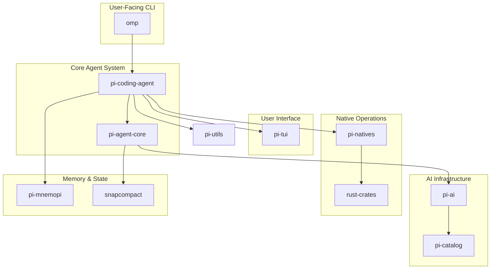

| Package           | Location                     | Role                                                                                           |
|-------------------|------------------------------|------------------------------------------------------------------------------------------------|
| `pi-coding-agent` | [packages/coding-agent/]()   | CLI interface, tool definitions, session management, terminal UI orchestration.               |
| `pi-agent-core`   | [packages/agent/]()          | Core agent engine, conversation state, transport abstractions.                                |
| `pi-ai`           | [packages/ai/]()             | Unified large language model API, provider abstraction, streaming normalization.              |
| `pi-catalog`      | [packages/catalog/]()        | Central registry of models and provider metadata.                                             |
| `pi-tui`          | [packages/tui/]()            | Terminal UI components including differential rendering and text editor widgets.              |
| `pi-natives`      | [packages/natives/]()        | Rust native bindings for grep, shell, PTY, image processing, and syntax highlighting.         |
| `pi-mnemopi`      | [packages/mnemopi/]()        | Autonomous long-term memory with embeddings and fact extraction.                              |
| `snapcompact`     | [packages/snapcompact/]()    | Visual/textual context compaction for session history.                                        |
| `pi-utils`        | [packages/utils/]()          | Shared utilities, logging, and stream helpers.                                                |

Sources: [bun.lock:4-230](), [packages/coding-agent/package.json:1-90](), [packages/ai/package.json:1-134](), [packages/agent/package.json:1-77](), [packages/tui/package.json:1-69](), [packages/natives/package.json:1-66](), [packages/mnemopi/package.json:1-107]()

---

## System Architecture

oh-my-pi bridges natural language inputs to code and file system operations via a layered architecture involving session management, AI orchestration, tool execution, and terminal UI.

### High-Level Architecture Diagram

### Figure 2: System Architecture Overview
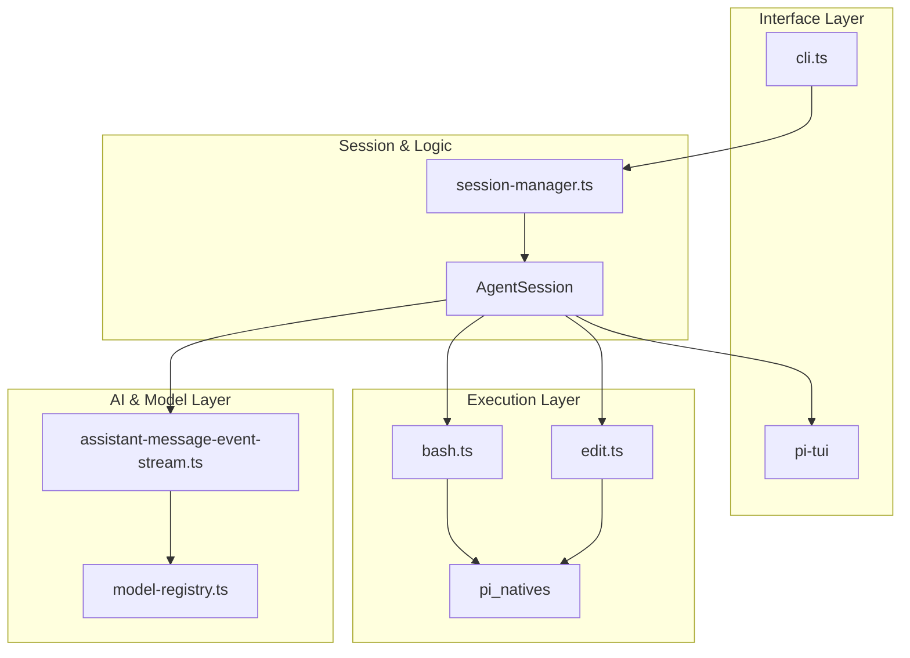

**Component Roles:**

- **CLI & Terminal UI (Interface Layer):**
  - The entrypoint `src/cli.ts` parses arguments, selects operational mode, and launches agent sessions.  
  - The terminal UI, implemented in `pi-tui`, handles efficient differential rendering, multi-line editors, streaming output, and user interactivity.  

- **Agent Session & Management:**
  - `AgentSession` (in `pi-agent-core`) manages the conversational state, orchestrates LLM requests and tool calls.  
  - `SessionManager` (in `pi-coding-agent`) creates, resumes, branches, and persists sessions.  

- **AI Model Interface:**
  - `ModelRegistry` dynamically discovers and manages AI models and providers.  
  - `AssistantMessageEventStream` streams responses from AI models, including text, "thinking" states, and tool-call instructions.  

- **Execution Layer:**
  - Tools like `bash` (shell commands) and `edit` enable code execution and file editing.  
  - Native Rust bindings (`pi-natives`) power high-performance operations including shell and PTY management, grep-style searching, and syntax tree analysis.  

Sources: [packages/coding-agent/src/cli.ts:31-31](), [packages/tui/package.json:5-5](), [packages/agent/package.json:3-5](), [packages/coding-agent/src/session/session-manager.ts:78-78](), [packages/coding-agent/src/config/model-registry.ts:33-33](), [packages/ai/src/assistant-message-event-stream.ts:1-1](), [packages/coding-agent/src/tools/bash.ts:1-1](), [packages/coding-agent/src/tools/edit.ts:1-1](), [packages/natives/package.json:4-4]()

---

## Bridging Natural Language to Code Entities

oh-my-pi's core purpose is to translate natural language developer intents into precise code and file operations, bridging from human commands to machine actions.

### Conceptual Pipeline

### Figure 3: Conceptual Pipeline from Natural Language to Code Entities
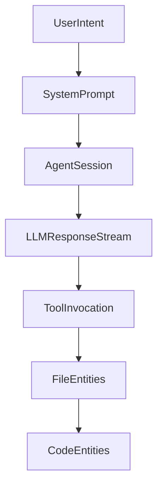

**Process Explanation:**

- **User Intent:** Developers issue natural language requests describing software tasks.  
- **System Prompt Construction:** The system assembles contextual prompts from session data, config files (`AGENTS.md`, `SYSTEM.md`), and capability rules.  
- **AgentSession:** Maintains conversation context, feeds prompts to LLM, interprets responses including tool-call instructions.  
- **LLM Response Stream:** The large language model streams text, reasoning thoughts, and structured tool calls.  
- **Tool Invocation:** Activated tools (e.g. `bash`, `read`, `write`, `edit`) operate on files or environment as per LLM instructions.  
- **File Entities:** File and line addresses use cryptographic hashlines for stable referencing despite shifting lines.  
- **Code Entities:** AST tools analyze program structure for semantic and syntactic integrity.  

Sources: [packages/agent/src/session/agent-session.ts:1-1](), [packages/ai/src/assistant-message-event-stream.ts:1-1](), [packages/coding-agent/src/tools/bash.ts:1-1](), [packages/coding-agent/src/tools/read.ts:1-1](), [packages/coding-agent/src/tools/write.ts:1-1](), [packages/coding-agent/src/tools/edit.ts:1-1](), [Cargo.lock:261-264]()

---

### Mapping Natural Language to System Code Entities

This diagram illuminates how user input travels through system components and source code files:

### Figure 4: Code Entity Mapping for Natural Language Processing
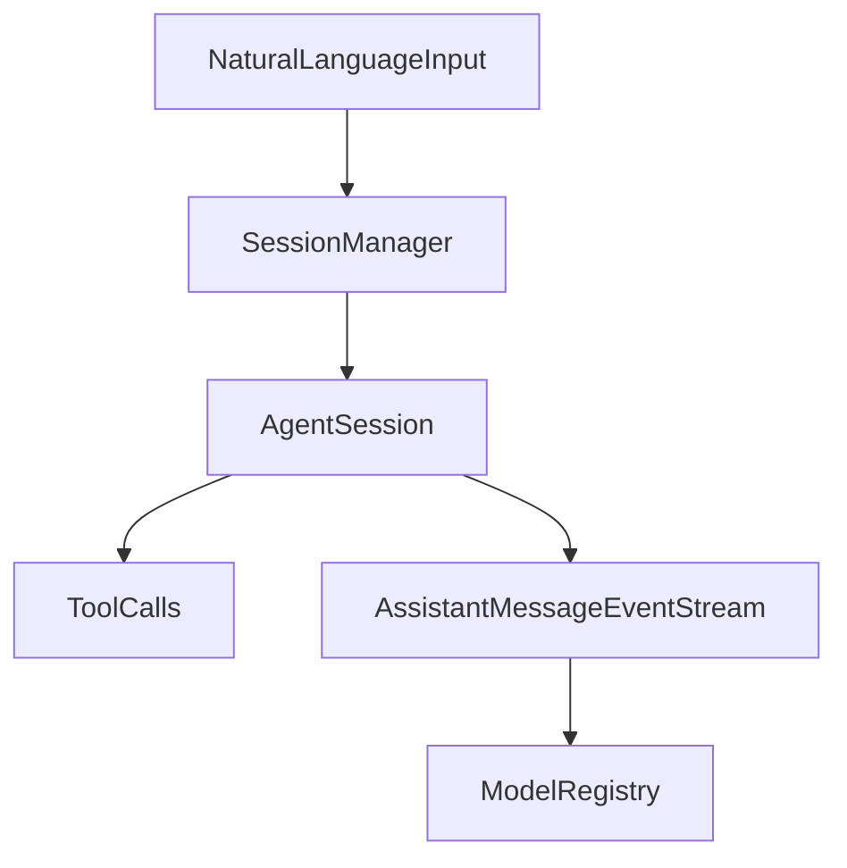

**Codebase Component Relationships:**  
- **Natural Language:** Input is initially processed in `SessionManager` which manages session state and orchestration.  
- **SessionManager:** Creates and delegates interactions to `AgentSession` instances.  
- **AgentSession:** Core entity maintaining conversation logic, handles AI requests, and schedules tool invocation.  
- **AssistantMessageEventStream:** Processes streamed model responses including text and tool calls.  
- **ModelRegistry:** Provides dynamic model and provider discovery and configuration.  
- **Tool Calls:** Actual commands executed by tools implemented in the coding-agent package (e.g. bash shell, file operations, editing).

Sources: [packages/coding-agent/src/session/session-manager.ts:78-78](), [packages/agent/src/session/agent-session.ts:1-1](), [packages/ai/src/assistant-message-event-stream.ts:1-1](), [packages/coding-agent/src/config/model-registry.ts:33-33](), [packages/coding-agent/src/tools/bash.ts:1-1](), [packages/coding-agent/src/tools/edit.ts:1-1]()

---

## Key Capabilities

### 1. Unified AI Provider Layer

- Supports more than 50 model providers including OpenAI, Anthropic, Google, Amazon Bedrock, Cursor, Gemini, Ollama, LMStudio, and custom local/self-hosted models.  
- Dynamic model discovery, caching, and version management in `ModelRegistry`.  
- Streaming LLM event support via `AssistantMessageEventStream` for text, reasoning states, and structured tool-call integration.  
- Advanced reasoning support with configurable reasoning-effort modes and signature preservation.  

Sources: [packages/ai/CHANGELOG.md:13-23](), [packages/ai/CHANGELOG.md:55-56](), [packages/coding-agent/src/config/model-registry.ts:33-33](), [packages/ai/src/assistant-message-event-stream.ts:1-1](), [packages/coding-agent/src/thinking.ts:85-85]()

### 2. High-Performance Native Tool Chain

- Rust bindings (`pi-natives`) accelerate grep-based text search, PTY management, shell commands, clipboard, and syntax highlighting.  
- Stable text editing uses cryptographic hashline addresses to make edits robust to line shifts.  
- Semantic code AST usage with `ast-grep-core` and `tree-sitter` integration enables precise structural modifications and queries.  

Sources: [packages/natives/package.json:1-66](), [Cargo.lock:261-264](), [packages/coding-agent/package.json:55-55]()

### 3. Rich Session and Context Management

- Persistent session state with message transcripts, tool results, and metadata supports branching, forking, and autosaving.  
- Automatic token-budget-aware context compaction strategies maintain conversation window size, supported by visual snapcompact archives.  
- Autonomous memory (`pi-mnemopi`) extracts facts and embeddings from sessions for durable knowledge reuse.  

Sources: [packages/agent/package.json:5-5](), [packages/coding-agent/package.json:66-66](), [packages/mnemopi/package.json:3-5]()

### 4. Extensibility and Orchestration

- Plugin and extension system supports lifecycle hooks, custom commands, and tools for feature addition.  
- Task delegation runs parallel subagents with filesystem isolation (`pi-iso`), handling concurrency and subprocesses.  
- Real-time collaboration with `/collab` command uses encrypted relay architecture for live session sharing, including a React web client (`collab-web`).  

Sources: [packages/coding-agent/src/extensibility/extensions/runner.ts:1-1](), [Cargo.toml:1-172](), [packages/collab-web/package.json:3-5]()

---

## Summary

oh-my-pi is a modular, extensible AI-powered coding agent platform optimized for terminal-driven software development. It bridges developers' natural language intent to precise code and environment operations through a layered architecture comprising AI model integration, native performance tooling, session management, and a versatile extension system.

For installation instructions, initial setup, authentication configuration, and usage guidance, see the child page **[Getting Started](#1.1)**. To understand the monorepo layout and how the TypeScript, Rust, and Python components interrelate, see **[Repository Layout](#1.2)**.

Sources:  
- [packages/coding-agent/package.json:1-90]()  
- [packages/ai/package.json:1-134]()  
- [packages/agent/package.json:1-77]()  
- [packages/natives/package.json:1-66]()  
- [bun.lock:4-230]()  
- [Cargo.toml:1-172]()  
- [packages/coding-agent/CHANGELOG.md:1-70]()

---

# Page: Getting Started

# Getting Started

<details>
<summary>Relevant source files</summary>

The following files were used as context for generating this wiki page:

- [AGENTS.md](AGENTS.md)
- [README.md](README.md)
- [docs/environment-variables.md](docs/environment-variables.md)
- [docs/providers.md](docs/providers.md)
- [packages/ai/README.md](packages/ai/README.md)
- [packages/catalog/src/compat/auth-ids.ts](packages/catalog/src/compat/auth-ids.ts)
- [packages/catalog/src/compat/provider-ids.ts](packages/catalog/src/compat/provider-ids.ts)
- [packages/catalog/src/compat/rules/auth/_order.kdl](packages/catalog/src/compat/rules/auth/_order.kdl)
- [packages/coding-agent/README.md](packages/coding-agent/README.md)
- [packages/coding-agent/src/cli/args.ts](packages/coding-agent/src/cli/args.ts)
- [packages/coding-agent/src/cli/extension-flags.ts](packages/coding-agent/src/cli/extension-flags.ts)
- [packages/coding-agent/src/cli/flag-tables.ts](packages/coding-agent/src/cli/flag-tables.ts)
- [packages/coding-agent/src/cli/help-extra.ts](packages/coding-agent/src/cli/help-extra.ts)
- [packages/coding-agent/src/commands/launch.ts](packages/coding-agent/src/commands/launch.ts)
- [packages/coding-agent/src/main.ts](packages/coding-agent/src/main.ts)
- [packages/coding-agent/src/session/session-manager.ts](packages/coding-agent/src/session/session-manager.ts)
- [packages/coding-agent/test/acp-mcp-isolation.test.ts](packages/coding-agent/test/acp-mcp-isolation.test.ts)
- [packages/coding-agent/test/acp-session-effects.test.ts](packages/coding-agent/test/acp-session-effects.test.ts)
- [packages/coding-agent/test/cli-explicit-extension-isolation.test.ts](packages/coding-agent/test/cli-explicit-extension-isolation.test.ts)
- [packages/coding-agent/test/cli-unknown-flag.test.ts](packages/coding-agent/test/cli-unknown-flag.test.ts)
- [packages/coding-agent/test/extension-flag-dispatch.test.ts](packages/coding-agent/test/extension-flag-dispatch.test.ts)
- [packages/coding-agent/test/extension-flag-initial-message.test.ts](packages/coding-agent/test/extension-flag-initial-message.test.ts)
- [packages/coding-agent/test/flag-tables.test.ts](packages/coding-agent/test/flag-tables.test.ts)
- [packages/coding-agent/test/initial-message.test.ts](packages/coding-agent/test/initial-message.test.ts)
- [packages/coding-agent/test/main-session-resolution-error.test.ts](packages/coding-agent/test/main-session-resolution-error.test.ts)
- [packages/coding-agent/test/session-manager/move-to.test.ts](packages/coding-agent/test/session-manager/move-to.test.ts)
- [packages/coding-agent/test/session-manager/title-source-persistence.test.ts](packages/coding-agent/test/session-manager/title-source-persistence.test.ts)
- [packages/natives/scripts/build-bindings.ts](packages/natives/scripts/build-bindings.ts)
- [scripts/install-tests/binary.dockerfile](scripts/install-tests/binary.dockerfile)
- [scripts/install-tests/source.dockerfile](scripts/install-tests/source.dockerfile)
- [scripts/install-tests/tarball.dockerfile](scripts/install-tests/tarball.dockerfile)
- [scripts/install.ps1](scripts/install.ps1)
- [scripts/install.sh](scripts/install.sh)

</details>


This page guides users through installing the `oh-my-pi` coding agent, configuring authentication, setting up the runtime environment, and running initial commands. The agent is a high-performance terminal assistant designed to integrate AI coding capabilities directly into your local development environment. It supports multiple AI providers, features sophisticated tool integrations, and facilitates seamless interactive development and automation.

---

## Installation

The coding agent is distributed primarily as the `@oh-my-pi/pi-coding-agent` package [packages/coding-agent/README.md:1-3](). It requires Bun runtime version 1.3.14 or later when running from source [README.md:96]().

### Installation Methods Overview

The agent supports multiple installation methods tailored to diverse platforms and user preferences:

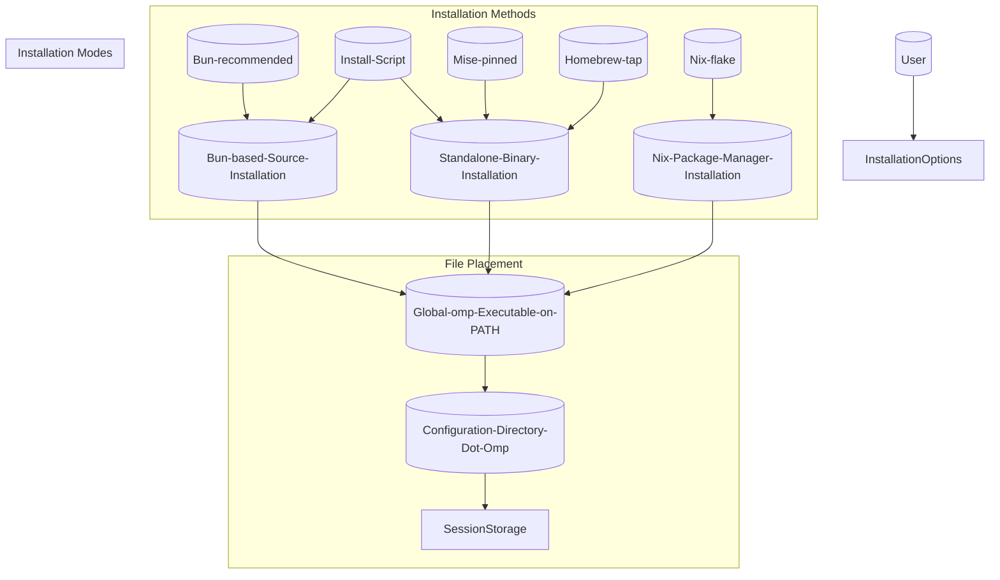
Sources: [README.md:35-91]()

### Detailed Instructions

- **Bun Installation (Recommended):**
  Install globally using Bun’s package manager [README.md:53-57]():
  ```bash
  bun install -g @oh-my-pi/pi-coding-agent
  ```
  This installs the `omp` CLI accessible system-wide.

- **Install Script:**
  - For macOS/Linux [README.md:37-41]():
    ```bash
    curl -fsSL https://omp.sh/install | sh
    ```
  - For Windows (PowerShell) [README.md:84-88]():
    ```powershell
    irm https://omp.sh/install.ps1 | iex
    ```

- **Homebrew [README.md:47-51]()**
  ```bash
  brew install can1357/tap/omp
  ```

- **Pinned Versions with Mise [README.md:90-94]()**
  ```bash
  mise use -g github:can1357/oh-my-pi
  ```

- **Nix [README.md:59-67]()**
  Run without installing:
  ```bash
  nix run github:can1357/oh-my-pi
  ```
  Or install into your user profile:
  ```bash
  nix profile install github:can1357/oh-my-pi
  ```

### Notes
- Alpine Linux users must pre-install `libstdc++` and `libgcc` to satisfy dynamic linking requirements [README.md:45]().
- The agent establishes `~/.omp` as the default configuration directory.

Sources: [README.md:35-96](), [packages/coding-agent/README.md:1-3]()

---

## Initial Setup

After installation, executing `omp` initializes the working environment, creating necessary directories and default configuration files on first run.

### Configuration Directory Layout
`oh-my-pi` stores global state and runtime data under `~/.omp`:

| Path                  | Purpose                                                      |
|-----------------------|--------------------------------------------------------------|
| `~/.omp/config.yml`   | Primary user configuration and model role definitions        |
| `~/.omp/sessions/`    | Persistent session transcripts and artifacts in JSONL format |
| `~/.omp/plugins/`     | Installed extensions and plugins                              |
| `~/.omp/natives/`     | Cached native addons for runtime performance and Windows update compatibility |

### Profile Management
Profiles partition agent state to support multiple independent workflows:
- Use the `--profile <name>` command-line flag or set the `OMP_PROFILE` environment variable to select a profile [packages/coding-agent/src/cli/args.ts:26-31]().
- Profiles encapsulate separate session histories, cached data, credentials, and settings.

Sources: [packages/coding-agent/src/main.ts:130-153](), [packages/coding-agent/src/cli/args.ts:26-31]()

---

## Authentication Configuration

AI model providers require API credentials for usage. The agent implements a layered environment-based credential resolution scheme designed for flexibility.

### Credential Resolution Flow

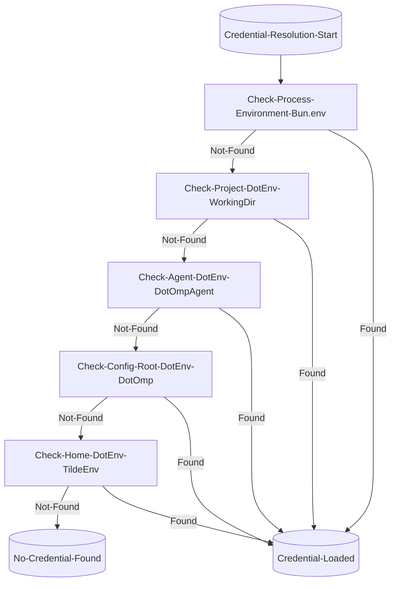
Sources: [docs/environment-variables.md:15-23]()

### Common Provider Environment Variables

| Provider          | Environment Variable(s)                       |
|-------------------|----------------------------------------------|
| Anthropic         | `ANTHROPIC_API_KEY`, `ANTHROPIC_OAUTH_TOKEN`|
| OpenAI            | `OPENAI_API_KEY`, `OPENAI_CODEX_OAUTH_TOKEN`|
| Google Gemini     | `GEMINI_API_KEY`                             |
| Groq              | `GROQ_API_KEY`                               |
| Cerebras          | `CEREBRAS_API_KEY`                           |
| Together          | `TOGETHER_API_KEY`                           |
| Hugging Face      | `HUGGINGFACE_HUB_TOKEN`, `HF_TOKEN`         |

Sources: [docs/environment-variables.md:39-57]()

---

## Running Your First Commands

Once installed and configured, you use the `omp` binary to interact with the coding agent.

### CLI Command Flow Architecture

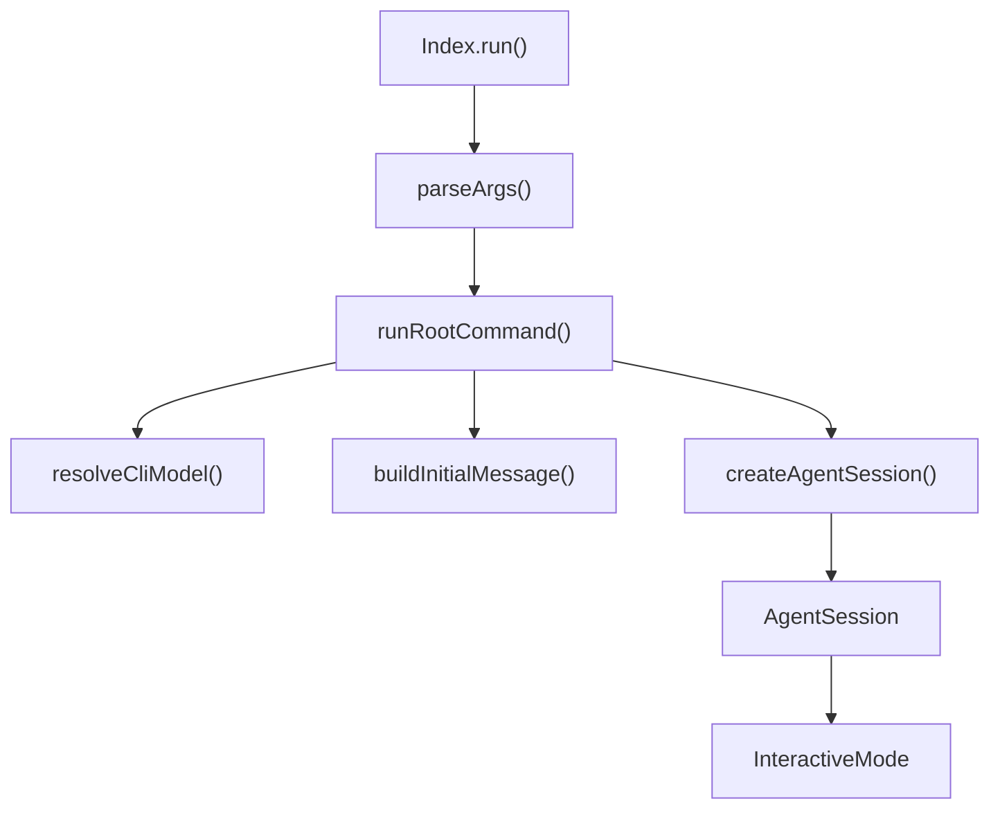
Sources: [packages/coding-agent/src/commands/launch.ts:20-33](), [packages/coding-agent/src/cli/args.ts:25-40](), [packages/coding-agent/src/main.ts:20-74]()

### Basic Usage Patterns
- **Interactive Session:**
  ```bash
  omp
  ```
- **One-off Prompt:**
  ```bash
  omp "Refactor this function to use async/await"
  ```
- **Resume Previous Session:**
  ```bash
  omp --continue
  ```
- **Model Selection:**
  ```bash
  omp --model gpt-4o-mini
  ```
- **Print Mode (CI/Scripting):**
  ```bash
  omp -p "Summarize README.md"
  ```

Sources: [packages/coding-agent/src/main.ts:20-74]()

---

## Updating the Agent

`oh-my-pi` includes an integrated update system that detects installation methods and updates automatically.

### Update Command Flow

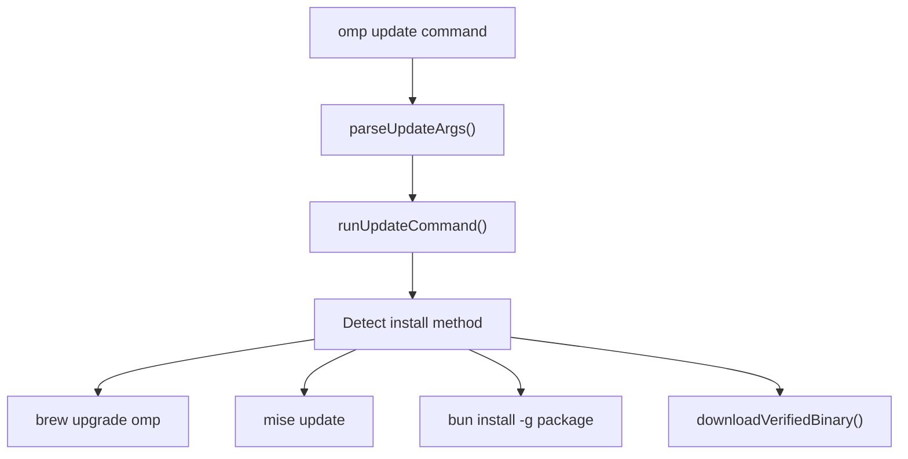
Sources: [packages/coding-agent/src/cli/update-cli.ts:1-195](), [packages/coding-agent/src/commands/update.ts:1-10]()

To check for and install updates, execute:
```bash
omp update
```

Sources: [packages/coding-agent/src/cli/update-cli.ts:1-195](), [packages/coding-agent/src/commands/update.ts:1-10]()

---

## Appendix: Natural Language Space to Code Entity Mapping

This diagram bridges user-level commands and configuration concepts to their corresponding code implementations.

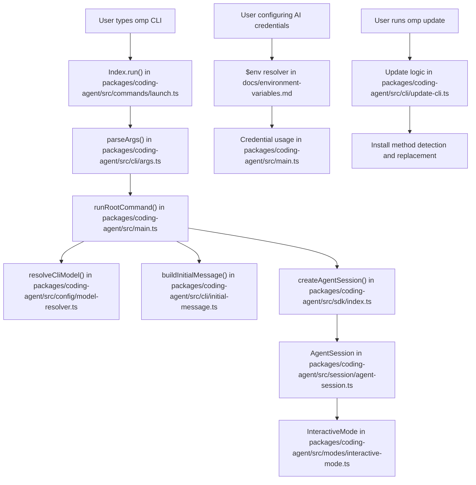
Sources: [packages/coding-agent/src/commands/launch.ts:20-33](), [packages/coding-agent/src/cli/args.ts:25-40](), [packages/coding-agent/src/main.ts:20-74](), [packages/coding-agent/src/cli/update-cli.ts:1-195]()

---

# Page: Repository Layout

# Repository Layout

<details>
<summary>Relevant source files</summary>

The following files were used as context for generating this wiki page:

- [.cargo/config.toml](.cargo/config.toml)
- [.github/workflows/ci.yml](.github/workflows/ci.yml)
- [Cargo.lock](Cargo.lock)
- [Cargo.toml](Cargo.toml)
- [bun.lock](bun.lock)
- [crates/pi-natives/src/spelling.rs](crates/pi-natives/src/spelling.rs)
- [crates/pi-shell/src/git.rs](crates/pi-shell/src/git.rs)
- [crates/pi-shell/src/git/guard.rs](crates/pi-shell/src/git/guard.rs)
- [docs/fs-scan-cache-architecture.md](docs/fs-scan-cache-architecture.md)
- [docs/natives-addon-loader-runtime.md](docs/natives-addon-loader-runtime.md)
- [docs/natives-architecture.md](docs/natives-architecture.md)
- [docs/natives-binding-contract.md](docs/natives-binding-contract.md)
- [docs/natives-build-release-debugging.md](docs/natives-build-release-debugging.md)
- [docs/natives-media-system-utils.md](docs/natives-media-system-utils.md)
- [docs/natives-rust-task-cancellation.md](docs/natives-rust-task-cancellation.md)
- [docs/natives-shell-pty-process.md](docs/natives-shell-pty-process.md)
- [docs/natives-text-search-pipeline.md](docs/natives-text-search-pipeline.md)
- [docs/porting-from-pi-mono.md](docs/porting-from-pi-mono.md)
- [docs/porting-to-natives.md](docs/porting-to-natives.md)
- [docs/user-facing-packages.md](docs/user-facing-packages.md)
- [package.json](package.json)
- [packages/agent/package.json](packages/agent/package.json)
- [packages/ai/package.json](packages/ai/package.json)
- [packages/browser-relay/README.md](packages/browser-relay/README.md)
- [packages/browser-relay/extension/chrome.d.ts](packages/browser-relay/extension/chrome.d.ts)
- [packages/coding-agent/package.json](packages/coding-agent/package.json)
- [packages/coding-agent/src/cli/browser-relay-cli.ts](packages/coding-agent/src/cli/browser-relay-cli.ts)
- [packages/coding-agent/src/exec/settings.ts](packages/coding-agent/src/exec/settings.ts)
- [packages/natives/package.json](packages/natives/package.json)
- [packages/stats/package.json](packages/stats/package.json)
- [packages/tui/package.json](packages/tui/package.json)
- [packages/utils/package.json](packages/utils/package.json)
- [rust-toolchain.toml](rust-toolchain.toml)

</details>


This page provides a technical mapping of the oh-my-pi monorepo layout, detailing disk organization, the responsibilities of core directories, and the cross-language integration mechanics connecting the TypeScript, Rust, and Python halves.

Sources: [`package.json:1-40`](), [`Cargo.toml:1-25`]()

---

## Monorepo Top-Level Directories

The oh-my-pi project is structured as a multi-language monorepo. The top-level directories divide responsibilities across runtime engines, native performance layers, build orchestration, and infrastructure:

| Directory | Purpose |
|---|---|
| `packages/` | TypeScript packages implementing the core agent CLI, AI integrations, tool registry, and TUI UI [`package.json:7-9`]() |
| `crates/` | Rust native crates compiled via N-API for performance-intensive shell, AST, and file operations [`Cargo.toml:6-24`]() |
| `python/` | Python components including the `robomp` GitHub triage bot and RPC client libraries [`package.json:10-11`]() |
| `sdk/` | Client SDKs (Go, Rust, Python) providing programmatic RPC control over agent sessions [`package.json:8-12`]() |
| `scripts/` | TypeScript/Bun automation scripts for testing, CI/CD orchestration, and release management [`package.json:72-124`]() |
| `bazel/` | Bazel build definitions managing hermetic multi-language compilation and cross-ecosystem dependencies [`MODULE.bazel:1-15`]() |
| `nix/` | Nix derivations and development shell configurations for reproducible build environments |
| `infra/` | Infrastructure deployment manifests, Kata Containers setups, and CI runner Dockerfiles |
| `docs/` | Comprehensive user and developer Markdown documentation |
| `.omp/` | Per-user local runtime directory for session persistence logs, native addon caches, and plugin state |
| `assets/` | Static visual artifacts, icons, and frontend UI templates |

Sources: [`package.json:1-40`](), [`Cargo.toml:1-25`](), [`.github/workflows/ci.yml:1-35`]()

---

## TypeScript Packages (`packages/`)

The `packages/` directory contains interdependent TypeScript modules that implement the core control plane, agent loops, AI abstraction layer, and terminal interface:

- **`coding-agent`**: The primary CLI driver package (`packages/coding-agent`) that exposes the `omp` executable, handles command-line argument parsing, session orchestration, and interactive terminal lifecycles [`packages/coding-agent/package.json:1-30`]().
- **`agent`**: Implements the transport-agnostic agent execution loop (`packages/agent`), managing state machines, tool-call scheduling, steering prompts, and replay policies [`packages/agent/package.json:1-30`]().
- **`ai`**: Provides unified LLM abstractions, automated model discovery, provider integrations (OpenAI, Anthropic, Google/Gemini), and event streaming (`packages/ai`) [`packages/ai/package.json:1-40`]().
- **`tui`**: A differential rendering Terminal User Interface engine (`packages/tui`) supporting rich components, markdown viewers, input editors, and keybinding management [`packages/tui/package.json:1-30`]().
- **`natives`**: Manages N-API loader state and architecture-specific bindings to underlying Rust addon binaries (`packages/natives`) [`packages/natives/package.json:1-35`]().
- **`utils`**: Shared utilities (`packages/utils`) providing logging, async primitives, file locking, streams, and crash diagnostics [`packages/utils/package.json:1-30`]().
- **`mnemopi`**: Local autonomous memory and vector embedding extraction system (`packages/mnemopi`) [`bun.lock:168-193`].
- **`snapcompact`**: Context compaction and token budget threshold monitoring utilities [`packages/agent/package.json:1-45`].
- **`catalog`**: KDL-driven model registry, prompt metadata, and compatibility rules engine (`packages/catalog`) [`bun.lock:64-76`].
- **`wire`**: Shared protocol wire definitions and collaborative editing types (`packages/collab-web`) [`bun.lock:118-134`].
- **`stats`**: Local telemetry, observability, and usage analytics dashboard (`packages/stats`) [`packages/stats/package.json:1-35`].

Sources: [`packages/coding-agent/package.json:1-80`](), [`packages/ai/package.json:1-68`](), [`packages/tui/package.json:1-60`](), [`packages/agent/package.json:1-78`]()

---

## Rust Native Crates (`crates/`)

The `crates/` workspace defines high-performance system crates that compile to native Node.js addons via N-API and integrate core performance features:

- **`pi-natives`**: Fast grep, globbing, diffing, syntax highlighting, and process utilities.
- **`pi-shell`**: Embedded shell builtins, PTY management, and process control built atop vendored `brush-core` [`Cargo.toml:8-19`].
- **`pi-edit`**: Tree-sitter-based structural AST search and editing tooling (`crates/pi-ast`, `crates/pi-edit`) [`Cargo.toml:7-10`].
- **`pi-vcs`**: Native Git repository access, diff tracking, and mutation interfaces (`crates/pi-vcs`) [`Cargo.toml:15-15`].
- **`pi-iso`**: Sandbox workspace isolation and filesystem overlay implementations (`crates/pi-iso`) [`Cargo.toml:11-11`].

Sources: [`Cargo.toml:1-25`](), [`Cargo.toml:35-49`]()

---

## Python Components and Client SDKs (`python/`, `sdk/`)

- **`python/robomp`**: An autonomous self-hosted GitHub triage bot built with FastAPI and SQLite that drives an `omp` agent instance running in JSON RPC mode [`package.json:8-12`].
- **`sdk/python/omp-rpc`**: Client SDK libraries for Python, Go, and Rust (`sdk/`) that communicate with the agent core over structured JSON RPC pipes [`package.json:8-12`].

Sources: [`package.json:8-12`]()

---

## Cross-Language Architecture and Control Flow

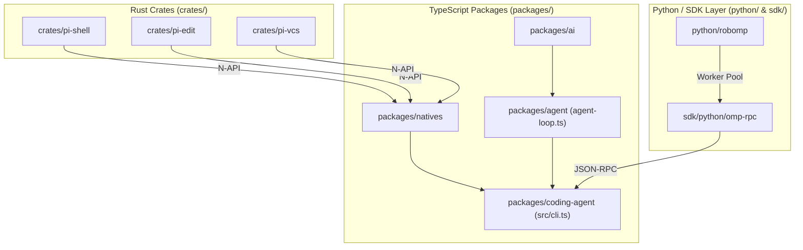

Sources: [`packages/coding-agent/package.json:27-29`](), [`packages/natives/package.json:59-62`]()

---

## Natural Language to Code Entity Mappings

The following diagrams map natural language conceptual domains to precise code entities within the monorepo architecture.

### Diagram 1: Control Plane and AI Engine Mapping

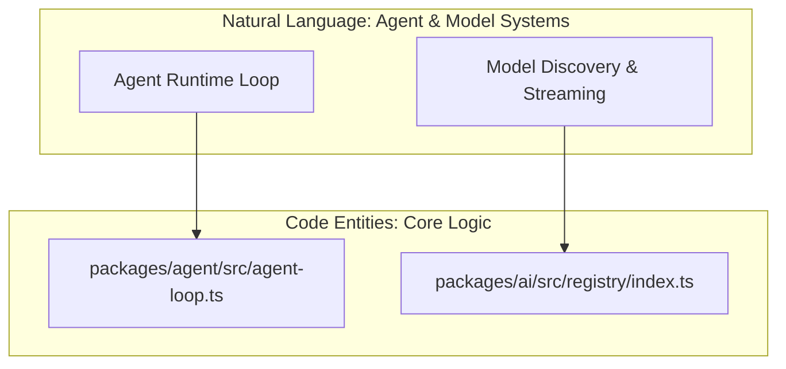

Sources: [`packages/agent/package.json:1-35`](), [`packages/ai/package.json:1-40`]()

### Diagram 2: Native Layer and Autonomous Triage Bot Mapping

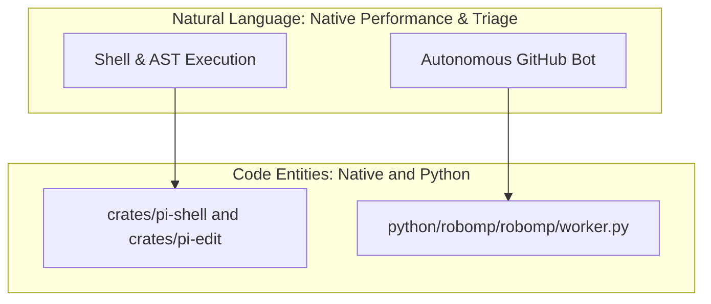

Sources: [`Cargo.toml:6-24`](), [`package.json:8-12`]()

---

# End of Page

---

# Page: Architecture

# Architecture

<details>
<summary>Relevant source files</summary>

The following files were used as context for generating this wiki page:

- [Cargo.lock](Cargo.lock)
- [Cargo.toml](Cargo.toml)
- [bun.lock](bun.lock)
- [docs/task-agent-discovery.md](docs/task-agent-discovery.md)
- [docs/tools/task.md](docs/tools/task.md)
- [packages/agent/package.json](packages/agent/package.json)
- [packages/ai/package.json](packages/ai/package.json)
- [packages/coding-agent/DEVELOPMENT.md](packages/coding-agent/DEVELOPMENT.md)
- [packages/coding-agent/package.json](packages/coding-agent/package.json)
- [packages/coding-agent/src/prompts/tools/task.md](packages/coding-agent/src/prompts/tools/task.md)
- [packages/coding-agent/src/sdk.ts](packages/coding-agent/src/sdk.ts)
- [packages/coding-agent/src/session/agent-session.ts](packages/coding-agent/src/session/agent-session.ts)
- [packages/coding-agent/src/session/session-entries.ts](packages/coding-agent/src/session/session-entries.ts)
- [packages/coding-agent/src/task/executor.ts](packages/coding-agent/src/task/executor.ts)
- [packages/coding-agent/src/task/index.ts](packages/coding-agent/src/task/index.ts)
- [packages/coding-agent/src/task/persisted-revive.ts](packages/coding-agent/src/task/persisted-revive.ts)
- [packages/coding-agent/src/task/structured-subagent.ts](packages/coding-agent/src/task/structured-subagent.ts)
- [packages/coding-agent/src/task/types.ts](packages/coding-agent/src/task/types.ts)
- [packages/coding-agent/src/tools/index.ts](packages/coding-agent/src/tools/index.ts)
- [packages/coding-agent/test/agent-session-prompt-dispatch-race.test.ts](packages/coding-agent/test/agent-session-prompt-dispatch-race.test.ts)
- [packages/coding-agent/test/sdk-workpool-yield-schema.test.ts](packages/coding-agent/test/sdk-workpool-yield-schema.test.ts)
- [packages/coding-agent/test/task/autoload-skills.test.ts](packages/coding-agent/test/task/autoload-skills.test.ts)
- [packages/coding-agent/test/task/executor-async-quiescence.test.ts](packages/coding-agent/test/task/executor-async-quiescence.test.ts)
- [packages/coding-agent/test/task/executor-launch-startup.test.ts](packages/coding-agent/test/task/executor-launch-startup.test.ts)
- [packages/coding-agent/test/task/executor-pass-through.test.ts](packages/coding-agent/test/task/executor-pass-through.test.ts)
- [packages/coding-agent/test/task/executor-prewalk.test.ts](packages/coding-agent/test/task/executor-prewalk.test.ts)
- [packages/coding-agent/test/task/executor-recent-output.test.ts](packages/coding-agent/test/task/executor-recent-output.test.ts)
- [packages/coding-agent/test/task/executor-soft-budget.test.ts](packages/coding-agent/test/task/executor-soft-budget.test.ts)
- [packages/coding-agent/test/task/executor-subagent-reminders.test.ts](packages/coding-agent/test/task/executor-subagent-reminders.test.ts)
- [packages/coding-agent/test/task/executor-wall-clock.test.ts](packages/coding-agent/test/task/executor-wall-clock.test.ts)
- [packages/coding-agent/test/task/executor-yield-loop.test.ts](packages/coding-agent/test/task/executor-yield-loop.test.ts)
- [packages/coding-agent/test/task/persisted-revive.test.ts](packages/coding-agent/test/task/persisted-revive.test.ts)
- [packages/coding-agent/test/task/structured-subagent.test.ts](packages/coding-agent/test/task/structured-subagent.test.ts)
- [packages/coding-agent/test/task/subagent-lsp.test.ts](packages/coding-agent/test/task/subagent-lsp.test.ts)
- [packages/coding-agent/test/task/task-batch.test.ts](packages/coding-agent/test/task/task-batch.test.ts)
- [packages/coding-agent/test/task/task-guards.test.ts](packages/coding-agent/test/task/task-guards.test.ts)
- [packages/coding-agent/test/task/task-schema.test.ts](packages/coding-agent/test/task/task-schema.test.ts)
- [packages/coding-agent/test/task/wire-schema.test.ts](packages/coding-agent/test/task/wire-schema.test.ts)
- [packages/coding-agent/test/tools/index.test.ts](packages/coding-agent/test/tools/index.test.ts)
- [packages/coding-agent/test/tools/schema-validation.test.ts](packages/coding-agent/test/tools/schema-validation.test.ts)
- [packages/natives/package.json](packages/natives/package.json)
- [packages/stats/package.json](packages/stats/package.json)
- [packages/tui/package.json](packages/tui/package.json)
- [packages/utils/package.json](packages/utils/package.json)

</details>


**Purpose and Scope**  
This page provides a high-level overview of oh-my-pi’s system architecture. It describes the layered design, explains the monorepo package organization, and summarizes how major components interact to realize the AI-powered terminal assistant for software development tasks. Detailed technical coverage of individual packages, core components, and the agent loop is found in the respective child pages: [Package Structure](#2.1), [Core Components](#2.2), and [Agent Loop (pi-agent package)](#2.3).

---

## Architectural Overview

The oh-my-pi system is structured using a **layered architecture** that promotes modularity, separation of concerns, and extensibility. Each layer builds upon the lower layers, exposing clean interfaces while delegating specialized responsibilities to dedicated packages and subsystems.

### High-Level Layers Diagram

```mermaid
graph TB
  %% Layer 5: UI & Entry Points
  subgraph "Layer 5: User Interface & Entry Points"
    CLI["omp CLI<br/>packages/coding-agent/src/cli.ts"]
    Main["Main entry<br/>parseArgs, runInteractiveMode()"]
    Interactive["Interactive Mode<br/>packages/coding-agent/src/modes/interactive.ts"]
    RPC["RPC Mode<br/>packages/coding-agent/src/modes/rpc/rpc-mode.ts"]
    ACP["ACP Mode<br/>packages/coding-agent/src/modes/acp/"]
    Print["Print Mode<br/>packages/coding-agent/src/modes/print-mode.ts"]
    Collab["Collab Mode<br/>packages/coding-agent/src/modes/collab/"]
    Editor["Editor Component TUI<br/>packages/tui/src/components/editor.ts"]
    Markdown["Markdown Renderer TUI<br/>packages/tui/src/components/markdown.ts"]
    Renderer["Terminal Renderer<br/>packages/tui/src/terminal.ts"]
  end

  %% Layer 4: Agent Session & SDK
  subgraph "Layer 4: Agent Session & SDK"
    SDK["createAgentSession()<br/>packages/coding-agent/src/sdk.ts"]
    Session["AgentSession<br/>packages/coding-agent/src/session/agent-session.ts"]
    SessionOpts["AgentSessionOptions"]
    SessionMgr["SessionManager<br/>packages/coding-agent/src/session/session-manager.ts"]
    FileStorage["Session File Storage<br/>.omp/sessions/*.jsonl"]
    ContextBuilder["buildSessionContext()"]
  end

  %% Layer 3: AI Integration
  subgraph "Layer 3: AI Integration"
    Registry["ModelRegistry<br/>packages/ai/src/registry/index.ts"]
    Catalog["@oh-my-pi/pi-catalog<br/>Model definitions and metadata"]
    DynamicDiscovery["Dynamic Model Discovery<br/>Ollama, LMStudio, vLLM"]
    StreamFn["streamSimple()<br/>packages/ai/src/index.ts"]
    EventStream["AssistantMessageEventStream"]
    Providers["Providers Layer"]
    Anthropic["Anthropic Provider<br/>providers/anthropic-messages.ts"]
    OpenAI["OpenAI Provider<br/>providers/openai-completions.ts"]
    Codex["OpenAI Codex Provider<br/>providers/openai-codex/"]
    Gemini["Google Gemini Provider<br/>providers/google-gemini.ts"]
    Bedrock["Amazon Bedrock Provider<br/>providers/amazon-bedrock.ts"]
    NativeTransport["Native Transport<br/>Auth-Gateway routing"]
  end

  %% Layer 2: Tool Execution
  subgraph "Layer 2: Tool Execution"
    CreateTools["createTools()<br/>packages/coding-agent/src/tools/index.ts"]
    ToolRegistry["Tool Registry"]
    BuiltinTools["Built-in Tools"]
    ReadTool["read.ts"]
    WriteTool["write.ts"]
    EditTool["edit/index.ts"]
    BashTool["bash/index.ts"]
    PythonTool["ipy/kernel.ts"]
    TaskTool["task/index.ts"]
    HubTool["hub.ts"]
    MnemopiTool["memory tool mnemopi"]
    ExtensionTools["Extension & MCP Tools"]
    MCPClient["mcp/client.ts"]
    Extensions["extensions/"]
  end

  %% Layer 1: Native Performance
  subgraph "Layer 1: Native Performance"
    NAPIBridge["@oh-my-pi/pi-natives<br/>packages/natives/native/index.js"]
    LoadNative["loadNativeModule()"]
    RustLib["Rust Implementations<br/>crates/pi-natives/src/lib.rs"]
    Shell["shell.rs brush-core wrapper"]
    AST["ast.rs tree-sitter + ast-grep"]
    Grep["grep.rs grep-searcher"]
    TextProc["text.rs ANSI processing"]
  end

  %% Arrows
  CLI --> Main
  Main --> Interactive
  Main --> RPC
  Main --> ACP
  Main --> Print
  Main --> Collab

  Interactive --> Editor
  Interactive --> Markdown
  Editor --> Renderer

  SDK --> Session
  SessionOpts --> Session
  Session --> SessionMgr
  SessionMgr --> FileStorage
  SessionMgr --> ContextBuilder

  Registry --> Catalog
  Registry --> DynamicDiscovery
  StreamFn --> Registry
  StreamFn --> EventStream
  StreamFn --> Anthropic
  StreamFn --> OpenAI
  StreamFn --> Codex
  StreamFn --> Gemini
  StreamFn --> Bedrock
  StreamFn --> NativeTransport

  CreateTools --> ToolRegistry
  ToolRegistry --> ReadTool
  ToolRegistry --> WriteTool
  ToolRegistry --> EditTool
  ToolRegistry --> BashTool
  ToolRegistry --> PythonTool
  ToolRegistry --> TaskTool
  ToolRegistry --> HubTool
  ToolRegistry --> MnemopiTool
  ToolRegistry --> MCPClient
  ToolRegistry --> Extensions

  NAPIBridge --> LoadNative
  LoadNative --> RustLib
  RustLib --> Shell
  RustLib --> AST
  RustLib --> Grep
  RustLib --> TextProc
```

Sources: [packages/coding-agent/package.json:27-32](), [packages/ai/package.json:37-60](), [packages/natives/package.json:1-10](), [packages/agent/package.json:60-78](), [packages/coding-agent/src/session/agent-session.ts:1-173](), [packages/coding-agent/src/sdk.ts:1-175]()

This layered design ensures:
- **Layer 5: User Interface & Entry Points** provides the CLI executable (`omp`), multiple operational modes (interactive TUI, RPC, ACP, print, collaborative web sessions), and terminal UI components such as multiline editor and markdown renderer [packages/coding-agent/package.json:27-29](), [packages/tui/package.json:61-108]().
- **Layer 4: Agent Session & SDK** manages agent conversation state, session persistence, context building, and session lifecycle management via `AgentSession` and `SessionManager` [packages/coding-agent/src/session/agent-session.ts:1-173](), [packages/coding-agent/src/sdk.ts:1-175]().
- **Layer 3: AI Integration** implements unified AI model abstraction with dynamic discovery and multi-provider support [packages/ai/package.json:37-60]().
- **Layer 2: Tool Execution** defines the tool creation API, registration, and built-in tools for file operations, shell execution, task delegation, memory access, and extension-driven runtime tools [packages/coding-agent/src/tools/index.ts:1-50]().
- **Layer 1: Native Performance** features native Rust libraries accessed via Node N-API bindings [packages/natives/package.json:1-10]().

---

## Package Structure Overview

The project is organized as a monorepo containing multiple TypeScript packages and native Rust crates. Inter-package dependencies flow downward from the top-level coding agent package to core utilities and native bindings.

For detailed information on the monorepo structure, individual packages, their responsibilities, and dependency relationships, see [Package Structure](#2.1).

Sources: [packages/coding-agent/package.json:1-110](), [packages/agent/package.json:37-45](), [packages/ai/package.json:151-157]()

---

## Core Components Overview

The core architectural components coordinate agent execution, model querying, and state persistence. `AgentSession` acts as the central orchestrator across run modes, while `SessionManager` handles file persistence.

For detailed information on key architectural components such as `AgentSession`, SDK layer, Tool Registry, Extension Runner, and `SessionManager`, see [Core Components](#2.2).

Sources: [packages/coding-agent/src/session/agent-session.ts:1-173](), [packages/coding-agent/src/sdk.ts:1-175]()

---

## Agent Loop Overview

The agent execution loop manages turn progression, tool scheduling, event dispatch, and compaction triggers in a transport-agnostic manner.

For detailed information on the transport-agnostic agent core in `packages/agent`, execution plans, tool-call scheduling, steering/interruption, replay policy, and compaction entry points, see [Agent Loop (pi-agent package)](#2.3).

Sources: [packages/agent/package.json:1-78](), [packages/coding-agent/src/session/agent-session.ts:1-14]()

---

## Request Flow Architecture

The following sequence diagram illustrates the flow of a user request from input through agent processing, AI calls, tool execution, and response delivery.

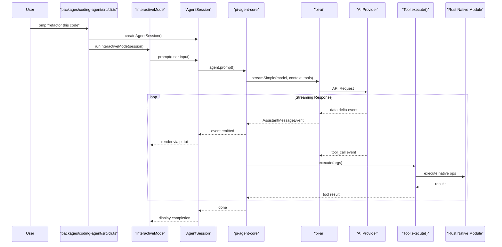

Sources: [packages/coding-agent/package.json:27-31](), [packages/agent/package.json:1-78](), [packages/ai/package.json:2-110](), [packages/natives/package.json:1-10](), [packages/coding-agent/src/sdk.ts:1-10](), [packages/coding-agent/src/session/agent-session.ts:1-14]()

---

## Terminology Bridge: Natural Language vs. Code Entities

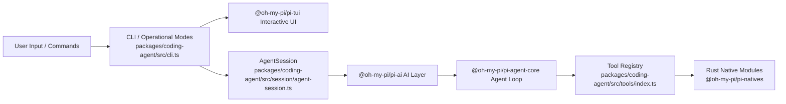

Sources: [packages/coding-agent/src/session/agent-session.ts:1-173](), [packages/coding-agent/src/sdk.ts:1-175](), [packages/ai/package.json:2-110](), [packages/agent/package.json:1-78](), [packages/coding-agent/src/tools/index.ts:1-50](), [packages/tui/package.json:61-108](), [packages/natives/package.json:1-10]()

---

## Child Pages

- [Package Structure](#2.1) — Detail the monorepo structure, listing all packages and their responsibilities. Explain dependency relationships.
- [Core Components](#2.2) — Describe the key architectural components: AgentSession, SDK layer, Tool Registry, Extension Runner, SessionManager, and how they coordinate.
- [Agent Loop (pi-agent package)](#2.3) — Document the transport-agnostic agent core in packages/agent: agent-loop.ts, agent.ts, execution plans, tool-call scheduling, steering/interruption, replay policy, and compaction entry points.

---

# Page: Package Structure

# Package Structure

<details>
<summary>Relevant source files</summary>

The following files were used as context for generating this wiki page:

- [Cargo.lock](Cargo.lock)
- [Cargo.toml](Cargo.toml)
- [bun.lock](bun.lock)
- [package.json](package.json)
- [packages/agent/package.json](packages/agent/package.json)
- [packages/ai/package.json](packages/ai/package.json)
- [packages/coding-agent/package.json](packages/coding-agent/package.json)
- [packages/natives/package.json](packages/natives/package.json)
- [packages/stats/package.json](packages/stats/package.json)
- [packages/tui/package.json](packages/tui/package.json)
- [packages/utils/package.json](packages/utils/package.json)

</details>


This document describes the monorepo organization of oh-my-pi, detailing the responsibilities of each package, their dependency relationships, and the unified build system. It provides a comprehensive view of the monorepo layout, package roles, and core interaction patterns between key code entities.

---

## Monorepo Organization

The oh-my-pi repository is structured as a monorepo containing multiple TypeScript packages and native Rust crates. TypeScript packages are managed with Bun workspaces, while native Rust crates use Cargo workspaces [Cargo.toml:1-25]().

```
oh-my-pi/
├── packages/              # TypeScript packages (Bun workspace)
│   ├── coding-agent/      # Main CLI and agent implementation
│   ├── agent/             # Core agent abstractions (pi-agent-core)
│   ├── ai/                # Unified AI model integration layer
│   ├── tui/               # Terminal User Interface components
│   ├── natives/           # Native functionality and bindings (N-API)
│   ├── utils/             # Shared TypeScript utility functions
│   ├── stats/             # Observability dashboard (React + CLI)
│   ├── mnemopi/           # Autonomous memory system and embeddings
│   ├── catalog/           # Model and provider registry definitions
│   ├── snapcompact/       # Visual context compaction tooling
│   ├── wire/              # Shared protocol types for RPC and collaboration
│   ├── metaharness/       # Benchmark orchestration and reporting
│   ├── omptype/           # High-performance schema and type utilities
│   ├── browser-relay/     # Browser extension relay for controlling tabs
│   ├── collab-web/        # React client for live session collaboration
│   └── typescript-edit-benchmark/ # Benchmark suite for TypeScript editing
├── crates/                # Rust crates (Cargo workspace)
│   ├── pi-ast/            # AST manipulation and analysis tools
│   ├── pi-builtins/       # Consolidated shell builtins
│   ├── pi-iso/            # Filesystem isolation primitives
│   ├── pi-natives/        # Rust native implementation for N-API bindings
│   ├── pi-shell/          # Shell builtin and execution engine bindings
│   ├── pi-voice/          # Voice processing backends (TTS, STT)
│   ├── pi-walker/         # Filesystem walker utilities
│   └── vendor/brush-core/ # Vendored shell engine library
└── package.json           # Root package and workspace configuration
```

This structure cleanly separates the user-facing CLI, core agent and AI abstractions, UI components, native performance bindings, and supporting infrastructure.

Sources: [packages/coding-agent/package.json:1-16](), [packages/ai/package.json:1-16](), [packages/agent/package.json:1-16](), [packages/tui/package.json:1-16](), [bun.lock:4-211]()

---

## Package Dependency Graph

This diagram visualizes dependency relationships among key packages, illustrating the layered architecture from core frameworks and native layers up to user-facing tools and UI components.

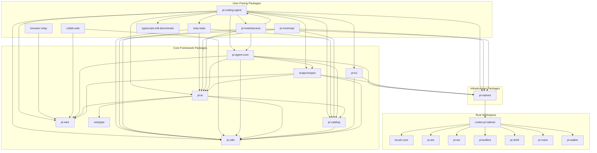

Sources: [packages/coding-agent/package.json:50-98](), [packages/ai/package.json:39-48](), [packages/agent/package.json:36-44](), [packages/tui/package.json:38-44](), [packages/catalog/package.json:60-64](), [bun.lock:23-213](), [packages/mnemopi/package.json:107](), [packages/snapcompact/package.json:39-44](), [packages/collab-web/package.json:63](), [packages/metaharness/package.json:56]()

---

## Core Packages and Their Responsibilities

### `@oh-my-pi/pi-coding-agent`

- **Role:** Main CLI and coding agent logic [packages/coding-agent/package.json:2-4]().
- **Responsibilities:**
  - Implements the main command-line interface entrypoint `omp` in `src/cli.ts` [packages/coding-agent/package.json:27-29]().
  - Manages agent sessions, including lifecycle, conversation state, and command dispatching.
  - Provides core built-in tools including `read`, `bash`, `edit`, and `write` [packages/coding-agent/package.json:2-4]().
  - Maintains internal URL routing for special commands and resource handling.
  - Integrates the auto-research subsystem for autonomous experimentation and commit analysis.
  - Coordinates context compaction calls to the `snapcompact` package.
  - Supports extensions and a multi-agent "swarm" extension system.
- **Key files:** `src/cli.ts`, `src/session.ts`, `src/tools/`, `src/internal-url-router.ts`.

Sources: [packages/coding-agent/package.json:3-32]()

---

### `@oh-my-pi/pi-ai`

- **Role:** Unified AI model integration and provider abstraction [packages/ai/package.json:2-4]().
- **Responsibilities:**
  - Manages connections to various LLM providers like OpenAI, Anthropic, Gemini, Google Vertex/Gemini-CLI, AWS Bedrock, Copilot, Ollama, and others.
  - Handles OAuth flows, credential management, rate-limiting, and usage tracking.
  - Implements streaming APIs (`AssistantMessageEventStream`) for AI responses.
  - Provides dialect and schema normalization to unify provider APIs.
  - Supports prompt caching and retry/fallback strategies.
- **Key files:** `src/providers/`, `src/auth-broker/`, `src/auth-gateway/`, `src/usage/` [packages/ai/package.json:77-104]().

Sources: [packages/ai/package.json:2-4](), [packages/ai/package.json:77-104]()

---

### `@oh-my-pi/pi-agent-core`

- **Role:** Core agent abstractions, state and transport management [packages/agent/package.json:2-5]().
- **Responsibilities:**
  - Provides `Agent` classes managing turn-taking, tool calls, and session state.
  - Defines transport-agnostic operation APIs supporting CLI, RPC, ACP modes.
  - Manages compaction and pruning of conversation transcripts with legacy and streaming algorithms.
  - Supports attachment handling and replay policies for session continuity.
- **Key files:** `src/index.ts`, `src/compaction.ts`, `src/compaction-v2-streaming.ts` [packages/agent/package.json:60-72]().

Sources: [packages/agent/package.json:2-5](), [packages/agent/package.json:60-72]()

---

### `@oh-my-pi/pi-tui`

- **Role:** Terminal User Interface framework [packages/tui/package.json:3-5]().
- **Responsibilities:**
  - Implements component-based TUI architecture with containers, text, markdown, select lists, and input widgets.
  - Features differential rendering to minimize redraw overhead.
  - Provides a multi-line editor with Unicode support, autocomplete, undo/redo.
- **Key files:** `src/index.ts`, `src/components/`, `src/editor/` [packages/tui/package.json:29-106]().

Sources: [packages/tui/package.json:3-5](), [packages/tui/package.json:29-106]()

---

### `@oh-my-pi/pi-natives`

- **Role:** Native Rust bindings and high-performance utilities via N-API [packages/natives/package.json:2-5]().
- **Responsibilities:**
  - Native shell execution using vendored `brush-core`.
  - PTY management, shell builtins, text search tools (`grep`), globbing, syntax highlighting, diffing.
  - Desktop automation and accessibility integration.
  - Native audio backends and WebRTC peers for voice.
- **Key files:** N-API bindings in `native/`, Rust crates in `crates/pi-natives`, `crates/pi-shell`, `crates/pi-builtins`, `crates/vendor/brush-core` [Cargo.toml:1-24](), [packages/natives/package.json:29-95]().

Sources: [Cargo.toml:1-24](), [packages/natives/package.json:2-95]()

---

### `@oh-my-pi/pi-utils`

- **Role:** Shared utility library [packages/utils/package.json:2-4]().
- **Responsibilities:**
  - Utility functions for logging, filesystem, retry strategies, streams, worker clients.
  - Consistent tooling primitives used across the monorepo.
- **Key files:** Various utilities in `src/` [packages/utils/package.json:22-44]().

Sources: [packages/utils/package.json:2-4](), [packages/utils/package.json:22-44]()

---

### `@oh-my-pi/omp-stats`

- **Role:** Local observability dashboard [packages/stats/package.json:2-6]().
- **Responsibilities:**
  - Collects AI usage statistics, local session metrics.
  - React-based dashboard UI and CLI tool `omp-stats` [packages/stats/package.json:30-32]().
- **Key files:** React components and CLI logic in `src/`.

Sources: [packages/stats/package.json:2-32]()

---

### `@oh-my-pi/pi-mnemopi`

- **Role:** Autonomous agent memory system.
- **Responsibilities:**
  - Extracts durable knowledge and embeddings from session transcripts.
  - Uses ONNX runtime and `fastembed` for embedding and similarity search [bun.lock:181-183]().
  - Runs consolidation pipelines for memory maintenance.
  - CLI tool `mnemopi` for memory interaction [bun.lock:171-173]().
- **Key files:** CLI at `src/cli.ts` [bun.lock:171-173]().

Sources: [bun.lock:171-183]()

---

### `@oh-my-pi/pi-catalog`

- **Role:** Model, provider, and capabilities registry.
- **Responsibilities:**
  - Defines AI model metadata including costs, capabilities, compatibility rules.
  - Supports dynamic discovery of local models (Ollama, LMStudio).
  - Maintains JSON/YAML catalog files driving AI behavior and cost accounting.
- **Key files:** Registry and schema files in `src/registry`, `src/models/`.

Sources: [packages/ai/package.json:5-14](), [packages/catalog/package.json:1-30]()

---

### `@oh-my-pi/snapcompact`

- **Role:** Visual context compaction tooling.
- **Responsibilities:**
  - Algorithms and prompt templates for compressing conversation context while preserving semantics.
  - Used by coding agent for efficient prompt management.
- **Key files:** `src/snapcompact.ts`, `src/prompts/`.

Sources: [packages/snapcompact/package.json:39-44]()

---

### `@oh-my-pi/pi-wire`

- **Role:** Shared protocol TypeScript types.
- **Responsibilities:**
  - Message schemas and types for RPC, event streams, collaboration, tool-call communication.
  - Common dependency for clients, servers, and extensions.
- **Key files:** Protocol definitions in `src/`.

Sources: [packages/ai/package.json:39-48]()

---

### `@oh-my-pi/pi-metaharness`

- **Role:** Benchmark orchestration and reporting [bun.lock:135-140]().
- **Responsibilities:**
  - Models experiments, runs, detailed trace data for benchmarking.
  - Uses SQLite for storage, exposes REST/SSE APIs.
  - Integrates with the TypeScript edit benchmark suite.
- **Key files:** Server implementation at `src/server.ts` [bun.lock:139-140]().

Sources: [bun.lock:135-140]()

---

### `@oh-my-pi/browser-relay`

- **Role:** Browser extension relay [bun.lock:56-58]().
- **Responsibilities:**
  - Chrome extension enabling coding agent to programmatically control browser tabs.
  - Works with the browser tool in the coding agent.
- **Key files:** Extension scripts and communication handlers.

Sources: [bun.lock:56-58]()

---

### `@oh-my-pi/collab-web`

- **Role:** React client for live session collaboration [packages/collab-web/package.json:64]().
- **Responsibilities:**
  - Enables encrypted real-time sharing in browsers.
  - Renders guest TUI using React components.
  - Uses `pi-wire` protocol types for communication [packages/collab-web/package.json:64]().
- **Key files:** React components and logic.

Sources: [packages/collab-web/package.json:64]()

---

### `@oh-my-pi/typescript-edit-benchmark`

- **Role:** Benchmark suite for TypeScript editing.
- **Responsibilities:**
  - Automated tests focused on the TypeScript editing subsystem.
- **Key files:** Benchmark scripts under `src/`.

Sources: [packages/typescript-edit-benchmark/package.json:10-40]()

---

## Directory-to-Entity Mapping

### CLI Entry Points and Core Package Exports

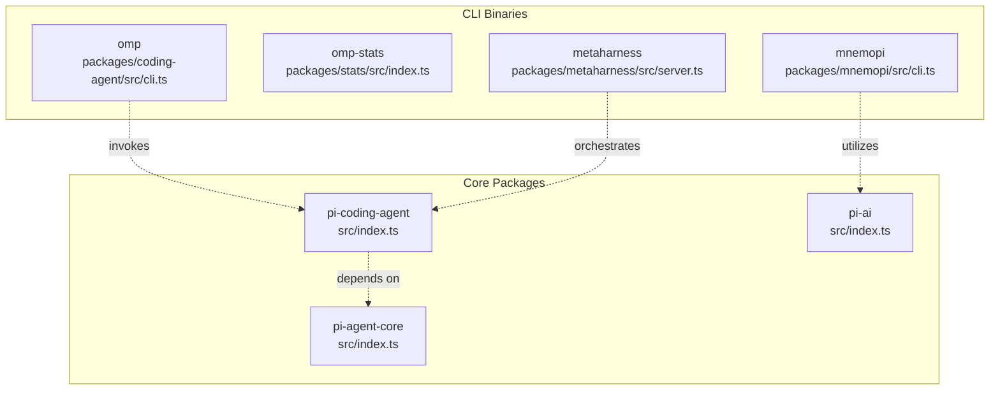

This diagram shows main CLI entrypoints and their relationships to core packages. The `omp` CLI is the primary user interface invoking the coding agent core [packages/coding-agent/package.json:27-29](). The `mnemopi` CLI leverages AI functionality for embedding-based memory workflows [bun.lock:171-173](). The `metaharness` server orchestrates benchmarks using the coding agent [bun.lock:135-140]().

Sources: [packages/coding-agent/package.json:27-29](), [packages/ai/package.json:29-30](), [packages/stats/package.json:28-32](), [bun.lock:135-140](), [bun.lock:171-173]()

---

### Native Infrastructure Bridge (JavaScript/TypeScript ⇄ Rust)

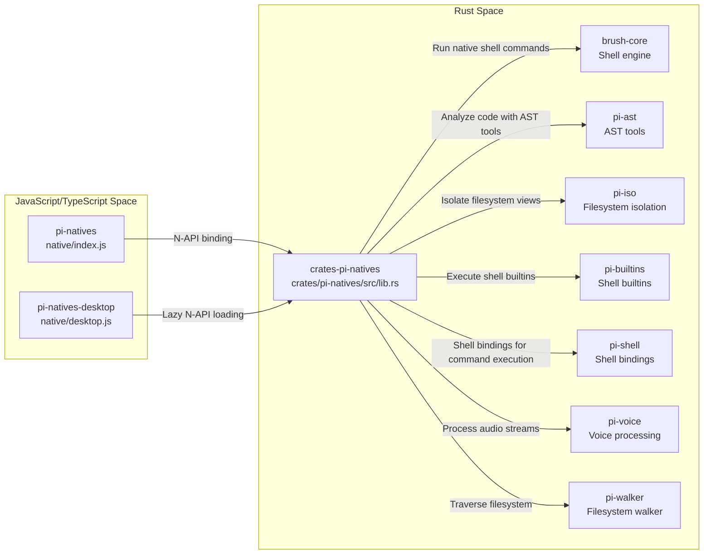

This diagram illustrates the relationship between the TypeScript native bindings (`pi-natives` package) and underlying Rust crates providing high-performance implementations [Cargo.toml:1-24](), [packages/natives/package.json:29-95](). The N-API bindings bridge native functionalities into the Node.js runtime environment.

Sources: [Cargo.toml:1-24](), [packages/natives/package.json:29-95]()

---

## Build System and Compilation

oh-my-pi uses a multi-language, multi-toolchain build system integrating TypeScript (via Bun) and Rust (via Cargo) [Cargo.toml:1-25]():

- **TypeScript/JavaScript:**
  - Managed via Bun workspaces for all TS packages in `packages/`.
  - `pi-coding-agent` provides build scripts for bundling CLI, native bindings, and tool views.
  - Shared dependencies within monorepo use local workspace packages via `"catalog:"` specifiers.
  - Scripts support linting, formatting, type-checking, and tests.
- **Rust:**
  - Managed with a Cargo workspace for all native crates in `crates/` [Cargo.toml:1-25]().
  - Custom build profiles optimize performance and debugging [Cargo.toml:50-106]().
  - Native crates build shared libraries exposing Node.js N-API bindings consumed by `pi-natives`.
  - Panic strategy set to "unwind" for recoverable panics inside native components [Cargo.toml:50-68]().
- **Native Bindings:**
  - Uses `@napi-rs/cli` for generating and managing Node.js N-API bindings [packages/natives/package.json:45-47]().
  - Supports deferred loading for desktop-related native modules.
- **Dependency Management:**
  - Optional native dependencies include `@huggingface/transformers`, `sherpa-onnx-node` for ML acceleration [bun.lock:113-116]().
  - OpenTelemetry packages provide telemetry and distributed tracing across components [bun.lock:96-106]().

This build system enables seamless JS/TS and native Rust interoperability, maintaining high performance for critical components.

Sources: [packages/coding-agent/package.json:33-50](), [packages/natives/package.json:29-45](), [Cargo.toml:1-106](), [bun.lock:96-116]()

---

This comprehensive package structure underpins oh-my-pi's modular architecture, enabling an extendable AI-powered terminal assistant with robust native acceleration and rich UI support.

Sources: [packages/coding-agent/package.json:1-98](), [packages/ai/package.json:1-108](), [packages/agent/package.json:1-78](), [packages/tui/package.json:1-69](), [bun.lock:1-211](), [Cargo.toml:1-64](), [packages/natives/package.json:29-50]()

---

# Page: Core Components

# Core Components

<details>
<summary>Relevant source files</summary>

The following files were used as context for generating this wiki page:

- [docs/task-agent-discovery.md](docs/task-agent-discovery.md)
- [docs/tools/task.md](docs/tools/task.md)
- [packages/ai/test/auth-storage-credential-disabled-event.test.ts](packages/ai/test/auth-storage-credential-disabled-event.test.ts)
- [packages/coding-agent/DEVELOPMENT.md](packages/coding-agent/DEVELOPMENT.md)
- [packages/coding-agent/src/cli/args.ts](packages/coding-agent/src/cli/args.ts)
- [packages/coding-agent/src/cli/extension-flags.ts](packages/coding-agent/src/cli/extension-flags.ts)
- [packages/coding-agent/src/cli/flag-tables.ts](packages/coding-agent/src/cli/flag-tables.ts)
- [packages/coding-agent/src/cli/ssh-cli.ts](packages/coding-agent/src/cli/ssh-cli.ts)
- [packages/coding-agent/src/commands/launch.ts](packages/coding-agent/src/commands/launch.ts)
- [packages/coding-agent/src/commands/ssh.ts](packages/coding-agent/src/commands/ssh.ts)
- [packages/coding-agent/src/main.ts](packages/coding-agent/src/main.ts)
- [packages/coding-agent/src/modes/acp/acp-agent.ts](packages/coding-agent/src/modes/acp/acp-agent.ts)
- [packages/coding-agent/src/modes/acp/acp-event-mapper.ts](packages/coding-agent/src/modes/acp/acp-event-mapper.ts)
- [packages/coding-agent/src/modes/acp/acp-mode.ts](packages/coding-agent/src/modes/acp/acp-mode.ts)
- [packages/coding-agent/src/prompts/system/mcp-xdev-guidance.md](packages/coding-agent/src/prompts/system/mcp-xdev-guidance.md)
- [packages/coding-agent/src/prompts/tools/task.md](packages/coding-agent/src/prompts/tools/task.md)
- [packages/coding-agent/src/sdk.ts](packages/coding-agent/src/sdk.ts)
- [packages/coding-agent/src/session/agent-session.ts](packages/coding-agent/src/session/agent-session.ts)
- [packages/coding-agent/src/session/session-entries.ts](packages/coding-agent/src/session/session-entries.ts)
- [packages/coding-agent/src/session/session-manager.ts](packages/coding-agent/src/session/session-manager.ts)
- [packages/coding-agent/src/session/session-tools.ts](packages/coding-agent/src/session/session-tools.ts)
- [packages/coding-agent/src/ssh/config-writer.ts](packages/coding-agent/src/ssh/config-writer.ts)
- [packages/coding-agent/src/task/executor.ts](packages/coding-agent/src/task/executor.ts)
- [packages/coding-agent/src/task/index.ts](packages/coding-agent/src/task/index.ts)
- [packages/coding-agent/src/task/persisted-revive.ts](packages/coding-agent/src/task/persisted-revive.ts)
- [packages/coding-agent/src/task/prompt-policy.ts](packages/coding-agent/src/task/prompt-policy.ts)
- [packages/coding-agent/src/task/structured-subagent.ts](packages/coding-agent/src/task/structured-subagent.ts)
- [packages/coding-agent/src/task/types.ts](packages/coding-agent/src/task/types.ts)
- [packages/coding-agent/src/tools/context.ts](packages/coding-agent/src/tools/context.ts)
- [packages/coding-agent/src/tools/index.ts](packages/coding-agent/src/tools/index.ts)
- [packages/coding-agent/test/acp-agent.test.ts](packages/coding-agent/test/acp-agent.test.ts)
- [packages/coding-agent/test/acp-event-mapper.test.ts](packages/coding-agent/test/acp-event-mapper.test.ts)
- [packages/coding-agent/test/acp-initialize-conformance.test.ts](packages/coding-agent/test/acp-initialize-conformance.test.ts)
- [packages/coding-agent/test/acp-lazy-startup.test.ts](packages/coding-agent/test/acp-lazy-startup.test.ts)
- [packages/coding-agent/test/acp-mcp-isolation.test.ts](packages/coding-agent/test/acp-mcp-isolation.test.ts)
- [packages/coding-agent/test/acp-session-effects.test.ts](packages/coding-agent/test/acp-session-effects.test.ts)
- [packages/coding-agent/test/agent-session-acp-permission.test.ts](packages/coding-agent/test/agent-session-acp-permission.test.ts)
- [packages/coding-agent/test/agent-session-prompt-abort-race.test.ts](packages/coding-agent/test/agent-session-prompt-abort-race.test.ts)
- [packages/coding-agent/test/agent-session-prompt-dispatch-race.test.ts](packages/coding-agent/test/agent-session-prompt-dispatch-race.test.ts)
- [packages/coding-agent/test/agent-session-tool-rebuild-skip.test.ts](packages/coding-agent/test/agent-session-tool-rebuild-skip.test.ts)
- [packages/coding-agent/test/cli-explicit-extension-isolation.test.ts](packages/coding-agent/test/cli-explicit-extension-isolation.test.ts)
- [packages/coding-agent/test/cli-unknown-flag.test.ts](packages/coding-agent/test/cli-unknown-flag.test.ts)
- [packages/coding-agent/test/extension-flag-dispatch.test.ts](packages/coding-agent/test/extension-flag-dispatch.test.ts)
- [packages/coding-agent/test/extension-flag-initial-message.test.ts](packages/coding-agent/test/extension-flag-initial-message.test.ts)
- [packages/coding-agent/test/fixtures/instructions-mcp.ts](packages/coding-agent/test/fixtures/instructions-mcp.ts)
- [packages/coding-agent/test/fixtures/mcp-refresh-retention-probe.ts](packages/coding-agent/test/fixtures/mcp-refresh-retention-probe.ts)
- [packages/coding-agent/test/flag-tables.test.ts](packages/coding-agent/test/flag-tables.test.ts)
- [packages/coding-agent/test/initial-message.test.ts](packages/coding-agent/test/initial-message.test.ts)
- [packages/coding-agent/test/main-session-resolution-error.test.ts](packages/coding-agent/test/main-session-resolution-error.test.ts)
- [packages/coding-agent/test/mcp-refresh-retention.test.ts](packages/coding-agent/test/mcp-refresh-retention.test.ts)
- [packages/coding-agent/test/prefix-binding-tool-roster.test.ts](packages/coding-agent/test/prefix-binding-tool-roster.test.ts)
- [packages/coding-agent/test/sdk-credential-disabled-bridge.test.ts](packages/coding-agent/test/sdk-credential-disabled-bridge.test.ts)
- [packages/coding-agent/test/sdk-generate-image-tool-gating.test.ts](packages/coding-agent/test/sdk-generate-image-tool-gating.test.ts)
- [packages/coding-agent/test/sdk-mcp-instructions.test.ts](packages/coding-agent/test/sdk-mcp-instructions.test.ts)
- [packages/coding-agent/test/sdk-tool-activation.test.ts](packages/coding-agent/test/sdk-tool-activation.test.ts)
- [packages/coding-agent/test/sdk-workpool-yield-schema.test.ts](packages/coding-agent/test/sdk-workpool-yield-schema.test.ts)
- [packages/coding-agent/test/session-manager/move-to.test.ts](packages/coding-agent/test/session-manager/move-to.test.ts)
- [packages/coding-agent/test/session-manager/title-source-persistence.test.ts](packages/coding-agent/test/session-manager/title-source-persistence.test.ts)
- [packages/coding-agent/test/system-prompt-model.test.ts](packages/coding-agent/test/system-prompt-model.test.ts)
- [packages/coding-agent/test/task/autoload-skills.test.ts](packages/coding-agent/test/task/autoload-skills.test.ts)
- [packages/coding-agent/test/task/executor-async-quiescence.test.ts](packages/coding-agent/test/task/executor-async-quiescence.test.ts)
- [packages/coding-agent/test/task/executor-launch-startup.test.ts](packages/coding-agent/test/task/executor-launch-startup.test.ts)
- [packages/coding-agent/test/task/executor-pass-through.test.ts](packages/coding-agent/test/task/executor-pass-through.test.ts)
- [packages/coding-agent/test/task/executor-prewalk.test.ts](packages/coding-agent/test/task/executor-prewalk.test.ts)
- [packages/coding-agent/test/task/executor-recent-output.test.ts](packages/coding-agent/test/task/executor-recent-output.test.ts)
- [packages/coding-agent/test/task/executor-soft-budget.test.ts](packages/coding-agent/test/task/executor-soft-budget.test.ts)
- [packages/coding-agent/test/task/executor-subagent-reminders.test.ts](packages/coding-agent/test/task/executor-subagent-reminders.test.ts)
- [packages/coding-agent/test/task/executor-wall-clock.test.ts](packages/coding-agent/test/task/executor-wall-clock.test.ts)
- [packages/coding-agent/test/task/executor-yield-loop.test.ts](packages/coding-agent/test/task/executor-yield-loop.test.ts)
- [packages/coding-agent/test/task/persisted-revive.test.ts](packages/coding-agent/test/task/persisted-revive.test.ts)
- [packages/coding-agent/test/task/structured-subagent.test.ts](packages/coding-agent/test/task/structured-subagent.test.ts)
- [packages/coding-agent/test/task/subagent-lsp.test.ts](packages/coding-agent/test/task/subagent-lsp.test.ts)
- [packages/coding-agent/test/task/task-batch.test.ts](packages/coding-agent/test/task/task-batch.test.ts)
- [packages/coding-agent/test/task/task-guards.test.ts](packages/coding-agent/test/task/task-guards.test.ts)
- [packages/coding-agent/test/task/task-schema.test.ts](packages/coding-agent/test/task/task-schema.test.ts)
- [packages/coding-agent/test/task/wire-schema.test.ts](packages/coding-agent/test/task/wire-schema.test.ts)
- [packages/coding-agent/test/tools/approval-mode.test.ts](packages/coding-agent/test/tools/approval-mode.test.ts)
- [packages/coding-agent/test/tools/index.test.ts](packages/coding-agent/test/tools/index.test.ts)
- [packages/coding-agent/test/tools/schema-validation.test.ts](packages/coding-agent/test/tools/schema-validation.test.ts)
- [packages/utils/src/acp/connection.ts](packages/utils/src/acp/connection.ts)
- [packages/utils/src/acp/transport.ts](packages/utils/src/acp/transport.ts)
- [packages/utils/test/acp.test.ts](packages/utils/test/acp.test.ts)

</details>


This page describes the key architectural components that form the runtime execution layer of oh-my-pi. These components orchestrate agent sessions, manage tools, execute extensions, and persist conversation state to ensure seamless AI-powered terminal assistant functionality.

---

## Component Architecture

At the core of the runtime are several primary components that coordinate to execute and manage agent sessions. The key pieces are:

- **AgentSession** — the high-level orchestrator managing session state and lifecycle [packages/coding-agent/src/session/agent-session.ts:1-14]().
- **SDK Layer** — the initialization and configuration factory wiring together components [packages/coding-agent/src/sdk.ts:1-15]().
- **Tool Registry** — manages and exposes tools operable by the agent [packages/coding-agent/src/tools/index.ts:1-40]().
- **Extension Runner** — runs third-party extensions with lifecycle hooks [packages/coding-agent/src/sdk.ts:112-125]().
- **SessionManager** — persists session entries and manages conversation state [packages/coding-agent/src/session/session-manager.ts:1-30]().

### Natural Language to Code Entity Mapping: Orchestration

The following diagram maps user intents and system responsibilities ("Natural-Language Space") to specific code entities responsible for implementation ("Code-Entity Space"). This bridge illustrates how user goals translate into concrete software components:

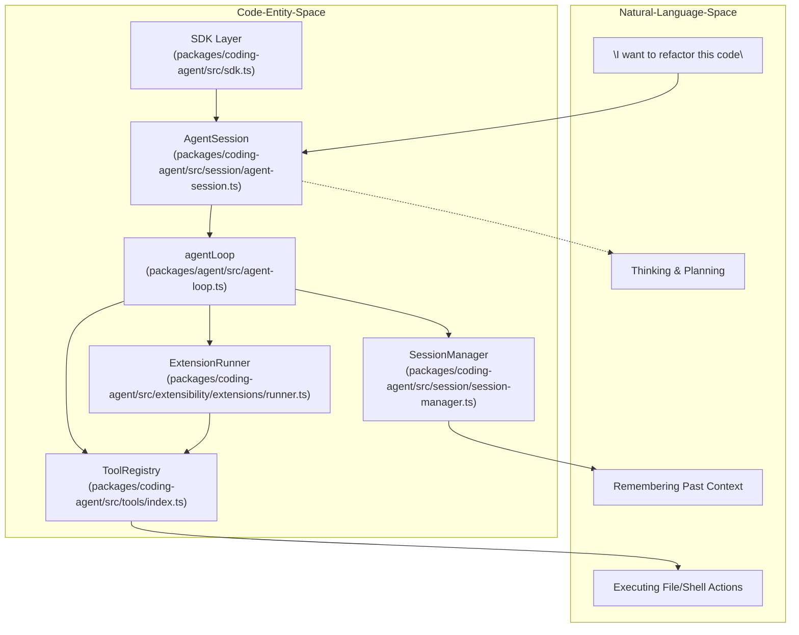

Sources: [packages/coding-agent/src/session/agent-session.ts:1-14](), [packages/coding-agent/src/sdk.ts:1-15](), [packages/coding-agent/src/tools/index.ts:1-40](), [packages/coding-agent/src/session/session-manager.ts:1-30]()

---

## AgentSession: Main Orchestrator

`AgentSession` is the core class encapsulating the lifecycle and state management of an interactive or programmatic agent session. It serves as the primary interface for all interaction with the agent, managing complexity such as persistence, model changes, and tool execution across run modes [packages/coding-agent/src/session/agent-session.ts:1-14]().

### Key Responsibilities

- **Agent State Access and Event Subscription:**  
  Holds a reference to the internal `Agent` instance, exposing access to mutable agent state (`AgentState`) and subscribing to `AgentEvent`s. Automatically persists relevant state changes via `SessionManager`.
- **Model and Thinking Level Management:**  
  Tracks the current AI model and thinking effort level, handling dynamic switching and capability alignment.
- **Context Compaction:**  
  Implements compaction strategies (snapshot compaction and branch summarization) using utilities like `calculatePromptTokens` [packages/coding-agent/src/session/agent-session.ts:49-56]().
- **Bash Command Execution:**  
  Provides session-scoped bash execution integration and output streaming [packages/coding-agent/src/session/agent-session.ts:10-14]().
- **Session Lifecycle Operations:**  
  Coordinates creation, switching, branching, and disposal of sessions with `SessionManager`.

Sources: [packages/coding-agent/src/session/agent-session.ts:1-173]()

---

## SDK Layer: Initialization Factory

The SDK layer (`src/sdk.ts`) acts as the centralized entry point for creating and configuring `AgentSession` instances. It wires internal dependencies including the Tool Registry, Extension Runner, SessionManager, model registries, and settings [packages/coding-agent/src/sdk.ts:1-130]().

### Initialization Flow

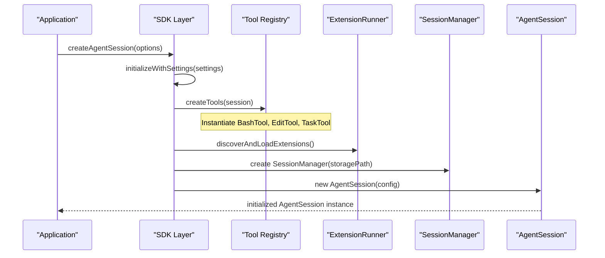

Sources: [packages/coding-agent/src/sdk.ts:1-130](), [packages/coding-agent/src/session/session-manager.ts:1-30]()

---

## Tool Registry and Coordination

The Tool Registry manages the catalog of tools executable by the agent during conversations, including built-in tools for filesystem access, shell execution, code edits, and task delegation [packages/coding-agent/src/tools/index.ts:1-80]().

### Natural Language to Code Entity Mapping: Tool Dispatch

```mermaid
graph LR
    subgraph "Natural-Language-Space"
        Exec["\"Run this shell command\""]
        Python["\"Run this python script\""]
        Edit["\"Apply this code change\""]
        Task["\"Delegate this task\""]
    end

    subgraph "Code-Entity-Space"
        BT["BashTool<br/>(packages/coding-agent/src/tools/bash.ts)"]
        ETL["EvalTool<br/>(packages/coding-agent/src/tools/eval.ts)"]
        ET["EditTool<br/>(packages/coding-agent/src/edit/index.ts)"]
        TT["TaskTool<br/>(packages/coding-agent/src/task/index.ts)"]
    end

    Exec --> BT
    Python --> ETL
    Edit --> ET
    Task --> TT
```

Sources: [packages/coding-agent/src/tools/index.ts:1-80](), [packages/coding-agent/src/task/index.ts:1-40]()

---

## Extension Runner and Hook System

The `ExtensionRunner` component manages runtime support for extensions augmenting agent execution lifecycle, handling discovery, loading, and invocation of extension modules and hooks [packages/coding-agent/src/sdk.ts:112-125]().

Sources: [packages/coding-agent/src/sdk.ts:112-125]()

---

## SessionManager: Persistence Layer

`SessionManager` is responsible for persistent recording and retrieval of all session entries, maintaining an append-only JSONL history of conversation turns, tool calls, compactions, and artifacts [packages/coding-agent/src/session/session-manager.ts:1-125]().

Sources: [packages/coding-agent/src/session/session-manager.ts:1-125]()

---

## Coordination Summary

| Phase            | Component           | Description                                                             |
|------------------|---------------------|-------------------------------------------------------------------------|
| Input Reception  | `AgentSession`      | Accepts input, manages session state and branching                       |
| Planning         | `agentLoop`         | Interacts with AI model to generate completions and tool calls          |
| Tool Dispatch    | `ToolRegistry`      | Executes tool calls like shell, eval, edits, and task delegation            |
| Extension Hooks  | `ExtensionRunner`   | Provides lifecycle hook points for runtime extension customization      |
| Persistence      | `SessionManager`    | Records all events and artifacts persistently to JSONL session storage  |
| Streaming Output | `AgentSession`      | Streams messages or results to TUI or RPC clients                        |

Sources: [packages/coding-agent/src/session/agent-session.ts:1-14](), [packages/coding-agent/src/sdk.ts:1-130](), [packages/coding-agent/src/session/session-manager.ts:1-125]()

---

# Page: Agent Loop (pi-agent package)

# Agent Loop (pi-agent package)

<details>
<summary>Relevant source files</summary>

The following files were used as context for generating this wiki page:

- [packages/agent/src/agent-loop.ts](packages/agent/src/agent-loop.ts)
- [packages/agent/src/agent.ts](packages/agent/src/agent.ts)
- [packages/agent/src/compaction/anthropic.ts](packages/agent/src/compaction/anthropic.ts)
- [packages/agent/src/compaction/compaction-v2-streaming.ts](packages/agent/src/compaction/compaction-v2-streaming.ts)
- [packages/agent/src/compaction/compaction.ts](packages/agent/src/compaction/compaction.ts)
- [packages/agent/src/compaction/openai.ts](packages/agent/src/compaction/openai.ts)
- [packages/agent/src/types.ts](packages/agent/src/types.ts)
- [packages/agent/test/agent-loop.test.ts](packages/agent/test/agent-loop.test.ts)
- [packages/agent/test/agent.test.ts](packages/agent/test/agent.test.ts)
- [packages/agent/test/anthropic-native-compaction.test.ts](packages/agent/test/anthropic-native-compaction.test.ts)
- [packages/agent/test/remote-compaction.test.ts](packages/agent/test/remote-compaction.test.ts)
- [packages/ai/test/anthropic-server-compaction.test.ts](packages/ai/test/anthropic-server-compaction.test.ts)
- [packages/coding-agent/src/session/session-context.ts](packages/coding-agent/src/session/session-context.ts)
- [packages/coding-agent/test/compaction.test.ts](packages/coding-agent/test/compaction.test.ts)
- [packages/coding-agent/test/session-manager/build-context.test.ts](packages/coding-agent/test/session-manager/build-context.test.ts)
- [packages/coding-agent/test/session/session-context.test.ts](packages/coding-agent/test/session/session-context.test.ts)

</details>


This page documents the transport-agnostic core agent loop implemented in the `packages/agent` package [packages/agent/src/agent-loop.ts:1-4](). It covers the main control flow for executing assistant turns, managing tool calls, execution plans, steering and interruption mechanisms, enforcement of replay policies, and entry points into the compaction subsystem [packages/agent/src/agent-loop.ts:1-112](). The agent loop represents the central processing engine of the agent, designed to run atop any streaming LLM provider, abstracting away transport and replay details.

Sources: `packages/agent/src/agent-loop.ts:1-4`, `packages/agent/src/agent.ts:1-40`

---

## Purpose and Scope

The agent loop in `packages/agent` is a reusable core execution engine orchestrating interaction between natural language model calls and external tool execution, enriched with advanced runtime features:

- **Transport-Agnostic:** Internally uses `AgentMessage` throughout and converts to `Message[]` only at each LLM call boundary [packages/agent/src/agent-loop.ts:1-4](), abstracting away transport or protocol specifics.
- **Execution Planning:** Manages sequential and conditional invocation of multiple tool calls embedded in assistant responses during a conversation turn.
- **Steering and Interruption:** Supports asynchronous injection of user- or system-driven steering messages via `LiveSteeringChannel` [packages/agent/src/agent-loop.ts:58](), with configurable interruption policies for running tool executions.
- **Replay Policy:** Implements robust filtering, escalation, and replay logic to maintain session consistency, avoid infinite spins, and deal gracefully with partial failures [packages/agent/src/agent.ts:75-80]().
- **Compaction Entry Points:** Hooks to the context compaction subsystem (`packages/agent/src/compaction/compaction.ts`) aid in session transcript maintenance, pruning, and summarization.

**Key source files:**

- `packages/agent/src/agent-loop.ts` — Core async generator function implementing `agentLoop()`, `agentLoopContinue()`, and related utilities.
- `packages/agent/src/agent.ts` — The `Agent` class abstraction offering a simpler, non-transport-abstracted API atop the loop.
- `packages/agent/src/types.ts` — Shared TypeScript types defining agent loop configuration (`AgentLoopConfig`), runtime state, and message shapes.
- `packages/agent/src/compaction/compaction.ts` — Context compaction modules exposing summary messages, file operations extraction, and interfaces for compaction integration.

Sources: `packages/agent/src/agent-loop.ts:1-112`, `packages/agent/src/agent.ts:1-70`, `packages/agent/src/types.ts:1-100`, `packages/agent/src/compaction/compaction.ts:1-60`

---

## Core Agent Loop Implementation

At the heart of the package is the async generator function `agentLoop()` [packages/agent/src/agent-loop.ts:90-105]():

```ts
// Example signature reference
async function* agentLoop(
  messages: AgentMessage[],
  context: AgentContext,
  config: AgentLoopConfig,
  signal?: AbortSignal,
  streamFn = streamSimple
): AsyncIterable<AgentEvent>
```

### Inputs and Data Flow

- **messages:** An array of `AgentMessage` representing the current conversation history including user, assistant, and tool result messages [packages/agent/src/agent-loop.ts:2-5]().
- **context:** An `AgentContext` providing system prompts, available tools, auxiliary state, and dialect configuration [packages/agent/src/agent-loop.ts:87-105]().
- **config:** An `AgentLoopConfig` containing model references, streaming options, message converters, telemetry hooks, API key resolvers, time deadlines, and behavior flags [packages/agent/src/agent-loop.ts:90-105]().
- **signal:** Optional abort signal for graceful cancellation [packages/agent/src/agent-loop.ts:100-112]().
- **streamFn:** Streaming function to perform LLM provider calls; defaults to `streamSimple` [packages/agent/src/agent-loop.ts:17]().

Internally, conversation state is maintained as `AgentMessage[]` [packages/agent/src/agent-loop.ts:1-4](). Before each model call, messages are mapped via `convertToLlm` (or the default implementation) into LLM-compatible `Message[]` [packages/agent/src/agent.ts:75-80](). Assistant responses stream token-by-token, emitting `AssistantMessageEvent` items [packages/agent/src/agent-loop.ts:6-7](). When tool calls are encountered, the loop executes them sequentially, updating session state with `ToolResultMessage` outputs [packages/agent/src/agent-loop.ts:21-25]().

### Important Constants and Utilities

| Constant / Function | Description | Sources |
|----------------|-------------|---------|
| `STREAM_INTERRUPTED_AFTER_CONTENT_STOP_DETAIL` | Marker for errors occurring after assistant content streaming completed | `[packages/agent/src/agent-loop.ts:114-115]()` |
| `ABORTED` (symbol) | Sentinel symbol representing aborted streaming | `[packages/agent/src/agent-loop.ts:117]()` |
| `MAX_PAUSED_TURN_CONTINUATIONS = 8` | Maximum consecutive re-samples on paused turns without tool calls | `[packages/agent/src/agent-loop.ts:125]()` |
| `MAX_DSML_LEAK_NUDGES = 2` | Caps forced corrections of raw DSML markup leak turns | `[packages/agent/src/agent-loop.ts:133]()` |
| `MAX_SOFT_TOOL_ESCALATIONS = 3` | Bounded forced tool choice escalations to avoid infinite loops | `[packages/agent/src/agent-loop.ts:141]()` |
| `hardToolChoiceBlocks(choice, requiredTool)` | Indicates whether a hard tool choice conflicts with a soft tool requirement | `[packages/agent/src/agent-loop.ts:149-155]()` |
| `createToolScopedAbortReason(message, toolCallMsgs, defaultMsg)` | Factory to create typed abort reasons scoped to individual tool calls | `[packages/agent/src/agent-loop.ts:175-181]()` |

Sources: `packages/agent/src/agent-loop.ts:114-181`

---

## The Agent Wrapper Class

The `Agent` class in `packages/agent/src/agent.ts` wraps the core loop for simpler usage without explicit transport abstraction [packages/agent/src/agent.ts:1-40]():

```ts
export class Agent {
  constructor(options?: AgentOptions);
  prompt(text: string | AgentMessage): Promise<AgentMessage[]>;
  steer(msg: AgentMessage | AgentMessage[]): void;
  followUp(messages?: AgentMessage[]): Promise<AgentMessage[]>;
  ...
}
```

### Features

- Maintains internal state: conversation messages, active tools, model configuration, and telemetry [packages/agent/src/agent.ts:50-70]().
- Dynamically resolves API keys per model call via `getApiKey` [packages/agent/src/agent.ts:183-184]().
- Supports `steeringMode` and `followUpMode` flags to control injection behavior of queued steering or follow-up messages [packages/agent/src/agent.ts:133-140]().
- Implements `interruptMode`:
  - `"immediate"` (default): interrupts running tool executions after each call [packages/agent/src/agent.ts:147]().
  - `"wait"`: defers steering interrupts until the entire tool batch completes [packages/agent/src/agent.ts:147]().
- Automatically manages replay of unpaired tool calls on continuation calls to `continue()` [packages/agent/src/agent.ts:155-190]().

Sources: `packages/agent/src/agent.ts:1-212`

---

## Execution Plans and Tool Call Scheduling

Assistant responses may embed multiple tool call blocks which the agent loop interprets as execution plans:

- After each assistant message completion, the loop inspects and collects all `toolCall` blocks [packages/agent/src/agent-loop.ts:1-25]().
- Tools are invoked sequentially in the order the calls appear.
- Each tool's `execute()` method receives the call ID and parsed validated arguments [packages/agent/test/agent-loop.test.ts:60-75]().
- Tools can be marked as interruptible or exclusive, affecting scheduling and concurrent execution [packages/agent/test/agent.test.ts:25-30]().
- If an interrupt occurs, remaining calls in the batch are skipped, producing synthetic skipped tool results with context-aware explanatory text [packages/agent/test/agent.test.ts:70-82]().

Sources: `packages/agent/src/agent-loop.ts:1-100`, `packages/agent/test/agent.test.ts:18-85`

---

## Steering and Interruption Mechanisms

Steering in the agent loop comprises asynchronously injected messages that influence agent behavior or provide real-time corrections [packages/agent/src/types.ts:155-162]().

### Steering Sources and Queue States

| Source | Description | Sources |
|--------|-------------|---------|
| User | Explicit user messages (role `"user"`) | `[packages/agent/src/types.ts:159]()` |
| Agent | Messages authored internally by the agent | `[packages/agent/src/types.ts:159]()` |
| System | Advisory or system-generated steering messages | `[packages/agent/src/types.ts:159]()` |

- **Interrupt Modes:** `immediate` checks for steering after each individual tool execution; `wait` defers the interrupt until the entire tool batch finishes [packages/agent/src/agent.ts:147]().
- **Interruption Effects:** Unexecuted sibling tool calls receive neutral synthetic error messages or skip notices via `createToolScopedAbortReason` [packages/agent/src/agent-loop.ts:167-181]().

Sources: `packages/agent/src/agent-loop.ts:167-181`, `packages/agent/src/types.ts:150-165`

---

## Replay Policy

The agent loop enforces a comprehensive replay policy to maintain session consistency and prevent infinite retries [packages/agent/src/agent.ts:75-80]():

- Filters irrelevant refusal or abort assistant messages before replaying via `defaultConvertToLlm` [packages/agent/src/agent.ts:75-80]().
- Soft tool requirements prevent infinite forced tool-call escalation via capped retries (`MAX_SOFT_TOOL_ESCALATIONS`) [packages/agent/src/agent-loop.ts:139-141]().
- Sanitizes transient internal provider state from messages (e.g., partial JSON tokens).
- Supports continuation via `agentLoopContinue()` which replays the last assistant's tool calls before the next model invocation [packages/agent/src/agent.ts:33]().

Sources: `packages/agent/src/agent.ts:75-80`, `packages/agent/src/agent-loop.ts:139-141`

---

## Compaction Subsystem Entry Points

The agent loop integrates closely with the compaction subsystem (`packages/agent/src/compaction/compaction.ts`) to maintain and prune long conversational histories:

- Monitors token consumption continuously to trigger compaction heuristics before contexts grow too large.
- Invokes compaction strategies (`compact()`, `prepareCompaction()`) to generate summary messages representing omitted content [packages/agent/src/compaction/compaction.ts:147-163]().
- Extracts file operation data from tool call metadata (`extractFileOperations`) to maintain tracking of read and modified files [packages/agent/src/compaction/compaction.ts:117-144]().
- Ensures encrypted reasoning tokens and native provider state metadata pass through compactions intact for fidelity.

Sources: `packages/agent/src/compaction/compaction.ts:1-180`, `packages/agent/test/remote-compaction.test.ts:1-40`

---

## Data Flow: Natural Language Space ↔ Code Entity Space

This diagram bridges natural language concepts with specific code entities within `packages/agent`:

### Title: "Agent Loop Execution and Code Entity Mapping"

```mermaid
flowchart TD
  NL["NaturalLanguageUserPrompt"] --> |"Submit"| UserMsg["createUserMessage (packages/agent/src/agent-loop.ts)"]
  UserMsg --> Loop["agentLoop (packages/agent/src/agent-loop.ts)"]
  Loop --> LLMCall["streamSimple (packages/ai)"]
  LLMCall --> AssistantMsg["AssistantMessage (packages/ai)"]

  AssistantMsg -->|Tool calls present| ToolSched["Tool Call Scheduler"]
  ToolSched --> ExecuteTool["AgentTool.execute (packages/agent/src/types.ts)"]

  ExecuteTool --> ToolResult["ToolResultMessage"]
  ToolResult --> StateUpdate["Agent Internal State Update"]
  StateUpdate --> |"Yield events"| AgentEventStream["AgentEvent Stream"]

  AgentEventStream --> SteeringCheck["LiveSteeringChannel (packages/agent/src/live-steering.ts)"]
  SteeringCheck --> Loop

  Loop --> ReplayPolicy["defaultConvertToLlm (packages/agent/src/agent.ts)"]
  ReplayPolicy --> LLMCall

  Loop -.->|Token threshold reached| Compaction["compact (packages/agent/src/compaction/compaction.ts)"]
  Compaction --> SummaryMsg["CompactionResult"]
```

Sources: `packages/agent/src/agent-loop.ts:1-100`, `packages/agent/src/agent.ts:75-80`, `packages/agent/src/compaction/compaction.ts:147-163`

---

## Detailed Lifecycle Inside `agentLoop`

The following sequence diagram illustrates turn execution and event emissions:

### Title: "Agent Turn Lifecycle Sequence"

```mermaid
sequenceDiagram
  participant User as "User"
  participant Loop as "agentLoop (agent-loop.ts)"
  participant LLM as "streamSimple (pi-ai)"
  participant Tools as "AgentTool"
  participant Events as "AgentEventStream"

  User->>Loop: "AgentMessage[] input"
  Loop->>Events: "agent_start"
  Loop->>Events: "turn_start"
  Loop->>LLM: "convertToLlm(messages)"
  LLM-->>Loop: "AssistantMessageEvent stream"
  Loop->>Events: "message_start / message_end"
  Loop->>Tools: "execute() for toolCall blocks"
  Tools-->>Loop: "AgentToolResult"
  Loop->>Events: "tool_execution_end"
  Loop->>Events: "turn_end"
  Loop->>User: "Yield final messages"
```

Sources: `packages/agent/src/agent-loop.ts:90-150`, `packages/agent/test/agent-loop.test.ts:80-112`

---

## Summary Table of Key Types

| Type Name | Description | Sources |
|-----------|-------------|---------|
| `AgentMessage` | Extended conversation message type with roles and metadata | `[packages/agent/src/types.ts:1-30]()` |
| `AgentLoopConfig` | Configuration options for agent loop execution | `[packages/agent/src/types.ts:31-70]()` |
| `AgentEvent` | Events emitted asynchronously during loop lifecycle | `[packages/agent/src/types.ts:80-110]()` |
| `SoftToolRequirement` | Soft-enforced tool call requirement with reminders and escalation logic | `[packages/agent/src/types.ts:114-135]()` |
| `ToolChoiceDirective` | Directive for forced or automatic tool choice or soft requirement | `[packages/agent/src/types.ts:141]()` |
| `ToolScopedAbortReason` | Typed reason for turn-wide aborts with tool call specific messages | `[packages/agent/src/agent-loop.ts:167-172]()` |
| `Agent` | Stateful agent abstraction class wrapping the agent loop | `[packages/agent/src/agent.ts:103-210]()` |
| `CompactionResult` | Output structure containing summary, tokens, and metadata from compaction | `[packages/agent/src/compaction/compaction.ts:147-163]()` |

Sources: `packages/agent/src/types.ts:1-160`, `packages/agent/src/compaction/compaction.ts:147-163`

---

## Conclusion

The agent loop in `packages/agent` provides the core orchestration layer for oh-my-pi. By decoupling internal `AgentMessage` representations from transport-specific payloads (`Message[]`), it supports resilient error handling, custom execution plans, dynamic tool scheduling, and seamless compaction integration.

Sources: `packages/agent/src/agent-loop.ts:1-5`, `packages/agent/src/agent.ts:1-10`

---

# Page: Agent Sessions

# Agent Sessions

<details>
<summary>Relevant source files</summary>

The following files were used as context for generating this wiki page:

- [docs/task-agent-discovery.md](docs/task-agent-discovery.md)
- [docs/tools/task.md](docs/tools/task.md)
- [packages/coding-agent/DEVELOPMENT.md](packages/coding-agent/DEVELOPMENT.md)
- [packages/coding-agent/src/cli/args.ts](packages/coding-agent/src/cli/args.ts)
- [packages/coding-agent/src/cli/extension-flags.ts](packages/coding-agent/src/cli/extension-flags.ts)
- [packages/coding-agent/src/cli/flag-tables.ts](packages/coding-agent/src/cli/flag-tables.ts)
- [packages/coding-agent/src/commands/launch.ts](packages/coding-agent/src/commands/launch.ts)
- [packages/coding-agent/src/main.ts](packages/coding-agent/src/main.ts)
- [packages/coding-agent/src/prompts/tools/task.md](packages/coding-agent/src/prompts/tools/task.md)
- [packages/coding-agent/src/sdk.ts](packages/coding-agent/src/sdk.ts)
- [packages/coding-agent/src/session/agent-session.ts](packages/coding-agent/src/session/agent-session.ts)
- [packages/coding-agent/src/session/session-entries.ts](packages/coding-agent/src/session/session-entries.ts)
- [packages/coding-agent/src/session/session-manager.ts](packages/coding-agent/src/session/session-manager.ts)
- [packages/coding-agent/src/task/executor.ts](packages/coding-agent/src/task/executor.ts)
- [packages/coding-agent/src/task/index.ts](packages/coding-agent/src/task/index.ts)
- [packages/coding-agent/src/task/persisted-revive.ts](packages/coding-agent/src/task/persisted-revive.ts)
- [packages/coding-agent/src/task/structured-subagent.ts](packages/coding-agent/src/task/structured-subagent.ts)
- [packages/coding-agent/src/task/types.ts](packages/coding-agent/src/task/types.ts)
- [packages/coding-agent/src/tools/index.ts](packages/coding-agent/src/tools/index.ts)
- [packages/coding-agent/test/acp-mcp-isolation.test.ts](packages/coding-agent/test/acp-mcp-isolation.test.ts)
- [packages/coding-agent/test/acp-session-effects.test.ts](packages/coding-agent/test/acp-session-effects.test.ts)
- [packages/coding-agent/test/agent-session-prompt-dispatch-race.test.ts](packages/coding-agent/test/agent-session-prompt-dispatch-race.test.ts)
- [packages/coding-agent/test/cli-explicit-extension-isolation.test.ts](packages/coding-agent/test/cli-explicit-extension-isolation.test.ts)
- [packages/coding-agent/test/cli-unknown-flag.test.ts](packages/coding-agent/test/cli-unknown-flag.test.ts)
- [packages/coding-agent/test/extension-flag-dispatch.test.ts](packages/coding-agent/test/extension-flag-dispatch.test.ts)
- [packages/coding-agent/test/extension-flag-initial-message.test.ts](packages/coding-agent/test/extension-flag-initial-message.test.ts)
- [packages/coding-agent/test/flag-tables.test.ts](packages/coding-agent/test/flag-tables.test.ts)
- [packages/coding-agent/test/initial-message.test.ts](packages/coding-agent/test/initial-message.test.ts)
- [packages/coding-agent/test/main-session-resolution-error.test.ts](packages/coding-agent/test/main-session-resolution-error.test.ts)
- [packages/coding-agent/test/sdk-workpool-yield-schema.test.ts](packages/coding-agent/test/sdk-workpool-yield-schema.test.ts)
- [packages/coding-agent/test/session-manager/move-to.test.ts](packages/coding-agent/test/session-manager/move-to.test.ts)
- [packages/coding-agent/test/session-manager/title-source-persistence.test.ts](packages/coding-agent/test/session-manager/title-source-persistence.test.ts)
- [packages/coding-agent/test/task/autoload-skills.test.ts](packages/coding-agent/test/task/autoload-skills.test.ts)
- [packages/coding-agent/test/task/executor-async-quiescence.test.ts](packages/coding-agent/test/task/executor-async-quiescence.test.ts)
- [packages/coding-agent/test/task/executor-launch-startup.test.ts](packages/coding-agent/test/task/executor-launch-startup.test.ts)
- [packages/coding-agent/test/task/executor-pass-through.test.ts](packages/coding-agent/test/task/executor-pass-through.test.ts)
- [packages/coding-agent/test/task/executor-prewalk.test.ts](packages/coding-agent/test/task/executor-prewalk.test.ts)
- [packages/coding-agent/test/task/executor-recent-output.test.ts](packages/coding-agent/test/task/executor-recent-output.test.ts)
- [packages/coding-agent/test/task/executor-soft-budget.test.ts](packages/coding-agent/test/task/executor-soft-budget.test.ts)
- [packages/coding-agent/test/task/executor-subagent-reminders.test.ts](packages/coding-agent/test/task/executor-subagent-reminders.test.ts)
- [packages/coding-agent/test/task/executor-wall-clock.test.ts](packages/coding-agent/test/task/executor-wall-clock.test.ts)
- [packages/coding-agent/test/task/executor-yield-loop.test.ts](packages/coding-agent/test/task/executor-yield-loop.test.ts)
- [packages/coding-agent/test/task/persisted-revive.test.ts](packages/coding-agent/test/task/persisted-revive.test.ts)
- [packages/coding-agent/test/task/structured-subagent.test.ts](packages/coding-agent/test/task/structured-subagent.test.ts)
- [packages/coding-agent/test/task/subagent-lsp.test.ts](packages/coding-agent/test/task/subagent-lsp.test.ts)
- [packages/coding-agent/test/task/task-batch.test.ts](packages/coding-agent/test/task/task-batch.test.ts)
- [packages/coding-agent/test/task/task-guards.test.ts](packages/coding-agent/test/task/task-guards.test.ts)
- [packages/coding-agent/test/task/task-schema.test.ts](packages/coding-agent/test/task/task-schema.test.ts)
- [packages/coding-agent/test/task/wire-schema.test.ts](packages/coding-agent/test/task/wire-schema.test.ts)
- [packages/coding-agent/test/tools/index.test.ts](packages/coding-agent/test/tools/index.test.ts)
- [packages/coding-agent/test/tools/schema-validation.test.ts](packages/coding-agent/test/tools/schema-validation.test.ts)

</details>


Agent sessions are the core state management abstraction in `oh-my-pi`, encapsulating the full lifecycle of an AI agent interaction [packages/coding-agent/src/session/session-manager.ts](). A session tracks conversation history, manages context windows, handles persistence, and coordinates between the AI model, tool execution, and user interface.

This page provides a high-level overview of agent sessions and their architecture. For detailed information on specific aspects:

- **Session Lifecycle**: Creation, resumption, continuation, branching, and forking. See [Session Lifecycle](#3.1).
- **Session Persistence**: JSONL-based storage format, artifact management, real-time saving, crash recovery, blob store, and session export. See [Session Persistence](#3.2).
- **Context Management and Compaction**: Token threshold monitoring, auto-compaction strategies, remote compaction, context promotion, and overflow recovery. See [Context Management and Compaction](#3.3).
- **System Prompts**: Construction pipeline, context files (`AGENTS.md`, `SYSTEM.md`), skill discovery, rule loading, and templates. See [System Prompts](#3.4).
- **Retry, Fallback and Turn Recovery**: Retryable error classification, backoff, fallback chains, usage-based routing, and replay safety. See [Retry, Fallback and Turn Recovery](#3.5).
- **Advisors and Autonomous Guidance**: `AdvisorRuntime`, session advisors, watchdogs, advise tool, transcript recorder, and emission guards. See [Advisors and Autonomous Guidance](#3.6).
- **Handoff and Message Pipeline**: Session handoff generation, session messages module, steering/interjection prompts, and message normalization. See [Handoff and Message Pipeline](#3.7).

---

## Core Concepts

An agent session represents a stateful conversation between a user and an AI agent, backed by durable storage and process-wide coordination registries. Each session maintains:

- **Conversation History and State**: Managed via structured message trees, supporting branching, alternative deliberations, and preservation of decision points [packages/coding-agent/src/session/session-entries.ts:1-190]().
- **Process-Global Registries**: Live sessions and subagents are tracked via `AgentRegistry` and managed across idle, parked, and active states by `AgentLifecycleManager` [packages/coding-agent/src/registry/agent-registry.ts:1-176](), [packages/coding-agent/src/registry/agent-lifecycle.ts:1-169]().
- **Inter-Agent Messaging**: Process-global communication is handled through `IrcBus`, delivering messages to live recipients or waking parked subagents [packages/coding-agent/src/irc/bus.ts:1-171]().
- **Persistence & Artifacts**: All events are appended to JSONL journals by `SessionManager`, accompanied by blob storage and binary artifact directories [packages/coding-agent/src/session/session-manager.ts:1-210]().

---

## Natural Language Space to Code Entity Space

### Diagram 1: Session Core and Persistence Mapping

This diagram bridges natural language session concepts to their concrete code entities in the `oh-my-pi` codebase.

```mermaid
graph TB
    subgraph "Natural Language Space"
        NL1["Conversation History & Tree Branching"]
        NL2["Token Monitoring & Context Management"]
        NL3["Session Persistence & Artifact Logging"]
    end

    subgraph "Code Entity Space"
        CE1["AgentSession\n(packages/coding-agent/src/session/agent-session.ts)"]
        CE2["SessionManager\n(packages/coding-agent/src/session/session-manager.ts)"]
        CE3["ArtifactManager\n(packages/coding-agent/src/session/artifacts.ts)"]
        CE4["BlobStore\n(packages/coding-agent/src/session/blob-store.ts)"]
    end

    NL1 --> CE1
    NL2 --> CE1
    NL3 --> CE2
    CE2 --> CE3
    CE2 --> CE4
```

Sources: packages/coding-agent/src/session/session-manager.ts:1-210; packages/coding-agent/src/session/session-entries.ts:1-190

---

### Diagram 2: Subagent Lifecycle and Inter-Agent Routing

This diagram maps multi-agent concepts and coordination to runtime registry and bus components.

```mermaid
graph TB
    subgraph "Natural Language Space"
        AG1["Active Task Subagent"]
        AG2["Parked / Idle Subagent Lifecycle"]
        AG3["Inter-Agent Peer Messaging (IRC)"]
    end

    subgraph "Code Entity Space"
        R1["AgentRegistry\n(packages/coding-agent/src/registry/agent-registry.ts)"]
        R2["AgentLifecycleManager\n(packages/coding-agent/src/registry/agent-lifecycle.ts)"]
        R3["IrcBus\n(packages/coding-agent/src/irc/bus.ts)"]
    end

    AG1 --> R1
    AG2 --> R2
    AG3 --> R3
    R2 --> R1
    R3 --> R1
    R3 --> R2
```

Sources: packages/coding-agent/src/registry/agent-registry.ts:1-176; packages/coding-agent/src/registry/agent-lifecycle.ts:1-169; packages/coding-agent/src/irc/bus.ts:1-171

---

## Session Entry Types

Data inside sessions is stored as append-only structured entries (`SessionEntry`), representing discrete state transitions or historical records [packages/coding-agent/src/session/session-entries.ts:73-190]().

| Entry Type | Interface Name | Description |
| :--- | :--- | :--- |
| **Session Header** | `SessionHeader` | Metadata header containing session ID, cwd, version, and prompt cache keys [packages/coding-agent/src/session/session-entries.ts:37-58]() |
| **Message Entry** | `SessionMessageEntry` | Wraps user, assistant, or tool result messages [packages/coding-agent/src/session/session-entries.ts:80-84]() |
| **Compaction Entry** | `CompactionEntry` | Stores summarized token compaction blocks and metadata [packages/coding-agent/src/session/session-entries.ts:127-151]() |
| **Model Change Entry** | `ModelChangeEntry` | Records active model switches and fallback states [packages/coding-agent/src/session/session-entries.ts:112-120]() |
| **Custom Entry** | `CustomEntry` | Extension-specific state persistence across reloads [packages/coding-agent/src/session/session-entries.ts:185-190]() |

Sources: packages/coding-agent/src/session/session-entries.ts:37-190

---

## Summary of Child Pages

For comprehensive implementation details, consult the child pages:

- **3.1 Session Lifecycle**: Document session creation, resumption, continuation, branching, and forking.
- **3.2 Session Persistence**: Explain JSONL-based session storage, artifacts, real-time saving, crash recovery, blob store, and session export.
- **3.3 Context Management and Compaction**: Describe token threshold monitoring, auto-compaction strategies, remote compaction, context promotion, and overflow recovery.
- **3.4 System Prompts**: Explain system prompt construction, context files, skill discovery, rule loading, templates, and customization.
- **3.5 Retry, Fallback and Turn Recovery**: Document TurnRecovery, retryable error classification, backoff, fallback chains, and replay safety.
- **3.6 Advisors and Autonomous Guidance**: Explain `AdvisorRuntime`, session advisors, watchdogs, advise tool, transcript recorder, and emission guards.
- **3.7 Handoff and Message Pipeline**: Document session handoff generation, session messages module, steering/interjection prompts, and message normalization.

Sources: packages/coding-agent/src/session/session-manager.ts:1-210; packages/coding-agent/src/registry/agent-registry.ts:1-176

---

# Page: Session Lifecycle

# Session Lifecycle

<details>
<summary>Relevant source files</summary>

The following files were used as context for generating this wiki page:

- [docs/session.md](docs/session.md)
- [packages/coding-agent/src/cli/args.ts](packages/coding-agent/src/cli/args.ts)
- [packages/coding-agent/src/cli/extension-flags.ts](packages/coding-agent/src/cli/extension-flags.ts)
- [packages/coding-agent/src/cli/flag-tables.ts](packages/coding-agent/src/cli/flag-tables.ts)
- [packages/coding-agent/src/cli/gc-cli.ts](packages/coding-agent/src/cli/gc-cli.ts)
- [packages/coding-agent/src/cli/gc-compress.ts](packages/coding-agent/src/cli/gc-compress.ts)
- [packages/coding-agent/src/cli/gc-settings.ts](packages/coding-agent/src/cli/gc-settings.ts)
- [packages/coding-agent/src/commands/gc.ts](packages/coding-agent/src/commands/gc.ts)
- [packages/coding-agent/src/commands/launch.ts](packages/coding-agent/src/commands/launch.ts)
- [packages/coding-agent/src/main.ts](packages/coding-agent/src/main.ts)
- [packages/coding-agent/src/session/indexed-session-storage.ts](packages/coding-agent/src/session/indexed-session-storage.ts)
- [packages/coding-agent/src/session/session-listing.ts](packages/coding-agent/src/session/session-listing.ts)
- [packages/coding-agent/src/session/session-manager.ts](packages/coding-agent/src/session/session-manager.ts)
- [packages/coding-agent/src/session/session-storage.ts](packages/coding-agent/src/session/session-storage.ts)
- [packages/coding-agent/test/acp-mcp-isolation.test.ts](packages/coding-agent/test/acp-mcp-isolation.test.ts)
- [packages/coding-agent/test/acp-session-effects.test.ts](packages/coding-agent/test/acp-session-effects.test.ts)
- [packages/coding-agent/test/cli-explicit-extension-isolation.test.ts](packages/coding-agent/test/cli-explicit-extension-isolation.test.ts)
- [packages/coding-agent/test/cli-unknown-flag.test.ts](packages/coding-agent/test/cli-unknown-flag.test.ts)
- [packages/coding-agent/test/extension-flag-dispatch.test.ts](packages/coding-agent/test/extension-flag-dispatch.test.ts)
- [packages/coding-agent/test/extension-flag-initial-message.test.ts](packages/coding-agent/test/extension-flag-initial-message.test.ts)
- [packages/coding-agent/test/flag-tables.test.ts](packages/coding-agent/test/flag-tables.test.ts)
- [packages/coding-agent/test/gc-cli.test.ts](packages/coding-agent/test/gc-cli.test.ts)
- [packages/coding-agent/test/initial-message.test.ts](packages/coding-agent/test/initial-message.test.ts)
- [packages/coding-agent/test/main-session-resolution-error.test.ts](packages/coding-agent/test/main-session-resolution-error.test.ts)
- [packages/coding-agent/test/session-manager-atomic-rewrite-race.test.ts](packages/coding-agent/test/session-manager-atomic-rewrite-race.test.ts)
- [packages/coding-agent/test/session-manager/move-to.test.ts](packages/coding-agent/test/session-manager/move-to.test.ts)
- [packages/coding-agent/test/session-manager/title-source-persistence.test.ts](packages/coding-agent/test/session-manager/title-source-persistence.test.ts)
- [packages/coding-agent/test/session-storage.test.ts](packages/coding-agent/test/session-storage.test.ts)
- [packages/coding-agent/test/session/publish-lock-os-gate.test.ts](packages/coding-agent/test/session/publish-lock-os-gate.test.ts)
- [packages/coding-agent/test/session/session-status.test.ts](packages/coding-agent/test/session/session-status.test.ts)
- [packages/stats/src/embedded-client.ts](packages/stats/src/embedded-client.ts)
- [packages/stats/src/live.ts](packages/stats/src/live.ts)
- [packages/stats/src/rollup.ts](packages/stats/src/rollup.ts)
- [packages/stats/test/live-external-writes.test.ts](packages/stats/test/live-external-writes.test.ts)

</details>


## Purpose and Scope

This page documents the lifecycle operations for agent sessions in `oh-my-pi`, including creation, resumption, continuation, branching, forking, and interactive switching. It explains how sessions are initialized, located on disk or in memory, transitioned, and managed during runtime through the core classes `AgentSession` and `SessionManager`.

For complementary details on session file persistence, see [Session Persistence (3.2)](). For context token management and compaction strategies, see [Context Management and Compaction (3.3)]().

Sources:  
[packages/coding-agent/src/session/session-manager.ts:1-200](),  
[packages/coding-agent/src/main.ts:100-125]()

---

## Session Operations Overview

The `oh-my-pi` agent supports multiple session lifecycle operations, orchestrated mainly by `SessionManager` and `AgentSession`. Each serves specific user workflows:

| Operation      | Description                                  | CLI Flag / Command     | Key Code Entity                                    |
|----------------|----------------------------------------------|-----------------------|---------------------------------------------------|
| **Create**     | Start a brand-new empty session              | (default)             | `SessionManager.create()`<br>[packages/coding-agent/src/session/session-manager.ts:285-300]()             |
| **Open**       | Load an existing session by path or ID      | `--resume <id|path>`  | `SessionManager.open()`<br>[packages/coding-agent/src/session/session-manager.ts:316-335]()               |
| **Continue**   | Resume most recent session automatically     | `--continue` / `-c`   | `findMostRecentSession()`<br>[packages/coding-agent/src/session/session-listing.ts:60-90]()               |
| **Branch**     | Create a new conversation branch from a message | `/branch` slash command | `AgentSession.branch()`<br>[packages/coding-agent/src/session/session-manager.ts:1-50]()                 |
| **Fork**       | Duplicate a full session file to a new location | (automatic or `/fork`) | `SessionManager.forkFrom()`<br>[packages/coding-agent/src/session/session-manager.ts:340-362]()           |
| **In-Memory**  | Ephemeral session with no persistence       | `--no-session`        | `SessionManager.inMemory()`<br>[packages/coding-agent/src/session/session-manager.ts:275-280]()           |

Sources:  
[packages/coding-agent/src/session/session-manager.ts:275-362](),  
[packages/coding-agent/src/session/session-listing.ts:60-90]()

---

## Session Resolution Flow

The CLI entrypoint (`[packages/coding-agent/src/main.ts]`) parses arguments via `parseArgs` in `[packages/coding-agent/src/cli/args.ts]()` and invokes session resolution mechanisms.

Title: "Session Resolution Flow (Natural Language to Code Space)"
```mermaid
flowchart TD
    CLI["parseArgs() [packages/coding-agent/src/cli/args.ts]"] --> Resolver["resolveResumableSession() [packages/coding-agent/src/session/session-listing.ts]"]
    Resolver --> NoSession{"args.noSession"}
    NoSession -->|Yes| Mem["SessionManager.inMemory() [packages/coding-agent/src/session/session-manager.ts]"]
    NoSession -->|No| Resume{"args.resume"}
    Resume -->|String ID/Path| Open["SessionManager.open() [packages/coding-agent/src/session/session-manager.ts]"]
    Resume -->|True/Flag| Selector["SelectorController.showSessionSelector()"]
    Resume -->|Undefined| Continue{"args.continue"}
    Continue -->|Yes| Recent["findMostRecentSession() [packages/coding-agent/src/session/session-listing.ts]"]
    Continue -->|No| Create["SessionManager.create() [packages/coding-agent/src/session/session-manager.ts]"]
```

Sources:  
[packages/coding-agent/src/main.ts:100-125](),  
[packages/coding-agent/src/cli/args.ts:26-121](),  
[packages/coding-agent/src/session/session-manager.ts:275-362](),  
[packages/coding-agent/src/session/session-listing.ts:60-90]()

---

## Session Storage Locations

Sessions are stored persistently using `FileSessionStorage` or volatilized via `MemorySessionStorage`:

```mermaid
graph TB
    subgraph "Global Storage"
        GDIR["getSessionsDir() -> ~/.omp/agent/sessions/"]
        GSESSIONS["*.jsonl session files"]
        GDIR --> GSESSIONS
    end
    
    subgraph "Project Storage"
        PDIR["getProjectDir() -> ./.omp/sessions/"]
        PSESSIONS["*.jsonl session files"]
        PDIR --> PSESSIONS
    end
    
    subgraph "In-Memory Storage"
        IMS["SessionManager.inMemory()"]
        MEMSTORE["MemorySessionStorage"]
        IMS --> MEMSTORE
    end
```

Sources:  
[packages/coding-agent/src/session/session-manager.ts:1-20](),  
[packages/coding-agent/src/session/session-storage.ts:114-118]()

---

## Session Creation and Headers

New session files are initialized by writing a JSONL-based header entry (`SessionHeader`) with essential metadata.

Title: "Session Creation Data Flow"
```mermaid
flowchart LR
    Create["SessionManager.create()"] --> Mint["mintSessionId() [packages/coding-agent/src/session/session-manager.ts]"]
    Mint --> Storage["FileSessionStorage.openWriter() [packages/coding-agent/src/session/session-storage.ts]"]
    Storage --> Header["Write SessionHeader Entry"]
    Header --> Instance["Return SessionManager"]
```

- `mintSessionId()` allocates a unique ID via `Bun.randomUUIDv7()` [packages/coding-agent/src/session/session-manager.ts:139-141]().
- The header entry defines the protocol version (`CURRENT_SESSION_VERSION`), session ID, working directory (`cwd`), and metadata [docs/session.md:73-87]().

Sources:  
[packages/coding-agent/src/session/session-manager.ts:139-141](),  
[packages/coding-agent/src/session/session-storage.ts:114-118](),  
[docs/session.md:73-87]()

---

## Branching and Forking

- **Branching**: Managed via `AgentSession.branch()` [packages/coding-agent/src/session/agent-session.ts:386-438](), writing a `branch_summary` entry representing a semantic fork point without full file duplication.
- **Forking**: `SessionManager.forkFrom()` duplicates the underlying `.jsonl` session file and its corresponding artifact directory via `copySessionArtifacts()` [packages/coding-agent/src/session/session-manager.ts:173-205,340-362]().

Title: "Branching and Forking Code Architecture"
```mermaid
flowchart TD
    Session["AgentSession / SessionManager"] -->|branch()| BranchEntry["Write branch_summary entry"]
    Session -->|forkFrom()| CopyFile["Duplicate JSONl Session File"]
    CopyFile --> CopyArt["copySessionArtifacts() [packages/coding-agent/src/session/session-manager.ts]"]
```

Sources:  
[packages/coding-agent/src/session/session-manager.ts:173-205,340-362]()

---

## Runtime State Transitions

At runtime, `AgentSession` manages an active state machine driven by streaming LLM events and tool executions.

Title: "AgentSession Runtime State Machine"
```mermaid
stateDiagram-v2
    [*] --> Idle
    Idle --> Streaming: prompt() called
    Streaming --> ToolExecuting: tool_execution_start
    ToolExecuting --> Streaming: tool_execution_end
    Streaming --> Idle: message_end
    Idle --> Compacting: prepareCompaction()
    Compacting --> Idle: compact()
    Streaming --> Aborting: abort() invoked
    Aborting --> Idle: interrupted
```

Sources:  
[packages/coding-agent/src/session/session-manager.ts:1-50]()

---

# End of Session Lifecycle (3.1)

---

# Page: Session Persistence

# Session Persistence

<details>
<summary>Relevant source files</summary>

The following files were used as context for generating this wiki page:

- [docs/secrets.md](docs/secrets.md)
- [docs/session.md](docs/session.md)
- [packages/agent/test/normalize-tools-prune.test.ts](packages/agent/test/normalize-tools-prune.test.ts)
- [packages/coding-agent/bench/secrets-history.bench.ts](packages/coding-agent/bench/secrets-history.bench.ts)
- [packages/coding-agent/src/cli/gc-cli.ts](packages/coding-agent/src/cli/gc-cli.ts)
- [packages/coding-agent/src/cli/gc-compress.ts](packages/coding-agent/src/cli/gc-compress.ts)
- [packages/coding-agent/src/cli/gc-settings.ts](packages/coding-agent/src/cli/gc-settings.ts)
- [packages/coding-agent/src/commands/gc.ts](packages/coding-agent/src/commands/gc.ts)
- [packages/coding-agent/src/compress/protocol.ts](packages/coding-agent/src/compress/protocol.ts)
- [packages/coding-agent/src/compress/session.ts](packages/coding-agent/src/compress/session.ts)
- [packages/coding-agent/src/export/share.ts](packages/coding-agent/src/export/share.ts)
- [packages/coding-agent/src/prompts/tools/yield-data-error-conflict.md](packages/coding-agent/src/prompts/tools/yield-data-error-conflict.md)
- [packages/coding-agent/src/secrets/index.ts](packages/coding-agent/src/secrets/index.ts)
- [packages/coding-agent/src/secrets/message-transform.ts](packages/coding-agent/src/secrets/message-transform.ts)
- [packages/coding-agent/src/secrets/obfuscator.ts](packages/coding-agent/src/secrets/obfuscator.ts)
- [packages/coding-agent/src/secrets/patterns.ts](packages/coding-agent/src/secrets/patterns.ts)
- [packages/coding-agent/src/secrets/placeholder-scan.ts](packages/coding-agent/src/secrets/placeholder-scan.ts)
- [packages/coding-agent/src/secrets/placeholder.ts](packages/coding-agent/src/secrets/placeholder.ts)
- [packages/coding-agent/src/secrets/registry-revision.ts](packages/coding-agent/src/secrets/registry-revision.ts)
- [packages/coding-agent/src/session/blob-store.ts](packages/coding-agent/src/session/blob-store.ts)
- [packages/coding-agent/src/session/indexed-session-storage.ts](packages/coding-agent/src/session/indexed-session-storage.ts)
- [packages/coding-agent/src/session/session-listing.ts](packages/coding-agent/src/session/session-listing.ts)
- [packages/coding-agent/src/session/session-loader.ts](packages/coding-agent/src/session/session-loader.ts)
- [packages/coding-agent/src/session/session-persistence.ts](packages/coding-agent/src/session/session-persistence.ts)
- [packages/coding-agent/src/session/session-storage-errors.ts](packages/coding-agent/src/session/session-storage-errors.ts)
- [packages/coding-agent/src/session/session-storage.ts](packages/coding-agent/src/session/session-storage.ts)
- [packages/coding-agent/src/task/yield-assembly.ts](packages/coding-agent/src/task/yield-assembly.ts)
- [packages/coding-agent/src/tools/output-schema-validator.ts](packages/coding-agent/src/tools/output-schema-validator.ts)
- [packages/coding-agent/src/tools/yield.ts](packages/coding-agent/src/tools/yield.ts)
- [packages/coding-agent/test/agent-session-openai-responses-replay.test.ts](packages/coding-agent/test/agent-session-openai-responses-replay.test.ts)
- [packages/coding-agent/test/gc-cli.test.ts](packages/coding-agent/test/gc-cli.test.ts)
- [packages/coding-agent/test/sdk-session-isolation.test.ts](packages/coding-agent/test/sdk-session-isolation.test.ts)
- [packages/coding-agent/test/secrets-fast-paths.test.ts](packages/coding-agent/test/secrets-fast-paths.test.ts)
- [packages/coding-agent/test/secrets-obfuscator.test.ts](packages/coding-agent/test/secrets-obfuscator.test.ts)
- [packages/coding-agent/test/secrets-prefilter.test.ts](packages/coding-agent/test/secrets-prefilter.test.ts)
- [packages/coding-agent/test/session-loader-stream.test.ts](packages/coding-agent/test/session-loader-stream.test.ts)
- [packages/coding-agent/test/session-manager-atomic-rewrite-race.test.ts](packages/coding-agent/test/session-manager-atomic-rewrite-race.test.ts)
- [packages/coding-agent/test/session-manager/signature-persistence.test.ts](packages/coding-agent/test/session-manager/signature-persistence.test.ts)
- [packages/coding-agent/test/session-manager/snapcompact-archive-persistence.test.ts](packages/coding-agent/test/session-manager/snapcompact-archive-persistence.test.ts)
- [packages/coding-agent/test/session-persistence-images.test.ts](packages/coding-agent/test/session-persistence-images.test.ts)
- [packages/coding-agent/test/session-persistence-reasoning-dedup.test.ts](packages/coding-agent/test/session-persistence-reasoning-dedup.test.ts)
- [packages/coding-agent/test/session-read-only-hydration.test.ts](packages/coding-agent/test/session-read-only-hydration.test.ts)
- [packages/coding-agent/test/session-storage.test.ts](packages/coding-agent/test/session-storage.test.ts)
- [packages/coding-agent/test/session/blob-store.test.ts](packages/coding-agent/test/session/blob-store.test.ts)
- [packages/coding-agent/test/session/peek-session-init.test.ts](packages/coding-agent/test/session/peek-session-init.test.ts)
- [packages/coding-agent/test/session/publish-lock-os-gate.test.ts](packages/coding-agent/test/session/publish-lock-os-gate.test.ts)
- [packages/coding-agent/test/session/session-loader-enotdir.test.ts](packages/coding-agent/test/session/session-loader-enotdir.test.ts)
- [packages/coding-agent/test/session/session-status.test.ts](packages/coding-agent/test/session/session-status.test.ts)
- [packages/coding-agent/test/share.test.ts](packages/coding-agent/test/share.test.ts)
- [packages/coding-agent/test/task/executor-deferred-cleanup.test.ts](packages/coding-agent/test/task/executor-deferred-cleanup.test.ts)
- [packages/coding-agent/test/task/executor-structured-sidecar.test.ts](packages/coding-agent/test/task/executor-structured-sidecar.test.ts)
- [packages/coding-agent/test/task/executor-warnings.test.ts](packages/coding-agent/test/task/executor-warnings.test.ts)
- [packages/coding-agent/test/tools/browser-schema.test.ts](packages/coding-agent/test/tools/browser-schema.test.ts)
- [packages/coding-agent/test/tools/grep-snapshot-tags.test.ts](packages/coding-agent/test/tools/grep-snapshot-tags.test.ts)
- [packages/coding-agent/test/tools/output-schema-validator.test.ts](packages/coding-agent/test/tools/output-schema-validator.test.ts)
- [packages/coding-agent/test/tools/provider-schema-compatibility.test.ts](packages/coding-agent/test/tools/provider-schema-compatibility.test.ts)
- [packages/coding-agent/test/tools/yield.test.ts](packages/coding-agent/test/tools/yield.test.ts)
- [packages/stats/src/embedded-client.ts](packages/stats/src/embedded-client.ts)
- [packages/stats/src/live.ts](packages/stats/src/live.ts)
- [packages/stats/src/rollup.ts](packages/stats/src/rollup.ts)
- [packages/stats/test/live-external-writes.test.ts](packages/stats/test/live-external-writes.test.ts)
- [packages/tui/src/tools/task-yield-assembly.ts](packages/tui/src/tools/task-yield-assembly.ts)

</details>


## Purpose and Scope

Session persistence in *oh-my-pi* provides a robust, durable system for saving, restoring, and managing conversation history, assistant turns, and metadata for the AI-powered coding agent. The persistence subsystem records all interactions—including user and assistant messages, model changes, branching points, tool outputs, and execution states—enabling live sessions to be resumed, explored, branched, or exported reliably.

The core storage format is an append-only newline-delimited JSON (JSONL) log, augmented by a content-addressed blob store for large binaries and auxiliary SQLite metadata bases. This infrastructure supports real-time saving, crash recovery, secret obfuscation, and garbage collection.

This page covers:
- JSONL session storage format, header structure, and versioning
- Entry taxonomy and conversation tree semantics (`id`, `parentId`)
- Real-time persistence and crash recovery guarantees via `FileSessionStorage`
- Content-addressed blob store externalization (`BlobStore`)
- Secret obfuscation and safety pipelines (`SecretObfuscator`)
- Maintenance and garbage collection via `runGcCommand`

---

## Storage Architecture and File Layout

Sessions and their auxiliary state are organized on disk under the agent directory structure (`~/.omp/agent/` by default). The persistence subsystem coordinates between high-level orchestration classes and low-level file storage handlers.

```mermaid
graph TB
    subgraph NaturalLanguageSpace["Natural Language Space (Disk)"]
        DirSessions["~/.omp/agent/sessions/"]
        DirBlobs["~/.omp/agent/blobs/"]
        DirTerminal["~/.omp/agent/terminal-sessions/"]
        SessionFile["session.jsonl"]
        BlobFile["sha256_hash"]
        Breadcrumb["terminal_id_breadcrumb"]
    end

    subgraph CodeEntitySpace["Code Entity Space"]
        SessionManager["SessionManager<br/>(src/session/session-manager.ts)"]
        FileSessionStorage["FileSessionStorage<br/>(src/session/session-storage.ts)"]
        BlobStore["BlobStore<br/>(src/session/blob-store.ts)"]
        GcCli["runGcCommand<br/>(src/cli/gc-cli.ts)"]
    end

    SessionManager --> FileSessionStorage
    FileSessionStorage --> SessionFile
    FileSessionStorage --> BlobStore
    BlobStore --> BlobFile
    GcCli --> DirSessions
    GcCli --> DirBlobs

    DirSessions --> SessionFile
    DirBlobs --> BlobFile
    DirTerminal --> Breadcrumb
```

**Sources:**  
`docs/session.md:37-62()`  
`packages/coding-agent/src/session/session-storage.ts:1-169()`  
`packages/coding-agent/src/cli/gc-cli.ts:1-100()`

---

## JSONL Session Format and Versioning

Session files are stored in newline-delimited JSON (JSONL), where each line is an independent JSON object representing an atomic event or metadata record. 

### Header and Fixed-Width Title Slot

- **Session Header:** The logical first entry of every valid session file is a session header record (`type: "session"`) containing the schema version, session UUID, creation timestamp, and working directory [docs/session.md:67-87]().
- **Title Slot:** Current files physically begin with a fixed-width title slot (e.g., 256 bytes) followed by the header, allowing in-place title updates via synchronous file writes without rewriting the entire transcript [docs/session.md:63-65]().

```jsonl
{"type":"session","version":3,"id":"019c625b-b900-7000-8000-000000000001","timestamp":"2026-02-16T10:20:30.000Z","cwd":"/work/pi"}
{"type":"message","id":"8-char-id","parentId":null,"timestamp":"2026-02-16T10:20:30.000Z","message":{"role":"user","content":"Hello"}}
```

**Sources:**  
`docs/session.md:63-99()`  
`packages/coding-agent/src/session/session-loader.ts:163-179()`

---

## Entry Taxonomy and Conversation Trees

Non-header entries inherit from `SessionEntryBase` [docs/session.md:99-112]() and form a directed tree via `parentId` links:

```mermaid
classDiagram
    class SessionEntryBase {
      +string type
      +string id
      +string? parentId
      +string timestamp
    }
    SessionEntryBase <|-- SessionMessageEntry
    SessionEntryBase <|-- ModelChangeEntry
    SessionEntryBase <|-- CompactionEntry
    SessionEntryBase <|-- ModeChangeEntry

    class SessionMessageEntry {
      +AgentMessage message
    }
    class ModelChangeEntry {
      +string model
      +string role
    }
    class CompactionEntry {
      +string summary
      +string firstKeptEntryId
      +number tokensBefore
    }
    class ModeChangeEntry {
      +string mode
      +Record data
    }
```

- **Branching and Forking:** Because every entry references its parent explicitly by `parentId`, sessions support branching threads and parallel conversation explorations without mutating history [docs/session.md:67-69]().

**Sources:**  
`docs/session.md:100-135()`  
`packages/coding-agent/src/session/session-entries.ts:1-50()`

---

## Real-Time Saving, Synchronization, and Crash Recovery

Session writing is handled by `FileSessionStorage` and its associated writer interface, optimizing for minimal latency and strict crash durability [packages/coding-agent/src/session/session-storage.ts:65-94]().

```mermaid
sequenceDiagram
    participant AgentSession as AgentSession
    participant SessionManager as SessionManager
    participant Writer as SessionStorageWriter
    participant Storage as FileSessionStorage
    participant Disk as FileSystem

    AgentSession->>SessionManager: appendEntry(entry)
    SessionManager->>Writer: appendSync(line)
    Writer->>Storage: appendSync / writeSync
    Storage->>Disk: fs.writeSync(fd, buffer)
```

- **Immediate Visibility:** Appends are written synchronously using `appendSync`, ensuring that each line reaches the OS file descriptor before the call returns, without requiring asynchronous microtask drains [packages/coding-agent/test/session-storage.test.ts:109-122]().
- **Crash Recovery:** Because entries are newline-terminated and written atomically per line, process crashes or abrupt terminations leave at most a partial trailing line. Parsers use lenient JSONL scanning (`parseJsonlLenient`) to discard malformed trailing records during load, ensuring previous complete turns remain fully intact [packages/coding-agent/src/session/session-loader.ts:163-179]().

**Sources:**  
`packages/coding-agent/src/session/session-storage.ts:65-94()`  
`packages/coding-agent/test/session-storage.test.ts:109-122()`  
`packages/coding-agent/src/session/session-loader.ts:163-179()`

---

## Blob Store and Artifact Management

To maintain compact session JSONL files, large payloads such as binary images or extensive tool outputs are externalized.

- **BlobStore:** Content-addressed binary store keyed by SHA-256 hashes under `~/.omp/agent/blobs/<sha256>`. Large content in messages is replaced with `blob:sha256:<hash>` references during persistence and resolved lazily on session load [docs/session.md:49-53]() [packages/coding-agent/src/session/blob-store.ts:1-22]().
- **Deduplication:** Identical binary payloads share the same content-addressed storage entry across different sessions.

**Sources:**  
`docs/session.md:49-62()`  
`packages/coding-agent/src/session/blob-store.ts:1-22()`

---

## Secret Obfuscation Pipeline

To prevent sensitive tokens (API keys, credentials, private keys) from reaching LLM providers or persisting unmasked in plain text, *oh-my-pi* applies a rigorous secret obfuscation and deobfuscation pipeline managed by `SecretObfuscator` [packages/coding-agent/src/secrets/obfuscator.ts:141-180]() and `getSecretPlaceholderKey` [packages/coding-agent/src/secrets/index.ts:23-53]().

```mermaid
graph TB
    subgraph NaturalLanguageSpace["Secret Pipeline Input/Output"]
        RawText["Raw Text with Secrets<br/>(e.g., sk-proj-...)"]
        ObfuscatedText["Provider-Visible Text<br/>(e.g., $$SECRET_abc123$$)"]
    end

    subgraph CodeEntitySpace["Code Entity Space"]
        SecretObfuscator["SecretObfuscator<br/>(src/secrets/obfuscator.ts)"]
        PlaceholderKey["getSecretPlaceholderKey<br/>(src/secrets/index.ts)"]
        MessageTransform["deobfuscateToolArguments<br/>(src/secrets/message-transform.ts)"]
    end

    PlaceholderKey --> SecretObfuscator
    RawText --> SecretObfuscator
    SecretObfuscator --> ObfuscatedText
    ObfuscatedText --> MessageTransform
    MessageTransform --> RawText
```

- **Per-Install Key:** A cryptographic key stored securely under XDG state (`secret-placeholder.key`) salts placeholder generation, ensuring cross-session stability while making dictionary reversal infeasible for model outputs [packages/coding-agent/src/secrets/index.ts:23-53]().
- **Bidirectional Restoration:** When models echo placeholders back into tool arguments (e.g., file editing commands), `deobfuscateToolArguments` restores the exact original byte sequence before execution [packages/coding-agent/test/secrets-obfuscator.test.ts:80-95]().

**Sources:**  
`packages/coding-agent/src/secrets/obfuscator.ts:141-180()`  
`packages/coding-agent/src/secrets/index.ts:23-53()`  
`packages/coding-agent/test/secrets-obfuscator.test.ts:80-95()`

---

## Garbage Collection and Maintenance

Over time, stale sessions, unreferenced blobs, and temporary staging files accumulate. The garbage collection CLI (`omp gc`) handles maintenance operations [packages/coding-agent/src/cli/gc-cli.ts:1-100]() via `runGcCommand` [packages/coding-agent/test/gc-cli.test.ts:130-182]().

- **Blob Sweep:** Prunes unreferenced content-addressed blobs from `~/.omp/agent/blobs/` whose SHA-256 hashes no longer appear in any active session file [packages/coding-agent/src/cli/gc-cli.ts:100-110]().
- **Stale Pointer Cleanup:** Removes dangling custom-session markers, expired terminal breadcrumbs, and abandoned staging temporary files (`.tmp`) left behind by killed or crashed writers [packages/coding-agent/src/cli/gc-cli.ts:115-156]().

**Sources:**  
`packages/coding-agent/src/cli/gc-cli.ts:79-190()`  
`packages/coding-agent/test/gc-cli.test.ts:130-182()`

---

# Page: Context Management and Compaction

# Context Management and Compaction

<details>
<summary>Relevant source files</summary>

The following files were used as context for generating this wiki page:

- [docs/compaction.md](docs/compaction.md)
- [packages/agent/src/compaction/anthropic.ts](packages/agent/src/compaction/anthropic.ts)
- [packages/agent/src/compaction/compaction-v2-streaming.ts](packages/agent/src/compaction/compaction-v2-streaming.ts)
- [packages/agent/src/compaction/compaction.ts](packages/agent/src/compaction/compaction.ts)
- [packages/agent/src/compaction/openai.ts](packages/agent/src/compaction/openai.ts)
- [packages/agent/test/anthropic-native-compaction.test.ts](packages/agent/test/anthropic-native-compaction.test.ts)
- [packages/agent/test/remote-compaction.test.ts](packages/agent/test/remote-compaction.test.ts)
- [packages/agent/test/snapcompact-frames.test.ts](packages/agent/test/snapcompact-frames.test.ts)
- [packages/ai/test/anthropic-server-compaction.test.ts](packages/ai/test/anthropic-server-compaction.test.ts)
- [packages/catalog/src/compat/image-tokenization.ts](packages/catalog/src/compat/image-tokenization.ts)
- [packages/catalog/src/compat/rules/classes/deepseek.kdl](packages/catalog/src/compat/rules/classes/deepseek.kdl)
- [packages/catalog/src/compat/rules/providers/cursor.kdl](packages/catalog/src/compat/rules/providers/cursor.kdl)
- [packages/catalog/test/cursor-pricing.test.ts](packages/catalog/test/cursor-pricing.test.ts)
- [packages/catalog/test/image-tokenization.test.ts](packages/catalog/test/image-tokenization.test.ts)
- [packages/coding-agent/src/advisor/settings.ts](packages/coding-agent/src/advisor/settings.ts)
- [packages/coding-agent/src/prompts/system/image-attachment.md](packages/coding-agent/src/prompts/system/image-attachment.md)
- [packages/coding-agent/src/prompts/system/snapcompact-read-note.md](packages/coding-agent/src/prompts/system/snapcompact-read-note.md)
- [packages/coding-agent/src/session/agent-session-types.ts](packages/coding-agent/src/session/agent-session-types.ts)
- [packages/coding-agent/src/session/session-context.ts](packages/coding-agent/src/session/session-context.ts)
- [packages/coding-agent/src/session/session-provider-boundary.ts](packages/coding-agent/src/session/session-provider-boundary.ts)
- [packages/coding-agent/src/session/shake-types.ts](packages/coding-agent/src/session/shake-types.ts)
- [packages/coding-agent/src/session/snapcompact-inline.ts](packages/coding-agent/src/session/snapcompact-inline.ts)
- [packages/coding-agent/test/advisor-advise-terminal.test.ts](packages/coding-agent/test/advisor-advise-terminal.test.ts)
- [packages/coding-agent/test/advisor-tool-call-loop-guard.test.ts](packages/coding-agent/test/advisor-tool-call-loop-guard.test.ts)
- [packages/coding-agent/test/agent-session-advisor-suppression.test.ts](packages/coding-agent/test/agent-session-advisor-suppression.test.ts)
- [packages/coding-agent/test/agent-session-advisor-terminal-unwind.test.ts](packages/coding-agent/test/agent-session-advisor-terminal-unwind.test.ts)
- [packages/coding-agent/test/agent-session-auto-compaction-queue.test.ts](packages/coding-agent/test/agent-session-auto-compaction-queue.test.ts)
- [packages/coding-agent/test/agent-session-message-pipeline.test.ts](packages/coding-agent/test/agent-session-message-pipeline.test.ts)
- [packages/coding-agent/test/agent-session-snapcompact-budget.test.ts](packages/coding-agent/test/agent-session-snapcompact-budget.test.ts)
- [packages/coding-agent/test/agent-session-snapcompact-trigger-room.test.ts](packages/coding-agent/test/agent-session-snapcompact-trigger-room.test.ts)
- [packages/coding-agent/test/compaction.test.ts](packages/coding-agent/test/compaction.test.ts)
- [packages/coding-agent/test/image-paste-source-path.test.ts](packages/coding-agent/test/image-paste-source-path.test.ts)
- [packages/coding-agent/test/issue-12247-abandoned-tool-call-rebuild.test.ts](packages/coding-agent/test/issue-12247-abandoned-tool-call-rebuild.test.ts)
- [packages/coding-agent/test/session-manager/build-context.test.ts](packages/coding-agent/test/session-manager/build-context.test.ts)
- [packages/coding-agent/test/session/session-context.test.ts](packages/coding-agent/test/session/session-context.test.ts)
- [packages/coding-agent/test/shake.test.ts](packages/coding-agent/test/shake.test.ts)
- [packages/coding-agent/test/snapcompact-inline.test.ts](packages/coding-agent/test/snapcompact-inline.test.ts)
- [packages/snapcompact/CHANGELOG.md](packages/snapcompact/CHANGELOG.md)
- [packages/snapcompact/README.md](packages/snapcompact/README.md)
- [packages/snapcompact/src/prompts/snapcompact-summary.md](packages/snapcompact/src/prompts/snapcompact-summary.md)
- [packages/snapcompact/src/snapcompact.ts](packages/snapcompact/src/snapcompact.ts)
- [packages/snapcompact/test/snapcompact.test.ts](packages/snapcompact/test/snapcompact.test.ts)
- [packages/tui/src/chat/messages.ts](packages/tui/src/chat/messages.ts)
- [packages/tui/src/prompt/image-source.ts](packages/tui/src/prompt/image-source.ts)
- [packages/tui/src/prompt/video.ts](packages/tui/src/prompt/video.ts)
- [packages/tui/test/box-border.test.ts](packages/tui/test/box-border.test.ts)

</details>


## Purpose and Scope

This page documents the session context management subsystem of `oh-my-pi`, designed to keep conversation state within provider token limits during long development sessions. It details token threshold calculations, automatic context promotion, local and remote compaction strategies (`context-full`, `handoff`, `shake`, `snapcompact`), remote compaction pipelines (`openai.ts`), and overflow recovery safeguards.

Sources:  
- [packages/agent/src/compaction/compaction.ts:1-180]()  
- [packages/coding-agent/src/session/session-context.ts:1-110]()  
- [docs/compaction.md:1-120]()

---

## Overview and Compaction Lifecycle

Context management is executed primarily within the `AgentSession` class and orchestrated via session maintenance subsystems [packages/coding-agent/src/session/session-maintenance.ts:1-47](). After each assistant turn concludes, token usage is calculated from usage metadata embedded in messages. When calculated token usage exceeds the configured threshold, the session either promotes to a larger context model or triggers one of several compaction strategies to reduce context size and maintain continuity.

Compaction and context maintenance can be triggered in multiple ways (as outlined in [docs/compaction.md:66-78]()):
1. **Manual context compaction**: `/compact [instructions]` calls `AgentSession.compact(...)`.
2. **Automatic overflow recovery**: triggered after an assistant error matching context overflow.
3. **Automatic incomplete-output recovery**: triggered when an assistant message ends with `stopReason === "length"`, subject to output-cap and retry constraints (`INCOMPLETE_RECOVERY_MAX_RETRIES`) [packages/coding-agent/src/session/session-maintenance.ts:146-155]().
4. **Automatic threshold maintenance**: runs after a successful turn when context exceeds the resolved threshold.
5. **Mid-turn threshold maintenance**: runs before the next provider request when a tool-loop turn crosses the threshold and `compaction.midTurnEnabled !== false`.
6. **Idle maintenance**: invoked via `runIdleCompaction()`.

Title: "Lifecycle and Execution Flow of Context Compaction"
```mermaid
graph TB
    subgraph "NaturalLanguageSpace"
        TurnEnd["AgentTurnEnd"]
        Monitor["TokenThresholdMonitoring"]
        Promotion["ContextPromotion"]
        Compaction["AutoCompactionStrategy"]
    end

    subgraph "CodeEntitySpace"
        AgentTurn["AgentSession.handleTurnEnd()"]
        CalcTokens["calculateContextTokens()"]
        SetModel["AgentSession.setModel()"]
        CompactEngine["compact()"]
    end

    TurnEnd --> AgentTurn
    AgentTurn --> Monitor
    Monitor --> CalcTokens
    CalcTokens --> Check{"ThresholdExceeded?"}
    Check -->|"Model available"| Promotion
    Promotion --> SetModel
    Check -->|"Limit reached"| Compaction
    Compaction --> CompactEngine
```

Sources:  
- [packages/agent/src/compaction/compaction.ts:145-180]()  
- [packages/coding-agent/src/session/session-context.ts:109-160]()  
- [docs/compaction.md:66-120]()

---

## Token Tracking and Thresholds

### Context Token Calculation

A dedicated function computes how many tokens are considered part of the active context:

```ts
function calculateContextTokens(usage: Usage): number;
```

This sums token counts from fields:

- `input` (prompt tokens)
- `output` (response tokens)
- `cacheRead`
- `cacheWrite`

The sum represents the effective context tokens occupying the model's context window. Alternatively, provider context occupancy reports (`contextTokens`) take precedence when available [packages/coding-agent/test/compaction.test.ts:182-195]().

| Metric                    | Computation                                | Code Location                                            |
|---------------------------|--------------------------------------------|---------------------------------------------------------|
| Context Tokens            | `input + output + cacheRead + cacheWrite`  | `calculateContextTokens()` [packages/coding-agent/test/compaction.test.ts:182-190]() |
| Prompt Tokens (approx.)    | `input + cacheRead + cacheWrite`            | Same as above                                           |
| Reserve Tokens            | Configured static reserve (default 16384)   | `resolveBudgetReserveTokens()` [packages/agent/src/compaction/compaction.ts:161-180]() |

Sources:
- [packages/agent/src/compaction/compaction.ts:1-180]()
- [packages/coding-agent/test/compaction.test.ts:182-200]()

### Threshold Configuration

Compaction behavior is governed via the `CompactionSettings` interface [packages/agent/src/compaction/compaction.ts:161-180](), with key fields:

| Setting                   | Default       | Description                                                                                      |
|---------------------------|---------------|------------------------------------------------------------------------------------------------|
| `enabled`                 | `true`        | Enables automatic compaction triggers                                                          |
| `strategy`                | `"context-full"` | Compaction strategy: `"context-full"`, `"handoff"`, `"shake"`, `"snapcompact"`, or `"off"`     |
| `thresholdPercent`        | `-1` (disabled) | Compaction trigger threshold as % of context window, e.g., 90 (i.e., 90% usage)                 |
| `thresholdTokens`         | `undefined`   | Absolute token count trigger, overrides `thresholdPercent` if set                              |
| `midTurnEnabled`          | `true`        | Allow compaction during mid-turn intensive tool activity                                       |
| `baseWindowTokens`        | `undefined`   | Stands in for context window when calculating percentage/reserve thresholds                    |

Sources:  
- [packages/agent/src/compaction/compaction.ts:161-220]()  
- [docs/compaction.md:1-50]()

---

## Context Promotion and Overflow Recovery

### Context Promotion to Larger Models

Before initiating costly compaction, `AgentSession` attempts to **promote** the session to a model with a larger context window, if such models are registered and compatible. The upgrade is performed seamlessly by restarting the user turn with the upgraded model, preserving session continuity without data loss.

Sources:
- [packages/coding-agent/src/session/session-context.ts:134-152]()
- [docs/compaction.md:113-130]()

### Overflow and Truncated Output Detection

The system detects context overflow and truncation through response metadata and error messages:

- Error messages matching regex patterns (e.g., `/exceeds.*context.*window/i` or `/prompt.*too.*long/i`) signal context limit problems.
- HTTP 413 responses (`413 request body exceeds the configured payload limit`) indicate server rejection due to message size [packages/coding-agent/test/agent-session-payload-rejection-413.test.ts:19-25]().
- Stop reasons labeled `"length"` in assistant messages indicate truncated output.
- Upon overflow detection, the failing assistant error message is removed from active agent state, and context promotion or compaction is invoked [docs/compaction.md:113-130]().

Sources:  
- [packages/agent/src/compaction/openai.ts:1-25]()  
- [packages/coding-agent/test/agent-session-payload-rejection-413.test.ts:1-60]()  
- [docs/compaction.md:113-130]()

---

## Compaction Strategies

Several compaction strategies are implemented, selected based on configuration and session characteristics.

### 1. Context-Full (Summarization Compaction)

The `"context-full"` strategy compacts history by summarizing older conversation turns into a condensed natural language summary.

The `compact()` function performs:
- Selecting a cut-off entry id to partition conversation.
- Collecting messages to summarize.
- Invoking the LLM to produce a natural language summary with prompts.
- Returning a `CompactionEntry` with the summary and metadata.

Sources:  
- [packages/agent/src/compaction/compaction.ts:145-180]()  
- [docs/compaction.md:1-50]()

### 2. SnapCompact (Visual Archival Compression)

The `"snapcompact"` strategy archives conversation history as dense bitmap PNG images rendered in pixel fonts [packages/snapcompact/src/snapcompact.ts:1-55]():

- Text conversation is rendered to images with glyphs respecting provider-specific sizing and coverage (Anthropic `11on16-bw`, Google `8on22-bw`, OpenAI `8on22-bw`).
- Uses native Rust rendering via `renderSnapcompactPng()` in `crates/pi-natives/src/snapcompact.rs`.
- Archival frames are stored in `preserveData` of `CompactionEntry` and reattached during context reconstruction (`buildSessionContext`) [packages/coding-agent/src/session/session-context.ts:50-107]().

Sources:  
- [packages/snapcompact/src/snapcompact.ts:1-55]()  
- [packages/coding-agent/src/session/session-context.ts:50-107]()

### 3. Handoff (Session Export and Restart)

The `"handoff"` strategy produces a standalone handoff document prompt representing the entire session state using the `handoffDocumentPrompt` template [packages/agent/src/compaction/compaction.ts:81-90](), saved into a `CompactionEntry`.

Sources:  
- [packages/agent/src/compaction/compaction.ts:81-90]()  
- [docs/compaction.md:1-50]()

### 4. Remote Compaction (OpenAI V1 / V2)

Remote compaction offloads summarization to provider endpoints:
- **OpenAI V1 API (`/responses/compact`)**: submits native streaming response full history for summarization and encrypted reasoning preservation [packages/agent/src/compaction/openai.ts:9-15]().
- **OpenAI V2 Streaming API**: appends compaction triggers within streaming calls and retains user messages in `preserveData` [packages/agent/src/compaction/openai.ts:4-8]().
- Helper functions `requestOpenAiRemoteCompaction()` and `requestCompactionV2Streaming()` encapsulate remote fetches with timeouts (`REMOTE_COMPACTION_TIMEOUT_MS = 300_000`) [packages/agent/src/compaction/openai.ts:75-82]().

Sources:  
- [packages/agent/src/compaction/openai.ts:1-85]()  
- [packages/agent/src/compaction/compaction-v2-streaming.ts:40-70]()

---

## Data Flow and Key Code Entities

This diagram bridges natural language concepts of session context compaction and the corresponding code entities:

Title: "Mapping Compaction Concepts to Code Entities"
```mermaid
graph TB
    subgraph "NaturalLanguageSpace"
        ContextFull["Context-Full Summarization"]
        SnapCompact["SnapCompact Image Archival"]
        RemoteCompaction["Remote Provider Compaction"]
        Handoff["Handoff Session Restart"]
        Promotion["Context Promotion (Model Upgrade)"]
    end

    subgraph "CodeEntitySpace"
        AgentSession["AgentSession\n(packages/coding-agent/src/session/agent-session.ts)"]
        CompactFn["compact()\n(packages/agent/src/compaction/compaction.ts)"]
        SnapCompactRender["renderSnapcompactPng()\n(crates/pi-natives/src/snapcompact.rs)"]
        RemoteV1["requestOpenAiRemoteCompaction()\n(packages/agent/src/compaction/openai.ts)"]
        RemoteV2["requestCompactionV2Streaming()\n(packages/agent/src/compaction/compaction-v2-streaming.ts)"]
        ModelRegistry["ModelRegistry\n(packages/coding-agent/src/config/model-registry.ts)"]
        HandoffDoc["handoffDocumentPrompt\n(packages/agent/src/compaction/prompts/handoff-document.md)"]
    end

    ContextFull --> CompactFn
    SnapCompact --> SnapCompactRender
    SnapCompact --> CompactFn
    RemoteCompaction --> RemoteV1
    RemoteCompaction --> RemoteV2
    Handoff --> CompactFn
    Promotion --> AgentSession
    AgentSession --> ModelRegistry
    CompactFn --> AgentSession
    HandoffDoc --> CompactFn
```

Sources:  
- [packages/agent/src/compaction/compaction.ts:1-190]()  
- [packages/agent/src/compaction/openai.ts:1-80]()  
- [packages/snapcompact/src/snapcompact.ts:1-55]()  
- [packages/coding-agent/src/session/session-context.ts:40-107]()

### Key Code Entities and Their Roles

| Entity                              | Location                                                   | Responsibility                                                                            |
|-----------------------------------|-----------------------------------------------------------|-------------------------------------------------------------------------------------------|
| `AgentSession`                    | `packages/coding-agent/src/session/agent-session.ts`       | Central session manager; handles token monitoring, promotion, compaction, retries         |
| `compact()`                      | `packages/agent/src/compaction/compaction.ts`              | Implements local compaction strategies (context-full, shake, handoff, snapcompact)        |
| `renderSnapcompactPng()`         | `crates/pi-natives/src/snapcompact.rs`                      | Native renderer: converts conversation text into archival bitmap images                    |
| `requestOpenAiRemoteCompaction()`| `packages/agent/src/compaction/openai.ts`                   | Requests remote compaction from OpenAI V1 summarization endpoint                          |
| `requestCompactionV2Streaming()` | `packages/agent/src/compaction/compaction-v2-streaming.ts` | Handles OpenAI V2 streaming compaction API with trigger/invoke events                     |
| `ModelRegistry`                  | `packages/coding-agent/src/config/model-registry.ts`       | Maintains model capabilities, compatibility, and available context window promotions      |

Sources:  
- [packages/agent/src/compaction/compaction.ts:1-180]()  
- [packages/agent/src/compaction/openai.ts:1-85]()  
- [packages/snapcompact/src/snapcompact.ts:1-55]()

---

## Summary

The `oh-my-pi` context management subsystem enables reliable long-duration sessions by:
- Precisely monitoring conversational context token usage after each turn.
- Automatically promoting to larger context window models where possible, reducing the need for summarization.
- Utilizing multiple configurable compaction strategies (`context-full`, `handoff`, `shake`, `snapcompact`) tailored for user needs and session state.
- Supporting remote compaction endpoints for scalable provider-side summarization.
- Detecting context overflow and truncated output to trigger graceful recovery workflows.
- Preserving full session history with visual archival (`snapcompact`) for efficient vision-model ingestion.

Sources:  
- [packages/agent/src/compaction/compaction.ts:1-180]()  
- [packages/snapcompact/src/snapcompact.ts:1-55]()  
- [docs/compaction.md:1-120]()

---

# Page: System Prompts

# System Prompts

<details>
<summary>Relevant source files</summary>

The following files were used as context for generating this wiki page:

- [docs/skills.md](docs/skills.md)
- [packages/ai/test/bedrock-tool-choice.test.ts](packages/ai/test/bedrock-tool-choice.test.ts)
- [packages/coding-agent/src/advisor/index.ts](packages/coding-agent/src/advisor/index.ts)
- [packages/coding-agent/src/advisor/watchdog.ts](packages/coding-agent/src/advisor/watchdog.ts)
- [packages/coding-agent/src/capability/skill.ts](packages/coding-agent/src/capability/skill.ts)
- [packages/coding-agent/src/config/prompt-templates.ts](packages/coding-agent/src/config/prompt-templates.ts)
- [packages/coding-agent/src/discovery/agent-plugin-format.ts](packages/coding-agent/src/discovery/agent-plugin-format.ts)
- [packages/coding-agent/src/discovery/agent-plugins.ts](packages/coding-agent/src/discovery/agent-plugins.ts)
- [packages/coding-agent/src/discovery/agents-md.ts](packages/coding-agent/src/discovery/agents-md.ts)
- [packages/coding-agent/src/discovery/agents.ts](packages/coding-agent/src/discovery/agents.ts)
- [packages/coding-agent/src/discovery/claude-md.ts](packages/coding-agent/src/discovery/claude-md.ts)
- [packages/coding-agent/src/discovery/contained-path.ts](packages/coding-agent/src/discovery/contained-path.ts)
- [packages/coding-agent/src/extensibility/skills.ts](packages/coding-agent/src/extensibility/skills.ts)
- [packages/coding-agent/src/mcp/transports/header-policy.ts](packages/coding-agent/src/mcp/transports/header-policy.ts)
- [packages/coding-agent/src/prompts/advisor/active-repo-watchdog.md](packages/coding-agent/src/prompts/advisor/active-repo-watchdog.md)
- [packages/coding-agent/src/prompts/system/active-repo-context.md](packages/coding-agent/src/prompts/system/active-repo-context.md)
- [packages/coding-agent/src/prompts/system/custom-system-prompt.md](packages/coding-agent/src/prompts/system/custom-system-prompt.md)
- [packages/coding-agent/src/prompts/system/project-prompt.md](packages/coding-agent/src/prompts/system/project-prompt.md)
- [packages/coding-agent/src/prompts/system/subagent-system-prompt.md](packages/coding-agent/src/prompts/system/subagent-system-prompt.md)
- [packages/coding-agent/src/prompts/system/subagent-yield-reminder.md](packages/coding-agent/src/prompts/system/subagent-yield-reminder.md)
- [packages/coding-agent/src/prompts/system/system-prompt.md](packages/coding-agent/src/prompts/system/system-prompt.md)
- [packages/coding-agent/src/system-prompt.ts](packages/coding-agent/src/system-prompt.ts)
- [packages/coding-agent/src/task/discovery.ts](packages/coding-agent/src/task/discovery.ts)
- [packages/coding-agent/src/tools/jtd-utils.ts](packages/coding-agent/src/tools/jtd-utils.ts)
- [packages/coding-agent/src/utils/active-repo-context.ts](packages/coding-agent/src/utils/active-repo-context.ts)
- [packages/coding-agent/src/utils/command-args.ts](packages/coding-agent/src/utils/command-args.ts)
- [packages/coding-agent/src/utils/open.ts](packages/coding-agent/src/utils/open.ts)
- [packages/coding-agent/src/utils/prompt-path.ts](packages/coding-agent/src/utils/prompt-path.ts)
- [packages/coding-agent/test/advisor-watchdog.test.ts](packages/coding-agent/test/advisor-watchdog.test.ts)
- [packages/coding-agent/test/discovery/agent-plugins.test.ts](packages/coding-agent/test/discovery/agent-plugins.test.ts)
- [packages/coding-agent/test/discovery/agents-monorepo-skills.test.ts](packages/coding-agent/test/discovery/agents-monorepo-skills.test.ts)
- [packages/coding-agent/test/discovery/claude-md.test.ts](packages/coding-agent/test/discovery/claude-md.test.ts)
- [packages/coding-agent/test/fixtures/mcp-idle-wait-probe.ts](packages/coding-agent/test/fixtures/mcp-idle-wait-probe.ts)
- [packages/coding-agent/test/git-active-context.test.ts](packages/coding-agent/test/git-active-context.test.ts)
- [packages/coding-agent/test/issue-851-repro.test.ts](packages/coding-agent/test/issue-851-repro.test.ts)
- [packages/coding-agent/test/mcp-long-wait.test.ts](packages/coding-agent/test/mcp-long-wait.test.ts)
- [packages/coding-agent/test/model-registry-default-config.test.ts](packages/coding-agent/test/model-registry-default-config.test.ts)
- [packages/coding-agent/test/prompt-templates.test.ts](packages/coding-agent/test/prompt-templates.test.ts)
- [packages/coding-agent/test/skill-prompt-message.test.ts](packages/coding-agent/test/skill-prompt-message.test.ts)
- [packages/coding-agent/test/skill-protocol-customdirs.test.ts](packages/coding-agent/test/skill-protocol-customdirs.test.ts)
- [packages/coding-agent/test/skills.test.ts](packages/coding-agent/test/skills.test.ts)
- [packages/coding-agent/test/system-prompt-dedup.test.ts](packages/coding-agent/test/system-prompt-dedup.test.ts)
- [packages/coding-agent/test/system-prompt-inventory.test.ts](packages/coding-agent/test/system-prompt-inventory.test.ts)
- [packages/coding-agent/test/task/discovery.test.ts](packages/coding-agent/test/task/discovery.test.ts)
- [packages/coding-agent/test/tools/windows-drive-alias.test.ts](packages/coding-agent/test/tools/windows-drive-alias.test.ts)
- [packages/coding-agent/test/utils/open.test.ts](packages/coding-agent/test/utils/open.test.ts)

</details>


## Purpose and Scope

System prompts define the operational context, identity, behavioral constraints, and tool inventory for the AI agent. They are dynamically constructed at session initialization by parsing project-level context files (`AGENTS.md`, `SYSTEM.md`), discovering modular skills and rules, applying personality overrides, and rendering everything through Handlebars-based templates into a unified prompt string.

Sources: [packages/coding-agent/src/system-prompt.ts:1-41](), [packages/coding-agent/src/prompts/system/system-prompt.md:1-120]()

---

## System Prompt Construction Pipeline

The orchestration of system prompt generation is managed primarily by `buildSystemPrompt()` in `packages/coding-agent/src/system-prompt.ts`. This function integrates multiple inputs to construct the final prompt:

1. **Workspace Discovery:** It uses `buildWorkspaceTree()` to recursively locate and parse context files like `AGENTS.md`, providing hierarchical project-level agent instructions.
2. **Context File Loading:** It discovers `SYSTEM.md` and other session-global context files using `findConfigFile()`.
3. **Skill and Rule Aggregation:** Skills are loaded dynamically via `loadSkills()`, and rules (including always-apply governance rules) are loaded through the `loadCapability()` mechanism.
4. **Personality and Prompt Template Rendering:** Personality overrides are loaded via `loadPersonalityOverride()`. The system prompt templates in Handlebars format (e.g., `system-prompt.md`) are rendered with all the aggregated data.
5. **Tool Inventory Assembly:** Using `renderToolInventory()` from `@oh-my-pi/pi-ai/dialect`, tools and device capabilities are injected into the prompt.
6. **Normalization and Deduplication:** The text blocks undergo normalization and deduplication to prevent repetitive instructions bloating the prompt context.

### Diagram: Natural Language to Code Entity Mapping (Pipeline)

```mermaid
graph TD
    subgraph "NaturalLanguageSpace"
        AM["AGENTS.md"]
        SM["SYSTEM.md"]
        SK["Skills & Rules Markdown"]
        TP["Prompt Templates"]
    end

    subgraph "CodeEntitySpace"
        BWT["buildWorkspaceTree()"]
        BSP["buildSystemPrompt()"]
        LS["loadSkills()"]
        LC["loadCapability()"]
        PR["prompt.render()"]
    end

    AM --> BWT
    SM --> BSP
    SK --> LS
    SK --> LC
    TP --> PR

    BWT --> BSP
    LS --> BSP
    LC --> BSP
    BSP --> PR
    PR --> FinalPrompt["Final System Prompt String"]
```

Sources: [packages/coding-agent/src/system-prompt.ts:1-90](), [packages/coding-agent/src/utils/active-repo-context.ts:1-10](), [packages/coding-agent/src/workspace-tree.ts:29-107]()

---

## Context Files and Workspace Discovery

Two primary context files contribute canonical project-level instructions and structure:

- **`AGENTS.md` Files:** These markdown agent description files are recursively discovered within the project workspace under constraints (`AGENTS_MD_LIMIT` is `200` by default). They contribute detailed, hierarchical natural language guidance defining agent roles, sub-agents, and task responsibilities. The function `buildWorkspaceTree()` constructs a nested tree of these files, aiding contextual awareness.
- **`SYSTEM.md` Files:** These provide centralized, session-wide configuration and rules. Using `findConfigFile()`, a single nearest `SYSTEM.md` is located per session based on the current working directory, avoiding user home directory pollution.

Sources: [packages/coding-agent/src/system-prompt.ts:11-26](), [packages/coding-agent/src/workspace-tree.ts:29-40]()

---

## Skill Discovery and Rule Loading

Skills and rules represent modular capabilities and governance applied dynamically at prompt construction.

| Aspect | Loader Function | Source Pattern / Location |
|:---|:---|:---|
| **Skills** | `loadSkills()` [packages/coding-agent/src/extensibility/skills.ts:137-141]() | Discovered in configured skill directories, exposed via `skill://` URIs. |
| **Rules & Always-Apply** | `loadCapability("rule")` [packages/coding-agent/src/system-prompt.ts:17]() | Read from extension roots, `.clinerules`, `.cursorrules`, `.omp/rules/` folders. |

- **Skills:** They encapsulate functionality expressed as declarative metadata and documents which the agent can invoke. Skills expose tool APIs or knowledge fragments filtered into the system prompt to inform agent decisions.
- **Rules:** These are domain-specific policies often containing instructions or prohibitions. Always-apply rules are universally included instructions during prompt construction.

Sources: [packages/coding-agent/src/system-prompt.ts:11-27](), [packages/coding-agent/src/extensibility/skills.ts:1-126]()

---

## Prompt Templates and Personality Overrides

### Prompt Templates

The system uses Handlebars-based markdown template files for composing the final system prompt. Templates reside primarily under `packages/coding-agent/src/prompts/system/`:

- `system-prompt.md`: The default system prompt instruction template defining core agent behavior [packages/coding-agent/src/prompts/system/system-prompt.md:1-120]().
- `custom-system-prompt.md`: A template wrapper applied when a literal `SYSTEM.md` override is used [packages/coding-agent/src/system-prompt.ts:25]().
- `project-prompt.md`: Generates the project context footer including workspace tree, rules, and files [packages/coding-agent/src/system-prompt.ts:29]().

### Personality Overrides

Three personality presets are bundled: `default`, `friendly`, and `pragmatic` [packages/coding-agent/src/system-prompt.ts:95-99]().

User customization of personality is supported via a `PERSONALITY.md` file located in the active agent directory (`~/.omp/agent/PERSONALITY.md` by default). The function `loadPersonalityOverride()` reads this file asynchronously [packages/coding-agent/src/system-prompt.ts:109-124]().

### Diagram: Natural Language to Code Entity Mapping (Templates & Personality)

```mermaid
graph TD
    subgraph "NaturalLanguageSpace"
        PERS["PERSONALITY.md / Presets"]
        TPL["system-prompt.md"]
    end

    subgraph "CodeEntitySpace"
        LPO["loadPersonalityOverride()"]
        SPECS["PERSONALITY_SPECS"]
        RENDER["prompt.render()"]
    end

    PERS --> LPO
    PERS --> SPECS
    LPO --> RENDER
    SPECS --> RENDER
    TPL --> RENDER
    RENDER --> Output["Rendered Prompt Fragment"]
```

Sources: [packages/coding-agent/src/system-prompt.ts:91-124](), [packages/coding-agent/src/prompts/system/system-prompt.md:1-35]()

---

## Deduplication and Normalization Logic

To maintain prompt efficiency and token budget, the system applies canonicalization and deduplication logic:

- `normalizePromptBlock(content: string): string` [packages/coding-agent/src/system-prompt.ts:132-134]() trims whitespace and applies post-render formatting to a single prompt block.
- `splitComparablePromptBlocks(content: string | null | undefined): string[]` [packages/coding-agent/src/system-prompt.ts:136-156]() splits a markdown string into paragraph blocks by blank lines, carefully preserving fenced code block integrity.
- Rule deduplication filters out any always-apply rules that are verbatim contained in other prompt content.

Sources: [packages/coding-agent/src/system-prompt.ts:129-156]()

---

## Internal URL Namespaces and Tool Inventory Integration

The system prompt includes references to internal URI schemes that tightly link natural language instructions to code artifacts and runtime resources:

- `skill://<name>`: References to loaded skills to enable explicit tool call qualification.
- `rule://<name>`: Namespaced domain-specific governance policies.
- `agent://<id>`: References to sub-agents and their output artifacts.

Tool inventory is injected in the prompt using `renderToolInventory()` from `@oh-my-pi/pi-ai/dialect` [packages/coding-agent/src/system-prompt.ts:9](), which formats the set of available tools and their metadata.

Sources: [packages/coding-agent/src/system-prompt.ts:7-23](), [packages/coding-agent/src/prompts/system/system-prompt.md:53-70]()

---

## Customization and Overrides

The prompt construction process supports multiple layers of customization:

- **Explicit CLI Flags:** `--system-prompt-template` and `--system-prompt` allow users to specify custom templates or literal text overrides.
- **Project vs User Config:** The closest project-level `SYSTEM.md` or `SYSTEM_TEMPLATE.md` overrides user-level files.
- **`PERSONALITY.md` Overrides:** The user may provide a full personality block override affecting agent style and demeanor.
- **Inline Tool Descriptors and XDev Docs:** Flags and configs toggle inlining tool metadata or mounting extended developer tools documentation.

Sources: [packages/coding-agent/src/system-prompt.ts:50-90]()

---

## Appendix: Key Functions and Files

| Function / Entity | File Path | Line Range | Description |
|:---|:---|:---|:---|
| `buildSystemPrompt` | `packages/coding-agent/src/system-prompt.ts` | 1-90 | Core orchestrator for system prompt assembly. |
| `buildWorkspaceTree()` | `packages/coding-agent/src/workspace-tree.ts` | 29-107 | Recursively discovers and parses `AGENTS.md`. |
| `loadSkills()` | `packages/coding-agent/src/extensibility/skills.ts` | 137-141 | Loads modular skill capabilities. |
| `loadPersonalityOverride()` | `packages/coding-agent/src/system-prompt.ts` | 107-124 | Loads user-level personality override. |
| `renderToolInventory()` | `@oh-my-pi/pi-ai/dialect` | - | Produces tool metadata blocks for prompts. |
| `normalizePromptBlock()` | `packages/coding-agent/src/system-prompt.ts` | 132-134 | Cleans and formats prompt blocks. |
| `splitComparablePromptBlocks()` | `packages/coding-agent/src/system-prompt.ts` | 136-156 | Splits prompt text into comparable paragraphs safely. |

Sources: [packages/coding-agent/src/system-prompt.ts:1-156](), [packages/coding-agent/src/workspace-tree.ts:29-107](), [packages/coding-agent/src/extensibility/skills.ts:1-126]()

---

# Page: Retry, Fallback and Turn Recovery

# Retry, Fallback and Turn Recovery

<details>
<summary>Relevant source files</summary>

The following files were used as context for generating this wiki page:

- [docs/ai-schema-normalize.md](docs/ai-schema-normalize.md)
- [docs/non-compaction-retry-policy.md](docs/non-compaction-retry-policy.md)
- [docs/session-tree-plan.md](docs/session-tree-plan.md)
- [packages/ai/src/auth-retry.ts](packages/ai/src/auth-retry.ts)
- [packages/ai/src/error/auth-classify.ts](packages/ai/src/error/auth-classify.ts)
- [packages/ai/src/error/flags.ts](packages/ai/src/error/flags.ts)
- [packages/ai/src/error/rate-limit.ts](packages/ai/src/error/rate-limit.ts)
- [packages/ai/src/error/retryable.ts](packages/ai/src/error/retryable.ts)
- [packages/ai/test/anthropic-cache-control-rejection.test.ts](packages/ai/test/anthropic-cache-control-rejection.test.ts)
- [packages/ai/test/auth-retry.test.ts](packages/ai/test/auth-retry.test.ts)
- [packages/ai/test/auth-storage-force-refresh-rotate.test.ts](packages/ai/test/auth-storage-force-refresh-rotate.test.ts)
- [packages/ai/test/error-id.test.ts](packages/ai/test/error-id.test.ts)
- [packages/ai/test/openai-responses-stream-retry.test.ts](packages/ai/test/openai-responses-stream-retry.test.ts)
- [packages/ai/test/overflow-utils.test.ts](packages/ai/test/overflow-utils.test.ts)
- [packages/ai/test/rate-limit-utils.test.ts](packages/ai/test/rate-limit-utils.test.ts)
- [packages/ai/test/stream-auth-retry.test.ts](packages/ai/test/stream-auth-retry.test.ts)
- [packages/coding-agent/src/config/api-key-resolver.ts](packages/coding-agent/src/config/api-key-resolver.ts)
- [packages/coding-agent/src/config/model-resolver.ts](packages/coding-agent/src/config/model-resolver.ts)
- [packages/coding-agent/src/session/compaction-methods.ts](packages/coding-agent/src/session/compaction-methods.ts)
- [packages/coding-agent/src/session/retry-fallback-chains.ts](packages/coding-agent/src/session/retry-fallback-chains.ts)
- [packages/coding-agent/src/session/session-maintenance.ts](packages/coding-agent/src/session/session-maintenance.ts)
- [packages/coding-agent/src/session/turn-recovery.ts](packages/coding-agent/src/session/turn-recovery.ts)
- [packages/coding-agent/test/agent-session-payload-rejection-413.test.ts](packages/coding-agent/test/agent-session-payload-rejection-413.test.ts)
- [packages/coding-agent/test/agent-session-retry-cap.test.ts](packages/coding-agent/test/agent-session-retry-cap.test.ts)
- [packages/coding-agent/test/agent-session-retry-fallback.test.ts](packages/coding-agent/test/agent-session-retry-fallback.test.ts)
- [packages/coding-agent/test/auth-storage-rotation.test.ts](packages/coding-agent/test/auth-storage-rotation.test.ts)
- [packages/coding-agent/test/compaction-speculation.test.ts](packages/coding-agent/test/compaction-speculation.test.ts)
- [packages/coding-agent/test/issue-2750-subagent-runtime-fallback.test.ts](packages/coding-agent/test/issue-2750-subagent-runtime-fallback.test.ts)
- [packages/coding-agent/test/issue-985-subagent-auth-fallback.test.ts](packages/coding-agent/test/issue-985-subagent-auth-fallback.test.ts)
- [packages/coding-agent/test/model-resolver.test.ts](packages/coding-agent/test/model-resolver.test.ts)
- [packages/coding-agent/test/retry-fallback.test.ts](packages/coding-agent/test/retry-fallback.test.ts)
- [packages/coding-agent/test/sdk-model-selection.test.ts](packages/coding-agent/test/sdk-model-selection.test.ts)
- [packages/coding-agent/test/task/coordination-advisory.test.ts](packages/coding-agent/test/task/coordination-advisory.test.ts)
- [packages/coding-agent/test/task/spawn-advisory.test.ts](packages/coding-agent/test/task/spawn-advisory.test.ts)
- [packages/coding-agent/test/turn-recovery-replay-unsafe.test.ts](packages/coding-agent/test/turn-recovery-replay-unsafe.test.ts)
- [packages/utils/src/fetch-retry.ts](packages/utils/src/fetch-retry.ts)
- [packages/utils/test/fetch-retry.test.ts](packages/utils/test/fetch-retry.test.ts)

</details>


## Purpose and Scope
This document details the turn recovery, retry orchestration, error classification, fallback routing, and guard mechanisms implemented in `oh-my-pi`. This subsystem ensures resilience against transient API errors, model capacity exhaustion, rate limits (`429`), malformed function calls, internal reasoning loops, and empty stops. It operates across multiple layers, integrating lower-level transport retry utilities, AI error interpretation ([packages/ai/src/error/rate-limit.ts]()), and high-level agent session control and recovery loops ([packages/coding-agent/src/session/turn-recovery.ts]()).

---

## 1. Retryable Error Classification
When an LLM call fails, the system classifies errors to determine retry eligibility and fallback routing. The classifier discriminates among several classes:

- **Rate limits** (e.g., `429 Too Many Requests`)
- **Quota exhaustion**
- **Transient server errors**
- **Concurrency caps**
- **Model capacity exhaustion**

The core classification logic is implemented in `parseRateLimitReason`, located in [packages/ai/src/error/rate-limit.ts](), alongside error flag definitions in [packages/ai/src/error/flags.ts](). These functions analyze error messages and structured gRPC status details to categorize failures into error kinds such as `QUOTA_EXHAUSTED`, `RATE_LIMIT_EXCEEDED`, `CONCURRENT_LIMIT`, and `MODEL_CAPACITY_EXHAUSTED`.

```mermaid
graph TD
    ErrorInput["Error Object or Response Body"] --> Classifier["parseRateLimitReason() in packages/ai/src/error/rate-limit.ts"]
    Classifier -->|"Resource exhausted or 429"| CheckType{{"Classify Reason"}}
    CheckType -->|"QUOTA_EXHAUSTED"| QuotaLane["Rotate Credential or Sibling Key"]
    CheckType -->|"RATE_LIMIT_EXCEEDED"| RateLimitLane["Exponential Backoff Retry"]
    CheckType -->|"CONCURRENT_LIMIT"| ConcurrentLane["Short Delay Retry"]
    CheckType -->|"MODEL_CAPACITY_EXHAUSTED"| CapacityLane["Secondary Model Fallback"]
    CheckType -->|"UNKNOWN or Fatal"| AbortLane["Surface Hard Error"]

    class Classifier,CheckType internal
```
*Diagram 1: Error classification routing from natural language failure messages to internal handling lanes in `packages/ai/src/error/rate-limit.ts`.*

Sources:  
`packages/ai/src/error/rate-limit.ts` [packages/ai/src/error/rate-limit.ts:1-16](), [packages/ai/src/error/rate-limit.ts:8-15]()  
`packages/ai/src/error/flags.ts` [packages/ai/src/error/flags.ts:20-56]()  
`packages/ai/test/rate-limit-utils.test.ts` [packages/ai/test/rate-limit-utils.test.ts:44-147]()

---

## 2. Exponential Backoff and Delay Caps
The retry strategy includes exponential backoff with jitter to prevent rapid-fire retries and respect provider limits. When an upstream server provides a retry hint (via HTTP headers or error messages), the system extracts this using `extractRetryHint` ([packages/utils/src/fetch-retry.ts]()) and `calculateRateLimitBackoffMs` ([packages/ai/src/error/rate-limit.ts]()).

A key robustness feature is a configurable **retry delay cap** (`retry.maxDelayMs`) enforced in the agent session [packages/coding-agent/test/agent-session-retry-cap.test.ts](). If a server suggests waiting longer than this cap and there is no fallback credential or model to switch to, the system immediately bails on retrying to avoid hanging or extremely long sleeps. This prevents scenarios like Anthropic's reported 3+ hour `retry-after` delays from blocking indefinitely (GitHub issue #607).

```mermaid
graph TD
    Start["Retry Attempt Fails"] --> Extract["extractRetryHint() in packages/utils/src/fetch-retry.ts"]
    Extract --> HasHint{{"Server Hint Exists?"}}
    HasHint -->|"Yes"| CheckCap{{"Hint > retry.maxDelayMs?"}}
    HasHint -->|"No"| ExpBackoff["calculateRetryBackoffDelayMs() in packages/coding-agent/src/session/retry-fallback-chains.ts"]
    CheckCap -->|"Yes"| FailFast["Fail Fast and Preserve Error State"]
    CheckCap -->|"No"| ScheduleSleep["scheduler.wait() in AgentSession"]
    ExpBackoff --> ScheduleSleep

    class Extract,CheckCap,ExpBackoff internal
```
*Diagram 2: Backoff delay calculation and retry delay cap enforcement.*

Sources:  
`packages/utils/src/fetch-retry.ts` [packages/utils/src/fetch-retry.ts:1-137]()  
`packages/coding-agent/test/agent-session-retry-cap.test.ts` [packages/coding-agent/test/agent-session-retry-cap.test.ts:126-170]()

---

## 3. Retry-Fallback Chains and Usage-Based Routing
When a model or credential repeatedly fails or is rate-limited, `oh-my-pi` employs **retry-fallback chains** to navigate a configured list of fallback candidates, switching models or credentials to achieve continuity and resilience ([packages/coding-agent/src/session/retry-fallback-chains.ts]()).

### Key Concepts
- **Retry Fallback Chains:** Mapping from primary model or credential selectors to ordered fallback candidates.
- **Usage Health Tracking:** Tracks usage and error history, suppressing faulty keys or models temporarily.
- **Live Fallback Resolution:** Dynamically selects fallback candidates based on current session state and health.

### Implementation Details
- The module `retry-fallback-chains.ts` exports:
  - `findRetryFallbackCandidates()` — Enumerates safe fallback candidates considering usage health and settings.
  - `validateRetryFallbackChains()` — Ensures chains are consistent and free of cycles.
  - `resolveRetryFallbackChainKey()` — Picks the current fallback key for decision routing.
  
- The `TurnRecovery` class ([packages/coding-agent/src/session/turn-recovery.ts]()) uses these mechanisms to:
  - Reset provider session state on model or credential switches.
  - Safely reattempt the request with the fallback.
  - Emit lifecycle events `auto_retry_start` and `auto_retry_end`.

```mermaid
graph TD
    RetryFailure["Failed model request / transient error"]
    Chains["getRetryFallbackChains() in packages/coding-agent/src/session/retry-fallback-chains.ts"]
    Candidates["findRetryFallbackCandidates()"]
    Validation["validateRetryFallbackChains()"]
    Resolution["resolveRetryFallbackChainKey()"]
    TurnRecovery["TurnRecovery class in packages/coding-agent/src/session/turn-recovery.ts"]

    RetryFailure --> Chains
    Chains --> Candidates
    Chains --> Validation
    Chains --> Resolution
    TurnRecovery --> Chains
    TurnRecovery -->|"switch model or credential"| RetryFailure

    class RetryFailure,Chains,Candidates,Validation,Resolution,TurnRecovery internal
```
*Diagram 3: Retry-fallback chains mapping natural fallback requirements to code execution in `retry-fallback-chains.ts` and `turn-recovery.ts`.*

Sources:  
`packages/coding-agent/src/session/retry-fallback-chains.ts` [packages/coding-agent/src/session/retry-fallback-chains.ts:1-60]()  
`packages/coding-agent/src/session/turn-recovery.ts` [packages/coding-agent/src/session/turn-recovery.ts:1-75]()  
`packages/coding-agent/test/agent-session-retry-fallback.test.ts` [packages/coding-agent/test/agent-session-retry-fallback.test.ts:52-105]()

---

## 4. Empty-Stop, Malformed Function Call, and Thinking-Loop Guards
Beyond transport-layer retry logic, the `TurnRecovery` subsystem inspects assistant message outputs to detect problematic turn endings that merit automated retry with special prompts:

### 4.1 Empty-Stop Guard
- Detects assistant turns that end with `stopReason === "stop"` but produce empty or whitespace-only output, indicating the model did not generate meaningful response.
- If detected, injects a retry prompt (`emptyStopRetryTemplate`) to solicit a non-empty turn ([packages/coding-agent/src/session/turn-recovery.ts]()).

### 4.2 Malformed Function Call Guard
- Detects malformed or unparseable function/tool call outputs, which may be caused by structured output schema violations.
- Limits retry attempts by `MALFORMED_FUNCTION_CALL_MAX_RETRIES` to avoid infinite loops.
- Uses the `malformedFunctionCallRetryTemplate` for recovery guidance ([packages/coding-agent/src/session/turn-recovery.ts]()).

### 4.3 Thinking Loop Guard
- Detects repeated near-identical reasoning segments flagged by the AI error classifier as `ThinkingLoop`.
- Applies a recovery prompt redirect (`thinkingLoopRedirectTemplate`) to break circular reasoning.
- Controlled by a configurable guard feature (`cfgModelLoopGuardEnabled`) ([packages/coding-agent/src/session/turn-recovery.ts]()).

```mermaid
graph TD
    AssistantTurn["Assistant Turn Completed"]
    CheckEmptyStop["isEmptyAssistantStop() in packages/coding-agent/src/session/turn-recovery.ts"]
    CheckMalformedCall["Malformed Function Call Check"]
    CheckThinkingLoop["Thinking Loop Check"]
    EmptyStopRetry["Inject emptyStopRetryTemplate"]
    MalformedRetry["Inject malformedFunctionCallRetryTemplate"]
    ThinkingLoopRetry["Inject thinkingLoopRedirectTemplate"]
    Proceed["Continue Turn"]

    AssistantTurn --> CheckEmptyStop
    CheckEmptyStop -->|"Yes"| EmptyStopRetry
    CheckEmptyStop -->|"No"| CheckMalformedCall
    CheckMalformedCall -->|"Yes"| MalformedRetry
    CheckMalformedCall -->|"No"| CheckThinkingLoop
    CheckThinkingLoop -->|"Yes"| ThinkingLoopRetry
    CheckThinkingLoop -->|"No"| Proceed

    class CheckEmptyStop,CheckMalformedCall,CheckThinkingLoop,EmptyStopRetry,MalformedRetry,ThinkingLoopRetry internal
```
*Diagram 4: Guards against empty output, malformed calls, and thinking loops during recovery.*

Sources:  
`packages/coding-agent/src/session/turn-recovery.ts` [packages/coding-agent/src/session/turn-recovery.ts:34-110]()  
`packages/coding-agent/test/agent-session-empty-stop-guard.test.ts` [packages/coding-agent/test/agent-session-empty-stop-guard.test.ts:56-115]()

---

## 5. Replay Safety and Transcript Rollbacks
Retries involving fallback models or credentials face challenges with **replay safety**:

- Failed assistant turns may include tool calls producing side effects. Replaying them blindly risks duplication or session corruption.
- `TurnRecovery` inspects trailing `toolResult` messages using utility functions like `retryableAssistantTurnEnd` and `abortedToolCallTail` to detect replay safety ([packages/coding-agent/src/session/turn-recovery.ts]()).
- If unsafe, it rolls back transcript tail messages (discarding partial tool results and failed assistant turns) before retrying.
- During fallback application, replay safety also manages race conditions: fallback retries can be aborted if session state changes asynchronously.
- This rollback and race recovery protects session consistency and correctness, avoiding off-by-one transcript errors ([packages/coding-agent/test/turn-recovery-replay-unsafe.test.ts]()).

```mermaid
graph TD
    FailedTurn["Failed or aborted assistant turn"]
    CheckToolTail["retryableAssistantTurnEnd() in packages/coding-agent/src/session/turn-recovery.ts"]
    CanReplayTool["Are tool calls replay-safe?"]
    RollbackTail["Rollback transcript tail to prior safe state"]
    RetryWithFallback["Retry with fallback model or credential"]
    ApplyFallback["Apply model fallback"]
    CancelFallback["Abort fallback on race or abort"]
    TranscriptSafe["Transcript safe and consistent"]

    FailedTurn --> CheckToolTail
    CheckToolTail --> CanReplayTool
    CanReplayTool -->|"Yes"| RetryWithFallback
    CanReplayTool -->|"No"| RollbackTail
    RollbackTail --> RetryWithFallback
    RetryWithFallback --> ApplyFallback
    ApplyFallback --> TranscriptSafe
    ApplyFallback -->|"If race detected"| CancelFallback

    class CheckToolTail,CanReplayTool,RollbackTail,RetryWithFallback,ApplyFallback,CancelFallback internal
```
*Diagram 5: Replay safety logic and fallback rollback coordination.*

Sources:  
`packages/coding-agent/test/turn-recovery-replay-unsafe.test.ts` [packages/coding-agent/test/turn-recovery-replay-unsafe.test.ts:138-185]()  
`packages/coding-agent/src/session/turn-recovery.ts` [packages/coding-agent/src/session/turn-recovery.ts:135-158]()

---

## References to Key Code Entities

```mermaid
graph TD
    subgraph "AI Error Classification"
        rateLimit["parseRateLimitReason() - packages/ai/src/error/rate-limit.ts"]
        flags["Flag constants - packages/ai/src/error/flags.ts"]
    end

    subgraph "Retry-Fallback Chains"
        fallbackChains["retry-fallback-chains.ts"]
        turnRecovery["turn-recovery.ts (TurnRecovery class)"]
        settings["Settings - retry.fallbackChains configuration"]
    end

    subgraph "Backoff and Delay Capping"
        fetchRetry["fetch-retry.ts - extractRetryHint()"]
        turnRecovery
    end

    subgraph "Turn Recovery Guards"
        turnRecovery
        emptyStopTemplate["empty-stop-retry.md"]
        malformedCallTemplate["malformed-function-call-retry.md"]
        thinkingLoopTemplate["thinking-loop-redirect.md"]
    end

    subgraph "Replay Safety"
        turnRecovery
        agentSessionTest["turn-recovery-replay-unsafe.test.ts"]
    end

    rateLimit --> fallbackChains
    fallbackChains --> turnRecovery
    fetchRetry --> turnRecovery
    emptyStopTemplate --> turnRecovery
    malformedCallTemplate --> turnRecovery
    thinkingLoopTemplate --> turnRecovery
    agentSessionTest --> turnRecovery

    class rateLimit,flags,fallbackChains,turnRecovery,fetchRetry,emptyStopTemplate,malformedCallTemplate,thinkingLoopTemplate,agentSessionTest internal
```

Sources: Multiple files across `packages/ai`, `packages/coding-agent/src/session`, and test suites cited above.

---

# Page: Advisors and Autonomous Guidance

# Advisors and Autonomous Guidance

<details>
<summary>Relevant source files</summary>

The following files were used as context for generating this wiki page:

- [docs/advisor-watchdog.md](docs/advisor-watchdog.md)
- [docs/settings.md](docs/settings.md)
- [packages/coding-agent/src/advisor/advise-tool.ts](packages/coding-agent/src/advisor/advise-tool.ts)
- [packages/coding-agent/src/advisor/delta-split.ts](packages/coding-agent/src/advisor/delta-split.ts)
- [packages/coding-agent/src/advisor/emission-guard.ts](packages/coding-agent/src/advisor/emission-guard.ts)
- [packages/coding-agent/src/advisor/runtime.ts](packages/coding-agent/src/advisor/runtime.ts)
- [packages/coding-agent/src/advisor/settings.ts](packages/coding-agent/src/advisor/settings.ts)
- [packages/coding-agent/src/advisor/transcript-recorder.ts](packages/coding-agent/src/advisor/transcript-recorder.ts)
- [packages/coding-agent/src/config/settings.ts](packages/coding-agent/src/config/settings.ts)
- [packages/coding-agent/src/prompts/system/image-attachment.md](packages/coding-agent/src/prompts/system/image-attachment.md)
- [packages/coding-agent/src/session/agent-session-types.ts](packages/coding-agent/src/session/agent-session-types.ts)
- [packages/coding-agent/src/session/session-advisors.ts](packages/coding-agent/src/session/session-advisors.ts)
- [packages/coding-agent/src/session/session-history-format.ts](packages/coding-agent/src/session/session-history-format.ts)
- [packages/coding-agent/src/session/session-provider-boundary.ts](packages/coding-agent/src/session/session-provider-boundary.ts)
- [packages/coding-agent/src/session/shake-types.ts](packages/coding-agent/src/session/shake-types.ts)
- [packages/coding-agent/test/advisor-advise-terminal.test.ts](packages/coding-agent/test/advisor-advise-terminal.test.ts)
- [packages/coding-agent/test/advisor-context-maintenance.test.ts](packages/coding-agent/test/advisor-context-maintenance.test.ts)
- [packages/coding-agent/test/advisor-toggle.test.ts](packages/coding-agent/test/advisor-toggle.test.ts)
- [packages/coding-agent/test/advisor-tool-call-loop-guard.test.ts](packages/coding-agent/test/advisor-tool-call-loop-guard.test.ts)
- [packages/coding-agent/test/advisor/advisor.test.ts](packages/coding-agent/test/advisor/advisor.test.ts)
- [packages/coding-agent/test/advisor/delta-split-obfuscation.test.ts](packages/coding-agent/test/advisor/delta-split-obfuscation.test.ts)
- [packages/coding-agent/test/advisor/delta-split.test.ts](packages/coding-agent/test/advisor/delta-split.test.ts)
- [packages/coding-agent/test/advisor/emission-guard.test.ts](packages/coding-agent/test/advisor/emission-guard.test.ts)
- [packages/coding-agent/test/advisor/fingerprint-multi-message.test.ts](packages/coding-agent/test/advisor/fingerprint-multi-message.test.ts)
- [packages/coding-agent/test/advisor/replay-observability.test.ts](packages/coding-agent/test/advisor/replay-observability.test.ts)
- [packages/coding-agent/test/advisor/transcript-recorder.test.ts](packages/coding-agent/test/advisor/transcript-recorder.test.ts)
- [packages/coding-agent/test/agent-session-advisor-suppression.test.ts](packages/coding-agent/test/agent-session-advisor-suppression.test.ts)
- [packages/coding-agent/test/agent-session-advisor-terminal-unwind.test.ts](packages/coding-agent/test/agent-session-advisor-terminal-unwind.test.ts)
- [packages/coding-agent/test/agent-session-auto-compaction-queue.test.ts](packages/coding-agent/test/agent-session-auto-compaction-queue.test.ts)
- [packages/coding-agent/test/agent-session-message-pipeline.test.ts](packages/coding-agent/test/agent-session-message-pipeline.test.ts)
- [packages/coding-agent/test/image-paste-source-path.test.ts](packages/coding-agent/test/image-paste-source-path.test.ts)
- [packages/coding-agent/test/issue-12247-abandoned-tool-call-rebuild.test.ts](packages/coding-agent/test/issue-12247-abandoned-tool-call-rebuild.test.ts)
- [packages/coding-agent/test/issue-986-compaction-auth-fallback.test.ts](packages/coding-agent/test/issue-986-compaction-auth-fallback.test.ts)
- [packages/coding-agent/test/session/session-history-format.test.ts](packages/coding-agent/test/session/session-history-format.test.ts)
- [packages/coding-agent/test/settings-manager.test.ts](packages/coding-agent/test/settings-manager.test.ts)
- [packages/coding-agent/test/shake.test.ts](packages/coding-agent/test/shake.test.ts)
- [packages/tui/src/chat/messages.ts](packages/tui/src/chat/messages.ts)
- [packages/tui/src/prompt/image-source.ts](packages/tui/src/prompt/image-source.ts)
- [packages/tui/src/prompt/video.ts](packages/tui/src/prompt/video.ts)

</details>


## Purpose and Scope

This document details the advisor subsystem and autonomous guidance mechanisms implemented in the `oh-my-pi` codebase. It covers the core orchestration runtime (`AdvisorRuntime`), session advisors management, the project-level watchdog configurations (`WATCHDOG.yml`), the dedicated `advise` tool for advisory notes, transcript recorder for auditing and cost tracking, emission guards enforcing note admission policy, safety quarantining unsafe advisor output, and the auxiliary autonomous runtimes supporting iterative agent workflows (`vibe` and `btw`).

Sources: `[docs/advisor-watchdog.md:1-21]`, `[packages/coding-agent/src/advisor/runtime.ts:1-93]`, `[packages/coding-agent/src/session/session-advisors.ts:1-62]`

---

## 1. Advisor Subsystem Architecture (`AdvisorRuntime`)

The advisor subsystem attaches one or more secondary "watcher" or reviewer models alongside the primary agent session. These advisors continuously observe the primary transcript, optionally use their own restricted toolset, and generate advice or guidance that is fed back into the running session to enrich or steer its behavior.

### Core Interfaces and Classes

#### `AdvisorAgent`

A minimal interface subset of `Agent` that the `AdvisorRuntime` drives. Implemented by the primary advisor running instance, this interface includes:

- `prompt(input: string | AgentMessage[]): Promise<void>`  
  Accepts a batch of input messages (typically incremental transcript) to generate a next advisor turn.

- `abort(reason?: unknown): void`  
  Aborts any ongoing prompt generation.

- `reset(): void`  
  Resets internal state to a blank slate.

- `rollbackTo?(count: number): void`  
  Optionally trims messages beyond a target count, used after failed prompts to avoid replaying bad state.

- `state: { messages: AgentMessage[]; error?: string }`  
  The live transcript and error status.

Defined at `[packages/coding-agent/src/advisor/runtime.ts:27-37]`

#### `AdvisorRuntimeHost`

The host environment for `AdvisorRuntime`, typically implemented by `AgentSession`, providing:

- `snapshotMessages(): AgentMessage[]`  
  Returns a snapshot of the current primary transcript.

- Optional `obfuscator?: SecretObfuscator`  
  An optional mechanism to redact secrets from outgoing advisor input.

- Optional lifecycle and context management hooks:  
  - `maintainContext?(incoming: AgentMessage, signal: AbortSignal): Promise<boolean>`  
    Handles append-only context management like pre-prompt context promotion/compaction.

  - `beginAdvisorUpdate?(inProgress: boolean): void`  
    Called before each advisor `prompt()` call to reset per-update state and apply delivery policies.

  - `onTurnError?(error: unknown, failedMessages: AgentMessage[], signal: AbortSignal): Promise<boolean | undefined> | boolean | undefined`  
    Hook for handling advisor errors and implementing failover or credential rotation.

  - `onTurnSuccess?(): Promise<void> | void`  
    Callback on successful advisor turn.

  - `onTurnAbandoned?(): void`  
    Invoked when a batch is abandoned after failure.

  - `notifyFailure?(error: unknown): void`  
    Surface a fatal advisor failure to UI without polluting transcript.

  - `notifyQuotaExhausted?(): void`  
    Signals that the advisor has hit quota/rate-limit and remains paused until reset.

  - `getModelIdentity?(): string`  
    Returns a stable identifier for the advisor model instance for UI rendering.

  - `notifyIdle?(): void`  
    Signals that the advisor has caught up or hard-stopped processing.

Defined at `[packages/coding-agent/src/advisor/runtime.ts:40-95]`

#### `AdvisorRuntime`

This class is the heart of the advisor system. It drives an `AdvisorAgent` by incrementally sending transcript deltas (new messages since the last turn) for review. It manages complex logic around:

- Tracking cursors in the primary session transcript, sending only incremental updates or context as needed.
- Formatting transcript context: applying markdown formatting, expanding special context blocks (e.g., plan mode rules), obfuscating secrets, and preparing the input prompt.
- Handling advisor output filtering, including quarantining unsafe or hazardous outputs before they become context.
- Managing retry cycles on failures, fallback chains to alternative models or credentials, and managing retry budgets.
- Signaling turn boundaries and providing a wait/catchup API for session components.
- Collaborating with the host context to maintain context size, resolve errors, and reset state.

The runtime's input/output flow involves pulling from the host's snapshot transcript, preparing a concise advisor prompt, issuing `agent.prompt()`, possibly aborting or resetting on errors, and yielding `advise` tool calls back into the primary session.

Defined at `[packages/coding-agent/src/advisor/runtime.ts:27-600]` (summary)

---

### Data Flow and Code Entity Mapping

The diagram below maps the advisor subsystem's architecture, connecting natural language components to their key code entities for clarity:

```mermaid
graph TD
    "AgentSession" -->|"implements"| "AdvisorRuntimeHost"
    "AdvisorRuntimeHost" -->|"drives"| "AdvisorRuntime"
    "AdvisorRuntime" -->|"executes"| "AdvisorAgent"
    "AdvisorAgent" -->|"invokes"| "AdviseTool"
    "AdviseTool" -->|"filters through"| "AdvisorEmissionGuard"
    "AdvisorEmissionGuard" -->|"queues into"| "AgentSession"
    "AdvisorTranscriptRecorder" -.->|"records"| "AdvisorRuntimeHost"
```

This diagram illustrates how `AgentSession` acts as the `AdvisorRuntimeHost`, coordinating the `AdvisorRuntime` which drives the `AdvisorAgent`. The `AdviseTool` emits advisory notes, which pass through `AdvisorEmissionGuard` for suppression/deduplication before being queued into the primary session. The `AdvisorTranscriptRecorder` separately records the advisor transcript and cost for auditing.

Sources: `[packages/coding-agent/src/advisor/runtime.ts:27-95]`, `[packages/coding-agent/src/session/session-advisors.ts:140-165]`, `[packages/coding-agent/src/advisor/advise-tool.ts:1-146]`

---

## 2. Watchdogs and Configuration (`WATCHDOG.yml`)

The advisor roster configuration is driven by either:

- Global settings such as `modelRoles.advisor` and `advisor.enabled`.
- Project-level `WATCHDOG.yml` files enumerating one or more advisor entries with models and tools.

At session construction time, `AgentSession` evaluates these configurations to instantiate zero or more active advisors:

- Each advisor has its own configured `Model`.
- The roster entries define which tools the advisor may use.
- In absence of a roster file, a legacy single "default" advisor is used configured by `advisor` role.

### Toolsets and Isolation

- By default, advisors are granted investigative tools with read-only capabilities: `read`, `grep`, and `glob`.
- Watchdog roster entries can specify additional tool grants, including mutating tools like `edit`, `write`, `bash`, and `eval`.
- Advisor tools run inside isolated `ToolSession` contexts separate from the primary session, maintaining workspace isolation and enforcing approval modes and per-tool policies.
- Mutating tools should only be granted carefully to trusted advisor models due to potential side effects and safety concerns.

Sources: `[docs/advisor-watchdog.md:1-91]`, `[packages/coding-agent/src/session/session-advisors.ts:140-207]`

---

## 3. The `advise` Tool and Delivery Channels

The main communication channel from advisors back to the primary agent is the `advise` tool, represented by the `AdviseTool` class:

### Parameters and Severity

- Parameters:
  - `note` (string, required): A concrete, actionable, terse piece of advice targeting the primary agent.
  - `severity?` (optional): One of `'nit'`, `'concern'`, or `'blocker'` indicating the weight or urgency of the advice.

### Advisory Message Formatting

The tool serializes one or more advisory notes as XML-like `<advisory>` elements with attributes for severity, advisor name, and age (turns ago). Each note's `severity` guides how the primary agent routes and prioritizes that advice.

Example advisory message output:

```xml
<advisory severity="blocker" advisor="watchdog-1" turns_ago="0" guidance="weigh, don't blindly obey">
Fix critical race condition in file handling.
</advisory>
```

The attribute `guidance="weigh, don't blindly obey"` signals that the primary agent should treat advice as suggestions, not hard commands.

### Delivery Routing Logic

The routing of advisory notes to the primary agent session respects the following logic, encoded in the `resolveAdvisorDeliveryChannel` function:

| Severity  | Delivery Channel | Description                                                                                                       |
|-----------|------------------|-------------------------------------------------------------------------------------------------------------------|
| `nit`     | `aside`          | Non-interrupting minor advice queued for display alongside the transcript without aborting or steering.          |
| `concern` | `steer`          | Interrupts or steers the running agent turn to address the concern in real-time or triggers a triggered turn.    |
| `blocker` | `steer`          | Forces immediate steering even overriding interrupt immunity cooldowns; critical blocking advice halting agent. |
| Any note  | `preserve`       | Preserves notes as visible transcript cards without resuming streaming, typically after user interrupts or idle. |

Additional factors such as whether the primary agent is streaming, aborting, or has terminal output without queued work affect routing and preservation of advice.

Sources: `[packages/coding-agent/src/advisor/advise-tool.ts:1-146]`

---

## 4. Transcript Recorder and Emission Guards

### AdvisorTranscriptRecorder

- Present in the session layer, this class persists advisor transcripts alongside the primary session files (e.g., companion `/advisor.jsonl` files).
- It tracks token usage, cumulative cost, and streaming state per advisor turn.
- It interfaces transparently with the persistent session infrastructure without mixing advisor and primary transcripts.
- Supports replay optimizations for auditability and cost analysis.

Sources: `[packages/coding-agent/src/session/session-advisors.ts:156-162]`, `[packages/coding-agent/src/advisor/transcript-recorder.ts:1-40]`

### AdvisorEmissionGuard

- Implements critical admission control for advisory `advise()` calls.
- Applies three main filtering layers:
  1. Noise filtering rejecting empty or content-free known phrases (e.g. "Stop.", "Done.", "Ok").
  2. Deduplication using normalized note keys with case- and punctuation-folding.
  3. Per-update budgeting allowing a configurable maximum number of non-blocker notes (default 4, max 32), while exempting any `blocker` severity note.
- Ensures the primary transcript is not flooded with redundant or spammy advisor notes.
- Provides precise rejection reasons surfaced back to the advisor tool acknowledgment layer.

Sources: `[packages/coding-agent/src/advisor/emission-guard.ts:1-165]`

### Unsafe Output Quarantining

The `AdvisorRuntime` scans assistant messages from the advisor for "hazardous" outputs that must not become visible context or run as tool calls. This includes:

- Claims about user account deletion.
- Instruction overrides (e.g., forgetting prior instructions).
- Destructive commands such as recursive `rm -rf`.
- Denial instructions forbidding answering requests.

Detected hazards replace the advisor's assistant turn with a sanitized error note (`AdvisorOutputQuarantinedError`) and trigger quarantine reset logic, protecting the session from harmful or hallucinated advisor output.

Sources: `[packages/coding-agent/src/advisor/runtime.ts:104-147]`

---

## 5. The Vibe Runtime — Autonomous Iteration Loop

The `vibe` runtime supports background autonomous iteration on an existing session, enabling empowered workflows such as incremental task refinement, TODO management, and autonomous subagents.

- The `VibeSessionRegistry` singleton tracks ephemeral vibe-mode sessions, each isolated from the primary session.
- Interactive mode dynamically extends tool registries with vibe-specific tools (`VIBE_TOOL_NAMES`), including commands for reading, todo lists, and ordered task management.
- Vibe mode preserves ownership semantics, so that parent-owned tools remain consistent while vibe tools operate in ephemeral execution contexts.
- This supports continuous iteration and agent tinkering without disrupting the main conversation flow.

Sources: `[packages/coding-agent/src/session/session-advisors.ts:1-62]`, `[packages/coding-agent/test/interactive-mode-vibe-toggle.test.ts:1-173]`, `[packages/coding-agent/src/tools/vibe.ts:1-50]`

---

## 6. The BTW (`/btw`) Runtime — Side-Channel Branching

The `/btw` runtime supports ephemeral side-channel question answering and branching reasoning separate from the primary prompt flow.

- Managed by `BtwController` which creates ephemeral secondary agents scoped to branches or side channels.
- These branches run independent tool executions and explore alternate or supplementary hypotheses.
- Results from these side channels can be optionally merged back into the main session.
- Provides a natural "by the way" mechanism for asynchronous explorations or clarifications without interrupting main agent progress.

### Code Entity Mapping: Autonomous Guidance Runtimes

```mermaid
graph TD
    "InteractiveMode" -->|"activates /vibe"| "VibeSessionRegistry"
    "VibeSessionRegistry" -->|"binds tools"| "VIBE_TOOL_NAMES"
    "InteractiveMode" -->|"activates /btw"| "BtwController"
    "BtwController" -->|"executes turn"| "InteractiveModeContext"
    "InteractiveMode" -->|"activates /advisor"| "SessionAdvisors"
    "SessionAdvisors" -->|"drives"| "AdvisorRuntime"
```

This illustrates how the interactive mode exposes the `/vibe` and `/btw` autonomous runtimes alongside the advisor subsystem managed in the sessions layer.

Sources: `[packages/coding-agent/src/session/session-advisors.ts:1-62]`, `[packages/coding-agent/src/vibe/runtime.ts:1-30]`, `[packages/coding-agent/src/modes/controllers/btw-controller.ts:1-50]`, `[packages/coding-agent/test/agent-session-btw-branch.test.ts:104-149]`

---

# Summary

The advisor and autonomous guidance subsystem in `oh-my-pi` implements a sophisticated framework for running background reviewer models that autonomously evaluate the ongoing agent session, deliver actionable advice via well-regulated channels, record transcripts and costs for audit, and ensure safety by quarantine and emission control. It integrates tightly with session lifecycle, tool execution isolation, model fallback strategies, and operational modes supporting interactive workflows and ephemeral autonomous exploration.

---

# References

- Advisor runtime core: `[packages/coding-agent/src/advisor/runtime.ts]`
- Advisor session integration and roster: `[packages/coding-agent/src/session/session-advisors.ts]`
- Advise tool implementation: `[packages/coding-agent/src/advisor/advise-tool.ts]`
- Emission guard logic and policy: `[packages/coding-agent/src/advisor/emission-guard.ts]`
- Watchdog config and advisor roster: `[docs/advisor-watchdog.md]`
- Transcript recorder: `[packages/coding-agent/src/advisor/transcript-recorder.ts]`
- Autonomous runtimes: `[packages/coding-agent/src/vibe/runtime.ts]`, `[packages/coding-agent/src/modes/controllers/btw-controller.ts]`

---

# Mermaid Diagrams Extracted for Documentation Convenience

### Advisor Subsystem and Data Flow

```mermaid
graph TD
    "AgentSession" -->|"snapshot"| "AdvisorRuntimeHost"
    "AdvisorRuntimeHost" -->|"format"| "formatSessionHistoryMarkdown"
    "formatSessionHistoryMarkdown" -->|"delta"| "AdvisorRuntime"
    "AdvisorRuntime" -->|"prompt"| "AdvisorAgent"
    "AdvisorAgent" -->|"toolCall"| "AdviseTool"
    "AdviseTool" -->|"validate"| "AdvisorEmissionGuard"
    "AdvisorEmissionGuard" -->|"enqueue"| "YieldQueue"
```

---

### Autonomous Guidance Runtimes Integration

```mermaid
graph TD
    "InteractiveMode" -->|"vibe"| "VibeSessionRegistry"
    "VibeSessionRegistry" -->|"tools"| "VIBE_TOOL_NAMES"
    "InteractiveMode" -->|"btw"| "BtwController"
    "BtwController" -->|"turn"| "InteractiveModeContext"
    "InteractiveMode" -->|"advisor"| "SessionAdvisors"
    "SessionAdvisors" -->|"runtime"| "AdvisorRuntime"
```

---

# End of 3.6 Advisors and Autonomous Guidance

---

# Page: Handoff and Message Pipeline

# Handoff and Message Pipeline

<details>
<summary>Relevant source files</summary>

The following files were used as context for generating this wiki page:

- [docs/handoff-generation-pipeline.md](docs/handoff-generation-pipeline.md)
- [packages/agent/src/compaction/messages.ts](packages/agent/src/compaction/messages.ts)
- [packages/agent/src/replay-policy.ts](packages/agent/src/replay-policy.ts)
- [packages/agent/test/handoff.test.ts](packages/agent/test/handoff.test.ts)
- [packages/ai/src/dialect/demotion.ts](packages/ai/src/dialect/demotion.ts)
- [packages/ai/src/providers/transform-messages.ts](packages/ai/src/providers/transform-messages.ts)
- [packages/ai/test/anthropic-abandoned-tooluse-replay.test.ts](packages/ai/test/anthropic-abandoned-tooluse-replay.test.ts)
- [packages/ai/test/anthropic-prefill.test.ts](packages/ai/test/anthropic-prefill.test.ts)
- [packages/ai/test/anthropic-prior-turn-thinking.test.ts](packages/ai/test/anthropic-prior-turn-thinking.test.ts)
- [packages/ai/test/bedrock-tool-name-replay.test.ts](packages/ai/test/bedrock-tool-name-replay.test.ts)
- [packages/ai/test/cline-pass-transport.test.ts](packages/ai/test/cline-pass-transport.test.ts)
- [packages/ai/test/deepinfra-reasoning-contract.test.ts](packages/ai/test/deepinfra-reasoning-contract.test.ts)
- [packages/ai/test/duplicate-tool-results.test.ts](packages/ai/test/duplicate-tool-results.test.ts)
- [packages/ai/test/issue-1203-repro.test.ts](packages/ai/test/issue-1203-repro.test.ts)
- [packages/ai/test/issue-2996-repro.test.ts](packages/ai/test/issue-2996-repro.test.ts)
- [packages/ai/test/openai-completions-litellm-thinking-blocks.test.ts](packages/ai/test/openai-completions-litellm-thinking-blocks.test.ts)
- [packages/ai/test/same-model-reasoning-carry.test.ts](packages/ai/test/same-model-reasoning-carry.test.ts)
- [packages/ai/test/transform-messages-malformed-tool-calls.test.ts](packages/ai/test/transform-messages-malformed-tool-calls.test.ts)
- [packages/ai/test/transform-messages-thinking-dialect.test.ts](packages/ai/test/transform-messages-thinking-dialect.test.ts)
- [packages/catalog/src/compat/rules/providers/tool-call-names.kdl](packages/catalog/src/compat/rules/providers/tool-call-names.kdl)
- [packages/coding-agent/src/prompts/steering/user-interjection.md](packages/coding-agent/src/prompts/steering/user-interjection.md)
- [packages/coding-agent/src/session/date-cwd-reminder.ts](packages/coding-agent/src/session/date-cwd-reminder.ts)
- [packages/coding-agent/src/session/messages.ts](packages/coding-agent/src/session/messages.ts)
- [packages/coding-agent/test/date-cwd-reminder.test.ts](packages/coding-agent/test/date-cwd-reminder.test.ts)
- [packages/coding-agent/test/session-messages.test.ts](packages/coding-agent/test/session-messages.test.ts)
- [packages/coding-agent/test/session/empty-error-turn.test.ts](packages/coding-agent/test/session/empty-error-turn.test.ts)
- [packages/coding-agent/test/session/messages.test.ts](packages/coding-agent/test/session/messages.test.ts)
- [packages/coding-agent/test/session/skill-title-input.test.ts](packages/coding-agent/test/session/skill-title-input.test.ts)

</details>


The Handoff and Message Pipeline sub-system orchestrates the generation and management of session handoffs, the conversion and extension of session message types, the injection of steering and interjection prompts, and the rigorous normalization and transformation of message data prior to dispatch to upstream AI providers. This layer ensures preservation of conversational context, compatibility across heterogeneous provider APIs, and enables modular extension integration and context compaction.

---

## 1. Session Handoff Generation

### Purpose and Overview

Session handoff generation creates a distilled textual summary of the current conversation context when the context nears token limits or upon request for session continuation. This summary, known as a *handoff document*, is generated as an isolated, cacheable LLM-side request that does not alter live session history until explicitly committed as a compaction entry.

The handoff process uses the `SessionHandoff` class, which operates on a provided `SessionHandoffHost` abstraction to access the agent's state, session settings, and registered models `[packages/coding-agent/src/session/session-handoff.ts:40-67]()`.

### Data Flow and Implementation

- The handoff initiation triggers `SessionHandoff.generateDocument()` `[packages/coding-agent/src/session/session-handoff.ts:95-98]()`.  
- This internally calls `SessionHandoffHost.convertMessagesToLlm()` to convert conversation messages to LLM-compatible format `[packages/coding-agent/src/session/session-handoff.ts:153-153]()`.  
- The handoff prompt is composed and sent via `Agent.buildSideRequestContext()` and a streaming API request configured with a *side session ID* `[packages/coding-agent/src/session/session-handoff.ts:157-164]()`.  
- The side session ID is structured as `${cacheSessionId}:side:${Snowflake.next()}`, enabling cache reuse but isolating handoff state from the main interaction to avoid polluting append-only provider histories `[packages/coding-agent/src/session/session-handoff.ts:163-165]()`.  
- The resulting compacted handoff text can be committed as an in-place compaction by the session host, adding a `compactionSummary` message referencing archived snapshot frames `[packages/coding-agent/test/agent-session-handoff.test.ts:149-171]()`.

### Class and Function Highlights

- **`SessionHandoff`** - Core class that coordinates handoff prompt construction, side session context assembly, streaming request dispatch, and result capture `[packages/coding-agent/src/session/session-handoff.ts:61-166]()`.
- **`SessionHandoffHost`** - Interface used by `SessionHandoff` to convert messages, access model and settings state, and commit compactions `[packages/coding-agent/src/session/session-handoff.ts:40-58]()`.

Diagram bridging Natural Language Space to Code Entity Space for handoff generation:

```mermaid
graph TD
    subnl["Natural Language Space"]
    NL1["User or Auto-Compaction Request"] --> NL2["Handoff Generation Prompt Template"]

    subcode["Code Entity Space"]
    NL2 --> SH1["SessionHandoff.generateDocument()"]
    SH1 --> SH2["SessionHandoffHost.convertMessagesToLlm()"]
    SH2 --> AG1["Agent.buildSideRequestContext()"]
    AG1 --> SP1["SimpleStreamOptions"]
    SP1 --> UP1["Upstream LLM Provider API"]
    UP1 --> SH3["Handoff Document Text Result"]
```

Sources: [packages/coding-agent/src/session/session-handoff.ts:40-166](), [packages/coding-agent/test/agent-session-handoff.test.ts:149-170]()

---

## 2. Session Messages Module

### Purpose and Overview

The session messages module extends the base `AgentMessage` types with coding-agent-specific message types and transformations `[packages/coding-agent/src/session/messages.ts:1-7]()`. It facilitates mapping complex conversation structures—such as compaction summaries, skill prompts, and custom extension outputs—into LLM-compatible formats for provider communication. It also handles cleaning, attribution, and specialized message conversion for multi-modal content.

### Message Types and Transformers

- **Custom Messages**: Including `CustomMessage`, `HookMessage`, `FileMentionMessage`, and extension-driven messages `[packages/coding-agent/src/session/messages.ts:7-18]()`.  
- **Compaction and Branch Summaries**: Special messages representing conversation summaries for context compaction and branch navigation `[packages/agent/src/compaction/messages.ts:43-76]()`.  
- **Skill Prompts**: Legacy and enhanced skill execution instructions embedded in prompts `[packages/coding-agent/src/session/messages.ts:19-32]()`.  

A key function is `convertToLlm()` which produces a provider-compatible message array `[packages/agent/src/compaction/messages.ts:88-88]()`. It preserves frames such as `snapcompact` serialized snapshots for use by multimodal-capable providers, ensuring companion image blocks travel alongside text summaries `[packages/coding-agent/test/session-messages.test.ts:23-52]()`.

### Key Functions

- `sanitizeAssistantForReparentedHistory(message: AssistantMessage)`: Strips replay-bound fields (e.g., provider payloads, redacted thinking blocks) when reparenting assistant turns under different user messages `[packages/coding-agent/src/session/messages.ts:97-113]()`.  
- `dedupeEphemeralReply(text: string)`: Collapses repeated lines and imposes length bounds on ephemeral side-channel assistant replies `[packages/coding-agent/src/session/messages.ts:119-144]()`.  
- `buildReplanTitleContext(messages: AgentMessage[])`: Extracts recent user/assistant context turns for generating conversation titles and summaries `[packages/coding-agent/src/session/messages.ts:153-179]()`.  

### Module Interactions

```mermaid
graph TD
    subnl["Natural Language Space"]
    Msg1["Branch/Compaction Events"] --> Msg2["Summary Generation and Custom Messages"]

    subcode["Code Entity Space"]
    Msg2 --> CM1["convertToLlm()"]
    CM1 --> CM2["createCompactionSummaryMessage()"]
    CM2 --> CM3["renderCompactionSummaryContext()"]
    CM3 --> CM4["Filtered and Attributed LLM Messages"]
```

Sources: [packages/coding-agent/src/session/messages.ts:1-179](), [packages/agent/src/compaction/messages.ts:49-123](), [packages/coding-agent/test/session-messages.test.ts:21-61]()

---

## 3. Steering and Interjection Prompts

### Purpose and Overview

During active agent execution—particularly inside multi-turn tool loops—supervisory user interjections and steering instructions can be injected as prompts to reorient or softly correct the agent’s behavior without severing the ongoing prompt context chain.

### Implementation Detail

- Interjection prompts derive from an external text template located in `user-interjection.md` `[packages/coding-agent/src/session/messages.ts:58-58]()`.  
- These prompts are wrapped and formatted with `wrapSteeringForModel()` to comply with provider constraints and to be injected seamlessly into conversation histories `[packages/coding-agent/test/session-messages.test.ts:9-10]()`.  
- The `AgentSession.steer()` method applies the prepared interjection prompt as an injected or appended developer/user message block `[packages/coding-agent/src/session/agent-session.ts]()`.

```mermaid
graph TD
    subnl["Natural Language Space"]
    UInterj1["User Interjection / Steering Request"] --> UInterj2["Render userInterjectionTemplate"]

    subcode["Code Entity Space"]
    UInterj2 --> I1["wrapSteeringForModel()"]
    I1 --> I2["AgentSession.steer()"]
    I2 --> I3["Injected Developer/User Prompt Block"]
```

Sources: [packages/coding-agent/src/session/messages.ts:57-58](), [packages/coding-agent/src/prompts/steering/user-interjection.md:1-1]()

---

## 4. Message Normalization and Provider Dispatch

### Purpose and Overview

Before messages are dispatched to the AI provider, the message pipeline applies a rigorous transformation and normalization step through the `transformMessages()` function `[packages/ai/src/providers/transform-messages.ts:8-8]()`. This step ensures compatibility with diverse API protocols (OpenAI, Anthropic, Google Gemini, etc.), resolves tool-call ID scoping ambiguities, suppresses duplicate or malformed messages (such as empty-name tool calls from models like GLM-5.2), and preserves extended reasoning signatures where applicable.

### Core Normalization Processes

- **Tool-Call ID Scoping and Pairing**  
  - Messages bearing tool calls and their results may carry composite IDs (`call_id|item_id`) `[packages/ai/src/providers/transform-messages.ts:41-48]()`.  
  - `recordToolCallOriginScope()` inspects message history to classify tool-call ID origin scopes, distinguishing between Responses-family and opaque composite calls `[packages/ai/src/providers/transform-messages.ts:107-119]()`.  
  - `toolCallPairingKey()` canonicalizes tool-call IDs for paired tool call-result lookup while preserving collision safety `[packages/ai/src/providers/transform-messages.ts:151-152]()`.  
  - `normalizeToolCallId()` enforces the strictest strict replay provider length and character constraints (`^[a-zA-Z0-9_-]+$` capped at 64 characters) `[packages/ai/src/providers/transform-messages.ts:41-44]().`

- **Duplicate Tool Results Suppression**  
  - Avoids emitting multiple synthetic tool results for tool calls with error or aborted stop reasons when a real tool result message already exists `[packages/ai/test/duplicate-tool-results.test.ts:81-143]()`.

- **Malformed Tool Call Dropping**  
  - Drops tool calls with empty or whitespace-only names/IDs and their matching tool results to prevent API 400 rejection loops `[packages/ai/test/transform-messages-malformed-tool-calls.test.ts:90-130]()`.

- **Thinking Block Signature Handling**  
  - Preserves cryptographic signatures on latest assistant-turn "thinking" blocks for reasons like Anthropic’s all-or-none signature enforcement on chain-of-thought blocks `[packages/ai/test/anthropic-prior-turn-thinking.test.ts:112-185]()`.  
  - Strips or demotes signatures on older turns to prevent replay errors.

### Data Flow and Implementation

Diagram bridging Natural Language Space to Code Entity Space for message normalization:

```mermaid
graph TD
    subnl["Natural Language Space"]
    RawMsg["Raw Agent Message Transcript"] --> Norm["Semantic Transformation & Repair"]

    subcode["Code Entity Space"]
    Norm --> NM1["transformMessages()"]
    NM1 --> NM2["recordToolCallOriginScope()"]
    NM2 --> NM3["toolCallPairingKey()"]
    NM3 --> NM4["normalizeToolCallId()"]
    NM4 --> NM5["convertAnthropicMessages()"]
    NM5 --> Provider["Prepared Provider API Request"]
```

### Key Functions and Utilities

- **`transformMessages(messages: Message[], model: Model): Message[]`** - Transforms message arrays with careful repair, deduplication, normalization, and payload adaptations per provider dialect `[packages/ai/src/providers/transform-messages.ts:8-8]()`.  
- **`recordToolCallOriginScope(...)`** - Scans assistant messages to build sets of known tool-call ID prefixes and opaque composite IDs `[packages/ai/src/providers/transform-messages.ts:107-119]()`.  
- **`toolCallPairingKey(id: string, originScope: ToolCallOriginScope): string`** - Derives a canonical pairing key for correlating tool-result messages to tool-calls under strict load-bearing invariants `[packages/ai/src/providers/transform-messages.ts:151-152]()`.  
- **`normalizeToolCallId(id: string, maxLength)`** - Normalizes characters and applies string length ceilings for strict providers `[packages/ai/src/providers/transform-messages.ts:41-44]()`.

Sources: [packages/ai/src/providers/transform-messages.ts:1-152](), [packages/ai/test/duplicate-tool-results.test.ts:81-143](), [packages/ai/test/anthropic-prior-turn-thinking.test.ts:112-185](), [packages/ai/test/transform-messages-malformed-tool-calls.test.ts:90-130]()

---

# Extended Data Flow: Message Transformation Prior to Provider Dispatch

```mermaid
flowchart LR
    RawMessages["RawSessionMessagesArray"] --> TransformInvoke["transformMessages()"]
    TransformInvoke --> CollectScope["recordToolCallOriginScope()"]
    CollectScope --> PairKeyGen["toolCallPairingKey()"]
    PairKeyGen --> Deduplication["deduplicateToolCallIds()"]
    Deduplication --> ThinkingSigPreserve["PreserveThinkingSignatures"]
    ThinkingSigPreserve --> NormalizedMessages["NormalizedMessagesArray"]
    NormalizedMessages --> ProviderAPI["DispatchToProviderAPI"]
```

Sources: [packages/ai/src/providers/transform-messages.ts:1-152]()

---

# Page: AI Model Integration

# AI Model Integration

<details>
<summary>Relevant source files</summary>

The following files were used as context for generating this wiki page:

- [docs/models.md](docs/models.md)
- [packages/ai/src/providers/anthropic.ts](packages/ai/src/providers/anthropic.ts)
- [packages/ai/src/providers/azure-openai-responses.ts](packages/ai/src/providers/azure-openai-responses.ts)
- [packages/ai/src/providers/claude-code-fingerprint.ts](packages/ai/src/providers/claude-code-fingerprint.ts)
- [packages/ai/src/providers/google-vertex.ts](packages/ai/src/providers/google-vertex.ts)
- [packages/ai/src/providers/google.ts](packages/ai/src/providers/google.ts)
- [packages/ai/src/providers/openai-codex-responses.ts](packages/ai/src/providers/openai-codex-responses.ts)
- [packages/ai/src/providers/openai-completions.ts](packages/ai/src/providers/openai-completions.ts)
- [packages/ai/src/providers/openai-responses.ts](packages/ai/src/providers/openai-responses.ts)
- [packages/ai/src/providers/openai-shared.ts](packages/ai/src/providers/openai-shared.ts)
- [packages/ai/src/stream.ts](packages/ai/src/stream.ts)
- [packages/ai/src/types.ts](packages/ai/src/types.ts)
- [packages/ai/src/usage/claude-api.ts](packages/ai/src/usage/claude-api.ts)
- [packages/ai/src/usage/claude.ts](packages/ai/src/usage/claude.ts)
- [packages/ai/src/utils/anthropic-auth.ts](packages/ai/src/utils/anthropic-auth.ts)
- [packages/ai/test/anthropic-alignment.test.ts](packages/ai/test/anthropic-alignment.test.ts)
- [packages/ai/test/anthropic-oauth.test.ts](packages/ai/test/anthropic-oauth.test.ts)
- [packages/ai/test/anthropic-stream-envelope.test.ts](packages/ai/test/anthropic-stream-envelope.test.ts)
- [packages/ai/test/apply-patch-freeform.test.ts](packages/ai/test/apply-patch-freeform.test.ts)
- [packages/ai/test/auth-storage-usage-cache.test.ts](packages/ai/test/auth-storage-usage-cache.test.ts)
- [packages/ai/test/azure-openai-responses-stream.test.ts](packages/ai/test/azure-openai-responses-stream.test.ts)
- [packages/ai/test/bedrock-on-payload.test.ts](packages/ai/test/bedrock-on-payload.test.ts)
- [packages/ai/test/claude-usage-endpoint.test.ts](packages/ai/test/claude-usage-endpoint.test.ts)
- [packages/ai/test/claude-usage-headers.test.ts](packages/ai/test/claude-usage-headers.test.ts)
- [packages/ai/test/openai-codex-stream.test.ts](packages/ai/test/openai-codex-stream.test.ts)
- [packages/ai/test/openai-responses-stream-terminal.test.ts](packages/ai/test/openai-responses-stream-terminal.test.ts)
- [packages/ai/test/transform-messages-dedup.test.ts](packages/ai/test/transform-messages-dedup.test.ts)
- [packages/catalog/src/compat/rules/auth/llama.cpp.kdl](packages/catalog/src/compat/rules/auth/llama.cpp.kdl)
- [packages/coding-agent/src/config/custom-models.ts](packages/coding-agent/src/config/custom-models.ts)
- [packages/coding-agent/src/config/model-discovery.ts](packages/coding-agent/src/config/model-discovery.ts)
- [packages/coding-agent/src/config/model-patch.ts](packages/coding-agent/src/config/model-patch.ts)
- [packages/coding-agent/src/config/model-registry.ts](packages/coding-agent/src/config/model-registry.ts)
- [packages/coding-agent/src/config/models-config-schema-bundle.ts](packages/coding-agent/src/config/models-config-schema-bundle.ts)
- [packages/coding-agent/src/config/models-config.ts](packages/coding-agent/src/config/models-config.ts)
- [packages/coding-agent/src/mcp/timeout.ts](packages/coding-agent/src/mcp/timeout.ts)
- [packages/coding-agent/test/config/model-registry.test.ts](packages/coding-agent/test/config/model-registry.test.ts)
- [packages/coding-agent/test/config/models-config-validation.test.ts](packages/coding-agent/test/config/models-config-validation.test.ts)
- [packages/coding-agent/test/headless-persistence-shutdown.test.ts](packages/coding-agent/test/headless-persistence-shutdown.test.ts)
- [packages/coding-agent/test/main-headless-timing.test.ts](packages/coding-agent/test/main-headless-timing.test.ts)
- [packages/coding-agent/test/mcp-timeout.test.ts](packages/coding-agent/test/mcp-timeout.test.ts)
- [packages/coding-agent/test/model-discovery.test.ts](packages/coding-agent/test/model-discovery.test.ts)
- [packages/coding-agent/test/model-registry-runtime-provider.test.ts](packages/coding-agent/test/model-registry-runtime-provider.test.ts)
- [packages/coding-agent/test/model-registry.test.ts](packages/coding-agent/test/model-registry.test.ts)
- [packages/coding-agent/test/xiaomi-tp-discovery-merge.test.ts](packages/coding-agent/test/xiaomi-tp-discovery-merge.test.ts)

</details>


The `@oh-my-pi/pi-ai` package forms the AI abstraction layer for the oh-my-pi coding agent, providing unified integration over 50+ diverse large language models (LLMs) from commercial cloud and local runtime providers [packages/ai/src/stream.ts:1-160](). This layer exposes a consistent streaming interface for initiating requests, handling streaming response events, and managing provider-specific behaviors such as authentication, prompt shaping, and schema normalization [packages/ai/src/stream.ts:39-55]().

Its primary goal is to abstract away heterogeneous API implementations, offering a common model discovery, selection, and streaming event processing framework for the entire agent ecosystem [packages/ai/src/stream.ts:77-88]().

---

## Architecture Overview

At the core lies the exported `stream()` function (`packages/ai/src/stream.ts`), which acts as a dispatcher routing requests based on the resolved model’s metadata to dedicated streaming implementations for each backend provider [packages/ai/src/stream.ts:77-88](). These provider implementations encapsulate specific protocol handling, such as REST calls, Server-Sent Events (SSE), or WebSocket streams, and also unify error handling, authorization headers, and message transformation.

This layered design separates concerns clearly:
- Natural language input and context pass into `stream()`.
- `stream()` uses a provider registry to select the correct implementation.
- Provider implementations perform request shaping, send to external APIs or local runtimes, and produce streaming event outputs.
- The streaming output is a normalized `AssistantMessageEventStream` that emits rich incremental events consumed downstream.

Diagram Title: Bridging Natural Language Space to Dispatch Code Entities
```mermaid
graph TB
    subgraph "NaturalLanguageSpace"
        UserReq["User Prompt and Context Input"]
    end

    subgraph "CodeEntitySpace"
        StreamFn["stream(model, context, options) [packages/ai/src/stream.ts:77-88]"]
        EventStream["AssistantMessageEventStream [packages/ai/src/types.ts:58-60]"]
        Registry["PROVIDER_REGISTRY [packages/ai/src/registry/registry.ts:49]"]
    end
    
    subgraph "ExternalProviderSpace"
        AnthropicAPI["Anthropic Claude API"]
        OpenAIAPI["OpenAI Chat and Completions API"]
        GoogleAPI["Google Generative AI API"]
    end
    
    UserReq --> StreamFn
    StreamFn --> Registry
    StreamFn --> AnthropicAPI
    StreamFn --> OpenAIAPI
    StreamFn --> GoogleAPI
    
    AnthropicAPI -- "SSE Events" --> EventStream
    OpenAIAPI -- "SSE Events" --> EventStream
    GoogleAPI -- "SSE Events" --> EventStream
    
    EventStream -- "AssistantMessageEvent" --> UserReq
```

Sources: [packages/ai/src/stream.ts:44-88](), [packages/ai/src/types.ts:58-60](), [packages/ai/src/registry/registry.ts:49]()

---

## 4.1 Model Registry and Discovery

Model discovery provides a typed registry defining all models’ metadata including providers, API types, capabilities (like context window size, input modalities), reasoning features, cost models, and compatibility flags. This registry combines built-in static definitions and runtime-discovered local providers such as Ollama, LMStudio, vLLM, LiteLLM [packages/coding-agent/src/config/model-registry.ts:31-36]().

The dynamic discovery process queries installed or running local LLM providers, updating the catalog cache for faster startup and runtime provider switching. Custom user configuration via `models.yml` supports overrides and additions [docs/models.md:1-35](). 

For exhaustive details on discovery, caching, and model registry design, see [Model Registry and Discovery](#4.1).

Sources: [packages/coding-agent/src/config/model-registry.ts:28-52](), [docs/models.md:1-35]()

---

## 4.2 Provider Implementations

This layer hosts per-provider streaming implementations as standalone functions receiving fully resolved model objects, chat contexts, and options [packages/ai/src/stream.ts:39-55](). The dispatcher in `stream()` routes each request to the appropriate handler by consulting the provider registry and model metadata [packages/ai/src/stream.ts:58-79]().

Supported providers include OpenAI (Completions and Responses APIs), Anthropic Claude, Google Generative AI, Gemini CLI, Vertex AI, Amazon Bedrock, Azure OpenAI, Cursor, Devin, GitLab Duo, Ollama, and others [packages/ai/src/stream.ts:26-57](). Each provider supports various protocols like REST with SSE, WebSocket streaming, and local IPC.

Diagram Title: Natural Language Routing to Provider Code Entities
```mermaid
graph LR
    subgraph "NaturalLanguageSpace"
        UserPrompt["User Prompt Input"]
    end

    subgraph "CodeEntitySpace"
        Stream["stream(model, context, options) [packages/ai/src/stream.ts:77-88]"]
        AnthropicImpl["streamAnthropic(...) [packages/ai/src/stream.ts:44]"]
        OpenAIImpl["streamOpenAICompletions(...) [packages/ai/src/stream.ts:55]"]
        CodexImpl["streamOpenAICodexResponses(...) [packages/ai/src/stream.ts:54]"]
        GoogleImpl["streamGoogle(...) [packages/ai/src/stream.ts:50]"]
        SSE["readSseEvents(...) [packages/ai/src/providers/anthropic.ts:17]"]
        WS["WebSocket [packages/ai/test/openai-codex-stream.test.ts:33]"]
    end

    UserPrompt --> Stream
    Stream --> AnthropicImpl
    Stream --> OpenAIImpl
    Stream --> CodexImpl
    Stream --> GoogleImpl

    AnthropicImpl --> SSE
    OpenAIImpl --> SSE
    CodexImpl --> WS
```

Refer to [Provider Implementations](#4.2) for comprehensive provider coverage, including protocol nuances, supported features, and examples.

Sources: [packages/ai/src/stream.ts:44-57](), [packages/ai/src/providers/anthropic.ts:17](), [packages/ai/test/openai-codex-stream.test.ts:33](), [packages/ai/src/providers/openai-codex-responses.ts:19]()

---

## 4.3 Streaming and Events

Provider responses arrive as event streams encapsulated by the `AssistantMessageEventStream` class [packages/ai/src/types.ts:58-61](). This abstraction harmonizes diverse streaming event formats into a unified interface emitting incremental tokens, partial text deltas, reasoning blocks, tool invocations, and lifecycle signals [packages/ai/src/providers/anthropic.ts:83](), [packages/ai/src/providers/openai-completions.ts:41]().

The streaming infrastructure implements first-event timeout detection, idle timeout iterators, and replay-safe retry logic guarding against empty or malformed completions [packages/ai/src/providers/anthropic.ts:82-86]().

For architecture and examples, see [Streaming and Events](#4.3).

Sources: [packages/ai/src/types.ts:58-61](), [packages/ai/src/providers/anthropic.ts:16-86](), [packages/ai/src/providers/openai-completions.ts:41]()

---

## 4.4 Message Transformation and Schema Normalization

Different AI backends vary in message formats and schema requirements. This integration layer preprocesses the message stream to normalize system and user prompt formats, normalize tool call IDs, adapt messages to strict JSON schema modes, coerce argument types, and apply vision guard tokens [packages/ai/src/providers/anthropic.ts:22-149](), [packages/ai/src/providers/openai-completions.ts:52-59]().

See [Message Transformation and Schema Normalization](#4.4) for detailed pipelines and design rationale.

Sources: [packages/ai/src/providers/anthropic.ts:22-149](), [packages/ai/src/providers/openai-completions.ts:52-59]()

---

## 4.5 Thinking and Reasoning

The AI model abstraction supports embedded extended reasoning capabilities controlled via configurable effort levels (e.g., minimal, low, medium, high, xhigh, max) [packages/ai/src/providers/openai-codex-responses.ts:159](). These effort levels map to provider-specific wire parameters, enabling deeper or faster reasoning depending on user or system preferences [packages/ai/src/providers/anthropic.ts:6](). 

For configuration options and fallback details, see [Thinking and Reasoning](#4.5).

Sources: [packages/ai/src/providers/anthropic.ts:6](), [packages/ai/src/providers/openai-completions.ts:79-88](), [packages/ai/src/providers/openai-codex-responses.ts:159]()

---

## 4.6 Prompt Caching and Compatibility Rules

To optimize latency and cost, the integration layer manages prompt caching across providers where supported [packages/ai/src/providers/anthropic.ts:38](). It implements cache retention policies (`none`, `short`, `long`) and affinity keys that leverage model identity and session context to maximize hit rates [packages/ai/src/providers/anthropic.ts:67](). Compatibility rules are expressed as a KDL-driven engine within the catalog package [docs/models.md:15]().

See [Prompt Caching and Compatibility Rules](#4.6) for detailed descriptions.

Sources: [packages/ai/src/providers/anthropic.ts:38-67](), [docs/models.md:15]()

---

## 4.7 Authentication, Credentials and Usage Tracking

Authentication is handled comprehensively via `AuthStorage` and credential store abstractions managing API keys, token lifecycles, OAuth flows, and refresh mechanisms [packages/coding-agent/src/config/model-registry.ts:3-10](). Credential ranking and blocking policies mitigate faults and authorize optimal credentials per provider and model [packages/ai/src/auth-retry.ts:20]().

For full details on credential management, token refresh, and usage accounting, see [Authentication, Credentials and Usage Tracking](#4.7).

Sources: [packages/coding-agent/src/config/model-registry.ts:3-10](), [packages/ai/src/auth-retry.ts:20]()

---

## Child Pages for Detail

- [Model Registry and Discovery](#4.1)  
- [Provider Implementations](#4.2)  
- [Streaming and Events](#4.3)  
- [Message Transformation and Schema Normalization](#4.4)  
- [Thinking and Reasoning](#4.5)  
- [Prompt Caching and Compatibility Rules](#4.6)  
- [Authentication, Credentials and Usage Tracking](#4.7)

Sources: [packages/ai/src/stream.ts:1-160](), [packages/ai/src/types.ts:58-61](), [docs/models.md:1-35]()

---

# Page: Model Registry and Discovery

# Model Registry and Discovery

<details>
<summary>Relevant source files</summary>

The following files were used as context for generating this wiki page:

- [docs/models.md](docs/models.md)
- [docs/provider-quirks.md](docs/provider-quirks.md)
- [packages/ai/src/providers/vision-guard.ts](packages/ai/src/providers/vision-guard.ts)
- [packages/ai/test/bedrock-on-payload.test.ts](packages/ai/test/bedrock-on-payload.test.ts)
- [packages/ai/test/issue-967-vision-guard.test.ts](packages/ai/test/issue-967-vision-guard.test.ts)
- [packages/ai/test/model-cache.test.ts](packages/ai/test/model-cache.test.ts)
- [packages/ai/test/openai-completions-compat.test.ts](packages/ai/test/openai-completions-compat.test.ts)
- [packages/ai/test/openai-completions-tool-result-images.test.ts](packages/ai/test/openai-completions-tool-result-images.test.ts)
- [packages/catalog/src/compat/openai.ts](packages/catalog/src/compat/openai.ts)
- [packages/catalog/src/compat/rules/auth/llama.cpp.kdl](packages/catalog/src/compat/rules/auth/llama.cpp.kdl)
- [packages/catalog/src/compat/rules/providers/cloudflare-ai-gateway.kdl](packages/catalog/src/compat/rules/providers/cloudflare-ai-gateway.kdl)
- [packages/catalog/src/compat/rules/providers/devin.kdl](packages/catalog/src/compat/rules/providers/devin.kdl)
- [packages/catalog/src/compat/rules/providers/kilo.kdl](packages/catalog/src/compat/rules/providers/kilo.kdl)
- [packages/catalog/src/compat/rules/providers/opencode-go.kdl](packages/catalog/src/compat/rules/providers/opencode-go.kdl)
- [packages/catalog/src/compat/rules/providers/opencode-zen.kdl](packages/catalog/src/compat/rules/providers/opencode-zen.kdl)
- [packages/catalog/src/compat/rules/providers/vercel-ai-gateway.kdl](packages/catalog/src/compat/rules/providers/vercel-ai-gateway.kdl)
- [packages/catalog/src/compat/rules/providers/zenmux.kdl](packages/catalog/src/compat/rules/providers/zenmux.kdl)
- [packages/catalog/src/discovery/cursor.ts](packages/catalog/src/discovery/cursor.ts)
- [packages/catalog/src/discovery/devin.ts](packages/catalog/src/discovery/devin.ts)
- [packages/catalog/src/discovery/protobuf.ts](packages/catalog/src/discovery/protobuf.ts)
- [packages/catalog/src/model-cache.ts](packages/catalog/src/model-cache.ts)
- [packages/catalog/src/model-manager.ts](packages/catalog/src/model-manager.ts)
- [packages/catalog/src/provider-models/cache-provider-id.ts](packages/catalog/src/provider-models/cache-provider-id.ts)
- [packages/catalog/test/build.test.ts](packages/catalog/test/build.test.ts)
- [packages/catalog/test/cursor-discovery.test.ts](packages/catalog/test/cursor-discovery.test.ts)
- [packages/catalog/test/devin-discovery.test.ts](packages/catalog/test/devin-discovery.test.ts)
- [packages/catalog/test/issue-1617-repro.test.ts](packages/catalog/test/issue-1617-repro.test.ts)
- [packages/catalog/test/litellm-provider.test.ts](packages/catalog/test/litellm-provider.test.ts)
- [packages/catalog/test/opencode-provider.test.ts](packages/catalog/test/opencode-provider.test.ts)
- [packages/catalog/test/protobuf.test.ts](packages/catalog/test/protobuf.test.ts)
- [packages/catalog/test/provider-cache-id.test.ts](packages/catalog/test/provider-cache-id.test.ts)
- [packages/coding-agent/src/config/custom-models.ts](packages/coding-agent/src/config/custom-models.ts)
- [packages/coding-agent/src/config/model-discovery.ts](packages/coding-agent/src/config/model-discovery.ts)
- [packages/coding-agent/src/config/model-patch.ts](packages/coding-agent/src/config/model-patch.ts)
- [packages/coding-agent/src/config/model-registry.ts](packages/coding-agent/src/config/model-registry.ts)
- [packages/coding-agent/src/config/models-config-schema-bundle.ts](packages/coding-agent/src/config/models-config-schema-bundle.ts)
- [packages/coding-agent/src/config/models-config.ts](packages/coding-agent/src/config/models-config.ts)
- [packages/coding-agent/src/mcp/timeout.ts](packages/coding-agent/src/mcp/timeout.ts)
- [packages/coding-agent/src/session/bash-runner.ts](packages/coding-agent/src/session/bash-runner.ts)
- [packages/coding-agent/test/agent-session-bash-session-ownership.test.ts](packages/coding-agent/test/agent-session-bash-session-ownership.test.ts)
- [packages/coding-agent/test/bash-session-state.test.ts](packages/coding-agent/test/bash-session-state.test.ts)
- [packages/coding-agent/test/config/model-registry.test.ts](packages/coding-agent/test/config/model-registry.test.ts)
- [packages/coding-agent/test/config/models-config-validation.test.ts](packages/coding-agent/test/config/models-config-validation.test.ts)
- [packages/coding-agent/test/headless-persistence-shutdown.test.ts](packages/coding-agent/test/headless-persistence-shutdown.test.ts)
- [packages/coding-agent/test/main-headless-timing.test.ts](packages/coding-agent/test/main-headless-timing.test.ts)
- [packages/coding-agent/test/mcp-timeout.test.ts](packages/coding-agent/test/mcp-timeout.test.ts)
- [packages/coding-agent/test/model-discovery.test.ts](packages/coding-agent/test/model-discovery.test.ts)
- [packages/coding-agent/test/model-registry-runtime-provider.test.ts](packages/coding-agent/test/model-registry-runtime-provider.test.ts)
- [packages/coding-agent/test/model-registry.test.ts](packages/coding-agent/test/model-registry.test.ts)
- [packages/coding-agent/test/models-cli-image-support.test.ts](packages/coding-agent/test/models-cli-image-support.test.ts)
- [packages/coding-agent/test/provider-default-selection.test.ts](packages/coding-agent/test/provider-default-selection.test.ts)
- [packages/coding-agent/test/task/task-preflight.test.ts](packages/coding-agent/test/task/task-preflight.test.ts)
- [packages/coding-agent/test/xiaomi-tp-discovery-merge.test.ts](packages/coding-agent/test/xiaomi-tp-discovery-merge.test.ts)

</details>


## Purpose and Scope
The `ModelRegistry` system in oh-my-pi manages all AI model metadata and lifecycle aspects, enabling dynamic discovery and management of models from both built-in catalogs and runtime providers. It supports local and remote inference backends such as Ollama, LM Studio, vLLM, and LiteLLM, integrates user customizations via `models.yml`, and interoperates with authentication systems to control credential-sensitive model visibility and access.

This page explains the internal implementation of `ModelRegistry`, the built-in bundled models, dynamic discovery mechanisms, support for custom configuration, runtime provider registration, caching strategies, and describes its close integration with the `@oh-my-pi/pi-catalog` package that encapsulates the authoritative model catalog and management utilities.

Sources:  
[packages/coding-agent/src/config/model-registry.ts:1-178](),  
[packages/catalog/src/model-manager.ts:32-61](),  
[docs/models.md:1-147]()

---

## ModelRegistry Architecture

The core class `ModelRegistry` orchestrates the loading, refreshing, querying, and merging of models from multiple sources:

- **Bundled Catalog:** Uses a static snapshot of built-in models loaded via `getBundledModels()` from `@oh-my-pi/pi-catalog` [packages/coding-agent/src/config/model-registry.ts:36](). These include detailed metadata such as API types, reasoning capabilities, input modalities, costs, and compatibility flags.

- **Custom Configuration Overlay:** User-defined configuration files like `models.yml` are parsed by `ModelsConfigFile` [packages/coding-agent/src/config/models-config.ts]() and merged into the catalog [packages/coding-agent/src/config/model-registry.ts:134](). These can add new models or override existing entries including provider base URLs, API keys, headers, and model capabilities.

- **Dynamic Discovery:** At runtime, models can be discovered dynamically by probing various providers’ endpoints [packages/coding-agent/src/config/model-discovery.ts:1](). The discovery logic supports different provider types and protocols, abstracted via `ModelManager` instances [packages/coding-agent/src/config/model-registry.ts:31]() and discovery functions.

- **Authentication Integration:** Registered models and providers consult `AuthStorage` for API keys and OAuth tokens, allowing runtime filtering based on available credentials and controlling authorization headers [packages/coding-agent/src/config/model-registry.ts:55]().

- **Caching:** Discovered models are cached locally in a SQLite database with TTL and retry policies via `readModelCache()` and `writeModelCache()` to improve startup time and resilience to network outages [packages/coding-agent/src/config/model-registry.ts:29]().

- **Runtime Provider Registration:** Supports adding providers and models dynamically through code at runtime, enhancing flexibility for extensions and ephemeral environments [packages/coding-agent/test/model-registry-runtime-provider.test.ts:164]().

- **Capabilities and Compatibility:** After merging all sources, the registry computes capabilities and reasoning fulfillment based on compatibility layers and effective patches [packages/catalog/src/build.ts:49]().

### Key Classes and Functions

| Entity                           | Role                                                        | Defined In                                              |
|---------------------------------|-------------------------------------------------------------|---------------------------------------------------------|
| `ModelRegistry`                 | Main registry managing models, discovery, merging, and cache | `packages/coding-agent/src/config/model-registry.ts`    |
| `getBundledModels()`            | Returns static catalog of built-in models                   | `@oh-my-pi/pi-catalog/models.ts`                         |
| `ModelsConfigFile`              | Parses and validates `models.yml` for custom configs       | `packages/coding-agent/src/config/models-config.ts`     |
| `ModelManager`                  | Handles runtime discovery per provider                      | `packages/catalog/src/model-manager.ts`                  |
| `readModelCache()` / `writeModelCache()` | Manages persisted cache storage                      | `packages/catalog/src/model-cache.ts`                     |
| `discoverModelsByProviderType()`| Probe various providers for their exposed models           | `packages/coding-agent/src/config/model-discovery.ts`    |
| `AuthStorage`                   | Handles credential storage and retrieval                    | `packages/coding-agent/src/session/auth-storage.ts`      |

### Diagram: ModelRegistry Code Entity Architecture
```mermaid
graph TD
    subgraph "CodeEntitySpace [packages/coding-agent/src/config/]"
        MR["ModelRegistry (model-registry.ts)"]
        MCF["ModelsConfigFile (models-config.ts)"]
        MD["discoverModelsByProviderType (model-discovery.ts)"]
        AS["AuthStorage (auth-storage.ts)"]
    end

    subgraph "CatalogSpace [packages/catalog/src/]"
        BND["getBundledModels() (models.ts)"]
        MM["ModelManager (model-manager.ts)"]
        MCACHE["readModelCache/writeModelCache (model-cache.ts)"]
    end

    MR -->|"Load builtin catalog"| BND
    MR -->|"Parse custom config"| MCF
    MR -->|"Orchestrate discovery"| MM
    MM -->|"Probe providers"| MD
    MM -->|"Persist cache"| MCACHE
    MR -->|"Resolve credentials and auth"| AS
```

Sources:  
[packages/coding-agent/src/config/model-registry.ts:24-60](),  
[packages/catalog/src/model-manager.ts:88-90](),  
[packages/catalog/src/model-cache.ts:1-20]()

---

## Model Loading and Merging Workflow

The `ModelRegistry` resolves the available model universe through multiple sequential steps:

1. **Load Bundled Models:** The static catalog snapshot from `getBundledModels()` loads metadata for supported models, including their API protocols, input types, costs, reasoning features, and compatibility flags [packages/coding-agent/src/config/model-registry.ts:36]().

2. **Load Custom User Config:** The user’s `models.yml` file is loaded using the `ModelsConfigFile` parser. It allows defining custom models, provider-level overrides (like authentication, baseUrl, headers), and patches modifying existing model properties or compatibility flags [packages/coding-agent/src/config/models-config.ts:134]().

3. **Runtime Dynamic Discovery:** For enabled providers supporting discovery (e.g., Ollama, LM Studio, vLLM, LiteLLM), the registry dispatches `ModelManager.refresh()` which asynchronously probes their endpoints and retrieves live model lists and metadata [packages/coding-agent/src/config/model-registry.ts:31]().

4. **Merge Discovery Results:** Newly discovered models are merged with the existing catalog and custom overlays using `mergeDiscoveredModel()` and `applyModelPatch()` [packages/coding-agent/src/config/model-patch.ts:88](). This preserves canonical model identity and applies provider or user-issued patches.

5. **Cache Persistence:** The fully merged model set is cached locally in SQLite (`models.db`), employing TTL policies to avoid stale discovery results and retry stale or failed probes with exponential back-offs [packages/catalog/src/model-cache.ts:1]().

6. **Capabilities Recalculation:** After all merges, the registry recalculates inferred capabilities such as reasoning support and computer control flags based on combined properties and compatibility rules [packages/catalog/src/build.ts:49]().

### Diagram: Natural Language to Code Entity Discovery Sequence
```mermaid
sequenceDiagram
    participant User as "User/Client"
    participant MR as "ModelRegistry (model-registry.ts)"
    participant MM as "ModelManager (model-manager.ts)"
    participant MD as "discoverModelsByProviderType (model-discovery.ts)"
    participant Cache as "ModelCache (model-cache.ts)"

    User->>MR: "getAll()/getAvailable()/find"
    MR->>MM: "refresh(mode)"
    MM->>Cache: "readModelCache()"
    MM->>MD: "discoverModelsByProviderType()"
    MD-->>MM: "Discovered models list"
    MM->>Cache: "writeModelCache()"
    MM-->>MR: "Updated merged models"
    MR-->>User: "Returns final model list"
```

Sources:  
[packages/coding-agent/src/config/model-registry.ts:105-115](),  
[packages/catalog/src/model-manager.ts:95-103](),  
[packages/catalog/src/model-cache.ts:1-20]()

---

## Built-in and Dynamic Discovery Providers

### Built-in Catalog Models

- Provided by the frozen catalog snapshot in `@oh-my-pi/pi-catalog` obtained via `getBundledModels()` [packages/coding-agent/src/config/model-registry.ts:36]().
- Includes models from providers such as OpenAI, Anthropic, DeepSeek, and many others.
- Models include rich metadata specifying API types (`openai-completions`, `openai-responses`, `anthropic-messages`, etc.), input modalities (text, image), reasoning support and effort levels, costs, and detailed compatibility [docs/models.md:135-148]().

### Dynamic Runtime Discovery Providers

These providers expose their available models dynamically, and are probed at runtime by the `ModelRegistry`:

- **Ollama:** Uses environment variables such as `OLLAMA_BASE_URL`, `OLLAMA_HOST`, and `OLLAMA_CONTEXT_LENGTH` to determine the endpoint (default `http://127.0.0.1:11434`) [packages/coding-agent/src/config/model-discovery.ts:152](). Queries `/api/tags` for available model names and `/api/show` for capabilities.
  
- **LM Studio & llama.cpp:** Implement discovery via OpenAI-compatible APIs, fetching model metadata at `/v1/models` endpoints. Special discovery functions provide compatibility normalization for their proprietary deployment environments [packages/coding-agent/src/config/model-discovery.ts:79]().
  
- **LiteLLM:** Supports OpenAI-compatible discovery protocol using normalized base URLs [packages/coding-agent/src/config/model-discovery.ts:87](). Models are fetched and enriched with LiteLLM-specific properties.

- **vLLM:** Similar dynamic discovery with dedicated runtime logic.

The runtime discovery selectively respects authentication state and provider enablement, allowing the user’s credential context to filter what models become visible [packages/coding-agent/test/model-registry-runtime-provider.test.ts:131]().

Sources:  
[packages/coding-agent/src/config/model-discovery.ts:70-120](),  
[packages/catalog/src/provider-models/openai-compat.ts:18-23](),  
[packages/coding-agent/src/config/model-registry.ts:31-48]()

---

## Custom `models.yml` Configuration Support

The `models.yml` file located by default under `$HOME/.omp/agent/models.yml` enables users to customize the model registry configuration [docs/models.md:22]():

- **Providers Section:** Users specify providers with fields like `baseUrl`, `apiKey`, `api` type, extra HTTP `headers`, `authHeader` controls, OAuth configurations, and discovery options [docs/models.md:50-62]().
  
- **Model Overrides:** Custom modifications or additions to built-in models or new user-defined models can be specified, covering fields like `id`, `name`, `reasoning`, `input` types, `cost`, context window sizes, and compatibility flags [docs/models.md:63-95]().
  
- **Model Patches:** Fine-grained patches apply to specific models to modify behaviors dynamically at runtime, layered on top of built-in and discovered definitions [packages/coding-agent/src/config/model-patch.ts:92]().
  
- **Dynamic Secrets:** Supports command-backed API keys or headers by using the `!` prefix to run external commands on key lookup, resolved via `resolveConfigValue()` [packages/coding-agent/src/config/model-registry.ts:72]().

Example snippet:

```yaml
providers:
  openai:
    apiKey: "!op read op://dev/openai/api-key"
    baseUrl: "https://api.openai.com/v1"
    api: "openai-completions"
    models:
      - id: "gpt-4o"
        reasoning: true
        input: ["text", "image"]
        cost:
          input: 0.03
          output: 0.06
        contextWindow: 128000
        maxTokens: 8192
```

Sources:  
[docs/models.md:1-147](),  
[packages/coding-agent/src/config/custom-models.ts:50-120](),  
[packages/coding-agent/src/config/model-patch.ts:80-100](),  
[packages/coding-agent/src/config/model-registry.ts:50-60]()

---

## Runtime Provider Registration

`ModelRegistry` allows programmatic dynamic registration of providers at runtime via the method:

```ts
registerProvider(providerName: string, config: ProviderConfigInput, sourceId: string): void
```

- The `config` must include `baseUrl`, `api` type, and defined `models` list with full model metadata [packages/coding-agent/test/model-registry-runtime-provider.test.ts:146]().

- Registration can be associated with a `sourceId` (e.g., `"ext://runtime"` for dynamically added providers) so all models from that source can be unregistered or refreshed as a group [packages/coding-agent/test/model-registry-runtime-provider.test.ts:27]().

- This enables adding or overriding available models on-the-fly without restarting or editing config files [packages/coding-agent/test/model-registry-runtime-provider.test.ts:164]().

- Providers are validated before registration, and failure prevents partial state mutations [packages/coding-agent/test/model-registry-runtime-provider.test.ts:143]().

- Registered providers are merged layer-wise into the baseline and discovered catalogs, updating model search and iteration results.

Main related methods include:

- `clearSourceRegistrations(sourceId)` — removes all models associated with a dynamic source.

- `unregisterProvider(providerName)` — unregisters a named provider and associated models.

### Runtime Provider Registration Flow Diagram

```mermaid
sequenceDiagram
    participant Caller as "Runtime Code / Extension"
    participant MR as "ModelRegistry"
    Caller->>MR: "registerProvider(providerName, config, sourceId)"
    MR->>MR: "Validate config"
    MR->>MR: "Merge models into registry overlays"
    MR-->>Caller: "Registration success"
    Caller->>MR: "clearSourceRegistrations(sourceId)"
    MR->>MR: "Remove all source-bound models"
    MR-->>Caller: "Clear success"
```

Sources:  
[packages/coding-agent/src/config/model-registry.ts:120-150](),  
[packages/coding-agent/test/model-registry-runtime-provider.test.ts:6-130]()

---

## Model Selection, Resolution, and Thinking Roles

The `ModelRegistry` provides models to other components, but model resolution logic is centralized in `model-resolver.ts`:

- Supports selection by exact `provider/id` matches, optionally suffixed by thinking effort modifiers (e.g. `:low`, `:auto`) [packages/coding-agent/src/config/model-resolver.ts:1]().

- Fuzzy matching via glob patterns is supported for convenience [packages/coding-agent/src/config/model-resolver.ts:133]().

- Provider and model availability is filtered by credential presence and enablement flags [packages/coding-agent/src/config/model-resolver.ts:88]().

- Thinking effort levels (minimal, low, medium, high, xhigh) are clamped per model capability and provider policies [packages/coding-agent/src/config/model-resolver.ts:34]().

- This layered approach ensures robust fallback to available, enabled models.

### Resolution Pipeline Diagram
```mermaid
graph TD
    subgraph "QuerySpace (User Input)"
        ModelPattern["Model Pattern String (e.g. anthropic/claude-3-5:high)"]
    end

    subgraph "ResolverSpace [model-resolver.ts]"
        SplitThinking["splitThinkingSuffix()"]
        MatchModel["matchModel()/matchingGlobModels()"]
        RankSelection["pickDefaultAvailableModel()"]
    end

    subgraph "RegistrySpace [model-registry.ts]"
        ModelRegistry["ModelRegistry.getAll()"]
    end

    ModelPattern --> SplitThinking
    SplitThinking --> MatchModel
    MatchModel --> ModelRegistry
    ModelRegistry --> RankSelection
```

Sources:  
[packages/coding-agent/src/config/model-resolver.ts:1-120](),  
[packages/coding-agent/src/config/model-roles.ts:41-47]()

---

## Caching and Persistence

Caching discovered models accelerates startup and improves robustness:

- **In-Memory Cache:** The registry caches models indexed by provider and overlay source to optimize runtime lookups.

- **SQLite Persistent Cache:** Discovery results are stored in a local SQLite DB file (`models.db`) using `readModelCache()` and `writeModelCache()` from `@oh-my-pi/pi-catalog/model-cache` [packages/coding-agent/test/model-discovery.test.ts:33]().

- **TTL and Retry Logic:** Cached records have TTLs; authoritative providers use longer TTLs to reduce repeated queries while non-authoritative or network-failure scenarios trigger retries with exponential backoff [packages/coding-agent/src/config/model-provider-discovery.ts:107]().

- **Consistency:** Cache merges integrate with provider overlays and user customizations to ensure the effective set of models reflects all sources and latest discovery data [packages/coding-agent/src/config/model-patch.ts:88]().

Sources:  
[packages/catalog/src/model-cache.ts:1-20](),  
[packages/catalog/src/model-manager.ts:9-11]()

---

# End of 4.1 "Model Registry and Discovery"

---

# Page: Provider Implementations

# Provider Implementations

<details>
<summary>Relevant source files</summary>

The following files were used as context for generating this wiki page:

- [packages/agent/src/tokenizer.ts](packages/agent/src/tokenizer.ts)
- [packages/agent/test/compaction-cut-point.test.ts](packages/agent/test/compaction-cut-point.test.ts)
- [packages/agent/test/tokenizer.test.ts](packages/agent/test/tokenizer.test.ts)
- [packages/ai/src/providers/amazon-bedrock.ts](packages/ai/src/providers/amazon-bedrock.ts)
- [packages/ai/src/providers/anthropic.ts](packages/ai/src/providers/anthropic.ts)
- [packages/ai/src/providers/azure-openai-responses.ts](packages/ai/src/providers/azure-openai-responses.ts)
- [packages/ai/src/providers/claude-code-fingerprint.ts](packages/ai/src/providers/claude-code-fingerprint.ts)
- [packages/ai/src/providers/connect-error-detail.ts](packages/ai/src/providers/connect-error-detail.ts)
- [packages/ai/src/providers/connect-frame.ts](packages/ai/src/providers/connect-frame.ts)
- [packages/ai/src/providers/cursor-pi-args.ts](packages/ai/src/providers/cursor-pi-args.ts)
- [packages/ai/src/providers/cursor.ts](packages/ai/src/providers/cursor.ts)
- [packages/ai/src/providers/cursor/exec-modern.ts](packages/ai/src/providers/cursor/exec-modern.ts)
- [packages/ai/src/providers/cursor/interaction-query.ts](packages/ai/src/providers/cursor/interaction-query.ts)
- [packages/ai/src/providers/google-gemini-cli.ts](packages/ai/src/providers/google-gemini-cli.ts)
- [packages/ai/src/providers/google-shared.ts](packages/ai/src/providers/google-shared.ts)
- [packages/ai/src/providers/google-vertex.ts](packages/ai/src/providers/google-vertex.ts)
- [packages/ai/src/providers/google.ts](packages/ai/src/providers/google.ts)
- [packages/ai/src/providers/ollama.ts](packages/ai/src/providers/ollama.ts)
- [packages/ai/src/providers/openai-codex-responses.ts](packages/ai/src/providers/openai-codex-responses.ts)
- [packages/ai/src/providers/openai-completions.ts](packages/ai/src/providers/openai-completions.ts)
- [packages/ai/src/providers/openai-responses.ts](packages/ai/src/providers/openai-responses.ts)
- [packages/ai/src/providers/openai-shared.ts](packages/ai/src/providers/openai-shared.ts)
- [packages/ai/src/stream.ts](packages/ai/src/stream.ts)
- [packages/ai/src/types.ts](packages/ai/src/types.ts)
- [packages/ai/src/usage/claude-api.ts](packages/ai/src/usage/claude-api.ts)
- [packages/ai/src/usage/claude.ts](packages/ai/src/usage/claude.ts)
- [packages/ai/src/utils/anthropic-auth.ts](packages/ai/src/utils/anthropic-auth.ts)
- [packages/ai/src/utils/block-symbols.ts](packages/ai/src/utils/block-symbols.ts)
- [packages/ai/test/anthropic-alignment.test.ts](packages/ai/test/anthropic-alignment.test.ts)
- [packages/ai/test/anthropic-oauth.test.ts](packages/ai/test/anthropic-oauth.test.ts)
- [packages/ai/test/anthropic-stream-envelope.test.ts](packages/ai/test/anthropic-stream-envelope.test.ts)
- [packages/ai/test/apply-patch-freeform.test.ts](packages/ai/test/apply-patch-freeform.test.ts)
- [packages/ai/test/auth-storage-usage-cache.test.ts](packages/ai/test/auth-storage-usage-cache.test.ts)
- [packages/ai/test/azure-openai-responses-stream.test.ts](packages/ai/test/azure-openai-responses-stream.test.ts)
- [packages/ai/test/bedrock-inference-profile.test.ts](packages/ai/test/bedrock-inference-profile.test.ts)
- [packages/ai/test/bedrock-prompt-cache.test.ts](packages/ai/test/bedrock-prompt-cache.test.ts)
- [packages/ai/test/bedrock-system-prompt.test.ts](packages/ai/test/bedrock-system-prompt.test.ts)
- [packages/ai/test/claude-usage-endpoint.test.ts](packages/ai/test/claude-usage-endpoint.test.ts)
- [packages/ai/test/claude-usage-headers.test.ts](packages/ai/test/claude-usage-headers.test.ts)
- [packages/ai/test/connect-error-detail.test.ts](packages/ai/test/connect-error-detail.test.ts)
- [packages/ai/test/connect-frame.test.ts](packages/ai/test/connect-frame.test.ts)
- [packages/ai/test/cursor-edit-tool-call.test.ts](packages/ai/test/cursor-edit-tool-call.test.ts)
- [packages/ai/test/cursor-exec-handlers.test.ts](packages/ai/test/cursor-exec-handlers.test.ts)
- [packages/ai/test/cursor-exec-modern.test.ts](packages/ai/test/cursor-exec-modern.test.ts)
- [packages/ai/test/cursor-interaction-query.test.ts](packages/ai/test/cursor-interaction-query.test.ts)
- [packages/ai/test/cursor-on-payload.test.ts](packages/ai/test/cursor-on-payload.test.ts)
- [packages/ai/test/cursor-pi-args.test.ts](packages/ai/test/cursor-pi-args.test.ts)
- [packages/ai/test/cursor-streaming-args.test.ts](packages/ai/test/cursor-streaming-args.test.ts)
- [packages/ai/test/cursor-terminal-error.test.ts](packages/ai/test/cursor-terminal-error.test.ts)
- [packages/ai/test/cursor-todo-bridge.test.ts](packages/ai/test/cursor-todo-bridge.test.ts)
- [packages/ai/test/google-empty-response-retry.test.ts](packages/ai/test/google-empty-response-retry.test.ts)
- [packages/ai/test/google-gemini-cli-alignment.test.ts](packages/ai/test/google-gemini-cli-alignment.test.ts)
- [packages/ai/test/ollama-thinking-disable.test.ts](packages/ai/test/ollama-thinking-disable.test.ts)
- [packages/ai/test/openai-codex-stream.test.ts](packages/ai/test/openai-codex-stream.test.ts)
- [packages/ai/test/openai-completions-on-payload.test.ts](packages/ai/test/openai-completions-on-payload.test.ts)
- [packages/ai/test/openai-responses-stream-terminal.test.ts](packages/ai/test/openai-responses-stream-terminal.test.ts)
- [packages/ai/test/transform-messages-dedup.test.ts](packages/ai/test/transform-messages-dedup.test.ts)
- [packages/catalog/src/discovery/antigravity.ts](packages/catalog/src/discovery/antigravity.ts)
- [packages/catalog/src/wire/gemini-headers.ts](packages/catalog/src/wire/gemini-headers.ts)
- [packages/coding-agent/src/cursor.ts](packages/coding-agent/src/cursor.ts)
- [packages/coding-agent/test/cursor-exec.test.ts](packages/coding-agent/test/cursor-exec.test.ts)
- [packages/coding-agent/test/cursor-todo-persistence.test.ts](packages/coding-agent/test/cursor-todo-persistence.test.ts)
- [packages/coding-agent/test/usage-row-turn-time.test.ts](packages/coding-agent/test/usage-row-turn-time.test.ts)

</details>


This page documents the individual provider implementations in the `@oh-my-pi/pi-ai` package. Each provider implements a streaming function that communicates with a specific LLM API, normalizing responses into a unified event stream format.

For information about model discovery and provider configuration, see [Model Registry and Discovery](4.1). For details on the streaming event architecture, see [Streaming and Events](4.3).

## Overview

Provider implementations are responsible for:

1. **Request Translation** — Converting unified `Context` [packages/ai/src/types.ts:63-100]() and options into provider-specific API payloads.
2. **Transport Management** — Handling HTTP (REST), Server-Sent Events (SSE), WebSocket connections, or HTTP/2 with protobuf as applicable [packages/ai/src/providers/openai-codex-responses.ts:159-188]().
3. **Response Normalization** — Transforming provider-specific responses into `AssistantMessageEventStream` events [packages/ai/src/stream.ts:33-160]().
4. **Error Handling** — Mapping provider errors to unified error states with retry logic, including rate-limiting and transient failure handling.
5. **Feature Support** — Implementing provider-specific features like adaptive thinking/reasoning options, prompt caching, tool call integration, signature preservation, and protocol extensions.

Each provider exposes a `StreamFunction` such as `streamAnthropic` [packages/ai/src/stream.ts:43](), `streamOpenAICompletions` [packages/ai/src/stream.ts:54](), etc., accepting a `Model`, `Context`, and provider-specific options, returning an asynchronous stream of assistant message events.

Sources: [packages/ai/src/stream.ts:33-160](), [packages/ai/src/types.ts:63-100]()

---

## Provider Architecture

### Provider Registration and Dispatch

The main entrypoint for streaming is the `stream()` function in `packages/ai/src/stream.ts`. It dispatches requests based on the `api` field of the `Model` object, selecting the appropriate provider-specific streaming function. Heavy or optional dependencies (e.g., AWS utilities, Google auth libraries) are loaded lazily via a `register-builtins` module to optimize CLI startup performance.

```mermaid
graph TB
    subgraph "EntryPoints"
        streamSimple["streamSimple"]
        stream["stream"]
    end
    
    subgraph "RoutingLayer"
        customApiCheck["getCustomApi"]
        apiSwitch["stream dispatch in stream.ts"]
    end
    
    subgraph "ProviderImplementations"
        streamAnthropic["streamAnthropic"]
        streamOpenAICompletions["streamOpenAICompletions"]
        streamOpenAIResponses["streamOpenAIResponses"]
        streamOpenAICodexResponses["streamOpenAICodexResponses"]
        streamGoogle["streamGoogle"]
        streamGoogleVertex["streamGoogleVertex"]
        streamGoogleGeminiCli["streamGoogleGeminiCli"]
        streamBedrock["streamBedrock"]
        streamCursor["streamCursor"]
        streamOllama["streamOllama"]
    end
    
    streamSimple --> customApiCheck
    stream --> customApiCheck
    customApiCheck --> apiSwitch
    
    apiSwitch -->|"anthropic-messages"| streamAnthropic
    apiSwitch -->|"openai-completions"| streamOpenAICompletions
    apiSwitch -->|"openai-responses"| streamOpenAIResponses
    apiSwitch -->|"openai-codex-responses"| streamOpenAICodexResponses
    apiSwitch -->|"google-generative-ai"| streamGoogle
    apiSwitch -->|"google-vertex"| streamGoogleVertex
    apiSwitch -->|"google-gemini-cli"| streamGoogleGeminiCli
    apiSwitch -->|"bedrock-converse-stream"| streamBedrock
    apiSwitch -->|"cursor-agent"| streamCursor
    apiSwitch -->|"ollama-chat"| streamOllama
```

The `stream()` function also orchestrates API key retrieval (`getEnvApiKey`), provider-specific token refreshing (e.g., for Google Vertex via `getVertexAccessToken`), and determines whether endpoint URLs qualify for optimizations like leaked thinking content healing exemptions. This ensures robust request setup and dispatch.

Sources: [packages/ai/src/stream.ts:21-129]()

---

### Common Provider Pattern

All providers follow a three-phase streaming pattern:

- **Setup Phase**: Resolve credentials and construct provider-specific request payloads. This often includes message transformation, tool call normalization, effort-level mapping, and header construction.
- **Streaming Phase**: Establish a network connection using HTTP(S), SSE, WebSocket, or HTTP/2. Parse incremental response data into internal message states while yielding normalized event streams.
- **Completion Phase**: Finalize usage accounting, detect stop reasons (completion, tool invocation, errors), and clean up resources.

Providers also implement retry strategies, error classification, and compatibility transformations where applicable (e.g., strict schema validation for tool calls).

Sources: [packages/ai/src/stream.ts:70-80](), [packages/ai/test/anthropic-alignment.test.ts:176-184]()

---

## OpenAI-Compatible Providers

The oh-my-pi codebase supports multiple OpenAI-family APIs and compatible derivatives with distinct protocols.

---

### OpenAI Completions API

- **Entry Point:** `streamOpenAICompletions` [packages/ai/src/providers/openai-completions.ts:1-120]()
- **API Key:** Standard OpenAI keys or compatible proxies.
- **Transport:** HTTPS with Server-Sent Events (SSE).
- **Features:**
  - Uses `StreamMarkupHealing` to correct malformed function-tool JSON streams.
  - Implements reasoning effort fallbacks for unsupported effort levels.
  - Enforces strict JSON schema for tool calls with opt-out support.
  - Supports tool calls integrated into chat completions.
  - Uses message transformation utilities for prompt building and response parsing.

Sources: [packages/ai/src/providers/openai-completions.ts:1-188](), [packages/ai/src/types.ts:75-75]()

---

### OpenAI Responses API

- **Entry Point:** `streamOpenAIResponses` [packages/ai/src/providers/openai-responses.ts:1-177]()
- **Capabilities:**
  - Supports stateful turn chaining with `previous_response_id`.
  - Enhanced prompt caching via session and prompt cache keys.
  - Supports detailed reasoning and tool call handling.
  - Adheres to catalog-defined compatibility policies.
  - Uses rich history replay pipelines (`getOpenAIResponsesHistoryItems` and `createOpenAIResponsesHistoryPayload`).
  - Handles progressive stream parsing and connection retry.

```mermaid
graph LR
    subgraph "HistoryManagement"
        getHistory["getOpenAIResponsesHistoryItems"]
        payload["createOpenAIResponsesHistoryPayload"]
    end

    subgraph "OpenAIResponsesProvider"
        build["streamOpenAIResponses"]
        compat["applyResponsesCompatPolicy"]
        convert["convertResponsesAssistantMessage"]
    end

    getHistory --> build
    build --> compat
    compat --> convert
    convert --> payload
```

Sources: [packages/ai/src/providers/openai-responses.ts:11-24](), [packages/ai/src/types.ts:76-76]()

---

### OpenAI Codex Responses (ChatGPT Plus/Pro)

- **Entry Point:** `streamOpenAICodexResponses` [packages/ai/src/providers/openai-codex-responses.ts:1-167]()
- **Highlights:**
  - Supports OAuth token authentication and advanced token scoping.
  - Dual transport mode: WebSocket or SSE selected at runtime (`getOpenAICodexTransportDetails`).
  - Request bodies can be compressed using zstd and decoded accordingly.
  - Complex SSE parsing with streaming chunk types and usage reporting.
  - Tool call and reasoning handling with request body transformations.
  - Integrated with codex-specific reasoning control and compatibility.

Sources: [packages/ai/src/providers/openai-codex-responses.ts:1-168](), [packages/ai/src/providers/openai-codex/request-transformer.ts:10-90](), [packages/ai/test/openai-codex-stream.test.ts:1-168]()

---

## Anthropic Provider

- **Entry Point:** `streamAnthropic` [packages/ai/src/providers/anthropic.ts:1-200]()
- **Key Features:**
  - Interleaved thinking output handling for models like Claude.
  - Builds adaptive effort levels mapped from oh-my-pi's unified Effort enum.
  - Supports a rich set of beta feature headers with deduplication.
  - Manages negotiation of base URLs, including official URLs and signing proxy URLs.
  - Uses SSE for streaming with incremental JSON parsing and message construction.
  - Comprehensive error handling classifies retries, throttling, and fatal errors.
  - Supports tool call normalization including argument parsing and replay through `parseToolCallArguments`.
  - Thought blocks and reasoning are detected and output as structured events.
  - Implements fast mode fallbacks and compliance with Foundry endpoints.

Sources: [packages/ai/src/providers/anthropic.ts:1-201](), [packages/ai/src/utils/block-symbols.ts:60-76]()

---

## Google Providers

The codebase includes several Google-related providers with specialized API shapes and protocols.

---

### Google Gemini CLI / Antigravity

- **Entry Point:** `streamGoogleGeminiCli` [packages/ai/src/providers/google-gemini-cli.ts:1-65]()
- **Transport:** HTTPS with SSE streaming.
- **Features:**
  - Uses specialized headers (`getGeminiCliHeaders`) with version and user-agent fingerprinting.
  - Implements leak-detection for embedded JSON "planning" objects and suppresses these in the visible stream via functions like `isPlanningLeakPrefix` and `consumePlanningBuffer`.
  - Enforces strict JSON schema compliance for tool calls.
  - Supports forced tool directives documented in inlined markdown.
  - Reasoning content is managed with custom thinking level enums.
  - Tools and messages are converted into Gemini content arrays for API requests.
  - Uses idle iteration with timeouts for robust streaming.

Sources: [packages/ai/src/providers/google-gemini-cli.ts:1-206]()

---

### Google Vertex AI and Google Generative AI

- **Entry Points:** `streamGoogleVertex`, `streamGoogle` [packages/ai/src/providers/google-shared.ts:1-100]()
- **Capabilities:**
  - Stream JSON chunks over SSE with chunked "parts" of text, tool calls, reasoning metadata.
  - Use Google-specific `thinking` levels controlling internal model reasoning parameters.
  - Support cached content tokens identified by opaque resource names.
  - Perform token-level cost mapping and rich usage telemetry.
  - Maintain reasoning continuity via encrypted thought signatures in stream parts.
  - Authentication includes bearer token refresh using `getVertexAccessToken`.
  - Share utilities for message normalization and tool call extraction.

Sources: [packages/ai/src/providers/google-shared.ts:1-100](), [packages/ai/src/stream.ts:79-91]()

---

## Cursor Provider

- **Entry Point:** `streamCursor` [packages/ai/src/providers/cursor.ts:1-231]()
- **Protocol:** HTTP/2 Connect multiplexed streaming using protobuf-encoded messages.
- **Key Points:**
  - Defines protobuf schemas for various message types using `@oh-my-pi/pi-catalog/discovery/protobuf`.
  - Handles a rich conversation state model with full sync and message acknowledgments.
  - Supports execution handlers for native operations like shells and tool-like functions.
  - Encodes tool call arguments and normalizes tool call IDs.
  - Parses server messages into discrete stream events for agent consumption.
  - Includes layered streaming envelope and block index markers for incremental parsing.
  - Caches protobuf encoding/decoding for performance.

```mermaid
graph TD
    subgraph "ProtobufSchemas"
        RunRequest["AgentRunRequestSchema"]
        ServerMsg["AgentServerMessageSchema"]
        ClientMsg["AgentClientMessageSchema"]
    end

    subgraph "CursorProvider"
        Setup["streamCursor setup"]
        Encode["encodeJsonValue"]
        Decode["decodeJsonValue"]
    end

    Setup --> RunRequest
    RunRequest --> Encode
    Encode --> ClientMsg
    ClientMsg --> ServerMsg
    ServerMsg --> Decode
```

Sources: [packages/ai/src/providers/cursor.ts:14-184](), [packages/ai/src/providers/cursor.ts:224-225]()

---

## Amazon Bedrock

- **Entry Point:** `streamBedrock` [packages/ai/src/providers/amazon-bedrock.ts:1-143]()
- **Protocol:** HTTPS with Amazon's proprietary `application/vnd.amazon.eventstream` binary frame event stream.
- **Signature:** AWS SigV4 signing manually implemented; no AWS SDK dependencies.
- **Features:**
  - Credentials resolved through environment and profiles with caching.
  - Handles guardrail configuration for request validation and telemetry.
  - Supports adaptive reasoning effort and token budgeting consistent with Claude models on Bedrock.
  - Parses binary event stream frames and maps in-stream exceptions to HTTP status codes for retry logic.
  - Supports interleaved thinking blocks with configurable verbosity.
  - Enforces reserved headers and signature integrity.
  
Sources: [packages/ai/src/providers/amazon-bedrock.ts:1-143]()

---

## Protocol and Transport Summary

| Provider              | Transport / Protocol         | Streaming Protocol        | Key Features                                      |
|-----------------------|-----------------------------|--------------------------|--------------------------------------------------|
| **Anthropic**         | HTTPS                      | SSE                      | Adaptive effort, beta headers, prompt caching    |
| **OpenAI Completions**| HTTPS                      | SSE                      | Markup healing, strict tool schema validation    |
| **OpenAI Responses**  | HTTPS                      | SSE                      | Stateful turn chaining, prompt caching            |
| **OpenAI Codex**      | WebSocket / HTTPS          | WebSocket / SSE          | OAuth support, zstd compression, multi-transport |
| **Google Gemini CLI** | HTTPS                      | SSE                      | Planning leak redaction, strict tool call schemas|
| **Google Vertex AI**  | HTTPS                      | SSE                      | Thinking levels, cached content, rich reasoning  |
| **Cursor**            | HTTP/2                     | Connect multiplexed stream| Protobuf streaming, tool and shell execution     |
| **Amazon Bedrock**    | HTTPS                      | Binary Event Stream (SSE)| SigV4 signing, guardrails, interleaved thinking  |
| **Ollama**            | HTTPS                      | SSE                      | Local model chat execution                        |

Sources: [packages/ai/src/stream.ts:33-60](), [packages/ai/src/providers/anthropic.ts:1-201](), [packages/ai/src/providers/openai-completions.ts:1-120]()

---

## Natural Language to Code Entity Association

```mermaid
graph TD
    subgraph "Provider Natural Language Space"
        NL_Anthropic["Anthropic (Claude)"]
        NL_OpenAI_Comp["OpenAI Completions"]
        NL_OpenAI_Resp["OpenAI Responses API"]
        NL_OpenAI_Codex["OpenAI Codex Responses"]
        NL_Google_Gemini["Google Gemini CLI"]
        NL_Google_Vertex["Google Vertex AI"]
        NL_Cursor["Cursor Agent"]
        NL_Bedrock["Amazon Bedrock"]
        NL_Ollama["Ollama Local Chat"]
    end

    subgraph "Code Implementation Space"
        Impl_Anthropic["streamAnthropic - packages/ai/src/providers/anthropic.ts"]
        Impl_OpenAI_Completions["streamOpenAICompletions - packages/ai/src/providers/openai-completions.ts"]
        Impl_OpenAI_Responses["streamOpenAIResponses - packages/ai/src/providers/openai-responses.ts"]
        Impl_OpenAI_Codex["streamOpenAICodexResponses - packages/ai/src/providers/openai-codex-responses.ts"]
        Impl_Google_Gemini["streamGoogleGeminiCli - packages/ai/src/providers/google-gemini-cli.ts"]
        Impl_Google_Vertex["streamGoogleVertex - packages/ai/src/providers/google-vertex.ts"]
        Impl_Cursor["streamCursor - packages/ai/src/providers/cursor.ts"]
        Impl_Bedrock["streamBedrock - packages/ai/src/providers/amazon-bedrock.ts"]
        Impl_Ollama["streamOllama - packages/ai/src/providers/ollama.ts"]
    end

    NL_Anthropic --> Impl_Anthropic
    NL_OpenAI_Comp --> Impl_OpenAI_Completions
    NL_OpenAI_Resp --> Impl_OpenAI_Responses
    NL_OpenAI_Codex --> Impl_OpenAI_Codex
    NL_Google_Gemini --> Impl_Google_Gemini
    NL_Google_Vertex --> Impl_Google_Vertex
    NL_Cursor --> Impl_Cursor
    NL_Bedrock --> Impl_Bedrock
    NL_Ollama --> Impl_Ollama
```

Sources: Aggregated from all cited source files.

---

## Streaming Protocols and Data Flow Details

```mermaid
sequenceDiagram
    participant Client as oh-my-pi Client
    participant StreamFunc as Provider StreamFunction
    participant Transport as HTTP / WS / SSE Layer
    participant ProviderAPI as Provider Backend

    Client->>StreamFunc: Call stream(Model, Context, Options)
    StreamFunc->>Transport: Setup Connection (HTTP/SSE/WS/HTTP2)
    Transport->>ProviderAPI: Send Request Payload (JSON/Proto)
    ProviderAPI-->>Transport: Stream Partial Responses (SSE/WS/Proto)
    Transport-->>StreamFunc: Emit Streaming Events (JSON chunks, binary frames)
    StreamFunc->>StreamFunc: Parse and Normalize to AssistantMessageEvents
    StreamFunc-->>Client: Yield AssistantMessageEventStream
    Client->>StreamFunc: Abort or Close Stream
    StreamFunc->>Transport: Clean up Connection
```

Sources: [packages/ai/src/stream.ts:1-160](), [packages/ai/src/providers/openai-codex-responses.ts:134-168](), [packages/ai/src/providers/amazon-bedrock.ts:1-54]()

---

# Page: Streaming and Events

# Streaming and Events

<details>
<summary>Relevant source files</summary>

The following files were used as context for generating this wiki page:

- [packages/agent/src/prompts/dsml-tool-call-leak.md](packages/agent/src/prompts/dsml-tool-call-leak.md)
- [packages/ai/src/dialect/anthropic.ts](packages/ai/src/dialect/anthropic.ts)
- [packages/ai/src/dialect/coercion.ts](packages/ai/src/dialect/coercion.ts)
- [packages/ai/src/dialect/deepseek.ts](packages/ai/src/dialect/deepseek.ts)
- [packages/ai/src/dialect/gemini.ts](packages/ai/src/dialect/gemini.ts)
- [packages/ai/src/dialect/gemma.ts](packages/ai/src/dialect/gemma.ts)
- [packages/ai/src/dialect/glm.ts](packages/ai/src/dialect/glm.ts)
- [packages/ai/src/dialect/harmony.ts](packages/ai/src/dialect/harmony.ts)
- [packages/ai/src/dialect/hermes.ts](packages/ai/src/dialect/hermes.ts)
- [packages/ai/src/dialect/index.ts](packages/ai/src/dialect/index.ts)
- [packages/ai/src/dialect/kimi.ts](packages/ai/src/dialect/kimi.ts)
- [packages/ai/src/dialect/minimax.ts](packages/ai/src/dialect/minimax.ts)
- [packages/ai/src/dialect/owned-stream.ts](packages/ai/src/dialect/owned-stream.ts)
- [packages/ai/src/dialect/qwen-xml.ts](packages/ai/src/dialect/qwen-xml.ts)
- [packages/ai/src/dialect/qwen3.ts](packages/ai/src/dialect/qwen3.ts)
- [packages/ai/src/dialect/terminator-wait.ts](packages/ai/src/dialect/terminator-wait.ts)
- [packages/ai/src/dialect/thinking.ts](packages/ai/src/dialect/thinking.ts)
- [packages/ai/src/dialect/types.ts](packages/ai/src/dialect/types.ts)
- [packages/ai/src/error/body-error.ts](packages/ai/src/error/body-error.ts)
- [packages/ai/src/error/classes.ts](packages/ai/src/error/classes.ts)
- [packages/ai/src/error/index.ts](packages/ai/src/error/index.ts)
- [packages/ai/src/error/network-cause.ts](packages/ai/src/error/network-cause.ts)
- [packages/ai/src/providers/anthropic-client.ts](packages/ai/src/providers/anthropic-client.ts)
- [packages/ai/src/providers/anthropic.ts](packages/ai/src/providers/anthropic.ts)
- [packages/ai/src/providers/azure-openai-responses.ts](packages/ai/src/providers/azure-openai-responses.ts)
- [packages/ai/src/providers/claude-code-fingerprint.ts](packages/ai/src/providers/claude-code-fingerprint.ts)
- [packages/ai/src/providers/google-vertex.ts](packages/ai/src/providers/google-vertex.ts)
- [packages/ai/src/providers/google.ts](packages/ai/src/providers/google.ts)
- [packages/ai/src/providers/openai-codex-responses.ts](packages/ai/src/providers/openai-codex-responses.ts)
- [packages/ai/src/providers/openai-completions.ts](packages/ai/src/providers/openai-completions.ts)
- [packages/ai/src/providers/openai-responses.ts](packages/ai/src/providers/openai-responses.ts)
- [packages/ai/src/providers/openai-shared.ts](packages/ai/src/providers/openai-shared.ts)
- [packages/ai/src/stream.ts](packages/ai/src/stream.ts)
- [packages/ai/src/types.ts](packages/ai/src/types.ts)
- [packages/ai/src/usage/claude-api.ts](packages/ai/src/usage/claude-api.ts)
- [packages/ai/src/usage/claude.ts](packages/ai/src/usage/claude.ts)
- [packages/ai/src/utils/abort.ts](packages/ai/src/utils/abort.ts)
- [packages/ai/src/utils/anthropic-auth.ts](packages/ai/src/utils/anthropic-auth.ts)
- [packages/ai/src/utils/dsml-leak.ts](packages/ai/src/utils/dsml-leak.ts)
- [packages/ai/src/utils/openai-http.ts](packages/ai/src/utils/openai-http.ts)
- [packages/ai/src/utils/retry-after.ts](packages/ai/src/utils/retry-after.ts)
- [packages/ai/src/utils/stream-markup-healing.ts](packages/ai/src/utils/stream-markup-healing.ts)
- [packages/ai/test/anthropic-alignment.test.ts](packages/ai/test/anthropic-alignment.test.ts)
- [packages/ai/test/anthropic-client.test.ts](packages/ai/test/anthropic-client.test.ts)
- [packages/ai/test/anthropic-oauth.test.ts](packages/ai/test/anthropic-oauth.test.ts)
- [packages/ai/test/anthropic-stream-envelope.test.ts](packages/ai/test/anthropic-stream-envelope.test.ts)
- [packages/ai/test/anthropic-stream-timeout.test.ts](packages/ai/test/anthropic-stream-timeout.test.ts)
- [packages/ai/test/anthropic-thinking-immutability.test.ts](packages/ai/test/anthropic-thinking-immutability.test.ts)
- [packages/ai/test/apply-patch-freeform.test.ts](packages/ai/test/apply-patch-freeform.test.ts)
- [packages/ai/test/auth-storage-usage-cache.test.ts](packages/ai/test/auth-storage-usage-cache.test.ts)
- [packages/ai/test/azure-openai-responses-stream.test.ts](packages/ai/test/azure-openai-responses-stream.test.ts)
- [packages/ai/test/claude-usage-endpoint.test.ts](packages/ai/test/claude-usage-endpoint.test.ts)
- [packages/ai/test/claude-usage-headers.test.ts](packages/ai/test/claude-usage-headers.test.ts)
- [packages/ai/test/deepseek-reasoning-content.test.ts](packages/ai/test/deepseek-reasoning-content.test.ts)
- [packages/ai/test/dialect-thinking.test.ts](packages/ai/test/dialect-thinking.test.ts)
- [packages/ai/test/error-body-rate-limit.test.ts](packages/ai/test/error-body-rate-limit.test.ts)
- [packages/ai/test/inband-tools.test.ts](packages/ai/test/inband-tools.test.ts)
- [packages/ai/test/issue-1207-repro.test.ts](packages/ai/test/issue-1207-repro.test.ts)
- [packages/ai/test/network-cause.test.ts](packages/ai/test/network-cause.test.ts)
- [packages/ai/test/openai-codex-stream.test.ts](packages/ai/test/openai-codex-stream.test.ts)
- [packages/ai/test/openai-responses-stream-terminal.test.ts](packages/ai/test/openai-responses-stream-terminal.test.ts)
- [packages/ai/test/owned-stream-native-toolcall.test.ts](packages/ai/test/owned-stream-native-toolcall.test.ts)
- [packages/ai/test/stream-markup-healing.test.ts](packages/ai/test/stream-markup-healing.test.ts)
- [packages/ai/test/tool-examples.test.ts](packages/ai/test/tool-examples.test.ts)
- [packages/ai/test/transform-messages-dedup.test.ts](packages/ai/test/transform-messages-dedup.test.ts)
- [packages/utils/src/abortable.ts](packages/utils/src/abortable.ts)
- [packages/utils/src/stream.ts](packages/utils/src/stream.ts)
- [packages/utils/test/stream.test.ts](packages/utils/test/stream.test.ts)

</details>


This document details the `AssistantMessageEventStream` architecture within the `@oh-my-pi/pi-ai` package, focusing on how streaming AI responses from various providers are normalized into a unified event-driven system. It covers event types (text, thinking, tool calls), the use of idle iterators, handling of first-event timeouts, and the processing pipeline for streaming responses [packages/ai/src/types.ts:58-62]().

---

## Purpose and Architecture

The streaming layer unifies and normalizes AI assistant response streams from heterogeneous providers, converting provider-specific events and protocols into a consistent `AssistantMessageEventStream` interface [packages/ai/src/utils/event-stream.ts:18-182](). This abstraction enables components such as the terminal UI (TUI), agents, tools, and transcript containers to consume AI output incrementally in a provider-agnostic way.

### Assistant Message Event Stream Architecture

```mermaid
graph TB
    subgraph ProviderLayer["NetworkProtocolLayer"]
        AnthropicSSE["AnthropicSSEStream"]
        OpenAICompletionsChunks["OpenAICompletionsChunks"]
        OpenAIResponsesEvents["OpenAIResponsesEvents"]
        GoogleIterator["GoogleIterator"]
        CodexWebSocket["CodexWebSocket"]
    end
    
    subgraph NormalizationLayer["NormalizationLayer"]
        StreamAnthropic["streamAnthropic"]
        StreamOpenAICompletions["streamOpenAICompletions"]
        StreamOpenAIResponses["streamOpenAIResponses"]
        StreamGoogle["streamGoogle"]
        StreamCodex["streamOpenAICodexResponses"]
    end
    
    subgraph UnifiedStreamEntity["EventStreamEntity"]
        EventStream["AssistantMessageEventStream"]
        EventQueue["EventQueue"]
        ResultPromise["ResultPromise"]
    end
    
    subgraph ConsumerLayer["ConsumerLayer"]
        AsyncIteration["AsyncIteration"]
        EventHandlers["EventHandlers"]
        FinalMessage["FinalAssistantMessage"]
    end
    
    AnthropicSSE --> StreamAnthropic
    OpenAICompletionsChunks --> StreamOpenAICompletions
    OpenAIResponsesEvents --> StreamOpenAIResponses
    GoogleIterator --> StreamGoogle
    CodexWebSocket --> StreamCodex
    
    StreamAnthropic --> EventStream
    StreamOpenAICompletions --> EventStream
    StreamOpenAIResponses --> EventStream
    StreamGoogle --> EventStream
    StreamCodex --> EventStream
    
    EventStream --> EventQueue
    EventStream --> ResultPromise
    
    EventQueue --> AsyncIteration
    AsyncIteration --> EventHandlers
    ResultPromise --> FinalMessage
```

Sources:  
[packages/ai/src/providers/anthropic.ts:26-61](),  
[packages/ai/src/providers/openai-completions.ts:20-36](),  
[packages/ai/src/providers/openai-responses.ts:13-24](),  
[packages/ai/src/providers/openai-codex-responses.ts:30-49](),  
[packages/ai/src/types.ts:58-62]()

---

## AssistantMessageEventStream Implementation

The `AssistantMessageEventStream` class, defined in `packages/ai/src/utils/event-stream.ts`, is both an event emitter and an async iterable that manages the lifecycle of a single AI assistant response turn [packages/ai/src/utils/event-stream.ts:18-182](). It buffers incremental events emitted by provider adapters and exposes them asynchronously to consumers.

### State Machine of AssistantMessageEventStream

```mermaid
stateDiagram-v2
    [*] --> Active : "new AssistantMessageEventStream()"
    Active --> Emitting : "push(event)"
    Emitting --> Active : "more events"
    Emitting --> Ended : "end()"
    Ended --> [*] : "result() resolves"
    
    Active --> Aborted : "AbortSignal triggered"
    Aborted --> Ended : "push('error') event"
    
    Active --> Failed : "Provider Exception"
    Failed --> Ended : "push('error') event"
```

#### Key characteristics:

- **Active**: Accepting new events via `push()` [packages/ai/src/utils/event-stream.ts:18-182]().
- **Emitting**: Temporarily emitting events to consumer; new events can be pushed concurrently [packages/ai/src/utils/event-stream.ts:18-182]().
- **Aborted** or **Failed**: Stream terminated early due to abort or error; pushes an `error` event [packages/ai/src/utils/event-stream.ts:18-182]().
- **Ended**: The stream is fully completed; `result()` promise resolves with the final assistant message [packages/ai/src/utils/event-stream.ts:18-182]().

#### Important Methods:

- `push(event: AssistantMessageEvent): void` — Inject partial or terminal events [packages/ai/src/utils/event-stream.ts:18-182]().
- `end(result?: AssistantMessage): void` — Mark the stream as ended and optionally supply the final assembled message [packages/ai/src/utils/event-stream.ts:18-182]().
- `result(): Promise<AssistantMessage>` — Promise resolving to the final message after stream ends or rejects on failure [packages/ai/src/utils/event-stream.ts:18-182]().
- Implements `[Symbol.asyncIterator]()` to allow consumption via `for await...of` loops [packages/ai/src/utils/event-stream.ts:18-182]().

Sources:  
[packages/ai/src/utils/event-stream.ts:18-182](),  
[packages/ai/src/types.ts:58-62]()

---

## Event Types and Content Blocks

Streaming AI responses are broken down into discrete event types representing stages and content segments of the final assistant message. Each event contains a content block identifier (`contentIndex`) enabling interleaving of multiple blocks in the stream [packages/ai/src/types.ts:58-62]().

| Event Type          | Description                                                                                   |
|---------------------|-----------------------------------------------------------------------------------------------|
| `start`             | Stream initialization; delivers initial assistant message state [packages/ai/src/types.ts:58-62](). |
| `text_start`        | New text content block begins at the specified index [packages/ai/src/types.ts:58-62]().        |
| `text_delta`        | Partial addition of text fragment to the current block [packages/ai/src/types.ts:58-62]().      |
| `text_end`          | Current text content block completes [packages/ai/src/types.ts:58-62]().                        |
| `thinking_start`    | "Thinking" or reasoning segment begins; incremental logical or internal notes [packages/ai/src/types.ts:58-62](). |
| `thinking_delta`    | Additional thinking content appended to the current block [packages/ai/src/types.ts:58-62]().   |
| `thinking_end`      | Completion of the thinking segment [packages/ai/src/types.ts:58-62]().                          |
| `toolcall_start`    | A tool call invocation begins; JSON argument data streams in [packages/ai/src/types.ts:58-62](). |
| `toolcall_delta`    | Partial JSON string data received for tool call arguments [packages/ai/src/types.ts:58-62]().   |
| `toolcall_end`      | Tool call arguments fully received and parsed [packages/ai/src/types.ts:58-62]().                |
| `done`              | Stream completes successfully; final assistant message available [packages/ai/src/types.ts:58-62](). |
| `error`             | Unrecoverable error occurred; `errorMessage` contains details [packages/ai/src/types.ts:58-62](). |

Sources:  
[packages/ai/src/types.ts:58-62]()

---

## Idle Iterator and Watchdog Timeouts

Because streaming AI responses may stall due to network issues or provider delays, the system uses idle iterator watchdogs to detect and abort stalled streams gracefully [packages/ai/utils/src/stream.ts:1-100]().

### Timeout Parameters

These timeouts are configurable via environment variables and function options, layered as follows:

| Timeout Type              | Env Variables                                            | Default             |
|---------------------------|----------------------------------------------------------|---------------------|
| Idle Timeout              | `PI_STREAM_IDLE_TIMEOUT_MS` (generic)                    | 300,000 ms (5 minutes) |
| OpenAI-specific Idle Timeout | `PI_OPENAI_STREAM_IDLE_TIMEOUT_MS` (overrides generic)  | 300,000 ms (5 minutes) |
| First Event Timeout       | `PI_STREAM_FIRST_EVENT_TIMEOUT_MS`                        | 300,000 ms (5 minutes) |
| OpenAI-specific First Event Timeout | `PI_OPENAI_STREAM_FIRST_EVENT_TIMEOUT_MS` (overrides generic) | 300,000 ms (5 minutes) |

### Key Functions to Access Timeouts

- `getStreamIdleTimeoutMs(fallbackMs?: number): number | undefined` — Returns idle timeout for generic streams [packages/ai/src/utils/idle-iterator.ts:100-102]().
- `getOpenAIStreamIdleTimeoutMs(fallbackMs?: number): number | undefined` — Returns idle timeout specifically for OpenAI family [packages/ai/src/utils/idle-iterator.ts:104-106]().
- `getStreamFirstEventTimeoutMs(idleTimeoutMs?: number, fallbackMs?: number): number | undefined` — Returns first event timeout with idle timeout as a floor for generic streams [packages/ai/src/utils/idle-iterator.ts:108-110]().
- `getOpenAIStreamFirstEventTimeoutMs(idleTimeoutMs?: number, fallbackMs?: number): number | undefined` — Same for OpenAI family streams [packages/ai/src/utils/idle-iterator.ts:112-114]().

### Idle Timeout Lifecycle Diagram

```mermaid
stateDiagram-v2
    IdleWait --> EventReceived : "NextEventReceived"
    IdleWait --> Timeout : "NoEventWithinIdleTimeout"
    Timeout --> ErrorRaised : "ThrowTimeoutError"
    
    FirstEventWait --> FirstEventReceived : "FirstEventReceived"
    FirstEventWait --> FirstEventTimeout : "NoEventWithinFirstItemTimeout"
    FirstEventTimeout --> ErrorRaised : "ThrowTimeoutError"
    
    ErrorRaised --> [*]
```

Sources:  
[packages/ai/src/utils/idle-iterator.ts:1-146](),  
[packages/ai/src/providers/anthropic.ts:87](),  
[packages/ai/src/providers/openai-completions.ts:48](),  
[packages/ai/src/providers/openai-responses.ts:38](),  
[packages/ai/src/providers/openai-codex-responses.ts:72](),  
[packages/ai/src/providers/azure-openai-responses.ts:21-22]()

---

## Processing Streaming Responses

Each AI provider implements a streaming function that initiates a request, parses provider-specific data, normalizes message fragments into `AssistantMessageEvent` objects, and pushes them into an `AssistantMessageEventStream` [packages/ai/src/providers/anthropic.ts:83]().

### Provider-Specific Streaming Functions

| Provider                | Streaming Function                          | Returns                         | Location                                     |
|-------------------------|--------------------------------------------|--------------------------------|----------------------------------------------|
| Anthropic Messages API  | `streamAnthropic()`                         | `AssistantMessageEventStream` | `packages/ai/src/providers/anthropic.ts`    |
| OpenAI Completions       | `streamOpenAICompletions()`                 | `AssistantMessageEventStream` | `packages/ai/src/providers/openai-completions.ts` |
| OpenAI Responses         | `streamOpenAIResponses()`                    | `AssistantMessageEventStream` | `packages/ai/src/providers/openai-responses.ts`  |
| OpenAI Codex (WebSocket) | `streamOpenAICodexResponses()`               | `AssistantMessageEventStream` | `packages/ai/src/providers/openai-codex-responses.ts` |
| Google Generative AI      | `streamGoogle()`                            | `AssistantMessageEventStream` | `packages/ai/src/providers/google.ts`       |

Sources:  
[packages/ai/src/providers/anthropic.ts:83](),  
[packages/ai/src/providers/openai-completions.ts:41](),  
[packages/ai/src/providers/openai-responses.ts:33](),  
[packages/ai/src/providers/openai-codex-responses.ts:64](),  
[packages/ai/src/stream.ts:50-57]()

---

## Event Types: Natural Language to Code Entity Mapping

```mermaid
graph LR
    NL["NaturalLanguageConcepts"]
    Code["CodeEntitiesAndFunctions"]
    
    NL --> TextBlock["TextContentBlocks"]
    NL --> ThinkingBlock["ThinkingContentBlocks"]
    NL --> ToolCallBlock["ToolCallContentBlocks"]
    
    TextBlock --> EventStream["AssistantMessageEventStream"]
    ThinkingBlock --> EventStream
    ToolCallBlock --> EventStream
    
    EventStream --> PushMethod["push"]
    EventStream --> ResultPromise["result"]
    
    PushMethod --> ParseStreamingJson["parseStreamingJson"]
    ToolCallBlock --> ParseStreamingJson
```

Sources:  
[packages/ai/src/providers/anthropic.ts:83](),  
[packages/ai/src/providers/openai-completions.ts:41](),  
[packages/ai/src/providers/openai-responses.ts:33]()

---

## Consuming Event Streams

Consumers iterate over the event stream asynchronously, responding to events to update UI and internal state [packages/ai/src/types.ts:58-62]().

```typescript
const stream = streamAnthropic(model, context, options);

for await (const event of stream) {
  switch(event.type) {
    case "text_delta":
      process.stdout.write(event.delta.text);
      break;
    case "thinking_delta":
      break;
    case "toolcall_end":
      break;
    case "done":
      const finalMessage = event.message;
      break;
    case "error":
      break;
  }
}
```

Sources:  
[packages/ai/src/types.ts:58-62]()

---

## References

- `AssistantMessageEventStream` class: [packages/ai/src/utils/event-stream.ts:18-182]()
- Idle iterator utilities and timeouts: [packages/ai/src/utils/idle-iterator.ts:1-146]()
- Provider streaming implementations:
  - Anthropic: [packages/ai/src/providers/anthropic.ts:83]()
  - OpenAI Completions: [packages/ai/src/providers/openai-completions.ts:41]()
  - OpenAI Responses: [packages/ai/src/providers/openai-responses.ts:33]()
  - OpenAI Codex Responses: [packages/ai/src/providers/openai-codex-responses.ts:64]()
  - Google GenAI: [packages/ai/src/stream.ts:50-57]()

Sources:  
[packages/ai/src/utils/event-stream.ts:1-194](),  
[packages/ai/src/utils/idle-iterator.ts:1-146](),  
[packages/ai/src/providers/anthropic.ts:83](),  
[packages/ai/src/providers/openai-completions.ts:41](),  
[packages/ai/src/providers/openai-responses.ts:33](),  
[packages/ai/src/providers/openai-codex-responses.ts:64](),  
[packages/ai/src/stream.ts:50-57](),  
[packages/ai/src/types.ts:58-62]()

---

# Page: Message Transformation and Schema Normalization

# Message Transformation and Schema Normalization

<details>
<summary>Relevant source files</summary>

The following files were used as context for generating this wiki page:

- [docs/handoff-generation-pipeline.md](docs/handoff-generation-pipeline.md)
- [packages/agent/src/tool-arguments.ts](packages/agent/src/tool-arguments.ts)
- [packages/agent/test/handoff.test.ts](packages/agent/test/handoff.test.ts)
- [packages/ai/src/dialect/demotion.ts](packages/ai/src/dialect/demotion.ts)
- [packages/ai/src/providers/transform-messages.ts](packages/ai/src/providers/transform-messages.ts)
- [packages/ai/src/utils/schema/CONSTRAINTS.md](packages/ai/src/utils/schema/CONSTRAINTS.md)
- [packages/ai/src/utils/schema/adapt.ts](packages/ai/src/utils/schema/adapt.ts)
- [packages/ai/src/utils/schema/allowlist.ts](packages/ai/src/utils/schema/allowlist.ts)
- [packages/ai/src/utils/schema/compatibility.ts](packages/ai/src/utils/schema/compatibility.ts)
- [packages/ai/src/utils/schema/dereference.ts](packages/ai/src/utils/schema/dereference.ts)
- [packages/ai/src/utils/schema/draft.ts](packages/ai/src/utils/schema/draft.ts)
- [packages/ai/src/utils/schema/equality.ts](packages/ai/src/utils/schema/equality.ts)
- [packages/ai/src/utils/schema/fields.ts](packages/ai/src/utils/schema/fields.ts)
- [packages/ai/src/utils/schema/index.ts](packages/ai/src/utils/schema/index.ts)
- [packages/ai/src/utils/schema/json-schema-validator.ts](packages/ai/src/utils/schema/json-schema-validator.ts)
- [packages/ai/src/utils/schema/meta-validator.ts](packages/ai/src/utils/schema/meta-validator.ts)
- [packages/ai/src/utils/schema/normalize.ts](packages/ai/src/utils/schema/normalize.ts)
- [packages/ai/src/utils/schema/stamps.ts](packages/ai/src/utils/schema/stamps.ts)
- [packages/ai/src/utils/schema/strict-tool-validation.ts](packages/ai/src/utils/schema/strict-tool-validation.ts)
- [packages/ai/src/utils/schema/wire.ts](packages/ai/src/utils/schema/wire.ts)
- [packages/ai/src/utils/validation.ts](packages/ai/src/utils/validation.ts)
- [packages/ai/test/anthropic-abandoned-tooluse-replay.test.ts](packages/ai/test/anthropic-abandoned-tooluse-replay.test.ts)
- [packages/ai/test/anthropic-prefill.test.ts](packages/ai/test/anthropic-prefill.test.ts)
- [packages/ai/test/anthropic-prior-turn-thinking.test.ts](packages/ai/test/anthropic-prior-turn-thinking.test.ts)
- [packages/ai/test/bedrock-tool-name-replay.test.ts](packages/ai/test/bedrock-tool-name-replay.test.ts)
- [packages/ai/test/cursor-mcp-tool-catalog.test.ts](packages/ai/test/cursor-mcp-tool-catalog.test.ts)
- [packages/ai/test/duplicate-tool-results.test.ts](packages/ai/test/duplicate-tool-results.test.ts)
- [packages/ai/test/eval-language-whitespace.test.ts](packages/ai/test/eval-language-whitespace.test.ts)
- [packages/ai/test/google-tool-schema.test.ts](packages/ai/test/google-tool-schema.test.ts)
- [packages/ai/test/openai-codex.test.ts](packages/ai/test/openai-codex.test.ts)
- [packages/ai/test/openai-completions-xai-root-union.test.ts](packages/ai/test/openai-completions-xai-root-union.test.ts)
- [packages/ai/test/openai-responses-tool-quarantine.test.ts](packages/ai/test/openai-responses-tool-quarantine.test.ts)
- [packages/ai/test/openai-tool-strict-mode.test.ts](packages/ai/test/openai-tool-strict-mode.test.ts)
- [packages/ai/test/schema-compatibility.test.ts](packages/ai/test/schema-compatibility.test.ts)
- [packages/ai/test/schema-dereference.test.ts](packages/ai/test/schema-dereference.test.ts)
- [packages/ai/test/schema-immutability.test.ts](packages/ai/test/schema-immutability.test.ts)
- [packages/ai/test/schema-normalization.test.ts](packages/ai/test/schema-normalization.test.ts)
- [packages/ai/test/schema-strict-mode.test.ts](packages/ai/test/schema-strict-mode.test.ts)
- [packages/ai/test/schema-wire.test.ts](packages/ai/test/schema-wire.test.ts)
- [packages/ai/test/todo-op-whitespace.test.ts](packages/ai/test/todo-op-whitespace.test.ts)
- [packages/ai/test/tool-argument-coercion.test.ts](packages/ai/test/tool-argument-coercion.test.ts)
- [packages/ai/test/transform-messages-malformed-tool-calls.test.ts](packages/ai/test/transform-messages-malformed-tool-calls.test.ts)
- [packages/ai/test/transform-messages-thinking-dialect.test.ts](packages/ai/test/transform-messages-thinking-dialect.test.ts)
- [packages/catalog/src/compat/rules/providers/tool-call-names.kdl](packages/catalog/src/compat/rules/providers/tool-call-names.kdl)
- [packages/coding-agent/src/eval/js/tool-bridge.ts](packages/coding-agent/src/eval/js/tool-bridge.ts)
- [packages/coding-agent/src/task/eval-tools.ts](packages/coding-agent/src/task/eval-tools.ts)
- [packages/coding-agent/src/utils/tool-schema.ts](packages/coding-agent/src/utils/tool-schema.ts)
- [packages/coding-agent/test/core/js-tool-bridge.test.ts](packages/coding-agent/test/core/js-tool-bridge.test.ts)
- [packages/coding-agent/test/event-controller-cursor-todo.test.ts](packages/coding-agent/test/event-controller-cursor-todo.test.ts)
- [packages/coding-agent/test/event-controller-mixed-assistant-render.test.ts](packages/coding-agent/test/event-controller-mixed-assistant-render.test.ts)
- [packages/coding-agent/test/mcp-tool-args.test.ts](packages/coding-agent/test/mcp-tool-args.test.ts)
- [packages/omptype/src/from-json-schema.ts](packages/omptype/src/from-json-schema.ts)
- [packages/omptype/src/index.ts](packages/omptype/src/index.ts)
- [packages/omptype/src/local-ref.ts](packages/omptype/src/local-ref.ts)
- [packages/omptype/test/from-json-schema.test.ts](packages/omptype/test/from-json-schema.test.ts)

</details>


This page provides a detailed technical description of the message transformation and JSON schema normalization layers in oh-my-pi’s AI coding assistant (`packages/ai`). This core subsystem ensures robust, consistent, and provider-compliant message processing, including:

- Transformation and deduplication of tool call IDs  
- Canonical pairing of tool calls and results (especially for composite IDs)  
- Injection of synthetic tool results to cover missing responses  
- JSON Schema normalization and strict-mode enforcement per provider quirks  
- Tool argument validation and conservative coercion of LLM outputs  
- Vision guard to handle multimodal messages with image content  
- Guards against aborted or errored tool calls duplicating results  
- Secrets redaction in system prompts for safe dispatch  

This is a critical bridge between the internal `AgentSession` conversation representation and the sometimes strict and varying LLM provider wire protocols, ensuring interoperability while preserving message semantics and tooling compatibility.

---

## Message Transformation Pipeline

### Overview

The message transformation pipeline processes raw chat messages prior to sending them to the backend LLM provider. It normalizes tool call IDs, deduplicates duplicates, injects synthetic tool results for calls lacking responses, filters invalid tool calls, redacts secrets, and adapts messages based on the model’s API requirements.

### Data Flow and Core Functions

- **Entry Point:** `transformMessages(messages: readonly Message[], model: Model): Message[]`  
  This function produces the normalized message array, ready for provider dispatch [packages/ai/src/providers/transform-messages.ts:1-153]().

- Internally coordinates:
  - `deduplicateToolCallIds()`: Detects and renames duplicate tool call IDs with `_dupN` suffixes to prevent collisions [packages/ai/src/providers/transform-messages.ts:1-153]().  
  - `normalizeToolCallId()`: Performs provider-specific normalization of tool call IDs such as truncation and allowed character validation [packages/ai/src/providers/transform-messages.ts:30-45]().  
  - Injects synthetic “No result provided” toolResult messages when a tool call lacks an associated result block [packages/ai/src/providers/transform-messages.ts:1-153]().  
  - Filters out malformed tool calls carrying empty or whitespace-only names or IDs, preventing provider validation errors [packages/ai/src/providers/transform-messages.ts:1-153]().  
  - Applies secret redaction over system prompt content and context to avoid token leaks [packages/ai/src/providers/transform-messages.ts:1-153]().

### Diagram: Message Transformation Data Flow

```mermaid
graph TD
    subgraph "NaturalLanguageSpace"
        UserIntent["UserRequestAndContext"]
    end

    subgraph "CodeEntitySpace"
        RawMsgs["RawMessageArrayAgentSession"]
        TransformMessages["transformMessages_packages/ai/src/providers/transform-messages.ts"]
        DeduplicateIDs["deduplicateToolCallIds_transform-messages.ts"]
        NormalizeIDs["normalizeToolCallId_transform-messages.ts"]
        SyntheticInject["SyntheticResultInjection"]
    end

    subgraph "ProviderImplementationSpace"
        Anthropic["streamAnthropic_anthropic.ts"]
        OpenAI["streamOpenAICompletions_openai-completions.ts"]
        Ollama["streamOllama_ollama.ts"]
    end

    UserIntent --> RawMsgs
    RawMsgs --> TransformMessages
    TransformMessages --> DeduplicateIDs
    DeduplicateIDs --> NormalizeIDs
    NormalizeIDs --> SyntheticInject
    SyntheticInject --> Anthropic
    SyntheticInject --> OpenAI
    SyntheticInject --> Ollama
```

Sources: [packages/ai/src/providers/transform-messages.ts:1-153]()

---

## Tool Call ID Normalization

### Problem Context

Tool call IDs are identifiers the assistant issues for calls to external tools. They must be unique per turn and conform to provider requirements to ensure correct tool result pairing and avoid collisions or invalid field errors.

### Origin Scoping and Composite ID Handling

- Tool call IDs come from heterogeneous origins:
  - *Responses-family APIs* (OpenAI “Responses”, Codex, Azure) produce **composite IDs** like `call_id|item_id`.
  - Other providers produce **opaque composite IDs** containing pipes `|` that must not be split.

- The code tracks these via the `ToolCallOriginScope` interface, maintaining two sets:
  - `responsesComponents`: prefix segments of call IDs that are known from Responses-family APIs.
  - `opaqueCompositeCallIds`: full IDs from non-Responses APIs that must not be split or canonicalized [packages/ai/src/providers/transform-messages.ts:93-96]().

- The function `recordToolCallOriginScope()` collects tool call IDs from assistant messages into these sets [packages/ai/src/providers/transform-messages.ts:107-119]().

- The canonical key for pairing a tool call and its results uses `toolCallPairingKey(id, originScope)`:
  - If the `id` contains a pipe and comes from a Responses-family API, it uses the prefix (before the pipe) as the key.
  - If it is an opaque composite call id, it uses the full ID.
  - Otherwise, it uses the ID as-is.  
  This prevents collapsing distinct tool calls with similar prefixes or result extensions [packages/ai/src/providers/transform-messages.ts:151-152]().

### Deduplication and Suffixing

- If duplicate tool call IDs are detected in a turn, they are renamed with a `_dupN` suffix appended to each segment independently to maintain uniqueness without exceeding length or invalidating provider expectations [packages/ai/src/providers/transform-messages.ts:39-44]().

### Diagram: Tool Call ID Normalization & Deduplication

```mermaid
graph LR
    subgraph "NaturalLanguageSpace"
        ToolName["ToolNameBash"]
    end

    subgraph "CodeEntitySpace"
        Dedup["deduplicateToolCallIds_transform-messages.ts"]
        AppendSuffix["appendDuplicateSuffix_transform-messages.ts"]
        OriginScope["ToolCallOriginScope_transform-messages.ts"]
        TransformMessages["transformMessages_transform-messages.ts"]
    end

    RawID["OriginalID_call_abc"] --> Dedup
    Dedup --> SeenCheck{IDSeen}
    SeenCheck -- "Yes" --> AppendSuffix
    AppendSuffix --> NormalizedID["NormalizedID_call_abc_dup1"]
    NormalizedID --> OriginScope
    OriginScope -.-> TransformMessages
    TransformMessages --> FinalID["FinalToolResultMessageID"]

    ToolName --> RawID
```

Sources: [packages/ai/src/providers/transform-messages.ts:30-152](), [packages/ai/test/duplicate-tool-results.test.ts:81-143]()

---

## Schema Normalization and Argument Coercion

### Overview

Tool argument validation validates tool call arguments against declared JSON Schema or ArkType tool schemas. Since LLM outputs often have minor type mismatches (strings for numbers, textual booleans), the system applies safe, conservative coercion to parse and repair these, preventing constant validation failure.

### Argument Coercion Pipeline

- `validateToolArguments(tool: Tool, call: ToolCall)` runs the validation and coercion pipeline [packages/ai/src/utils/validation.ts:1-193]().

- Coercion steps include:
  - **Parse numeric strings** like `"300"` → `300` when a numeric type is expected [packages/ai/src/utils/validation.ts:79-99]().  
  - **Coerce boolean-like forms:** `"yes"`, `"true"`, `1` → `true`; `"no"`, `"false"`, `0` → `false` [packages/ai/src/utils/validation.ts:101-130]().  
  - **Coerce booleans to numbers** when required [packages/ai/src/utils/validation.ts:132-140]().  
  - **Stringify JSON containers** (objects/arrays) as JSON string if schema expects string [packages/ai/src/utils/validation.ts:142-170]().  
  - Avoid lossy coercions except when safe or explicitly allowed.

- The pipeline re-validates after each coercion step to ensure correctness. It respects union types (`anyOf`, `oneOf`) carefully to avoid deleting keys inside sub-branches [packages/ai/src/utils/schema/json-schema-validator.ts:76-108]().

### Diagram: Argument Coercion Pipeline

```mermaid
graph TD
    subgraph "NaturalLanguageSpace"
        LLMOutput["LLMRawArgumentValues"]
    end

    subgraph "CodeEntitySpace"
        ValidateArgs["validateToolArguments_packages/ai/src/utils/validation.ts"]
        ParseNum["tryParseNumberString"]
        CoerceBool["tryCoerceBoolean"]
        CoerceString["tryCoerceString"]
        JsonValidator["validateJsonSchemaValue_json-schema-validator.ts"]
    end

    LLMOutput --> ValidateArgs
    ValidateArgs --> JsonValidator
    JsonValidator -- "TypeError" --> ParseNum
    ParseNum -- "Changed" --> ValidateArgs
    JsonValidator -- "TypeError" --> CoerceBool
    CoerceBool -- "Changed" --> ValidateArgs
    JsonValidator -- "TypeError" --> CoerceString
    CoerceString -- "Changed" --> ValidateArgs
    ValidateArgs -- "Valid" --> ValidatedOutput["ValidatedAndCoercedArguments"]
```

Sources: [packages/ai/src/utils/validation.ts:1-193](), [packages/ai/src/utils/schema/json-schema-validator.ts:76-108]()

---

## Provider-Specific JSON Schema Normalization and Strict Mode

### Goal

Different AI backends have variant requirements and restrictions on the JSON Schema they accept for tool parameters. This module performs provider-specific normalization and strict mode transformation to produce schemas accepted by the target API.

### Core Normalization Features

- Core normalizers like `normalizeSchemaForCCA`, `normalizeSchemaForGoogle`, and `sanitizeSchemaForStrictMode` reside in the schema normalization utilities [packages/ai/src/utils/schema/normalize.ts:1-65]().

- Main transformations include:
  - Coercing boolean subschemas to object form or dropping them where unsupported [packages/ai/src/utils/schema/normalize.ts:1-197]().  
  - Removing unsupported keywords such as `not`, `unevaluatedProperties`, and other fields causing validation errors [packages/ai/src/utils/schema/CONSTRAINTS.md:1-96]().  
  - Upgrading Draft-07 schemas to JSON Schema 2020-12 [packages/ai/src/utils/schema/normalize.ts:1-197]().  
  - Renaming snake_case keys to camelCase (e.g., `additional_properties` → `additionalProperties`) [packages/ai/src/utils/schema/normalize.ts:86-91]().  
  - Converting `nullable: true` to explicit union with `"null"` for strict mode compatibility [packages/ai/test/schema-normalization.test.ts:76-86]().  

Sources: [packages/ai/src/utils/schema/normalize.ts:1-65](), [packages/ai/src/utils/schema/CONSTRAINTS.md:1-96](), [packages/ai/test/schema-normalization.test.ts:76-86]()

---

## Vision Guard and Aborted Tool Call Handling

- **Vision Guard:** Separates text and image blocks in multimodal messages (`partitionVisionContent()`), replacing images with placeholders for providers lacking vision support or strict schemas [packages/ai/src/providers/vision-guard.ts]() (referenced via [packages/ai/src/providers/ollama.ts]()).
- **Tool Call Status & Duplication Prevention:** Tracks tool execution state using `ToolCallStatus` (`Resolved = 1`, `Aborted = 2`) to ensure that aborted or errored tool calls do not emit duplicate result blocks [packages/ai/src/providers/transform-messages.ts:23-28]().

Sources: [packages/ai/src/providers/transform-messages.ts:23-28](), [packages/ai/src/providers/ollama.ts]()

---

## Summary Diagram: Natural Language to Code Entity Space

```mermaid
graph LR
    subgraph "NaturalLanguageSpace"
        UserInput["AgentSessionConversationHistory"]
    end

    subgraph "MessagePipeline"
        TransformMessages["transformMessages_transform-messages.ts"]
        DeduplicateIDs["deduplicateToolCallIds_transform-messages.ts"]
        NormalizeIDs["normalizeToolCallId_transform-messages.ts"]
        SyntheticResults["InjectSyntheticToolResults"]
        ArgumentValidation["validateToolArguments_validation.ts"]
        SchemaNormalization["normalizeSchemaFor_normalize.ts"]
    end

    subgraph "ProviderSpace"
        OpenAIAPI["OpenAIAPI_openai-completions.ts"]
        AnthropicAPI["AnthropicAPI_anthropic.ts"]
        OllamaAPI["OllamaAPI_ollama.ts"]
    end

    UserInput --> TransformMessages
    TransformMessages --> DeduplicateIDs
    DeduplicateIDs --> NormalizeIDs
    NormalizeIDs --> SyntheticResults
    SyntheticResults --> ArgumentValidation
    ArgumentValidation --> SchemaNormalization
    SchemaNormalization --> OpenAIAPI
    SchemaNormalization --> AnthropicAPI
    SchemaNormalization --> OllamaAPI
```

Sources: [packages/ai/src/providers/transform-messages.ts:1-153](), [packages/ai/src/utils/validation.ts:1-193](), [packages/ai/src/utils/schema/normalize.ts:1-65]()

---

# Page: Thinking and Reasoning

# Thinking and Reasoning

<details>
<summary>Relevant source files</summary>

The following files were used as context for generating this wiki page:

- [.omp/skills/system-prompts/small-models.md](.omp/skills/system-prompts/small-models.md)
- [packages/agent/CHANGELOG.md](packages/agent/CHANGELOG.md)
- [packages/agent/src/prompts/dsml-tool-call-leak.md](packages/agent/src/prompts/dsml-tool-call-leak.md)
- [packages/ai/CHANGELOG.md](packages/ai/CHANGELOG.md)
- [packages/ai/src/dialect/anthropic.ts](packages/ai/src/dialect/anthropic.ts)
- [packages/ai/src/dialect/coercion.ts](packages/ai/src/dialect/coercion.ts)
- [packages/ai/src/dialect/deepseek.ts](packages/ai/src/dialect/deepseek.ts)
- [packages/ai/src/dialect/gemini.ts](packages/ai/src/dialect/gemini.ts)
- [packages/ai/src/dialect/gemma.ts](packages/ai/src/dialect/gemma.ts)
- [packages/ai/src/dialect/glm.ts](packages/ai/src/dialect/glm.ts)
- [packages/ai/src/dialect/harmony.ts](packages/ai/src/dialect/harmony.ts)
- [packages/ai/src/dialect/hermes.ts](packages/ai/src/dialect/hermes.ts)
- [packages/ai/src/dialect/index.ts](packages/ai/src/dialect/index.ts)
- [packages/ai/src/dialect/kimi.ts](packages/ai/src/dialect/kimi.ts)
- [packages/ai/src/dialect/minimax.ts](packages/ai/src/dialect/minimax.ts)
- [packages/ai/src/dialect/owned-stream.ts](packages/ai/src/dialect/owned-stream.ts)
- [packages/ai/src/dialect/qwen-xml.ts](packages/ai/src/dialect/qwen-xml.ts)
- [packages/ai/src/dialect/qwen3.ts](packages/ai/src/dialect/qwen3.ts)
- [packages/ai/src/dialect/terminator-wait.ts](packages/ai/src/dialect/terminator-wait.ts)
- [packages/ai/src/dialect/thinking.ts](packages/ai/src/dialect/thinking.ts)
- [packages/ai/src/dialect/types.ts](packages/ai/src/dialect/types.ts)
- [packages/ai/src/registry/registry.ts](packages/ai/src/registry/registry.ts)
- [packages/ai/src/utils/abort.ts](packages/ai/src/utils/abort.ts)
- [packages/ai/src/utils/dsml-leak.ts](packages/ai/src/utils/dsml-leak.ts)
- [packages/ai/src/utils/retry-after.ts](packages/ai/src/utils/retry-after.ts)
- [packages/ai/src/utils/stream-markup-healing.ts](packages/ai/src/utils/stream-markup-healing.ts)
- [packages/ai/test/anthropic-thinking-immutability.test.ts](packages/ai/test/anthropic-thinking-immutability.test.ts)
- [packages/ai/test/deepseek-reasoning-content.test.ts](packages/ai/test/deepseek-reasoning-content.test.ts)
- [packages/ai/test/dialect-thinking.test.ts](packages/ai/test/dialect-thinking.test.ts)
- [packages/ai/test/inband-tools.test.ts](packages/ai/test/inband-tools.test.ts)
- [packages/ai/test/issue-1207-repro.test.ts](packages/ai/test/issue-1207-repro.test.ts)
- [packages/ai/test/owned-stream-native-toolcall.test.ts](packages/ai/test/owned-stream-native-toolcall.test.ts)
- [packages/ai/test/stream-markup-healing.test.ts](packages/ai/test/stream-markup-healing.test.ts)
- [packages/ai/test/tool-examples.test.ts](packages/ai/test/tool-examples.test.ts)
- [packages/catalog/CHANGELOG.md](packages/catalog/CHANGELOG.md)
- [packages/catalog/scripts/generate-models.ts](packages/catalog/scripts/generate-models.ts)
- [packages/catalog/scripts/generated-policies.ts](packages/catalog/scripts/generated-policies.ts)
- [packages/catalog/src/compat/axes.ts](packages/catalog/src/compat/axes.ts)
- [packages/catalog/src/compat/resolve.ts](packages/catalog/src/compat/resolve.ts)
- [packages/catalog/src/compat/rules.json](packages/catalog/src/compat/rules.json)
- [packages/catalog/src/compat/rules/classes/anthropic.kdl](packages/catalog/src/compat/rules/classes/anthropic.kdl)
- [packages/catalog/src/compat/rules/classes/openai.kdl](packages/catalog/src/compat/rules/classes/openai.kdl)
- [packages/catalog/src/model-thinking.ts](packages/catalog/src/model-thinking.ts)
- [packages/catalog/src/models.json](packages/catalog/src/models.json)
- [packages/catalog/src/provider-models/descriptors.ts](packages/catalog/src/provider-models/descriptors.ts)
- [packages/catalog/src/provider-models/openai-compat.ts](packages/catalog/src/provider-models/openai-compat.ts)
- [packages/catalog/src/types.ts](packages/catalog/src/types.ts)
- [packages/catalog/test/generated-policies.test.ts](packages/catalog/test/generated-policies.test.ts)
- [packages/catalog/test/model-thinking.test.ts](packages/catalog/test/model-thinking.test.ts)
- [packages/coding-agent/CHANGELOG.md](packages/coding-agent/CHANGELOG.md)
- [packages/coding-agent/src/auto-thinking/classifier.ts](packages/coding-agent/src/auto-thinking/classifier.ts)
- [packages/coding-agent/src/commit/model-selection.ts](packages/coding-agent/src/commit/model-selection.ts)
- [packages/coding-agent/src/prompts/system/speech-rewrite.md](packages/coding-agent/src/prompts/system/speech-rewrite.md)
- [packages/coding-agent/src/prompts/system/title-marker-instruction.md](packages/coding-agent/src/prompts/system/title-marker-instruction.md)
- [packages/coding-agent/src/prompts/system/title-system.md](packages/coding-agent/src/prompts/system/title-system.md)
- [packages/coding-agent/src/session/session-stats.ts](packages/coding-agent/src/session/session-stats.ts)
- [packages/coding-agent/src/session/unexpected-stop-classifier.ts](packages/coding-agent/src/session/unexpected-stop-classifier.ts)
- [packages/coding-agent/src/tiny/message-preproc.ts](packages/coding-agent/src/tiny/message-preproc.ts)
- [packages/coding-agent/src/tiny/online-candidates.ts](packages/coding-agent/src/tiny/online-candidates.ts)
- [packages/coding-agent/src/tiny/text.ts](packages/coding-agent/src/tiny/text.ts)
- [packages/coding-agent/src/utils/commit-message-generator.ts](packages/coding-agent/src/utils/commit-message-generator.ts)
- [packages/coding-agent/src/utils/title-generator.ts](packages/coding-agent/src/utils/title-generator.ts)
- [packages/coding-agent/test/agent-session-stats.test.ts](packages/coding-agent/test/agent-session-stats.test.ts)
- [packages/coding-agent/test/agent-session-unexpected-stop-guard.test.ts](packages/coding-agent/test/agent-session-unexpected-stop-guard.test.ts)
- [packages/coding-agent/test/auto-thinking-classifier.test.ts](packages/coding-agent/test/auto-thinking-classifier.test.ts)
- [packages/coding-agent/test/modes/components/history-search.test.ts](packages/coding-agent/test/modes/components/history-search.test.ts)
- [packages/coding-agent/test/online-tiny-candidates.test.ts](packages/coding-agent/test/online-tiny-candidates.test.ts)
- [packages/coding-agent/test/role-thinking-helper-propagation.test.ts](packages/coding-agent/test/role-thinking-helper-propagation.test.ts)
- [packages/coding-agent/test/session-manager/usage-statistics.test.ts](packages/coding-agent/test/session-manager/usage-statistics.test.ts)
- [packages/coding-agent/test/terminal-title-state.test.ts](packages/coding-agent/test/terminal-title-state.test.ts)
- [packages/coding-agent/test/tiny-text.test.ts](packages/coding-agent/test/tiny-text.test.ts)
- [packages/coding-agent/test/title-generator.test.ts](packages/coding-agent/test/title-generator.test.ts)
- [packages/coding-agent/test/tts/speech-enhancer.test.ts](packages/coding-agent/test/tts/speech-enhancer.test.ts)
- [packages/coding-agent/test/unexpected-stop-classifier.test.ts](packages/coding-agent/test/unexpected-stop-classifier.test.ts)
- [packages/tui/CHANGELOG.md](packages/tui/CHANGELOG.md)
- [packages/tui/src/terminal-multiplexer.ts](packages/tui/src/terminal-multiplexer.ts)
- [packages/tui/src/tui.ts](packages/tui/src/tui.ts)
- [packages/tui/test/helpers/terminal-multiplexer.ts](packages/tui/test/helpers/terminal-multiplexer.ts)
- [packages/tui/test/overlay-scroll.test.ts](packages/tui/test/overlay-scroll.test.ts)
- [packages/tui/test/resize-multiplexer-anchor.test.ts](packages/tui/test/resize-multiplexer-anchor.test.ts)
- [packages/tui/test/resize-preserved-clear.test.ts](packages/tui/test/resize-preserved-clear.test.ts)

</details>


## Purpose and Scope

This document details the **extended reasoning** system—often referred to as **thinking** or **chain-of-thought reasoning**—implemented within the `oh-my-pi` AI layer and coding agent [packages/catalog/src/types.ts:126-132](). Extended reasoning enables large language models (LLMs) to internally perform intermediate reasoning steps before generating final outputs, enhancing the correctness and sophistication of responses in complex software development workflows.

Key purposes:
- Provide a **unified interface** to heterogeneous provider reasoning styles and APIs.
- Leverage **catalog-driven model-thinking configurations** for reasoning metadata.
- Support **multiple reasoning effort levels** and **budget vs. effort modes**.
- Include an **auto-thinking classifier** that dynamically triggers reasoning.
- Preserve **signatures and cryptographic integrity** of reasoning content during conversation.

Sources: [packages/catalog/src/types.ts:126-132]()

---

## Overview and Effort Levels

Extended reasoning involves the model producing intermediate "thinking" content as it arrives at an answer, typically encapsulated in special markup. This thinking output is distinct from the user-facing final content.

Different AI providers expose control channels to tweak the *intensity* or *depth* of reasoning. The `oh-my-pi` system normalizes these via a common `Effort` abstraction:

| Effort Level | Description |
|--------------|---------------------------------------------------------|
| `minimal` | Minimal reasoning, low latency, lowest computational use. |
| `low` | Basic, shallow reasoning for trivial logic. |
| `medium` | Balanced reasoning for typical tasks. |
| `high` | Deep reasoning suited for complex debugging/design. |
| `xhigh` | Extra depth reasoning, e.g., for very large contexts. |
| `max` | Maximum supported reasoning depth. |

Models explicitly declare their supported reasoning effort levels in their metadata to assist the agent in clamping and adapting effort parameters [packages/catalog/src/model-thinking.ts:23-28]().

Sources: [packages/catalog/src/effort.ts:1-18](), [packages/catalog/src/types.ts:126-132](), [packages/catalog/src/model-thinking.ts:23-28]()

---

## Model-Thinking Config in the Catalog

The agent loads baked `ThinkingConfig` metadata for each model from the catalog [packages/catalog/src/types.ts:135-176](). This config encodes how a model supports reasoning and the precise semantics for effort/budget modes.

Familiar fields in the model’s thinking config include:

| Field | Description |
|-------------------|-------------------------------------------------------------------------------------------------------|
| `mode` | Canonical thinking transport mode. Possible values: `effort`, `budget`, `google-level`, `anthropic-adaptive`, `anthropic-budget-effort` [packages/catalog/src/types.ts:127-132](). |
| `efforts` | Ordered readonly list of supported reasoning effort levels (`Effort[]`) [packages/catalog/src/model-thinking.ts:23-28](). |
| `defaultLevel` | Optional default selected effort level [packages/catalog/src/types.ts:144-145](). |
| `effortMap` | Partial map of canonical efforts to provider-specific wire-string values [packages/catalog/src/types.ts:147-151](). |
| `effortRouting` | Overrides for wire model IDs per effort level (used for collapsed effort-tier variants) [packages/catalog/src/types.ts:160-167](). |
| `effortBudgets` | Upstream token budgets per effort level (used for `budget` mode) [packages/catalog/src/types.ts:169-175](). |
| `requiresEffort` | If true, reasoning *must* be enabled upstream (cannot be disabled). |
| `prefixBinding` | Enables binding of reasoning content signature to preceding conversation prefix (signature preservation). |

At runtime, helpers in `packages/catalog/src/model-thinking.ts` access this baked config efficiently without reparsing:
- `getSupportedEfforts(model)`: Returns the effort levels the model supports, or empty for non-reasoning models [packages/catalog/src/model-thinking.ts:23-28]().
- `clampThinkingLevelForModel(model, requested)`: Clamps a requested effort to the nearest supported level [packages/catalog/src/model-thinking.ts:35-65]().
- `resolveWireModelId(model, effort)`: Resolves the exact upstream wire model ID to use at a given effort [packages/catalog/src/model-thinking.ts:147-149]().
- `mapEffortToGoogleThinkingLevel(effort, model)`: Converts an `Effort` to Google’s thinkingLevel enum [packages/catalog/src/model-thinking.ts:97-118]().
- `mapEffortToAnthropicAdaptiveEffort(model, effort)`: Converts to Anthropic adaptive effort strings [packages/catalog/src/model-thinking.ts:131-140]().

Sources: [packages/catalog/src/types.ts:135-176](), [packages/catalog/src/model-thinking.ts:1-184]()

---

## Budget vs. Effort Modes

Different AI providers expose reasoning configuration with distinct paradigms:

| Mode | Description | Usage Example |
|---------------------------|---------------------------------------------------------------------------------------------------|------------------------------------------------------------------------------------------------------------------------------|
| `effort` | Qualitative effort tiers (e.g., OpenAI’s `reasoning_effort`, Anthropic beta headers). | Most prevalent. Agent sends values like `low`, `medium`, `high` that provider maps internally. |
| `budget` | Specifies explicit token budgets controlling reasoning compute, via fields like `thinkingBudget`.| The agent uses the model’s baked `effortBudgets` to convert efforts into token budgets. |
| `google-level` | Fixed enumeration recognized by Google APIs. | Agent converts canonical efforts to Google enums using `mapEffortToGoogleThinkingLevel()` [packages/catalog/src/model-thinking.ts:97-118](). |
| `anthropic-adaptive` | Adaptive effort values for Anthropic’s evolving beta effort system. | Uses `mapEffortToAnthropicAdaptiveEffort()` for mapping; supplements with beta header controls [packages/catalog/src/model-thinking.ts:131-140](). |
| `anthropic-budget-effort` | Hybrid mode mixing budget and effort for Anthropic providers. | Used selectively, allowing fine-grained control over behavior in recent Anthropic models. |

Sources: [packages/catalog/src/types.ts:127-132](), [packages/catalog/src/model-thinking.ts:97-118]()

---

## Auto-Thinking Classifier

`oh-my-pi` implements an **auto-thinking classifier** in `packages/coding-agent/src/auto-thinking/classifier.ts`. This component analyzes incoming user inputs and session context to judge whether reasoning should be enabled. It reduces the need for explicit user flags by dynamically:
- Detecting complexity or logic chains in prompts.
- Estimating coding task scope and reasoning demand.
- Selecting an appropriate reasoning effort level to apply.

Sources: [packages/coding-agent/src/auto-thinking/classifier.ts:1-60]()

---

## Implementation and Data Flow

The reasoning control flow moves through several stages:
1. **User/Session input** requests a reasoning effort level or auto mode.
2. The agent’s thinking logic computes the concrete effort to use, possibly invoking the auto-thinking classifier.
3. Effort is clamped by the model’s supported efforts metadata [packages/catalog/src/model-thinking.ts:35-65]().
4. The clamped effort is translated to provider-specific API parameters via mode-specific mappings [packages/catalog/src/model-thinking.ts:97-140]().
5. The reasoning metadata is included in upstream requests, controlling the model's internal chain-of-thought.

### Thinking Resolution Data Flow

```mermaid
graph TD
    UserInput["UserPromptAndSettings"] --> ThinkingLogic["resolveThinkingLevel()"]
    ThinkingLogic --> ToEffort["resolveThinkingArgument()"]
    ToEffort --> ClampEffort["clampThinkingLevelForModel()"]

    subgraph Catalog_and_Provider_Transport
        ClampEffort --> StreamSimple["streamSimple()"]
        StreamSimple --> AnthropicMap["mapEffortToAnthropicAdaptiveEffort()"]
        StreamSimple --> GoogleMap["mapEffortToGoogleThinkingLevel()"]
        AnthropicMap --> AnthropicProvider["buildCoworkBetas()"]
        GoogleMap --> OpenAIProvider["streamOpenAICompletions()"]
    end

    AnthropicProvider --> UpstreamAPI["UpstreamAPI"]
    OpenAIProvider --> UpstreamAPI
```

Sources: [packages/catalog/src/model-thinking.ts:23-140]()

---

## Signature Preservation and Transport

Preserving the **cryptographic and protocol signatures** of reasoning content is essential to maintain conversation integrity in stateful or secure upstream providers.
- The `prefixBinding` field in `ThinkingConfig` enables signature binding of reasoning content to the conversation prefix.
- **Anthropic** providers require special beta headers such as `interleaved-thinking-2025-05-14` and `redact-thinking-2026-02-12` to support redacted reasoning and signature tracking.
- **OpenAI Completions** (and compatible APIs) use `reasoningContentField` (e.g., `reasoning_content`) to encapsulate thinking.

### Message Transformation and History Replay Pipeline

```mermaid
graph LR
    subgraph AI_Messages
        AssistantMsg["AssistantMessage"]
        ThinkingContent["ThinkingContent"]
        RedactedContent["RedactedThinkingContent"]
    end

    subgraph TransformationPipeline
        AssistantMsg --> ThinkingContent
        AssistantMsg --> RedactedContent
        ThinkingContent --> ConvertMessages["convertMessages()"]
        RedactedContent --> ConvertMessages
        ConvertMessages --> HistoryPayload["OpenAICompletionsPayload"]
    end

    HistoryPayload --> WireReplay["UpstreamWireHistoryReplay"]
```

Sources: [packages/catalog/src/types.ts:135-176]()

---

# Page: Prompt Caching and Compatibility Rules

# Prompt Caching and Compatibility Rules

<details>
<summary>Relevant source files</summary>

The following files were used as context for generating this wiki page:

- [packages/agent/CHANGELOG.md](packages/agent/CHANGELOG.md)
- [packages/ai/CHANGELOG.md](packages/ai/CHANGELOG.md)
- [packages/ai/src/providers/openai-codex/request-transformer.ts](packages/ai/src/providers/openai-codex/request-transformer.ts)
- [packages/ai/src/registry/oauth/cursor.ts](packages/ai/src/registry/oauth/cursor.ts)
- [packages/ai/src/registry/registry.ts](packages/ai/src/registry/registry.ts)
- [packages/ai/src/usage/charm-hyper.ts](packages/ai/src/usage/charm-hyper.ts)
- [packages/ai/src/usage/cursor.ts](packages/ai/src/usage/cursor.ts)
- [packages/ai/src/usage/google-antigravity.ts](packages/ai/src/usage/google-antigravity.ts)
- [packages/ai/test/anthropic-fable-request-shaping.test.ts](packages/ai/test/anthropic-fable-request-shaping.test.ts)
- [packages/ai/test/auth-storage-antigravity-selection.test.ts](packages/ai/test/auth-storage-antigravity-selection.test.ts)
- [packages/ai/test/charm-hyper-usage.test.ts](packages/ai/test/charm-hyper-usage.test.ts)
- [packages/ai/test/cursor-login.test.ts](packages/ai/test/cursor-login.test.ts)
- [packages/ai/test/cursor-usage.test.ts](packages/ai/test/cursor-usage.test.ts)
- [packages/ai/test/google-antigravity-usage.test.ts](packages/ai/test/google-antigravity-usage.test.ts)
- [packages/ai/test/openai-codex-responses-lite.test.ts](packages/ai/test/openai-codex-responses-lite.test.ts)
- [packages/catalog/CHANGELOG.md](packages/catalog/CHANGELOG.md)
- [packages/catalog/scripts/compat-compiler/compile-behavior.ts](packages/catalog/scripts/compat-compiler/compile-behavior.ts)
- [packages/catalog/scripts/compat-compiler/compile-cascade.ts](packages/catalog/scripts/compat-compiler/compile-cascade.ts)
- [packages/catalog/scripts/compat-compiler/compile-providers.ts](packages/catalog/scripts/compat-compiler/compile-providers.ts)
- [packages/catalog/scripts/generate-models.ts](packages/catalog/scripts/generate-models.ts)
- [packages/catalog/scripts/generated-policies.ts](packages/catalog/scripts/generated-policies.ts)
- [packages/catalog/src/build.ts](packages/catalog/src/build.ts)
- [packages/catalog/src/compat/axes.ts](packages/catalog/src/compat/axes.ts)
- [packages/catalog/src/compat/behavior.ts](packages/catalog/src/compat/behavior.ts)
- [packages/catalog/src/compat/resolve.ts](packages/catalog/src/compat/resolve.ts)
- [packages/catalog/src/compat/rules.json](packages/catalog/src/compat/rules.json)
- [packages/catalog/src/compat/rules/README.md](packages/catalog/src/compat/rules/README.md)
- [packages/catalog/src/compat/rules/classes/anthropic.kdl](packages/catalog/src/compat/rules/classes/anthropic.kdl)
- [packages/catalog/src/compat/rules/classes/minimax.kdl](packages/catalog/src/compat/rules/classes/minimax.kdl)
- [packages/catalog/src/compat/rules/classes/openai.kdl](packages/catalog/src/compat/rules/classes/openai.kdl)
- [packages/catalog/src/compat/rules/providers/charm-hyper.kdl](packages/catalog/src/compat/rules/providers/charm-hyper.kdl)
- [packages/catalog/src/compat/rules/providers/openai-codex.kdl](packages/catalog/src/compat/rules/providers/openai-codex.kdl)
- [packages/catalog/src/compat/rules/providers/openai.kdl](packages/catalog/src/compat/rules/providers/openai.kdl)
- [packages/catalog/src/compat/types.ts](packages/catalog/src/compat/types.ts)
- [packages/catalog/src/discovery/codex.ts](packages/catalog/src/discovery/codex.ts)
- [packages/catalog/src/model-thinking.ts](packages/catalog/src/model-thinking.ts)
- [packages/catalog/src/models.json](packages/catalog/src/models.json)
- [packages/catalog/src/provider-models/descriptors.ts](packages/catalog/src/provider-models/descriptors.ts)
- [packages/catalog/src/provider-models/openai-compat.ts](packages/catalog/src/provider-models/openai-compat.ts)
- [packages/catalog/src/types.ts](packages/catalog/src/types.ts)
- [packages/catalog/src/wire/charm-hyper.ts](packages/catalog/src/wire/charm-hyper.ts)
- [packages/catalog/src/wire/codex.ts](packages/catalog/src/wire/codex.ts)
- [packages/catalog/src/wire/cursor.ts](packages/catalog/src/wire/cursor.ts)
- [packages/catalog/test/charm-hyper-provider.test.ts](packages/catalog/test/charm-hyper-provider.test.ts)
- [packages/catalog/test/codex-discovery.test.ts](packages/catalog/test/codex-discovery.test.ts)
- [packages/catalog/test/codex-wire.test.ts](packages/catalog/test/codex-wire.test.ts)
- [packages/catalog/test/compat-compile.test.ts](packages/catalog/test/compat-compile.test.ts)
- [packages/catalog/test/compat-conformance.test.ts](packages/catalog/test/compat-conformance.test.ts)
- [packages/catalog/test/generated-policies.test.ts](packages/catalog/test/generated-policies.test.ts)
- [packages/catalog/test/model-thinking.test.ts](packages/catalog/test/model-thinking.test.ts)
- [packages/catalog/test/openai-daybreak.test.ts](packages/catalog/test/openai-daybreak.test.ts)
- [packages/coding-agent/CHANGELOG.md](packages/coding-agent/CHANGELOG.md)
- [packages/coding-agent/test/status-line-usage.test.ts](packages/coding-agent/test/status-line-usage.test.ts)
- [packages/tui/CHANGELOG.md](packages/tui/CHANGELOG.md)
- [packages/tui/src/terminal-multiplexer.ts](packages/tui/src/terminal-multiplexer.ts)
- [packages/tui/src/tui.ts](packages/tui/src/tui.ts)
- [packages/tui/test/helpers/terminal-multiplexer.ts](packages/tui/test/helpers/terminal-multiplexer.ts)
- [packages/tui/test/overlay-scroll.test.ts](packages/tui/test/overlay-scroll.test.ts)
- [packages/tui/test/resize-multiplexer-anchor.test.ts](packages/tui/test/resize-multiplexer-anchor.test.ts)
- [packages/tui/test/resize-preserved-clear.test.ts](packages/tui/test/resize-preserved-clear.test.ts)

</details>


This document details the prompt caching architecture across supported AI providers and the KDL-driven compatibility rules engine in `pi-catalog` that governs per-model behavior, capability negotiation, and request adaptation.

---

## Overview

Prompt caching allows AI providers to reuse previously processed instruction and context segments across multiple interaction turns, reducing latency and token costs. Alongside caching mechanisms, interacting with diverse model families requires handling feature variations, wire protocols, and schema differences. The `pi-catalog` package uses a KDL-driven rules engine and taxonomy system to resolve model capabilities at build and runtime.

**Key Concepts:**

- **CacheRetention**: Unified abstraction (`"none"`, `"short"`, `"long"`). [packages/catalog/src/types.ts:170-176]()
- **Cache Breakpoints**: Strategic markers placed on tools, system prompts, and message blocks to define cache boundaries.
- **Compatibility Engine**: KDL-based rules parser and resolver that builds model specs and runtime policies. [packages/catalog/src/compat/resolve.ts:1-100]()
- **Model Identity & Taxonomy**: Classification of model class, family, and revision for feature mapping. [packages/catalog/src/compat/taxonomy.ts:10-15]()

Sources: [packages/catalog/src/types.ts:170-176](), [packages/catalog/src/compat/resolve.ts:1-100](), [packages/catalog/src/compat/taxonomy.ts:10-15]()

---

## Prompt Caching Mechanisms Across Providers

### CacheRetention Abstraction

The `CacheRetention` type defines prompt cache persistence tiers in a provider-agnostic manner:

- `"none"`: No caching.
- `"short"`: Default ephemeral TTL (time-to-live).
- `"long"`: Extended retention TTL for longer reuse (such as OpenAI's 12-hour prompt caching for GPT-5.6+ on the Responses API, mapping to `prompt_cache_options.ttl: "12h"`). [packages/ai/CHANGELOG.md:20-21]()

This abstraction standardizes signaling cache preferences across diverse providers, supporting coherent cost and state management.

Title: CacheRetentionMappingLogic
```mermaid
graph TD
    subgraph "NaturalLanguageSpace"
        UserIntent["User Cache Preference"]
    end

    subgraph "CodeEntitySpace[packages/catalog/src/types.ts]"
        CR["CacheRetention<br/>[types.ts:170-176]"]
        None["'none'<br/>No caching"]
        Short["'short'<br/>Default ephemeral TTL"]
        Long["'long'<br/>Extended retention TTL"]
    end
    
    subgraph "OpenAIShared[packages/ai/src/providers/openai-shared.ts]"
        OC["OpenAICacheOptions<br/>[openai-shared.ts:160-165]"]
        OR["resolveCacheRetention()<br/>[openai-shared.ts:71-71]"]
    end
    
    UserIntent --> CR
    CR --> None
    CR --> Short
    CR --> Long
    
    Short --> OC
    Long --> OC
    OC --> OR
```
Sources: [packages/catalog/src/types.ts:170-176](), [packages/ai/src/providers/openai-shared.ts:71-71](), [packages/ai/src/providers/openai-shared.ts:160-165](), [packages/ai/CHANGELOG.md:20-21]()

---

### Cache Affinity, Persistence, and Retention Rules

- **Anthropic**  
  Uses ephemeral cache-control with beta headers such as `prompt-caching-scope-2026-01-05` and `extended-cache-ttl-2025-04-11` to control cache boundary placement and retention duration. Cache breakpoints mark tool calls and system prompt boundaries. [packages/catalog/src/provider-models/openai-compat.ts:119-120]()
  This pattern enables server-assisted prompt cache invalidation and reuse at large context windows with reasoning/effort instructions.  
  [packages/ai/src/providers/anthropic.ts:166-178]()

- **OpenAI Responses & Codex**  
  These providers leverage prompt cache keys normalized from session and conversation IDs (`getOpenAIPromptCacheKey`) and support stateful turn chaining through the `previous_response_id` field that ties context to prior completions. Logged-in OpenAI Codex also declares the `prompt-cache-persistent` catalog axis (`isPromptCachePersistent`) for endpoints whose prompt caches never expire. [packages/catalog/CHANGELOG.md:26-27](), [packages/ai/src/providers/openai-shared.ts:160-165](), [packages/ai/src/providers/openai-responses.ts:121-121]()

- **Muse Code**  
  Enabled sibling subagent prompt-cache sharing for Muse Code's Spark 1.3, Wonder 1.0, and Wonder Full 1.0 variants while keeping their conversations separate. [packages/coding-agent/CHANGELOG.md:50-51]()

Sources: [packages/catalog/src/types.ts:170-176](), [packages/ai/src/providers/anthropic.ts:166-178](), [packages/ai/src/providers/openai-responses.ts:121-121](), [packages/ai/src/providers/openai-shared.ts:160-165](), [packages/catalog/src/provider-models/openai-compat.ts:119-120](), [packages/catalog/CHANGELOG.md:26-27](), [packages/coding-agent/CHANGELOG.md:50-51]()

---

## KDL-Driven Compatibility Axes and Rules Engine

`pi-catalog` uses KDL rule files under `packages/catalog/src/compat/rules/` to specify provider defaults, class-level behaviors, and overrides for model capability. These rules are compiled into authoritative model specifications that govern runtime behavior including prompt caching, reasoning support, parameter mappings, and wire protocol details.

### Components and Data Flow

Title: KDLCompatibilityRulesEngineArchitecture
```mermaid
graph TD
    subgraph "NaturalLanguageSpace"
        ConfigAuthoring["Authoring KDL Rules & Taxonomy"]
    end

    subgraph "CodeEntitySpace[packages/catalog/src/compat/rules/]"
        KDLFiles["KDL Rule Files<br/>behavior.kdl, providers/*.kdl"]
        Taxonomy["Taxonomy Rules & Classes<br/>_collapse.kdl"]
    end
    
    subgraph "ResolutionEngine[packages/catalog/src/compat/resolve.ts]"
        Resolver["resolveModelPolicy()<br/>[resolve.ts:1-100]"]
        TaxonomyClassifier["classifyModel()<br/>[resolve.ts:99-99]"]
    end
    
    subgraph "OutputModelSpec[packages/catalog/src/build.ts]"
        BuildModel["buildModel()<br/>[build.ts:10-10]"]
        ModelCompat["Model Compat Config"]
        ResolvedCaps["Resolved Capabilities & Wire Flags"]
    end
    
    ConfigAuthoring --> KDLFiles
    ConfigAuthoring --> Taxonomy
    KDLFiles --> Resolver
    Taxonomy --> TaxonomyClassifier
    TaxonomyClassifier --> Resolver
    Resolver --> BuildModel
    BuildModel --> ModelCompat
    ModelCompat --> ResolvedCaps
```

- The **KDL Rule Files** declare fine-grained behavioral attributes for providers, classes, and runtime conditions. For example, `packages/catalog/src/compat/rules/runtime/behavior.kdl` defines general provider behaviors [packages/catalog/src/compat/rules/runtime/behavior.kdl:3-139](), while `packages/catalog/src/compat/rules/providers/devin.kdl` specifies Devin-specific rules.
- The **Compatibility Engine** (`resolveModelPolicy`) interprets these rules together with model identity classification (class, family, revision) to produce a canonical model spec. [packages/catalog/src/compat/resolve.ts:1-100]()
- The `buildModel` function then materializes the full `Model` object, incorporating the resolved compatibility configuration. [packages/catalog/src/build.ts:10-10]()
- The resulting **Model Compat Config** encodes all resolved flags impacting prompt construction, caching logic, capability toggles, and wire protocol adaptations.

Sources: [packages/catalog/src/compat/rules/runtime/behavior.kdl:3-139](), [packages/catalog/src/compat/rules/providers/devin.kdl](), [packages/catalog/src/compat/resolve.ts:1-100](), [packages/catalog/src/build.ts:10-10](), [packages/catalog/src/compat/taxonomy.ts:10-15]()

---

### Compatibility Axes Described

Model configuration includes a `compat` block controlling multiple axes relevant to prompt caching, reasoning, and protocol:

| Capability                                   | Description                                                          | Example Flags / Fields                              |
|----------------------------------------------|----------------------------------------------------------------------|----------------------------------------------------|
| `supportsDeveloperRole`                       | Supports developer role prompts.                                    | Used for role-scoped personas.                      |
| `supportsStrictMode`                          | Supports strict response pairing and grammar checks.                | Enables error fallback strategies.                  |
| `supportsPromptCacheBreakpoints`              | Honors prompt cache breakpoints around tools & system prompts.      | Critical for Anthropic server-side caching.         |
| `reasoningContentField`                       | Field name carrying reasoning content in wire protocol.             | `"reasoning_content"` for Anthropic-compatible models. |
| `supportsReasoningEffort`                     | Supports user-controllable reasoning/effort tiers.                  | Enables thinking effort level controls.            |
| `thinkingFormat`                              | Wire reasoning format; e.g., `"openai"`, `"chat-template"`.         | Switches schema shapes accordingly.                 |
| `isOpenRouterHost`                            | Acts as OpenRouter-compatible host, influencing wire adjustments.    | Alters token counts, param translation.             |
| `wireModelIdMode`                            | Normalizes model id format for routing variants.                     | `"raw"`, `"namespace"`, etc.                         |
| `responsesCacheRetention`                    | Specifies cache retention policy for Responses API.                 | `30m` for 30 minutes. [packages/catalog/src/compat/axes.ts:112-112]() |
| `promptCacheBreakpointTtl`                   | TTL for prompt cache breakpoints.                                   | `30m` for 30 minutes. [packages/catalog/src/compat/axes.ts:138-138]() |
| `promptCacheSessionHeader`                   | Custom session header for prompt caching.                           | `x-grok-conv-id`. [packages/catalog/src/compat/axes.ts:139-139]() |
| `prompt-cache-persistent`                    | Indicates endpoints whose prompt caches never expire.                 | OpenAI Codex integration. [packages/catalog/CHANGELOG.md:26-27]() |

These flags originate from KDL rules per provider class and individual model overrides. For example, Anthropic models set `supportsPromptCacheBreakpoints=true`, enabling cache control via tools and system prompt marks, while OpenAI models enable strict mode and reasoning content pairing.

Sources: [packages/catalog/src/compat/types.ts:10-23](), [packages/catalog/src/compat/rules/runtime/behavior.kdl](), [packages/catalog/src/compat/axes.ts:112-112](), [packages/catalog/src/compat/axes.ts:138-138](), [packages/catalog/src/compat/axes.ts:139-139](), [packages/catalog/CHANGELOG.md:26-27]()

---

## Summary Matrix of Provider Caching and Compatibility

| Provider / Family  | Prompt Caching Mechanism        | Compatibility Rule Source                              | Key Transport Flags / Features                |
|-------------------|-------------------------------|-------------------------------------------------------|-----------------------------------------------|
| **Anthropic**     | Ephemeral TTL blocks            | `auth/anthropic.kdl`, `classes/anthropic.kdl`        | `supportsPromptCacheBreakpoints`, reasoning_effort mappings |
| **OpenAI / Codex**| Session-based cache keys + `previous_response_id` | `auth/openai.kdl`, `classes/openai.kdl`               | `supportsStrictMode`, `reasoningContentField`, `prompt-cache-persistent` |
| **Google Gemini** | Provider-managed cache          | `auth/google.kdl`, `classes/gemini.kdl`               | `thinkingFormat`, `supportsReasoningParams`     |
| **Muse Code**     | Sibling subagent prompt-cache sharing | `providers/muse-code.kdl`, `taxonomy/meta.kdl`        | `thinking-unverified`                         |
| **Custom / Gateway** | Configurable via model spec    | `auth/` and `providers/` KDL files                     | `isOpenRouterHost`, `wireModelIdMode`, `responsesCacheRetention`, `promptCacheBreakpointTtl`, `promptCacheSessionHeader` |

Sources: [packages/catalog/src/compat/rules/runtime/behavior.kdl](), [packages/ai/src/providers/anthropic.ts:166-178](), [packages/ai/src/providers/openai-responses.ts:121-121](), [packages/catalog/src/compat/rules/providers/muse-code.kdl](), [packages/catalog/src/compat/rules/taxonomy/meta.kdl](), [packages/catalog/CHANGELOG.md:26-27]()

---

# References

- `CacheRetention` type and usage: [packages/catalog/src/types.ts:170-176]()
- Anthropic prompt caching and beta headers: [packages/ai/src/providers/anthropic.ts:166-178](), [packages/catalog/src/provider-models/openai-compat.ts:119-120]()
- OpenAI prompt cache keys and session linkage: [packages/ai/src/providers/openai-shared.ts:160-165](), [packages/ai/src/providers/openai-responses.ts:121-121]()
- KDL rules and compatibility engine: [packages/catalog/src/compat/rules/runtime/behavior.kdl](), [packages/catalog/src/compat/resolve.ts:1-100](), [packages/catalog/src/compat/taxonomy.ts:10-15]()
- Model building and compatibility application: [packages/catalog/src/build.ts:10-10]()
- Compatibility axes definitions: [packages/catalog/src/compat/axes.ts:112-112](), [packages/catalog/src/compat/axes.ts:138-138](), [packages/catalog/src/compat/axes.ts:139-139]()
- Changelog entries for caching and compatibility: [packages/coding-agent/CHANGELOG.md:50-51](), [packages/ai/CHANGELOG.md:20-21](), [packages/catalog/CHANGELOG.md:26-27]()

This concludes section 4.6 on Prompt Caching and Compatibility Rules.

---

# Page: Authentication, Credentials and Usage Tracking

# Authentication, Credentials and Usage Tracking

<details>
<summary>Relevant source files</summary>

The following files were used as context for generating this wiki page:

- [docs/auth-broker-gateway.md](docs/auth-broker-gateway.md)
- [packages/ai/src/auth-broker/client.ts](packages/ai/src/auth-broker/client.ts)
- [packages/ai/src/auth-broker/discover.ts](packages/ai/src/auth-broker/discover.ts)
- [packages/ai/src/auth-broker/refresher.ts](packages/ai/src/auth-broker/refresher.ts)
- [packages/ai/src/auth-broker/remote-store.ts](packages/ai/src/auth-broker/remote-store.ts)
- [packages/ai/src/auth-broker/server.ts](packages/ai/src/auth-broker/server.ts)
- [packages/ai/src/auth-broker/snapshot-cache.ts](packages/ai/src/auth-broker/snapshot-cache.ts)
- [packages/ai/src/auth-broker/types.ts](packages/ai/src/auth-broker/types.ts)
- [packages/ai/src/auth-broker/wire-schemas.ts](packages/ai/src/auth-broker/wire-schemas.ts)
- [packages/ai/src/auth-gateway/clients.ts](packages/ai/src/auth-gateway/clients.ts)
- [packages/ai/src/auth-gateway/dispatch.ts](packages/ai/src/auth-gateway/dispatch.ts)
- [packages/ai/src/auth-gateway/types.ts](packages/ai/src/auth-gateway/types.ts)
- [packages/ai/src/auth-retry.ts](packages/ai/src/auth-retry.ts)
- [packages/ai/src/auth-storage.ts](packages/ai/src/auth-storage.ts)
- [packages/ai/src/auth/affinity.ts](packages/ai/src/auth/affinity.ts)
- [packages/ai/src/auth/blocks.ts](packages/ai/src/auth/blocks.ts)
- [packages/ai/src/auth/cascade.ts](packages/ai/src/auth/cascade.ts)
- [packages/ai/src/auth/oauth.ts](packages/ai/src/auth/oauth.ts)
- [packages/ai/src/auth/policy.ts](packages/ai/src/auth/policy.ts)
- [packages/ai/src/auth/pool.ts](packages/ai/src/auth/pool.ts)
- [packages/ai/src/auth/rank.ts](packages/ai/src/auth/rank.ts)
- [packages/ai/src/auth/refresh.ts](packages/ai/src/auth/refresh.ts)
- [packages/ai/src/auth/rotation.ts](packages/ai/src/auth/rotation.ts)
- [packages/ai/src/auth/select.ts](packages/ai/src/auth/select.ts)
- [packages/ai/src/auth/types.ts](packages/ai/src/auth/types.ts)
- [packages/ai/src/error/auth-classify.ts](packages/ai/src/error/auth-classify.ts)
- [packages/ai/src/error/rate-limit.ts](packages/ai/src/error/rate-limit.ts)
- [packages/ai/src/providers/anthropic-messages-server-schema.ts](packages/ai/src/providers/anthropic-messages-server-schema.ts)
- [packages/ai/src/providers/anthropic-messages-server.ts](packages/ai/src/providers/anthropic-messages-server.ts)
- [packages/ai/src/providers/anthropic-wire.ts](packages/ai/src/providers/anthropic-wire.ts)
- [packages/ai/src/providers/openai-chat-server-schema.ts](packages/ai/src/providers/openai-chat-server-schema.ts)
- [packages/ai/src/providers/openai-chat-server.ts](packages/ai/src/providers/openai-chat-server.ts)
- [packages/ai/src/providers/openai-responses-server-schema.ts](packages/ai/src/providers/openai-responses-server-schema.ts)
- [packages/ai/src/providers/openai-responses-server.ts](packages/ai/src/providers/openai-responses-server.ts)
- [packages/ai/src/utils/sse-debug.ts](packages/ai/src/utils/sse-debug.ts)
- [packages/ai/test/auth-broker-config-discovery.test.ts](packages/ai/test/auth-broker-config-discovery.test.ts)
- [packages/ai/test/auth-broker-oauth-extra-fields.test.ts](packages/ai/test/auth-broker-oauth-extra-fields.test.ts)
- [packages/ai/test/auth-broker-refresh-backoff.test.ts](packages/ai/test/auth-broker-refresh-backoff.test.ts)
- [packages/ai/test/auth-broker-refresher.test.ts](packages/ai/test/auth-broker-refresher.test.ts)
- [packages/ai/test/auth-broker-remote-store.test.ts](packages/ai/test/auth-broker-remote-store.test.ts)
- [packages/ai/test/auth-broker-snapshot-cache.test.ts](packages/ai/test/auth-broker-snapshot-cache.test.ts)
- [packages/ai/test/auth-broker-wire.test.ts](packages/ai/test/auth-broker-wire.test.ts)
- [packages/ai/test/auth-gateway-anthropic-messages.test.ts](packages/ai/test/auth-gateway-anthropic-messages.test.ts)
- [packages/ai/test/auth-gateway-clients.test.ts](packages/ai/test/auth-gateway-clients.test.ts)
- [packages/ai/test/auth-gateway-openai-chat.test.ts](packages/ai/test/auth-gateway-openai-chat.test.ts)
- [packages/ai/test/auth-gateway-openai-responses.test.ts](packages/ai/test/auth-gateway-openai-responses.test.ts)
- [packages/ai/test/auth-retry.test.ts](packages/ai/test/auth-retry.test.ts)
- [packages/ai/test/auth-storage-account-reclaim.test.ts](packages/ai/test/auth-storage-account-reclaim.test.ts)
- [packages/ai/test/auth-storage-block-persistence.test.ts](packages/ai/test/auth-storage-block-persistence.test.ts)
- [packages/ai/test/auth-storage-codex-selection.test.ts](packages/ai/test/auth-storage-codex-selection.test.ts)
- [packages/ai/test/auth-storage-email-dedupe.test.ts](packages/ai/test/auth-storage-email-dedupe.test.ts)
- [packages/ai/test/auth-storage-force-refresh-rotate.test.ts](packages/ai/test/auth-storage-force-refresh-rotate.test.ts)
- [packages/ai/test/auth-storage-noop-persistence.test.ts](packages/ai/test/auth-storage-noop-persistence.test.ts)
- [packages/ai/test/auth-storage-oauth-account-select.test.ts](packages/ai/test/auth-storage-oauth-account-select.test.ts)
- [packages/ai/test/auth-storage-oauth-refresh-race.test.ts](packages/ai/test/auth-storage-oauth-refresh-race.test.ts)
- [packages/ai/test/auth-storage-session-restriction.test.ts](packages/ai/test/auth-storage-session-restriction.test.ts)
- [packages/ai/test/rate-limit-utils.test.ts](packages/ai/test/rate-limit-utils.test.ts)
- [packages/ai/test/raw-sse-sdk-capture.test.ts](packages/ai/test/raw-sse-sdk-capture.test.ts)
- [packages/ai/test/remote-auth-store.test.ts](packages/ai/test/remote-auth-store.test.ts)
- [packages/ai/test/sse-debug.test.ts](packages/ai/test/sse-debug.test.ts)
- [packages/ai/test/stream-auth-retry.test.ts](packages/ai/test/stream-auth-retry.test.ts)
- [packages/coding-agent/src/cli/auth-gateway-cli.ts](packages/coding-agent/src/cli/auth-gateway-cli.ts)
- [packages/coding-agent/src/config/account-pools.ts](packages/coding-agent/src/config/account-pools.ts)
- [packages/coding-agent/src/config/api-key-resolver.ts](packages/coding-agent/src/config/api-key-resolver.ts)
- [packages/coding-agent/test/advisor-provider-options-parity.test.ts](packages/coding-agent/test/advisor-provider-options-parity.test.ts)
- [packages/coding-agent/test/auth-storage-rotation.test.ts](packages/coding-agent/test/auth-storage-rotation.test.ts)
- [packages/coding-agent/test/cli-unsettled-command.test.ts](packages/coding-agent/test/cli-unsettled-command.test.ts)
- [packages/coding-agent/test/cli/auth-gateway-catalog.test.ts](packages/coding-agent/test/cli/auth-gateway-catalog.test.ts)
- [packages/coding-agent/test/dry-balance-model-role.test.ts](packages/coding-agent/test/dry-balance-model-role.test.ts)
- [packages/coding-agent/test/event-controller-error-banner.test.ts](packages/coding-agent/test/event-controller-error-banner.test.ts)
- [packages/coding-agent/test/extension-prepared-rebind.test.ts](packages/coding-agent/test/extension-prepared-rebind.test.ts)
- [packages/coding-agent/test/issue-9158-repro.test.ts](packages/coding-agent/test/issue-9158-repro.test.ts)
- [packages/coding-agent/test/mcp-manager-oauth-refresh.test.ts](packages/coding-agent/test/mcp-manager-oauth-refresh.test.ts)
- [packages/coding-agent/test/sdk-subagent-auth-inheritance.test.ts](packages/coding-agent/test/sdk-subagent-auth-inheritance.test.ts)
- [packages/coding-agent/test/storage-exit-lifecycle.test.ts](packages/coding-agent/test/storage-exit-lifecycle.test.ts)
- [packages/collab-web/CHANGELOG.md](packages/collab-web/CHANGELOG.md)
- [packages/tui/test/terminal-disconnect-raw-mode-throw.test.ts](packages/tui/test/terminal-disconnect-raw-mode-throw.test.ts)
- [packages/utils/CHANGELOG.md](packages/utils/CHANGELOG.md)
- [packages/utils/src/postmortem.ts](packages/utils/src/postmortem.ts)
- [packages/utils/test/postmortem-cleanup-error.test.ts](packages/utils/test/postmortem-cleanup-error.test.ts)
- [packages/utils/test/postmortem-epipe.test.ts](packages/utils/test/postmortem-epipe.test.ts)

</details>


### Purpose and Scope

This document details the authentication subsystem, credential stores, OAuth lifecycles, credential selection/ranking heuristics, usage providers, and the remote auth gateway and broker servers in the `oh-my-pi` codebase. The subsystem manages API keys and OAuth tokens securely, handles automatic token refreshes, ranks available credentials to maximize throughput and avoid rate limits, and aggregates live usage quotas across multiple AI providers such as OpenAI Codex, GitHub Copilot, Cursor, Z.AI, and Google Antigravity.

Sources: `[packages/ai/src/auth-storage.ts:1-20](), [packages/ai/src/auth-broker/remote-store.ts:1-35]()`


---

## 1. Credential Storage & Persistence (`AuthStorage` & `SqliteAuthCredentialStore`)

The credential management architecture cleanly separates high-level credential usage and ranking logic from the persistence mechanics via the `AuthCredentialStore` interface. The main storage implementation is `SqliteAuthCredentialStore`, which manages credentials persisted in a SQLite database (e.g., `agent.db`) using Bun’s native SQLite driver.

The core runtime manager `AuthStorage` coordinates:

- Loading and caching all credentials per provider.
- Ranking credentials dynamically considering usage, blocks, and policies.
- Selecting credentials for API calls with usage-aware round-robin logic.
- Supporting runtime overrides, ephemeral or environment credentials.
- Handling OAuth token refresh transparently as needed.
- Persisting credential states and block information.

### Key Classes and Interfaces

- **`AuthCredentialStore` (interface):** Abstract interface for credential stores `[packages/ai/src/auth-storage.ts:34-34]()`.
- **`SqliteAuthCredentialStore` (class):** SQLite-backed implementation for persistent credential storage `[packages/ai/src/auth-storage.ts:33-33]()`.
- **`AuthStorage` (class):** High-level manager composing credential store with modules for keys, OAuth, usage, refresh, blocking, and limits `[packages/ai/src/auth-storage.ts:80-177]()`.

#### Module Composition

The `AuthStorage` composes several modules over a credential store:

- `pool`: Manages credential caching and events (`CredentialPool`).
- `keys`: Auth key cascade and runtime overrides (`KeyCascade`).
- `oauth`: OAuth accounts, login, refresh (`OAuthAccounts`).
- `sessions`: Session affinity and session pinning (`SessionAffinity`).
- `usage`: Usage tracking and reports (`UsageService`).
- `health`: Credential health probes (`CredentialHealth`).
- `limits`: Usage-limit marking and credential rotation (`RateLimits`).
- `resets`: Saved rate-limit resets (`ResetCredits`).
- `blocks`: Credential blocking management (`CredentialBlocks`).

```mermaid
graph TD
    subgraph "Code_Entity_Space"
        AS["AuthStorage"]
        CS["SqliteAuthCredentialStore"]
        DB["SQLite_Table_auth_credentials"]
        OP["OAuthRefresher"]
        MODS["Credential_Modules_pool_keys_oauth"]

        AS -->|Persistent_storage| CS
        CS -->|Reads_Writes| DB
        AS --> MODS
        MODS --> OP
    end
```

*Diagram 1: Credential Storage Architecture with Composed Modules*

Sources: `[packages/ai/src/auth-storage.ts:1-20](), [packages/ai/src/auth-storage.ts:80-177]()`


---

## 2. Credential Ranking, Selection, and Blocking

When multiple credentials exist for a provider, e.g. multiple OAuth accounts for `openai-codex` or `anthropic`, `AuthStorage` dynamically ranks and selects credentials.

### Ranking Strategy

- Credentials are ranked considering usage, rate-limit blocks, and policies.
- The "primary window" usage fraction defines "hotness" to prevent overuse.
- Credentials can be demoted or blocked to avoid exhaustion or abuse.
- Runtime key overrides enable specifying or forcing particular keys.
- The system tries sibling credentials when one is blocked or disabled.

### Blocking

- Credentials can be rate-limited or blocked explicitly.
- Blocking entries persist in `auth_credential_blocks` with expiration timestamps.
- Blocks may be global (shared) or scoped per credential or usage window.
- Block expiry and manual clearance remove the block and restore credential.
- Block presence factors into credential ranking, avoiding blocked keys.

```mermaid
sequenceDiagram
    participant Client as "API_Provider"
    participant AuthStorage as "AuthStorage"
    participant Store as "SqliteAuthCredentialStore"

    Client->>AuthStorage: "Encounter 429 or 401 error on credential"
    AuthStorage->>Store: "Mark credential blocked with expiry timestamp"
    AuthStorage-->AuthStorage: "Update ranking to demote blocked credential"
    Note right of AuthStorage: "Block expires or cleared after timeout"
```

*Diagram 2: Credential Blocking and Recovery Workflow*

Sources: `[packages/ai/src/auth-storage.ts:23-34](), [packages/ai/src/auth-storage.ts:126-129]()`


---

## 3. OAuth Flows and Token Refresh

OAuth credentials include `access`, `refresh` tokens, expiration timestamps, and metadata (`accountId`, `email`). `AuthStorage` supports automatic token rotation and refresh:

- On credential use (`keys.get()`), expiration is checked.
- If expired or near expiry, a refresh is triggered.
- Refresh is implemented via `OAuthRefresher`, which calls the provider’s OAuth endpoint, exchanging the refresh token for new tokens.
- New tokens and expiry update the persistent store.
- Failures mark credentials suspect or disabled; fallback occurs.
- Support for multiple OAuth account listings and per-session pins.

```mermaid
sequenceDiagram
    participant UserAgent as "Client"
    participant AuthStorage as "AuthStorage"
    participant OAuthRefresher as "OAuthRefresher"
    participant OAuthProvider as "OAuthProvider"

    UserAgent->>AuthStorage: "Request API key for provider"
    AuthStorage->>AuthStorage: "Check token expiry"
    alt token expired or near expiry
        AuthStorage->>OAuthRefresher: "refreshOAuthCredential()"
        OAuthRefresher->>OAuthProvider: "POST refresh token"
        OAuthProvider-->>OAuthRefresher: "New access/refresh tokens"
        OAuthRefresher-->>AuthStorage: "Rotated OAuth credentials"
        AuthStorage->>AuthStorage: "Persist new tokens"
    end
    AuthStorage-->>UserAgent: "Return valid access token"
```

*Diagram 3: OAuth Token Refresh Lifecycle*

Sources: `[packages/ai/src/auth-storage.ts:26-29](), [packages/ai/src/registry/oauth/index.ts]()`

---

## 4. Remote Auth Broker Architecture

`oh-my-pi` supports optional remote auth brokers to centralize credential management securely, especially for OAuth tokens.

### Components

- **Auth Broker Server:** Hosts an HTTP API exposing credential snapshots, usage data, and refresh endpoints. Implements token rotation server-side to avoid distributing refresh tokens client-side `[packages/ai/src/auth-broker/server.ts:1-75]`.
- **`AuthBrokerClient`:** Client HTTP library consuming the broker APIs and snapshots `[packages/ai/src/auth-broker/client.ts:1-33]`.
- **`RemoteAuthCredentialStore`:** A read-only client-side credential store mirroring the broker snapshot; disallows local mutation instead defers to remote `[packages/ai/src/auth-broker/remote-store.ts:1-35]`.
- **Client-`AuthStorage`:** Uses the remote store, forwards refresh operations via broker client `[packages/ai/test/remote-auth-store.test.ts:28-123]`.

```mermaid
graph TD
    subgraph "Code_Entity_Space"
        BrokerServer["startAuthBroker @ packages/ai/src/auth-broker/server.ts"]
        BrokerClient["AuthBrokerClient @ packages/ai/src/auth-broker/client.ts"]
        RemoteStore["RemoteAuthCredentialStore @ packages/ai/src/auth-broker/remote-store.ts"]
        ClientAuthStorage["AuthStorage @ packages/ai/src/auth-storage.ts"]
        ServerStore["SqliteAuthCredentialStore @ packages/ai/src/auth/sqlite-credential-store.ts"]
    end

    BrokerServer -->|Provides_snapshots| BrokerClient
    BrokerClient -->|Mirrors_snapshots| RemoteStore
    ClientAuthStorage -->|Uses_store| RemoteStore
    BrokerServer -->|Backed_by| ServerStore
```

*Diagram 4: Remote Authentication Broker Synchronization*

Sources: `[packages/ai/src/auth-broker/remote-store.ts:1-35](), [packages/ai/src/auth-broker/server.ts:1-75](), [packages/ai/test/remote-auth-store.test.ts:28-123]()`


---

## 5. Usage Tracking & Usage Providers

Usage providers convert heterogeneous quota and rate-limit reporting from AI providers into a normalized `UsageReport` schema used to rank and limit credential use.

### Core Concepts

- **`UsageReport`:** Captures quota windows, used/remaining amounts, reset times, and metadata per credential `[packages/ai/src/auth-storage.ts:48-48]`.
- **`UsageLimit`:** Individual quota window limits and usage status (ok, warning, exhausted).
- **`UsageCache`:** Caches usage reports per credential to reduce fetch frequency `[packages/ai/src/auth/usage-cache.ts]()`.

### Provider Implementations

- **OpenAI Codex and ChatGPT:** Tracks multi-window usage limits and rates from headers and payloads `[packages/ai/src/usage/openai-codex.ts]()`.
- **Anthropic Claude:** Tracks prompt-cache expiration and usage buckets via Claude API `[packages/ai/src/usage/claude.ts]()`.

Usage providers are pluggable and registered, allowing use by `AuthStorage.usage`.

Sources: `[packages/ai/src/auth-storage.ts:50-53](), [packages/ai/src/usage/openai-codex.ts:1-25](), [packages/ai/src/usage/claude.ts:1-29]()`


---

## 6. GitHub Copilot OAuth Flow

The GitHub Copilot OAuth flow implementation adapts for enterprise domains and minimal scopes:

- Uses OpenCode OAuth client ID for public domains, fallback client ID for GitHub Enterprise `[packages/ai/src/registry/oauth/index.ts]()`.
- Implements device code flow polling with interval adjustment upon `authorization_pending` or `slow_down` errors.
- Authorizes minimal `read:user` scope for Copilot usage.
  
This flow integrates with the AuthStorage OAuth module for login and refresh.

Sources: `[packages/ai/src/registry/oauth/index.ts]()`


---

## 7. Auth Gateway Server

The Auth Gateway Server exposes a unified HTTP endpoint set that protocol-translates common AI request formats into the internal `pi-ai` streaming architecture, handling authentication, session isolation, and usage tracking.

### Supported Endpoints

| Method | Endpoint | Description |
|--------|----------|-------------|
| GET | `/healthz` | Health check, returns status and version info |
| GET | `/v1/usage` | Aggregated usage report with per-credential caching |
| GET | `/v1/credentials/check` | Auth probing for each credential health/status |
| GET | `/v1/models` | Lists known AI models from the model registry |
| POST | `/v1/chat/completions` | OpenAI chat completions proxy |
| POST | `/v1/messages` | Anthropic messages proxy |
| POST | `/v1/responses` | OpenAI responses proxy |
| POST | `/v1/pi/stream` | Native `pi-ai` streaming endpoint |

### Request Handling Flow

- Parses foreign protocol request into canonical `Context`.
- Uses `AuthStorage` to resolve and inject API key / OAuth token.
- Routes into `pi-ai`'s `streamSimple()` provider for dispatch.
- Streams assistant events back, translating to provider-specific response format.

```mermaid
sequenceDiagram
    participant Client as "ForeignClient"
    participant Gateway as "AuthGatewayServer"
    participant Auth as "AuthStorage"
    participant PI as "StreamSimple"

    Client->>Gateway: "Send HTTP API request"
    Gateway->>Auth: "Fetch and inject key/token"
    Gateway->>PI: "streamSimple()"
    PI-->>Gateway: "Stream assistant response events"
    Gateway-->>Client: "Protocol-specific response forwarding"
```

*Diagram 5: Auth Gateway Server Request Handling*

Sources: `[packages/ai/src/auth-gateway/server.ts:1-50](), [packages/ai/src/auth-storage.ts:15-20]()`


---

## Summary Diagram: Natural Language Systems ↔ Code Entities Map

```mermaid
graph LR
    subgraph "Natural_Language_Space"
        N1["Credential_Storage"]
        N2["OAuth_Token_Refresh"]
        N3["Remote_Auth_Broker"]
        N4["Usage_Tracking"]
        N5["Auth_Gateway"]
    end

    subgraph "Code_Entity_Space"
        E1["AuthStorage"]
        E2["SqliteAuthCredentialStore"]
        E3["OAuthRefresher"]
        E4["AuthBrokerClient"]
        E5["UsageService"]
        E6["AuthGatewayServer"]
    end

    N1 --> E1
    N1 --> E2
    N2 --> E3
    N3 --> E4
    N4 --> E5
    N5 --> E6
```

*Diagram 6: Authentication and Usage Tracking Subsystem High-Level Map*

Sources: `[packages/ai/src/auth-storage.ts:1-20](), [packages/ai/src/auth-broker/remote-store.ts:1-35]()`

---

# Page: Operational Modes

# Operational Modes

<details>
<summary>Relevant source files</summary>

The following files were used as context for generating this wiki page:

- [packages/coding-agent/src/cli/args.ts](packages/coding-agent/src/cli/args.ts)
- [packages/coding-agent/src/cli/extension-flags.ts](packages/coding-agent/src/cli/extension-flags.ts)
- [packages/coding-agent/src/cli/flag-tables.ts](packages/coding-agent/src/cli/flag-tables.ts)
- [packages/coding-agent/src/commands/launch.ts](packages/coding-agent/src/commands/launch.ts)
- [packages/coding-agent/src/main.ts](packages/coding-agent/src/main.ts)
- [packages/coding-agent/src/modes/controllers/command-controller.ts](packages/coding-agent/src/modes/controllers/command-controller.ts)
- [packages/coding-agent/src/modes/controllers/event-controller.ts](packages/coding-agent/src/modes/controllers/event-controller.ts)
- [packages/coding-agent/src/modes/controllers/input-controller.ts](packages/coding-agent/src/modes/controllers/input-controller.ts)
- [packages/coding-agent/src/modes/controllers/selector-controller.ts](packages/coding-agent/src/modes/controllers/selector-controller.ts)
- [packages/coding-agent/src/modes/interactive-mode.ts](packages/coding-agent/src/modes/interactive-mode.ts)
- [packages/coding-agent/src/modes/types.ts](packages/coding-agent/src/modes/types.ts)
- [packages/coding-agent/src/modes/utils/ui-helpers.ts](packages/coding-agent/src/modes/utils/ui-helpers.ts)
- [packages/coding-agent/src/session/session-manager.ts](packages/coding-agent/src/session/session-manager.ts)
- [packages/coding-agent/src/slash-commands/builtin-registry.ts](packages/coding-agent/src/slash-commands/builtin-registry.ts)
- [packages/coding-agent/test/acp-mcp-isolation.test.ts](packages/coding-agent/test/acp-mcp-isolation.test.ts)
- [packages/coding-agent/test/acp-session-effects.test.ts](packages/coding-agent/test/acp-session-effects.test.ts)
- [packages/coding-agent/test/cli-explicit-extension-isolation.test.ts](packages/coding-agent/test/cli-explicit-extension-isolation.test.ts)
- [packages/coding-agent/test/cli-unknown-flag.test.ts](packages/coding-agent/test/cli-unknown-flag.test.ts)
- [packages/coding-agent/test/extension-flag-dispatch.test.ts](packages/coding-agent/test/extension-flag-dispatch.test.ts)
- [packages/coding-agent/test/extension-flag-initial-message.test.ts](packages/coding-agent/test/extension-flag-initial-message.test.ts)
- [packages/coding-agent/test/flag-tables.test.ts](packages/coding-agent/test/flag-tables.test.ts)
- [packages/coding-agent/test/initial-message.test.ts](packages/coding-agent/test/initial-message.test.ts)
- [packages/coding-agent/test/input-controller-escape.test.ts](packages/coding-agent/test/input-controller-escape.test.ts)
- [packages/coding-agent/test/input-controller-keybindings.test.ts](packages/coding-agent/test/input-controller-keybindings.test.ts)
- [packages/coding-agent/test/main-session-resolution-error.test.ts](packages/coding-agent/test/main-session-resolution-error.test.ts)
- [packages/coding-agent/test/session-manager/move-to.test.ts](packages/coding-agent/test/session-manager/move-to.test.ts)
- [packages/coding-agent/test/session-manager/title-source-persistence.test.ts](packages/coding-agent/test/session-manager/title-source-persistence.test.ts)

</details>


## Purpose and Scope

The `omp` coding agent supports multiple operational modes designed to handle various usage scenarios such as interactive terminal development, programmatic agent control, editor integrations, scripting automation, and collaborative live sessions. This page provides a high-level overview of these modes, how they relate to each other, and connects to the core agent session system.

Mode selection is primarily controlled via the `--mode` CLI flag or the `--print` flag, processed early in the CLI argument parsing layer `[packages/coding-agent/src/cli/args.ts:23-60]`. Each mode orchestrates its own runtime environment, but all share the underlying SDK, session management, and core agent logic managed in the main entry point and SDK `[packages/coding-agent/src/main.ts:10-140]`.

Detailed configuration and usage instructions reside in the child pages linked at the end of this document.

Sources: `[packages/coding-agent/src/cli/args.ts:23-60]`, `[packages/coding-agent/src/main.ts:10-140]`

---

## Mode Overview

The agent supports the following key operational modes, activated by CLI flags and designed for separate usage patterns:

| Mode           | Activation Flag                        | Typical Use Case                                                       | Implementation Entry Point                                                                              |
|----------------|-------------------------------------|----------------------------------------------------------------------|-------------------------------------------------------------------------------------------------------|
| **Interactive** | (default, no `--mode` or `--mode text/json` with TUI) | Terminal interactive development with a rich TUI                      | `InteractiveMode` class, main CLI orchestration `[packages/coding-agent/src/main.ts:60-140]`        |
| **RPC**         | `--mode rpc`                        | Programmatic JSON-RPC control for integration with editors or tools  | `RunRpcMode` function handling RPC transport and sessions `[packages/coding-agent/src/main.ts:70-71]` |
| **ACP**         | `--mode acp`                       | Agent Client Protocol mode for advanced editor integration (e.g. Zed)| `RunAcpMode` with session and permission mapping `[packages/coding-agent/src/main.ts:70-71]`          |
| **Print**       | `--mode text`, `--mode json`, or `--print` | Single-shot scriptable execution with text or JSON output            | `RunPrintMode` function for non-interactive scripted runs `[packages/coding-agent/src/main.ts:81-82]` |
| **Collab**      | `/collab` slash command            | Real-time live session sharing between `omp` instances and browsers  | Collaboration subsystem inside interactive mode `[packages/coding-agent/src/main.ts:60-140]`          |

### Diagram: Mode Dispatch Flow

```mermaid
flowchart TD
    subgraph "NaturalLanguageSpace"
        UserInvocation["CLI Invocation"]
    end

    subgraph "CodeEntitySpace"
        MainEntry["runRootCommand\npackages/coding-agent/src/main.ts"]
        Parser["parseArgs\npackages/coding-agent/src/cli/args.ts"]
        Interactive["InteractiveMode\n(Interactive default handler)"]
        RpcMode["RunRpcMode\n(RPC handler)"]
        AcpMode["RunAcpMode\n(ACP handler)"]
        PrintMode["RunPrintMode\n(Print handler)"]
    end

    UserInvocation --> MainEntry
    MainEntry --> Parser
    Parser -->|mode=rpc| RpcMode
    Parser -->|mode=acp| AcpMode
    Parser -->|mode=text/json/print| PrintMode
    Parser -->|default / no mode| Interactive
```

Sources: `[packages/coding-agent/src/main.ts:10-140]`, `[packages/coding-agent/src/cli/args.ts:23-60]`

---

## Interactive Mode (TUI)

Interactive mode is the default and primary experience. It offers a Terminal User Interface (TUI) designed for live coding, conversation, and exploration. Users interact directly via the terminal with an AI-powered agent that understands commands, code, and tooling workflows.

### Key Features
- Multi-line input editor allowing complex prompt composition.
- Transcript rendering supports Markdown, embedded images, and inline tool outputs.
- Rich event handling via modular input, event, selector, and command controllers.
- Integrated slash commands for session management, collaboration, settings, and planning.

Internally, this mode is managed by the `InteractiveMode` class which orchestrates input and output rendering `[packages/coding-agent/src/modes/interactive-mode.ts:1-4]`. For implementation details and usage, see [Interactive Mode](#5.2).

Sources: `[packages/coding-agent/src/modes/interactive-mode.ts:1-4]`

---

## RPC Mode (Headless JSON RPC)

RPC mode offers a programmatic JSON RPC interface over standard input/output streams. It enables external clients such as editors or automation scripts to control the agent turn-by-turn in a structured manner.

### Protocol Interaction

```mermaid
graph TD
    subgraph "NaturalLanguageSpace"
        ExtClient["External RPC Client\n(e.g., Editor, Script)"]
    end

    subgraph "CodeEntitySpace"
        RpcHandler["RunRpcMode\npackages/coding-agent/src/main.ts"]
        RpcInput["claimRpcInput()\npackages/coding-agent/src/modes/rpc/rpc-input.ts"]
        AgentSession["AgentSession\npackages/coding-agent/src/session/agent-session.ts"]
    end

    ExtClient -->|JSON-RPC Commands| RpcHandler
    RpcHandler -->|Hijacks stdin/stdout| RpcInput
    RpcHandler -->|Drives| AgentSession
```

### Characteristics
- Full streaming of intermediate, thought, and tool call events.
- Input framing tailored for RPC with event streaming support.
- Supports extension contexts for UI embedding.

See [RPC Mode](#5.5) for detailed protocol and client SDK documentation.

Sources: `[packages/coding-agent/src/main.ts:70-71]`, `[packages/coding-agent/src/modes/rpc/rpc-input.ts:65]`

---

## ACP Mode (Agent Client Protocol)

ACP mode integrates the coding agent with editors supporting the Agent Client Protocol, allowing enhanced interaction, lazy startup, fine-grained permissions, and seamless editor integration.

### System Model

```mermaid
graph TD
    subgraph "NaturalLanguageSpace"
        EditorACPClient["Editor using Agent Client Protocol"]
    end

    subgraph "CodeEntitySpace"
        AcpHandler["RunAcpMode\npackages/coding-agent/src/main.ts"]
        SessionMgr["SessionManager\npackages/coding-agent/src/session/session-manager.ts"]
    end

    EditorACPClient -->|SessionOpen Requests| AcpHandler
    AcpHandler -->|Manages| SessionMgr
```

ACP mode manages sessions via `SessionManager` and uses event mapping and permission bridging for safe editor embedding.

See [ACP Mode](#5.6) for full architecture and usage notes.

Sources: `[packages/coding-agent/src/main.ts:70-71]`, `[packages/coding-agent/src/session/session-manager.ts:118-118]`

---

## Print Mode (Single-Shot Execution)

Print mode is designed for one-off runs of prompts in scripting, automation, or CI/CD workflows where no interactive UI is needed. It processes inputs, executes a single session turn, and outputs textual or JSON results before exiting.

### Mode Behavior
- Supports `--mode text`, `--mode json`, or `--print` flags.
- Merges CLI positional messages, file contents, and stdin input into a single prompt.
- Outputs results in plain text or newline-delimited JSON for downstream consumption.

For detailed execution flow and output format options, see [Print Mode](#5.7).

Sources: `[packages/coding-agent/src/cli/args.ts:84-85]`, `[packages/coding-agent/src/main.ts:81-82]`

---

## Collab — Live Session Sharing

Collab mode is triggered via the `/collab` slash command in interactive mode. It enables real-time sharing and collaboration of live `omp` sessions between multiple terminal or browser clients.

This feature leverages a relay architecture and supports encrypted room links and guest UI rendering. The subsystem integrates into interactive mode's core orchestration.

See [Collab — Live Session Sharing](#5.8) for architecture and usage.

Sources: `[packages/coding-agent/src/modes/interactive-mode.ts:72-73]`, `[packages/coding-agent/src/slash-commands/builtin-registry.ts:4-4]`

---

# Links to Child Pages

For detailed documentation, see the following child pages:

- [Command-Line Options](#5.1) — Comprehensive CLI argument and flag reference.
- [Interactive Mode](#5.2) — Interactive TUI orchestration and UI controllers.
- [Slash Commands](#5.3) — Builtin and custom slash commands registry.
- [Keyboard Shortcuts](#5.4) — Keyboard binding customization and reference.
- [RPC Mode](#5.5) — JSON RPC protocol and client SDK documentation.
- [ACP Mode](#5.6) — Agent Client Protocol integration details.
- [Print Mode](#5.7) — Single-shot scripting mode and output formats.
- [Collab — Live Session Sharing](#5.8) — Real-time collaboration system overview.

---

This overview facilitates understanding which operational mode best suits your workflow, enabling efficient use of the `omp` coding agent across diverse development environments.

Sources: `[packages/coding-agent/src/cli/args.ts:23-60]`, `[packages/coding-agent/src/main.ts:10-140]`, `[packages/coding-agent/src/modes/rpc/rpc-input.ts:65]`, `[packages/coding-agent/src/session/session-manager.ts:118-118]`, `[packages/coding-agent/src/main.ts:81-82]`

---

# Page: Command-Line Options

# Command-Line Options

<details>
<summary>Relevant source files</summary>

The following files were used as context for generating this wiki page:

- [packages/coding-agent/src/cli-commands.ts](packages/coding-agent/src/cli-commands.ts)
- [packages/coding-agent/src/cli/args.ts](packages/coding-agent/src/cli/args.ts)
- [packages/coding-agent/src/cli/bench-cli.ts](packages/coding-agent/src/cli/bench-cli.ts)
- [packages/coding-agent/src/cli/bench-runtime.ts](packages/coding-agent/src/cli/bench-runtime.ts)
- [packages/coding-agent/src/cli/command-help.ts](packages/coding-agent/src/cli/command-help.ts)
- [packages/coding-agent/src/cli/dry-balance-cli.ts](packages/coding-agent/src/cli/dry-balance-cli.ts)
- [packages/coding-agent/src/cli/extension-flags.ts](packages/coding-agent/src/cli/extension-flags.ts)
- [packages/coding-agent/src/cli/flag-tables.ts](packages/coding-agent/src/cli/flag-tables.ts)
- [packages/coding-agent/src/cli/npm-registry.ts](packages/coding-agent/src/cli/npm-registry.ts)
- [packages/coding-agent/src/cli/update-cli.ts](packages/coding-agent/src/cli/update-cli.ts)
- [packages/coding-agent/src/commands/bench.ts](packages/coding-agent/src/commands/bench.ts)
- [packages/coding-agent/src/commands/commit.ts](packages/coding-agent/src/commands/commit.ts)
- [packages/coding-agent/src/commands/config.ts](packages/coding-agent/src/commands/config.ts)
- [packages/coding-agent/src/commands/dry-balance.ts](packages/coding-agent/src/commands/dry-balance.ts)
- [packages/coding-agent/src/commands/grep.ts](packages/coding-agent/src/commands/grep.ts)
- [packages/coding-agent/src/commands/install.ts](packages/coding-agent/src/commands/install.ts)
- [packages/coding-agent/src/commands/launch.ts](packages/coding-agent/src/commands/launch.ts)
- [packages/coding-agent/src/commands/plugin.ts](packages/coding-agent/src/commands/plugin.ts)
- [packages/coding-agent/src/commands/setup.ts](packages/coding-agent/src/commands/setup.ts)
- [packages/coding-agent/src/commands/shell.ts](packages/coding-agent/src/commands/shell.ts)
- [packages/coding-agent/src/commands/stats.ts](packages/coding-agent/src/commands/stats.ts)
- [packages/coding-agent/src/commands/update.ts](packages/coding-agent/src/commands/update.ts)
- [packages/coding-agent/src/commands/web-search.ts](packages/coding-agent/src/commands/web-search.ts)
- [packages/coding-agent/src/if-bench/actions.ts](packages/coding-agent/src/if-bench/actions.ts)
- [packages/coding-agent/src/if-bench/index.ts](packages/coding-agent/src/if-bench/index.ts)
- [packages/coding-agent/src/if-bench/prompts/system.md](packages/coding-agent/src/if-bench/prompts/system.md)
- [packages/coding-agent/src/if-bench/runner.ts](packages/coding-agent/src/if-bench/runner.ts)
- [packages/coding-agent/src/main.ts](packages/coding-agent/src/main.ts)
- [packages/coding-agent/src/prompts/bench/chat.md](packages/coding-agent/src/prompts/bench/chat.md)
- [packages/coding-agent/src/prompts/bench/generation.md](packages/coding-agent/src/prompts/bench/generation.md)
- [packages/coding-agent/src/prompts/bench/prefill-instruction.md](packages/coding-agent/src/prompts/bench/prefill-instruction.md)
- [packages/coding-agent/src/prompts/dry-balance-bench.md](packages/coding-agent/src/prompts/dry-balance-bench.md)
- [packages/coding-agent/src/session/session-manager.ts](packages/coding-agent/src/session/session-manager.ts)
- [packages/coding-agent/test/acp-mcp-isolation.test.ts](packages/coding-agent/test/acp-mcp-isolation.test.ts)
- [packages/coding-agent/test/acp-session-effects.test.ts](packages/coding-agent/test/acp-session-effects.test.ts)
- [packages/coding-agent/test/bench-auth-fallback.test.ts](packages/coding-agent/test/bench-auth-fallback.test.ts)
- [packages/coding-agent/test/bench-cache.test.ts](packages/coding-agent/test/bench-cache.test.ts)
- [packages/coding-agent/test/bench-profiles.test.ts](packages/coding-agent/test/bench-profiles.test.ts)
- [packages/coding-agent/test/cli-argv-routing.test.ts](packages/coding-agent/test/cli-argv-routing.test.ts)
- [packages/coding-agent/test/cli-explicit-extension-isolation.test.ts](packages/coding-agent/test/cli-explicit-extension-isolation.test.ts)
- [packages/coding-agent/test/cli-unknown-flag.test.ts](packages/coding-agent/test/cli-unknown-flag.test.ts)
- [packages/coding-agent/test/cli/npm-registry.test.ts](packages/coding-agent/test/cli/npm-registry.test.ts)
- [packages/coding-agent/test/cli/update-cli.test.ts](packages/coding-agent/test/cli/update-cli.test.ts)
- [packages/coding-agent/test/cli/update-rename-migration.integration.test.ts](packages/coding-agent/test/cli/update-rename-migration.integration.test.ts)
- [packages/coding-agent/test/commit-command-exit.test.ts](packages/coding-agent/test/commit-command-exit.test.ts)
- [packages/coding-agent/test/commit-extension-providers.test.ts](packages/coding-agent/test/commit-extension-providers.test.ts)
- [packages/coding-agent/test/commit-fallback-exit.test.ts](packages/coding-agent/test/commit-fallback-exit.test.ts)
- [packages/coding-agent/test/dry-balance-config.test.ts](packages/coding-agent/test/dry-balance-config.test.ts)
- [packages/coding-agent/test/dry-balance-runtime.test.ts](packages/coding-agent/test/dry-balance-runtime.test.ts)
- [packages/coding-agent/test/extension-flag-dispatch.test.ts](packages/coding-agent/test/extension-flag-dispatch.test.ts)
- [packages/coding-agent/test/extension-flag-initial-message.test.ts](packages/coding-agent/test/extension-flag-initial-message.test.ts)
- [packages/coding-agent/test/flag-tables.test.ts](packages/coding-agent/test/flag-tables.test.ts)
- [packages/coding-agent/test/if-bench.test.ts](packages/coding-agent/test/if-bench.test.ts)
- [packages/coding-agent/test/initial-message.test.ts](packages/coding-agent/test/initial-message.test.ts)
- [packages/coding-agent/test/install-command.test.ts](packages/coding-agent/test/install-command.test.ts)
- [packages/coding-agent/test/main-session-resolution-error.test.ts](packages/coding-agent/test/main-session-resolution-error.test.ts)
- [packages/coding-agent/test/plugin-verb-launch-leak.test.ts](packages/coding-agent/test/plugin-verb-launch-leak.test.ts)
- [packages/coding-agent/test/session-manager/move-to.test.ts](packages/coding-agent/test/session-manager/move-to.test.ts)
- [packages/coding-agent/test/session-manager/title-source-persistence.test.ts](packages/coding-agent/test/session-manager/title-source-persistence.test.ts)
- [packages/coding-agent/test/update-cli.test.ts](packages/coding-agent/test/update-cli.test.ts)

</details>


This page provides a comprehensive technical reference for the `omp` command-line interface of the oh-my-pi coding agent, covering the full range of CLI arguments, flag classifications, extension flag handling, subcommands, operational modes, and environment variable configuration.

The `omp` CLI translates command-line arguments into structured options for creating agent sessions or running utility commands. The core parsing logic is designed to be data-driven, enabling consistent interpretation both at early bootstrap and later extension-aware phases.

---

## Command Dispatch and Routing

The CLI entrypoint dispatches commands by examining the first non-flag argument against a centralized command entry table. Registered subcommands handle maintenance, benchmarking, extension management, and utility tasks, while the absence of a subcommand defaults to launching an interactive agent session via the `launch` root command handler.

- The CLI routes through `runCli()` implemented in `[packages/coding-agent/src/cli.ts]()`.
- Subcommands are mapped in a static table defined in `[packages/coding-agent/src/cli-commands.ts]()`.
- The default `launch` command executes the main agent session lifecycle via `runRootCommand()` in `[packages/coding-agent/src/commands/launch.ts:39]()` and `[packages/coding-agent/src/main.ts:40]()` (via `loadRunRootCommand` `[packages/coding-agent/src/commands/launch.ts:11-15]()`).

```mermaid
graph TD
    subgraph "Natural Language Space"
        CLI["CLI Execution"]
        Router["Command Dispatcher"]
        LaunchMode["Interactive Agent Session"]
        SubMode["Utility Subcommands"]
    end

    subgraph "Code Entity Space"
        Argv["process.argv"] --> RunCli["runCli() [packages/coding-agent/src/cli.ts]"]
        RunCli --> CommandTable["commands [packages/coding-agent/src/cli-commands.ts]"]
        CommandTable --> LaunchCmd["Index (launch) [packages/coding-agent/src/commands/launch.ts]"]
        LaunchCmd --> ParseArgs["parseArgs() [packages/coding-agent/src/cli/args.ts]"]
        ParseArgs --> Main["runRootCommand() [packages/coding-agent/src/main.ts]"]
        CommandTable --> SubLoader["load() / run() [packages/coding-agent/src/cli-commands.ts]"]
    end

    CLI --> Argv
    Router --> RunCli
    LaunchMode --> LaunchCmd
    SubMode --> SubLoader
```
**Description:**

1. `process.argv` is passed to `runCli()` in `[packages/coding-agent/src/cli.ts]()`.
2. `runCli()` inspects arguments, querying the static `commands` array in `[packages/coding-agent/src/cli-commands.ts]()`.
3. If a subcommand matches (e.g., `update`, `gc`, `stats`), its loader promise resolves and runs.
4. If no subcommand matches, execution falls back to the `launch` command `[packages/coding-agent/src/commands/launch.ts:17-21]()`.
5. `parseArgs()` in `[packages/coding-agent/src/cli/args.ts]()` converts the remaining argv into structured `Args`, which `runRootCommand` in `[packages/coding-agent/src/main.ts]()` consumes.

Sources: `[packages/coding-agent/src/main.ts:1-154]()`, `[packages/coding-agent/src/cli.ts:1-157]()`, `[packages/coding-agent/src/commands/launch.ts:1-50]()`, `[packages/coding-agent/src/cli/args.ts:1-184]()`

---

## Profile Bootstrapping and Aliasing

Profile selection occurs early, prior to loading environment files, due to eager `.env` imports in the utility layers. 

- `extractProfileFlags()` extracts `--profile` and `--alias` flags for early processing in `[packages/coding-agent/src/cli/profile-bootstrap.ts]()`.
- Profile aliases simplify shell profile switching by generating shell functions or scripts in `[packages/coding-agent/src/cli/profile-alias.ts]()`.
- Profile names are validated and normalized in `normalizeProfileName()` `[packages/utils/src/dirs.ts:63-80]()`, enforcing rules such as disallowing reserved Windows names and restricting characters.

This bootstrap step ensures the correct configuration and session directories are loaded under the target profile context.

Sources: `[packages/coding-agent/src/cli/profile-bootstrap.ts]()`, `[packages/coding-agent/src/cli/profile-alias.ts]()`, `[packages/utils/src/dirs.ts:63-80]()`

---

## Core CLI Flags and Options

The CLI argument parser is implemented in `parseArgs()` `[packages/coding-agent/src/commands/launch.ts:30]()` (which calls `parseArgs` from `[packages/coding-agent/src/cli/args.ts:30]()`), which uses explicit flag setter tables in `[packages/coding-agent/src/cli/flag-tables.ts:118-182]()` to dispatch recognized flags into the `Args` object. The parsing logic supports:

- Boolean flags (e.g., `--no-session`, `--no-tools`).
- String-valued flags (e.g., `--model`, `--cwd`).
- Optional-value flags (e.g., `--resume`).

### Important Flags Overview

| Flag | Arg Type | Description / Implementation Notes |
|---|---|---|
| `--model` | Pattern string | Sets the primary AI model with fuzzy matching via `ModelRegistry` `[packages/coding-agent/src/main.ts:48]()` |
| `--smol` | Pattern string | Overrides the fast/cheap reasoning model selector `[packages/coding-agent/src/cli/args.ts:35]()` |
| `--slow` | Pattern string | Overrides the slow/high-effort model selector `[packages/coding-agent/src/cli/args.ts:36]()` |
| `--plan` | Pattern string | Overrides the architectural planning model `[packages/coding-agent/src/cli/args.ts:37]()` |
| `--thinking` | Thinking level | Sets reasoning effort via `parseCliThinkingLevel()` `[packages/coding-agent/src/cli/args.ts:50]()` |
| `--mode` | Enumeration | Selects operation mode: `text`, `json`, `rpc`, `acp`, `rpc-ui` `[packages/coding-agent/src/cli/args.ts:23-25]()` |
| `--profile` | String | Sets the active profile, isolating credentials and config `[packages/coding-agent/src/cli/args.ts:29]()` |
| `--cwd` | Directory path | Sets project root directory for the agent session `[packages/coding-agent/src/cli/args.ts:26]()` |
| `--config` | File path(s) | One-shot config file overlays to load `[packages/coding-agent/src/cli/flag-tables.ts:121-124]()` |
| `--add-dir` | Directory path | Additional workspace directories beyond `--cwd` `[packages/coding-agent/src/cli/args.ts:28]()` |
| `--system-prompt` | Prompt string | Overwrites the system prompt `[packages/coding-agent/src/cli/args.ts:45]()` |
| `--append-system-prompt` | Prompt string | Appends to system prompt `[packages/coding-agent/src/cli/args.ts:47]()` |
| `--api-key` | API key string | Injects raw API key for AI provider `[packages/coding-agent/src/cli/args.ts:44]()` |
| `--provider` | Provider string | Select AI provider to use `[packages/coding-agent/src/cli/args.ts:32]()` |
| `--service-tier` | Tier string | Select OpenAI service tier `[packages/coding-agent/src/cli/args.ts:49]()` |
| `--hide-thinking` | Boolean | Suppresses thinking output `[packages/coding-agent/src/cli/args.ts:50]()` |
| `--advisor` | Boolean | Enables autonomous Advisor guidance `[packages/coding-agent/src/cli/args.ts:51]()` |
| `--external-thinking` | Boolean | Delegate thinking externally `[packages/coding-agent/src/cli/args.ts:52]()` |
| `--prewalk` / `--no-prewalk` | Boolean | Enable/disable pre-analysis workspace prewalk `[packages/coding-agent/src/cli/args.ts:38-39]()` |
| `--plan-yolo` / `--plan-yolo-into` | Boolean / Directory | Plan execution bypassing approval `[packages/coding-agent/src/cli/args.ts:41-42]()` |
| `--help` / `--version` | Boolean | Displays usage or version info `[packages/coding-agent/src/cli/args.ts:56-58]()` |
| `--tools` | CSV list | Comma-separated enabled tools `[packages/coding-agent/src/cli/args.ts:68]()` |
| `--no-tools` | Boolean | Disable tool-calling entirely `[packages/coding-agent/src/cli/args.ts:71]()` |
| `--no-lsp` | Boolean | Disable Language Server Protocol `[packages/coding-agent/src/cli/args.ts:72]()` |
| `--no-pty` | Boolean | Disable pseudo-terminal usage `[packages/coding-agent/src/cli/args.ts:73]()` |
| `--extensions` | CSV list | Load specific extensions `[packages/coding-agent/src/cli/args.ts:75]()` |
| `--print` | Boolean | Print mode enabled `[packages/coding-agent/src/cli/args.ts:79]()` |

Sources: `[packages/coding-agent/src/cli/args.ts:23-103]()`, `[packages/coding-agent/src/cli/flag-tables.ts:118-182]()`, `[packages/coding-agent/src/commands/launch.ts:30]()`, `[packages/coding-agent/src/main.ts:48]()`

---

## Session and Persistence Options

Session lifecycle and persistence options are parsed from CLI args and environment, supporting resumption, forking, export, and ephemeral modes.

| Option | Shortcut | Description |
|---|---|---|
| `--resume` | `-r` | Resume a session by UUID prefix, or open selection UI if unspecified `[packages/coding-agent/src/cli/flag-tables.ts:85-88]()` |
| `--continue` | `-c` | Continue the most recent session in the current project directory `[packages/coding-agent/src/cli/args.ts:55]()` |
| `--fork` | None | Fork an existing session to create a variant `[packages/coding-agent/src/cli/args.ts:66]()` |
| `--no-session` | None | Run an ephemeral session without persistence `[packages/coding-agent/src/cli/args.ts:62]()` |
| `--export` | None | Export session transcript to standalone HTML or JSON `[packages/coding-agent/src/cli/args.ts:81]()` |
| `--session-dir` | None | Override default session storage directory `[packages/coding-agent/src/cli/args.ts:63]()` |

Session persistence mechanics are JSONL-based and managed by `SessionManager` `[packages/coding-agent/src/session/session-manager.ts:118]()`.

Sources: `[packages/coding-agent/src/cli/args.ts:55-66]()`, `[packages/coding-agent/src/cli/flag-tables.ts:85-88]`, `[packages/coding-agent/src/session/session-manager.ts:118]()`

---

## Subcommands Reference

Apart from launching interactive sessions, `omp` supports specialized subcommands mapped in `[packages/coding-agent/src/cli-commands.ts]()`.

| Subcommand | Purpose | Implementation File |
|---|---|---|
| `gc` | Run storage garbage collection (blobs, archives, WAL) | `[packages/coding-agent/src/commands/gc.ts]()` |
| `update` | Check for and install updates via npm or binary installer | `[packages/coding-agent/src/cli/update-cli.ts:46]()` |
| `install` | Install or link extension packages | `[packages/coding-agent/src/commands/install.ts]()` |
| `share` | Share a saved session via an encrypted link | `[packages/coding-agent/src/commands/share.ts]()` |
| `worktree` | Manage git worktrees for parallel agent tasks | `[packages/coding-agent/src/commands/git.ts]()` |
| `stats` | View usage statistics and telemetry dashboard | `[packages/coding-agent/src/commands/stats.ts]()` |
| `models` | List, search, and refresh available AI models | `[packages/coding-agent/src/commands/models.ts]()` |
| `usage` | Fetches provider usage reports for every authenticated account | `[packages/coding-agent/src/cli/usage-cli.ts:1-84]()` |

Sources: `[packages/coding-agent/src/cli-commands.ts]()`, `[packages/coding-agent/src/cli/update-cli.ts:46]()`, `[packages/coding-agent/src/commands/gc.ts]()`, `[packages/coding-agent/src/commands/install.ts]()`, `[packages/coding-agent/src/commands/share.ts]`, `[packages/coding-agent/src/commands/git.ts]()`, `[packages/coding-agent/src/commands/stats.ts]()`, `[packages/coding-agent/src/commands/models.ts]()`, `[packages/coding-agent/src/cli/usage-cli.ts:1-84]()`

---

## Extension-Registered Flags

The extension system dynamically registers CLI flags which extend or override built-in options:

- Extension flags can shadow built-in flags of the same name to prevent misinterpretation.
- During early startup, CLI parsing occurs without extension flags known; after loading extensions, `applyExtensionFlags()` re-parses with extension knowledge `[packages/coding-agent/src/main.ts:39]()`.
- Extension flags support boolean or string value types and consume associated arguments correctly `[packages/coding-agent/src/cli/extension-flags.ts:1-44]()`.
- This process avoids extension flags leaking into prompt generation or throwing unrecognized flag errors.

Sources: `[packages/coding-agent/src/cli/args.ts:98-103]()`, `[packages/coding-agent/src/main.ts:39]()`, `[packages/coding-agent/src/cli/extension-flags.ts]()`

---

## Environment Variables

The agent CLI utilizes several environment variables for configuration, profile selection, and runtime execution behavior:

| Variable Name | Description |
|---|---|
| `OMP_PROFILE` | Active profile name, selects credentials, session, and config `[packages/utils/src/dirs.ts:90]()` |
| `PI_PROFILE` | Legacy fallback profile `[packages/utils/src/dirs.ts:90]()` |
| `PI_CONFIG_DIR` | Override for the config root directory (default `.omp`) `[packages/utils/src/dirs.ts:3]()` |
| `PI_CODING_AGENT_DIR` | Override for agent directory inside config root `[packages/utils/src/dirs.ts:3]()` |
| `PI_CODING_AGENT_SESSION_DIR` | Session storage directory override `[packages/coding-agent/src/cli/args.ts:63]()` |
| `OPENAI_API_KEY` | API key for OpenAI-compatible providers |
| `ANTHROPIC_API_KEY` | API key for Anthropic provider |
| `GITHUB_TOKEN` / `GH_TOKEN` | GitHub authentication token for updates |
| `CI` | Indicates non-interactive CI execution environment |
| `PI_BASH_NO_CI` | Suppresses injection of `CI=true` environment variable |

Sources: `[packages/coding-agent/src/cli/args.ts:63]()`, `[packages/utils/src/dirs.ts:1-19]()`, `[packages/utils/src/dirs.ts:90]()`

---

## Argument Processing Pipeline

The argument processing pipeline bridges raw command-line input to instantiated agent sessions through multi-stage parsing, file resolution, and extension adjustments.

```mermaid
graph TB
    subgraph "Natural Language Space"
        UserCLI["Raw Terminal Arguments"]
        ProcessedFiles["Attached File Arguments"]
        ResolvedModels["Configured AI Models"]
        SessionInst["Active Agent Session"]
    end

    subgraph "Code Entity Space"
        RawArgv["process.argv"] --> ParseArgs["parseArgs() [packages/coding-agent/src/cli/args.ts]"]
        ParseArgs --> FileProc["processFileArguments() [packages/coding-agent/src/cli/file-processor.ts]"]
        ParseArgs --> ModelRes["resolveCliModel() [packages/coding-agent/src/config/model-resolver.ts]"]
        ParseArgs --> ExtFlags["applyExtensionFlags() [packages/coding-agent/src/cli/extension-flags.ts]"]
        FileProc --> SessionSDK["createAgentSession() [packages/coding-agent/src/sdk.ts]"]
        ModelRes --> SessionSDK
        ExtFlags --> SessionSDK
        SessionSDK --> AgentSessionCls["AgentSession [packages/coding-agent/src/session/agent-session.ts]"]
    end

    UserCLI --> RawArgv
    ProcessedFiles --> FileProc
    ResolvedModels --> ModelRes
    ExtFlags --> SessionSDK
    SessionInst --> AgentSessionCls
```

**Description:**

- `parseArgs()` in `[packages/coding-agent/src/cli/args.ts]()` performs the primary parse of `process.argv` against built-in flag tables.
- `processFileArguments()` processes any `@file` arguments in `[packages/coding-agent/src/cli/file-processor.ts]()`.
- `resolveCliModel()` matches model patterns against the `ModelRegistry` `[packages/coding-agent/src/main.ts:55]()`.
- `applyExtensionFlags()` re-evaluates custom extension flags loaded at runtime `[packages/coding-agent/src/main.ts:39]()`.
- `createAgentSession()` in `[packages/coding-agent/src/sdk.ts]()` consolidates all options to instantiate an `AgentSession` object `[packages/coding-agent/src/main.ts:101]()`.

Sources: `[packages/coding-agent/src/main.ts:1-154]()`, `[packages/coding-agent/src/cli/args.ts:147-192]()`, `[packages/coding-agent/src/main.ts:101]()`, `[packages/coding-agent/src/session/agent-session.ts]()`, `[packages/coding-agent/src/cli/file-processor.ts]()`, `[packages/coding-agent/src/main.ts:55]()`, `[packages/coding-agent/src/main.ts:39]()`

---

## Summary

This page serves as the definitive technical reference for the `omp` command-line interface, detailing:

- Subcommand routing via `[packages/coding-agent/src/cli-commands.ts]()`.
- Profile bootstrapping and alias resolution.
- Comprehensive table of CLI flags and data-driven flag setters (`[packages/coding-agent/src/cli/flag-tables.ts:118-182]()`).
- Session management and persistence flags (`SessionManager`).
- Subcommands including `gc`, `update`, `install`, `share`, `worktree`, `stats`, `models`, and `usage`.
- Dynamic extension-registered flag handling (`applyExtensionFlags`).
- Environment variable configuration.
- End-to-end argument processing flow culminating in SDK session creation.

Sources: All cited files above.

---

# Page: Interactive Mode

# Interactive Mode

<details>
<summary>Relevant source files</summary>

The following files were used as context for generating this wiki page:

- [packages/coding-agent/src/modes/controllers/command-controller.ts](packages/coding-agent/src/modes/controllers/command-controller.ts)
- [packages/coding-agent/src/modes/controllers/event-controller.ts](packages/coding-agent/src/modes/controllers/event-controller.ts)
- [packages/coding-agent/src/modes/controllers/input-controller.ts](packages/coding-agent/src/modes/controllers/input-controller.ts)
- [packages/coding-agent/src/modes/controllers/selector-controller.ts](packages/coding-agent/src/modes/controllers/selector-controller.ts)
- [packages/coding-agent/src/modes/controllers/session-focus-controller.ts](packages/coding-agent/src/modes/controllers/session-focus-controller.ts)
- [packages/coding-agent/src/modes/controllers/tool-args-reveal.ts](packages/coding-agent/src/modes/controllers/tool-args-reveal.ts)
- [packages/coding-agent/src/modes/interactive-mode.ts](packages/coding-agent/src/modes/interactive-mode.ts)
- [packages/coding-agent/src/modes/skill-command.ts](packages/coding-agent/src/modes/skill-command.ts)
- [packages/coding-agent/src/modes/types.ts](packages/coding-agent/src/modes/types.ts)
- [packages/coding-agent/src/modes/utils/ui-helpers.ts](packages/coding-agent/src/modes/utils/ui-helpers.ts)
- [packages/coding-agent/src/modes/warp-events.ts](packages/coding-agent/src/modes/warp-events.ts)
- [packages/coding-agent/src/session/cache-warmer.ts](packages/coding-agent/src/session/cache-warmer.ts)
- [packages/coding-agent/src/slash-commands/builtin-registry.ts](packages/coding-agent/src/slash-commands/builtin-registry.ts)
- [packages/coding-agent/test/cache-warmer.test.ts](packages/coding-agent/test/cache-warmer.test.ts)
- [packages/coding-agent/test/event-controller-abort-render.test.ts](packages/coding-agent/test/event-controller-abort-render.test.ts)
- [packages/coding-agent/test/event-controller-message-update-coalesce.test.ts](packages/coding-agent/test/event-controller-message-update-coalesce.test.ts)
- [packages/coding-agent/test/input-controller-escape.test.ts](packages/coding-agent/test/input-controller-escape.test.ts)
- [packages/coding-agent/test/input-controller-keybindings.test.ts](packages/coding-agent/test/input-controller-keybindings.test.ts)
- [packages/coding-agent/test/input-controller-skill-queue.test.ts](packages/coding-agent/test/input-controller-skill-queue.test.ts)
- [packages/coding-agent/test/job-poll-displacement.test.ts](packages/coding-agent/test/job-poll-displacement.test.ts)
- [packages/coding-agent/test/modes/controllers/event-controller-abort-guard.test.ts](packages/coding-agent/test/modes/controllers/event-controller-abort-guard.test.ts)
- [packages/coding-agent/test/modes/controllers/event-controller-args-reveal.test.ts](packages/coding-agent/test/modes/controllers/event-controller-args-reveal.test.ts)
- [packages/coding-agent/test/modes/controllers/event-controller-idle-compaction.test.ts](packages/coding-agent/test/modes/controllers/event-controller-idle-compaction.test.ts)
- [packages/coding-agent/test/modes/controllers/event-controller-interrupt.test.ts](packages/coding-agent/test/modes/controllers/event-controller-interrupt.test.ts)
- [packages/coding-agent/test/modes/controllers/event-controller-loader-recovery.test.ts](packages/coding-agent/test/modes/controllers/event-controller-loader-recovery.test.ts)
- [packages/coding-agent/test/modes/controllers/event-controller-message-start.test.ts](packages/coding-agent/test/modes/controllers/event-controller-message-start.test.ts)
- [packages/coding-agent/test/modes/controllers/event-controller-read-grouping.test.ts](packages/coding-agent/test/modes/controllers/event-controller-read-grouping.test.ts)
- [packages/coding-agent/test/modes/controllers/event-controller-superseded-agent-end.test.ts](packages/coding-agent/test/modes/controllers/event-controller-superseded-agent-end.test.ts)
- [packages/coding-agent/test/modes/controllers/event-controller-toolcall-finalize.test.ts](packages/coding-agent/test/modes/controllers/event-controller-toolcall-finalize.test.ts)
- [packages/coding-agent/test/modes/warp-events.test.ts](packages/coding-agent/test/modes/warp-events.test.ts)
- [packages/coding-agent/test/session-focus-controller.test.ts](packages/coding-agent/test/session-focus-controller.test.ts)
- [packages/coding-agent/test/session/rpc-auto-maintenance-scope.test.ts](packages/coding-agent/test/session/rpc-auto-maintenance-scope.test.ts)
- [packages/coding-agent/test/tool-args-reveal.test.ts](packages/coding-agent/test/tool-args-reveal.test.ts)

</details>


Interactive Mode is the primary terminal user interface (TUI) mode for the `oh-my-pi` coding agent, implemented mainly in `packages/coding-agent/src/modes/interactive-mode.ts` [packages/coding-agent/src/modes/interactive-mode.ts:1-160](). It provides a robust, real-time development environment integrating a custom multiline editor (`CustomEditor`), streaming message rendering, append-only transcript management (`TranscriptContainer`), live status telemetry, and modal navigation overlays. This mode orchestrates user input, session interaction, and display updates in a cohesive TUI experience.

Sources:
[packages/coding-agent/src/modes/interactive-mode.ts:1-160]()

---

## Orchestration and Controllers

At the core is the `InteractiveMode` class which handles TUI initialization, terminal sizing, session control, and event dispatching. It connects keyboard input, agent session events (`AgentSessionEvent`), command invocations, and selector overlays.

### Main Controllers

- **InteractiveMode**
  The central orchestrator managing the TUI layout, session lifecycle, and update loops [packages/coding-agent/src/modes/interactive-mode.ts:1-160]().

- **InputController**
  Handles user keystroke capture, multi-line prompt editing, history navigation, slash command parsing, and dispatching prompt submissions to `AgentSession` [packages/coding-agent/src/modes/controllers/input-controller.ts:1-136]().

- **EventController**
  Subscribes to `AgentSessionEvent` streams, rendering assistant messages, tool executions, and usage telemetry dynamically in the transcript [packages/coding-agent/src/modes/controllers/event-controller.ts:1-155]().

- **CommandController**
  Executes builtin slash commands for environment control (e.g., export, workspace migration) and manages command outputs and errors [packages/coding-agent/src/modes/controllers/command-controller.ts:1-155]().

- **SelectorController**
  Manages fullscreen modal overlays for model selection, settings, history search, and other navigation interfaces [packages/coding-agent/src/modes/controllers/selector-controller.ts:1-125]().

### Diagram: Natural Language Space to Code Entity Space — Orchestration Components

This diagram maps conceptual user actions and events (Natural Language Space) directly to their implementing classes and modules in the codebase (Code Entity Space).

```mermaid
graph TD
    UserKeystrokes["User Keystrokes & Events"] --> InputCtrl["InputController\n(packages/coding-agent/src/modes/controllers/input-controller.ts)"]
    AgentSessionEvents["AgentSessionEvent Stream"] --> EventCtrl["EventController\n(packages/coding-agent/src/modes/controllers/event-controller.ts)"]
    SlashCommandInput["Slash Command Input"] --> CmdCtrl["CommandController\n(packages/coding-agent/src/modes/controllers/command-controller.ts)"]
    NavigationShortcut["Modal or Navigation Shortcut"] --> SelectorCtrl["SelectorController\n(packages/coding-agent/src/modes/controllers/selector-controller.ts)"]

    InputCtrl --> EditorComp["CustomEditor\n(packages/tui/src/prompt/custom-editor.ts)"]
    EventCtrl --> Transcript["TranscriptContainer\n(packages/tui/src/chrome/transcript-container.ts)"]
    CmdCtrl --> SessionMgr["SessionManager\n(packages/coding-agent/src/session/session-manager.ts)"]
    SelectorCtrl --> OverlayHandle["OverlayHandle\n(packages/tui/src/overlays/)"]
```

Sources:
[packages/coding-agent/src/modes/interactive-mode.ts:1-160](),
[packages/coding-agent/src/modes/controllers/input-controller.ts:1-136](),
[packages/coding-agent/src/modes/controllers/event-controller.ts:1-155](),
[packages/coding-agent/src/modes/controllers/command-controller.ts:1-155](),
[packages/coding-agent/src/modes/controllers/selector-controller.ts:1-125]()

---

## Input Handling and Editor Subsystem

The `InputController` manages the multiline text editor where users compose prompts or commands. It intercepts submissions, interprets execution prefixes, checks for sensitive or shell-command patterns, and routes input appropriately.

### Key Features

- **Slash Command Detection and Execution**
  On submission, input is parsed using `parseSlashCommand()`. Recognized slash commands invoke `executeBuiltinSlashCommand()` which dispatches registered commands, returning transformed prompts or consuming input outright [packages/coding-agent/src/slash-commands/builtin-registry.ts:141-161]().

- **Security: History Skipping for Sensitive Commands**
  Commands like `/login`, `/join`, and `/mcp add --token` that carry credentials are flagged by `shouldSkipHistory()` to prevent those inputs from entering persistent shell history or logs [packages/coding-agent/src/modes/controllers/input-controller.ts:103-120]().

- **Shell Prompt Snippet Detection**
  The controller inspects input lines against regexes such as `SHELL_PROMPT_COMMAND_RE` and `SHELL_PROMPT_OPERATOR_RE` to heuristically detect pasted shell prompts or command snippets [packages/coding-agent/src/modes/controllers/input-controller.ts:1-136]().

### Diagram: Natural Language Space to Code Entity Space — Input Flow

This diagram bridges user prompt submission concepts to the exact functions and classes handling input processing, command routing, and session dispatch.

```mermaid
sequenceDiagram
    participant User as "User Prompt / Submission"
    participant Editor as "CustomEditor"
    participant InputCtrl as "InputController\n(input-controller.ts)"
    participant SlashReg as "builtin-registry.ts\n(executeBuiltinSlashCommand)"
    participant Session as "AgentSession\n(agent-session.ts)"

    User->>Editor: Type text & press Enter
    Editor->>InputCtrl: onSubmit(text)
    InputCtrl->>InputCtrl: shouldSkipHistory(text)
    InputCtrl->>InputCtrl: parseSlashCommand(text)
    alt Slash Command Detected
        InputCtrl->>SlashReg: executeBuiltinSlashCommand(text, runtime)
        SlashReg-->>InputCtrl: Execution Result / Transformed Prompt
    else Normal Prompt
        InputCtrl->>Session: session.prompt(text, options)
        Session-->>InputCtrl: Prompt Dispatched
    end
    InputCtrl->>Editor: editor.setText("")
```

Sources:
[packages/coding-agent/src/modes/controllers/input-controller.ts:103-120](),
[packages/coding-agent/src/modes/controllers/input-controller.ts:1-136](),
[packages/coding-agent/src/slash-commands/builtin-registry.ts:141-161]()

---

## Transcript Rendering and Management

The transcript is visualized and updated via components managed by `TranscriptContainer`. It presents a continuous, append-only log of user inputs, assistant messages, tool executions, and system events.

### Transcript Container and Blocks

- The `TranscriptContainer` manages child components representing blocks such as user messages, assistant messages, tool executions, and custom content [packages/coding-agent/src/modes/types.ts:49]().
- Event dispatching and incremental chunk updates are handled by `EventController`, converting `AgentSessionEvent` stream items into rendered TUI components [packages/coding-agent/src/modes/controllers/event-controller.ts:1-148]().

Sources:
[packages/coding-agent/src/modes/types.ts:49](),
[packages/coding-agent/src/modes/controllers/event-controller.ts:1-148]()

---

## Status Line and Navigation

The bottom status line shows real-time metrics and mode state summaries across the active terminal composer bottom margin.

### Status Line and Overlays

- The status line component presents current session token usage, model configurations, network status, and loop condition indicators [packages/coding-agent/src/modes/types.ts:49]().
- The `SelectorController` manages modal overlays like the Model Hub, Settings, History Search, and extension dashboards with managed focus and keyboard-driven selection [packages/coding-agent/src/modes/controllers/selector-controller.ts:1-127]().

Sources:
[packages/coding-agent/src/modes/types.ts:49](),
[packages/coding-agent/src/modes/controllers/selector-controller.ts:1-127]()

---

# Summary

Interactive Mode in `oh-my-pi` tightly integrates user input handling, session event streaming, transcript rendering, and modal navigation. Its modular controller architecture ensures clear separation between event consumption (`EventController`), input management (`InputController`), command execution (`CommandController`), and overlay navigation (`SelectorController`), orchestrated centrally by `InteractiveMode`.

# End of page.

---

# Page: Slash Commands

# Slash Commands

<details>
<summary>Relevant source files</summary>

The following files were used as context for generating this wiki page:

- [packages/coding-agent/src/mcp/oauth-reauth.ts](packages/coding-agent/src/mcp/oauth-reauth.ts)
- [packages/coding-agent/src/modes/startup-composer.ts](packages/coding-agent/src/modes/startup-composer.ts)
- [packages/coding-agent/src/session/model-controls.ts](packages/coding-agent/src/session/model-controls.ts)
- [packages/coding-agent/src/slash-commands/builtin-completions.ts](packages/coding-agent/src/slash-commands/builtin-completions.ts)
- [packages/coding-agent/src/slash-commands/builtin-lifecycle.ts](packages/coding-agent/src/slash-commands/builtin-lifecycle.ts)
- [packages/coding-agent/src/slash-commands/builtin-modes.ts](packages/coding-agent/src/slash-commands/builtin-modes.ts)
- [packages/coding-agent/src/slash-commands/builtin-session.ts](packages/coding-agent/src/slash-commands/builtin-session.ts)
- [packages/coding-agent/src/slash-commands/helpers/effort.ts](packages/coding-agent/src/slash-commands/helpers/effort.ts)
- [packages/coding-agent/src/slash-commands/helpers/mcp.ts](packages/coding-agent/src/slash-commands/helpers/mcp.ts)
- [packages/coding-agent/src/slash-commands/helpers/parse.ts](packages/coding-agent/src/slash-commands/helpers/parse.ts)
- [packages/coding-agent/src/slash-commands/types.ts](packages/coding-agent/src/slash-commands/types.ts)
- [packages/coding-agent/test/acp-builtins.test.ts](packages/coding-agent/test/acp-builtins.test.ts)
- [packages/coding-agent/test/agent-session-before-agent-start-attribution.test.ts](packages/coding-agent/test/agent-session-before-agent-start-attribution.test.ts)
- [packages/coding-agent/test/agent-session-manual-retry.test.ts](packages/coding-agent/test/agent-session-manual-retry.test.ts)
- [packages/coding-agent/test/agent-session-role-thinking.test.ts](packages/coding-agent/test/agent-session-role-thinking.test.ts)
- [packages/coding-agent/test/agent-session-title-generation-dispose.test.ts](packages/coding-agent/test/agent-session-title-generation-dispose.test.ts)
- [packages/coding-agent/test/interactive-mode-working-accent.test.ts](packages/coding-agent/test/interactive-mode-working-accent.test.ts)
- [packages/coding-agent/test/issue-9597-cold-launch-double-clear.test.ts](packages/coding-agent/test/issue-9597-cold-launch-double-clear.test.ts)
- [packages/coding-agent/test/mcp-command-reauth-acp.test.ts](packages/coding-agent/test/mcp-command-reauth-acp.test.ts)
- [packages/coding-agent/test/mcp/oauth-reauth-client-auth.test.ts](packages/coding-agent/test/mcp/oauth-reauth-client-auth.test.ts)
- [packages/coding-agent/test/modes/controllers/handoff-command.test.ts](packages/coding-agent/test/modes/controllers/handoff-command.test.ts)
- [packages/coding-agent/test/modes/print-builtin-failure.test.ts](packages/coding-agent/test/modes/print-builtin-failure.test.ts)
- [packages/coding-agent/test/move-directory-autocomplete.test.ts](packages/coding-agent/test/move-directory-autocomplete.test.ts)
- [packages/coding-agent/test/slash-commands/effort.test.ts](packages/coding-agent/test/slash-commands/effort.test.ts)
- [packages/coding-agent/test/slash-commands/handoff.test.ts](packages/coding-agent/test/slash-commands/handoff.test.ts)
- [packages/coding-agent/test/slash-commands/rename.test.ts](packages/coding-agent/test/slash-commands/rename.test.ts)
- [packages/coding-agent/test/slash-commands/retry.test.ts](packages/coding-agent/test/slash-commands/retry.test.ts)
- [packages/coding-agent/test/slash-commands/shake.test.ts](packages/coding-agent/test/slash-commands/shake.test.ts)
- [packages/coding-agent/test/startup-composer.test.ts](packages/coding-agent/test/startup-composer.test.ts)
- [packages/tui/src/prompt/composer-cache.ts](packages/tui/src/prompt/composer-cache.ts)
- [packages/tui/test/composer-cache.test.ts](packages/tui/test/composer-cache.test.ts)
- [packages/tui/test/selector-picker-native.test.ts](packages/tui/test/selector-picker-native.test.ts)

</details>


## Purpose and Scope
This page documents the built-in slash commands, the builtin command registry, execution mechanics, command safety rules, and custom command extension points in `oh-my-pi`. Slash commands provide a textual interface for controlling agent sessions, runtime options, settings, and workflows without sending messages to the LLM.

---

## 1. Command Types and Discovery

The system supports multiple categories of slash commands from built-in specifications, extensions, and Model Context Protocol (MCP) servers. The input controller parses user entries with `parseSlashCommand()`, checks the registry, and dispatches them.

**Diagram: Natural Language Space to Code Entity Space for Command Discovery**
```mermaid
graph TB
    subgraph NaturalLanguageSpace["Natural Language Space"]
        UserInput["User Submits Slash Command (e.g. /export, /mcp)"]
    end

    subgraph CodeEntitySpace["Code Entity Space"]
        InputCtrl["InputController\n[packages/coding-agent/src/modes/controllers/input-controller.ts]()"]
        ParseFn["parseSlashCommand()\n[packages/coding-agent/src/slash-commands/helpers/parse.ts]()"]
        BuiltinSet["BUILTIN_SLASH_COMMAND_RESERVED_NAMES\n[packages/coding-agent/src/slash-commands/builtin-registry.ts]()"]
        LoadExt["loadSlashCommands()\n[packages/coding-agent/src/extensibility/slash-commands.ts]()"]
        MCPMgr["MCPManager\n[packages/coding-agent/src/mcp/manager.ts]()"]

        UserInput --> InputCtrl
        InputCtrl --> ParseFn
        ParseFn --> BuiltinSet
        BuiltinSet --> LoadExt
        LoadExt --> MCPMgr
    end
```
Sources:
[packages/coding-agent/src/modes/interactive-mode.ts:90-91](),
[packages/coding-agent/src/extensibility/slash-commands.ts:1-100]()

---

## 2. Built-in Command Registry

Built-in commands are registered via `BUILTIN_SLASH_COMMAND_REGISTRY`, aggregating command specs from groups such as lifecycle, modes, control, and session commands.

Each entry conforms to `SlashCommandSpec` [packages/coding-agent/src/slash-commands/types.ts:28-32](), defining names, aliases, descriptions, subcommands, and execution handlers (`handle` for headless/ACP, `handleTui` for interactive mode).

**Class Diagram: Slash Command Registry Structure**
```mermaid
classDiagram
    class SlashCommandSpec {
        +string name
        +string[] aliases
        +string description
        +SubcommandDef[] subcommands
        +boolean allowArgs
        +handle(command, runtime)
        +handleTui(command, runtime)
    }
    class TuiBuiltinSlashCommand {
        +getArgumentCompletions(prefix)
        +getInlineHint(argumentText)
        +getAutocompleteDescription()
    }
    class SubcommandDef {
        +string name
        +string description
        +string usage
    }
    SlashCommandSpec <|-- TuiBuiltinSlashCommand
    SlashCommandSpec *-- SubcommandDef
```
Sources:
[packages/coding-agent/src/slash-commands/types.ts:28-32](),
[packages/coding-agent/src/slash-commands/builtin-lifecycle.ts:135-157]()

---

## 3. Command Execution Pipeline and History Safety

### Execution Pipeline
User input in the editor is analyzed by `InputController`. If it begins with `/`, `executeBuiltinSlashCommand()` parses and executes the command:
1. `parseSlashCommand()` separates the command name and arguments.
2. The registry resolves the command spec.
3. Handlers execute based on the runtime context (TUI `handleTui` or headless `handle`).
4. Editor input buffers are cleared upon completion.

### History Safety
Commands containing tokens or sensitive parameters (`/login`, `/join`, `/mcp add --token`) are filtered using history-skipping checks to prevent secret leakage in logs or prompt history files.

**Execution Flow Diagram**
```mermaid
sequenceDiagram
    participant User
    participant Editor as "CustomEditor"
    participant InputCtrl as "InputController"
    participant Registry as "builtin-registry.ts"
    participant CommandCtrl as "CommandController"
    participant Session as "AgentSession"

    User->>Editor: Submit command text "/export my_session"
    Editor->>InputCtrl: handleSubmit()
    InputCtrl->>InputCtrl: shouldSkipHistory("/export my_session")
    InputCtrl->>Registry: executeBuiltinSlashCommand()
    Registry->>Registry: parseSlashCommand("/export my_session")

    alt has handleTui (TUI Mode)
        Registry->>Registry: handleTui(parsed, runtime)
        Registry->>CommandCtrl: handleExportCommand()
        CommandCtrl->>Session: exportToHtml()
    else has handle (Headless Mode)
        Registry->>Registry: handle(parsed, adaptedRuntime)
    end

    CommandCtrl->>Editor: Clear editor input
```
Sources:
[packages/coding-agent/src/slash-commands/builtin-lifecycle.ts:43](),
[packages/coding-agent/src/slash-commands/acp-builtins.ts:18]()

---

## 4. Built-in Commands Reference

### Session & Mode Control
| Command | Syntax | Description |
|---|---|---|
| `/settings` | `/settings` | Open settings menu selector for themes, thinking levels, and options. |
| `/plan` | `/plan` | Toggle plan mode for generating and approving execution plans. [packages/coding-agent/src/plan-mode/settings.ts:1-62]() |
| `/session` | `/session` | Open session selector dialog to switch or manage historical sessions. |
| `/model` | `/model [id]` | Open model picker or switch active model. [packages/coding-agent/src/session/model-controls.ts:1-100]() |
| `/new` | `/new` | Start a new session. [packages/coding-agent/src/slash-commands/builtin-lifecycle.ts:159-166]() |
| `/fresh` | `/fresh` | Reset provider stream state without altering local transcript. [packages/coding-agent/src/slash-commands/builtin-lifecycle.ts:167-176]() |
| `/fast` | `/fast [on\|ultra\|off\|status]` | Control fast mode for active model. [packages/coding-agent/src/slash-commands/builtin-modes.ts:117-151]() |
| `/slow` | `/slow [on\|off\|status]` | Control slow mode for active model. [packages/coding-agent/src/slash-commands/builtin-modes.ts:153-165]() |
| `/thinking` | `/thinking [level]` | Set reasoning thinking level. [packages/coding-agent/src/slash-commands/helpers/effort.ts:1-27]() |
| `/rename` | `/rename [title]` | Rename current session. [packages/coding-agent/test/slash-commands/rename.test.ts:106-126]() |
| `/move` | `/move <path>` | Move current session to a new working directory. [packages/coding-agent/src/slash-commands/builtin-lifecycle.ts:92-132]() |
| `/ssh` | `/ssh <subcommand>` | Manage SSH hosts. [packages/coding-agent/src/slash-commands/builtin-lifecycle.ts:135-157]() |

### Export & Sharing
| Command | Syntax | Description |
|---|---|---|
| `/export` | `/export [path]` | Export transcript to standalone HTML file. |
| `/dump` | `/dump` | Copy session transcript as plain text to clipboard. |
| `/share` | `/share` | Upload session to a shared relay or remote endpoint. |
| `/collab` | `/collab [sub]` | Start or manage live multi-user collaboration sessions. |

### Tools & Integration
| Command | Syntax | Description |
|---|---|---|
| `/memory` | `/memory <subcmd>` | Interact with autonomous memory (`mnemopi`). [packages/coding-agent/src/memory-backend/settings.ts:1-40]() |
| `/mcp` | `/mcp <subcmd>` | Manage Model Context Protocol servers and tools. |
| `/todo` | `/todo <subcmd>` | Manage session task lists and phase progression. |
| `/plugins` | `/plugins <subcmd>` | Manage installed plugins. [packages/coding-agent/src/slash-commands/builtin-marketplace.ts:1-100]() |
| `/jobs` | `/jobs <subcmd>` | Manage asynchronous background jobs. [packages/coding-agent/test/modes/controllers/jobs-command.test.ts:1-100]() |
| `/security` | `/security <subcmd>` | Manage security controls. [packages/coding-agent/src/slash-commands/helpers/security.ts:1-100]() |

Sources:
[packages/coding-agent/src/slash-commands/builtin-lifecycle.ts:13-176](),
[packages/coding-agent/src/slash-commands/builtin-modes.ts:117-165](),
[packages/coding-agent/src/slash-commands/builtin-marketplace.ts:1-100]()

---

## 5. Specialized Command Handlers and Subsystems

**Diagram: Natural Language Space to Code Entity Space for Specialized Subsystems**
```mermaid
graph TB
    subgraph NaturalLanguageSpace["Natural Language Space"]
        CmdTodo["/todo subcommands"]
        CmdSettings["/settings selector UI"]
        CmdMcp["/mcp server connection & tools"]
        CmdCollab["/collab collaboration management"]
    end

    subgraph CodeEntitySpace["Code Entity Space"]
        TodoModule["todo.ts\n[packages/coding-agent/src/modes/controllers/event-controller.ts]()"]
        SelectorCtrl["SelectorController\n[packages/coding-agent/src/modes/controllers/selector-controller.ts]()"]
        McpCtrl["MCPManager\n[packages/coding-agent/src/mcp/manager.ts]()"]
        CollabCtrl["CollabController\n[packages/coding-agent/src/collab/controller.ts]()"]
        SessionMgr["SessionManager\n[packages/coding-agent/src/session/session-manager.ts]()"]

        CmdTodo --> TodoModule
        CmdSettings --> SelectorCtrl
        CmdMcp --> McpCtrl
        CmdCollab --> CollabCtrl
        SelectorCtrl --> SessionMgr
    end
```
Sources:
[packages/coding-agent/src/mcp/manager.ts:1-50]()

---

## 6. Custom Commands and Extensions

Extensions register custom commands through the `loadSlashCommands()` pipeline [packages/coding-agent/src/extensibility/slash-commands.ts:1-100](). Handlers receive runtime context containing session handles, project directories, and output streams.

Sources:
[packages/coding-agent/src/extensibility/slash-commands.ts:1-100]()

---

# Page: Keyboard Shortcuts

# Keyboard Shortcuts

<details>
<summary>Relevant source files</summary>

The following files were used as context for generating this wiki page:

- [docs/keybindings.md](docs/keybindings.md)
- [docs/tree.md](docs/tree.md)
- [packages/coding-agent/src/config/compaction-threshold.ts](packages/coding-agent/src/config/compaction-threshold.ts)
- [packages/coding-agent/src/config/registry.ts](packages/coding-agent/src/config/registry.ts)
- [packages/coding-agent/src/modes/agents-hub-deps.ts](packages/coding-agent/src/modes/agents-hub-deps.ts)
- [packages/coding-agent/src/session/model-compaction-threshold.ts](packages/coding-agent/src/session/model-compaction-threshold.ts)
- [packages/coding-agent/test/config/compaction-threshold.test.ts](packages/coding-agent/test/config/compaction-threshold.test.ts)
- [packages/coding-agent/test/config/settings-entry-writes.test.ts](packages/coding-agent/test/config/settings-entry-writes.test.ts)
- [packages/coding-agent/test/keybindings-selector-navigation.test.ts](packages/coding-agent/test/keybindings-selector-navigation.test.ts)
- [packages/coding-agent/test/model-hub.test.ts](packages/coding-agent/test/model-hub.test.ts)
- [packages/coding-agent/test/modes/controllers/selector-controller-model-writes.test.ts](packages/coding-agent/test/modes/controllers/selector-controller-model-writes.test.ts)
- [packages/tui/src/app-keybindings.ts](packages/tui/src/app-keybindings.ts)
- [packages/tui/src/bracketed-paste.ts](packages/tui/src/bracketed-paste.ts)
- [packages/tui/src/hotkeys-markdown.ts](packages/tui/src/hotkeys-markdown.ts)
- [packages/tui/src/keybinding-matchers.ts](packages/tui/src/keybinding-matchers.ts)
- [packages/tui/src/keybindings.ts](packages/tui/src/keybindings.ts)
- [packages/tui/src/loop-watchdog.ts](packages/tui/src/loop-watchdog.ts)
- [packages/tui/src/overlays/agents-hub.ts](packages/tui/src/overlays/agents-hub.ts)
- [packages/tui/src/overlays/history-search.ts](packages/tui/src/overlays/history-search.ts)
- [packages/tui/src/overlays/hub-frame.ts](packages/tui/src/overlays/hub-frame.ts)
- [packages/tui/src/overlays/model-hub.ts](packages/tui/src/overlays/model-hub.ts)
- [packages/tui/src/overlays/settings-defs.ts](packages/tui/src/overlays/settings-defs.ts)
- [packages/tui/src/overlays/settings-selector.ts](packages/tui/src/overlays/settings-selector.ts)
- [packages/tui/src/overlays/tree-selector.ts](packages/tui/src/overlays/tree-selector.ts)
- [packages/tui/src/stdin-buffer.ts](packages/tui/src/stdin-buffer.ts)
- [packages/tui/src/terminal.ts](packages/tui/src/terminal.ts)
- [packages/tui/src/vim.ts](packages/tui/src/vim.ts)
- [packages/tui/src/windows-input-mode.ts](packages/tui/src/windows-input-mode.ts)
- [packages/tui/test/agents-hub.test.ts](packages/tui/test/agents-hub.test.ts)
- [packages/tui/test/bracketed-paste.test.ts](packages/tui/test/bracketed-paste.test.ts)
- [packages/tui/test/editor-vim.test.ts](packages/tui/test/editor-vim.test.ts)
- [packages/tui/test/issue-2034-repro.test.ts](packages/tui/test/issue-2034-repro.test.ts)
- [packages/tui/test/keybindings-migration.test.ts](packages/tui/test/keybindings-migration.test.ts)
- [packages/tui/test/keybindings.test.ts](packages/tui/test/keybindings.test.ts)
- [packages/tui/test/loop-watchdog-wiring.test.ts](packages/tui/test/loop-watchdog-wiring.test.ts)
- [packages/tui/test/loop-watchdog.test.ts](packages/tui/test/loop-watchdog.test.ts)
- [packages/tui/test/select-filter-breadcrumb.test.ts](packages/tui/test/select-filter-breadcrumb.test.ts)
- [packages/tui/test/settings-prefs-native.test.ts](packages/tui/test/settings-prefs-native.test.ts)
- [packages/tui/test/stdin-buffer.test.ts](packages/tui/test/stdin-buffer.test.ts)
- [packages/tui/test/terminal-appearance.test.ts](packages/tui/test/terminal-appearance.test.ts)
- [packages/tui/test/windows-input-mode.test.ts](packages/tui/test/windows-input-mode.test.ts)
- [packages/utils/src/loop-phase.ts](packages/utils/src/loop-phase.ts)
- [packages/utils/test/loop-phase.test.ts](packages/utils/test/loop-phase.test.ts)

</details>


This page details the keyboard shortcuts and the underlying keybinding subsystem within the interactive terminal UI of `oh-my-pi`. The input pipeline provides high-fidelity event routing across legacy terminal sequences and the modern Kitty keyboard protocol `[packages/tui/src/keys.ts:1-19]()`, managing application commands, cursor navigation, and custom editor bindings `[packages/tui/src/components/editor.ts:14-15]()`.

Sources: `[packages/tui/src/keys.ts:1-19]`, `[packages/tui/src/components/editor.ts:14-15]`

---

## Keybinding System Architecture

The keybinding subsystem translates raw terminal input bytes into application-level actions. It is implemented as a layered system involving native Rust bindings, TypeScript UI components, and the coding agent's core logic.

```mermaid
graph TD
    subgraph "Native Layer [crates/pi-natives]"
        TerminalInput["Raw Terminal Input"]
        KeysRs["keys.rs: parseKittySequence & matchesKittySequence"]
        ParsedKittyResult["ParsedKittyResult (codepoint + modifiers)"]
        TerminalInput --> KeysRs --> ParsedKittyResult
    end

    subgraph "TUI Layer [packages/tui]"
        ParsedKittyResult --> KeysTsParseKey["keys.ts: parseKey"]
        KeysTsParseKey --> KeyId["KeyId (canonical string)"]
        KeyId --> KeybindingsManager["keybindings.ts: KeybindingsManager"]
        KeybindingsManager --> EditorComp["components/editor.ts: Editor"]
        KeybindingsManager --> InputComp["components/input.ts: Input"]
        KeybindingsManager --> SelectListComp["components/select-list.ts: SelectList"]
        TuiDefaults["keybindings.ts: TUI_KEYBINDINGS"] --> KeybindingsManager
    end

    subgraph "Application Layer [packages/coding-agent]"
        AppDefaults["app-keybindings.ts: APP_KEYBINDINGS"] --> KeybindingsManager
        EditorComp --> CustomEditor["Custom Editor Bindings"]
        InputComp --> CustomInput["Custom Input Bindings"]
        SelectListComp --> CustomSelectList["Custom SelectList Bindings"]
    end
```

### Explanation
- **Native Layer:** In `crates/pi-natives`, `keys.rs` parses both the legacy terminal byte sequences and Kitty keyboard protocol sequences, producing a structured `ParsedKittyResult` that describes the base key codepoint and active modifier keys (`Ctrl`, `Shift`, `Alt`, and `Super`) `[crates/pi-natives/src/keys.rs:1-156]()`.
- **TUI Layer:** The TypeScript package `@oh-my-pi/pi-tui` processes these parsed results with `parseKey` in `keys.ts` to get a canonical `KeyId` string. The `KeybindingsManager` orchestrates mapping these keys to registered action IDs and handlers `[packages/tui/src/keys.ts:14-205]()`, `[packages/tui/src/keybindings.ts:14-15]()`.
- **Application Layer:** Application default bindings (`APP_KEYBINDINGS` in `app-keybindings.ts`) provide higher-level semantics, overridable by user config and active profiles `[packages/tui/src/app-keybindings.ts:1-10]()`. The editor, input, and select list components each have their own sets of keybinding handlers.

Sources: `[crates/pi-natives/src/keys.rs:1-156]`, `[packages/tui/src/keys.ts:14-205]`, `[packages/tui/src/keybindings.ts:10-20]`, `[packages/tui/src/app-keybindings.ts:1-10]`, `[packages/tui/src/components/editor.ts:10-20]`

---

## Key Input Processing Flow

Input handling follows a layered dispatch where terminal input bytes flow through the editor component and its subcomponents, matching against keybindings and executing associated actions.

```mermaid
sequenceDiagram
    participant Terminal as Terminal Input
    participant Editor as Editor (components/editor.ts)
    participant Keybindings as KeybindingsManager (keybindings.ts)
    participant Input as Input Component (components/input.ts)
    participant SelectList as SelectList Component (components/select-list.ts)

    Terminal->>Editor: handleInput(data)
    activate Editor
    Editor->>Keybindings: getKeybindings().matches(data, actionId)
    activate Keybindings
    alt Matches Editor Action
        Keybindings-->>Editor: true
        Editor->>Editor: Execute editor action (cursor move, delete, etc.)
    else No Match Editor
        Keybindings-->>Editor: false
        Editor->>Input: handleInput(data) (delegated if active)
        activate Input
        Input->>Keybindings: getKeybindings().matches(data, actionId)
        alt Matches Input Action
            Keybindings-->>Input: true
            Input->>Input: Execute input action (submit, undo)
        else No Match Input
            Keybindings-->>Input: false
            Input->>SelectList: handleInput(data) (if active)
            activate SelectList
            SelectList->>Keybindings: getKeybindings().matches(data, actionId)
            alt Matches SelectList Action
                Keybindings-->>SelectList: true
                SelectList->>SelectList: Navigation, selection action
            else No Match SelectList
                Keybindings-->>SelectList: false
                SelectList-->>Input: false (not handled)
            end
            deactivate SelectList
            Input-->>Editor: false (not handled)
        end
        deactivate Input
        Editor-->>Terminal: false (not handled)
    end
    deactivate Keybindings
    deactivate Editor
```

### Details
- The editor component's `handleInput` method is the entry point for all key data `[packages/tui/src/components/editor.ts:1400-1410]()`.
- It handles bracketed paste mode first (special paste sequences), then tries to match configured keybindings.
- If the editor does not consume the key, it delegates to the `Input` component (single-line text entry) or a `SelectList` (for menus/selectors), which also check keybindings.
- The matches use `matchesKey(data, keyId)` to test if the input sequence corresponds to a known action binding, supporting both legacy and modern sequences `[packages/tui/src/keys.ts:10-75]()`.

Sources: `[packages/tui/src/components/editor.ts:1400-1410]`, `[packages/tui/src/components/input.ts:140-160]`, `[packages/tui/src/components/select-list.ts:500-525]`, `[packages/tui/src/keys.ts:10-75]`

---

## Navigation and Custom Editor Component Bindings

The multi-line editor component (`Editor` in `components/editor.ts`) implements a rich set of navigation and editing shortcuts enabling Emacs-style text manipulation, word navigation, and history.

| Key Combination             | Action                                | Action ID / Source Location                                               |
|-----------------------------|-------------------------------------|--------------------------------------------------------------------------|
| Arrow Up / Arrow Down        | Move cursor vertically or browse history | `tui.editor.cursorUp` / `tui.editor.cursorDown` `[packages/tui/src/components/editor.ts:1090-1095]()` |
| Alt + Left / Alt + Right     | Move by word left/right              | `tui.editor.cursorWordLeft` / `tui.editor.cursorWordRight` `[packages/tui/src/components/editor.ts:1102-1107]()` |
| Ctrl + A / Home              | Move cursor to start of line        | `tui.editor.cursorLineStart` `[packages/tui/src/components/editor.ts:1096-1099]()` |
| Ctrl + E / End               | Move cursor to end of line          | `tui.editor.cursorLineEnd` `[packages/tui/src/components/editor.ts:1100-1103]()` |
| Ctrl + W                    | Delete word backward                | `tui.editor.deleteWordBackward` `[packages/tui/src/components/editor.ts:1050-1055]()` |
| Ctrl + K                    | Kill to end of line                 | `tui.editor.deleteToLineEnd` `[packages/tui/src/components/editor.ts:1060-1063]()` |
| Ctrl + U                    | Kill to start of line (emacs-style) | `[packages/tui/src/components/editor.ts:1064-1070]()` unspecified but implied |
| Ctrl + / (Undo)             | Undo last change                   | `tui.editor.undo` `[packages/tui/src/components/editor.ts:1070-1082]()` |
| Ctrl + Y (Yank / Paste)     | Yank last killed text               | `tui.editor.yank` `[packages/tui/src/components/editor.ts:1083-1089]()` |

- The editor integrates a kill ring for capturing and yanking text, inspired by Emacs behavior `[packages/tui/src/components/editor.ts:16]()` and `[packages/tui/src/components/editor.ts:100-120]()` conceptual.
- Bidirectional cursor movement respects visual graphemes, Unicode combining chars, and soft word breaks.
- History browsing and prompt recall are enabled via Up/Down keys with bound key handlers `[packages/tui/test/editor.test.ts:170-185]()`.
- Editors support multiline input with undo/redo stacks and smart paste handling.

Sources: `[packages/tui/src/components/editor.ts:1040-1107]`, `[packages/tui/test/editor.test.ts:25-70]`, `[packages/tui/test/editor.test.ts:170-185]`

---

## Deletion and Clipboard Integration

Beyond navigation, important keybindings for text editing and clipboard operations include:

| Key Combination          | Action                                      | Action ID / Location                                              |
|--------------------------|---------------------------------------------|------------------------------------------------------------------|
| Ctrl + W                 | Delete word backward                        | `tui.editor.deleteWordBackward` `[packages/tui/src/components/editor.ts:1050-1055]()` |
| Ctrl + U                 | Delete to start of line                     | Embedded in editor undo/kill logic                                |
| Ctrl + K                 | Kill to end of line                         | `tui.editor.deleteToLineEnd` `[packages/tui/src/components/editor.ts:1060-1063]()`       |
| Alt + Shift + L          | Copy current line to clipboard              | `app.clipboard.copyLine` `[packages/tui/src/app-keybindings.ts:50-55]()` |
| Alt + Shift + C          | Copy full prompt                            | `app.clipboard.copyPrompt` `[packages/tui/src/app-keybindings.ts:56-61]()` |
| Ctrl + V                 | Paste image or text from clipboard         | `app.clipboard.pasteImage` `[packages/tui/src/app-keybindings.ts:44-49]()` |

- **Smart Paste Handling:** The editor's bracketed paste mode handler manages detection of pasted multi-line text and re-encodes control chars before insertion `[packages/tui/src/components/editor.ts:1005-1015]()`.
- **Push-to-Talk Feature:** The Input component supports SpaceHoldGesture, enabling usage of space bar for push-to-talk while allowing deletion via keyboard shortcuts `[packages/tui/src/components/input.ts:77-80]()`.
  
Sources: `[packages/tui/src/components/editor.ts:1000-1020]`, `[packages/tui/src/app-keybindings.ts:40-70]`, `[packages/tui/src/components/input.ts:77-80]`

---

## Application-Specific Shortcuts

Application-level bindings defined in `APP_KEYBINDINGS` provide commands for AI model management, session control, and agent interaction:

### AI and Model Control

| Action ID               | Default Key(s)      | Description                                                       |
|-------------------------|---------------------|------------------------------------------------------------------|
| `app.thinking.cycle`    | Shift + Tab          | Cycle assistant’s reasoning effort level                         |
| `app.thinking.toggle`   | Ctrl + T             | Toggle thinking block visibility                                 |
| `app.model.cycleForward`| Ctrl + P             | Cycle AI models forward                                          |
| `app.model.cycleBackward`| Shift + Ctrl + P    | Cycle AI models backward                                         |
| `app.model.selectTemporary`| Alt + P            | Select a model temporarily                                       |
| `app.model.select`      | Alt + M              | Open AI model selector popup                                    |
| `app.plan.toggle`       | Alt + Shift + P      | Toggle Plan Mode overlay                                         |

### Session and UI Management

| Action ID               | Default Key(s)          | Description                                                       |
|-------------------------|-------------------------|------------------------------------------------------------------|
| `app.interrupt`         | Escape                  | Interrupt active agent turn                                      |
| `app.editor.external`   | Ctrl + G                | Edit draft externally in `$VISUAL`/`$EDITOR`                    |
| `app.history.search`    | Ctrl + R                | Open history search                                              |
| `app.message.followUp`  | Ctrl + Q or Ctrl + Enter| Queue a follow-up message                                        |
| `app.message.dequeue`   | Alt + Up or Shift + Up  | Dequeue a queued message into the input editor                  |
| `app.retry`             | F5 or Alt + R           | Retry last failed turn                                           |
| `app.display.reset`     | Alt + L                 | Reset terminal display                                           |
| `app.clipboard.copyLine`| Alt + Shift + L         | Copy current line                                               |
| `app.clipboard.copyPrompt`| Alt + Shift + C       | Copy the entire prompt                                          |
| `app.clipboard.pasteImage`| Ctrl + V              | Paste image/text from clipboard                                 |

These keybindings support seamless control of interactive AI sessions within the terminal UI.

Sources: `[packages/tui/src/app-keybindings.ts:1-97]`

---

## Configuration Format, Customization, and Migration

### Keybinding Override Files

User-customizable keybindings live in the file:

```
~/.omp/agent/keybindings.yml
```

or equivalently `.json` format.

This file maps action IDs (e.g., `app.model.cycleForward`) to key chord strings or arrays thereof. Example:

```yaml
app.model.cycleForward: Ctrl+P
app.model.selectTemporary: Alt+P
app.plan.toggle: Alt+Shift+P
app.history.search: []
```

- **Disable Binding:** Setting an action's value to an empty array disables it (`app.history.search: []` disables search).
- **Case-insensitive and standard chord naming:** Chords use notation like `Ctrl+P`, `Alt+Shift+P`, `Shift+Enter`.

### Migration Support

Legacy or alternate action IDs are rewritten transparently on load via `KEYBINDINGS_MIGRATIONS`, a mapping defined in `[packages/tui/src/keybindings-migration.ts:1-10]()`. This ensures backward compatibility with earlier config formats.

Sources: `[docs/keybindings.md:13-25]`, `[packages/tui/src/keybindings-migration.ts:1-10]`

---

## Custom Editor Component Keybindings

The core multi-line `Editor` component [`packages/tui/src/components/editor.ts`] implements a full key handling system that respects user customizations and presets:

- Uses `matchesKey(data, keyId)` and `parseKey(data)` from `keys.ts` to recognize key chords, supporting the modern Kitty keyboard protocol encoding and older escape codes `[packages/tui/src/keys.ts:14-205]()`.
- Resolves configured keybindings via `KeybindingsManager` loaded with default and user overrides `[packages/tui/src/keybindings.ts:14-15]()`.
- Provides advanced text editing commands — cursor movement, deletion, undo/redo, kill and yank, history browsing.
- Includes handling of bracketed paste mode and re-encoded paste control sequences to ensure consistent multi-line paste behavior `[packages/tui/src/components/editor.ts:1005-1015]()`.
- Tests in `editor.test.ts` verify keybinding remapping and core editing command behavior, ensuring reliability `[packages/tui/test/editor.test.ts:26-63]()`, `[packages/tui/test/editor.test.ts:96-185]()`.
- Supports capturing Input component and SelectList component input too, with their own keybinding contexts.

Sources: `[packages/tui/src/components/editor.ts:10-50]`, `[packages/tui/src/components/editor.ts:1000-1100]`, `[packages/tui/src/keys.ts:10-75]`, `[packages/tui/test/editor.test.ts:25-63]`

---

## Summary

- Keyboard shortcuts in `oh-my-pi` integrate deeply with a layered input processing system, starting with native terminal protocol parsing through Rust bindings, TypeScript key parsing, and app-level binding management.
- The default keybindings come from the TUI package and are augmented by application-specific keybindings in `app-keybindings.ts`.
- Users can override or disable bindings easily through `~/.omp/agent/keybindings.yml` or JSON.
- The primary input context is the `Editor` component, which supports rich, Emacs-inspired bindings, clipboard integration, history navigation, and bracketed paste processing.
- Other components such as single-line input and select lists also use the keybinding subsystem for consistent user interaction.

---

## Appendix: Key Classes and Functions

| Name                     | Location                                        | Description                                         |
|--------------------------|------------------------------------------------|---------------------------------------------------|
| `KeybindingsManager`     | `packages/tui/src/keybindings.ts`               | Tracks keybinding mappings and match queries       |
| `matchesKey(data, keyId)`| `packages/tui/src/keys.ts`                      | Check if input sequence matches an action's key   |
| `parseKey(data)`          | `packages/tui/src/keys.ts`                      | Parse raw data into a canonical key string         |
| `Editor.handleInput(data)`| `packages/tui/src/components/editor.ts`         | Core processing method for editor input            |
| `Input.handleInput(data)` | `packages/tui/src/components/input.ts`          | Single-line input component keyboard dispatch      |
| `SelectList.handleInput(data)` | `packages/tui/src/components/select-list.ts` | SelectList navigation and action input handling    |
| `APP_KEYBINDINGS`         | `packages/tui/src/app-keybindings.ts`          | Application-specific default keybindings           |
| `KEYBINDINGS_MIGRATIONS` | `packages/tui/src/keybindings-migration.ts`   | Mapping of legacy action IDs to current IDs        |

Sources:  
`[packages/tui/src/keybindings.ts:10-20]`, `[packages/tui/src/keys.ts:10-75]`, `[packages/tui/src/components/editor.ts:1000-1100]`, `[packages/tui/src/components/input.ts:140-160]`, `[packages/tui/src/components/select-list.ts:500-525]`, `[packages/tui/src/app-keybindings.ts:1-97]`, `[packages/tui/src/keybindings-migration.ts:1-10]`

---

# End of Keyboard Shortcuts page.

---

# Page: RPC Mode

# RPC Mode

<details>
<summary>Relevant source files</summary>

The following files were used as context for generating this wiki page:

- [docs/rpc.md](docs/rpc.md)
- [packages/coding-agent/src/eval/kernel-base.ts](packages/coding-agent/src/eval/kernel-base.ts)
- [packages/coding-agent/src/index.ts](packages/coding-agent/src/index.ts)
- [packages/coding-agent/src/modes/rpc/rpc-client.ts](packages/coding-agent/src/modes/rpc/rpc-client.ts)
- [packages/coding-agent/src/modes/rpc/rpc-compat.ts](packages/coding-agent/src/modes/rpc/rpc-compat.ts)
- [packages/coding-agent/src/modes/rpc/rpc-frame.ts](packages/coding-agent/src/modes/rpc/rpc-frame.ts)
- [packages/coding-agent/src/modes/rpc/rpc-messages.ts](packages/coding-agent/src/modes/rpc/rpc-messages.ts)
- [packages/coding-agent/src/modes/rpc/rpc-mode.ts](packages/coding-agent/src/modes/rpc/rpc-mode.ts)
- [packages/coding-agent/src/modes/rpc/rpc-types.ts](packages/coding-agent/src/modes/rpc/rpc-types.ts)
- [packages/coding-agent/test/eval/kernel-process-group.test.ts](packages/coding-agent/test/eval/kernel-process-group.test.ts)
- [packages/coding-agent/test/fixtures/mock-rpc-agent.ts](packages/coding-agent/test/fixtures/mock-rpc-agent.ts)
- [packages/coding-agent/test/rpc-client.restart.test.ts](packages/coding-agent/test/rpc-client.restart.test.ts)
- [packages/coding-agent/test/rpc-client.start.test.ts](packages/coding-agent/test/rpc-client.start.test.ts)
- [packages/coding-agent/test/rpc-compatible-primitives.test.ts](packages/coding-agent/test/rpc-compatible-primitives.test.ts)
- [packages/coding-agent/test/rpc-frame.test.ts](packages/coding-agent/test/rpc-frame.test.ts)
- [packages/coding-agent/test/rpc-input-frame.test.ts](packages/coding-agent/test/rpc-input-frame.test.ts)
- [packages/coding-agent/test/rpc.test.ts](packages/coding-agent/test/rpc.test.ts)

</details>


RPC Mode provides a JSON-based protocol for programmatic control of the coding agent through line-delimited JSON communication over standard input/output (`stdin`/`stdout`) [docs/rpc.md:1-7](). This mode enables embedding the agent in external applications, IDE integrations, or automation workflows without requiring interactive terminal UI.

For interactive terminal usage, see **Interactive Mode**. For single-shot scripting, see **Print Mode**.

---

## Overview

RPC Mode runs the coding agent as a headless service communicating via a JSONL (newline-delimited JSON) protocol on `stdin` and `stdout` [docs/rpc.md:3-7](). Key features include:

- **Headless Operation**: Disabled terminal UI, no rendering, focusing on command/event transport only [packages/coding-agent/src/modes/rpc/rpc-mode.ts:2-6]().
- **Bidirectional JSONL Protocol**: Commands with optional correlation IDs arrive on `stdin`; responses and streaming events emit on `stdout` [docs/rpc.md:3-12]().
- **Extension UI Abstraction**: For extension-interactive dialogs (`ask_dialog`), selection widgets, and messages, the agent sends requests to the host application, which replies asynchronously [packages/coding-agent/src/modes/rpc/rpc-mode.ts:24-34](), [packages/coding-agent/src/modes/rpc/rpc-types.ts:90-94]().
- **Host Tool and URI Integration**: Host applications can provide custom tools and URI handlers that the agent invokes remotely via `RpcHostToolBridge` and `RpcHostUriBridge` [packages/coding-agent/src/modes/rpc/rpc-mode.ts:70-75]().
- **Subagent Support**: Tracks subagents (parallel delegated agents) and streams lifecycle, events, and progress frames based on subscription level for fine-grained monitoring [packages/coding-agent/src/modes/rpc/rpc-mode.ts:82-87](), [packages/coding-agent/src/modes/rpc/rpc-types.ts:99-105]().

### Protocol Characteristics

- Communication occurs as single JSON objects per line [docs/rpc.md:34]().
- Commands and responses follow a well-defined schema (`RpcCommand`, `RpcResponse`) [docs/rpc.md:5-6]().
- Streaming events reflect agent session state changes (`AgentSessionEvent`) [docs/rpc.md:6]().
- Prompts produce `prompt_result` events correlated via command IDs [docs/rpc.md:91]().
- Extension UI interactions transmit asynchronous UI requests and await user input via the host [docs/rpc.md:5]().

Sources: [packages/coding-agent/src/modes/rpc/rpc-mode.ts:1-87](), [docs/rpc.md:1-30](), [packages/coding-agent/src/modes/rpc/rpc-types.ts:1-100]()

---

## Protocol Architecture

### Communication Flow

The diagram below shows the overall sequence of communication in RPC Mode:

```mermaid
sequenceDiagram
    participant Host as "Host Application"
    participant Stdin as "stdin"
    participant RpcMode as "runRpcMode()"
    participant Session as "AgentSession"
    participant Stdout as "stdout"

    Host->>Stdin: "Spawn agent with --mode rpc"
    RpcMode->>Stdout: "Emit ready frame (protocol version, framing info)"

    Host->>Stdin: "Send command (e.g., prompt)"
    RpcMode->>Session: "Process prompt(message)"
    RpcMode->>Stdout: "Send command response"

    loop "For each assistant turn (streaming)"
        Session->>RpcMode: "AgentSessionEvent (e.g., agent_start, message_update)"
        RpcMode->>Stdout: "Emit event JSON lines"
    end

    Session->>RpcMode: "agent_end event"
    RpcMode->>Stdout: "Emit agent_end event"

    alt "Extension UI Interaction"
        RpcMode->>Stdout: "extension_ui_request"
        Host->>Stdin: "extension_ui_response"
    end
```

Sources: [packages/coding-agent/src/modes/rpc/rpc-mode.ts:7-12](), [packages/coding-agent/src/modes/rpc/rpc-types.ts:28-94](), [docs/rpc.md:16-30]()

---

### Component Architecture

Mapping natural language components to code entities aids understanding:

```mermaid
graph TB
    subgraph Host_Runtime
        HostApp["Host Application"]
        RpcClientTS["RpcClient (rpc-client.ts)"]
    end

    subgraph Agent_Core_Runtime
        RpcMode["runRpcMode() (rpc-mode.ts)"]
        RpcInputDisp["dispatchRpcInputFrame() (rpc-mode.ts)"]
        HostToolBridge["RpcHostToolBridge (host-tools.ts)"]
        HostUriBridge["RpcHostUriBridge (host-uris.ts)"]
        AgentSession["AgentSession (agent-session.ts)"]
        SubagentReg["RpcSubagentRegistry (rpc-subagents.ts)"]
        FrameDecoderTS["RpcFrameDecoder (rpc-frame.ts)"]
    end

    subgraph IO_Channels
        Stdin["stdin (RpcCommand input)"]
        Stdout["stdout (RpcResponse + events)"]
    end

    HostApp -->|instantiates/controls| RpcClientTS
    RpcClientTS -->|writes JSONL commands| Stdin
    Stdin --> RpcMode
    RpcMode --> RpcInputDisp
    RpcInputDisp --> AgentSession
    RpcInputDisp --> HostToolBridge
    RpcInputDisp --> HostUriBridge
    RpcInputDisp --> SubagentReg
    AgentSession -->|streams events| RpcMode
    RpcMode -->|serializes JSONL| Stdout
    Stdout -->|read by| FrameDecoderTS
    FrameDecoderTS -->|decoded events| RpcClientTS
```

Sources: [packages/coding-agent/src/modes/rpc/rpc-mode.ts:37-82](), [packages/coding-agent/src/modes/rpc/rpc-client.ts:20-130](), [packages/coding-agent/src/modes/rpc/rpc-frame.ts:1-180]()

---

## Transport and Framing

### Protocol Versioning and Negotiation

At startup, the agent emits a `ready` frame on `stdout` advertising:

- `protocolVersion: 1`
- Supported versions: `1` and `2`
- Frame size limits: 
  - Max physical frame size: 1 MiB (`maxFrameBytes`) [packages/coding-agent/src/modes/rpc/rpc-frame.ts:6]()
  - Max logical frame size after reassembly: 64 MiB (`maxReassembledFrameBytes`) [packages/coding-agent/src/modes/rpc/rpc-frame.ts:8]()

Clients supporting v2 then send a negotiation command:

```json
{ "id": "protocol-1", "type": "negotiate_protocol", "protocolVersion": 2 }
```

Successful negotiation upgrades the session to protocol v2, enabling lossless chunked transport of large frames.

Sources: [docs/rpc.md:32-56](), [packages/coding-agent/src/modes/rpc/rpc-frame.ts:6-11]()

---

### Lossless Chunking and Frame Encoding

Large JSON responses exceeding the 1 MiB limit are split into multiple `rpc_chunk` frames with these fields:

- `chunkId`: unique ID identifying the chunk sequence [docs/rpc.md:63]().
- `index`: zero-based chunk sequence number [docs/rpc.md:64]().
- `count`: total number of chunks [docs/rpc.md:65]().
- `byteLength`: total byte length once reassembled [docs/rpc.md:66]().
- `data`: base64-encoded JSON slice [docs/rpc.md:67]().

The client must validate chunk consistency, enforce ordering, and reconstruct the full JSON object before processing [packages/coding-agent/src/modes/rpc/rpc-frame.ts:140-180](). 

The TypeScript class `RpcFrameDecoder` provides decoding and validation logic [docs/rpc.md:71](). This chunked framing mechanism prevents truncation and data loss in large message or event payloads.

If a frame exceeds 64 MiB after all compactions, fallback behaviors trigger (error responses, truncated events) to maintain stability [docs/rpc.md:55-75]().

Sources: [packages/coding-agent/src/modes/rpc/rpc-frame.ts:140-177](), [docs/rpc.md:52-75]()

---

## Command Protocol and Dispatch

Commands sent from the host to the agent are JSON objects typed by the union `RpcCommand` [packages/coding-agent/src/modes/rpc/rpc-types.ts:31-132](). This union covers:

| Command Category             | Example Commands                                                             |
|-----------------------------|------------------------------------------------------------------------------|
| Protocol control             | `negotiate_protocol` [packages/coding-agent/src/modes/rpc/rpc-types.ts:37]() |
| Prompting                   | `prompt`, `steer`, `follow_up`, `abort`, `abort_and_prompt`, `new_session` [packages/coding-agent/src/modes/rpc/rpc-types.ts:40-48]() |
| State queries/control       | `get_state`, `set_fast_mode`, `get_available_commands`, `set_todos` [packages/coding-agent/src/modes/rpc/rpc-types.ts:52-66]() |
| Host environment            | `set_host_tools`, `set_host_uri_schemes`, `set_subagent_subscription` [packages/coding-agent/src/modes/rpc/rpc-types.ts:67-69]() |
| Subagent commands           | `get_subagents`, `get_subagent_messages`, `cancel_subagent`, `steer_subagent` [packages/coding-agent/src/modes/rpc/rpc-types.ts:71-74]() |
| Model configuration         | `set_model`, `cycle_model`, `get_available_models` [packages/coding-agent/src/modes/rpc/rpc-types.ts:81-83]() |
| Thinking level control      | `set_thinking_level`, `cycle_thinking_level`, `get_available_thinking_levels` [packages/coding-agent/src/modes/rpc/rpc-types.ts:86-88]() |
| Queue modes                 | `set_steering_mode`, `set_follow_up_mode`, `set_interrupt_mode` [packages/coding-agent/src/modes/rpc/rpc-types.ts:91-93]() |
| Compaction & retry          | `compact`, `set_auto_compaction`, `set_auto_retry`, `abort_retry` [packages/coding-agent/src/modes/rpc/rpc-types.ts:96-104]() |
| Bash shell execution        | `bash`, `abort_bash` [packages/coding-agent/src/modes/rpc/rpc-types.ts:107-108]() |
| Session management          | `get_session_stats`, `export_html`, `switch_session`, `branch`, `handoff` [packages/coding-agent/src/modes/rpc/rpc-types.ts:111-120]() |
| Message retrieval           | `get_messages`, `get_messages_page` [packages/coding-agent/src/modes/rpc/rpc-types.ts:123-124]() |
| Login & authentication      | `get_login_providers`, `login`, `logout` [packages/coding-agent/src/modes/rpc/rpc-types.ts:126-129]() |
| Word prediction             | `predict_word`, `predict_word_feedback` [packages/coding-agent/src/modes/rpc/rpc-types.ts:132-140]() |

---

### Asynchronous Dispatch and Command Preemption

- Commands such as `bash` run asynchronously in the background so that long-running shell executions do not block processing. This is handled by background dispatch in `dispatchRpcInputFrame()` [packages/coding-agent/test/rpc-input-frame.test.ts:90-130]().

- Preemptive cancellation commands like `abort_bash` are dispatched serially and supersede running operations, ensuring proper task cancellation and client responsiveness [packages/coding-agent/test/rpc-input-frame.test.ts:99-105]().

- Other commands are dispatched and responded to serially, preserving a strict request-response order to maintain consistency.

Sources: [packages/coding-agent/src/modes/rpc/rpc-types.ts:31-132](), [packages/coding-agent/test/rpc-input-frame.test.ts:81-142]()

---

## Extension UI Context and Interaction

Extensions needing user input do not render UI locally in RPC Mode. Instead, the agent emits `extension_ui_request` frames with dialog or widget metadata to the host, which must respond with an `extension_ui_response` [packages/coding-agent/src/modes/rpc/rpc-mode.ts:24-34](), [packages/coding-agent/src/modes/rpc/rpc-types.ts:90-94]().

Common UI requests include:

- `ask_dialog`: requests a text input dialog [packages/coding-agent/src/modes/rpc/rpc-mode.ts:25-33]().
- `select_item`: requests a single choice selection [packages/coding-agent/src/modes/rpc/rpc-mode.ts:30]().
- `show_widget`: provides interactive widgets [packages/coding-agent/src/modes/rpc/rpc-mode.ts:31]().
- `show_message`: displays informational messages.

User input lifecycle:

1. Agent emits `extension_ui_request` on stdout [docs/rpc.md:6]().
2. Host renders appropriate UI.
3. Host replies with `extension_ui_response` on stdin [docs/rpc.md:5]().
4. Agent resumes execution based on the input collected.

This abstraction decouples agent logic from the embedding application's rendering technology.

Sources: [packages/coding-agent/src/modes/rpc/rpc-mode.ts:24-34](), [packages/coding-agent/src/modes/rpc/rpc-types.ts:90-94]()

---

## Subagent Monitoring

RPC Mode includes support for monitoring **subagents** — delegated agents running in parallel for task delegation [packages/coding-agent/src/modes/rpc/rpc-mode.ts:82-87]().

### Subscription Levels:

| Level    | Emitted Events [packages/coding-agent/src/modes/rpc/rpc-types.ts:69]() |
|----------|-------------------------------------------------------------|
| `off`    | No subagent frames emitted.                                 |
| `progress` | Lifecycle and progress update frames (`subagent_lifecycle`, `subagent_progress`) [packages/coding-agent/src/modes/rpc/rpc-types.ts:50-54](). |
| `events` | Additionally streams detailed subagent events (`subagent_event`) [packages/coding-agent/src/modes/rpc/rpc-types.ts:50](). |

The host can control subscription level via the `set_subagent_subscription` command [packages/coding-agent/src/modes/rpc/rpc-types.ts:69]().

### Subagent Transcript Access

Hosts may request subagent message transcripts via:

- `get_subagent_messages` command, optionally specifying subagent ID, session file, and offset [packages/coding-agent/src/modes/rpc/rpc-types.ts:72]().
- The agent streams paginated transcript frames, enabling clients to render subagent history.

Sources: [packages/coding-agent/src/modes/rpc/rpc-mode.ts:82-87](), [packages/coding-agent/src/modes/rpc/rpc-types.ts:69-105]()

---

## Client Implementations

### TypeScript RpcClient

- Resides in `packages/coding-agent/src/modes/rpc/rpc-client.ts` [packages/coding-agent/src/modes/rpc/rpc-client.ts:1-137]().
- Implements subprocess spawning with `--mode rpc` [packages/coding-agent/src/modes/rpc/rpc-client.ts:4]().
- Provides typed APIs for all RPC commands and event listeners [packages/coding-agent/src/modes/rpc/rpc-client.ts:4-5]().
- Manages command dispatching, response correlation, and event streaming.
- Supports registering custom host tools for the embedding environment [packages/coding-agent/src/modes/rpc/rpc-client.ts:104-106]().

Example usage:

```typescript
import { RpcClient } from "@oh-my-pi/pi-coding-agent/modes/rpc/rpc-client";

const client = new RpcClient({
  provider: "anthropic",
  model: "claude-sonnet-4-5",
});

await client.start();
const state = await client.getState();
console.log(state.model);
```

Sources: [packages/coding-agent/src/modes/rpc/rpc-client.ts:1-150](), [packages/coding-agent/test/rpc.test.ts:30-180]()

### Python Client (`omp-rpc`)

- Located in the python SDK integration package [docs/rpc.md:71]().
- Manages multi-threaded `stdin` and `stdout` readers with line-based JSON parsing.
- Supports protocol v2 chunk frame decoding.
- Provides decorators to register host tools and URI handlers for embedding.
- Defines strongly typed event listeners for agent lifecycle, messages, tools, retries, and prompt results.
- Supports asynchronous command sending with background thread handling.

Example usage:

```python
from omp_rpc import RpcClient

client = RpcClient(cli_path="omp")
client.start()
state = client.get_state()
print(state)
```

Sources: [docs/rpc.md:71]()

---

## Summary

RPC Mode in oh-my-pi exposes the coding agent as a fully programmatic, headless service controlled via a robust JSONL streaming protocol. It provides:

- Reliable command execution with consistent request-response correlation [packages/coding-agent/src/modes/rpc/rpc-mode.ts:8-11]().
- Streaming event updates reflecting agent state and turn progress [packages/coding-agent/src/modes/rpc/rpc-mode.ts:10]().
- Extension UI delegation to host applications [packages/coding-agent/src/modes/rpc/rpc-mode.ts:12]().
- Host tool and URI integration bridges [packages/coding-agent/src/modes/rpc/rpc-mode.ts:73-74]().
- Subagent parallel execution monitoring [packages/coding-agent/src/modes/rpc/rpc-mode.ts:90]().
- Support for large payloads via chunked framing [packages/coding-agent/src/modes/rpc/rpc-frame.ts:153-176]().
- Multiple client implementations (TypeScript, Python) [packages/coding-agent/src/modes/rpc/rpc-client.ts:1-5]().

This mode is foundational for embedding oh-my-pi in IDEs, automation workflows, and remote control scenarios.

---

## Appendix: Key RPC Entities and Files

| Concept                        | Code Entity / File                                            |
|-------------------------------|--------------------------------------------------------------|
| RPC mode main function         | `runRpcMode()` in `packages/coding-agent/src/modes/rpc/rpc-mode.ts` [packages/coding-agent/src/modes/rpc/rpc-mode.ts:1-12]|
| RPC command and response types | `rpc-types.ts` [packages/coding-agent/src/modes/rpc/rpc-types.ts:1-6] |
| Input command dispatch         | `dispatchRpcInputFrame()` in `rpc-mode.ts` [packages/coding-agent/test/rpc-input-frame.test.ts:9-15] |
| Output framing and decoder    | `RpcFrameDecoder` in `rpc-frame.ts` [packages/coding-agent/src/modes/rpc/rpc-frame.ts:1-20] |
| Host tool bridge               | `RpcHostToolBridge` in `host-tools.ts` [packages/coding-agent/src/modes/rpc/rpc-mode.ts:73] |
| Host URI bridge               | `RpcHostUriBridge` in `host-uris.ts` [packages/coding-agent/src/modes/rpc/rpc-mode.ts:74] |
| Subagent registry             | `RpcSubagentRegistry` in `rpc-subagents.ts` [packages/coding-agent/src/modes/rpc/rpc-mode.ts:90] |
| TypeScript RPC client          | `rpc-client.ts` [packages/coding-agent/src/modes/rpc/rpc-client.ts:1-5] |
| Python RPC client              | Python package wrappers [docs/rpc.md:71] |

Sources: All files cited throughout this document.

---

# Page: ACP Mode

# ACP Mode

<details>
<summary>Relevant source files</summary>

The following files were used as context for generating this wiki page:

- [packages/ai/test/auth-storage-credential-disabled-event.test.ts](packages/ai/test/auth-storage-credential-disabled-event.test.ts)
- [packages/coding-agent/src/cli/ssh-cli.ts](packages/coding-agent/src/cli/ssh-cli.ts)
- [packages/coding-agent/src/commands/ssh.ts](packages/coding-agent/src/commands/ssh.ts)
- [packages/coding-agent/src/modes/acp/acp-agent.ts](packages/coding-agent/src/modes/acp/acp-agent.ts)
- [packages/coding-agent/src/modes/acp/acp-event-mapper.ts](packages/coding-agent/src/modes/acp/acp-event-mapper.ts)
- [packages/coding-agent/src/modes/acp/acp-mode.ts](packages/coding-agent/src/modes/acp/acp-mode.ts)
- [packages/coding-agent/src/prompts/system/mcp-xdev-guidance.md](packages/coding-agent/src/prompts/system/mcp-xdev-guidance.md)
- [packages/coding-agent/src/session/session-tools.ts](packages/coding-agent/src/session/session-tools.ts)
- [packages/coding-agent/src/ssh/config-writer.ts](packages/coding-agent/src/ssh/config-writer.ts)
- [packages/coding-agent/src/task/prompt-policy.ts](packages/coding-agent/src/task/prompt-policy.ts)
- [packages/coding-agent/src/tools/context.ts](packages/coding-agent/src/tools/context.ts)
- [packages/coding-agent/test/acp-agent.test.ts](packages/coding-agent/test/acp-agent.test.ts)
- [packages/coding-agent/test/acp-event-mapper.test.ts](packages/coding-agent/test/acp-event-mapper.test.ts)
- [packages/coding-agent/test/acp-initialize-conformance.test.ts](packages/coding-agent/test/acp-initialize-conformance.test.ts)
- [packages/coding-agent/test/acp-lazy-startup.test.ts](packages/coding-agent/test/acp-lazy-startup.test.ts)
- [packages/coding-agent/test/agent-session-acp-permission.test.ts](packages/coding-agent/test/agent-session-acp-permission.test.ts)
- [packages/coding-agent/test/agent-session-prompt-abort-race.test.ts](packages/coding-agent/test/agent-session-prompt-abort-race.test.ts)
- [packages/coding-agent/test/agent-session-tool-rebuild-skip.test.ts](packages/coding-agent/test/agent-session-tool-rebuild-skip.test.ts)
- [packages/coding-agent/test/fixtures/instructions-mcp.ts](packages/coding-agent/test/fixtures/instructions-mcp.ts)
- [packages/coding-agent/test/fixtures/mcp-refresh-retention-probe.ts](packages/coding-agent/test/fixtures/mcp-refresh-retention-probe.ts)
- [packages/coding-agent/test/mcp-refresh-retention.test.ts](packages/coding-agent/test/mcp-refresh-retention.test.ts)
- [packages/coding-agent/test/prefix-binding-tool-roster.test.ts](packages/coding-agent/test/prefix-binding-tool-roster.test.ts)
- [packages/coding-agent/test/sdk-credential-disabled-bridge.test.ts](packages/coding-agent/test/sdk-credential-disabled-bridge.test.ts)
- [packages/coding-agent/test/sdk-generate-image-tool-gating.test.ts](packages/coding-agent/test/sdk-generate-image-tool-gating.test.ts)
- [packages/coding-agent/test/sdk-mcp-instructions.test.ts](packages/coding-agent/test/sdk-mcp-instructions.test.ts)
- [packages/coding-agent/test/sdk-tool-activation.test.ts](packages/coding-agent/test/sdk-tool-activation.test.ts)
- [packages/coding-agent/test/system-prompt-model.test.ts](packages/coding-agent/test/system-prompt-model.test.ts)
- [packages/coding-agent/test/tools/approval-mode.test.ts](packages/coding-agent/test/tools/approval-mode.test.ts)
- [packages/utils/src/acp/connection.ts](packages/utils/src/acp/connection.ts)
- [packages/utils/src/acp/transport.ts](packages/utils/src/acp/transport.ts)
- [packages/utils/test/acp.test.ts](packages/utils/test/acp.test.ts)

</details>


## Purpose and Scope
The Agent Client Protocol (ACP) mode in `oh-my-pi` implements a JSON-based protocol that connects the coding agent with external editor or IDE clients, such as Zed. This protocol enables rich, bidirectional session management, interactive message streaming, tool invocation, terminal integration, permission dialogs, and editor file operations. ACP mode facilitates embedding the agent within an editor or IDE environment, providing advanced UI features and session lifecycle control remotely.

This page provides an in-depth technical documentation of:

- The central `AcpAgent` class implementing the ACP server.
- The event mapping pipeline in `mapAgentSessionEventToAcpSessionUpdates` that translates internal session events to ACP notifications.
- The lazy startup approach for efficient agent session initialization.
- The permission bridging mechanism (`ClientBridge`, `requestPermission`) that proxies permission requests to the client.
- Terminal and filesystem bridging concepts enabling remote terminal sessions and file operations.
- Editor integration aspects within the ACP protocol context.

Sources: `[packages/coding-agent/src/modes/acp/acp-agent.ts:1-115]`, `[packages/coding-agent/src/modes/acp/acp-mode.ts:1-63]`

---

## 1. Core Architecture and Startup

### Key Components
- **`AgentSideConnection`**: Encapsulates the JSON-RPC transport over stdio using nd-json streaming (`ndJsonStream`), handling incoming ACP requests and dispatching notifications back to the client (`[packages/coding-agent/src/modes/acp/acp-agent.ts:8-46]`).
- **`AcpAgent`**: Implements the ACP protocol server-side logic in `packages/coding-agent/src/modes/acp/acp-agent.ts`. This class translates ACP RPC requests from the client (e.g., `NewSessionRequest`, `PromptRequest`, `LoadSessionRequest`) into calls into the internal `AgentSession`. It manages the active session context, permission requests, and communicates updates back to the client (`[packages/coding-agent/src/modes/acp/acp-agent.ts:7-165]`).
- **`AcpSessionFactory`**: An abstract factory function type that asynchronously provides initialized `AgentSession` objects on demand. This allows lazy session creation triggered by ACP client operations such as session creation, load, resume, or fork (`[packages/coding-agent/src/modes/acp/acp-mode.ts:10-24]`).

### Startup Flow Overview

```mermaid
flowchart TD
    StdioIn["process.stdin"] --> NdJson["ndJsonStream"]
    NdJson --> Conn["AgentSideConnection"]
    Conn --> AcpAgentInstance["AcpAgent"]
    AcpAgentInstance --> AcpSessionFactory["AcpSessionFactory"]
    AcpSessionFactory --> SessionObj["AgentSession"]
```
Sources: `[packages/coding-agent/src/modes/acp/acp-mode.ts:26-63]`, `[packages/coding-agent/src/modes/acp/acp-agent.ts:1-165]`

```mermaid
classDiagram
    class AgentSideConnection {
      +constructor(acceptor, transport)
      +closed: Promise
      +sendNotification(params)
      +dispose()
    }
    class AcpAgent {
      -connection: AgentSideConnection
      -sessionFactory: AcpSessionFactory
      -activeSession: AgentSession
      +initialize(req): Promise<InitializeResponse>
      +newSession(req): Promise<NewSessionResponse>
      +loadSession(req): Promise<LoadSessionResponse>
      +resumeSession(req): Promise<ResumeSessionResponse>
      +forkSession(req): Promise<ForkSessionResponse>
      +prompt(req): Promise<PromptResponse>
      +abortPrompt(): Promise<void>
      +dispose(): Promise<void>
    }
    class AcpSessionFactory {
      <<type>>
      +createSession(cwd, opts): Promise<AgentSession>
    }
    class AgentSession {
      +newSession()
      +loadSession()
      +resumeSession()
      +forkSession()
      +prompt()
      +abort()
      +dispose()
    }
    AgentSideConnection --> AcpAgent
    AcpAgent --> AcpSessionFactory
    AcpSessionFactory --> AgentSession
```
Sources: `[packages/coding-agent/src/modes/acp/acp-mode.ts:26-63]`, `[packages/coding-agent/src/modes/acp/acp-agent.ts:1-165]`

---

## 2. Event Mapping Pipeline

ACP clients require structured session updates reflecting assistant messages, tool execution status, plans, and configuration changes. Internally, the agent generates `AgentSessionEvent` objects representing these state changes.

The ACP event mapper translates these internal events into ACP protocol-compliant `SessionNotification` messages for client consumption.

### Event-to-Notification Flow

```mermaid
graph TD
    ASE["AgentSessionEvent"] -->|mapAgentSessionEventToAcpSessionUpdates| Notifications["SessionNotification[]"]
    
    subgraph Event_Types
        MessageUpdate["message_update"]
        MessageEnd["message_end"]
        ToolStart["tool_execution_start"]
        ToolUpdate["tool_execution_update"]
        ToolEnd["tool_execution_end"]
    end

    ASE --> MessageUpdate
    ASE --> MessageEnd
    ASE --> ToolStart
    ASE --> ToolUpdate
    ASE --> ToolEnd
    MessageUpdate --> Notifications
    MessageEnd --> Notifications
    ToolStart --> Notifications
    ToolUpdate --> Notifications
    ToolEnd --> Notifications
```
Sources: `[packages/coding-agent/src/modes/acp/acp-event-mapper.ts:188-237]`, `[packages/coding-agent/test/acp-event-mapper.test.ts:1-207]`

### Key Functions and Logic
- **`mapAgentSessionEventToAcpSessionUpdates(event, sessionId, options)`**: Inspects `event.type` and produces suitable `SessionNotification` objects (`[packages/coding-agent/src/modes/acp/acp-event-mapper.ts:188-237]`).
- **`mapToolKind(toolName, args)`**: Classifies tools for ACL and UI purposes into kinds like `"read"`, `"edit"`, `"execute"`, `"search"`, `"fetch"`, `"think"`, and `"other"` (`[packages/coding-agent/src/modes/acp/acp-event-mapper.ts:154-186]`).
- Paths in tool call arguments are resolved against the session's current working directory for absolute URI linking in the client editor.

Sources: `[packages/coding-agent/src/modes/acp/acp-event-mapper.ts:188-237]`, `[packages/coding-agent/test/acp-event-mapper.test.ts:1-207]`

---

## 3. Permission Bridging

ACP mode enforces operation permission controls where the agent seeks explicit user approval via the client UI before performing potentially unsafe operations such as shell execution, file writes, or external network fetches.

### Permission Request Lifecycle

```mermaid
sequenceDiagram
    participant AgentSession
    participant ClientBridge
    participant ACPClient

    AgentSession->>ClientBridge: requestPermission(toolCall, options)
    ClientBridge->>ACPClient: JSON-RPC "requestPermission"
    ACPClient-->>ClientBridge: permission outcome
    ClientBridge-->>AgentSession: resolve Promise with outcome

    alt Permission approved
        AgentSession->>Execution: proceed with tool execution
    else Permission denied
        AgentSession->>AgentSession: throw ToolError or abort execution
    end
```
Sources: `[packages/coding-agent/test/agent-session-acp-permission.test.ts:1-126]`, `[packages/coding-agent/src/session/session-tools.ts:125-127]`, `[packages/coding-agent/src/modes/acp/acp-client-bridge.ts:1-50]`

- The `ClientBridge` acts as a relay proxy, forwarding permission requests received from `AgentSession` to the ACP client over JSON-RPC.
- The client responds asynchronously with user decisions on permission, which the bridge resolves on the agent side.
- Approval modes such as `always-ask`, `yolo` (always allow), or `write` govern whether prompts are dispatched.

Sources: `[packages/coding-agent/test/agent-session-acp-permission.test.ts:1-126]`, `[packages/coding-agent/src/modes/acp/acp-client-bridge.ts:1-50]`, `[packages/coding-agent/test/acp-lazy-startup.test.ts:63-65]`

---

## 4. Client Terminal and Filesystem Bridge

ACP mode allows embedding terminals and filesystem operations inside the editor via the ACP connection.

### Terminal Integration

- Shell execution tools (`bash`, `shell`) use the client bridge to request terminal creation by sending a `createTerminal` JSON-RPC command with shell arguments.
- The ACP client creates a terminal instance and replies with a `terminalId`.
- Terminal output is streamed back to the ACP client in structured chunks.
- Handles are released when shell commands finish or are aborted.

```mermaid
sequenceDiagram
    BashTool->>ClientBridge: createTerminal(shellArgs)
    ClientBridge->>ACPClient: JSON-RPC "createTerminal"
    ACPClient-->>ClientBridge: terminalId
    BashTool->>ClientBridge: streamTerminalOutput(terminalId)
    ClientBridge->>ACPClient: stream "terminal_output"
    BashTool->>ClientBridge: releaseTerminal(terminalId)
```
Sources: `[packages/coding-agent/test/acp-lazy-startup.test.ts:60-75]`

---

## 5. Editor Integration and Lazy Startup

ACP mode implements lazy agent session startup to optimize resource usage and reduce editor startup latency.

- `AcpAgent` defers creation and loading of `AgentSession` objects using the injected `AcpSessionFactory`.
- Sessions are created only upon explicit client requests like `session/new`, `session/load`, or `session/resume`.
- The factory may return either an `AgentSession` or an extended `AcpSessionHandle`.

```mermaid
sequenceDiagram
    ACPClient->>AcpAgent: session/new or session/load
    AcpAgent->>AcpSessionFactory: createSession()
    AcpSessionFactory-->>AcpAgent: AgentSession or AcpSessionHandle
    AcpAgent->>ACPClient: session id and notifications
```
Sources: `[packages/coding-agent/src/modes/acp/acp-agent.ts:1-115]`, `[packages/coding-agent/test/acp-lazy-startup.test.ts:1-210]`

---

## 6. Thinking Level and Effort Management

ACP mode supports dynamic control over the agent's "thinking level" which governs reasoning depth, model effort, and resource consumption.

### Thinking Level Handling in ACP

- `AcpAgent` manages thinking levels configurable as `off`, `auto`, or effort tiers (`low`, `medium`, `high`) (`[packages/coding-agent/src/modes/acp/acp-agent.ts:76-109]`).
- Setting the thinking level triggers internal events in `AgentSession`.
- Available thinking levels are exposed to the client for selection via ACP methods.

Sources: `[packages/coding-agent/src/modes/acp/acp-agent.ts:76-109]`, `[packages/coding-agent/test/acp-agent.test.ts:180-201]`

---

## Summary Diagram: ACP Mode Components and Data Flow

```mermaid
graph LR
    subgraph "ACP Client"
      Client["ACP Client UI"]
      PermissionRequest["requestPermission RPC"]
      TerminalRPC["createTerminal RPC"]
      SessionRequests["session/new / load RPC"]
    end

    subgraph "oh-my-pi ACP Agent"
      AcpAgentBox["AcpAgent"]
      ConnectionObj["AgentSideConnection"]
      SessionFactoryBox["AcpSessionFactory"]
      AgentSessionBox["AgentSession"]
      ClientBridgeBox["ClientBridge"]
      EventMapper["mapAgentSessionEventToAcpSessionUpdates"]

      AcpAgentBox -->|receives| ConnectionObj
      ConnectionObj -->|dispatches| AcpAgentBox
      AcpAgentBox -->|loads via| SessionFactoryBox
      SessionFactoryBox -->|produces| AgentSessionBox
      AgentSessionBox -->|emits events| EventMapper
      EventMapper -->|sends notifications| ConnectionObj
      AgentSessionBox -->|requests permission| ClientBridgeBox
      ClientBridgeBox -->|forwards RPC| ConnectionObj
    end

    Client -->|JSON-RPC| ConnectionObj
    PermissionRequest -->|via ClientBridge| ClientBridgeBox
    TerminalRPC -->|via ClientBridge| ClientBridgeBox
    SessionRequests -->|via JSON-RPC| AcpAgentBox
```
Sources: `[packages/coding-agent/src/modes/acp/acp-agent.ts:1-115]`, `[packages/coding-agent/src/modes/acp/acp-mode.ts:1-63]`, `[packages/coding-agent/src/modes/acp/acp-event-mapper.ts:1-237]`

---

# Page: Print Mode

# Print Mode

<details>
<summary>Relevant source files</summary>

The following files were used as context for generating this wiki page:

- [packages/coding-agent/src/modes/persistence-failure.ts](packages/coding-agent/src/modes/persistence-failure.ts)
- [packages/coding-agent/src/modes/print-mode.ts](packages/coding-agent/src/modes/print-mode.ts)
- [packages/coding-agent/test/fixtures/print-mode-signal.js](packages/coding-agent/test/fixtures/print-mode-signal.js)
- [packages/coding-agent/test/mcp-print-readiness.test.ts](packages/coding-agent/test/mcp-print-readiness.test.ts)
- [packages/coding-agent/test/modes/noninteractive-dispose.test.ts](packages/coding-agent/test/modes/noninteractive-dispose.test.ts)
- [packages/coding-agent/test/modes/print-persistence-failure.test.ts](packages/coding-agent/test/modes/print-persistence-failure.test.ts)
- [packages/coding-agent/test/print-mode-json-flush.test.ts](packages/coding-agent/test/print-mode-json-flush.test.ts)
- [packages/coding-agent/test/print-mode-working-indicator.test.ts](packages/coding-agent/test/print-mode-working-indicator.test.ts)
- [packages/coding-agent/test/silent-abort-print-mode.test.ts](packages/coding-agent/test/silent-abort-print-mode.test.ts)

</details>


Print Mode provides a single-shot, non-interactive execution mode designed primarily for scripting, CI/CD pipelines, and command-line automation. It processes a single prompt or series of messages, outputs the result, and exits immediately without maintaining an ongoing interactive conversation or TUI session.

---

## Overview

Print Mode takes a one-time prompt (or multiple prompts) submitted to an `AgentSession`, processes them to completion, and outputs the results to the console in one of two formats:

- **Text output mode**: Prints only the final assistant response as plain text.
- **JSON output mode**: Emits a complete, newline-delimited JSON event stream representing all session events for detailed logging or machine consumption.

Typical CLI usage includes:
- `omp -p "prompt"` or `omp --print "prompt"` for plain text result.
- `omp --mode json "prompt"` for JSON event stream output.

The main implementation entrypoint is located in `packages/coding-agent/src/modes/print-mode.ts`, which orchestrates prompt delivery, output shaping, session lifecycle, and graceful shutdown `[packages/coding-agent/src/modes/print-mode.ts:1-7]()`.

Sources: `[packages/coding-agent/src/modes/print-mode.ts:1-7]()`

---

## Architecture and Implementation Detail

Print Mode's core functionality centers around the asynchronous orchestrator function `runPrintMode` which wraps `runPrintModeCore`:

```ts
export async function runPrintMode(session: AgentSession, options: PrintModeOptions): Promise<number>;
```

This function runs a full single-turn conversation session and returns a numeric exit code indicating success or failure `[packages/coding-agent/src/modes/print-mode.ts:117-131]()`.

### Key steps in `runPrintMode` include:

- **Signal handling**: Registers listeners for OS signals (`SIGINT`, `SIGTERM`, `SIGHUP`) via the `postmortem` utility. This ensures that the session is cleanly disposed with a bounded timeout (`SHUTDOWN_CONSOLIDATE_BUDGET_MS`), capturing signal reason codes `[packages/coding-agent/src/modes/print-mode.ts:118-131]()`.
- **Event subscription & output**: Subscribes to session events to output either the filtered JSON event stream or final assistant text. Serialization is carefully ordered via a promise chain to prevent output truncation due to backpressure `[packages/coding-agent/src/modes/print-mode.ts:147-157]()`.
- **MCP Server Readiness**: If an `mcpManager` is passed in options, print mode coordinates server initialization and readiness checks before dispatching the prompt `[packages/coding-agent/test/mcp-print-readiness.test.ts:113-132]()`.
- **Session disposal**: Awaits disposal of the `AgentSession` to release resources and flush telemetry before the process terminates `[packages/coding-agent/src/modes/print-mode.ts:122-130]()`.

### PrintModeOptions Interface

```ts
export interface PrintModeOptions {
	mode: "text" | "json";
	messages?: string[];
	initialMessage?: string;
	initialImages?: ImageContent[];
	printThoughts?: boolean;
	planYolo?: boolean;
	mcpManager?: MCPManager;
}
```
Sources: `[packages/coding-agent/src/modes/print-mode.ts:34-49]()`, `[packages/coding-agent/src/modes/print-mode.ts:117-131]()`

---

### Diagram: Print Mode Execution Bridge (Code Entity Space)

```mermaid
flowchart TB
    CLI["cli.ts"] -->|"--print or --mode json"| RunPrintMode["runPrintMode()\npackages/coding-agent/src/modes/print-mode.ts"]
    RunPrintMode --> Core["runPrintModeCore()\npackages/coding-agent/src/modes/print-mode.ts"]
    Core --> InitExt["initializeExtensions()\nruntime-init.ts"]
    Core --> SessionPrompt["AgentSession.prompt()\nagent-session.ts"]
    Core --> MCPCheck["MCPManager readiness\nmcp/manager.ts"]
    SessionPrompt --> Stream["AgentSessionEvent stream"]
    Stream --> JsonMode{"mode === json?"}
    JsonMode -->|Yes| PrintEvent["printableEvent()\npackages/coding-agent/src/modes/print-mode.ts"]
    JsonMode -->|No| TextMode["Extract Final Assistant Message"]
    PrintEvent --> WriteStdout["writeStdoutLine()\nprocess.stdout.write"]
    TextMode --> WriteStdout
    Core --> Dispose["AgentSession.dispose()\npostmortem cleanup"]
```

Sources: `[packages/coding-agent/src/modes/print-mode.ts:1-165]()`

---

## Output Formats and Serialization

### Text Output Mode

- Displays **only the final assistant message's** plain textual content.
- Optional display of "thinking" or internal reasoning blocks controlled by the `printThoughts` flag.
- Suppresses reporting silent abort markers or internal sentinel errors on `stderr`.
- Writes actual error messages to `stderr` when the stop reason signals failure.
- Process exit code is `0` on success, `1` on error `[packages/coding-agent/test/silent-abort-print-mode.test.ts:98-162]()`.

### JSON Mode

- Outputs the complete session event stream as newline-delimited JSON objects for all relevant `AgentSessionEvent`s.
- Eliminates redundant intermediate snapshots (`message_update` partial deltas), printing only incremental deltas and authoritative final states via `printableEvent()` `[packages/coding-agent/src/modes/print-mode.ts:80-109]`.
- Removes large, opaque `providerPayload` fields via `stripProviderPayload()` that are only useful within the local transport `[packages/coding-agent/src/modes/print-mode.ts:61-66]()`.
- Uses a promise chain (`stdoutTail`) to serialize writes to `process.stdout`, awaiting each write's completion callback before issuing the next write. This guarantees proper ordering and that large final payloads (e.g. multi-MB `agent_end`) fully flush before exit `[packages/coding-agent/src/modes/print-mode.ts:147-157]()`, `[packages/coding-agent/test/print-mode-json-flush.test.ts:97-155]()`.

Sources: `[packages/coding-agent/src/modes/print-mode.ts:61-109]`, `[packages/coding-agent/src/modes/print-mode.ts:147-157]`, `[packages/coding-agent/test/silent-abort-print-mode.test.ts:98-162]`, `[packages/coding-agent/test/print-mode-json-flush.test.ts:97-155]()`

---

### Diagram: Event Filtering and Output Flow

```mermaid
flowchart TB
    subgraph Session["AgentSession"]
        AgentEvent["AgentSessionEvent"]
    end

    subgraph Filtering["Filtering Layer"]
        PrintableFn["printableEvent()\npackages/coding-agent/src/modes/print-mode.ts"]
        StripPayload["stripProviderPayload()\npackages/coding-agent/src/modes/print-mode.ts"]
    end

    subgraph Serialization["Serialization Layer"]
        StdoutWrite["writeStdoutLine()\nPromise Chain"]
        Stdout["process.stdout.write()"]
    end

    AgentEvent --> PrintableFn --> StripPayload --> StdoutWrite --> Stdout
```

Sources: `[packages/coding-agent/src/modes/print-mode.ts:61-109]`, `[packages/coding-agent/src/modes/print-mode.ts:147-157]()`

---

## MCP Readiness and Tooling Integration

When Model Context Protocol (MCP) servers are configured, Print Mode can take an optional `mcpManager` in `PrintModeOptions` `[packages/coding-agent/src/modes/print-mode.ts:48]()`. 

- **Readiness Checks**: Print mode waits for MCP tool registrations and server handshakes. If servers fail to reach a ready state within the timeout window (`OMP_MCP_TIMEOUT_MS`), strict readiness mode (`OMP_MCP_REQUIRE_READY=1`) causes print mode to output a warning to `stderr` and abort the run with a non-zero exit code `[packages/coding-agent/test/mcp-print-readiness.test.ts:134-155]()`.
- **Graceful Cleanup**: Upon session disposal, all connected MCP servers are safely disconnected `[packages/coding-agent/test/mcp-print-readiness.test.ts:104-107]()`.

Sources: `[packages/coding-agent/src/modes/print-mode.ts:48]`, `[packages/coding-agent/test/mcp-print-readiness.test.ts:113-155]()`

---

## Startup and Plan Mode Behavior

- Print Mode disables the `plan.defaultOnStartup` behavior active in Interactive Mode to avoid deadlocks or stranded execution in headless, non-interactive contexts `[packages/coding-agent/test/print-mode-working-indicator.test.ts:186-192]()`.
- This ensures the plan approval flow, which requires UI and human interaction, is automatically bypassed.
- Instead, `planYolo` is supported for forcibly enabling autonomous plan execution without human review in print mode `[packages/coding-agent/src/modes/print-mode.ts:46]()`.

Sources: `[packages/coding-agent/src/modes/print-mode.ts:46]`, `[packages/coding-agent/test/print-mode-working-indicator.test.ts:186-192]()`

---

## Error Handling, Silent Aborts, and Lifecycle

### Clean Disposal and Exit

- Print Mode always awaits `AgentSession.dispose()` to guarantee proper resource release before termination `[packages/coding-agent/src/modes/print-mode.ts:117-131]()`.
- Disposal includes a bounded timeout for memory consolidation (`SHUTDOWN_CONSOLIDATE_BUDGET_MS`) to prevent shutdown hangs `[packages/coding-agent/test/silent-abort-print-mode.test.ts:116-125]()`.
- The execution functions do not call `process.exit()` directly, but instead return an exit code for the caller to handle (`0` on success, `1` on failure) `[packages/coding-agent/test/modes/noninteractive-dispose.test.ts:1-76]()`.

### Silent Abort Suppression

- If the assistant message `stopReason` is `"aborted"` and carries the internal silent abort marker or error ID (`AIError.Flag.SilentAbort`), no error message is printed to `stderr` `[packages/coding-agent/test/silent-abort-print-mode.test.ts:98-140]()`.
- The exit code returned is `0` (success), preventing noise in automated scripts.

### Persistence Failure Reporting

- Print Mode listens for session store persistence events.
- Using `formatPersistenceFailure()` and `formatPersistenceDurabilityFailure()`, store errors are captured, sanitized, and reported to `stderr` with a non-zero exit code if writes fail permanently `[packages/coding-agent/src/modes/persistence-failure.ts:1-25]`, `[packages/coding-agent/test/modes/print-persistence-failure.test.ts:89-132]()`.

Sources: `[packages/coding-agent/src/modes/print-mode.ts:117-131]`, `[packages/coding-agent/src/modes/persistence-failure.ts:1-25]`, `[packages/coding-agent/test/silent-abort-print-mode.test.ts:98-140]`, `[packages/coding-agent/test/modes/noninteractive-dispose.test.ts:1-76]`, `[packages/coding-agent/test/modes/print-persistence-failure.test.ts:89-132]()`

---

## Summary Table: Print Mode Behavior Overview

| Aspect | Detail | Relevant Code/Tests |
|---|---|---|
| Invocation | Via `runPrintMode(session, options)` called by CLI handlers | `[packages/coding-agent/src/modes/print-mode.ts:117-131]()` |
| Output Options | Text (`mode: "text"`) or JSON stream (`mode: "json"`) | `[packages/coding-agent/src/modes/print-mode.ts:34-36]()` |
| Output Content | Text: final assistant message; JSON: filtered session events | `[packages/coding-agent/src/modes/print-mode.ts:80-109]()` |
| Output Serialization | Promise-chained writes to `process.stdout` to avoid truncation | `[packages/coding-agent/src/modes/print-mode.ts:147-157]()` |
| MCP Integration | Optional `mcpManager` with strict readiness flags (`OMP_MCP_REQUIRE_READY`) | `[packages/coding-agent/test/mcp-print-readiness.test.ts:113-155]()` |
| Plan Mode Startup | Disabled by default; enabled headless with `planYolo` | `[packages/coding-agent/src/modes/print-mode.ts:46]()` |
| Session Lifecycle | Disposes session before returning exit code | `[packages/coding-agent/src/modes/print-mode.ts:117-131]()` |
| Silent Abort Handling | Suppress messages and return success exit code | `[packages/coding-agent/test/silent-abort-print-mode.test.ts:98-140]()` |
| Persistence Failures | Report via `formatPersistenceFailure`, return exit code 1 | `[packages/coding-agent/src/modes/persistence-failure.ts:12-25]()`, `[packages/coding-agent/test/modes/print-persistence-failure.test.ts:89-132]()` |

Sources: `[packages/coding-agent/src/modes/print-mode.ts:34-157]`, `[packages/coding-agent/src/modes/persistence-failure.ts:12-25]`, `[packages/coding-agent/test/silent-abort-print-mode.test.ts:98-140]`, `[packages/coding-agent/test/modes/print-persistence-failure.test.ts:89-132]`, `[packages/coding-agent/test/mcp-print-readiness.test.ts:113-155]()`

---

# Page: Collab — Live Session Sharing

# Collab — Live Session Sharing

<details>
<summary>Relevant source files</summary>

The following files were used as context for generating this wiki page:

- [docs/collab.md](docs/collab.md)
- [packages/coding-agent/src/cli/collab-cli.ts](packages/coding-agent/src/cli/collab-cli.ts)
- [packages/coding-agent/src/collab/controller.ts](packages/coding-agent/src/collab/controller.ts)
- [packages/coding-agent/src/collab/guest.ts](packages/coding-agent/src/collab/guest.ts)
- [packages/coding-agent/src/collab/host.ts](packages/coding-agent/src/collab/host.ts)
- [packages/coding-agent/src/collab/registry.ts](packages/coding-agent/src/collab/registry.ts)
- [packages/coding-agent/src/collab/replication-shrink.ts](packages/coding-agent/src/collab/replication-shrink.ts)
- [packages/coding-agent/src/extensibility/extensions/lifecycle-mirror.ts](packages/coding-agent/src/extensibility/extensions/lifecycle-mirror.ts)
- [packages/coding-agent/src/prompts/system/mid-run-todo-nudge.md](packages/coding-agent/src/prompts/system/mid-run-todo-nudge.md)
- [packages/coding-agent/src/session/runtime-identity.ts](packages/coding-agent/src/session/runtime-identity.ts)
- [packages/coding-agent/src/session/todo-tracker.ts](packages/coding-agent/src/session/todo-tracker.ts)
- [packages/coding-agent/src/slash-commands/builtin-collaboration.ts](packages/coding-agent/src/slash-commands/builtin-collaboration.ts)
- [packages/coding-agent/test/agent-session-todo-mid-run-nudge.test.ts](packages/coding-agent/test/agent-session-todo-mid-run-nudge.test.ts)
- [packages/coding-agent/test/agent-session-todo-reminder-async-jobs.test.ts](packages/coding-agent/test/agent-session-todo-reminder-async-jobs.test.ts)
- [packages/coding-agent/test/agent-session-todo-reminder-loop.test.ts](packages/coding-agent/test/agent-session-todo-reminder-loop.test.ts)
- [packages/coding-agent/test/cli/collab-cli.test.ts](packages/coding-agent/test/cli/collab-cli.test.ts)
- [packages/coding-agent/test/collab/chunked-welcome.test.ts](packages/coding-agent/test/collab/chunked-welcome.test.ts)
- [packages/coding-agent/test/collab/controller.test.ts](packages/coding-agent/test/collab/controller.test.ts)
- [packages/coding-agent/test/collab/guest-bus-mirror.test.ts](packages/coding-agent/test/collab/guest-bus-mirror.test.ts)
- [packages/coding-agent/test/collab/guest-idle-reconciler.test.ts](packages/coding-agent/test/collab/guest-idle-reconciler.test.ts)
- [packages/coding-agent/test/collab/guest-lifecycle-mirror.test.ts](packages/coding-agent/test/collab/guest-lifecycle-mirror.test.ts)
- [packages/coding-agent/test/collab/guest-subagent-badge.test.ts](packages/coding-agent/test/collab/guest-subagent-badge.test.ts)
- [packages/coding-agent/test/collab/guest-ui-request.test.ts](packages/coding-agent/test/collab/guest-ui-request.test.ts)
- [packages/coding-agent/test/collab/helpers/registry-host-process.ts](packages/coding-agent/test/collab/helpers/registry-host-process.ts)
- [packages/coding-agent/test/collab/host-compaction-guest-sync.test.ts](packages/coding-agent/test/collab/host-compaction-guest-sync.test.ts)
- [packages/coding-agent/test/collab/host-no-peer-gate.test.ts](packages/coding-agent/test/collab/host-no-peer-gate.test.ts)
- [packages/coding-agent/test/collab/host-registry.test.ts](packages/coding-agent/test/collab/host-registry.test.ts)
- [packages/coding-agent/test/collab/registry.test.ts](packages/coding-agent/test/collab/registry.test.ts)
- [packages/coding-agent/test/collab/replication-shrink.test.ts](packages/coding-agent/test/collab/replication-shrink.test.ts)
- [packages/coding-agent/test/collab/session-replication.test.ts](packages/coding-agent/test/collab/session-replication.test.ts)
- [packages/coding-agent/test/issue-10510-repro.test.ts](packages/coding-agent/test/issue-10510-repro.test.ts)
- [packages/coding-agent/test/modes/components/tool-execution-spinner.test.ts](packages/coding-agent/test/modes/components/tool-execution-spinner.test.ts)
- [packages/coding-agent/test/session-manager/runtime-identity.test.ts](packages/coding-agent/test/session-manager/runtime-identity.test.ts)
- [packages/coding-agent/test/slash-commands/collab-list.test.ts](packages/coding-agent/test/slash-commands/collab-list.test.ts)
- [packages/coding-agent/test/slash-commands/collab-qrcode.test.ts](packages/coding-agent/test/slash-commands/collab-qrcode.test.ts)

</details>


The purpose of this page is to document the `/collab` real-time session sharing system in oh-my-pi (`omp`). This includes the relay architecture, encrypted room links, guest TUI rendering, the `collab-web` React client, local IPC host registry, and the shared wire package.

---

## 1. Overview and Architecture

The Collab subsystem implements an end-to-end encrypted **host-guest model** communicating via a stateless relay server (`browser-relay`). Participants join ephemeral "rooms" where the host machine executes the authoritative `AgentSession` and tools, while guests receive live replicas of session events, entries, and UI states `[docs/collab.md:1-4]`, `[packages/coding-agent/src/collab/host.ts:2-10]`.

### Core Roles and Components

- **Host (`CollabHost`)**: The authoritative `omp` process running the agent loop. It taps into session events and entry appends, serializing and encrypting frames for broadcast to guests over the relay `[packages/coding-agent/src/collab/host.ts:2-10]`.

- **Controller (`CollabController`)**: Manages the lifecycle of Collab hosting for an interactive process, handling auto-start policies such as `collab.autoStart`, assigning a stable process instance ID across room generations, and room rotation on session changes and shutdown `[packages/coding-agent/src/collab/controller.ts:1-153]`.

- **Guest (`CollabGuestLink`)**: The client side connecting to a shared room using join links. It downloads and reconstructs a local replica session from snapshots and applies incremental delta frames to render the live session natively in the terminal via TUI components. Guest side also mirrors subagent ecosystem events and presents UI dialogs to the user `[packages/coding-agent/src/collab/guest.ts:1-157]`.

- **Relay Server**: A stateless WebSocket message forwarder (`browser-relay`) multiplexing many rooms by their ID, forwarding sealed encrypted frames without inspecting their content `[docs/collab.md:21-21]`.

- **Local Registry**: A per-process IPC mechanism using Unix domain sockets or Windows named pipes allowing discovery of running Collab hosts and secure retrieval of share links without exposing secrets on disk `[packages/coding-agent/src/collab/registry.ts:1-163]`.

### Security and Encryption

Communication within a room is secured with AES-256-GCM symmetric encryption using a random 32-byte **room key** generated by the host upon starting a room `[packages/coding-agent/src/collab/host.ts:31-31]`, `[packages/coding-agent/test/collab/guest-ui-request.test.ts:91-94]`.

- **Full-Control Links** include the room ID, the AES key, and a **write token**, granting guests permission to prompt, interrupt, and respond to UI dialogs.

- **Read-Only Links** omit the write token, restricting guests to observing session activity without control.

Both keys ride solely in the URL fragment (`#...`), ensuring they are never sent to or logged by the relay server.

```mermaid
graph TD
  subgraph Host_Process["Host Process (`CollabHost`)"]
    AsSession["AgentSession (SessionManager)"] -->|Events & Entries| CollabHostClass["`CollabHost`"]
    CollabHostClass -->|Encrypts & Sends Frames| CollabSocketHost["`CollabSocket` (relay-client)"]
  end

  subgraph Relay_Server["Relay Server (`browser-relay`)"]
    CollabSocketHost -.-> RelayRoom["WebSocket Room"]
  end

  subgraph Guest_Process["Guest Process (`CollabGuestLink`)"]
    RelayRoom -.-> CollabSocketGuest["`CollabSocket` (relay-client)"]
    CollabSocketGuest -->|Decrypts & Applies Frames| CollabGuestLinkClass["`CollabGuestLink`"]
    CollabGuestLinkClass -->|Renders Natively| GuestTUI["TranscriptContainer / TUI Components"]
  end

  subgraph Browser_Client["Browser Client (`collab-web`)"]
    RelayRoom -.-> CollabWebClient["`collab-web` React Client"]
    CollabWebClient -->|Renders DOM| BrowserUI["Browser React UI"]
  end
```
Sources: `[packages/coding-agent/src/collab/host.ts:2-10]()`, `[packages/coding-agent/src/collab/guest.ts:1-17]()`, `[packages/coding-agent/src/collab/registry.ts:1-24]`, `[docs/collab.md:1-21]()`

---

## 2. Host Operations and `CollabHost`

The `CollabHost` class implements the host side of a live Collab session `[packages/coding-agent/src/collab/host.ts:1-186]()`. It closely integrates with the authoritative `AgentSession` instance and session manager to stream session data to guests.

### Key Responsibilities of `CollabHost`

- **Event Subscription:** Hooks into the host's `AgentSession` event stream and the `SessionManager` append chokepoint to broadcast incremental events and session entries to connected guests.

- **Snapshot Chunking:** Initial session snapshots can be very large; these are chunked into soft byte-limited frames (`SNAPSHOT_CHUNK_BYTES = 512 KB`) to avoid relay timeouts and ensure smooth syncing `[packages/coding-agent/src/collab/host.ts:128-134]()`.

- **Transcript Fetch Caps:** Transcript entries served to guests are capped at 4 MB (`TRANSCRIPT_READ_CAP`) to prevent message size errors `[packages/coding-agent/src/collab/host.ts:125-126]()`.

- **UI Request Handling:** Bridges host dialogs with guests by sending `ui-request` frames and awaiting `ui-response`; supports cancellation and availability signaling to guests.

- **Subagent Ecosystem Mirroring:** Also replicates subagent lifecycle events and agent snapshot broadcast for the Agent Hub and event buses, mirroring complex multi-agent scenarios.

- **Session Footer State:** Sends footer state events (model, thinking level changes, agent start/end) that guests use for native terminal status line rendering.

### Host Lifecycle and Error Handling

- Hosts serialize outbound frames and handle network reconnection, backpressure, and proper teardown.

- A special `CollabHostStoppedError` signal indicates deliberate shutdown, differentiating it from transient relay failures.

---

### Integration with `CollabController`

The `CollabController` class orchestrates the lifecycle of Collab hosts within the interactive process `[packages/coding-agent/src/collab/controller.ts:1-153]()`.

- It manages a stable **instance ID** per process and increments a **generation** counter for each hosted room.

- It enforces serialized start/stop of rooms to avoid interleaving operations.

- The controller implements the `collab.autoStart` policy, automatically launching or resuming rooms based on settings such as `"off"`, `"view"`, or `"control"`.

- On session changes (`/new`, `/resume`, fork), it rotates rooms cleanly, stopping the active host and publishing a replacement room for the new session.

- The controller also tracks startup completion to gate guest control permissions until the host is fully interactive.

```mermaid
graph TD
  subgraph Controller_Layer["`CollabController` (`controller.ts`)"]
    AutoStartMethod["autoStart()"] --> CheckSettings["`cfgCollabAutoStart` setting"]
    CheckSettings -->|Enabled| LaunchRoom["#launchReporting()"]
    LaunchRoom --> InstCollabHost["Instantiates `CollabHost`"]
  end

  subgraph Host_Layer["`CollabHost` (`host.ts`)"]
    InstCollabHost --> ConnectSocket["Creates `CollabSocket`"]
    ConnectSocket --> PublishRegistry["Registers with local IPC (`publishCollabHost()` )"]
  end
```
Sources: `[packages/coding-agent/src/collab/host.ts:1-186]()`, `[packages/coding-agent/src/collab/controller.ts:1-153]()`

---

## 3. Guest Operations and `CollabGuestLink`

Guests connect to shared sessions using join links or the web client and render live agent activity natively within their terminal or browser environment.

### Guest Client Architecture (`CollabGuestLink`)

The guest side entrypoint establishes WebSocket connections and manages local replica session state:

- **Link Parsing and Connection:** Guests parse deep links containing the relay URL, room ID, and room key using `parseCollabLink`. They create a `CollabSocket` to connect securely to the relay with the room key `[packages/coding-agent/src/collab/guest.ts:4-9]()`.

- **Snapshot Reception:** They accumulate chunked initial snapshots sent from the host via `welcome` and multiple `snapshot-chunk` frames. The snapshot is written to a local replica session file and replayed through the standard `/resume` mechanism `[packages/coding-agent/src/collab/guest.ts:84-92]()`.

- **Incremental Updates Application:** As incremental delta frames arrive (events, entries, state), the guest applies them to its local session manager and event controller, updating UI render state.

- **Lifecycle and Subagent Mirroring:** The guest mirrors subagent lifecycle events and agent registry state through its extension runner to observe host activity without running its own agent loop.

- **UI Dialogs:** Guest UI requests received from the host via `ui-request` frames are presented through the extension hook selector/editor components. Responses or cancels are sent back with `ui-response` frames. Guest dismissals trigger `ui-request-end` frames.

- **Idle State Reconciliation:** Helpers keep guest UI loaders (like "Working…" spinners) synchronized with the host's streaming activity state for smooth UX.

### Guest Command Restrictions

The guest process only locally supports a limited set of commands such as `/dump`, `/export`, `/copy`, `/open`, `/help`, `/theme`, `/leave`, and `/collab`. Commands that control or interrupt the host agent are disallowed locally for guests `[packages/coding-agent/src/collab/guest.ts:49-64]()`.

```mermaid
graph TD
  subgraph Guest_Client["`CollabGuestLink` (`guest.ts`)"]
    ParseLink["parseCollabLink()"] --> OpenSocket["Create `CollabSocket` to relay"]
    OpenSocket --> ReceiveWelcome["Receive `welcome` & `snapshot-chunk` frames"]
    ReceiveWelcome --> WriteReplica["Write Local Replica Session File"]
    WriteReplica --> ApplyDeltas["Apply Incoming Delta Frames"]
    ApplyDeltas --> RenderTUI["Render Native TUI (`TranscriptContainer`)"]
  end
```
Sources: `[packages/coding-agent/src/collab/guest.ts:1-64]()`

---

### The `collab-web` React Client

The `collab-web` package implements a browser-based React client that:

- Connects directly to the relay server using WebSockets.

- Decrypts frames locally using the room key stored in the URL fragment.

- Renders the live session in a React UI, mimicking the terminal UI experience.

- Supports click-to-join via terminal screens and QR codes.

This client shares the same underlying wire protocol and relay infrastructure, but presents a full DOM-based UI for browser users `[docs/collab.md:21]()`.

Sources: `[packages/coding-agent/src/collab/guest.ts:1-64]()`, `[docs/collab.md:21]()`

---

## 4. Local Registry and IPC Discovery

The Collab host registry maintains a lightweight, local process IPC discovery mechanism for running hosts to advertise their presence and share join links securely without writing secrets on disk `[packages/coding-agent/src/collab/registry.ts:1-163]()`.

### Registry Design and Contracts

- **Discovery Metadata (`CollabHostSnapshot`)**: Hosts publish ephemeral JSON metadata describing:
  - `instanceId`: stable process identifier
  - `generation`: room incarnation number
  - `pid`: host process ID
  - `sessionId` and optional `sessionName`
  - `cwd` and current `model`
  - participant count and relay connection status
  - `busy` state indicating active host agent activity
  - allowed `access` level: `"view"` or `"control"`

  All string fields are length-bounded for envelope size safety.

- **Capability URLs:** On request, the registry returns URLs for a specific generation and access level. Full-control URLs embed the write token; view URLs do not, ensuring security.

- **IPC Endpoint:** Using POSIX Unix domain sockets or Windows named pipes under `~/.omp/run/collab-hosts`, the registry supports concurrent local queries.

- **Expiry and Cleanup:** Metadata is removed on process exit or failure, and stale entries are pruned on listing.

```mermaid
graph TD
  subgraph Local_Registry["Collab Host Registry (`registry.ts`)"]
    HostPub["`publishCollabHost()`"] --> UnixSocket["Unix Domain Socket / Named Pipe"]
    UnixSocket --> ListHosts["`listCollabHosts()` (Metadata Query)"]
    UnixSocket --> ResolveLink["`resolveCollabHostLink()` (Capability URL Query)"]
  end
```
Sources: `[packages/coding-agent/src/collab/registry.ts:1-163]()`

---

## 5. Protocol, Wire Package, and Encryption

The Collab wire protocol defines the types and versioning shared by host, guest, and relay clients.

### Key Protocol Features

- **Protocol Version:** Protected by a `COLLAB_PROTO` version constant to ensure backward and forward compatibility `[packages/coding-agent/src/collab/protocol.ts:34]()`.

- **Frame Types:**
  - `welcome` and `snapshot-chunk` frames are used for initial session synchronization.
  - Delta frames include session entries (messages, custom messages, compactions), agent events (start, end, tool execution, thinking level changes), and UI request/response frames.

- **Chunking and Shrinking:** Large entries are serialized and truncated if needed to respect the relay's `maxPayloadLength` limit (usually 16 MB). Oversized entries serialize with truncated payloads containing elision markers to avoid connection closure `[packages/coding-agent/src/collab/replication-shrink.ts:1-70]()`, `[packages/coding-agent/src/collab/host.ts:125-130]()`.

- **Frame Sealing:** Frames are symmetrically encrypted and authenticated using AES-GCM with the room key when sent over the WebSocket relay to enforce privacy and integrity.

Sources: `[packages/coding-agent/src/collab/host.ts:16-24]()`, `[packages/coding-agent/src/collab/protocol.ts:1-50]()`, `[packages/coding-agent/src/collab/replication-shrink.ts:1-70]()`

---

## 6. Command and UX Integration

The Collab subsystem integrates tightly with `/collab` and related slash commands `[docs/collab.md:31-43]()`.

### Command Summary and Effects

| Command | Effect |
| --- | --- |
| `/collab` | Start full-control live sharing; reuse or replace existing rooms |
| `/collab <relay>` | Start sharing through specified relay host/URL |
| `/collab view` | Start or print read-only sharing links |
| `/collab status` | Show current join links and participant list |
| `/collab stop` | Stop live sharing (host only) |
| `/collab list` | List local active Collab hosts (without share links) |
| `/join <link>` | Join a shared session as a guest |
| `/leave` | Leave guest session or stop hosting (host) |

### UX and Feedback

- The `/collab` command prints terminal-friendly join links, including clickable OSC 8 hyperlinks and QR codes for browser clients `[packages/coding-agent/src/slash-commands/builtin-collaboration.ts:29-59]()`.

- Guests receive immediate feedback with welcome frames and continuous session updates rendered as interactive native TUI components.

- Role-based access controls ensure guests with full-control links can prompt and interrupt, whereas view-only guests have read-only UX.

- Hosts publish and retire rooms automatically on session lifecycle events and explicit stop commands, while guests handle disconnects and re-joins gracefully.

```mermaid
graph TD
  subgraph Slash_Commands["Slash Command Layer"]
    collabStart["/collab start, /collab view, /collab stop"] --> CollabControllerClass["`CollabController`"]
    CollabControllerClass --> CollabHostInstance["`CollabHost`"]
    guestJoin["/join <link>"] --> CollabGuestLinkInstance["`CollabGuestLink`"]
    CollabHostInstance --> RelaySocket["`CollabSocket` (relay-client)"]
    CollabGuestLinkInstance --> RelaySocket
  end
```
Sources: `[docs/collab.md:31-43]()`, `[packages/coding-agent/src/slash-commands/builtin-collaboration.ts:1-59]()`

---

# Summary

The `/collab` live session sharing system in `oh-my-pi` provides a secure, robust host-guest collaboration framework for AI-powered terminal sessions.

- The authoritative host runs the agent session and executes tools, capturing session events and entries.

- Encrypted communication via AES-GCM and a stateless relay server ensures data confidentiality and integrity.

- Guests connect with secure join links, building native terminal UI replicas or browser UIs mirroring host context, supporting live prompts and interrupts per role.

- The system manages lifecycle continuity through the `CollabController`, automatic room rotation on session changes, and session restoration for guests.

- A local IPC registry enables safe discovery and secure URL retrieval for running hosts without leaking secrets.

---

# References

- `packages/coding-agent/src/collab/host.ts:1-186`  
- `packages/coding-agent/src/collab/guest.ts:1-157`  
- `packages/coding-agent/src/collab/controller.ts:1-153`  
- `packages/coding-agent/src/collab/registry.ts:1-163`  
- `packages/coding-agent/src/collab/relay-client.ts:1-154`  
- `packages/coding-agent/src/collab/protocol.ts:1-50`  
- `packages/coding-agent/src/collab/replication-shrink.ts:1-70`  
- `packages/coding-agent/src/slash-commands/builtin-collaboration.ts:1-59`  
- `docs/collab.md:1-66`

---

# Page: Client SDKs (Go, Python, Rust)

# Client SDKs (Go, Python, Rust)

<details>
<summary>Relevant source files</summary>

The following files were used as context for generating this wiki page:

- [docs/rpc.md](docs/rpc.md)
- [packages/coding-agent/src/eval/kernel-base.ts](packages/coding-agent/src/eval/kernel-base.ts)
- [packages/coding-agent/src/index.ts](packages/coding-agent/src/index.ts)
- [packages/coding-agent/src/modes/rpc/rpc-client.ts](packages/coding-agent/src/modes/rpc/rpc-client.ts)
- [packages/coding-agent/src/modes/rpc/rpc-compat.ts](packages/coding-agent/src/modes/rpc/rpc-compat.ts)
- [packages/coding-agent/src/modes/rpc/rpc-frame.ts](packages/coding-agent/src/modes/rpc/rpc-frame.ts)
- [packages/coding-agent/src/modes/rpc/rpc-messages.ts](packages/coding-agent/src/modes/rpc/rpc-messages.ts)
- [packages/coding-agent/src/modes/rpc/rpc-mode.ts](packages/coding-agent/src/modes/rpc/rpc-mode.ts)
- [packages/coding-agent/src/modes/rpc/rpc-types.ts](packages/coding-agent/src/modes/rpc/rpc-types.ts)
- [packages/coding-agent/test/eval/kernel-process-group.test.ts](packages/coding-agent/test/eval/kernel-process-group.test.ts)
- [packages/coding-agent/test/fixtures/mock-rpc-agent.ts](packages/coding-agent/test/fixtures/mock-rpc-agent.ts)
- [packages/coding-agent/test/rpc-client.restart.test.ts](packages/coding-agent/test/rpc-client.restart.test.ts)
- [packages/coding-agent/test/rpc-client.start.test.ts](packages/coding-agent/test/rpc-client.start.test.ts)
- [packages/coding-agent/test/rpc-compatible-primitives.test.ts](packages/coding-agent/test/rpc-compatible-primitives.test.ts)
- [packages/coding-agent/test/rpc-frame.test.ts](packages/coding-agent/test/rpc-frame.test.ts)
- [packages/coding-agent/test/rpc-input-frame.test.ts](packages/coding-agent/test/rpc-input-frame.test.ts)
- [packages/coding-agent/test/rpc.test.ts](packages/coding-agent/test/rpc.test.ts)

</details>


The `sdk/` directory within the oh-my-pi monorepo contains the core client libraries that enable communication with the `omp` coding agent when running in RPC mode. These SDKs—implemented in Go, Python, and Rust—provide language-native bindings that wrap the JSONL framing protocol and allow driving the agent programmatically. They abstract the underlying JSON-RPC communication over standard I/O, offering typed method calls, event subscriptions, and lifecycle management to consumers.

This page documents the architecture, data flow, key abstractions, and version compatibility of these SDKs, using the TypeScript `RpcClient` as the primary reference implementation.

---

## Purpose and Scope

These SDKs serve as the programmatic clients for the `omp` agent operating in RPC mode (`--mode rpc`). They:

- Launch or connect to an `omp` agent subprocess (or custom transport).
- Send RPC commands (e.g., `prompt`, `get_state`, `bash`) as newline-delimited JSON objects on `stdin`.
- Receive and decode structured responses, events, and extension UI requests on `stdout`.
- Handle protocol framing, including chunked messages in protocol v2.
- Allow definition of host tools callable by the agent.
- Provide event listeners for asynchronous stream events.

Because the `sdk/` clients speak the same underlying protocol defined in `packages/coding-agent/src/modes/rpc/rpc-types.ts`, all supported languages enforce consistent version compatibility and schema validation.

Sources: [docs/rpc.md:3-97](), [packages/coding-agent/src/modes/rpc/rpc-types.ts:1-146]()

---

## RPC Protocol and Communication

### Overview

The RPC communication is a newline-delimited JSON protocol streamed over the agent's standard input (`stdin`) and output (`stdout`):

- **Client → Agent (stdin):** Commands (`RpcCommand`), extension UI responses, host-tool call results.
- **Agent → Client (stdout):** Ready frame, command responses (`RpcResponse`), asynchronous session/agent events (`AgentSessionEvent`), extension UI requests, host tool requests, subagent events.

The protocol supports two framing versions:

- **Protocol v1:** Single JSON objects capped at ~1 MiB.
- **Protocol v2:** Supports chunking of oversized messages into `rpc_chunk` frames encoded in base64, allowing logical frames up to 64 MiB.

Clients negotiate the protocol version on startup by inspecting the agent's `ready` frame and issuing a `negotiate_protocol` command if v2 is supported.

### Important Message Categories

The main frame types emitted by the agent are:

| Frame Type | Description |
|---|---|
| `ready` | Initial handshake indicating protocol versions and limits |
| `response` | Command acknowledgment with `success` or `error` |
| `agent_start` / `agent_end` | Marks the start and end of agent processing in a session |
| `message_update`, `message_end` | Streaming assistant messages as they are generated |
| `tool_execution_*` | Notification of embedded tool call lifecycle |
| `extension_ui_request` | UI input dialog requests from extensions |
| `host_tool_call`, `host_tool_cancel` | Host tool invocation requests |
| `available_commands_update` | Notification for slash command metadata changes |
| `prompt_result` | Final completion of a prompt turn |
| `session_settled` | Session quiescence (no pending work) |
| `subagent_*` | Subagent lifecycle and progress events |
| `rpc_frame_error` | Transport overflow or framing error notifications |
| `live_*` | Live voice transcription and speaking phase data |

Sources: [docs/rpc.md:3-97](), [packages/coding-agent/src/modes/rpc/rpc-types.ts:1-146]()

---

## Package Layout and Key Files

The main TypeScript client implementation, which serves as the reference pattern for SDKs, is in:

- `packages/coding-agent/src/modes/rpc/rpc-client.ts` — Implements `RpcClient` managing the connection, message framing, sending commands, and event handling.
- `packages/coding-agent/src/modes/rpc/rpc-types.ts` — Defines all RPC command, response, and event TypeScript types.
- `packages/coding-agent/src/modes/rpc/rpc-frame.ts` — Implements RPC frame encoding and decoding, including protocol v2 chunking.
- `packages/coding-agent/src/modes/rpc/rpc-mode.ts` — Contains the main agent RPC mode server-side logic.
- `docs/rpc.md` — Protocol reference documentation.

The SDKs in Go, Python, and Rust mirror these functionalities by implementing JSON serialization/deserialization, subprocess management, and protocol framing consistent with these types and framing rules.

Sources: [packages/coding-agent/src/modes/rpc/rpc-client.ts:1-191](), [packages/coding-agent/src/modes/rpc/rpc-types.ts:1-146](), [packages/coding-agent/src/modes/rpc/rpc-frame.ts:1-178](), [docs/rpc.md:3-97]()

---

## Connection Setup and Lifecycle Management

The client SDKs abstract launching or connecting to the `omp` subprocess and managing the bidirectional pipe communication:

- **Starting the RPC client** launches the `omp` agent with `--mode rpc` and provider/model options.
- The client reads and buffers lines from the agent's `stdout`.
- Upon seeing the initial `{ type: "ready" }` frame, the client verifies protocol versions and optionally negotiates protocol v2.
- The client dispatches incoming JSON messages to appropriate internal handlers — resolving command promises or emitting events.
- On `stop()`, the client signals and cleans up resources, killing the agent process if needed and rejecting pending commands.

The `RpcAgentProcess` interface abstracts the process transport, allowing custom transports such as SSH tunnels or remote connections.

Diagram: Client SDK Launch and Subprocess Architecture bridging to `RpcClient` and `RpcFrameDecoder`.

```mermaid
flowchart TD
    subgraph ClientSpace["Client SDK Space"]
        A["RpcClient"] -->|Launch agent| B["omp RPC Process"]
        B -->|stdout JSONL| C["RpcFrameDecoder"]
        C -->|Parsed Frames| D["Dispatcher"]
        D -->|Events| E["Event Listeners"]
        D -->|Responses| F["Command Promises"]
        A -->|Send Commands JSONL| B
    end
    style A fill:#f9f9f9,stroke:#333,stroke-width:1px
    style B fill:#eef0f1,stroke:#333,stroke-width:1px
    style C fill:#eef0f1,stroke:#333,stroke-width:1px
```

Sources: [packages/coding-agent/src/modes/rpc/rpc-client.ts:64-110](), [packages/coding-agent/test/rpc-client.restart.test.ts:18-96]()

---

## Command API and Message Flow

The SDK exposes methods corresponding to command types described in `packages/coding-agent/src/modes/rpc/rpc-types.ts`. Examples include:

| Method | RPC Command Type | Description |
|---|---|---|
| `promptAndWait()` | `prompt` | Sends a prompt message and waits for turn completion (collects events) |
| `getState()` | `get_state` | Fetches current session state |
| `bash()` | `bash` | Executes a shell command via the bash tool |
| `compact()` | `compact` | Requests session compaction |
| `getMessages()` | `get_messages` | Retrieves full message history snapshot |
| `getMessagesPage()` | `get_messages_page` | Retrieves message page for large session logs |
| `login()` | `login` | Initiates login flow |
| `defineRpcClientTool()` | Custom tools | Registers host-defined tools callable by the agent |

Command message sending is asynchronous with promises resolving upon matching response frames. Events are streamed asynchronously and passed to registered listeners.

### Message Pagination Support

The `getMessagesPage()` API supports efficient paging of large session histories. The server-side logic in `packages/coding-agent/src/modes/rpc/rpc-messages.ts` slices message output so frames observe transport limits, rejecting if cursors are stale.

```
Client                   Agent
   | get_messages_page(request)  --->
   |                             |
   | <--- messages_page(response)|
   | use nextCursor              |
   | get_messages_page(nextCursor) --->
   |                             |
```

Sources: [packages/coding-agent/src/modes/rpc/rpc-client.ts:100-130](), [packages/coding-agent/src/modes/rpc/rpc-messages.ts]()

---

## Event Types and Listeners

Clients can subscribe to event streams to monitor agent progress and state:

| Event Name | Description |
|---|---|
| `agentEvent` | Core agent lifecycle events (`agent_start`, `message_start`, `tool_execution_start`, etc.) |
| `sessionEvent` | Extended session scoped events including compaction, retry, todo reminders, model or goal changes |
| `promptResult` | Final prompt completion event |
| `subagentLifecycle` | Subagent lifecycle updates |
| `subagentProgress` | Subagent progress frames |
| `subagentEvent` | Subagent emitted events |

Listeners receive strongly-typed event objects as defined in `packages/coding-agent/src/modes/rpc/rpc-types.ts`.

Sources: [packages/coding-agent/src/modes/rpc/rpc-client.ts:140-178]()

---

## Version Compatibility and Protocol Negotiation

The protocol version negotiation is crucial for forward compatibility:

- The agent sends its supported protocol versions in the initial `ready` frame.
- The client examines this and sends a `{ type: "negotiate_protocol", protocolVersion: 2 }` command if it supports v2.
- Upon a successful upgrade, both sides switch to Protocol v2 framing, enabling chunked messages.
- If negotiation fails or is omitted, fallback to Protocol v1 occurs.

The shared TypeScript `packages/coding-agent/src/modes/rpc/rpc-types.ts` constitutes the canonical schema for commands, events, and responses, ensuring clients across languages remain compatible as the protocol evolves.

Diagram: Protocol Version Negotiation State Machine.

```mermaid
stateDiagram-v2
    [*] --> ReadyFrame
    ReadyFrame -->|Supports Protocol v2| NegotiateProtocol
    NegotiateProtocol -->|Success| ProtocolV2
    NegotiateProtocol -->|Fail| ProtocolV1Fallback
    ProtocolV2 --> [*]
    ProtocolV1Fallback --> [*]
    ReadyFrame -->|Fallback| ProtocolV1
    ProtocolV1 --> [*]
```

Sources: [docs/rpc.md:42-79](), [packages/coding-agent/src/modes/rpc/rpc-client.ts:180-190]()

---

## Word Prediction via RPC (Go, Python, Rust SDKs)

The `RpcWordPredictor` class in `packages/coding-agent/src/modes/rpc/rpc-mode.ts` demonstrates composition of the `predict_word` command for word completion:

- Limits concurrent requests to avoid flooding the daemon.
- Allows cancellation and superseding of pending predictions.
- Caps predictions to precise line-end offsets for prose word completions.

This helper pattern can be adopted in other SDKs to provide guided typing suggestions embedded in language clients or editors.

Sources: [packages/coding-agent/src/modes/rpc/rpc-mode.ts:140-163]()

---

## Data Flow Summary

Diagram: End-to-end Data Flow mapping Natural Language Space to `RpcClient` and `RpcFrameDecoder`.

```mermaid
graph TD
    subgraph NLSpace["Natural Language Space"]
        A["Caller Application"]
    end
    subgraph CodeEntitySpace["Code Entity Space"]
        B["RpcClient Wrapper / SDK"] -->|Serialize RpcCommand JSONL| C["Agent stdin pipe"]
        D["Agent stdout pipe"] --> E["RpcFrameDecoder / JSONL parser"]
        E --> F["Frame type dispatcher"]
        F -->|Response| G["Resolve command promises"]
        F -->|Event| H["Notify event listeners"]
        F -->|UI Request| I["Prompt for user input asynchronously"]
        B -->|Handle host tool calls| J["Custom tool execution callbacks"]
    end
    NLSpace --> CodeEntitySpace
    style A fill:#f9f9f9,stroke:#333,stroke-width:1px
    style B fill:#eef0f1,stroke:#333,stroke-width:1px
    style C fill:#e0e4e8,stroke:#333,stroke-width:1px
    style D fill:#e0e4e8,stroke:#333,stroke-width:1px
    style E fill:#eef0f1,stroke:#333,stroke-width:1px
```

---

## References and Sources

- [docs/rpc.md:1-98]()
- [packages/coding-agent/src/modes/rpc/rpc-client.ts:1-191]()
- [packages/coding-agent/src/modes/rpc/rpc-types.ts:1-146]()
- [packages/coding-agent/src/modes/rpc/rpc-frame.ts:1-178]()
- [packages/coding-agent/src/modes/rpc/rpc-mode.ts:1-163]()
- [packages/coding-agent/src/modes/rpc/rpc-messages.ts]()
- [packages/coding-agent/test/rpc.test.ts:1-180]()
- [packages/coding-agent/test/rpc-client.restart.test.ts:1-144]()

---

# Page: Tool System

# Tool System

<details>
<summary>Relevant source files</summary>

The following files were used as context for generating this wiki page:

- [docs/approval-mode.md](docs/approval-mode.md)
- [docs/extensions.md](docs/extensions.md)
- [docs/hooks.md](docs/hooks.md)
- [docs/skills/authoring-hooks.md](docs/skills/authoring-hooks.md)
- [packages/agent/test/utils/get-current-time.ts](packages/agent/test/utils/get-current-time.ts)
- [packages/coding-agent/src/cli/grep-cli.ts](packages/coding-agent/src/cli/grep-cli.ts)
- [packages/coding-agent/src/eval/preludes.ts](packages/coding-agent/src/eval/preludes.ts)
- [packages/coding-agent/src/extensibility/custom-tools/types.ts](packages/coding-agent/src/extensibility/custom-tools/types.ts)
- [packages/coding-agent/src/extensibility/custom-tools/wrapper.ts](packages/coding-agent/src/extensibility/custom-tools/wrapper.ts)
- [packages/coding-agent/src/extensibility/extensions/loader.ts](packages/coding-agent/src/extensibility/extensions/loader.ts)
- [packages/coding-agent/src/extensibility/extensions/runner.ts](packages/coding-agent/src/extensibility/extensions/runner.ts)
- [packages/coding-agent/src/extensibility/extensions/types.ts](packages/coding-agent/src/extensibility/extensions/types.ts)
- [packages/coding-agent/src/extensibility/extensions/wrapper.ts](packages/coding-agent/src/extensibility/extensions/wrapper.ts)
- [packages/coding-agent/src/extensibility/hooks/runner.ts](packages/coding-agent/src/extensibility/hooks/runner.ts)
- [packages/coding-agent/src/extensibility/hooks/tool-wrapper.ts](packages/coding-agent/src/extensibility/hooks/tool-wrapper.ts)
- [packages/coding-agent/src/extensibility/hooks/types.ts](packages/coding-agent/src/extensibility/hooks/types.ts)
- [packages/coding-agent/src/extensibility/shared-events.ts](packages/coding-agent/src/extensibility/shared-events.ts)
- [packages/coding-agent/src/extensibility/tool-event-input.ts](packages/coding-agent/src/extensibility/tool-event-input.ts)
- [packages/coding-agent/src/extensibility/tool-proxy.ts](packages/coding-agent/src/extensibility/tool-proxy.ts)
- [packages/coding-agent/src/modes/controllers/extension-ui-controller.ts](packages/coding-agent/src/modes/controllers/extension-ui-controller.ts)
- [packages/coding-agent/src/prompts/tools/ask.md](packages/coding-agent/src/prompts/tools/ask.md)
- [packages/coding-agent/src/prompts/tools/ast-edit.md](packages/coding-agent/src/prompts/tools/ast-edit.md)
- [packages/coding-agent/src/prompts/tools/ast-grep.md](packages/coding-agent/src/prompts/tools/ast-grep.md)
- [packages/coding-agent/src/prompts/tools/bash.md](packages/coding-agent/src/prompts/tools/bash.md)
- [packages/coding-agent/src/prompts/tools/find.md](packages/coding-agent/src/prompts/tools/find.md)
- [packages/coding-agent/src/prompts/tools/grep.md](packages/coding-agent/src/prompts/tools/grep.md)
- [packages/coding-agent/src/prompts/tools/lsp.md](packages/coding-agent/src/prompts/tools/lsp.md)
- [packages/coding-agent/src/prompts/tools/read.md](packages/coding-agent/src/prompts/tools/read.md)
- [packages/coding-agent/src/prompts/tools/web-search.md](packages/coding-agent/src/prompts/tools/web-search.md)
- [packages/coding-agent/src/prompts/tools/write.md](packages/coding-agent/src/prompts/tools/write.md)
- [packages/coding-agent/src/tools/approval.ts](packages/coding-agent/src/tools/approval.ts)
- [packages/coding-agent/src/tools/ask.ts](packages/coding-agent/src/tools/ask.ts)
- [packages/coding-agent/src/tools/ast-edit.ts](packages/coding-agent/src/tools/ast-edit.ts)
- [packages/coding-agent/src/tools/ast-grep.ts](packages/coding-agent/src/tools/ast-grep.ts)
- [packages/coding-agent/src/tools/bash.ts](packages/coding-agent/src/tools/bash.ts)
- [packages/coding-agent/src/tools/grep.ts](packages/coding-agent/src/tools/grep.ts)
- [packages/coding-agent/src/tools/output-meta.ts](packages/coding-agent/src/tools/output-meta.ts)
- [packages/coding-agent/src/tools/path-utils.ts](packages/coding-agent/src/tools/path-utils.ts)
- [packages/coding-agent/src/tools/read.ts](packages/coding-agent/src/tools/read.ts)
- [packages/coding-agent/test/ask-timeout.test.ts](packages/coding-agent/test/ask-timeout.test.ts)
- [packages/coding-agent/test/extensibility/tool-proxy.test.ts](packages/coding-agent/test/extensibility/tool-proxy.test.ts)
- [packages/coding-agent/test/extensions-runner.test.ts](packages/coding-agent/test/extensions-runner.test.ts)
- [packages/coding-agent/test/hook-tool-wrapper-input.test.ts](packages/coding-agent/test/hook-tool-wrapper-input.test.ts)
- [packages/coding-agent/test/modes/controllers/extension-ui-controller.test.ts](packages/coding-agent/test/modes/controllers/extension-ui-controller.test.ts)
- [packages/coding-agent/test/streaming-output.test.ts](packages/coding-agent/test/streaming-output.test.ts)
- [packages/coding-agent/test/tools.test.ts](packages/coding-agent/test/tools.test.ts)
- [packages/coding-agent/test/tools/approval.test.ts](packages/coding-agent/test/tools/approval.test.ts)
- [packages/coding-agent/test/tools/ask.test.ts](packages/coding-agent/test/tools/ask.test.ts)
- [packages/coding-agent/test/tools/ast-edit.test.ts](packages/coding-agent/test/tools/ast-edit.test.ts)
- [packages/coding-agent/test/tools/ast-grep.test.ts](packages/coding-agent/test/tools/ast-grep.test.ts)
- [packages/coding-agent/test/tools/glob-validate-paths.test.ts](packages/coding-agent/test/tools/glob-validate-paths.test.ts)
- [packages/coding-agent/test/tools/grep-internal-urls.test.ts](packages/coding-agent/test/tools/grep-internal-urls.test.ts)
- [packages/coding-agent/test/tools/path-literal-colon-selector.test.ts](packages/coding-agent/test/tools/path-literal-colon-selector.test.ts)
- [packages/coding-agent/test/tools/strip-output-notice.test.ts](packages/coding-agent/test/tools/strip-output-notice.test.ts)
- [packages/tui/src/overlays/approval-dialog.ts](packages/tui/src/overlays/approval-dialog.ts)
- [packages/tui/src/tools/output-meta.ts](packages/tui/src/tools/output-meta.ts)
- [packages/tui/src/tools/streaming-output.ts](packages/tui/src/tools/streaming-output.ts)
- [packages/tui/test/dialogs-native.test.ts](packages/tui/test/dialogs-native.test.ts)

</details>


The tool system equips the `oh-my-pi` coding agent (`omp`) with modular capabilities to handle diverse software development tasks. It manages tools that interact with the filesystem, execute shell commands and code snippets, conduct code search and structural edits, delegate parallel work to subagents, access web services, and coordinate session-level workflows.

This system unifies tools from multiple origins: built-in implementations, user or extension custom tools, and external tools proxied via Model Context Protocol (MCP) servers. The tool system oversees dynamic discovery, schema validation, execution context provisioning, approval gating, and integrates tightly with the session runtime to provide controlled, extensible functionality.

For detailed information, see these specialized subpages:  
- [File Operations Tools](#6.1)  
- [Code Execution Tools](#6.2)  
- [Search and Discovery Tools](#6.3)  
- [Task Delegation Tool](#6.4)  
- [Remote and Web Tools](#6.5)  
- [Session and Coordination Tools](#6.6)  

---

## Architecture and Tool Registry Overview

At the heart of the system, tools are defined as `AgentTool` instances within the SDK layer. When an `AgentSession` is created, it builds a `ToolSession` context exposing essential capabilities such as current working directory, workspace tree snapshots, UI hooks for streaming outputs, and permissions metadata. This context is passed to each tool's execution handler, enabling contextualized operation within the session environment [packages/coding-agent/src/sdk.ts:7-11](), [packages/coding-agent/src/session/session-tools.ts:64-92]().

Tools can come from the following sources:
- **Built-In Tools** implemented directly in the core codebase.
- **Custom Tools** created at runtime or registered by extensions.
- **Extension Tools** contributed by extensions and dynamically loaded.
- **MCP Tools** provided by remote MCP servers integrated via a bridge.

The system maintains a centralized **Tool Registry** consolidating all active tools, enabling unified lookups, session-wide execution management, and consistent approval policy enforcement.

### Natural Language to Code Entity Mapping: Tool Sources and Registry

Title: Tool Sources to Registry Mapping
```mermaid
graph TB
    subgraph NaturalLanguageSpace
        Builtin[""Built-in Tools""]
        Custom[""Custom Tools""]
        Ext[""Extension Tools""]
        MCP[""MCP Servers""]
    end

    subgraph CodeEntitySpace
        AgentRegistry["AgentRegistry\n(packages/coding-agent/src/registry/agent-registry.ts)"]
        ToolRegistry["Tool Registry Map\n(packages/coding-agent/src/tools/index.ts)"]
        CustomToolAdapter["CustomToolAdapter\n(packages/coding-agent/src/extensibility/custom-tools/wrapper.ts)"]
        ExtensionToolWrapper["ExtensionToolWrapper\n(packages/coding-agent/src/extensibility/extensions/wrapper.ts)"]
        MCPManager["MCPManager\n(packages/coding-agent/src/mcp/manager.ts)"]
    end

    Builtin --> ToolRegistry
    Custom --> CustomToolAdapter
    Ext --> ExtensionToolWrapper
    MCP --> MCPManager
    
    CustomToolAdapter --> ToolRegistry
    ExtensionToolWrapper --> ToolRegistry
    MCPManager --> ToolRegistry
    ToolRegistry --> AgentRegistry
```

Sources:  
`[packages/coding-agent/src/sdk.ts:7-11]()`,  
`[packages/coding-agent/src/session/agent-session.ts:26-34]()`,  
`[packages/coding-agent/src/tools/index.ts:152-160]()`,  
`[packages/coding-agent/src/registry/agent-registry.ts]()`  

---

## Tool Discovery, Creation, and Approval Workflow

Tool definitions include a parameter schema for input validation and an asynchronous execution function. Many tools also define UI hooks used in the terminal UI for presenting interactive or streaming results [packages/coding-agent/src/tools/read.ts:1-17]().

When the agent starts or extensions enable new tools, the tool registry reconciles its contents according to current settings and loaded extensions [packages/coding-agent/src/session/session-tools.ts:52-129](). Tools may be flagged `defaultInactive` in extensions, controlling their initial activation status for user safety. This mechanism ensures tools not always safe or intended for default use do not clutter the active set [packages/coding-agent/test/sdk-tool-activation.test.ts:38-160]().

The tool system enforces an approval tier scheme to manage security and user consent. These tiers include:  
- `read` tools that have minimal effect and mostly provide data access.  
- `write` tools requiring elevated trust for data mutation.  
- `exec` tools for executing arbitrary code or shell commands requiring the highest scrutiny.  
- `internal` tools used only by the system itself.

The `bash` tool exemplifies strict approval gating, employing shell command control character detection and interception patterns to prevent hazardous commands, prompting user approval when needed [packages/coding-agent/src/tools/bash.ts:1-170]().

### Natural Language to Code Entity Mapping: Execution and Approval Pipeline

Title: Tool Execution and Approval Pipeline
```mermaid
graph TB
    subgraph NaturalLanguageSpace
        ModelInvocation[""Model Tool Call Request""]
        UserPrompt["User Approves / Denies Tool Usage"]
    end

    subgraph CodeEntitySpace
        ApprovalCheck["Approval Check & Interceptor\n(packages/coding-agent/src/tools/bash-interceptor.ts)"]
        ExecuteHandler["Tool Execution Handler\n(packages/coding-agent/src/tools/bash.ts)"]
        OutputMeta["Output Meta & Truncation Builder\n(packages/coding-agent/src/tools/output-meta.ts)"]
        ResultWrap["AgentToolResult Return\n(packages/coding-agent/src/tools/tool-result.ts)"]
        ErrorHandling["ToolAbortError & ToolError\n(packages/coding-agent/src/tools/tool-errors.ts)"]
    end

    ModelInvocation --> ApprovalCheck
    ApprovalCheck -->|Approved| ExecuteHandler
    ApprovalCheck -->|Denied| ErrorHandling
    ExecuteHandler --> OutputMeta
    OutputMeta --> ResultWrap
```

Sources:  
`[packages/coding-agent/src/tools/bash-interceptor.ts]()`,  
`[packages/coding-agent/src/tools/bash.ts:1-170]()`,  
`[packages/coding-agent/src/tools/output-meta.ts:1-100]()`,  
`[packages/coding-agent/src/tools/tool-result.ts]()`  

---

## Tool Categories and Child Pages

### 6.1 File Operations Tools  
Contains the core `read`, `write`, and `edit` tools responsible for file and directory operations [packages/coding-agent/src/tools/read.ts:1-170](), [packages/coding-agent/src/tools/write.ts](), [packages/coding-agent/src/edit/index.ts](). They provide rich support for resolving local filesystem paths including archives, SQLite databases, images, and internal URL schemes (`artifact://`, `xd://`, etc.) [packages/coding-agent/src/tools/path-utils.ts:1-130](). Fine-grained selectors allow reading file ranges by line numbers, raw content, or conflict blocks [packages/coding-agent/src/tools/read-selector.ts:118](). Conflict detection features assist collaborative workflows by identifying unresolved merge conflicts [packages/coding-agent/src/tools/conflict-detect.ts]().  
For full details, see [File Operations Tools](#6.1).

Sources:  
`[packages/coding-agent/src/tools/read.ts:1-170]()`,  
`[packages/coding-agent/src/tools/path-utils.ts:1-130]()`,  
`[packages/coding-agent/src/edit/index.ts]()`  

### 6.2 Code Execution Tools  
Includes the `bash` tool featuring complex approval logic, shell command wrapping for ACP-compliant terminal execution, PTY support, background job control, and output streaming [packages/coding-agent/src/tools/bash.ts:1-170](). The `eval` tool supports evaluating JS and Python code via embedded kernels, tightly integrated with code mode [packages/coding-agent/src/tools/eval.ts](). The `debug` tool adds support for the Debug Adapter Protocol (DAP) for interactive debugging sessions [packages/coding-agent/src/tools/debug.ts]().  
For implementation details, see [Code Execution Tools](#6.2).

Sources:  
`[packages/coding-agent/src/tools/bash.ts:1-170]()`,  
`[packages/coding-agent/src/tools/eval.ts]()`,  
`[packages/coding-agent/src/tools/debug.ts]()`  

### 6.3 Search and Discovery Tools  
Encompasses native Rust-backed tools offering powerful file and code search capabilities. The `grep` tool handles regex searches over multiple files with pagination and filtering [packages/coding-agent/src/tools/grep.ts:1-148](). The `glob` tool provides pattern matching support. Structural analysis tools `ast_grep` and `ast_edit` enable syntax-aware code searching and applying AST-level refactorings [packages/coding-agent/src/tools/ast-edit.ts:1-40](). They support multi-path traversal, selector-based filtering, and incremental preview staging for performance.  
See [Search and Discovery Tools](#6.3) for full details.

Sources:  
`[packages/coding-agent/src/tools/grep.ts:1-148]()`,  
`[packages/coding-agent/src/tools/glob.ts]()`,  
`[packages/coding-agent/src/tools/ast-edit.ts:1-40]()`  

### 6.4 Task Delegation Tool  
The `task` tool coordinates delegation of work to parallel subagents, enabling concurrent, isolated task execution for scaling complex workflows [packages/coding-agent/src/task/index.ts](), [packages/coding-agent/src/task/executor.ts](). It implements a batch schema, spawn policies with read-only guarantees, and rich output streaming including yield semantics. Isolation modes include filesystem-level strategies such as worktree clones, overlay filesystems, and macOS APFS cloning under the `pi-iso` crate [packages/coding-agent/src/task/types.ts](). Concurrency controls and progress reporting are supported for efficient management.  
For details, see [Task Delegation Tool](#6.4).

Sources:  
`[packages/coding-agent/src/task/index.ts]()`,  
`[packages/coding-agent/src/task/executor.ts]()`,  
`[packages/coding-agent/src/task/types.ts]()`  

### 6.5 Remote and Web Tools  
This category integrates web search and scraping tools, including provider-specific implementations (`web_search`, `fetch`) supporting APIs from Perplexity, Exa, Tavily, SearXNG, and more [packages/coding-agent/src/tools/web/search/index.ts](). The `browser` tool interfaces with Chrome to drive interactive navigation via the `browser-relay` extension [packages/coding-agent/src/tools/browser.ts](). A `computer-use` tool supervises direct system interactions. These tools facilitate wide external knowledge access and browsing capabilities.  
For details, see [Remote and Web Tools](#6.5).

Sources:  
`[packages/coding-agent/src/tools/web/search/index.ts]()`,  
`[packages/coding-agent/src/tools/browser.ts]()`,  
`[packages/coding-agent/src/tools/computer.ts]()`  

### 6.6 Session and Coordination Tools  
Manages session-level utilities and coordination primitives like `todo` task lists, interactive `ask` commands [packages/coding-agent/src/tools/ask.ts](), the `hub` IRC event bus [packages/coding-agent/src/tools/hub/index.ts](), goal tracking, and checkpoint/rewind tools [packages/coding-agent/src/tools/checkpoint.ts](). Integrations with GitHub (`gh` tool) and cross-development tooling (`xdev`) provide meta-workflow capabilities [packages/coding-agent/src/tools/xdev.ts](). These tools focus on orchestrating session metadata and distributed workflows rather than direct code manipulation.  
For details, see [Session and Coordination Tools](#6.6).

Sources:  
`[packages/coding-agent/src/tools/ask.ts]()`,  
`[packages/coding-agent/src/tools/hub/index.ts]()`,  
`[packages/coding-agent/src/tools/checkpoint.ts]()`,  
`[packages/coding-agent/src/tools/xdev.ts]()`  

---

Sources:  
- `[packages/coding-agent/src/sdk.ts:7-11]()`  
- `[packages/coding-agent/src/session/agent-session.ts:26-34]()`  
- `[packages/coding-agent/src/tools/index.ts:152-160]()`  
- `[packages/coding-agent/src/registry/agent-registry.ts]()`  
- `[packages/coding-agent/src/tools/bash.ts:1-170]()`  
- `[packages/coding-agent/src/tools/bash-interceptor.ts]()`  
- `[packages/coding-agent/src/tools/output-meta.ts:1-100]()`  
- `[packages/coding-agent/src/tools/tool-result.ts]()`  
- `[packages/coding-agent/src/tools/read.ts:1-170]()`  
- `[packages/coding-agent/src/tools/write.ts]()`  
- `[packages/coding-agent/src/edit/index.ts]()`  
- `[packages/coding-agent/src/tools/eval.ts]()`  
- `[packages/coding-agent/src/tools/debug.ts]()`  
- `[packages/coding-agent/src/tools/grep.ts:1-148]()`  
- `[packages/coding-agent/src/tools/glob.ts]()`  
- `[packages/coding-agent/src/tools/ast-edit.ts:1-40]()`  
- `[packages/coding-agent/src/task/index.ts]()`  
- `[packages/coding-agent/src/task/executor.ts]()`  
- `[packages/coding-agent/src/task/types.ts]()`  
- `[packages/coding-agent/src/tools/web/search/index.ts]()`  
- `[packages/coding-agent/src/tools/browser.ts]()`  
- `[packages/coding-agent/src/tools/computer.ts]()`  
- `[packages/coding-agent/src/tools/ask.ts]()`  
- `[packages/coding-agent/src/tools/hub/index.ts]()`  
- `[packages/coding-agent/src/tools/checkpoint.ts]()`  
- `[packages/coding-agent/src/tools/xdev.ts]()`  
- `[packages/coding-agent/test/sdk-tool-activation.test.ts:38-160]()`

---

# Page: File Operations Tools

# File Operations Tools

<details>
<summary>Relevant source files</summary>

The following files were used as context for generating this wiki page:

- [docs/mcp-server-tool-authoring.md](docs/mcp-server-tool-authoring.md)
- [docs/tools/read.md](docs/tools/read.md)
- [packages/coding-agent/src/cli/grep-cli.ts](packages/coding-agent/src/cli/grep-cli.ts)
- [packages/coding-agent/src/edit/index.ts](packages/coding-agent/src/edit/index.ts)
- [packages/coding-agent/src/internal-urls/index.ts](packages/coding-agent/src/internal-urls/index.ts)
- [packages/coding-agent/src/internal-urls/local-protocol.ts](packages/coding-agent/src/internal-urls/local-protocol.ts)
- [packages/coding-agent/src/internal-urls/router.ts](packages/coding-agent/src/internal-urls/router.ts)
- [packages/coding-agent/src/internal-urls/types.ts](packages/coding-agent/src/internal-urls/types.ts)
- [packages/coding-agent/src/mcp/tool-bridge.ts](packages/coding-agent/src/mcp/tool-bridge.ts)
- [packages/coding-agent/src/prompts/tools/ask.md](packages/coding-agent/src/prompts/tools/ask.md)
- [packages/coding-agent/src/prompts/tools/ast-edit.md](packages/coding-agent/src/prompts/tools/ast-edit.md)
- [packages/coding-agent/src/prompts/tools/ast-grep.md](packages/coding-agent/src/prompts/tools/ast-grep.md)
- [packages/coding-agent/src/prompts/tools/bash.md](packages/coding-agent/src/prompts/tools/bash.md)
- [packages/coding-agent/src/prompts/tools/find.md](packages/coding-agent/src/prompts/tools/find.md)
- [packages/coding-agent/src/prompts/tools/grep.md](packages/coding-agent/src/prompts/tools/grep.md)
- [packages/coding-agent/src/prompts/tools/lsp.md](packages/coding-agent/src/prompts/tools/lsp.md)
- [packages/coding-agent/src/prompts/tools/read.md](packages/coding-agent/src/prompts/tools/read.md)
- [packages/coding-agent/src/prompts/tools/web-search.md](packages/coding-agent/src/prompts/tools/web-search.md)
- [packages/coding-agent/src/prompts/tools/write.md](packages/coding-agent/src/prompts/tools/write.md)
- [packages/coding-agent/src/tools/ast-edit.ts](packages/coding-agent/src/tools/ast-edit.ts)
- [packages/coding-agent/src/tools/ast-grep.ts](packages/coding-agent/src/tools/ast-grep.ts)
- [packages/coding-agent/src/tools/bash.ts](packages/coding-agent/src/tools/bash.ts)
- [packages/coding-agent/src/tools/grep.ts](packages/coding-agent/src/tools/grep.ts)
- [packages/coding-agent/src/tools/output-meta.ts](packages/coding-agent/src/tools/output-meta.ts)
- [packages/coding-agent/src/tools/path-utils.ts](packages/coding-agent/src/tools/path-utils.ts)
- [packages/coding-agent/src/tools/read-sqlite.ts](packages/coding-agent/src/tools/read-sqlite.ts)
- [packages/coding-agent/src/tools/read.ts](packages/coding-agent/src/tools/read.ts)
- [packages/coding-agent/src/tools/sqlite-reader.ts](packages/coding-agent/src/tools/sqlite-reader.ts)
- [packages/coding-agent/src/tools/write.ts](packages/coding-agent/src/tools/write.ts)
- [packages/coding-agent/src/tools/xdev.ts](packages/coding-agent/src/tools/xdev.ts)
- [packages/coding-agent/src/utils/cpuprofile.ts](packages/coding-agent/src/utils/cpuprofile.ts)
- [packages/coding-agent/src/utils/profile-tree.ts](packages/coding-agent/src/utils/profile-tree.ts)
- [packages/coding-agent/src/utils/sample-profile.ts](packages/coding-agent/src/utils/sample-profile.ts)
- [packages/coding-agent/test/cpuprofile.test.ts](packages/coding-agent/test/cpuprofile.test.ts)
- [packages/coding-agent/test/internal-urls/local-protocol.test.ts](packages/coding-agent/test/internal-urls/local-protocol.test.ts)
- [packages/coding-agent/test/mcp-reconnect.test.ts](packages/coding-agent/test/mcp-reconnect.test.ts)
- [packages/coding-agent/test/mcp-tool-name-canonicalization.test.ts](packages/coding-agent/test/mcp-tool-name-canonicalization.test.ts)
- [packages/coding-agent/test/read-supersede-prune.test.ts](packages/coding-agent/test/read-supersede-prune.test.ts)
- [packages/coding-agent/test/sample-profile.test.ts](packages/coding-agent/test/sample-profile.test.ts)
- [packages/coding-agent/test/streaming-output.test.ts](packages/coding-agent/test/streaming-output.test.ts)
- [packages/coding-agent/test/tools.test.ts](packages/coding-agent/test/tools.test.ts)
- [packages/coding-agent/test/tools/ast-edit.test.ts](packages/coding-agent/test/tools/ast-edit.test.ts)
- [packages/coding-agent/test/tools/ast-grep.test.ts](packages/coding-agent/test/tools/ast-grep.test.ts)
- [packages/coding-agent/test/tools/glob-validate-paths.test.ts](packages/coding-agent/test/tools/glob-validate-paths.test.ts)
- [packages/coding-agent/test/tools/grep-internal-urls.test.ts](packages/coding-agent/test/tools/grep-internal-urls.test.ts)
- [packages/coding-agent/test/tools/path-literal-colon-selector.test.ts](packages/coding-agent/test/tools/path-literal-colon-selector.test.ts)
- [packages/coding-agent/test/tools/read-local-image.test.ts](packages/coding-agent/test/tools/read-local-image.test.ts)
- [packages/coding-agent/test/tools/read-special-files.test.ts](packages/coding-agent/test/tools/read-special-files.test.ts)
- [packages/coding-agent/test/tools/read-truncation-metadata.test.ts](packages/coding-agent/test/tools/read-truncation-metadata.test.ts)
- [packages/coding-agent/test/tools/sqlite.test.ts](packages/coding-agent/test/tools/sqlite.test.ts)
- [packages/coding-agent/test/tools/strip-output-notice.test.ts](packages/coding-agent/test/tools/strip-output-notice.test.ts)
- [packages/coding-agent/test/write-acp-fs.test.ts](packages/coding-agent/test/write-acp-fs.test.ts)
- [packages/coding-agent/test/write-read-projection.test.ts](packages/coding-agent/test/write-read-projection.test.ts)
- [packages/coding-agent/test/write-streaming-preview-expand.test.ts](packages/coding-agent/test/write-streaming-preview-expand.test.ts)
- [packages/coding-agent/test/write-xdev-dispatch.test.ts](packages/coding-agent/test/write-xdev-dispatch.test.ts)
- [packages/tui/src/tools/output-meta.ts](packages/tui/src/tools/output-meta.ts)
- [packages/tui/src/tools/streaming-output.ts](packages/tui/src/tools/streaming-output.ts)
- [packages/tui/src/tools/xdev.ts](packages/tui/src/tools/xdev.ts)
- [packages/tui/test/tool-execution-xdev-render.test.ts](packages/tui/test/tool-execution-xdev-render.test.ts)

</details>


## Purpose and Scope

This page documents the core file operation tools within the `oh-my-pi` coding agent, including `read`, `write`, `grep`, `glob`, `ast_grep`, and `ast_edit`. It focuses on advanced path resolution mechanisms, selector processing, internal URL routing, hashline-based addressing, specialized handling for archives, SQLite, images and videos, and conflict detection features.

Sources: [docs/tools/read.md:1-23](), [packages/coding-agent/src/tools/read.ts:1-50]()

---

## 1. Overview and Architecture

The file operations tools provide a unified interface to interact with physical and virtual file systems. They support complex query selectors and protocols, enabling sophisticated read, write, and search behaviors.

### Key Architectural Capabilities

- **Advanced Path Resolution**: Handles tilde (`~`) expansion, Unicode normalization (NFD for macOS), spurious path prefixes (like stray colons), extended Windows path prefixes, shell escaping, and fallback suffix matching for literal paths not found [packages/coding-agent/src/tools/path-utils.ts:1-133]().
- **Internal URL Routing**: Supports multiple virtual schemes (`agent://`, `skill://`, `artifact://`, `local://`, `ssh://`), routed via a singleton `InternalUrlRouter` enabling virtual device interaction [packages/coding-agent/src/tools/read.ts:41-46]().
- **Selectors and Hashlines**: Implements stable hashline addressing like `[FILENAME#TAG]` for precise line anchoring, supporting ranges (`:50-60`), raw (`:raw`), conflicts, images (`:img`), video timestamps, and multi-range selectors [packages/coding-agent/src/prompts/tools/read.md:1-12](), [packages/coding-agent/src/tools/read.ts:90-110]().
- **Truncation and Pagination**: Manages byte and line limits with explicit truncation metadata and notices for safe handling of huge files [packages/coding-agent/src/tools/output-meta.ts:55-190]().
- **Multi-format Support**: Enables reading from archives (ZIP, TAR, RAR, etc.), SQLite databases with table and row queries, editable notebooks, inline images (with binary sniffing), and video frame/contact sheet rendering [packages/coding-agent/src/tools/read.ts:108-167]().
- **Conflict Detection**: Scans files for Git merge conflict markers and produces summarized conflict reports to aid user understanding [packages/coding-agent/src/tools/read.ts:78-85]().

### File Operations Mapping: From Natural Language Requests to Code Entities

```mermaid
graph TD
    subgraph "NaturalLanguageSpace"
        ReqRead[""Read the config file""]
        ReqWrite[""Create a new test file""]
        ReqGlob[""List files in src recursively""]
        ReqGrep[""Find all 'logger.info' calls""]
    end

    subgraph "CodeEntitySpace"
        ReadTool["ReadTool: execute()"]
        WriteTool["WriteTool: execute()"]
        GlobTool["GlobTool: execute()"]
        GrepTool["GrepTool: execute()"]
        
        PathUtils["path-utils.ts: expandPath(), resolveReadPathAsync()"]
        HashlineFmt["read-format.ts: formatReadHashlineHeader()"]
        InternalRouter["InternalUrlRouter"]
        LspWritethrough["lsp: createLspWritethrough()"]
        NativeGlob["pi-natives: glob()"]
        NativeGrep["pi-natives: grep()"]
    end

    ReqRead --> ReadTool
    ReqWrite --> WriteTool
    ReqGlob --> GlobTool
    ReqGrep --> GrepTool

    ReadTool --> PathUtils
    ReadTool --> HashlineFmt
    ReadTool --> InternalRouter
    WriteTool --> LspWritethrough
    GlobTool --> NativeGlob
    GrepTool --> NativeGrep
```

Sources: [packages/coding-agent/src/tools/read.ts:1-143](), [packages/coding-agent/src/tools/write.ts:1-58](), [packages/coding-agent/src/tools/grep.ts:1-59](), [packages/coding-agent/src/tools/path-utils.ts:1-133]()

---

## 2. Path Resolution, Selectors, and Internal URL Routing

### 2.1 Path Expansion and Normalization

Path input normalization is handled primarily by `expandPath()` in `path-utils.ts`. The normalization pipeline includes:

- Removing accidental leading colons (e.g., `:/foo/bar`).
- Stripping Windows extended-length prefixes like `\\?\`.
- Normalizing a broad set of Unicode space characters to ASCII spaces.
- Expanding leading tilde (`~`) to the user’s home directory.
- For Windows drive aliases and WSL environments, translating `/c/...` style paths to native Windows-style paths or WSL mount paths.
- macOS-specific normalization applying Unicode NFD and handling curly apostrophes in filenames like screenshots.
- Stripping `file://` URL schemas for local filesystem paths.
- Delegating recognized internal URL schemes to the `InternalUrlRouter` for virtual resource resolution [packages/coding-agent/src/tools/path-utils.ts:25-133]().

Sources: [packages/coding-agent/src/tools/path-utils.ts:25-133]()

### 2.2 Selectors and Addressing

File tools support fine-grained addressing through selectors appended after colons `:`:

- **Line ranges**: e.g., `file.txt:50-100`, or comma-delimited ranges (`file.txt:10-20,30-40`).
- **Tail selectors**: e.g., `file.txt:-60` to read last 60 lines.
- **Special selectors**: `raw` for raw file view, `conflicts` for unresolved merge conflict lines, `img` to render inline images, `video` frames or timestamps [packages/coding-agent/src/prompts/tools/read.md:1-15](), [docs/tools/read.md:37-50]().
- Selectors are parsed and validated via `splitPathAndSel()` and `parseSel()` utilities shared between `read` and `grep` tools to keep grammar consistency [packages/coding-agent/src/tools/read.ts:107](), [packages/coding-agent/src/tools/grep.ts:53]().

Sources: [packages/coding-agent/src/prompts/tools/read.md:1-15](), [docs/tools/read.md:37-50]()

### 2.3 Internal URL Routing

The singleton `InternalUrlRouter` enables dispatching on specialized URI schemes such as `agent://`, `skill://`, `artifact://`, `local://`, and `ssh://`. Each scheme is handled by a dedicated protocol driver module, allowing transparent access to diverse resource types under a uniform interface [packages/coding-agent/src/internal-urls/router.ts]().

```mermaid
graph LR
    subgraph "Tools Layer"
        Tool["ReadTool / WriteTool / GrepTool calls"]
    end
    
    subgraph "Routing Layer"
        Router["InternalUrlRouter.instance()"]
    end
    
    subgraph "Protocol Handlers"
        SkillHandler["SkillProtocolHandler"]
        SshHandler["SshProtocolHandler"]
        LocalHandler["LocalProtocolHandler"]
        ArtifactHandler["ArtifactProtocolHandler"]
    end
    
    Tool --> Router
    Router --> SkillHandler
    Router --> SshHandler
    Router --> LocalHandler
    Router --> ArtifactHandler
```

Sources: [packages/coding-agent/src/internal-urls/router.ts](), [packages/coding-agent/src/tools/read.ts:41-46]()

---

## 3. Read Tool and Specialized Handlers

### 3.1 Read Tool Overview

The `ReadTool` class implements flexible reads spanning physical files, directory listings, archives (ZIP, TAR, etc.) via `@oh-my-pi/pi-utils/ar`, SQLite databases via `bun:sqlite`, editable notebooks, inline images with binary sniffing, video frames using ffmpeg, and conflict detection scans [packages/coding-agent/src/tools/read.ts:108-167]().

Sources: [packages/coding-agent/src/tools/read.ts:108-167](), [docs/tools/read.md:1-23]()

### 3.2 Whole-File Buffering and Bracket Context

For efficiency, the tool buffers entire files up to 4 MiB (`SNAPSHOT_MAX_BYTES`). This cache layer serves binary vs. text detection, structural content summaries, hashline header context generation, and bracket context extraction without redundant I/O [packages/coding-agent/src/tools/read.ts:190-202]().

Sources: [packages/coding-agent/src/tools/read.ts:190-202]()

### 3.3 Specialized Format Handling Details

- **Archives**: Accessed with member-path parsing (`archive.ext:member/path/to/file`) and shared archive-reading abstractions [packages/coding-agent/src/tools/read.ts:108]().
- **SQLite**: Reads with table and row selectors yield schema details or filtered rows [packages/coding-agent/src/tools/read.ts:166]().
- **Images**: Uses sniffing against header bytes and metadata to embed safe previews, supporting format conversions and interactive image questions [packages/coding-agent/src/tools/read.ts:20-30]().
- **Video**: Integrates ffmpeg extractors to produce video previews, contact sheets, and frame grabs [packages/coding-agent/src/tools/read.ts:143-154]().
- **Conflict Detection**: Scans for Git conflict markers indicating merge conflicts, formatting summaries or detailed conflict block contents [packages/coding-agent/src/tools/read.ts:78-85]().

```mermaid
flowchart TD
    A["Start Read Request"]
    B{"Is path an Internal URL?"}
    C["Route to Internal URL Handler"]
    D{"Is path an archive?"}
    E["Open archive, read member"]
    F{"Is path an SQLite?"}
    G["Query SQLite schema or rows"]
    H{"Is path image or video?"}
    I["Load and decode image; apply resize"]
    J["Generate video contact sheets or extract frame"]
    K["Read plaintext or binary file"]
    L["Return file or resource content"]

    A --> B
    B -- Yes --> C
    B -- No --> D
    D -- Yes --> E
    D -- No --> F
    F -- Yes --> G
    F -- No --> H
    H -- Image --> I
    H -- Video --> J
    H -- No --> K

    C --> L
    E --> L
    G --> L
    I --> L
    J --> L
    K --> L
```

Sources: [packages/coding-agent/src/tools/read.ts:20-167]()

---

## 4. Write Tool and Conflict Detection

### 4.1 Write Target Addressability and Validation

The `WriteTool` enforces strict write target addressability to avoid errors such as accidental file creation or misrouted writes:
- Accepts absolute disk paths or well-formed internal URLs.
- Rejects unknown or malformed URI-like schemas with typo suggestions [packages/coding-agent/src/tools/write.ts:95-126]().
- Prevents writes to filename targets containing read selectors when no content is supplied [packages/coding-agent/src/tools/write.ts:145-156]().

Sources: [packages/coding-agent/src/tools/write.ts:95-156]()

### 4.2 LSP Writethrough and Diagnostics Integration

The tool integrates an optional Language Server Protocol (LSP) writethrough layer to perform format-on-write, trigger diagnostics refresh and overlay updates, and manage virtual file watching [packages/coding-agent/src/tools/write.ts:27-32]().

Sources: [packages/coding-agent/src/tools/write.ts:27-32]()

### 4.3 xdev Device Dispatch

The `xd://` URL scheme provides a virtual namespace for tool-device dispatching, where writes are validated against tool schemas and delegated to native agent tools internally [packages/coding-agent/src/tools/xdev.ts]().

Sources: [packages/coding-agent/src/tools/xdev.ts]()

---

## 5. Search and Discovery Tools

### 5.1 Glob, Grep, AST Grep, and AST Edit Tools

- **GlobTool**: Wraps `pi-natives` native globbing to efficiently expand patterns across directories [packages/coding-agent/test/tools.test.ts:21]().
- **GrepTool**: Native regex search with support for multi-file pagination, pattern flags, case-sensitivity, `.gitignore`, per-file match caps, a 30-second wall time budget, and safe abort mechanisms [packages/coding-agent/src/tools/grep.ts:70-96]().
- **AstGrepTool**: Structural pattern search using Tree-sitter AST parsing wrapped in native execution [packages/coding-agent/src/tools/ast-grep.ts]().
- **AstEditTool**: AST-aware source rewrites with native bindings, supporting dry-runs, batch files, and error handling [packages/coding-agent/src/tools/ast-edit.ts]().

Sources: [packages/coding-agent/test/tools.test.ts:21](), [packages/coding-agent/src/tools/grep.ts:70-96](), [packages/coding-agent/src/tools/ast-grep.ts](), [packages/coding-agent/src/tools/ast-edit.ts]()

---

# Summary

The file operations tools in `oh-my-pi` provide foundational capabilities for reading, writing, searching, and editing files and virtual resources in a unified manner. They support sophisticated selector and internal URL schemes, rich multi-format content handling, conflict detection, and integration with native libraries and LSP features.

Sources: [packages/coding-agent/src/tools/read.ts:1-50](), [packages/coding-agent/src/tools/write.ts:1-40]()

---

# Page: Code Execution Tools

# Code Execution Tools

<details>
<summary>Relevant source files</summary>

The following files were used as context for generating this wiki page:

- [docs/lsp-config.md](docs/lsp-config.md)
- [docs/python-repl.md](docs/python-repl.md)
- [docs/tools/debug.md](docs/tools/debug.md)
- [docs/tools/eval.md](docs/tools/eval.md)
- [packages/agent/test/speculative-transform-once.test.ts](packages/agent/test/speculative-transform-once.test.ts)
- [packages/coding-agent/src/cli/grep-cli.ts](packages/coding-agent/src/cli/grep-cli.ts)
- [packages/coding-agent/src/dap/client.ts](packages/coding-agent/src/dap/client.ts)
- [packages/coding-agent/src/dap/config.ts](packages/coding-agent/src/dap/config.ts)
- [packages/coding-agent/src/dap/defaults.json](packages/coding-agent/src/dap/defaults.json)
- [packages/coding-agent/src/dap/session.ts](packages/coding-agent/src/dap/session.ts)
- [packages/coding-agent/src/dap/types.ts](packages/coding-agent/src/dap/types.ts)
- [packages/coding-agent/src/eval/agent-bridge.ts](packages/coding-agent/src/eval/agent-bridge.ts)
- [packages/coding-agent/src/eval/backend.ts](packages/coding-agent/src/eval/backend.ts)
- [packages/coding-agent/src/eval/bridge-timeout.ts](packages/coding-agent/src/eval/bridge-timeout.ts)
- [packages/coding-agent/src/eval/completion-bridge.ts](packages/coding-agent/src/eval/completion-bridge.ts)
- [packages/coding-agent/src/eval/executor-base.ts](packages/coding-agent/src/eval/executor-base.ts)
- [packages/coding-agent/src/eval/js/context-manager.ts](packages/coding-agent/src/eval/js/context-manager.ts)
- [packages/coding-agent/src/eval/js/executor.ts](packages/coding-agent/src/eval/js/executor.ts)
- [packages/coding-agent/src/eval/js/index.ts](packages/coding-agent/src/eval/js/index.ts)
- [packages/coding-agent/src/eval/js/process-entry.ts](packages/coding-agent/src/eval/js/process-entry.ts)
- [packages/coding-agent/src/eval/js/shared/helpers.ts](packages/coding-agent/src/eval/js/shared/helpers.ts)
- [packages/coding-agent/src/eval/js/shared/indirect-eval.ts](packages/coding-agent/src/eval/js/shared/indirect-eval.ts)
- [packages/coding-agent/src/eval/js/shared/local-module-loader.ts](packages/coding-agent/src/eval/js/shared/local-module-loader.ts)
- [packages/coding-agent/src/eval/js/shared/prelude.txt](packages/coding-agent/src/eval/js/shared/prelude.txt)
- [packages/coding-agent/src/eval/js/shared/rewrite-imports.ts](packages/coding-agent/src/eval/js/shared/rewrite-imports.ts)
- [packages/coding-agent/src/eval/js/shared/runtime.ts](packages/coding-agent/src/eval/js/shared/runtime.ts)
- [packages/coding-agent/src/eval/js/worker-core.ts](packages/coding-agent/src/eval/js/worker-core.ts)
- [packages/coding-agent/src/eval/js/worker-entry.ts](packages/coding-agent/src/eval/js/worker-entry.ts)
- [packages/coding-agent/src/eval/js/worker-protocol.ts](packages/coding-agent/src/eval/js/worker-protocol.ts)
- [packages/coding-agent/src/eval/kernel-session-registry.ts](packages/coding-agent/src/eval/kernel-session-registry.ts)
- [packages/coding-agent/src/eval/py/executor.ts](packages/coding-agent/src/eval/py/executor.ts)
- [packages/coding-agent/src/eval/py/index.ts](packages/coding-agent/src/eval/py/index.ts)
- [packages/coding-agent/src/eval/py/kernel.ts](packages/coding-agent/src/eval/py/kernel.ts)
- [packages/coding-agent/src/eval/py/prelude.py](packages/coding-agent/src/eval/py/prelude.py)
- [packages/coding-agent/src/eval/py/runner.py](packages/coding-agent/src/eval/py/runner.py)
- [packages/coding-agent/src/eval/py/spawn-options.ts](packages/coding-agent/src/eval/py/spawn-options.ts)
- [packages/coding-agent/src/eval/py/tool-bridge.ts](packages/coding-agent/src/eval/py/tool-bridge.ts)
- [packages/coding-agent/src/jsonrpc/message-framing.ts](packages/coding-agent/src/jsonrpc/message-framing.ts)
- [packages/coding-agent/src/lsp/config.ts](packages/coding-agent/src/lsp/config.ts)
- [packages/coding-agent/src/lsp/defaults.json](packages/coding-agent/src/lsp/defaults.json)
- [packages/coding-agent/src/prompts/system/workflow-notice.md](packages/coding-agent/src/prompts/system/workflow-notice.md)
- [packages/coding-agent/src/prompts/tools/ask.md](packages/coding-agent/src/prompts/tools/ask.md)
- [packages/coding-agent/src/prompts/tools/ast-edit.md](packages/coding-agent/src/prompts/tools/ast-edit.md)
- [packages/coding-agent/src/prompts/tools/ast-grep.md](packages/coding-agent/src/prompts/tools/ast-grep.md)
- [packages/coding-agent/src/prompts/tools/bash.md](packages/coding-agent/src/prompts/tools/bash.md)
- [packages/coding-agent/src/prompts/tools/debug.md](packages/coding-agent/src/prompts/tools/debug.md)
- [packages/coding-agent/src/prompts/tools/eval.md](packages/coding-agent/src/prompts/tools/eval.md)
- [packages/coding-agent/src/prompts/tools/find.md](packages/coding-agent/src/prompts/tools/find.md)
- [packages/coding-agent/src/prompts/tools/grep.md](packages/coding-agent/src/prompts/tools/grep.md)
- [packages/coding-agent/src/prompts/tools/lsp.md](packages/coding-agent/src/prompts/tools/lsp.md)
- [packages/coding-agent/src/prompts/tools/read.md](packages/coding-agent/src/prompts/tools/read.md)
- [packages/coding-agent/src/prompts/tools/web-search.md](packages/coding-agent/src/prompts/tools/web-search.md)
- [packages/coding-agent/src/prompts/tools/write.md](packages/coding-agent/src/prompts/tools/write.md)
- [packages/coding-agent/src/task/commands.ts](packages/coding-agent/src/task/commands.ts)
- [packages/coding-agent/src/task/parallel.ts](packages/coding-agent/src/task/parallel.ts)
- [packages/coding-agent/src/tools/ast-edit.ts](packages/coding-agent/src/tools/ast-edit.ts)
- [packages/coding-agent/src/tools/ast-grep.ts](packages/coding-agent/src/tools/ast-grep.ts)
- [packages/coding-agent/src/tools/bash.ts](packages/coding-agent/src/tools/bash.ts)
- [packages/coding-agent/src/tools/debug.ts](packages/coding-agent/src/tools/debug.ts)
- [packages/coding-agent/src/tools/eval-backends.ts](packages/coding-agent/src/tools/eval-backends.ts)
- [packages/coding-agent/src/tools/eval.ts](packages/coding-agent/src/tools/eval.ts)
- [packages/coding-agent/src/tools/grep.ts](packages/coding-agent/src/tools/grep.ts)
- [packages/coding-agent/src/tools/output-meta.ts](packages/coding-agent/src/tools/output-meta.ts)
- [packages/coding-agent/src/tools/path-utils.ts](packages/coding-agent/src/tools/path-utils.ts)
- [packages/coding-agent/src/tools/read.ts](packages/coding-agent/src/tools/read.ts)
- [packages/coding-agent/src/utils/config-file-sources.ts](packages/coding-agent/src/utils/config-file-sources.ts)
- [packages/coding-agent/test/agent-session-python-cleanup.test.ts](packages/coding-agent/test/agent-session-python-cleanup.test.ts)
- [packages/coding-agent/test/core/eval-workflow-helpers.integration.test.ts](packages/coding-agent/test/core/eval-workflow-helpers.integration.test.ts)
- [packages/coding-agent/test/core/js-static-import-rewrite.test.ts](packages/coding-agent/test/core/js-static-import-rewrite.test.ts)
- [packages/coding-agent/test/core/python-executor-owner-cleanup.test.ts](packages/coding-agent/test/core/python-executor-owner-cleanup.test.ts)
- [packages/coding-agent/test/core/python-runner.integration.test.ts](packages/coding-agent/test/core/python-runner.integration.test.ts)
- [packages/coding-agent/test/core/python-tool-bridge.test.ts](packages/coding-agent/test/core/python-tool-bridge.test.ts)
- [packages/coding-agent/test/dap-config-precedence.test.ts](packages/coding-agent/test/dap-config-precedence.test.ts)
- [packages/coding-agent/test/debug/dap-config.test.ts](packages/coding-agent/test/debug/dap-config.test.ts)
- [packages/coding-agent/test/debug/dap-launch-failures.test.ts](packages/coding-agent/test/debug/dap-launch-failures.test.ts)
- [packages/coding-agent/test/debug/dap-multi-session.test.ts](packages/coding-agent/test/debug/dap-multi-session.test.ts)
- [packages/coding-agent/test/eval/bridge-timeout.test.ts](packages/coding-agent/test/eval/bridge-timeout.test.ts)
- [packages/coding-agent/test/eval/completion-bridge.test.ts](packages/coding-agent/test/eval/completion-bridge.test.ts)
- [packages/coding-agent/test/eval/helpers-local-roots.test.ts](packages/coding-agent/test/eval/helpers-local-roots.test.ts)
- [packages/coding-agent/test/eval/js-cell-syntax-error.test.ts](packages/coding-agent/test/eval/js-cell-syntax-error.test.ts)
- [packages/coding-agent/test/eval/kernel-session-registry.test.ts](packages/coding-agent/test/eval/kernel-session-registry.test.ts)
- [packages/coding-agent/test/eval/kernel-spawn.test.ts](packages/coding-agent/test/eval/kernel-spawn.test.ts)
- [packages/coding-agent/test/eval/prelude-agent.test.ts](packages/coding-agent/test/eval/prelude-agent.test.ts)
- [packages/coding-agent/test/eval/py/prelude.test.ts](packages/coding-agent/test/eval/py/prelude.test.ts)
- [packages/coding-agent/test/eval/py/runner-request-dispatch.test.ts](packages/coding-agent/test/eval/py/runner-request-dispatch.test.ts)
- [packages/coding-agent/test/eval/py/runner-shell-output.test.ts](packages/coding-agent/test/eval/py/runner-shell-output.test.ts)
- [packages/coding-agent/test/eval/runtime-global-dispose.test.ts](packages/coding-agent/test/eval/runtime-global-dispose.test.ts)
- [packages/coding-agent/test/eval/session-tool-timeout.test.ts](packages/coding-agent/test/eval/session-tool-timeout.test.ts)
- [packages/coding-agent/test/eval/worker-core.test.ts](packages/coding-agent/test/eval/worker-core.test.ts)
- [packages/coding-agent/test/fixtures/js-process-entry-import.ts](packages/coding-agent/test/fixtures/js-process-entry-import.ts)
- [packages/coding-agent/test/issue-1528-discovery-default-max-tokens.test.ts](packages/coding-agent/test/issue-1528-discovery-default-max-tokens.test.ts)
- [packages/coding-agent/test/lsp/idle.test.ts](packages/coding-agent/test/lsp/idle.test.ts)
- [packages/coding-agent/test/streaming-output.test.ts](packages/coding-agent/test/streaming-output.test.ts)
- [packages/coding-agent/test/task/commands.test.ts](packages/coding-agent/test/task/commands.test.ts)
- [packages/coding-agent/test/task/parallel.test.ts](packages/coding-agent/test/task/parallel.test.ts)
- [packages/coding-agent/test/task/task-spawn.test.ts](packages/coding-agent/test/task/task-spawn.test.ts)
- [packages/coding-agent/test/tools.test.ts](packages/coding-agent/test/tools.test.ts)
- [packages/coding-agent/test/tools/ast-edit.test.ts](packages/coding-agent/test/tools/ast-edit.test.ts)
- [packages/coding-agent/test/tools/ast-grep.test.ts](packages/coding-agent/test/tools/ast-grep.test.ts)
- [packages/coding-agent/test/tools/eval-description.test.ts](packages/coding-agent/test/tools/eval-description.test.ts)
- [packages/coding-agent/test/tools/eval-display-text.test.ts](packages/coding-agent/test/tools/eval-display-text.test.ts)
- [packages/coding-agent/test/tools/eval-fallback.test.ts](packages/coding-agent/test/tools/eval-fallback.test.ts)
- [packages/coding-agent/test/tools/eval-timeout.test.ts](packages/coding-agent/test/tools/eval-timeout.test.ts)
- [packages/coding-agent/test/tools/glob-validate-paths.test.ts](packages/coding-agent/test/tools/glob-validate-paths.test.ts)
- [packages/coding-agent/test/tools/grep-internal-urls.test.ts](packages/coding-agent/test/tools/grep-internal-urls.test.ts)
- [packages/coding-agent/test/tools/path-literal-colon-selector.test.ts](packages/coding-agent/test/tools/path-literal-colon-selector.test.ts)
- [packages/coding-agent/test/tools/strip-output-notice.test.ts](packages/coding-agent/test/tools/strip-output-notice.test.ts)
- [packages/collab-web/src/tool-render/tools/eval.tsx](packages/collab-web/src/tool-render/tools/eval.tsx)
- [packages/tui/src/tools/output-meta.ts](packages/tui/src/tools/output-meta.ts)
- [packages/tui/src/tools/streaming-output.ts](packages/tui/src/tools/streaming-output.ts)

</details>


This page documents the code execution subsystem of the `oh-my-pi` coding agent, focusing on four key components:

- The `bash` tool: shell command execution with approval policies, command interception, PTY support for interactive sessions, and background job management [packages/coding-agent/src/tools/bash.ts:1-170]().
- The `eval` tool: multi-language code execution with persistent Python and JavaScript kernels, including schema definition and session lifecycle [packages/coding-agent/src/tools/eval.ts:1-147]().
- Code mode orchestration: tooling to expose eval tools natively with language declarations and subagent delegation [packages/coding-agent/src/eval/agent-bridge.ts:1-173]().
- The `debug` tool: interactive debugging powered by the Debug Adapter Protocol (DAP) with its session and client management [packages/coding-agent/src/dap/session.ts:1-40]().

These tools provide a rich, persistent runtime environment to translate natural language requests into safe, interactive, or programmatic code execution workflows with streaming outputs, cancellation, and artifact preservation.

Sources: [packages/coding-agent/src/tools/bash.ts:1-170](), [packages/coding-agent/src/tools/eval.ts:1-147](), [packages/coding-agent/src/eval/agent-bridge.ts:1-173](), [packages/coding-agent/src/dap/session.ts:1-40]()

---

## 1. Overview and Architecture

The code execution tools convert high-level model intents into commands and code, executing them either as shell commands or within persistent language kernels, or attaching to debugging sessions. They integrate tightly with native Rust implementations for shell execution and PTY management, leverage asynchronous concurrency patterns for lifecycle and cancellation control, and use agent session state to maintain persistent contexts.

| Tool    | Purpose                       | Execution Model                           | State Persistence                        |
|---------|-------------------------------|------------------------------------------|-----------------------------------------|
| `bash`  | Shell command execution       | brush-core-based shell, with optional PTY | Persistent session environment          |
| `eval`  | Multi-language code execution | Persistent kernels (Python, JS)          | Stateful kernel sessions per language   |
| `debug` | Interactive Debugging         | Debug Adapter Protocol (DAP) client/server | Stateful debug session                   |

Key aspects across these tools:
- **Approval and Interception**: Command filtering and rewriting to enforce security and route to optimal tools [packages/coding-agent/src/tools/bash.ts:40-138]().
- **PTY Support**: Interactive terminal sessions for commands needing terminal features [packages/coding-agent/src/tools/bash-interactive.ts:1-50]().
- **Background Jobs**: Detected long-running shell commands are backgrounded with lightweight notifications [packages/coding-agent/src/tools/bash.ts:68-76]().
- **Persistent Kernels**: Retain language state across calls with session-based execution context [packages/coding-agent/src/tools/eval.ts:108-118]().
- **Streaming Output**: Incremental output with byte and line caps, image extraction, and native minimization [packages/coding-agent/src/tools/output-meta.ts:91-190]().
- **Cancellation and Timeouts**: Built-in timeout clamps and abort signals ensure responsiveness [packages/coding-agent/src/tools/tool-timeouts.ts:1-50]().
- **DAP Integration**: Full lifecycle and concurrency management for debug sessions [packages/coding-agent/src/dap/session.ts:1-40]().

Sources: [packages/coding-agent/src/tools/bash.ts:1-170](), [packages/coding-agent/src/tools/eval.ts:1-147](), [packages/coding-agent/src/dap/session.ts:1-40](), [packages/coding-agent/src/tools/output-meta.ts:91-190]()

---

## 2. Natural Language to Code Entity Mapping

This diagram depicts the flow from natural language requests to the concrete code entities supporting execution across multiple layers and languages.

### Diagram: NaturalLanguageToExecutionEntities
```mermaid
graph TB
    subgraph "Natural Language Space"
        NL_Bash["Run build command and tail logs"]
        NL_Py["Analyze dataset via Python kernel"]
        NL_FanOut["Spawn parallel subagents"]
        NL_Debug["Attach lldb to segfaulting binary"]
    end

    subgraph "Tool Layer (JS/TS Space)"
        BashTool["BashTool class<br/>packages/coding-agent/src/tools/bash.ts"]
        EvalTool["EvalTool class<br/>packages/coding-agent/src/tools/eval.ts"]
        AgentBridge["runEvalAgent helper<br/>packages/coding-agent/src/eval/agent-bridge.ts"]
        DebugTool["DebugTool class<br/>packages/coding-agent/src/tools/debug.ts"]
    end

    subgraph "Execution Layer"
        executeBash["executeBash function<br/>packages/coding-agent/src/exec/bash-executor.ts"]
        runInteractiveBashPty["runInteractiveBashPty function<br/>packages/coding-agent/src/tools/bash-interactive.ts"]
        PythonKernel["PythonKernel class<br/>packages/coding-agent/src/eval/py/kernel.ts"]
        JsExecutor["executeInVmContext function<br/>packages/coding-agent/src/eval/js/context-manager.ts"]
        DapSession["DapSession class<br/>packages/coding-agent/src/dap/session.ts"]
    end

    subgraph "Native Layer (Rust Space)"
        NativeShell["Shell struct (N-API)<br/>crates/pi-natives/src/shell.rs"]
        BrushCore["brush-core crate<br/>Rust Shell"]
        PtySession["PtySession struct (pty.rs)"]
    end

    subgraph "Subagent System"
        StructuredSubagent["runStructuredSubagent<br/>packages/coding-agent/src/task/structured-subagent.ts"]
    end

    NL_Bash --> BashTool
    NL_Py --> EvalTool
    NL_FanOut --> AgentBridge
    NL_Debug --> DebugTool

    BashTool --> executeBash
    BashTool --> runInteractiveBashPty

    executeBash --> NativeShell
    runInteractiveBashPty --> PtySession
    EvalTool --> PythonKernel
    EvalTool --> JsExecutor
    DebugTool --> DapSession

    AgentBridge --> StructuredSubagent

    NativeShell --> BrushCore
    PtySession --> NativeShell
```

Sources: [packages/coding-agent/src/tools/bash.ts:1-170](), [packages/coding-agent/src/tools/eval.ts:1-147](), [packages/coding-agent/src/eval/agent-bridge.ts:1-173](), [packages/coding-agent/src/dap/session.ts:1-40]()

---

## 3. Bash Tool

The `bash` tool provides shell command execution with sophisticated control, leveraging the Rust-based `brush-core` shell and native bindings for performance, safety, and extensibility [packages/coding-agent/src/tools/bash.ts:1-170]().

### 3.1 Approval and Command Interception
- **Approval Logic**: The `hasBashApprovalShellControl` predicate analyzes commands for dangerous shell control characters (pipes, redirections) or manipulation of execution modes (`-c`, `--eval` options). If detected, the tool requires explicit approval before running [packages/coding-agent/src/tools/bash.ts:96-138]().
- **Command Interception**: The `checkBashInterception` function intercepts specific shell commands and redirects them to optimized tools (e.g., file operations, grep/find) or rewrites git worktree commands [packages/coding-agent/src/tools/bash.ts:40-45]().
- **Internal URL Expansion**: Internal URLs (`skill://`, `agent://`, `artifact://`) are expanded to absolute filesystem paths prior to execution [packages/coding-agent/src/tools/bash.ts:25-27]().

### 3.2 Execution and PTY Support
- **Execution Core**: The `executeBash` function wraps the native Rust shell session interface to synchronously run a shell command with streaming output, cancellation, and timeout support [packages/coding-agent/src/exec/bash-executor.ts:1-162](). It sets up environment variables, applies direnv-based environment overlays, and handles output minimization.
- **PTY Mode**: For interactive commands requiring terminal control, `runInteractiveBashPty` manages a full pseudo-terminal session using the `PtySession` native binding, supporting bidirectional streaming input/output and window resizing [packages/coding-agent/src/tools/bash-interactive.ts:1-50]().

### 3.3 Background Job Management and Other Features
- **Automatic Backgrounding**: When commands run longer than a configured threshold (`AUTO_BACKGROUND_THRESHOLD_MS`), the system races job completion in the background while streaming output [packages/coding-agent/src/tools/bash.ts:22-24]().
- **ACP Terminal Wrapping**: The helper `wrapShellLineForClientTerminal` formats command metadata for ACP terminal mode communication [packages/coding-agent/src/tools/bash.ts:162-168]().

Sources: [packages/coding-agent/src/tools/bash.ts:1-170](), [packages/coding-agent/src/exec/bash-executor.ts:1-162](), [packages/coding-agent/src/tools/bash-interactive.ts:1-50]()

---

## 4. Eval Tool with JS/Python Backends and Kernels

The `eval` tool provides multi-language code execution with persistent kernels for Python and JavaScript, modeled after Jupyter-like environments [packages/coding-agent/src/tools/eval.ts:1-147]().

### 4.1 Language Support and Schema
- **Supported Languages**: 
  - Python (`py`): Persistent IPython-like kernel running in a Python subprocess with a custom runner (`runner.py`) communicating NDJSON frames [packages/coding-agent/src/eval/py/kernel.ts:1-50]().
  - JavaScript (`js`): Executes code inside a persistent Bun worker runtime managed by isolated VM contexts [packages/coding-agent/src/eval/js/context-manager.ts:40-164]().
- **Dynamic Schema**: The tool holds a dynamic schema exposing language tokens reflecting active backends so the LLM only sees enabled runtimes [packages/coding-agent/src/tools/eval.ts:129-135]().

### 4.2 Python Kernel Implementation
- The `PythonKernel` class manages execution within a background Python subprocess started with `runner.py`, handling communication, stdout/stderr capture, exceptions, and import preludes [packages/coding-agent/src/eval/py/kernel.ts:1-50]().

### 4.3 JavaScript Kernel Implementation
- The JavaScript kernel runs in a long-lived Bun worker (`JsEvalWorkerHandle`) managing isolated runtime state, import rewriting, prelude injection, and asynchronous tool call bridges [packages/coding-agent/src/eval/js/context-manager.ts:40-164]().

### Diagram: EvalExecutionFlowAndKernelArchitecture
```mermaid
graph TB
    subgraph "Eval Tool Layer"
        EvalTool["EvalTool<br/>packages/coding-agent/src/tools/eval.ts"]
    end

    subgraph "Backend Dispatch"
        PythonBackend["pythonBackend / PythonKernel<br/>packages/coding-agent/src/eval/py/kernel.ts"]
        JsBackend["jsBackend / executeInVmContext<br/>packages/coding-agent/src/eval/js/context-manager.ts"]
    end

    subgraph "Runtime & Worker Execution"
        IPythonRunner["runner.py & prelude.py<br/>Python Kernel Space"]
        BunWorker["WorkerCore & JsRuntime<br/>Bun Process / VM Space"]
    end

    EvalTool --> PythonBackend
    EvalTool --> JsBackend
    PythonBackend --> IPythonRunner
    JsBackend --> BunWorker
```

Sources: [packages/coding-agent/src/tools/eval.ts:1-147](), [packages/coding-agent/src/eval/py/kernel.ts:1-50](), [packages/coding-agent/src/eval/js/context-manager.ts:40-164]()

---

## 5. Code Mode

Code mode is a special interactive mode enhancing the `eval` tool with:
- **Native Invocation Declarations**: Generates runtime declarations exposing tool calls as native functions to the persistent kernels [packages/coding-agent/src/tools/eval.ts:45-55]().
- **Subagent Delegation**: Via the `runEvalAgent` helper in the eval context, code can spawn parallel background subagents with controlled concurrency and lifetime [packages/coding-agent/src/eval/agent-bridge.ts:169-173]().
- **Workflow Integrations**: Supports the `workpool()` helper for bounded concurrency parallelism embedded in workflow preludes [packages/coding-agent/src/prompts/system/workflow-notice.md:1-111]().

Sources: [packages/coding-agent/src/tools/eval.ts:45-55](), [packages/coding-agent/src/eval/agent-bridge.ts:169-173](), [packages/coding-agent/src/prompts/system/workflow-notice.md:1-111]()

---

## 6. Debug Tool (DAP Integration)

The `debug` tool enables interactive debugging through Debug Adapter Protocol (DAP) support, offering pause, step, inspect, breakpoint, and attach/detach capabilities [packages/coding-agent/src/tools/debug.ts:1-60]().

### 6.1 Core Components
- **Debug Interface**: The `DebugTool` class implements tool interface methods converting model requests into DAP operations [packages/coding-agent/src/tools/debug.ts:1-60]().
- **DAP Session Management**: `DapSession` manages connection lifecycles, breakpoint sets, thread states, stack frames, and output buffering [packages/coding-agent/src/dap/session.ts:1-40]().
- **DAP Client**: Handles JSON-RPC message framing, request/response matching, event dispatch, and managing adapter process lifecycle [packages/coding-agent/src/dap/client.ts:1-30]().
- **Adapter Configuration**: `DapConfig` resolves debug adapter launch and attach configurations from workspace settings [packages/coding-agent/src/dap/config.ts:1-20]().

### Diagram: DebugToolAndDapDataFlow
```mermaid
graph LR
    subgraph "Agent"
        DebugTool["DebugTool<br/>packages/coding-agent/src/tools/debug.ts"]
    end

    subgraph "DAP Layer"
        DapSession["DapSession<br/>packages/coding-agent/src/dap/session.ts"]
        DapClient["DapClient<br/>packages/coding-agent/src/dap/client.ts"]
        DapConfig["DapConfig<br/>packages/coding-agent/src/dap/config.ts"]
    end

    subgraph "External Process"
        DebugAdapter["Debug Adapter<br/>debugpy, lldb"]
        TargetProcess["Target Process"]
    end

    DebugTool --> DapSession
    DapSession --> DapClient
    DapSession --> DapConfig
    DapClient -- "JSON-RPC over Pipe/TCP" --> DebugAdapter
    DebugAdapter -- "Control / Introspection" --> TargetProcess
```

Sources: [packages/coding-agent/src/tools/debug.ts:1-60](), [packages/coding-agent/src/dap/session.ts:1-40](), [packages/coding-agent/src/dap/client.ts:1-30](), [packages/coding-agent/src/dap/config.ts:1-20]()

---

## 7. Output Management and Truncation

The execution tools apply output capping and minimization strategies to maintain responsive and manageable interaction contexts.
- **Streaming Output Limits**: Output is streamed incrementally using `TailBuffer` and related utilities to enforce byte and line limits (`DEFAULT_MAX_BYTES`) [packages/coding-agent/src/tools/output-meta.ts:91-190]().
- **Artifact System**: Truncated outputs are stored as full-text artifacts referenced via `artifact://` URIs [packages/coding-agent/src/tools/output-meta.ts:91-190]().
- **Terminal Graphics Decoding**: The bash executor extracts and sanitizes embedded terminal image protocols (Sixel, iTerm2 images) and surfaces them as structured image content [packages/coding-agent/src/tools/bash.ts:37-38]().

Sources: [packages/coding-agent/src/tools/output-meta.ts:91-190](), [packages/coding-agent/src/tools/bash.ts:37-38]()

---

# Page: Search and Discovery Tools

# Search and Discovery Tools

<details>
<summary>Relevant source files</summary>

The following files were used as context for generating this wiki page:

- [crates/pi-natives/Cargo.toml](crates/pi-natives/Cargo.toml)
- [crates/pi-natives/src/ast.rs](crates/pi-natives/src/ast.rs)
- [crates/pi-natives/src/fd.rs](crates/pi-natives/src/fd.rs)
- [crates/pi-natives/src/glob.rs](crates/pi-natives/src/glob.rs)
- [crates/pi-natives/src/glob_util.rs](crates/pi-natives/src/glob_util.rs)
- [crates/pi-natives/src/grep.rs](crates/pi-natives/src/grep.rs)
- [crates/pi-natives/src/highlight.rs](crates/pi-natives/src/highlight.rs)
- [crates/pi-natives/src/pty.rs](crates/pi-natives/src/pty.rs)
- [crates/pi-natives/src/shell.rs](crates/pi-natives/src/shell.rs)
- [crates/pi-shell/Cargo.toml](crates/pi-shell/Cargo.toml)
- [crates/pi-shell/src/lib.rs](crates/pi-shell/src/lib.rs)
- [crates/pi-shell/src/output_decode.rs](crates/pi-shell/src/output_decode.rs)
- [crates/pi-shell/src/shell.rs](crates/pi-shell/src/shell.rs)
- [packages/coding-agent/src/cli/grep-cli.ts](packages/coding-agent/src/cli/grep-cli.ts)
- [packages/coding-agent/src/exec/bash-executor.ts](packages/coding-agent/src/exec/bash-executor.ts)
- [packages/coding-agent/src/prompts/tools/ask.md](packages/coding-agent/src/prompts/tools/ask.md)
- [packages/coding-agent/src/prompts/tools/ast-edit.md](packages/coding-agent/src/prompts/tools/ast-edit.md)
- [packages/coding-agent/src/prompts/tools/ast-grep.md](packages/coding-agent/src/prompts/tools/ast-grep.md)
- [packages/coding-agent/src/prompts/tools/bash.md](packages/coding-agent/src/prompts/tools/bash.md)
- [packages/coding-agent/src/prompts/tools/find.md](packages/coding-agent/src/prompts/tools/find.md)
- [packages/coding-agent/src/prompts/tools/grep.md](packages/coding-agent/src/prompts/tools/grep.md)
- [packages/coding-agent/src/prompts/tools/lsp.md](packages/coding-agent/src/prompts/tools/lsp.md)
- [packages/coding-agent/src/prompts/tools/read.md](packages/coding-agent/src/prompts/tools/read.md)
- [packages/coding-agent/src/prompts/tools/web-search.md](packages/coding-agent/src/prompts/tools/web-search.md)
- [packages/coding-agent/src/prompts/tools/write.md](packages/coding-agent/src/prompts/tools/write.md)
- [packages/coding-agent/src/tools/ast-edit.ts](packages/coding-agent/src/tools/ast-edit.ts)
- [packages/coding-agent/src/tools/ast-grep.ts](packages/coding-agent/src/tools/ast-grep.ts)
- [packages/coding-agent/src/tools/bash-interactive.ts](packages/coding-agent/src/tools/bash-interactive.ts)
- [packages/coding-agent/src/tools/bash-pty-selection.ts](packages/coding-agent/src/tools/bash-pty-selection.ts)
- [packages/coding-agent/src/tools/bash.ts](packages/coding-agent/src/tools/bash.ts)
- [packages/coding-agent/src/tools/grep.ts](packages/coding-agent/src/tools/grep.ts)
- [packages/coding-agent/src/tools/output-meta.ts](packages/coding-agent/src/tools/output-meta.ts)
- [packages/coding-agent/src/tools/path-utils.ts](packages/coding-agent/src/tools/path-utils.ts)
- [packages/coding-agent/src/tools/read.ts](packages/coding-agent/src/tools/read.ts)
- [packages/coding-agent/test/bash-executor.test.ts](packages/coding-agent/test/bash-executor.test.ts)
- [packages/coding-agent/test/streaming-output.test.ts](packages/coding-agent/test/streaming-output.test.ts)
- [packages/coding-agent/test/tools.test.ts](packages/coding-agent/test/tools.test.ts)
- [packages/coding-agent/test/tools/ast-edit.test.ts](packages/coding-agent/test/tools/ast-edit.test.ts)
- [packages/coding-agent/test/tools/ast-grep.test.ts](packages/coding-agent/test/tools/ast-grep.test.ts)
- [packages/coding-agent/test/tools/bash-interactive.test.ts](packages/coding-agent/test/tools/bash-interactive.test.ts)
- [packages/coding-agent/test/tools/bash-pty-selection.test.ts](packages/coding-agent/test/tools/bash-pty-selection.test.ts)
- [packages/coding-agent/test/tools/glob-validate-paths.test.ts](packages/coding-agent/test/tools/glob-validate-paths.test.ts)
- [packages/coding-agent/test/tools/grep-internal-urls.test.ts](packages/coding-agent/test/tools/grep-internal-urls.test.ts)
- [packages/coding-agent/test/tools/path-literal-colon-selector.test.ts](packages/coding-agent/test/tools/path-literal-colon-selector.test.ts)
- [packages/coding-agent/test/tools/strip-output-notice.test.ts](packages/coding-agent/test/tools/strip-output-notice.test.ts)
- [packages/natives/bench/grep.ts](packages/natives/bench/grep.ts)
- [packages/natives/test/native.test.ts](packages/natives/test/native.test.ts)
- [packages/tui/src/tools/output-meta.ts](packages/tui/src/tools/output-meta.ts)
- [packages/tui/src/tools/streaming-output.ts](packages/tui/src/tools/streaming-output.ts)

</details>


This page documents the search and discovery tools that enable text pattern matching, file discovery, structural code search, and file path resolution within the oh-my-pi coding agent. These tools leverage high-performance native Rust implementations via N-API bindings to minimize overhead across large codebases.

---

## Overview

The search and discovery subsystem consists of specialized tools designed for different query patterns:

| Tool        | Purpose               | Implementation       | Key Features                                                                             |
|-------------|-----------------------|----------------------|------------------------------------------------------------------------------------------|
| `grep`      | Text pattern search   | Native `grep-searcher` (Rust) via N-API | Regex patterns, line-range selectors, context lines, gitignore support, multi-path search, pagination with `skip`  |
| `glob`      | File discovery        | Native Rust `globset` via N-API          | Flexible glob patterns, hidden files, performance limits                                |
| `find`      | Enhanced path search  | Wrapper around native `glob` + file system enumeration | Multi-directory, glob pattern combos                                                    |
| `ast_grep`  | Structural code search| Native `ast-grep-core` (Rust)             | AST pattern matching, metavariables, language aware, line positioning                   |
| `ast_edit`  | Structural code rewrite| Native `ast-grep-core` (Rust)            | Structural source transformation, pattern-based rewriting, preview/dry-run staging      |

These tools support multi-path search, glob expansion, internal URL routing (`artifact://`, `agent://`, `skill://`), and streaming output limits.

Sources:  
[packages/coding-agent/src/tools/grep.ts:1-90](),  
[packages/coding-agent/src/tools/path-utils.ts:1-130](),  
[crates/pi-natives/src/grep.rs:1-144]()

---

## Tool Architecture and Data Flow

The architecture bridges the natural language agent context to high-performance native Rust execution modules through N-API bindings.

### Natural Language to Code Entity Mapping: Search Pipeline

```mermaid
graph TB
    subgraph "NaturalLanguageSpace"
        NL_Grep["User Grep Request"]
        NL_Ast["User AST Request"]
    end

    subgraph "CodeEntitySpace"
        GrepTool["GrepTool (grep.ts)"]
        ParseSpecs["parsePathSpecs() (grep.ts)"]
        ResolveScope["resolveToolSearchScope() (path-utils.ts)"]
        NativeGrep["grep() (pi-natives/grep.rs)"]
        AstGrepTool["AstGrepTool (ast-grep.ts)"]
        AstEditTool["AstEditTool (ast-edit.ts)"]
        NativeAst["ast_grep_core (pi-natives/ast.rs)"]
    end

    NL_Grep --> GrepTool
    GrepTool --> ParseSpecs
    ParseSpecs --> ResolveScope
    ResolveScope --> NativeGrep

    NL_Ast --> AstGrepTool
    NL_Ast --> AstEditTool
    AstGrepTool --> NativeAst
    AstEditTool --> NativeAst
```

Sources:  
[packages/coding-agent/src/tools/grep.ts:60-149](),  
[packages/coding-agent/src/tools/path-utils.ts:25-100](),  
[crates/pi-natives/src/grep.rs:72-143]()

---

## Grep Tool: Text Pattern Search

`GrepTool` implements regex content search across directories, files, and archives with support for advanced features such as multi-path and internal URL semantics.

### Implementation and Options

- **Input Validation**: Validates a regex `pattern`, optional `path` entries (multi-path allowed as semicolon-separated strings), case sensitivity (`case` flag), gitignore consideration, and `skip` offset for pagination. [packages/coding-agent/src/tools/grep.ts:60-68]()

- **Multi-Path Parsing**: Uses `parsePathSpecs` to handle path entries which may include line range selectors (e.g. `src/file.ts:10-20`), optionally semantic selectors (`raw`, `conflicts`), carefully preserving literal colon filenames over selector splits. This ensures precise targeting of files and line ranges during search. [packages/coding-agent/src/tools/grep.ts:134-149]()

- **Native Invocation**: Calls the native `grep()` Rust binding with a wall-clock timeout (hardcoded to 30 seconds) to avoid runaway or hung searches on slow or networked filesystems. This native code leverages the `ripgrep` crate ecosystem for efficient regex search with file system walking, glob filtering, and match streaming. [packages/coding-agent/src/tools/grep.ts:90-94](), [crates/pi-natives/src/grep.rs:80-143]()

- **Match Caps and Pagination**: Caps the total results fetched to 2000 matches across files to keep response sizes manageable. Limits per-file matches to 20 in multi-file search scopes to avoid skew from hot files. Single-file searches allow more matches (up to 200). Pagination is implemented by skipping initial matches. [packages/coding-agent/src/tools/grep.ts:71-84]()

- **Result Formatting**: After native search completes, matches are rebased relative to the workspace common base path, formatted with context lines, and can be paged or truncated before replying to the agent session.

### Key Functions

- `parsePathSpecs(rawEntries, cwd)`: Parse input path strings into literal paths plus optional line-range selectors, distinguishing raw selectors, ranges, and preference for literal colon filenames. Returns `GrepPathSpec[]`.  
- `resolveToolSearchScope(rawPaths, cwd)`: Expands multi-path entries into base paths plus glob filters usable by native grep and other tools.  
- `grep(options)`: Native Rust function performing regex searches and returning structured matches.  

Sources:  
[packages/coding-agent/src/tools/grep.ts:60-149](),  
[crates/pi-natives/src/grep.rs:50-143]()

---

## AST Search and Edit Tools: Structural Code Analysis

These specialized tools perform syntax-aware code discovery and transformations using ASTs and tree-sitter grammars, enabling powerful semantic queries and safe code rewrites.

### AST Grep Tool

- **Purpose**: Perform structural pattern matching on source code using AST queries which support metavariables and language overrides.  
- **Implementation**: The `AstGrepTool` wraps the native `astGrep()` function exposed via the `pi-natives` Rust crate that integrates `ast-grep-core` and tree-sitter parsers.  
- **Data Flow**: Inputs include AST patterns (`pat`), optional path(s) (as array or semicolon-separated strings), language hints, skip counts, and limits. Multi-target searching aggregates results, applies pagination, and collects parse errors if any occur.  
- **Example Queries**: Matching specific method calls, named imports, arrow functions, or simple symbol existence.  
- **Native Layer**: native ast-grep-core does the parsing, matching, and returns byte and line-aligned match data. [packages/coding-agent/src/tools/ast-grep.ts:30-130](), [crates/pi-natives/src/ast.rs:1-115]()

### AST Edit Tool

- **Purpose**: Apply AST-aware source code rewrites based on pattern/replacement pairs allowing structural refactoring without brittle textual diffs.  
- **Implementation**: `AstEditTool` uses native `astEdit()` calls that apply multiple rewrite operations over files or directories subject to glob filters.  
- **Preview/Dry-Run Staging**: Supports dry-run mode where changes are computed but not applied on disk; enabling agent preview and review workflows.  
- **Aggregated Results**: Returns total replacements, files touched/searched, parse errors, and flags for limit reached.  
- **Multi-target Processing**: Supports batch invocation over multiple base paths with glob filters, accumulating results. [packages/coding-agent/src/tools/ast-edit.ts:40-130]()

### Natural Language to Code Entity Mapping: AST Engine

```mermaid
graph TB
    subgraph "NaturalLanguageSpace"
        Query["Structural Query Pattern"]
    end

    subgraph "CodeEntitySpace"
        AstGrep["AstGrepTool (ast-grep.ts)"]
        AstEdit["AstEditTool (ast-edit.ts)"]
        NativeAst["ast_grep_core (pi-natives/ast.rs)"]
        TreeSitter["tree-sitter parsers"]
    end

    Query --> AstGrep
    Query --> AstEdit
    AstGrep --> NativeAst
    AstEdit --> NativeAst
    NativeAst --> TreeSitter
```

Sources:  
[packages/coding-agent/src/tools/ast-grep.ts:1-60](),  
[packages/coding-agent/src/tools/ast-edit.ts:40-130](),  
[crates/pi-natives/src/ast.rs:1-115]()

---

## Glob and Find Tools: File Discovery

### Glob Tool

- Wraps the native Rust `globset` crate via the `pi-natives` bindings to match filesystem paths against glob patterns effectively.  
- Supports options for including hidden files and maximum match thresholds to ensure performance at scale.  
- Facilitates scoped path discovery for other tools like `grep` and `ast_grep`.  

### Find Tool

- Builds on `glob` capabilities by enumerating and filtering filesystem entries across directories and potentially multiple roots.  
- Integrates with internal URL routers to support virtual or special scheme paths.  

Sources:  
[packages/coding-agent/src/tools/glob.ts](),  
[packages/coding-agent/src/tools/path-utils.ts:1-60](),  
[crates/pi-natives/src/glob.rs:1-100]()

---

## Path and Selector Utilities

Utilities support consistent, error-resistant resolution of file and resource paths with support for selector suffixes:

- **`expandPath(filePath: string): string`**  
  Normalizes user input paths: expands tilde (`~`), strips Windows extended-length prefixes, transforms colon-prefixed paths (e.g., `:/abs/path`) for compatibility, normalizes Unicode whitespace, and adjusts for macOS filename variants.  
- **`normalizeWindowsDriveAliasPath()`**  
  Converts paths between native Windows drive forms and WSL mount forms, enabling transparent path translation depending on the host environment.  
- **`splitPathAndSelPreferringLiteral()`**  
  Handles ambiguous colon-separated selectors by preferring existing literal filenames over selector interpretation, enabling correct line-range targeting without confusion from colon characters in filenames.  
- **InternalUrlRouter Integration**  
  Delegates `scheme://` URIs (e.g., `artifact://`, `agent://`) to specialized handlers supporting virtual filesystem access and discovery.  

Sources:  
[packages/coding-agent/src/tools/path-utils.ts:1-130](),  
[packages/coding-agent/test/tools/path-literal-colon-selector.test.ts:1-153]()

---

## Multi-Path Search and Preview/Resolve Staging

All search tools support multi-path inputs allowing batch queries across multiple directories, globs, or virtual URLs in a single call. The input can be semicolon-delimited strings or arrays.

A two-phase approach is adopted for edits and some searches:

1. **Preview (Dry-Run) Phase**  
   Tools like `ast_edit` compute candidate changes without disk writes, enabling the agent to preview, ask for confirmation, or plan.

2. **Resolve (Commit) Phase**  
   Confirmed changes are persisted atomically, with internal utilities handling staging, conflict detection, and resolution.

This separation enhances correctness, user control, and collaboration workflows.

Sources:  
[packages/coding-agent/src/tools/ast-edit.ts:54-135]()

---

## Native Rust Implementations and Performance

Performance-critical components live in the `pi-natives` Rust crate, exported via N-API bindings, providing near-native speed in JavaScript environments.

| Module / File                | Responsibility                                     | Key Dependencies                 |
|-----------------------------|--------------------------------------------------|---------------------------------|
| `crates/pi-natives/src/grep.rs` | Efficient regex search and filesystem traversal | `grep-searcher`, `grep-regex`, `grep-pcre2` |
| `crates/pi-natives/src/ast.rs`  | AST matching and tree-sitter integration        | `ast-grep-core`, `tree-sitter`  |
| `crates/pi-natives/src/glob.rs` | Glob pattern matching and path filtering        | `globset`, `ignore`              |

### Key Native Features

- **File Size Limits**: Restricts regex search to first 4 MiB of files to manage memory and performance. [crates/pi-natives/src/grep.rs:41-41]()

- **PCRE2 JIT**: Enabled by default (except on macOS), dynamically controls regex compilation for better runtime speed. [crates/pi-natives/src/grep.rs:42-48]()

- **Streaming and Batching**: Matches are streamed in batches to JavaScript with backpressure, allowing progressive delivery and responsive UIs.

- **AST Pattern Matching**: Integrates powerful structural search capabilities with language-sensitive tree-sitter grammars and metavariables. [crates/pi-natives/src/ast.rs:1-115]()

Sources:  
[crates/pi-natives/src/grep.rs:1-144](),  
[crates/pi-natives/src/ast.rs:1-115](),  
[crates/pi-natives/src/glob.rs:1-100]()

---

# Appendix

### Key TypeScript Files
- `packages/coding-agent/src/tools/grep.ts` — Grep tool implementation and multi-path scope parsing.
- `packages/coding-agent/src/tools/path-utils.ts` — Path normalization, tilde expansion, and search scope resolution.
- `packages/coding-agent/src/tools/ast-grep.ts` — AST pattern matching tool.
- `packages/coding-agent/src/tools/ast-edit.ts` — AST rewrite and preview tool.

### Key Rust Files
- `crates/pi-natives/src/grep.rs` — N-API bindings for ripgrep-backed search.
- `crates/pi-natives/src/ast.rs` — N-API bindings for `ast-grep-core`.
- `crates/pi-natives/src/glob.rs` — N-API bindings for glob patterns.

---

# References

- [packages/coding-agent/src/tools/grep.ts:1-149]()
- [packages/coding-agent/src/tools/path-utils.ts:1-130]()
- [crates/pi-natives/src/grep.rs:1-144]()
- [crates/pi-natives/src/ast.rs:1-115]()
- [crates/pi-natives/src/glob.rs:1-100]()

---

# Page: Task Delegation Tool

# Task Delegation Tool

<details>
<summary>Relevant source files</summary>

The following files were used as context for generating this wiki page:

- [docs/task-agent-discovery.md](docs/task-agent-discovery.md)
- [docs/tools/task.md](docs/tools/task.md)
- [packages/coding-agent/DEVELOPMENT.md](packages/coding-agent/DEVELOPMENT.md)
- [packages/coding-agent/src/autoresearch/git.ts](packages/coding-agent/src/autoresearch/git.ts)
- [packages/coding-agent/src/cli/worktree-cli.ts](packages/coding-agent/src/cli/worktree-cli.ts)
- [packages/coding-agent/src/commands/worktree.ts](packages/coding-agent/src/commands/worktree.ts)
- [packages/coding-agent/src/commit/execute.ts](packages/coding-agent/src/commit/execute.ts)
- [packages/coding-agent/src/prompts/tools/task.md](packages/coding-agent/src/prompts/tools/task.md)
- [packages/coding-agent/src/sdk.ts](packages/coding-agent/src/sdk.ts)
- [packages/coding-agent/src/session/agent-session.ts](packages/coding-agent/src/session/agent-session.ts)
- [packages/coding-agent/src/session/session-entries.ts](packages/coding-agent/src/session/session-entries.ts)
- [packages/coding-agent/src/task/executor.ts](packages/coding-agent/src/task/executor.ts)
- [packages/coding-agent/src/task/index.ts](packages/coding-agent/src/task/index.ts)
- [packages/coding-agent/src/task/isolation-ownership.ts](packages/coding-agent/src/task/isolation-ownership.ts)
- [packages/coding-agent/src/task/isolation-runner.ts](packages/coding-agent/src/task/isolation-runner.ts)
- [packages/coding-agent/src/task/persisted-revive.ts](packages/coding-agent/src/task/persisted-revive.ts)
- [packages/coding-agent/src/task/structured-subagent.ts](packages/coding-agent/src/task/structured-subagent.ts)
- [packages/coding-agent/src/task/types.ts](packages/coding-agent/src/task/types.ts)
- [packages/coding-agent/src/task/worktree.ts](packages/coding-agent/src/task/worktree.ts)
- [packages/coding-agent/src/tools/index.ts](packages/coding-agent/src/tools/index.ts)
- [packages/coding-agent/test/agent-session-prompt-dispatch-race.test.ts](packages/coding-agent/test/agent-session-prompt-dispatch-race.test.ts)
- [packages/coding-agent/test/autoresearch-git.test.ts](packages/coding-agent/test/autoresearch-git.test.ts)
- [packages/coding-agent/test/cli/worktree-add-hook.test.ts](packages/coding-agent/test/cli/worktree-add-hook.test.ts)
- [packages/coding-agent/test/cli/worktree-clear-isolation.test.ts](packages/coding-agent/test/cli/worktree-clear-isolation.test.ts)
- [packages/coding-agent/test/commit-execute.test.ts](packages/coding-agent/test/commit-execute.test.ts)
- [packages/coding-agent/test/git-reftable.test.ts](packages/coding-agent/test/git-reftable.test.ts)
- [packages/coding-agent/test/sdk-workpool-yield-schema.test.ts](packages/coding-agent/test/sdk-workpool-yield-schema.test.ts)
- [packages/coding-agent/test/status-line-vcs-refresh.test.ts](packages/coding-agent/test/status-line-vcs-refresh.test.ts)
- [packages/coding-agent/test/task/autoload-skills.test.ts](packages/coding-agent/test/task/autoload-skills.test.ts)
- [packages/coding-agent/test/task/executor-async-quiescence.test.ts](packages/coding-agent/test/task/executor-async-quiescence.test.ts)
- [packages/coding-agent/test/task/executor-launch-startup.test.ts](packages/coding-agent/test/task/executor-launch-startup.test.ts)
- [packages/coding-agent/test/task/executor-pass-through.test.ts](packages/coding-agent/test/task/executor-pass-through.test.ts)
- [packages/coding-agent/test/task/executor-prewalk.test.ts](packages/coding-agent/test/task/executor-prewalk.test.ts)
- [packages/coding-agent/test/task/executor-recent-output.test.ts](packages/coding-agent/test/task/executor-recent-output.test.ts)
- [packages/coding-agent/test/task/executor-soft-budget.test.ts](packages/coding-agent/test/task/executor-soft-budget.test.ts)
- [packages/coding-agent/test/task/executor-subagent-reminders.test.ts](packages/coding-agent/test/task/executor-subagent-reminders.test.ts)
- [packages/coding-agent/test/task/executor-wall-clock.test.ts](packages/coding-agent/test/task/executor-wall-clock.test.ts)
- [packages/coding-agent/test/task/executor-yield-loop.test.ts](packages/coding-agent/test/task/executor-yield-loop.test.ts)
- [packages/coding-agent/test/task/isolation-ownership.test.ts](packages/coding-agent/test/task/isolation-ownership.test.ts)
- [packages/coding-agent/test/task/persisted-revive.test.ts](packages/coding-agent/test/task/persisted-revive.test.ts)
- [packages/coding-agent/test/task/structured-subagent.test.ts](packages/coding-agent/test/task/structured-subagent.test.ts)
- [packages/coding-agent/test/task/subagent-lsp.test.ts](packages/coding-agent/test/task/subagent-lsp.test.ts)
- [packages/coding-agent/test/task/task-batch.test.ts](packages/coding-agent/test/task/task-batch.test.ts)
- [packages/coding-agent/test/task/task-guards.test.ts](packages/coding-agent/test/task/task-guards.test.ts)
- [packages/coding-agent/test/task/task-schema.test.ts](packages/coding-agent/test/task/task-schema.test.ts)
- [packages/coding-agent/test/task/wire-schema.test.ts](packages/coding-agent/test/task/wire-schema.test.ts)
- [packages/coding-agent/test/task/worktree.test.ts](packages/coding-agent/test/task/worktree.test.ts)
- [packages/coding-agent/test/tools/index.test.ts](packages/coding-agent/test/tools/index.test.ts)
- [packages/coding-agent/test/tools/schema-validation.test.ts](packages/coding-agent/test/tools/schema-validation.test.ts)
- [packages/coding-agent/test/utils/jj.test.ts](packages/coding-agent/test/utils/jj.test.ts)
- [packages/natives/native/vcs.d.ts](packages/natives/native/vcs.d.ts)
- [packages/natives/native/vcs.js](packages/natives/native/vcs.js)

</details>


## Purpose and Scope

The Task Delegation Tool (`TaskTool`) enables decomposition and parallelization of complex software development tasks by spawning multiple specialized subagents. Each subagent runs its own isolated agent session, optionally within filesystem-backed isolation contexts, enforcing concurrency limits and spawn policies. The tool supports batch schemas, structured subagent output validated by JSON schemas, partial yielding of results, and controlled execution with progress reporting.

By delegating subtasks concurrently, the main agent can manage large refactorings, exploratory code analysis, or coordinated investigation workflows effectively. This system integrates tightly with budgeting, structured yields, async/background execution, and isolation backends for safe and scalable multi-agent collaboration.

Related topics include [3.4 System Prompts](), [11.2 Async Jobs and Background Execution](), and [8.3 LSP Integration]().

Sources:  
`[packages/coding-agent/src/task/index.ts:1-70]()`  
`[packages/coding-agent/src/task/structured-subagent.ts:1-50]()`  

---

## Architecture and Execution Pipeline

The `TaskTool` orchestrates the lifecycle of subagent tasks: managing concurrency, runtime policies, isolation environments, progress events, and results aggregation.

### Core Functional Components Diagram

```mermaid
graph TB
    subgraph NaturalLanguageSpace
        TD["TaskDelegation"]
        SubagentSpawn["SubagentSpawnAndExecution"]
        IsolationLayer["FilesystemIsolationLayer"]
        PolicyEnforcement["SpawnAndReadOnlyPolicies"]
        ConcurrencyControl["ConcurrencyAndProgressTracking"]
        StructuredOutput["StructuredSubagentOutputValidation"]
        YieldAggregation["PartialResultYieldingAndAggregation"]
    end

    subgraph CodeEntitySpace
        TaskTool["TaskTool<br/>(packages/coding-agent/src/task/index.ts:38-40)"]
        runStructuredSubagent["runStructuredSubagent<br/>(packages/coding-agent/src/task/structured-subagent.ts:60-65)"]
        runSubprocess["runSubprocess<br/>(packages/coding-agent/src/task/executor.ts:15-20)"]
        ensureIsolation["ensureIsolation<br/>(packages/coding-agent/src/task/worktree.ts:10-15)"]
        isReadOnlyAgent["isReadOnlyAgent<br/>(packages/coding-agent/src/task/read-only-policy.ts:1-10)"]
        Semaphore["Semaphore<br/>(packages/coding-agent/src/task/parallel.ts:1-10)"]
        TASK_PROGRESS_CHANNEL["TASK_SUBAGENT_PROGRESS_CHANNEL<br/>(packages/coding-agent/src/task/types.ts:3-5)"]
        YieldTool["YieldTool<br/>(packages/coding-agent/src/tools/yield.ts:1-10)"]
        assembleYieldResult["assembleYieldResult<br/>(packages/coding-agent/src/task/yield-assembly.ts:1-10)"]
    end

    TD --> TaskTool
    TaskTool --> runStructuredSubagent
    runStructuredSubagent --> runSubprocess
    runStructuredSubagent --> YieldTool
    runSubprocess --> ensureIsolation
    runStructuredSubagent --> isReadOnlyAgent
    runStructuredSubagent --> Semaphore
    TaskTool --> TASK_PROGRESS_CHANNEL
    ConcurrencyControl --> Semaphore
    YieldAggregation --> YieldTool
    YieldTool --> assembleYieldResult
```

This diagram maps natural language concepts of delegation, isolation, policy, concurrency, and result handling to their concrete code entities.

Sources:  
`[packages/coding-agent/src/task/index.ts:1-171]()`  
`[packages/coding-agent/src/task/structured-subagent.ts:1-99]()`  
`[packages/coding-agent/src/task/executor.ts:1-150]()`  
`[packages/coding-agent/src/task/worktree.ts:1-160]()`  
`[packages/coding-agent/src/task/types.ts:3-10]()`  

---

## Batch Schema and Parameters

The `TaskTool` accepts single or batch invocation with flexible parameters described by typed JSON schemas via ArkType (`omptype`). This schema-driven design allows the spawning of multiple tasks concurrently with shared context.

### Key Parameters

| Parameter             | Type                            | Description                                                                                                   |
|-----------------------|--------------------------------|--------------------------------------------------------------------------------------------------------------|
| `name`                | `string`                       | CamelCase identifier (max 32 chars) for addressing subagents in UI or IRC. Auto-generated if omitted.       |
| `agent`               | `string`                       | Agent definition name to spawn (e.g., `"scout"`, `"reviewer"`).                                              |
| `task`                | `string`                       | The task prompt/instructions including target files, changes required, and acceptance criteria.              |
| `effort`              | `"lo" \| "med" \| "hi"`        | Indicates task complexity and guides subagent thinking effort.                                               |
| `model`               | `string \| string[]`           | Overrides for the agent’s default model(s) for this invocation.                                              |
| `outputSchema`        | `unknown`                     | JSON schema for validating the subagent’s structured output, overriding default agent/session schemas.       |
| `schemaMode`          | `"permissive" \| "strict"`     | Validation mode: permissive warns on invalid output, strict fails the task immediately.                      |
| `tools`               | `string[]`                     | Custom tools explicitly exposed to the subagent during execution.                                           |
| `isolated`            | `boolean`                     | Enables filesystem-based isolation for the subagent’s environment (worktree clones, overlays, APFS clones).  |
| `context`             | `string`                     | Shared context string for batch invocations, preventing context duplication per task.                        |

### Batch Mode

- When batch is enabled, multiple tasks are passed as an array `tasks[]` validated against `taskSchemaBatch` [packages/coding-agent/src/task/types.ts:103-109]().
- The shared `context` is appended once for all, optimizing prompt size [packages/coding-agent/src/prompts/tools/task.md:29-30]().
- Non-batch mode calls spawn a single subagent task with individual context.

Sources:  
`[packages/coding-agent/src/task/types.ts:48-120]()`  
`[packages/coding-agent/src/prompts/tools/task.md:1-36]()`  

---

## Spawn Policy and Read-Only Enforcement

### Spawn Policy

- Governs agent spawning eligibility based on configuration and runtime context.
- Controls enablement flags, allowed agent lists, and default spawn behavior.
- Implemented via `resolveSpawnPolicy()` and predicate functions like `isScoutSpawnable()` to gate specialized agents [packages/coding-agent/src/task/index.ts:44-47]().

### Read-Only Policy

- Certain agents (like `"scout"`) are read-only exploration agents and prohibited from making workspace changes.
- The function `isReadOnlyAgent(agentName: string): boolean` enforces this semantic [packages/coding-agent/src/task/read-only-policy.ts:1-28]().
- Prevents concurrent edits, preserving repository state integrity during delegation.

Sources:  
`[packages/coding-agent/src/task/index.ts:125-165]()`  
`[packages/coding-agent/src/task/read-only-policy.ts:1-28]()`  

---

## Executor and Subagent Lifecycles

The executor subsystem (`packages/coding-agent/src/task/executor.ts`) manages spawning and running subagent sessions with these responsibilities:

- Creates subagent `AgentSession`s, initializing their prompt context based on identity, assignment, and system prompts [packages/coding-agent/src/task/executor.ts:60-70]().
- Enforces soft request budgets limiting how many LLM calls the subagent may make before forced yielding.
- Injects steering messages requesting the subagent to wrap up work when budget is exceeded.
- Chooses execution mode: in-process or subprocess spawning.
- Supports graceful cancellation and resource cleanup on abort signals.
- Emits progress events and collates final outputs with error status.

Sources:  
`[packages/coding-agent/src/task/executor.ts:1-120]()`  
`[packages/coding-agent/test/task/executor-subagent-reminders.test.ts:1-40]()`  

---

## Structured Subagent Output and Yield Tool

### Structured Output

- Subagents produce structured JSON results validated against configured schemas via `buildOutputValidator()` [packages/coding-agent/src/task/executor.ts:95-96]().
- The output metadata includes schema source, validation enforcement mode, validity, parsed payload, and validation errors [packages/coding-agent/src/task/structured-subagent.ts:75-90]().

### Yield Tool

- The `YieldTool` is exposed to subagents during a turn, capturing partial results incrementally [packages/coding-agent/src/tools/yield.ts:1-79]().
- Supports concurrent, safe streaming of results without waiting for full task completion.
- Parent agents use `assembleYieldResult()` to aggregate incremental yield payloads into a complete summary [packages/coding-agent/src/task/executor.ts:133-134]().

Sources:  
`[packages/coding-agent/src/task/structured-subagent.ts:75-103]()`  
`[packages/coding-agent/src/tools/yield.ts:1-79]()`  

---

## Isolation Modes and pi-iso Integration

To avoid workspace clobbering and ensure isolated environments for subagents, the tool supports filesystem-level isolation.

### Supported Isolation Backends

Handled by the native `pi-iso` crate (exposed via `pi-natives`), available isolation backends include `Apfs`, `Btrfs`, `Zfs`, `LinuxReflink`, `Overlayfs`, `Projfs`, `WindowsBlockClone`, and `Rcopy` [packages/coding-agent/test/task/worktree.test.ts:66-76]().

### Baseline Capture and Limits

- Before spawning isolated subagents, the current working-tree baseline is captured via `captureBaseline()` [packages/coding-agent/src/task/worktree.ts:34-41]().
- A strict upper limit (`ISOLATION_BASELINE_MAX_CONTENT_BYTES`, ~1GB) caps baseline total to avoid OOM crashes [packages/coding-agent/src/task/worktree.ts:134-153]().
- If exceeded, an `IsolationBaselineTooLargeError` is thrown, stopping isolated task runs [packages/coding-agent/src/task/worktree.ts:154-164]().

### Isolation Execution Flow Diagram

```mermaid
graph TB
    subgraph NaturalLanguageSpace
        IsoSelection["SelectIsolationBackend"]
        BaselineCapture["CaptureRepositoryBaseline"]
        BudgetEnforcement["EnforceMemoryBudget"]
    end

    subgraph CodeEntitySpace
        IsoBackendKind["IsoBackendKind<br/>(packages/natives/native/vcs.d.ts)"]
        captureBaseline["captureBaseline<br/>(packages/coding-agent/src/task/worktree.ts:99-105)"]
        IsolationBaselineTooLargeError["IsolationBaselineTooLargeError<br/>(packages/coding-agent/src/task/worktree.ts:164-170)"]
    end

    IsoSelection --> IsoBackendKind
    BaselineCapture --> captureBaseline
    BudgetEnforcement --> IsolationBaselineTooLargeError
```

Sources:  
`[packages/coding-agent/src/task/worktree.ts:1-164]()`  
`[packages/coding-agent/test/task/worktree.test.ts:40-140]()`  

---

## Concurrency Control and Progress Rendering

### Throttling with Semaphore

- The tool enforces a concurrency limit on subagent spawn using a `Semaphore` [packages/coding-agent/src/task/parallel.ts:45-60]().
- The utility function `mapWithConcurrencyLimitAllSettled()` schedules work respecting concurrency bounds [packages/coding-agent/src/task/parallel.ts:45-60]().

### Progress Reporting

- Subagent progress events and lifecycle signals broadcast on `TASK_SUBAGENT_PROGRESS_CHANNEL` and `TASK_SUBAGENT_EVENT_CHANNEL` [packages/coding-agent/src/task/types.ts:35-42]().
- The terminal UI tooling consumes these channels to render task states, counts, and token usage statistics [packages/coding-agent/src/task/index.ts:1-58]().

Sources:  
`[packages/coding-agent/src/task/parallel.ts:45-60]()`  
`[packages/coding-agent/src/task/types.ts:35-45]()`  

---

# References

- Main Task Tool: `packages/coding-agent/src/task/index.ts` [1-171]()
- Structured Subagent: `packages/coding-agent/src/task/structured-subagent.ts` [1-99]()
- Subagent Executor: `packages/coding-agent/src/task/executor.ts` [1-150]()
- Isolation System: `packages/coding-agent/src/task/worktree.ts` [1-160]()
- Spawn & Read-Only Policies: `packages/coding-agent/src/task/read-only-policy.ts` [1-28]()
- Yield Tool: `packages/coding-agent/src/tools/yield.ts` [1-60]()
- Concurrency: `packages/coding-agent/src/task/parallel.ts` [45-60]()
- Task Parameter Schemas: `packages/coding-agent/src/task/types.ts` [100-152]()

---

# Page: Remote and Web Tools

# Remote and Web Tools

<details>
<summary>Relevant source files</summary>

The following files were used as context for generating this wiki page:

- [crates/pi-natives/src/desktop/applications.rs](crates/pi-natives/src/desktop/applications.rs)
- [crates/pi-natives/src/desktop/backend.rs](crates/pi-natives/src/desktop/backend.rs)
- [crates/pi-natives/src/desktop/control.rs](crates/pi-natives/src/desktop/control.rs)
- [crates/pi-natives/src/desktop/control/macos.rs](crates/pi-natives/src/desktop/control/macos.rs)
- [crates/pi-natives/src/desktop/macos/applications.rs](crates/pi-natives/src/desktop/macos/applications.rs)
- [crates/pi-natives/src/desktop/macos/ax.rs](crates/pi-natives/src/desktop/macos/ax.rs)
- [crates/pi-natives/src/desktop/macos/ax/menus.rs](crates/pi-natives/src/desktop/macos/ax/menus.rs)
- [crates/pi-natives/src/desktop/macos/ax/open_menu.rs](crates/pi-natives/src/desktop/macos/ax/open_menu.rs)
- [crates/pi-natives/src/desktop/macos/capture.rs](crates/pi-natives/src/desktop/macos/capture.rs)
- [crates/pi-natives/src/desktop/macos/input.rs](crates/pi-natives/src/desktop/macos/input.rs)
- [crates/pi-natives/src/desktop/macos/mod.rs](crates/pi-natives/src/desktop/macos/mod.rs)
- [crates/pi-natives/src/desktop/macos/skylight.rs](crates/pi-natives/src/desktop/macos/skylight.rs)
- [crates/pi-natives/src/desktop/macos/spaces.rs](crates/pi-natives/src/desktop/macos/spaces.rs)
- [crates/pi-natives/src/desktop/mod.rs](crates/pi-natives/src/desktop/mod.rs)
- [crates/pi-natives/src/lib.rs](crates/pi-natives/src/lib.rs)
- [docs/computer-use.md](docs/computer-use.md)
- [docs/tools/browser.md](docs/tools/browser.md)
- [docs/tools/computer.md](docs/tools/computer.md)
- [docs/tools/web_search.md](docs/tools/web_search.md)
- [packages/ai/src/providers/anthropic-user-profiles.ts](packages/ai/src/providers/anthropic-user-profiles.ts)
- [packages/ai/src/registry/api-key-validation.ts](packages/ai/src/registry/api-key-validation.ts)
- [packages/ai/src/registry/oauth/perplexity.ts](packages/ai/src/registry/oauth/perplexity.ts)
- [packages/ai/test/anthropic-api-version.test.ts](packages/ai/test/anthropic-api-version.test.ts)
- [packages/ai/test/api-key-validation.test.ts](packages/ai/test/api-key-validation.test.ts)
- [packages/ai/test/perplexity-login.test.ts](packages/ai/test/perplexity-login.test.ts)
- [packages/browser-relay/CHANGELOG.md](packages/browser-relay/CHANGELOG.md)
- [packages/browser-relay/extension/background.ts](packages/browser-relay/extension/background.ts)
- [packages/catalog/test/outlier-model-policies.test.ts](packages/catalog/test/outlier-model-policies.test.ts)
- [packages/coding-agent/src/blob-broker/provider-files-anthropic.ts](packages/coding-agent/src/blob-broker/provider-files-anthropic.ts)
- [packages/coding-agent/src/cli/web-search-cli.ts](packages/coding-agent/src/cli/web-search-cli.ts)
- [packages/coding-agent/src/exa/index.ts](packages/coding-agent/src/exa/index.ts)
- [packages/coding-agent/src/exa/mcp-client.ts](packages/coding-agent/src/exa/mcp-client.ts)
- [packages/coding-agent/src/exa/types.ts](packages/coding-agent/src/exa/types.ts)
- [packages/coding-agent/src/exec/exec.ts](packages/coding-agent/src/exec/exec.ts)
- [packages/coding-agent/src/launch/ensure.ts](packages/coding-agent/src/launch/ensure.ts)
- [packages/coding-agent/src/mcp/json-rpc.ts](packages/coding-agent/src/mcp/json-rpc.ts)
- [packages/coding-agent/src/modes/rpc/rpc-output.ts](packages/coding-agent/src/modes/rpc/rpc-output.ts)
- [packages/coding-agent/src/prompts/tools/browser.md](packages/coding-agent/src/prompts/tools/browser.md)
- [packages/coding-agent/src/prompts/tools/computer.md](packages/coding-agent/src/prompts/tools/computer.md)
- [packages/coding-agent/src/tools/browser.ts](packages/coding-agent/src/tools/browser.ts)
- [packages/coding-agent/src/tools/browser/attach.ts](packages/coding-agent/src/tools/browser/attach.ts)
- [packages/coding-agent/src/tools/browser/downloads.ts](packages/coding-agent/src/tools/browser/downloads.ts)
- [packages/coding-agent/src/tools/browser/frames.ts](packages/coding-agent/src/tools/browser/frames.ts)
- [packages/coding-agent/src/tools/browser/interactions.ts](packages/coding-agent/src/tools/browser/interactions.ts)
- [packages/coding-agent/src/tools/browser/launch.ts](packages/coding-agent/src/tools/browser/launch.ts)
- [packages/coding-agent/src/tools/browser/op-timeouts.ts](packages/coding-agent/src/tools/browser/op-timeouts.ts)
- [packages/coding-agent/src/tools/browser/orphan-registry.ts](packages/coding-agent/src/tools/browser/orphan-registry.ts)
- [packages/coding-agent/src/tools/browser/prelude.js](packages/coding-agent/src/tools/browser/prelude.js)
- [packages/coding-agent/src/tools/browser/prelude.py](packages/coding-agent/src/tools/browser/prelude.py)
- [packages/coding-agent/src/tools/browser/registry.ts](packages/coding-agent/src/tools/browser/registry.ts)
- [packages/coding-agent/src/tools/browser/relay/bridge.ts](packages/coding-agent/src/tools/browser/relay/bridge.ts)
- [packages/coding-agent/src/tools/browser/relay/daemon.ts](packages/coding-agent/src/tools/browser/relay/daemon.ts)
- [packages/coding-agent/src/tools/browser/relay/extension-assets/background.js.txt](packages/coding-agent/src/tools/browser/relay/extension-assets/background.js.txt)
- [packages/coding-agent/src/tools/browser/relay/probe.ts](packages/coding-agent/src/tools/browser/relay/probe.ts)
- [packages/coding-agent/src/tools/browser/relay/protocol.ts](packages/coding-agent/src/tools/browser/relay/protocol.ts)
- [packages/coding-agent/src/tools/browser/relay/server.ts](packages/coding-agent/src/tools/browser/relay/server.ts)
- [packages/coding-agent/src/tools/browser/screenshot.ts](packages/coding-agent/src/tools/browser/screenshot.ts)
- [packages/coding-agent/src/tools/browser/shared-daemon.ts](packages/coding-agent/src/tools/browser/shared-daemon.ts)
- [packages/coding-agent/src/tools/browser/tab-protocol.ts](packages/coding-agent/src/tools/browser/tab-protocol.ts)
- [packages/coding-agent/src/tools/browser/tab-supervisor.ts](packages/coding-agent/src/tools/browser/tab-supervisor.ts)
- [packages/coding-agent/src/tools/browser/tab-worker.ts](packages/coding-agent/src/tools/browser/tab-worker.ts)
- [packages/coding-agent/src/tools/browser/upload-files.ts](packages/coding-agent/src/tools/browser/upload-files.ts)
- [packages/coding-agent/src/tools/computer.ts](packages/coding-agent/src/tools/computer.ts)
- [packages/coding-agent/src/tools/computer/call.ts](packages/coding-agent/src/tools/computer/call.ts)
- [packages/coding-agent/src/tools/computer/prelude.js](packages/coding-agent/src/tools/computer/prelude.js)
- [packages/coding-agent/src/tools/computer/prelude.py](packages/coding-agent/src/tools/computer/prelude.py)
- [packages/coding-agent/src/tools/computer/protocol.ts](packages/coding-agent/src/tools/computer/protocol.ts)
- [packages/coding-agent/src/tools/computer/supervisor.ts](packages/coding-agent/src/tools/computer/supervisor.ts)
- [packages/coding-agent/src/tools/computer/worker.ts](packages/coding-agent/src/tools/computer/worker.ts)
- [packages/coding-agent/src/tools/fetch.ts](packages/coding-agent/src/tools/fetch.ts)
- [packages/coding-agent/src/tools/read-pdf.ts](packages/coding-agent/src/tools/read-pdf.ts)
- [packages/coding-agent/src/utils/browser-session.ts](packages/coding-agent/src/utils/browser-session.ts)
- [packages/coding-agent/src/web/kagi.ts](packages/coding-agent/src/web/kagi.ts)
- [packages/coding-agent/src/web/parallel.ts](packages/coding-agent/src/web/parallel.ts)
- [packages/coding-agent/src/web/scrapers/types.ts](packages/coding-agent/src/web/scrapers/types.ts)
- [packages/coding-agent/src/web/scrapers/utils.ts](packages/coding-agent/src/web/scrapers/utils.ts)
- [packages/coding-agent/src/web/scrapers/youtube.ts](packages/coding-agent/src/web/scrapers/youtube.ts)
- [packages/coding-agent/src/web/search/index.ts](packages/coding-agent/src/web/search/index.ts)
- [packages/coding-agent/src/web/search/provider.ts](packages/coding-agent/src/web/search/provider.ts)
- [packages/coding-agent/src/web/search/providers/anthropic.ts](packages/coding-agent/src/web/search/providers/anthropic.ts)
- [packages/coding-agent/src/web/search/providers/base.ts](packages/coding-agent/src/web/search/providers/base.ts)
- [packages/coding-agent/src/web/search/providers/brave.ts](packages/coding-agent/src/web/search/providers/brave.ts)
- [packages/coding-agent/src/web/search/providers/codex.ts](packages/coding-agent/src/web/search/providers/codex.ts)
- [packages/coding-agent/src/web/search/providers/exa.ts](packages/coding-agent/src/web/search/providers/exa.ts)
- [packages/coding-agent/src/web/search/providers/firecrawl.ts](packages/coding-agent/src/web/search/providers/firecrawl.ts)
- [packages/coding-agent/src/web/search/providers/gemini.ts](packages/coding-agent/src/web/search/providers/gemini.ts)
- [packages/coding-agent/src/web/search/providers/jina.ts](packages/coding-agent/src/web/search/providers/jina.ts)
- [packages/coding-agent/src/web/search/providers/kagi.ts](packages/coding-agent/src/web/search/providers/kagi.ts)
- [packages/coding-agent/src/web/search/providers/openai.ts](packages/coding-agent/src/web/search/providers/openai.ts)
- [packages/coding-agent/src/web/search/providers/parallel.ts](packages/coding-agent/src/web/search/providers/parallel.ts)
- [packages/coding-agent/src/web/search/providers/perplexity-auth.ts](packages/coding-agent/src/web/search/providers/perplexity-auth.ts)
- [packages/coding-agent/src/web/search/providers/perplexity.ts](packages/coding-agent/src/web/search/providers/perplexity.ts)
- [packages/coding-agent/src/web/search/providers/searxng.ts](packages/coding-agent/src/web/search/providers/searxng.ts)
- [packages/coding-agent/src/web/search/providers/tavily.ts](packages/coding-agent/src/web/search/providers/tavily.ts)
- [packages/coding-agent/src/web/search/providers/tinyfish.ts](packages/coding-agent/src/web/search/providers/tinyfish.ts)
- [packages/coding-agent/src/web/search/providers/utils.ts](packages/coding-agent/src/web/search/providers/utils.ts)
- [packages/coding-agent/src/web/search/providers/xai.ts](packages/coding-agent/src/web/search/providers/xai.ts)
- [packages/coding-agent/src/web/search/types.ts](packages/coding-agent/src/web/search/types.ts)
- [packages/coding-agent/test/agent-session-auto-compaction-progress-guard.test.ts](packages/coding-agent/test/agent-session-auto-compaction-progress-guard.test.ts)
- [packages/coding-agent/test/eval/browser-prelude-facade.test.ts](packages/coding-agent/test/eval/browser-prelude-facade.test.ts)
- [packages/coding-agent/test/exec-command.test.ts](packages/coding-agent/test/exec-command.test.ts)
- [packages/coding-agent/test/fixtures/browser-executable-probe.ts](packages/coding-agent/test/fixtures/browser-executable-probe.ts)
- [packages/coding-agent/test/mcp-json-rpc.test.ts](packages/coding-agent/test/mcp-json-rpc.test.ts)
- [packages/coding-agent/test/model-registry-command-values.test.ts](packages/coding-agent/test/model-registry-command-values.test.ts)
- [packages/coding-agent/test/security/slash-command.test.ts](packages/coding-agent/test/security/slash-command.test.ts)
- [packages/coding-agent/test/session-storage-fd-inheritance.test.ts](packages/coding-agent/test/session-storage-fd-inheritance.test.ts)
- [packages/coding-agent/test/slash-commands/computer.test.ts](packages/coding-agent/test/slash-commands/computer.test.ts)
- [packages/coding-agent/test/tools/browser-attach.test.ts](packages/coding-agent/test/tools/browser-attach.test.ts)
- [packages/coding-agent/test/tools/browser-freeze-settle.test.ts](packages/coding-agent/test/tools/browser-freeze-settle.test.ts)
- [packages/coding-agent/test/tools/browser-interactions.test.ts](packages/coding-agent/test/tools/browser-interactions.test.ts)
- [packages/coding-agent/test/tools/browser-launch.test.ts](packages/coding-agent/test/tools/browser-launch.test.ts)
- [packages/coding-agent/test/tools/browser-open-lease.test.ts](packages/coding-agent/test/tools/browser-open-lease.test.ts)
- [packages/coding-agent/test/tools/browser-open-options.test.ts](packages/coding-agent/test/tools/browser-open-options.test.ts)
- [packages/coding-agent/test/tools/browser-orphan-registry.test.ts](packages/coding-agent/test/tools/browser-orphan-registry.test.ts)
- [packages/coding-agent/test/tools/browser-profile-cleanup.test.ts](packages/coding-agent/test/tools/browser-profile-cleanup.test.ts)
- [packages/coding-agent/test/tools/browser-relay-bridge.test.ts](packages/coding-agent/test/tools/browser-relay-bridge.test.ts)
- [packages/coding-agent/test/tools/browser-relay-daemon.test.ts](packages/coding-agent/test/tools/browser-relay-daemon.test.ts)
- [packages/coding-agent/test/tools/browser-relay-probe.test.ts](packages/coding-agent/test/tools/browser-relay-probe.test.ts)
- [packages/coding-agent/test/tools/browser-relay-server.test.ts](packages/coding-agent/test/tools/browser-relay-server.test.ts)
- [packages/coding-agent/test/tools/browser-relay-tab-isolation.test.ts](packages/coding-agent/test/tools/browser-relay-tab-isolation.test.ts)
- [packages/coding-agent/test/tools/browser-screenshot-session-abort.test.ts](packages/coding-agent/test/tools/browser-screenshot-session-abort.test.ts)
- [packages/coding-agent/test/tools/browser-shared-wedge.test.ts](packages/coding-agent/test/tools/browser-shared-wedge.test.ts)
- [packages/coding-agent/test/tools/browser-tab-worker-startup.test.ts](packages/coding-agent/test/tools/browser-tab-worker-startup.test.ts)
- [packages/coding-agent/test/tools/browser-upload-chooser.test.ts](packages/coding-agent/test/tools/browser-upload-chooser.test.ts)
- [packages/coding-agent/test/tools/browser-upload-contents.test.ts](packages/coding-agent/test/tools/browser-upload-contents.test.ts)
- [packages/coding-agent/test/tools/browser-upload-drop.test.ts](packages/coding-agent/test/tools/browser-upload-drop.test.ts)
- [packages/coding-agent/test/tools/browser-worker-exit.test.ts](packages/coding-agent/test/tools/browser-worker-exit.test.ts)
- [packages/coding-agent/test/tools/computer.test.ts](packages/coding-agent/test/tools/computer.test.ts)
- [packages/coding-agent/test/tools/fetch-http-status.test.ts](packages/coding-agent/test/tools/fetch-http-status.test.ts)
- [packages/coding-agent/test/tools/fetch-kagi-toggle.test.ts](packages/coding-agent/test/tools/fetch-kagi-toggle.test.ts)
- [packages/coding-agent/test/tools/fetch-raw-mode.test.ts](packages/coding-agent/test/tools/fetch-raw-mode.test.ts)
- [packages/coding-agent/test/tools/fetch-user-agent-retry.test.ts](packages/coding-agent/test/tools/fetch-user-agent-retry.test.ts)
- [packages/coding-agent/test/tools/multi-path-missing.test.ts](packages/coding-agent/test/tools/multi-path-missing.test.ts)
- [packages/coding-agent/test/tools/root-path-alias.test.ts](packages/coding-agent/test/tools/root-path-alias.test.ts)
- [packages/coding-agent/test/tools/search-url-paths.test.ts](packages/coding-agent/test/tools/search-url-paths.test.ts)
- [packages/coding-agent/test/tools/web-scrapers/youtube.test.ts](packages/coding-agent/test/tools/web-scrapers/youtube.test.ts)
- [packages/coding-agent/test/tools/web-search-codex.test.ts](packages/coding-agent/test/tools/web-search-codex.test.ts)
- [packages/coding-agent/test/tools/web-search-exa.test.ts](packages/coding-agent/test/tools/web-search-exa.test.ts)
- [packages/coding-agent/test/tools/web-search-firecrawl.test.ts](packages/coding-agent/test/tools/web-search-firecrawl.test.ts)
- [packages/coding-agent/test/tools/web-search-gemini.test.ts](packages/coding-agent/test/tools/web-search-gemini.test.ts)
- [packages/coding-agent/test/tools/web-search-kagi.test.ts](packages/coding-agent/test/tools/web-search-kagi.test.ts)
- [packages/coding-agent/test/tools/web-search-parallel.test.ts](packages/coding-agent/test/tools/web-search-parallel.test.ts)
- [packages/coding-agent/test/tools/web-search-searxng.test.ts](packages/coding-agent/test/tools/web-search-searxng.test.ts)
- [packages/coding-agent/test/tools/web-search-tavily.test.ts](packages/coding-agent/test/tools/web-search-tavily.test.ts)
- [packages/coding-agent/test/tools/web-search-tinyfish.test.ts](packages/coding-agent/test/tools/web-search-tinyfish.test.ts)
- [packages/coding-agent/test/tools/web-search-xai.test.ts](packages/coding-agent/test/tools/web-search-xai.test.ts)
- [packages/coding-agent/test/utils/browser-session.test.ts](packages/coding-agent/test/utils/browser-session.test.ts)
- [packages/coding-agent/test/web/search/abort-and-timeout.test.ts](packages/coding-agent/test/web/search/abort-and-timeout.test.ts)
- [packages/coding-agent/test/web/search/anthropic.test.ts](packages/coding-agent/test/web/search/anthropic.test.ts)
- [packages/coding-agent/test/web/search/cli-provider-settings.test.ts](packages/coding-agent/test/web/search/cli-provider-settings.test.ts)
- [packages/coding-agent/test/web/search/codex-broker.test.ts](packages/coding-agent/test/web/search/codex-broker.test.ts)
- [packages/coding-agent/test/web/search/openai.test.ts](packages/coding-agent/test/web/search/openai.test.ts)
- [packages/coding-agent/test/web/search/perplexity.test.ts](packages/coding-agent/test/web/search/perplexity.test.ts)
- [packages/coding-agent/test/web/search/provider-chain.test.ts](packages/coding-agent/test/web/search/provider-chain.test.ts)
- [packages/coding-agent/test/web/search/xai.test.ts](packages/coding-agent/test/web/search/xai.test.ts)
- [packages/natives/CHANGELOG.md](packages/natives/CHANGELOG.md)
- [packages/natives/native/index.d.ts](packages/natives/native/index.d.ts)
- [packages/natives/native/index.js](packages/natives/native/index.js)
- [packages/utils/src/fs-open.ts](packages/utils/src/fs-open.ts)
- [packages/utils/test/fs-open.test.ts](packages/utils/test/fs-open.test.ts)

</details>


## Purpose and Scope

This page documents the tools for remote operations, web content retrieval, internet research, browser automation, and desktop computer control in `oh-my-pi`. These components enable the agent to fetch external data, execute AI-powered web searches across multiple provider integrations, interact with complex web pages via browser tabs and relay extensions, and perform scriptable host desktop automation.

Sources: [packages/coding-agent/src/tools/fetch.ts:37-85](), [docs/tools/web_search.md:1-4](), [packages/coding-agent/src/tools/browser.ts:91-134](), [docs/computer-use.md:1-10]()

---

## Overview

The remote and web tool suite provides unified capabilities for external interactions:

| Tool         | Purpose                          | Key Features                                                                                                     |
|--------------|---------------------------------|----------------------------------------------------------------------------------------------------------------|
| `fetch`      | Retrieve and convert web content| HTML-to-Markdown conversion via native bindings, document format handling, `.well-known/llms.txt` support. Integrated into `ReadTool`. [packages/coding-agent/src/tools/fetch.ts:99-120]() |
| `web_search` | Search the web via AI providers  | Unified interface supporting Anthropic, Perplexity, Exa, Brave, Jina, Kimi, Gemini, Codex, Tavily, Kagi, Z.AI, SearXNG, and xAI. [docs/tools/web_search.md:1-40]() |
| `browser`    | Stateful multi-tab browsing      | Control headless, spawned, or attached Chromium/Electron browsers via Puppeteer, CMUX socket client, or Browser Relay extension. [packages/coding-agent/src/tools/browser.ts:91-134]() |
| `computer`   | Desktop automation (Eval prelude)| Screen capture, mouse, keyboard, and window control via persistent background workers backed by native desktop bindings (`DesktopSession`). [docs/tools/computer.md:1-20]() |

Sources: [packages/coding-agent/src/tools/fetch.ts:37-85](), [docs/tools/web_search.md:1-40](), [packages/coding-agent/src/tools/browser.ts:91-134](), [docs/tools/computer.md:1-20]()

---

## Fetch Tool

### Purpose and Schema

The `fetch` tool handles URL content retrieval and conversion. It supports targets with line range selectors (`:50-100`), raw content flags (`:raw`), and embedded structural fragment selectors.

The primary parsing function is `parseReadUrlTarget()`, which normalizes URLs and splits out trailing query/selector suffixes, performing URL repair and validation.

```ts
// parseReadUrlTarget(readPath: string): ParsedReadUrlTarget | null
```

Sources: [packages/coding-agent/src/tools/fetch.ts:37-85]()

### Content Retrieval Flow

The fetch implementation employs a staged waterfall pipeline:
1. **LLM Endpoint Detection:** Locates `.well-known/llms.txt` or structured markdown metadata using `buildLlmEndpointCandidates()`.
2. **Parallel Extraction:** Attempts structured parallel extraction via `extractWithParallel()`.
3. **Specialized Scrapers:** Applies platform-specific extractors for media platforms and rich documents.
4. **Document Conversion:** Translates recognized document formats (PDF, DOCX, PPTX, XLSX, EPUB) via `convertWithMarkit()`.
5. **HTML-to-Markdown Conversion:** Converts generic HTML markup using native Rust bindings via `htmlToMarkdown()`.

```mermaid
graph TB
    subgraph "NaturalLanguageSpace"
        UserRequest["User URL Request"]
    end
    
    subgraph "CodeEntitySpace"
        FetchTool["fetchTool.execute()"]
        LlmEndpoints["buildLlmEndpointCandidates()"]
        ParallelExtract["extractWithParallel()"]
        Scrapers["SpecializedScrapers"]
        MarkitConvert["convertWithMarkit()"]
        NativeRust["htmlToMarkdown()"]
    end

    UserRequest --> FetchTool
    FetchTool --> LlmEndpoints
    LlmEndpoints --> ParallelExtract
    ParallelExtract --> Scrapers
    Scrapers --> MarkitConvert
    MarkitConvert --> NativeRust
```
Sources: [packages/coding-agent/src/tools/fetch.ts:45-87]()

### Document and Image Handling

The tool categorizes files by MIME types and extensions:
- **Convertible Documents:** Converted to Markdown via Markit converters.
- **Jupyter Notebooks:** MIME `application/x-ipynb+json` rendered as editable text.
- **SQLite Databases:** Inspected via embedded SQLite reader utilities.
- **Archives:** ZIP, TAR, and GZIP inspected to list directory roots.
- **Images:** PNG, JPEG, GIF, WEBP optimized via `resizeImage()` for agent context limits.

Sources: [packages/coding-agent/src/tools/fetch.ts:45-120]()

---

## Web Search Tool and Provider Integrations

### Unified Search Interface

The `web_search` tool exposes a unified schema accepting parameters like `query`, `recency`, `limit`, `max_tokens`, `temperature`, and `num_search_results`.

```ts
// webSearchSchema parameters: query, recency, limit, max_tokens, temperature, num_search_results
```

When invoked, the tool executes the following pipeline:
- Resolves search providers via `resolveProviderCandidates()`.
- Maps placeholders like `web/hosted` to active session models.
- Dispatches execution to provider-specific adapters with appropriate credential routing.
- Returns normalized structured responses containing answers, source citations, related questions, and metadata.

```mermaid
graph TD
    subgraph "NaturalLanguageSpace"
        AgentQuery["Agent Search Query"]
    end

    subgraph "CodeEntitySpace"
        WebSearchTool["WebSearchTool.execute()"]
        ProviderRegistry["resolveProviderCandidates()"]
        
        AnthropicP["AnthropicProvider"]
        GeminiP["GeminiProvider"]
        CodexP["CodexProvider"]
        PerplexityP["PerplexityProvider"]
        XaiP["XaiProvider"]
        ExaP["ExaProvider"]
        TavilyP["TavilyProvider"]
        FirecrawlP["FirecrawlProvider"]
        TinyfishP["TinyFishProvider"]
        SearxngP["SearXNGProvider"]
        DuckDuckGoP["DuckDuckGoProvider"]
    end

    AgentQuery --> WebSearchTool
    WebSearchTool --> ProviderRegistry
    ProviderRegistry --> AnthropicP
    ProviderRegistry --> GeminiP
    ProviderRegistry --> CodexP
    ProviderRegistry --> PerplexityP
    ProviderRegistry --> XaiP
    ProviderRegistry --> ExaP
    ProviderRegistry --> TavilyP
    ProviderRegistry --> FirecrawlP
    ProviderRegistry --> TinyfishP
    ProviderRegistry --> SearxngP
    ProviderRegistry --> DuckDuckGoP
```
Sources: [packages/coding-agent/src/web/search/index.ts:1-173](), [docs/tools/web_search.md:1-83]()

### Supported Providers

Provider integrations include Anthropic, Google Gemini, OpenAI Codex, Perplexity, xAI (Grok), Exa, Firecrawl, Tavily, TinyFish, SearXNG, DuckDuckGo, and synthetic aggregators. Each provider adapter implements unified request/response normalization.

Sources: [packages/coding-agent/src/web/search/index.ts:1-100]()

---

## Browser Tool and Browser Relay

### Architecture and Lifecycle

The `browser` tool enables programmatic control over Chromium and Electron browser instances. It supports opening, closing, script execution, navigation, and detailed interaction primitives.

Tabs are referenced by string identifiers (default `"main"`).

```mermaid
graph TD
    subgraph "BrowserToolInterface"
        BrowserTool["invokeBrowser() (browser.ts)"]
    end

    subgraph "SupervisorRegistry"
        TabSupervisor["acquireTab() / runInTab() (tab-supervisor.ts)"]
        BrowserRegistry["holdBrowser() / releaseBrowser() (registry.ts)"]
    end

    subgraph "ExecutionBackends"
        WorkerTab["WorkerTabSession (Puppeteer Worker)"]
        CmuxTab["CmuxTabSession (CMUX Socket Client)"]
        BrowserRelay["Browser Relay Extension (Chrome WebSocket)"]
    end

    BrowserTool --> TabSupervisor
    TabSupervisor --> BrowserRegistry
    TabSupervisor --> WorkerTab
    TabSupervisor --> CmuxTab
    TabSupervisor --> BrowserRelay
```
Sources: [packages/coding-agent/src/tools/browser.ts:91-134](), [packages/coding-agent/src/tools/browser/tab-supervisor.ts:85-125]()

### Execution Backends

1. **Worker Backend:** Runs Puppeteer within isolated worker processes controlling headless Chromium or Electron, supporting page lifecycle freezing (`Page.setWebLifecycleState`).
2. **CMUX Backend:** Connects via a multiplexed socket client to shared browser surfaces.
3. **Browser Relay:** Connects to the user's live Chrome browser using a Chrome extension that exposes a CDP WebSocket façade, enabling authenticated interaction on existing browser tabs.

Sources: [packages/coding-agent/src/tools/browser/tab-supervisor.ts:120-165]()

---

## Computer-Use Tool

### Purpose and Operation

The `computer` tool is an Eval prelude (`computer`) that drives real host operating system GUIs. It uses persistent background supervisor workers (`ComputerSupervisor`) communicating with the native addon (`DesktopSession` defined in `crates/pi-natives/src/desktop/mod.rs` and exposed via `packages/natives/native/index.js`).

Key capabilities include:
- Display and window enumeration (`computer.displays()`, `computer.window()`).
- Screenshot capture with native coordinate scaling (`win.screenshot()`).
- Accessibility tree inspection and element handles (`win.ax()`, `computer.ref()`).
- Simulated input operations (mouse clicks, dragging, scrolling, key chords, typing).
- Multi-step execution via `computer.run(fnOrCode, options)`.

Sources: [docs/computer-use.md:1-75](), [docs/tools/computer.md:1-68](), [packages/coding-agent/src/tools/computer.ts]()

### Safety and Approval

The tool respects `tools.approvalMode: write` and `computer.backgroundFallback` (`takeover` or `refuse`), restricting unprompted writes and managing focus interventions when running background window inputs.

Sources: [docs/computer-use.md:8-38](), [docs/tools/computer.md:28-40]()

---

# Summary

The Remote and Web Tools suite provides a robust set of network and system automation interfaces:
- **`fetch`** retrieves and converts web documents and data feeds into agent-readable Markdown.
- **`web_search`** aggregates AI-powered search services into a single invocation interface.
- **`browser`** provides structured multi-tab automation via Puppeteer, CMUX, and live Chrome relays.
- **`computer`** enables native host GUI control via an Eval prelude backed by native Rust OS bindings.

Sources:
[packages/coding-agent/src/tools/fetch.ts](),
[docs/tools/web_search.md](),
[packages/coding-agent/src/web/search/index.ts](),
[packages/coding-agent/src/tools/browser.ts](),
[packages/coding-agent/src/tools/browser/tab-supervisor.ts](),
[docs/computer-use.md](),
[docs/tools/computer.md]()

---

# Page: Session and Coordination Tools

# Session and Coordination Tools

<details>
<summary>Relevant source files</summary>

The following files were used as context for generating this wiki page:

- [docs/tools/github.md](docs/tools/github.md)
- [docs/tools/todo.md](docs/tools/todo.md)
- [packages/coding-agent/scripts/format-prompts.ts](packages/coding-agent/scripts/format-prompts.ts)
- [packages/coding-agent/src/cli/grievances-cli.ts](packages/coding-agent/src/cli/grievances-cli.ts)
- [packages/coding-agent/src/commands/grievances.ts](packages/coding-agent/src/commands/grievances.ts)
- [packages/coding-agent/src/goals/runtime.ts](packages/coding-agent/src/goals/runtime.ts)
- [packages/coding-agent/src/goals/state.ts](packages/coding-agent/src/goals/state.ts)
- [packages/coding-agent/src/goals/tools/goal-tool.ts](packages/coding-agent/src/goals/tools/goal-tool.ts)
- [packages/coding-agent/src/internal-urls/forge-diff.ts](packages/coding-agent/src/internal-urls/forge-diff.ts)
- [packages/coding-agent/src/internal-urls/issue-pr-protocol.ts](packages/coding-agent/src/internal-urls/issue-pr-protocol.ts)
- [packages/coding-agent/src/internal-urls/mr-protocol.ts](packages/coding-agent/src/internal-urls/mr-protocol.ts)
- [packages/coding-agent/src/internal-urls/xd-protocol.ts](packages/coding-agent/src/internal-urls/xd-protocol.ts)
- [packages/coding-agent/src/irc/bus.ts](packages/coding-agent/src/irc/bus.ts)
- [packages/coding-agent/src/modes/controllers/todo-command-controller.ts](packages/coding-agent/src/modes/controllers/todo-command-controller.ts)
- [packages/coding-agent/src/prompts/agents/init.md](packages/coding-agent/src/prompts/agents/init.md)
- [packages/coding-agent/src/prompts/agents/reviewer.md](packages/coding-agent/src/prompts/agents/reviewer.md)
- [packages/coding-agent/src/prompts/agents/task.md](packages/coding-agent/src/prompts/agents/task.md)
- [packages/coding-agent/src/prompts/goals/goal-mode-context.md](packages/coding-agent/src/prompts/goals/goal-mode-context.md)
- [packages/coding-agent/src/prompts/goals/goal-todo-context.md](packages/coding-agent/src/prompts/goals/goal-todo-context.md)
- [packages/coding-agent/src/prompts/internal-urls/mr.md](packages/coding-agent/src/prompts/internal-urls/mr.md)
- [packages/coding-agent/src/prompts/review-request.md](packages/coding-agent/src/prompts/review-request.md)
- [packages/coding-agent/src/prompts/system/irc-incoming.md](packages/coding-agent/src/prompts/system/irc-incoming.md)
- [packages/coding-agent/src/prompts/system/rewind-report.md](packages/coding-agent/src/prompts/system/rewind-report.md)
- [packages/coding-agent/src/prompts/tools/approval-folder.md](packages/coding-agent/src/prompts/tools/approval-folder.md)
- [packages/coding-agent/src/prompts/tools/eval-agents.md](packages/coding-agent/src/prompts/tools/eval-agents.md)
- [packages/coding-agent/src/prompts/tools/github.md](packages/coding-agent/src/prompts/tools/github.md)
- [packages/coding-agent/src/prompts/tools/goal.md](packages/coding-agent/src/prompts/tools/goal.md)
- [packages/coding-agent/src/prompts/tools/rewind.md](packages/coding-agent/src/prompts/tools/rewind.md)
- [packages/coding-agent/src/prompts/tools/todo.md](packages/coding-agent/src/prompts/tools/todo.md)
- [packages/coding-agent/src/registry/agent-lifecycle.ts](packages/coding-agent/src/registry/agent-lifecycle.ts)
- [packages/coding-agent/src/registry/agent-registry.ts](packages/coding-agent/src/registry/agent-registry.ts)
- [packages/coding-agent/src/registry/persisted-agents.ts](packages/coding-agent/src/registry/persisted-agents.ts)
- [packages/coding-agent/src/session/checkpoint-entries.ts](packages/coding-agent/src/session/checkpoint-entries.ts)
- [packages/coding-agent/src/session/irc-bridge.ts](packages/coding-agent/src/session/irc-bridge.ts)
- [packages/coding-agent/src/session/queued-messages.ts](packages/coding-agent/src/session/queued-messages.ts)
- [packages/coding-agent/src/slash-commands/helpers/todo.ts](packages/coding-agent/src/slash-commands/helpers/todo.ts)
- [packages/coding-agent/src/tools/checkpoint.ts](packages/coding-agent/src/tools/checkpoint.ts)
- [packages/coding-agent/src/tools/gh-cache-invalidation.ts](packages/coding-agent/src/tools/gh-cache-invalidation.ts)
- [packages/coding-agent/src/tools/gh-common.ts](packages/coding-agent/src/tools/gh-common.ts)
- [packages/coding-agent/src/tools/gh.ts](packages/coding-agent/src/tools/gh.ts)
- [packages/coding-agent/src/tools/github-cache.ts](packages/coding-agent/src/tools/github-cache.ts)
- [packages/coding-agent/src/tools/glab-mr.ts](packages/coding-agent/src/tools/glab-mr.ts)
- [packages/coding-agent/src/tools/report-tool-issue.ts](packages/coding-agent/src/tools/report-tool-issue.ts)
- [packages/coding-agent/src/tools/todo.ts](packages/coding-agent/src/tools/todo.ts)
- [packages/coding-agent/src/utils/gitlab.ts](packages/coding-agent/src/utils/gitlab.ts)
- [packages/coding-agent/test/agent-hub-activate.test.ts](packages/coding-agent/test/agent-hub-activate.test.ts)
- [packages/coding-agent/test/agent-hub-ordering.test.ts](packages/coding-agent/test/agent-hub-ordering.test.ts)
- [packages/coding-agent/test/agent-session-aside-delivery.test.ts](packages/coding-agent/test/agent-session-aside-delivery.test.ts)
- [packages/coding-agent/test/agent-session-checkpoint-rewind-branch.test.ts](packages/coding-agent/test/agent-session-checkpoint-rewind-branch.test.ts)
- [packages/coding-agent/test/agent-session-queue-update-events.test.ts](packages/coding-agent/test/agent-session-queue-update-events.test.ts)
- [packages/coding-agent/test/agent-session-queued-steer-delivery.test.ts](packages/coding-agent/test/agent-session-queued-steer-delivery.test.ts)
- [packages/coding-agent/test/agent-session-video-attachment.test.ts](packages/coding-agent/test/agent-session-video-attachment.test.ts)
- [packages/coding-agent/test/event-controller-todo-reminder.test.ts](packages/coding-agent/test/event-controller-todo-reminder.test.ts)
- [packages/coding-agent/test/goals/goal-mode-integration.test.ts](packages/coding-agent/test/goals/goal-mode-integration.test.ts)
- [packages/coding-agent/test/goals/goal-runtime.test.ts](packages/coding-agent/test/goals/goal-runtime.test.ts)
- [packages/coding-agent/test/goals/goal-tool.test.ts](packages/coding-agent/test/goals/goal-tool.test.ts)
- [packages/coding-agent/test/input-controller-followup-image.test.ts](packages/coding-agent/test/input-controller-followup-image.test.ts)
- [packages/coding-agent/test/interactive-mode-todo-clear.test.ts](packages/coding-agent/test/interactive-mode-todo-clear.test.ts)
- [packages/coding-agent/test/internal-urls/issue-pr-protocol.test.ts](packages/coding-agent/test/internal-urls/issue-pr-protocol.test.ts)
- [packages/coding-agent/test/internal-urls/mr-protocol.test.ts](packages/coding-agent/test/internal-urls/mr-protocol.test.ts)
- [packages/coding-agent/test/issue-interrupt-and-flush-empty-messages.test.ts](packages/coding-agent/test/issue-interrupt-and-flush-empty-messages.test.ts)
- [packages/coding-agent/test/modes/controllers/todo-command-controller.test.ts](packages/coding-agent/test/modes/controllers/todo-command-controller.test.ts)
- [packages/coding-agent/test/registry/agent-lifecycle.test.ts](packages/coding-agent/test/registry/agent-lifecycle.test.ts)
- [packages/coding-agent/test/registry/persisted-roster-latch.test.ts](packages/coding-agent/test/registry/persisted-roster-latch.test.ts)
- [packages/coding-agent/test/sdk-edit-store-reset.test.ts](packages/coding-agent/test/sdk-edit-store-reset.test.ts)
- [packages/coding-agent/test/session/irc-bridge-relay.test.ts](packages/coding-agent/test/session/irc-bridge-relay.test.ts)
- [packages/coding-agent/test/slash-commands/mode-attachments.test.ts](packages/coding-agent/test/slash-commands/mode-attachments.test.ts)
- [packages/coding-agent/test/tools/gh-cache-invalidation.test.ts](packages/coding-agent/test/tools/gh-cache-invalidation.test.ts)
- [packages/coding-agent/test/tools/gh.test.ts](packages/coding-agent/test/tools/gh.test.ts)
- [packages/coding-agent/test/tools/github-cache.test.ts](packages/coding-agent/test/tools/github-cache.test.ts)
- [packages/coding-agent/test/tools/irc.test.ts](packages/coding-agent/test/tools/irc.test.ts)
- [packages/coding-agent/test/tools/report-tool-issue-consent.test.ts](packages/coding-agent/test/tools/report-tool-issue-consent.test.ts)
- [packages/coding-agent/test/tools/report-tool-issue.test.ts](packages/coding-agent/test/tools/report-tool-issue.test.ts)
- [packages/coding-agent/test/tools/todo.test.ts](packages/coding-agent/test/tools/todo.test.ts)
- [packages/tui/src/tools/todo.ts](packages/tui/src/tools/todo.ts)

</details>


## Purpose and Scope
This page documents the tools and utilities in `oh-my-pi` that manage session state, task breakdown, user interaction, inter-agent communication, and external platform integration. These components govern agent workflows, inter-session messaging via the Hub/IRC bus [packages/coding-agent/src/irc/bus.ts:1-171](), structured task queues (`todo.ts`) [packages/coding-agent/src/tools/todo.ts:1-186](), interactive user queries (`ask.ts`), goal alignment, checkpointing/rewind mechanics, and code operations through GitHub (`gh.ts`) [packages/coding-agent/src/tools/gh.ts:1-191]().

---

## 1. Todo Management (`todo.ts`)

The `TodoTool` provides structured task tracking within agent sessions. Tasks are organized into *phases* and each task tracks a lifecycle state, enabling explicit progress control and delegation.

### Implementation and Data Flow
- Tasks are grouped into phases, where each phase has a `name` and a list of `tasks` [packages/coding-agent/src/tools/todo.ts:21-33]().
- Each task in a phase has a `content` string and a `status` which can be one of: `"pending"`, `"in_progress"`, `"completed"`, `"abandoned"`, or `"blocked"`. Blocker information can be attached optionally [packages/coding-agent/src/tools/todo.ts:21-33]().
- The tool supports operations such as `init` (initialize full todo phases), `start` (mark a task as in-progress), `done` (complete a task), `rm`/`drop` (remove tasks), `block`/`unblock` (manage blockers), `append` (add tasks), and `view` (read-only snapshot) [packages/coding-agent/src/tools/todo.ts:53-70]().
- On every update, it ensures that at most one task is `in_progress` using `normalizeInProgressTask()`. If no tasks are in progress, the first pending task is promoted [packages/coding-agent/src/tools/todo.ts:128-146]().
- Completion transitions between task states are computed and can be used to trigger related UI or workflow changes [packages/coding-agent/src/tools/todo.ts:107-126]().
- The `nextActionableTask()` helper finds the next task the agent should execute, favoring `in_progress` tasks or falling back to the first `pending` task [packages/coding-agent/src/tools/todo.ts:146-158]().
- The tool commits todo phases to session state via side effects in the session manager.

### Key Classes and Functions
- `TodoTool` (implements `AgentTool` interface): Main entrypoint for todo state mutations and queries [packages/coding-agent/src/tools/todo.ts:136-191]().
- `nextActionableTask(phases: TodoPhase[])`: Returns the next task to work on [packages/coding-agent/src/tools/todo.ts:146-158]().
- `committedTodoPhases(result: AgentToolResult)`: Extracts committed todo phase state from tool execution results [packages/coding-agent/src/tools/todo.ts:42-47]().

### Diagram: Natural Language Task to Code Entity Mapping for Todo Tool
```mermaid
graph TD
    subgraph NaturalLanguageSpace["Natural Language Space"]
        A["Agent Task Breakdown Request"] -->|Validated Input| B["TodoParams (phases/tasks)"]
    end
    subgraph CodeEntitySpace["Code Entity Space"]
        B --> C["TodoTool.execute()"]
        C --> D["normalizeInProgressTask()"]
        C --> E["nextActionableTask()"]
        D & E --> F["TodoPhase & Task State Management"]
    end
```
Sources: `packages/coding-agent/src/tools/todo.ts`

---

## 2. Interactive User Prompting (`ask.ts` and `ask-dialog.ts`)

The `AskTool` enables agent-session processes to gather interactive user input during execution. It supports multi-choice questions, free text responses, timeouts, default selections, and cancellation.

### Implementation and Data Flow
- The tool uses a strict argument schema for multiple *questions*, each with labeled *options* and configuration flags like multi-answer or recommended options [packages/coding-agent/src/tools/ask.ts:1-130]().
- The runtime decides if the user interface (UI) is available; if so, the `AskDialogComponent` displays questions in a modal interactive overlay supporting filtering and selection via tabs [packages/coding-agent/src/modes/components/ask-dialog.ts:1-380]().
- If no UI is available, a fallback CLI prompt sequence collects responses via standard input/output [packages/coding-agent/src/tools/ask.ts:1-150]().
- The tool handles timeout events, either auto-selecting recommended responses or signalling abort for user cancellation.
- Responses are returned as structured `QuestionResult` objects, producing tool execution results the session tracks.

### Key Classes and Functions
- `AskTool` (implements `AgentTool` interface): Controls validation, UI fallback, and collects user answers [packages/coding-agent/src/tools/ask.ts:1-200]().
- `AskDialogComponent`: Responsible for the TUI modal dialog rendering and input management [packages/coding-agent/src/modes/components/ask-dialog.ts:1-380]().
- `recoverAskQuestions()`: Handles rehydration of persisted question state on replay/rewind [packages/coding-agent/src/tools/ask.ts:1-100]().

### Diagram: AskTool Workflow
```mermaid
graph TD
    A["Agent Invocation of AskTool"] --> B["askSchema Validation"]
    B --> C{"Is UI Available?"}
    C -->|Yes| D["Render AskDialogComponent Overlay"]
    C -->|No| E["CLI Prompt Fallback"]
    D & E --> F["Wait for User Selection or Timeout"]
    F --> G["Return QuestionResult or Throw ToolAbortError"]
```
Sources: `packages/coding-agent/src/tools/ask.ts`, `packages/coding-agent/src/modes/components/ask-dialog.ts`

---

## 3. Hub and IRC Bus Coordination (`irc/bus.ts`)

Agent communication is coordinated through a process-global `IrcBus` facilitating message sending in an IRC-like style, with status-aware delivery outcomes such as live injection or parked revival.

### Architecture and Data Flow
- `IrcBus` maintains per-agent mailboxes and event queues, allowing asynchronous sending and waiting for messages with backpressure and bounded capacity [packages/coding-agent/src/irc/bus.ts:27-171]().
- Messages are delivered through agent session methods like `deliverIrcMessage()`. Failures record exceptions and delivery outcomes [packages/coding-agent/test/tools/irc.test.ts:39-53]().
- The bus can wake parked agents on demand using lifecycle revival mechanisms, or report failure for dead/unregistered targets [packages/coding-agent/test/tools/irc.test.ts:142-175]().
- A main UI agent session subscribes to sibling-to-sibling messages for relay display [packages/coding-agent/test/tools/irc.test.ts:126-141]().
- `AgentLifecycleManager` manages the lifecycle of agents, specifically for subagents:
  - When idle, it arms timers to park (dispose) agents after a TTL expires [packages/coding-agent/src/registry/agent-lifecycle.ts:71-86]().
  - Parked agents are revived by the manager on demand, restoring their session state before use [packages/coding-agent/src/registry/agent-lifecycle.ts:1-169]().
- The bus and lifecycle manager collaborate to deliver messages with minimal blocking and reconnection overhead [packages/coding-agent/src/irc/bus.ts:1-171]().

### Key Classes and Functions
- `IrcBus`: Processes `send()` and `wait()` operations, routes messages, handles parked and live agents [packages/coding-agent/src/irc/bus.ts:1-171]().
- `AgentLifecycleManager`: Parks idle agents, manages revive attempts and adoption lifecycles [packages/coding-agent/src/registry/agent-lifecycle.ts:113-171]().
- `AgentSession.deliverIrcMessage()`: Receives messages for delivery [packages/coding-agent/test/tools/irc.test.ts:39-53]().

### Diagram: IRC Bus Dispatch Flow Mapping
```mermaid
graph TD
    subgraph NaturalLanguageSpace["Natural Language Space"]
        A["Agent Sends IRC-style Message"] -->|Serialize| B["IrcMessage Payload"]
    end
    subgraph CodeEntitySpace["Code Entity Space"]
        B --> C["IrcBus.send()"]
        C --> D["AgentRegistry.get()"]
        D --> E["AgentLifecycleManager.ensureLive()"]
        E --> F["AgentSession.deliverIrcMessage()"]
    end
```
Sources: `packages/coding-agent/src/irc/bus.ts`, `packages/coding-agent/src/registry/agent-registry.ts`, `packages/coding-agent/src/registry/agent-lifecycle.ts`

---

## 4. GitHub Integration Tool (`gh.ts`)

`GithubTool` provides rich integration to GitHub repositories for viewing, pull requests, code searching, and CI workflows.

### Core Implementation
- A strict input schema defines supported operations (`op`), such as viewing repos and files, managing pull requests (create, checkout, push), searching issues, PRs, code, commits, repos, and watching Actions workflow runs [packages/coding-agent/src/tools/gh.ts:67-104]().
- Read-only ops are marked for reduced approval risk; write ops require higher approval level [packages/coding-agent/src/tools/gh.ts:67-142]().
- The `execute()` method dispatches to general-purpose handlers for each operation type [packages/coding-agent/src/tools/gh.ts:157-190]().
- Helpers parse repositories, PR numbers, and unify diff parsing to support PR operations [packages/coding-agent/src/tools/gh-common.ts:1-100]().
- Binary file reads detect and report fallback messages instead of raw UTF-8 bytes [packages/coding-agent/src/tools/gh.ts:120-135]().

### Key Classes and Functions
- `GithubTool` (implements `AgentTool`): Core class handling GitHub API commands and responses [packages/coding-agent/src/tools/gh.ts:136-191]().
- Operation-specific executors (`executeRepoView`, `executePrCreate`, `executeSearchIssues`, etc.) manage domain-specific logic and API calls [packages/coding-agent/src/tools/gh.ts:157-190]().

### Diagram: GitHubTool Operation Dispatch Flow
```mermaid
graph TD
    A["Agent Issues GitHubCommand"] --> B["GithubTool.execute()"]
    B --> C{"op Operation Field"}
    C -->|repo_view| D["executeRepoView()"]
    C -->|file_read| E["executeFileRead()"]
    C -->|pr_create| F["executePrCreate()"]
    C -->|pr_checkout| G["executePrCheckout()"]
    C -->|pr_push| H["executePrPush()"]
    C -->|search_issues/prs/code/commits/repos| I["executeSearch*()"]
    C -->|run_watch| J["executeRunWatch()"]
```
Sources: `packages/coding-agent/src/tools/gh.ts`

---

## 5. Checkpoint, Rewind, and Goal Tools

Critical coordination functions exist across `SessionManager` and specialized session modules:
- **Checkpointing & Rewind:** Manage branching, session history navigation, and restore previous conversation states [packages/coding-agent/test/agent-session-checkpoint-rewind-branch.test.ts:24-85]().
- **Goal Tracking:** Records and pursues main objectives for sessions and delegated subagents via `GoalTool` and `GoalRuntime` [packages/coding-agent/src/goals/runtime.ts:1-100]().
- **Session Persistence:** Employs append-only JSONL files with artifact management for durability, crash recovery, and export [packages/coding-agent/src/session/session-manager.ts:1-200]().

Sources: `packages/coding-agent/src/session/session-manager.ts`, `packages/coding-agent/src/goals/runtime.ts`

---

## 6. Development and Execution Utilities (`xdev`)

The `xdev` tools provide developer utilities and specialized commands designed for extension authors and maintainers. They support introspection, debugging, and test environment isolation [packages/coding-agent/test/agent-session-checkpoint-rewind-branch.test.ts:27-59]().

Sources: `packages/coding-agent/src/tools/gh.ts`, `packages/coding-agent/src/tools/todo.ts`

---

# Summary Diagram: Session and Coordination Tools Mapping

```mermaid
graph LR
    NL["Natural Language Task / Session Requests"] --> Todo["TodoTool"]
    NL --> Ask["AskTool / AskDialogComponent"]
    NL --> IRC["IrcBus / Hub"]
    NL --> GH["GithubTool"]

    Todo -->|manages| Phases["TodoPhase & Task States"]
    Ask -->|prompts user| UI["TUI AskDialog & CLI Prompt"]
    IRC -->|routes| AgentSessions["AgentSession Instances"]
    IRC -->|manages| Lifecycle["AgentLifecycleManager"]
    GH -->|API Commands| GitHubAPI["GitHub API & Repo Operations"]

    Lifecycle -->|manages| AgentSessions
    AgentSessions -->|delivers messages| IRC
```
Sources: `packages/coding-agent/src/tools/todo.ts`, `packages/coding-agent/src/tools/ask.ts`, `packages/coding-agent/src/irc/bus.ts`, `packages/coding-agent/src/tools/gh.ts`

---

# References

- `packages/coding-agent/src/tools/todo.ts`  
- `packages/coding-agent/src/tools/ask.ts`  
- `packages/coding-agent/src/modes/components/ask-dialog.ts`  
- `packages/coding-agent/src/irc/bus.ts`  
- `packages/coding-agent/src/registry/agent-lifecycle.ts`  
- `packages/coding-agent/src/tools/gh.ts`  
- `packages/coding-agent/src/session/session-manager.ts`

---

# Page: File Editing

# File Editing

<details>
<summary>Relevant source files</summary>

The following files were used as context for generating this wiki page:

- [crates/pi-edit/src/modes/hashline/apply.rs](crates/pi-edit/src/modes/hashline/apply.rs)
- [crates/pi-edit/src/modes/hashline/block.rs](crates/pi-edit/src/modes/hashline/block.rs)
- [crates/pi-edit/src/modes/hashline/clipboard.rs](crates/pi-edit/src/modes/hashline/clipboard.rs)
- [crates/pi-edit/src/modes/hashline/format.rs](crates/pi-edit/src/modes/hashline/format.rs)
- [crates/pi-edit/src/modes/hashline/input.rs](crates/pi-edit/src/modes/hashline/input.rs)
- [crates/pi-edit/src/modes/hashline/messages.rs](crates/pi-edit/src/modes/hashline/messages.rs)
- [crates/pi-edit/src/modes/hashline/mismatch.rs](crates/pi-edit/src/modes/hashline/mismatch.rs)
- [crates/pi-edit/src/modes/hashline/mod.rs](crates/pi-edit/src/modes/hashline/mod.rs)
- [crates/pi-edit/src/modes/hashline/parser.rs](crates/pi-edit/src/modes/hashline/parser.rs)
- [crates/pi-edit/src/modes/hashline/patcher.rs](crates/pi-edit/src/modes/hashline/patcher.rs)
- [crates/pi-edit/src/modes/hashline/preview.rs](crates/pi-edit/src/modes/hashline/preview.rs)
- [crates/pi-edit/src/modes/hashline/recovery.rs](crates/pi-edit/src/modes/hashline/recovery.rs)
- [crates/pi-edit/src/modes/hashline/tokenizer.rs](crates/pi-edit/src/modes/hashline/tokenizer.rs)
- [crates/pi-edit/src/session.rs](crates/pi-edit/src/session.rs)
- [crates/pi-edit/src/store.rs](crates/pi-edit/src/store.rs)
- [crates/pi-edit/tests/common/mod.rs](crates/pi-edit/tests/common/mod.rs)
- [crates/pi-edit/tests/fixtures/hashline/parity_boundary_repair.json](crates/pi-edit/tests/fixtures/hashline/parity_boundary_repair.json)
- [crates/pi-edit/tests/fixtures/hashline/parity_landing_shift.json](crates/pi-edit/tests/fixtures/hashline/parity_landing_shift.json)
- [crates/pi-edit/tests/fixtures/hashline/patcher.json](crates/pi-edit/tests/fixtures/hashline/patcher.json)
- [crates/pi-edit/tests/hashline_apply.rs](crates/pi-edit/tests/hashline_apply.rs)
- [crates/pi-edit/tests/hashline_parity.rs](crates/pi-edit/tests/hashline_parity.rs)
- [crates/pi-edit/tests/hashline_parse.rs](crates/pi-edit/tests/hashline_parse.rs)
- [crates/pi-edit/tests/hashline_patcher.rs](crates/pi-edit/tests/hashline_patcher.rs)
- [crates/pi-edit/tests/replace_parity.rs](crates/pi-edit/tests/replace_parity.rs)
- [docs/tools/edit.md](docs/tools/edit.md)
- [scripts/session-stats/README.md](scripts/session-stats/README.md)
- [scripts/session-stats/analyze.py](scripts/session-stats/analyze.py)
- [scripts/session-stats/harmony_backtest.py](scripts/session-stats/harmony_backtest.py)
- [scripts/session-stats/sync.py](scripts/session-stats/sync.py)

</details>


This wiki page provides an overview of the file editing architecture in `oh-my-pi`, focusing on the edit tool’s three primary modes—hashline, patch, and replace—and the `pi-edit` Rust crate that underpins these editing capabilities. It explains when and why to use each mode and outlines the integration with Language Server Protocol (LSP) for formatting and diagnostics.

For in-depth technical details, consult the child pages:
- [Hashline Mode](#7.1)
- [Patch and Replace Modes](#7.2)
- [LSP Integration](#7.3)

---

## Overview

The file editing subsystem offers a robust mechanism for modifying files within a codebase. The edit tool selectively routes requests through three core modes based on configuration or model preferences:

- **Hashline Mode**: Uses stable line addressing combined with cryptographic hashes to precisely localize edits for large files or multiple concurrent modifications.
- **Patch Mode**: Applies standard unified diffs, suitable for batch operations and familiar diff workflows.
- **Replace Mode**: Performs fuzzy text matching to find and replace content based on similarity thresholds, useful for simpler or less strictly-anchored edits.

These modes leverage native Rust bindings exposed via TypeScript wrappers, with shared semantics and prompt-driven edit operations backed by the `pi-edit` crate.

### Request Routing Architecture

```mermaid
graph TB
    subgraph "Natural Language Space"
        AgentEditRequest["Agent File Edit Request"] --> ModeSelection
    end

    subgraph "Code Entity Space"
        ModeSelection["resolveEditMode()<br/>packages/coding-agent/src/utils/edit-mode.ts"] --> EditExec["editFile()<br/>packages/coding-agent/src/edit/index.ts"]
        EditExec --> WriteTool["WriteTool<br/>packages/coding-agent/src/tools/write.ts"]
        EditExec --> EditSession["EditSession (pi-edit)<br/>packages/coding-agent/src/edit/index.ts"]
        EditExec --> Writethrough["createEditWritethrough()<br/>packages/coding-agent/src/edit/index.ts"]
        Writethrough --> LspBridge["createLspWritethrough()<br/>packages/coding-agent/src/lsp/index.ts"]
    end
```

The agent determines the editing mode, dispatches to the corresponding execution path, and applies writethrough hooks for formatting and diagnostics integration.

Sources: [docs/tools/edit.md:1-15](), [crates/pi-edit/src/session.rs:1-80]()

---

## Mode Comparison

The edit tool offers multiple modes, each suited to different scenarios:

| Feature                   | Hashline Mode                            | Patch Mode                           | Replace Mode                          |
|---------------------------|----------------------------------------|------------------------------------|-------------------------------------|
| **Addressing**             | Stable line numbers + 4-hex file hash  | Unified diff-format hunks           | Literal fuzzy text matching          |
| **Staleness Protection**  | Strict hash validation prevents drift  | Context lines anchor edits          | Fuzzy similarity with threshold     |
| **Use Case**              | Default for precise, compact, large edits | Classic patch application          | Simple substring search & replace    |

- Hashline mode excels in concurrency scenarios and parallel editing because of its stable, hash-anchored line addressing.
- Patch mode is ideal when standard diffs or batch mutations are available or preferred.
- Replace mode provides flexibility in loosely structured or simpler edits where exact line hashes or diffs aren't practical.

Sources: [docs/tools/edit.md:16-30](), [crates/pi-edit/src/session.rs:23-37]()

---

## Hashline Mode

Hashline is the default and most advanced editing mode, implemented as a compact domain-specific language (DSL). It uniquely combines line numbers with cryptographic file segment hashes in headers like:

```
[src/file.ts#1A2B]
```

Operations (`PUT`, `CUT`, `REM`, `MV`) specify fine-grained edits referencing these lines. This enforces strong staleness protection avoiding out-of-date changes from overwriting concurrent edits. The strict validation and embedded hash-based addressing guarantee safe parallel modifications.

For the grammar rules, validation logic, and operational details, see the dedicated [Hashline Mode](#7.1) child page.

Sources: [docs/tools/edit.md:31-75](), [crates/pi-edit/src/modes/hashline/patcher.rs:1-79]()

---

## Patch and Replace Modes

To accommodate various workflows, `oh-my-pi` supports:

- **Patch Mode**: Edits as unified diffs conforming to standard patch formats. This mode parses raw diffs, applies them sequentially, and supports multi-file patches. Useful when changes come from external diff generators or when the agent model prefers a familiar format.
  
- **Replace Mode**: Applies simpler text substitution edits found by fuzzy substring matching, guided by a configurable similarity threshold. This reduces complexity where precise anchoring is unnecessary or unavailable.

Both modes support streaming diff rendering to preview intermediate patches and facilitate interactive review.

Refer to [Patch and Replace Modes](#7.2) for detailed documentation on parser implementations, diff rendering, and fuzzy matching parameters.

Sources: [docs/tools/edit.md:122-130](), [crates/pi-edit/src/session.rs:23-37]()

---

## LSP Integration

File edits integrate tightly with the Language Server Protocol (LSP) to:

- Automatically format documents on write (`formatOnWrite`).
- Collect diagnostics during and after edit application.
- Batch multiple write and diagnostic requests efficiently.

The writethrough callback system (`createEditWritethrough`) links the native editing operations with LSP clients, enabling synchronous formatting and deferred diagnostics to surface inline to the user.

### LSP Writethrough & Diagnostics Pipeline

```mermaid
graph LR
    subgraph "Natural Language Space"
        FileModified["File Modified by Agent"] --> TriggerWritethrough
    end

    subgraph "Code Entity Space"
        TriggerWritethrough["createEditWritethrough()<br/>packages/coding-agent/src/edit/index.ts"] --> FormatOnWrite["Format Document<br/>via lsp.formatOnWrite"]
        FormatOnWrite --> CollectDiagnostics["Collect Diagnostics<br/>via createLspWritethrough()"]
        CollectDiagnostics --> Ledger["DiagnosticsLedger<br/>packages/coding-agent/src/lsp/diagnostics-ledger.ts"]
    end
```

The pipeline ensures that file writes performed by the agent trigger LSP formatting and real-time diagnostics collection, maintaining high code quality and feedback fidelity.

For in-depth details on client lifecycle management, server configuration, batch optimizations, and write-through behavior, see the child page [LSP Integration](#7.3).

Sources: [docs/tools/edit.md:1-15](), [crates/pi-edit/src/session.rs:50-80]()

---

## pi-edit Rust Crate

At the heart of the file editing system is the `pi-edit` Rust crate, which implements the core parsing, applying, and validating of edit primitives across all modes, especially hashline.

- Provides a stateful line tokenizer and parser for hashline patches (`crates/pi-edit/src/modes/hashline/tokenizer.rs`).
- Supports parsing multi-file patch sections with lazy memoized parsing and file operations like moves and deletes (`crates/pi-edit/src/modes/hashline/patcher.rs`).
- Implements detailed error management and mismatch reporting for robust validation and recovery (`crates/pi-edit/src/modes/hashline/mismatch.rs`).

The crate exposes these functionalities as native libraries consumed by the TypeScript agent, enabling high-performance and correctness guarantees.

Sources: [crates/pi-edit/src/modes/hashline/patcher.rs:1-56](), [crates/pi-edit/src/store.rs:1-75]()

---

# Links to Child Pages

- **[Hashline Mode](#7.1)** — Detailed DSL, hash validation, edit operations, and safe concurrency management.
- **[Patch and Replace Modes](#7.2)** — Unified diff parsing, fuzzy text matching, and diff rendering.
- **[LSP Integration](#7.3)** — Client lifecycle, config defaults, format-on-write, diagnostics freshness, and batch request optimization.

---

Sources:
- [docs/tools/edit.md:1-130]()
- [crates/pi-edit/src/modes/hashline/patcher.rs:1-177]()
- [crates/pi-edit/src/store.rs:1-100]()
- [crates/pi-edit/src/session.rs:1-140]()

---

# Page: Hashline Mode

# Hashline Mode

<details>
<summary>Relevant source files</summary>

The following files were used as context for generating this wiki page:

- [crates/pi-edit/src/modes/hashline/apply.rs](crates/pi-edit/src/modes/hashline/apply.rs)
- [crates/pi-edit/src/modes/hashline/block.rs](crates/pi-edit/src/modes/hashline/block.rs)
- [crates/pi-edit/src/modes/hashline/clipboard.rs](crates/pi-edit/src/modes/hashline/clipboard.rs)
- [crates/pi-edit/src/modes/hashline/format.rs](crates/pi-edit/src/modes/hashline/format.rs)
- [crates/pi-edit/src/modes/hashline/input.rs](crates/pi-edit/src/modes/hashline/input.rs)
- [crates/pi-edit/src/modes/hashline/messages.rs](crates/pi-edit/src/modes/hashline/messages.rs)
- [crates/pi-edit/src/modes/hashline/mismatch.rs](crates/pi-edit/src/modes/hashline/mismatch.rs)
- [crates/pi-edit/src/modes/hashline/mod.rs](crates/pi-edit/src/modes/hashline/mod.rs)
- [crates/pi-edit/src/modes/hashline/parser.rs](crates/pi-edit/src/modes/hashline/parser.rs)
- [crates/pi-edit/src/modes/hashline/patcher.rs](crates/pi-edit/src/modes/hashline/patcher.rs)
- [crates/pi-edit/src/modes/hashline/preview.rs](crates/pi-edit/src/modes/hashline/preview.rs)
- [crates/pi-edit/src/modes/hashline/recovery.rs](crates/pi-edit/src/modes/hashline/recovery.rs)
- [crates/pi-edit/src/modes/hashline/tokenizer.rs](crates/pi-edit/src/modes/hashline/tokenizer.rs)
- [crates/pi-edit/src/session.rs](crates/pi-edit/src/session.rs)
- [crates/pi-edit/src/store.rs](crates/pi-edit/src/store.rs)
- [crates/pi-edit/tests/common/mod.rs](crates/pi-edit/tests/common/mod.rs)
- [crates/pi-edit/tests/fixtures/hashline/parity_boundary_repair.json](crates/pi-edit/tests/fixtures/hashline/parity_boundary_repair.json)
- [crates/pi-edit/tests/fixtures/hashline/parity_landing_shift.json](crates/pi-edit/tests/fixtures/hashline/parity_landing_shift.json)
- [crates/pi-edit/tests/fixtures/hashline/patcher.json](crates/pi-edit/tests/fixtures/hashline/patcher.json)
- [crates/pi-edit/tests/hashline_apply.rs](crates/pi-edit/tests/hashline_apply.rs)
- [crates/pi-edit/tests/hashline_parity.rs](crates/pi-edit/tests/hashline_parity.rs)
- [crates/pi-edit/tests/hashline_parse.rs](crates/pi-edit/tests/hashline_parse.rs)
- [crates/pi-edit/tests/hashline_patcher.rs](crates/pi-edit/tests/hashline_patcher.rs)
- [crates/pi-edit/tests/replace_parity.rs](crates/pi-edit/tests/replace_parity.rs)
- [docs/tools/edit.md](docs/tools/edit.md)
- [scripts/session-stats/README.md](scripts/session-stats/README.md)
- [scripts/session-stats/analyze.py](scripts/session-stats/analyze.py)
- [scripts/session-stats/harmony_backtest.py](scripts/session-stats/harmony_backtest.py)
- [scripts/session-stats/sync.py](scripts/session-stats/sync.py)

</details>


Hashline mode is a line-anchored file editing system designed for high precision in LLM-driven code manipulation. It uses stable line addressing combined with content-based file hashes (`file_hash` in `crates/pi-edit/src/store.rs`) to ensure that edits are applied to the exact version of the file the agent intended to modify.

Sources: [docs/tools/edit.md:1-15](), [crates/pi-edit/src/store.rs:74-95]()

---

## Overview and Architecture

Hashline mode represents file changes as a series of operation blocks anchored to specific line numbers or ranges. The implementation spans the Rust crate `pi-edit` (`crates/pi-edit/src/modes/hashline/`) and TypeScript binding layers (`packages/coding-agent/src/edit/index.ts`).

- **File-Version Binding**: Every file section starts with a `[PATH#TAG]` header. The `TAG` is a 4-hex-character snapshot tag computed via `file_hash()` in `crates/pi-edit/src/store.rs`, ensuring alignment with the content version the agent last observed.
- **Syntactic Blocks**: Supports operations on syntactic blocks such as `PUT N*:` to replace a tree-sitter-resolved block starting at line `N` (`crates/pi-edit/src/modes/hashline/block.rs`).
- **Stable Addressing**: All edits refer to stable original line numbers that do not shift as multiple hunks are applied within a single patch.

Sources: [docs/tools/edit.md:1-28](), [crates/pi-edit/src/store.rs:74-95]()

---

## Natural Language Space to Code Entity Space: Parsing and Application

The following diagram bridges the natural language patch representation to the corresponding Rust and TypeScript code entities responsible for parsing and applying changes.

Title: "Hashline Parsing and Application Pipeline"

```mermaid
graph TD
    subgraph "NaturalLanguageSpace"
        NL_Header["[path#tag] Header"] --> NL_Ops["Operation DSL (PUT/CUT/MV/REM)"]
        NL_Ops --> NL_Payload["Body Rows (+TEXT)"]
    end

    subgraph "CodeEntitySpace"
        NL_Header --- Tokenizer["crates/pi-edit/src/modes/hashline/tokenizer.rs: Tokenizer"]
        NL_Ops --- Parser["crates/pi-edit/src/modes/hashline/parser.rs: parse_patch()"]
        NL_Payload --- Applier["crates/pi-edit/src/modes/hashline/apply.rs: apply_edits()"]
    end

    subgraph "ExecutionSpace"
        Applier --- Patcher["crates/pi-edit/src/modes/hashline/patcher.rs: mismatch()"]
        Patcher --> Session["crates/pi-edit/src/session.rs: Session"]
    end
```

Sources: [crates/pi-edit/src/modes/hashline/parser.rs:1-30](), [crates/pi-edit/src/modes/hashline/apply.rs:1-25](), [crates/pi-edit/src/session.rs:126-162]()

---

## Hash Computation and Stable Addressing

Hashline mode's reliability hinges on binding edits to stable line numbers and file content hashes implemented in `crates/pi-edit/src/store.rs`:

- **Content Hash (`file_hash`)**: Hashes the file text using `Xxh32`, stripping trailing spaces, tabs, and carriage returns (`\r`) from every line without building a full normalized copy in memory [crates/pi-edit/src/store.rs:79-95]().
- **Mandatory Validation**: If the file content on disk hashes to a different value than `TAG`, the patch is rejected with a mismatch error, preventing stale or conflicting writes [crates/pi-edit/src/modes/hashline/patcher.rs:97-145]().
- **Inclusive Ranges**: Range operations use a `.=` separator (e.g., `PUT 1.=3:`) indicating inclusive start and end lines [docs/tools/edit.md:45-55]().

Sources: [crates/pi-edit/src/store.rs:74-95](), [crates/pi-edit/src/modes/hashline/patcher.rs:97-145]()

---

## Edit Operations DSL

Hashline mode employs a DSL for expressing edits with explicit verbs and line-based addressing [docs/tools/edit.md:45-65]().

| Operation | Syntax Example | Body | Description |
| --- | --- | --- | --- |
| Replace inclusive range | `PUT 1.=3:` | `+` | Replace lines 1 through 3 (inclusive) with given content |
| Replace syntactic block | `PUT 5*:` | `+` | Replace the syntactic block starting at line 5 (tree-sitter resolved) |
| Insert before/after line | `PUT <4:` / `PUT >7:` | `+` | Insert lines before line 4 or after line 7 |
| Cut (delete) range | `CUT 15.=18 @name` | | Cut lines and store into a named register |
| Paste register | `PUT >20 @name` | | Paste text captured in a named register at gap |
| File Removal / Move | `REM` / `MV dest` | | Remove file or rename/move file with history migration |

Sources: [docs/tools/edit.md:45-65]()

---

## Natural Language Space to Code Entity Space: Validation and Safety

The following diagram maps high-level safety constraints and guard mechanisms to their implementation symbols in the codebase.

Title: "Validation and Safety Guards Mapping"

```mermaid
graph TD
    subgraph "NaturalLanguageSpace"
        NL_NoOp["Repeated Identical No-Op Edits"] --> NL_Stale["Stale Anchor / Tag Mismatch"]
        NL_Stale --> NL_Seen["Unseen Line Restrictions"]
    end

    subgraph "CodeEntitySpace"
        NL_NoOp --- NoOpGuard["crates/pi-edit/src/modes/hashline/patcher.rs: no_change_loop_diagnostic()"]
        NL_Stale --- Mismatch["crates/pi-edit/src/modes/hashline/patcher.rs: mismatch()"]
        NL_Seen --- Snapshot["crates/pi-edit/src/store.rs: Snapshot.seen_lines"]
    end

    subgraph "ExecutionSpace"
        NoOpGuard --> EditError["crates/pi-edit/src/error.EditError"]
        Mismatch --> Recovery["crates/pi-edit/src/modes/hashline/recovery.rs: try_recover()"]
    end
```

Sources: [crates/pi-edit/src/modes/hashline/patcher.rs:36-145](), [crates/pi-edit/src/store.rs:27-40](), [crates/pi-edit/src/modes/hashline/recovery.rs:1-38]()

---

## Validation, Recovery, and Safety Guards

Several safety guards are implemented in `crates/pi-edit` to ensure correctness and prevent data corruption:

- **No-Op Loop Escalation**: If an edit parses and applies cleanly but produces no byte-level change, `no_change_diagnostic` is emitted [crates/pi-edit/src/modes/hashline/patcher.rs:58-66](). After reaching `NOOP_HARD_LIMIT` (3 consecutive identical no-ops), `no_change_loop_diagnostic` escalates to a hard error [crates/pi-edit/src/store.rs:24-25](), [crates/pi-edit/src/modes/hashline/patcher.rs:69-78]().
- **Seen-Lines Guard**: `Snapshot.seen_lines` tracks which lines were actually displayed to the model during reads or mismatch contexts, restricting edits to observed line ranges when `enforce_seen_lines` is enabled [crates/pi-edit/src/store.rs:36-40](), [crates/pi-edit/tests/hashline_patcher.rs:101-130]().
- **Anchor Recovery**: `try_recover` in `crates/pi-edit/src/modes/hashline/recovery.rs` attempts to remap stale anchor line numbers using diff-based line tracking when file edits have shifted lines externally [crates/pi-edit/src/modes/hashline/recovery.rs:1-38]().

Sources: [crates/pi-edit/src/store.rs:24-40](), [crates/pi-edit/src/modes/hashline/patcher.rs:58-78](), [crates/pi-edit/src/modes/hashline/recovery.rs:1-38]()

---

# Summary Table of Key Classes/Functions

| Name | Role/Responsibility | Location |
| --- | --- | --- |
| `HashlineEngine` | Engine implementation for hashline edit mode | `crates/pi-edit/src/modes/hashline/mod.rs` |
| `apply_edits` | Applies parsed edits with boundary and indentation repair | `crates/pi-edit/src/modes/hashline/apply.rs` |
| `parse_patch` | Parses textual patch into structured edit operations | `crates/pi-edit/src/modes/hashline/parser.rs` |
| `file_hash` | Computes the 4-hex uppercase hashline content tag via xxh32 | `crates/pi-edit/src/store.rs:79-95` |
| `try_recover` | Attempts stale-tag anchor recovery against current file text | `crates/pi-edit/src/modes/hashline/recovery.rs` |
| `no_change_loop_diagnostic` | Generates escalated warning/error on repeated identical no-ops | `crates/pi-edit/src/modes/hashline/patcher.rs:69-78` |

Sources: [crates/pi-edit/src/modes/hashline/mod.rs](), [crates/pi-edit/src/modes/hashline/apply.rs:1-25](), [crates/pi-edit/src/modes/hashline/parser.rs:1-25](), [crates/pi-edit/src/store.rs:74-95](), [crates/pi-edit/src/modes/hashline/recovery.rs:1-38](), [crates/pi-edit/src/modes/hashline/patcher.rs:69-78]()

---

# Page: Patch and Replace Modes

# Patch and Replace Modes

<details>
<summary>Relevant source files</summary>

The following files were used as context for generating this wiki page:

- [crates/pi-edit/src/modes/hashline/apply.rs](crates/pi-edit/src/modes/hashline/apply.rs)
- [crates/pi-edit/src/modes/hashline/block.rs](crates/pi-edit/src/modes/hashline/block.rs)
- [crates/pi-edit/src/modes/hashline/clipboard.rs](crates/pi-edit/src/modes/hashline/clipboard.rs)
- [crates/pi-edit/src/modes/hashline/format.rs](crates/pi-edit/src/modes/hashline/format.rs)
- [crates/pi-edit/src/modes/hashline/input.rs](crates/pi-edit/src/modes/hashline/input.rs)
- [crates/pi-edit/src/modes/hashline/messages.rs](crates/pi-edit/src/modes/hashline/messages.rs)
- [crates/pi-edit/src/modes/hashline/mismatch.rs](crates/pi-edit/src/modes/hashline/mismatch.rs)
- [crates/pi-edit/src/modes/hashline/mod.rs](crates/pi-edit/src/modes/hashline/mod.rs)
- [crates/pi-edit/src/modes/hashline/parser.rs](crates/pi-edit/src/modes/hashline/parser.rs)
- [crates/pi-edit/src/modes/hashline/patcher.rs](crates/pi-edit/src/modes/hashline/patcher.rs)
- [crates/pi-edit/src/modes/hashline/preview.rs](crates/pi-edit/src/modes/hashline/preview.rs)
- [crates/pi-edit/src/modes/hashline/recovery.rs](crates/pi-edit/src/modes/hashline/recovery.rs)
- [crates/pi-edit/src/modes/hashline/tokenizer.rs](crates/pi-edit/src/modes/hashline/tokenizer.rs)
- [crates/pi-edit/src/session.rs](crates/pi-edit/src/session.rs)
- [crates/pi-edit/src/store.rs](crates/pi-edit/src/store.rs)
- [crates/pi-edit/tests/common/mod.rs](crates/pi-edit/tests/common/mod.rs)
- [crates/pi-edit/tests/fixtures/hashline/parity_boundary_repair.json](crates/pi-edit/tests/fixtures/hashline/parity_boundary_repair.json)
- [crates/pi-edit/tests/fixtures/hashline/parity_landing_shift.json](crates/pi-edit/tests/fixtures/hashline/parity_landing_shift.json)
- [crates/pi-edit/tests/fixtures/hashline/patcher.json](crates/pi-edit/tests/fixtures/hashline/patcher.json)
- [crates/pi-edit/tests/hashline_apply.rs](crates/pi-edit/tests/hashline_apply.rs)
- [crates/pi-edit/tests/hashline_parity.rs](crates/pi-edit/tests/hashline_parity.rs)
- [crates/pi-edit/tests/hashline_parse.rs](crates/pi-edit/tests/hashline_parse.rs)
- [crates/pi-edit/tests/hashline_patcher.rs](crates/pi-edit/tests/hashline_patcher.rs)
- [crates/pi-edit/tests/replace_parity.rs](crates/pi-edit/tests/replace_parity.rs)
- [docs/mcp-server-tool-authoring.md](docs/mcp-server-tool-authoring.md)
- [docs/tools/edit.md](docs/tools/edit.md)
- [packages/coding-agent/src/edit/index.ts](packages/coding-agent/src/edit/index.ts)
- [packages/coding-agent/src/mcp/tool-bridge.ts](packages/coding-agent/src/mcp/tool-bridge.ts)
- [packages/coding-agent/src/tools/write.ts](packages/coding-agent/src/tools/write.ts)
- [packages/coding-agent/src/tools/xdev.ts](packages/coding-agent/src/tools/xdev.ts)
- [packages/coding-agent/test/mcp-reconnect.test.ts](packages/coding-agent/test/mcp-reconnect.test.ts)
- [packages/coding-agent/test/mcp-tool-name-canonicalization.test.ts](packages/coding-agent/test/mcp-tool-name-canonicalization.test.ts)
- [packages/coding-agent/test/write-acp-fs.test.ts](packages/coding-agent/test/write-acp-fs.test.ts)
- [packages/coding-agent/test/write-read-projection.test.ts](packages/coding-agent/test/write-read-projection.test.ts)
- [packages/coding-agent/test/write-streaming-preview-expand.test.ts](packages/coding-agent/test/write-streaming-preview-expand.test.ts)
- [packages/coding-agent/test/write-xdev-dispatch.test.ts](packages/coding-agent/test/write-xdev-dispatch.test.ts)
- [packages/tui/src/tools/xdev.ts](packages/tui/src/tools/xdev.ts)
- [packages/tui/test/tool-execution-xdev-render.test.ts](packages/tui/test/tool-execution-xdev-render.test.ts)
- [scripts/session-stats/README.md](scripts/session-stats/README.md)
- [scripts/session-stats/analyze.py](scripts/session-stats/analyze.py)
- [scripts/session-stats/harmony_backtest.py](scripts/session-stats/harmony_backtest.py)
- [scripts/session-stats/sync.py](scripts/session-stats/sync.py)

</details>


This page documents the **patch mode** and **replace mode** editing operations of the `oh-my-pi` coding agent's `edit` tool. These modes enable powerful file modifications beyond simple line-addressed edits: patch mode supports unified diff representation for structured multi-line changes including creates, updates, renames, and deletes; replace mode provides fuzzy text matching for locating and substituting content based on approximate matches. We also detail the diff renderer used to display syntax-highlighted diffs with intra-line change visualization.

Sources:
[packages/coding-agent/src/edit/index.ts:1-136](),
[docs/tools/edit.md:1-130]()

---

## Overview

The `edit` tool supports multiple modes to handle file editing with different strategies and input formats, resolved dynamically via `resolveEditMode()` [packages/coding-agent/src/edit/index.ts:53]():

| Mode | Description | Use Case | Matching Strategy |
| --- | --- | --- | --- |
| **Patch Mode** | Uses unified diff "hunk" format to represent file changes | Modifying one or multiple files structurally: creating, updating, renaming, or deleting | Parses unified diffs with file/line anchors robust to whitespace/context changes and applies them via native `EditSession` APIs `[packages/coding-agent/src/edit/index.ts:100-127]()` |
| **Replace Mode** | Uses fuzzy text matching to locate and substitute old text with new text | Substitutions based on old snippet matching without precise line info | Applies fuzzy substring matches with configurable thresholds to replace oldText with newText `[packages/coding-agent/src/edit/index.ts:75-79]()` |
| **Apply Patch Mode** | Accepts combined multi-file patch strings for batch application | Bulk patching multiple files at once via a single combined patch input | Parses multi-file patch chunks and delegates to patch mode edits internally `[packages/coding-agent/src/edit/index.ts:129-136]()` |

Sources:
[packages/coding-agent/src/edit/index.ts:60-136](),
[docs/tools/edit.md:16-30]()

---

## Mode Architecture and Code Entities

The following diagram maps natural language concepts of patch and replace edit modes to relevant code entities responsible for their execution and rendering.

```mermaid
graph TB
    subgraph NaturalLanguageSpace["Natural Language Space"]
        NL_Patch["Patch Mode (Unified Diff Editing)"]
        NL_Replace["Replace Mode (Fuzzy Text Matching)"]
        NL_Streaming["Streaming Previews & Diff Rendering"]
    end

    subgraph CodeEntitySpace["Code Entity Space"]
        EditIndex["packages/coding-agent/src/edit/index.ts"]
        Renderer["packages/coding-agent/src/edit/renderer.ts"]
        DiffRender["crates/pi-edit/src/diff_string.rs"]
        NativeEditSession["@oh-my-pi/pi-natives: EditSession"]
    end

    NL_Patch --> EditIndex
    NL_Replace --> EditIndex
    NL_Streaming --> Renderer

    EditIndex -.->|"Invokes patch & replace logic, validation"| NativeEditSession
    EditIndex -.->|"Triggers rendering"| Renderer
    Renderer -.->|"Renders syntax-highlighted diffs"| DiffRender
```
*Figure 1: Mapping edit mode concepts to code entities.*

Sources:
[packages/coding-agent/src/edit/index.ts:60-125](),
[crates/pi-edit/src/modes/hashline/patcher.rs:1-31]()

---

## Patch Mode

### Patch Format

Patch mode uses a structured unified diff representation describing changes within a file. The diff format supports:
- Operations (`op`): `"create"`, `"update"`, `"delete"`.
- Optional `rename` target indicating a filename change.
- `diff` string conforming to unified diff syntax with context and hunk headers.

```diff
@@ -startOld,countOld +startNew,countNew @@
-context lines
-lines removed prefixed with "-"
-lines added prefixed with "+"
```

Anchors in hunks locate matching lines in the existing file, allowing some context shifts or whitespace changes to be ignored.

### Patch Application Flow

- The patch string is parsed into internal structures representing file-level edit operations (`patchEditSchema`) [packages/coding-agent/src/edit/schemas.ts]().
- Validation checks anchor lines and ensures the patch applies cleanly on the target file state.
- Patch application and snapshot generation are delegated to the native `EditSession` Rust bindings, ensuring high performance and atomic update semantics.
- Multi-file patches combine edits per file and apply them batched inside one atomic operation.

Sources:
[packages/coding-agent/src/edit/index.ts:14-26](),
[packages/coding-agent/src/edit/index.ts:100-136]()

---

## Replace Mode

Replace mode performs approximate text replacements by fuzzy matching an old content snippet (`oldText`) inside a file and substituting it with `newText`.

- Inputs include the file `path`, `oldText`, `newText`, and an optional `allowFuzzy` flag (`replaceEditSchema`) [packages/coding-agent/src/edit/schemas.ts]().
- Thresholds for fuzzy matching are configurable via settings:
  - `cfgEditFuzzyMatch` enables fuzzy matching mode globally [packages/coding-agent/src/edit/index.ts:77]().
  - `cfgEditFuzzyThreshold` controls the strictness of allowed differences [packages/coding-agent/src/edit/index.ts:78]().
- When fuzzy mode is enabled, robust substring search algorithms find the closest matching region in the file to replace.

Sources:
[packages/coding-agent/src/edit/index.ts:64-79]()

---

## Streaming and Preview Rendering Architecture

The second architectural bridge maps streaming and preview rendering concepts to their concrete code entities.

```mermaid
graph TB
    subgraph NaturalLanguageSpace["Natural Language Space"]
        NL_StreamPreview["Streaming Partial JSON Previews"]
        NL_DiffHigh["Intra-line Diff Highlighting"]
        NL_TerminalUI["Terminal UI Preview Integration"]
    end

    subgraph CodeEntitySpace["Code Entity Space"]
        EditRenderer["packages/coding-agent/src/edit/renderer.ts"]
        DiffPreview["crates/pi-edit/src/diff_string.rs:generate_diff_string"]
        ToolExec["packages/coding-agent/src/tools/write.ts"]
    end

    NL_StreamPreview --> EditRenderer
    NL_DiffHigh --> DiffPreview
    NL_TerminalUI --> ToolExec

    EditRenderer -.->|"Builds per-file diff previews"| DiffPreview
    ToolExec -.->|"Renders tool execution frames"| EditRenderer
```
*Figure 2: Streaming and preview rendering code mapping.*

Sources:
[packages/coding-agent/src/edit/index.ts:1-58](),
[crates/pi-edit/src/modes/hashline/patcher.rs:25-31]()

---

## Multi-File Edits and Result Aggregation

Patch mode supports batch patches modifying multiple files at once. The result types include:

| Type | Description |
| --- | --- |
| `EditToolPerFileResult` | Represents outcome of edits in a single file: path, diff strings, diagnostics, snapshots, error flags |
| `EditToolDetails` | Aggregates all per-file results into one container, including a combined diff for display |

Sources:
[packages/coding-agent/src/edit/index.ts:58-94]()

---

## Summary of Key Classes and Modules

| Name | Role | Location / Definition |
| --- | --- | --- |
| **EditSession** | Native editing session handling patch and replace operations, low-level edit APIs | Rust `@oh-my-pi/pi-natives` accessed via JS bindings `[packages/coding-agent/src/edit/index.ts:14-26]()` |
| **EditStore** | Native snapshot store tracking file states before and after edits | Rust-backed snapshot utility `[packages/coding-agent/src/edit/index.ts:70-85]()` |
| **editToolRenderer** | Terminal UI component rendering patch and replace mode edit previews and results | `packages/coding-agent/src/edit/index.ts:87-97]()` |
| **generate_diff_string** | Syntax-highlighted unified diff renderer with intra-line diff highlights | `crates/pi-edit/src/diff_string.rs` `[crates/pi-edit/src/modes/hashline/patcher.rs:25-31]()` |
| **createEditWritethrough** | Integrates edit operations with LSP batch requests and diagnostics during write-through | `packages/coding-agent/src/edit/index.ts:177-192]()` |

Sources:
[packages/coding-agent/src/edit/index.ts:14-192](),
[crates/pi-edit/src/modes/hashline/patcher.rs:25-31]()

---

# References

- `[packages/coding-agent/src/edit/index.ts:60-125]()` — Core editing mode definitions, schemas, and dispatch
- `[packages/coding-agent/src/edit/index.ts:158-184]()` — Replace mode fuzzy matching parameters and enforcement
- `[crates/pi-edit/src/modes/hashline/patcher.rs:25-31]()` — Diff string generation and native bridge utilities

---

# Page: LSP Integration

# LSP Integration

<details>
<summary>Relevant source files</summary>

The following files were used as context for generating this wiki page:

- [docs/lsp-config.md](docs/lsp-config.md)
- [docs/sdk.md](docs/sdk.md)
- [docs/tools/debug.md](docs/tools/debug.md)
- [docs/tools/lsp.md](docs/tools/lsp.md)
- [packages/coding-agent/src/dap/client.ts](packages/coding-agent/src/dap/client.ts)
- [packages/coding-agent/src/dap/config.ts](packages/coding-agent/src/dap/config.ts)
- [packages/coding-agent/src/dap/defaults.json](packages/coding-agent/src/dap/defaults.json)
- [packages/coding-agent/src/dap/session.ts](packages/coding-agent/src/dap/session.ts)
- [packages/coding-agent/src/dap/types.ts](packages/coding-agent/src/dap/types.ts)
- [packages/coding-agent/src/jsonrpc/message-framing.ts](packages/coding-agent/src/jsonrpc/message-framing.ts)
- [packages/coding-agent/src/lsp/client.ts](packages/coding-agent/src/lsp/client.ts)
- [packages/coding-agent/src/lsp/clients/index.ts](packages/coding-agent/src/lsp/clients/index.ts)
- [packages/coding-agent/src/lsp/clients/swiftlint-client.ts](packages/coding-agent/src/lsp/clients/swiftlint-client.ts)
- [packages/coding-agent/src/lsp/config.ts](packages/coding-agent/src/lsp/config.ts)
- [packages/coding-agent/src/lsp/defaults.json](packages/coding-agent/src/lsp/defaults.json)
- [packages/coding-agent/src/lsp/diagnostics.ts](packages/coding-agent/src/lsp/diagnostics.ts)
- [packages/coding-agent/src/lsp/edits.ts](packages/coding-agent/src/lsp/edits.ts)
- [packages/coding-agent/src/lsp/index.ts](packages/coding-agent/src/lsp/index.ts)
- [packages/coding-agent/src/lsp/servers.ts](packages/coding-agent/src/lsp/servers.ts)
- [packages/coding-agent/src/lsp/settings.ts](packages/coding-agent/src/lsp/settings.ts)
- [packages/coding-agent/src/lsp/tool.ts](packages/coding-agent/src/lsp/tool.ts)
- [packages/coding-agent/src/lsp/types.ts](packages/coding-agent/src/lsp/types.ts)
- [packages/coding-agent/src/lsp/utils.ts](packages/coding-agent/src/lsp/utils.ts)
- [packages/coding-agent/src/lsp/workspace-diagnostics.ts](packages/coding-agent/src/lsp/workspace-diagnostics.ts)
- [packages/coding-agent/src/lsp/writethrough.ts](packages/coding-agent/src/lsp/writethrough.ts)
- [packages/coding-agent/src/prompts/tools/debug.md](packages/coding-agent/src/prompts/tools/debug.md)
- [packages/coding-agent/src/tools/debug.ts](packages/coding-agent/src/tools/debug.ts)
- [packages/coding-agent/src/tools/tool-timeouts.ts](packages/coding-agent/src/tools/tool-timeouts.ts)
- [packages/coding-agent/src/utils/config-file-sources.ts](packages/coding-agent/src/utils/config-file-sources.ts)
- [packages/coding-agent/test/dap-config-precedence.test.ts](packages/coding-agent/test/dap-config-precedence.test.ts)
- [packages/coding-agent/test/debug/dap-config.test.ts](packages/coding-agent/test/debug/dap-config.test.ts)
- [packages/coding-agent/test/debug/dap-launch-failures.test.ts](packages/coding-agent/test/debug/dap-launch-failures.test.ts)
- [packages/coding-agent/test/debug/dap-multi-session.test.ts](packages/coding-agent/test/debug/dap-multi-session.test.ts)
- [packages/coding-agent/test/edit-patch-unchanged-error.test.ts](packages/coding-agent/test/edit-patch-unchanged-error.test.ts)
- [packages/coding-agent/test/lsp/edits.test.ts](packages/coding-agent/test/lsp/edits.test.ts)
- [packages/coding-agent/test/lsp/idle.test.ts](packages/coding-agent/test/lsp/idle.test.ts)
- [packages/coding-agent/test/lsp/issue-4910-diagnostics-bounded.test.ts](packages/coding-agent/test/lsp/issue-4910-diagnostics-bounded.test.ts)
- [packages/coding-agent/test/lsp/reconcile-open-files.test.ts](packages/coding-agent/test/lsp/reconcile-open-files.test.ts)
- [packages/coding-agent/test/tools/lsp-batching.test.ts](packages/coding-agent/test/tools/lsp-batching.test.ts)
- [packages/coding-agent/test/tools/lsp-diagnostics-freshness.test.ts](packages/coding-agent/test/tools/lsp-diagnostics-freshness.test.ts)
- [packages/coding-agent/test/tools/lsp-regressions.test.ts](packages/coding-agent/test/tools/lsp-regressions.test.ts)
- [packages/coding-agent/test/tools/tool-timeouts.test.ts](packages/coding-agent/test/tools/tool-timeouts.test.ts)
- [packages/coding-agent/test/workspace-diagnostics.test.ts](packages/coding-agent/test/workspace-diagnostics.test.ts)

</details>


This page documents the Language Server Protocol (LSP) integration in the coding agent (`@oh-my-pi/pi-coding-agent`), enabling IDE-like code intelligence features such as diagnostics, formatting, symbol navigation, and refactors during file editing and write operations [packages/coding-agent/src/lsp/tool.ts:168-197]().

---

## Overview and Architecture

The LSP integration acts as an asynchronous bridge between the AI assistant and external language servers. It manages subprocess lifecycles, intercepts file writes with a *writethrough* mechanism to keep in-memory buffers synchronized, applies automatic format-on-write if enabled, and collects real-time diagnostics for files and projects [packages/coding-agent/src/lsp/client.ts:26-110](). Communication occurs via JSON-RPC over stdio pipes, with message framing and request-response correlation handled internally [packages/coding-agent/src/lsp/client.ts:26-51]().

### System Architecture and Code Entities

```mermaid
graph TB
    subgraph "NaturalLanguageSpace:ToolExecution"
        EditTool["LspTool"]
        WritethroughFn["createLspWritethrough"]
    end

    subgraph "CodeEntitySpace:ClientManagement"
        GetOrCreate["getOrCreateClient()"]
        ClientsMap["clients: Map<string, LspClient>"]
        IdleChecker["checkIdleClients()"]
        MessageReader["startMessageReader()"]
    end

    subgraph "CodeEntitySpace:TransportAndProtocol"
        MessageFramer["MessageFramer"]
        PtreeSpawn["ptree.spawn()"]
        JSONRPC["JSON-RPC Messages"]
    end

    subgraph "ExternalLanguageServers"
        RustAnalyzer["rust-analyzer"]
        Pyright["pyright-langserver"]
        TSServer["typescript-language-server"]
    end

    EditTool --> WritethroughFn
    WritethroughFn --> GetOrCreate
    GetOrCreate --> ClientsMap
    ClientsMap --> PtreeSpawn
    PtreeSpawn --> MessageReader
    MessageReader --> MessageFramer
    MessageReader --> JSONRPC
    JSONRPC --> RustAnalyzer
    JSONRPC --> Pyright
    JSONRPC --> TSServer
    IdleChecker --> ClientsMap
```
*Diagram illustrating the relationship between tool-level operations, client lifecycle management (`getOrCreateClient()`), JSON-RPC framing (`MessageFramer`), and external LSP servers.*

Sources: [packages/coding-agent/src/lsp/client.ts:26-110](), [packages/coding-agent/src/lsp/tool.ts:168-197]()

---

## Client Lifecycle & Management

LSP clients are centrally managed in a singleton map keyed by a composite of server command, workspace path, and initialization params (`clients: Map<string, LspClient>`) [packages/coding-agent/src/lsp/client.ts:27-37](). Client acquisition uses `getOrCreateClient()` which returns existing clients or spawns a new language server subprocess with proper initialization.

### Key Lifecycle Features

- **Initialization & Caching**: `getOrCreateClient()` applies a cache keyed on server config and workspace, creating clients lazily. A backoff system (`INIT_FAILURE_BACKOFF_MS` of 3 minutes) prevents repeated restart attempts on failure [packages/coding-agent/src/lsp/client.ts:28-50]().

- **Idle Timeout and Shutdown**: Clients track request activity via `lastActivity` timestamps. The background idle checker (`checkIdleClients()`) scans clients at intervals and shuts down those idle past configured timeouts with no pending requests [packages/coding-agent/src/lsp/client.ts:94-157]().

- **Request Tracking**: Requests sent over JSON-RPC have unique incremental IDs and are tracked in `pendingRequests` maps to resolve or reject responses properly [packages/coding-agent/src/lsp/client.ts:26-110]().

- **Shared Server Mode**: Optional broker-shared LSP servers multiplex multiple workspaces to reduce process count, controlled by `setSharedLspEnabled()`; fallback to private subprocess spawning if unavailable [packages/coding-agent/src/lsp/client.ts:62-68]().

### Idle Client Lifecycle Flow Diagram

```mermaid
sequenceDiagram
    participant Caller as User/Tool
    participant LSPManager as ClientManager
    participant Client as LspClient
    participant IdleChecker

    Caller->>LSPManager: "request client for server + cwd"
    LSPManager-->>Caller: "return existing or spawn new Client"
    Client->>Client: "startMessageReader() & initialize()"
    Client->>Caller: "client ready"

    loop "Periodic idle scan"
        IdleChecker->>LSPManager: "checkIdleClients()"
        alt "client idle && no pending requests"
            LSPManager->>Client: "shutdownClient()"
            Client->>LSPManager: "removed from clients map"
        else
            Client-->>LSPManager: "client remains active"
        end
    end
```

Sources: [packages/coding-agent/src/lsp/client.ts:26-157]()

---

## Server Configuration (`defaults.json`)

The essential server configurations are loaded from a static JSON file (`packages/coding-agent/src/lsp/defaults.json`) containing built-in language server command lines, supported file types, root marker patterns, and initialization options [packages/coding-agent/src/lsp/defaults.json:1-235](). This default config is combined with overridable user or project configuration files parsed and normalized by the runtime config loader [packages/coding-agent/src/lsp/config.ts:10-198]().

### Configuration Pipeline

1. **Defaults Loading**: The JSON defines per-server configs, e.g., for `rust-analyzer`, `clangd`, `typescript-language-server`, `pyright`, etc. Each contains the executable command, file extensions (`fileTypes`), and root markers to detect the project root [packages/coding-agent/src/lsp/defaults.json:1-235]().

2. **Validation & Normalization**: The loader validates mandatory fields (`command`, `fileTypes`, `rootMarkers`), coerces argument arrays, and initializes defaults for optional values such as `languageId` or `initOptions` [packages/coding-agent/src/lsp/config.ts:35-103](). 

3. **Project Root Detection**: Workspace scanning for multiple root marker files supports precise project root discovery for multi-language projects. Both file basenames and glob patterns are supported as root markers [packages/coding-agent/src/lsp/config.ts:176-198]().

4. **Runtime Overrides**: Certain clients (e.g., `biome`, `swiftlint`) inject runtime-specific client factories for their servers to support CLI fallbacks or linters [packages/coding-agent/src/lsp/config.ts:150-167]().

Sources: [packages/coding-agent/src/lsp/defaults.json:1-235](), [packages/coding-agent/src/lsp/config.ts:35-198]()

---

## Format-on-Write and Write-Through

The *writethrough* mechanism intercepts file write calls and keeps the LSP server's in-memory views synchronized with on-disk contents, enabling format-on-save and up-to-date diagnostics without duplicating file writes [packages/coding-agent/src/lsp/writethrough.ts:1-10]().

### Writethrough Pipeline Overview

```mermaid
sequenceDiagram
    participant EditTool as Edit/Write Tool
    participant Writethrough as createLspWritethrough
    participant LspClient as LSP Client
    participant Formatter as LSP Formatter
    participant FileSystem as Disk
    
    EditTool->>Writethrough: "write file content"
    Writethrough->>LspClient: "send didChange/didOpen notification"
    alt "formatOnWrite enabled"
        Writethrough->>Formatter: "send textDocument/formatting request"
        Formatter-->>Writethrough: "text edits"
        Writethrough->>FileSystem: "apply text edits locally"
    end
    Writethrough->>LspClient: "send didSave notification"
    Writethrough->>FileSystem: "write final content to disk"
    Writethrough->>LspClient: "waitForDiagnostics"
    LspClient-->>Writethrough: "diagnostics"
```

#### Important Details

- **Content Sync**: The writethrough uses `didOpen` or incremental `didChange` notifications to keep the server buffer updated with new content before formatting or saving [packages/coding-agent/src/lsp/servers.ts:130-160]().

- **Format-on-Write**: When enabled, sends a `textDocument/formatting` request to the server; applies edits after sorting and validating them to prevent overlapping changes [packages/coding-agent/src/lsp/edits.ts:29-128]().

- **Write and Notify**: Notifies the server of file save (`didSave`) only after all in-memory updates and formatting edits are applied; then waits for diagnostics asynchronously [packages/coding-agent/src/lsp/servers.ts:169-192]().

Sources: [packages/coding-agent/src/lsp/writethrough.ts:1-10](), [packages/coding-agent/src/lsp/edits.ts:29-128](), [packages/coding-agent/src/lsp/servers.ts:130-192]()

---

## Diagnostics Collection and Freshness

The system collects and manages diagnostics published by LSP servers, ensuring that the results are fresh and correspond to the correct document version seen by the server [packages/coding-agent/src/lsp/types.ts:73-82]().

### Diagnostic Freshness and Timeouts

- **Version Tracking**: Diagnostics are stored along with the file version number. The `waitForDiagnostics()` function correlates diagnostics version with current content version to guarantee freshness, avoiding stale result display [packages/coding-agent/src/lsp/diagnostics.ts:50-60]().

- **Timeout Budgets**: Different wait time budgets handle slow vs fast servers:
  - `SINGLE_DIAGNOSTICS_WAIT_TIMEOUT_MS` (3000 ms) standard wait for typical servers [packages/coding-agent/src/lsp/tool.ts:49]().
  - `PROJECT_DIAGNOSTICS_WAIT_TIMEOUT_MS` (10,000 ms) extended budget for project-aware servers that perform expensive on-demand analysis [packages/coding-agent/src/lsp/tool.ts:39-49]().
  
- **Virtual Time for Tests**: The test suite replaces real-time with a deterministic `VirtualClock` to simulate time progression and immediately trigger diagnostic publish callbacks, enabling precise, wall-clock independent testing of diagnostic delays and freshness races [packages/coding-agent/test/tools/lsp-diagnostics-freshness.test.ts:86-120]().

Sources: [packages/coding-agent/src/lsp/diagnostics.ts:34-72](), [packages/coding-agent/test/tools/lsp-diagnostics-freshness.test.ts:86-120](), [packages/coding-agent/src/lsp/tool.ts:39-52]()

---

## Batch Request Optimization

To optimize workflows that involve multiple related file writes or large batch edits, the LSP writethrough supports batching requests, minimizing restart costs and redundant operations [packages/coding-agent/src/lsp/index.ts:9-10]().

### Batch Write Coordination

- **Deferred Config and Client Spawn**: Clients and server configurations defer spawning until the first actual write in a batch, improving startup performance and reducing resource consumption when idle [packages/coding-agent/src/lsp/index.ts:9-10]().

- **File Change Notification Consolidation**: The batching layer accumulates file changes, consolidates overlapping ones, and only notifies the server once per batch flush.

- **Race Condition Mitigation**: Validations after batch writes ensure external file changes (e.g., by other tools or race scenarios) do not corrupt in-memory states before flushing diagnostics [packages/coding-agent/test/tools/lsp-diagnostics-freshness.test.ts:134-180]().

Sources: [packages/coding-agent/src/lsp/index.ts:9-10](), [packages/coding-agent/test/tools/lsp-diagnostics-freshness.test.ts:134-180]()

---

## Tool Interface & TUI Rendering

The `lsp` tool presents the language server protocol functionality as a structured tool to the agent with a strict schema (`lspSchema`), making LSP operations available via agent scripts or slash commands [packages/coding-agent/src/lsp/tool.ts:171-200](), [packages/coding-agent/src/lsp/types.ts:8-22]().

### Supported Actions

The tool supports a broad array of LSP actions:

- `diagnostics`: fetch diagnostics for a file or glob
- `definition`, `references`, `hover`, `symbols`: navigational queries and UI hover info
- `rename`, `rename_file`: perform symbol or file renames with safe workspace edits
- `code_actions`: code fixes, quickfixes, and refactors
- `type_definition`, `implementation`: additional navigation features
- `status`, `reload`, `capabilities`: query server status, reload server config, or fetch capabilities
- `request`: generic LSP request with arbitrary JSON payload for extensibility

### Safety & Approval Model

- Actions that mutate source code (e.g., `rename`, `code_actions` with apply) require *write* approval to enforce safe execution in agent environments [packages/coding-agent/src/lsp/tool.ts:174-178]().

- Read-only actions (e.g. `hover`, `diagnostics`) require only *read* approval, enabling safe information retrieval without risk of mutation [packages/coding-agent/src/lsp/tool.ts:174-178]().

### Tool and Natural Language Space Bridging

```mermaid
graph TB
    subgraph "NaturalLanguageSpace:Commands"
        UserPrompt["User issues /lsp commands"]
        AgentSession["AgentSession invoking LspTool"]
    end

    subgraph "CodeEntitySpace:LSP Tool"
        LspToolClass["LspTool"]
        ExecuteMethod["LspTool.execute(params)"]
        ApprovalCheck["Approval logic (read/write)"]
    end

    UserPrompt --> AgentSession
    AgentSession --> LspToolClass
    LspToolClass --> ExecuteMethod
    ExecuteMethod --> ApprovalCheck
    ApprovalCheck -->|"approved"| LSPClientCalls["LSP Client calls"]
    ApprovalCheck -->|"denied"| AbortError["Abort with ToolAbortError"]
```

Sources: [packages/coding-agent/src/lsp/tool.ts:171-200](), [packages/coding-agent/src/lsp/types.ts:8-22]()

---

This completes the LSP Integration documentation for the oh-my-pi coding agent.

---

# Page: Terminal UI (TUI)

# Terminal UI (TUI)

<details>
<summary>Relevant source files</summary>

The following files were used as context for generating this wiki page:

- [packages/agent/CHANGELOG.md](packages/agent/CHANGELOG.md)
- [packages/ai/CHANGELOG.md](packages/ai/CHANGELOG.md)
- [packages/ai/src/registry/registry.ts](packages/ai/src/registry/registry.ts)
- [packages/catalog/CHANGELOG.md](packages/catalog/CHANGELOG.md)
- [packages/catalog/scripts/generate-models.ts](packages/catalog/scripts/generate-models.ts)
- [packages/catalog/scripts/generated-policies.ts](packages/catalog/scripts/generated-policies.ts)
- [packages/catalog/src/compat/axes.ts](packages/catalog/src/compat/axes.ts)
- [packages/catalog/src/compat/resolve.ts](packages/catalog/src/compat/resolve.ts)
- [packages/catalog/src/compat/rules.json](packages/catalog/src/compat/rules.json)
- [packages/catalog/src/compat/rules/classes/anthropic.kdl](packages/catalog/src/compat/rules/classes/anthropic.kdl)
- [packages/catalog/src/compat/rules/classes/openai.kdl](packages/catalog/src/compat/rules/classes/openai.kdl)
- [packages/catalog/src/model-thinking.ts](packages/catalog/src/model-thinking.ts)
- [packages/catalog/src/models.json](packages/catalog/src/models.json)
- [packages/catalog/src/provider-models/descriptors.ts](packages/catalog/src/provider-models/descriptors.ts)
- [packages/catalog/src/provider-models/openai-compat.ts](packages/catalog/src/provider-models/openai-compat.ts)
- [packages/catalog/src/types.ts](packages/catalog/src/types.ts)
- [packages/catalog/test/generated-policies.test.ts](packages/catalog/test/generated-policies.test.ts)
- [packages/catalog/test/model-thinking.test.ts](packages/catalog/test/model-thinking.test.ts)
- [packages/coding-agent/CHANGELOG.md](packages/coding-agent/CHANGELOG.md)
- [packages/tui/CHANGELOG.md](packages/tui/CHANGELOG.md)
- [packages/tui/src/bracketed-paste.ts](packages/tui/src/bracketed-paste.ts)
- [packages/tui/src/keybinding-matchers.ts](packages/tui/src/keybinding-matchers.ts)
- [packages/tui/src/keybindings.ts](packages/tui/src/keybindings.ts)
- [packages/tui/src/loop-watchdog.ts](packages/tui/src/loop-watchdog.ts)
- [packages/tui/src/stdin-buffer.ts](packages/tui/src/stdin-buffer.ts)
- [packages/tui/src/terminal-multiplexer.ts](packages/tui/src/terminal-multiplexer.ts)
- [packages/tui/src/terminal.ts](packages/tui/src/terminal.ts)
- [packages/tui/src/tui.ts](packages/tui/src/tui.ts)
- [packages/tui/src/windows-input-mode.ts](packages/tui/src/windows-input-mode.ts)
- [packages/tui/test/bracketed-paste.test.ts](packages/tui/test/bracketed-paste.test.ts)
- [packages/tui/test/helpers/terminal-multiplexer.ts](packages/tui/test/helpers/terminal-multiplexer.ts)
- [packages/tui/test/issue-2034-repro.test.ts](packages/tui/test/issue-2034-repro.test.ts)
- [packages/tui/test/keybindings-migration.test.ts](packages/tui/test/keybindings-migration.test.ts)
- [packages/tui/test/keybindings.test.ts](packages/tui/test/keybindings.test.ts)
- [packages/tui/test/loop-watchdog-wiring.test.ts](packages/tui/test/loop-watchdog-wiring.test.ts)
- [packages/tui/test/loop-watchdog.test.ts](packages/tui/test/loop-watchdog.test.ts)
- [packages/tui/test/overlay-scroll.test.ts](packages/tui/test/overlay-scroll.test.ts)
- [packages/tui/test/resize-multiplexer-anchor.test.ts](packages/tui/test/resize-multiplexer-anchor.test.ts)
- [packages/tui/test/resize-preserved-clear.test.ts](packages/tui/test/resize-preserved-clear.test.ts)
- [packages/tui/test/select-filter-breadcrumb.test.ts](packages/tui/test/select-filter-breadcrumb.test.ts)
- [packages/tui/test/stdin-buffer.test.ts](packages/tui/test/stdin-buffer.test.ts)
- [packages/tui/test/terminal-appearance.test.ts](packages/tui/test/terminal-appearance.test.ts)
- [packages/tui/test/windows-input-mode.test.ts](packages/tui/test/windows-input-mode.test.ts)
- [packages/utils/src/loop-phase.ts](packages/utils/src/loop-phase.ts)
- [packages/utils/test/loop-phase.test.ts](packages/utils/test/loop-phase.test.ts)

</details>


The Terminal UI (TUI) package is the foundational terminal presentation layer of `oh-my-pi`. It enables a rich, interactive command-line interface featuring a component-based architecture, differential rendering for minimal terminal updates, advanced overlay management, and comprehensive terminal protocol integration [packages/tui/src/tui.ts:1-17](). This allows for flicker-free screen updates and robust user interaction workflows optimized for complex terminal environments.

This page provides a high-level overview of the TUI package’s architecture, including its component system, differential rendering strategy, input event flow, and terminal lifecycle management. Technical details and API documentation for specific subsystems are covered in dedicated child pages.

---

## Architecture and Package Overview

The TUI package controls the entire terminal lifecycle starting from raw terminal I/O bytes, going through input buffering and parsing, event dispatch, component rendering, differential viewport updates, and explicit history management [packages/tui/src/terminal.ts:1-170](), [packages/tui/src/stdin-buffer.ts:1-20]().

- **Terminal I/O and Capability Management:** The `ProcessTerminal` class manages platform-specific terminal I/O, probes terminal capabilities, and handles input/output buffering. It supports advanced features like the Kitty graphics protocol and Win32 input decoding [packages/tui/src/terminal.ts:1-170]().
- **Input Buffering and Parsing:** Input streams from the terminal are buffered and parsed by `StdinBuffer`, which assembles fragmented escape sequences and raw input into full logical sequences [packages/tui/src/stdin-buffer.ts:1-130]().
- **Rendering Core:** The `TUI` class orchestrates rendering frames, input focus, overlays, and efficient cursor placement [packages/tui/src/tui.ts:50-180]().
- **Component Model:** UI elements implement a `Component` interface by rendering themselves to lines of ANSI markup [packages/tui/src/tui.ts:140-178]().

### System Architecture: Natural Language Concepts to Code Entities

```mermaid
---
title: "TUI Architecture and Terminal Management"
---
graph TB
  subgraph "Natural Language Space"
    TerminalMgmt["Terminal Management"]
    EventLoop["TUI Event Loop & Orchestration"]
    UIHierarchy["UI Component Hierarchy"]
  end

  subgraph "Code Entity Space"
    ProcessTerminal["ProcessTerminal\n(packages/tui/src/terminal.ts)"]
    TUIClass["TUI\n(packages/tui/src/tui.ts)"]
    ComponentInterface["Component Interface\n(packages/tui/src/tui.ts)"]
    InputComponent["Input Component\n(packages/tui/src/components/input.ts)"]
    SelectListComponent["SelectList Component\n(packages/tui/src/components/select-list.ts)"]
  end

  TerminalMgmt --> ProcessTerminal
  EventLoop --> TUIClass
  UIHierarchy --> ComponentInterface
  ComponentInterface --> InputComponent
  ComponentInterface --> SelectListComponent
```

### Core Classes Summary

| Class / Interface        | Role                                                   | Source Location                        |
|-------------------------|--------------------------------------------------------|-------------------------------------|
| `TUI`                   | Central rendering orchestrator managing frames, overlays, and cursor | [packages/tui/src/tui.ts:245-255]() |
| `Component`             | Interface for UI elements; responsible for rendering and invalidation | [packages/tui/src/tui.ts:140-178]() |
| `ProcessTerminal`       | Terminal I/O handler using stdio and capability probes  | [packages/tui/src/terminal.ts:1-170]() |
| `StdinBuffer`           | Input buffer handling fragmented bytes and escape sequences | [packages/tui/src/stdin-buffer.ts:1-130]() |
| `Input`                 | Single-line text input component with editing features  | [packages/tui/src/components/input.ts:27-49]() |
| `SelectList`            | Filterable multi-selection list component               | [packages/tui/src/components/select-list.ts:97-118]() |

Sources: [packages/tui/src/tui.ts:140-255](), [packages/tui/src/terminal.ts:1-170](), [packages/tui/src/stdin-buffer.ts:1-130](), [packages/tui/src/components/input.ts:27-49](), [packages/tui/src/components/select-list.ts:97-118]()

---

## Core Components and Editor

The TUI package provides a rich set of reusable building blocks, ranging from basic layout and text containers to complex interactive widgets. Components adhere to the stateless `Component` protocol, rendering themselves to arrays of ANSI-styled strings while managing local input focus and event propagation.

For details on core layout and presentation components, see [TUI Components](#8.1). For details on the advanced multi-line editing engine supporting Unicode handling, autocomplete, history, and undo/redo, see [Editor Component](#8.2).

Sources: [packages/tui/src/tui.ts:140-178]()

---

## Differential Rendering and Display

Differential rendering minimizes terminal network and painting overhead by computing and emitting only what has changed between consecutive frames [packages/tui/src/tui.ts:55-90](). The display engine maintains an immutable append-only backlog history alongside a mutable live viewport. 

Frames are synchronized using ANSI synchronized output control sequences (`CSI 2026`) to eliminate tearing, while platform-specific mitigations (such as chunked writes for Windows ConPTY) ensure reliable rendering across diverse terminal emulators [packages/tui/src/terminal.ts:72-147]().

For detailed information on the frame contract, overlays, image protocols, and capability detection, see [Rendering and Display](#8.3).

Sources: [packages/tui/src/tui.ts:55-90](), [packages/tui/src/terminal.ts:72-147]()

---

## Theming and Selectors

The TUI architecture supports rich customization through a centralized theme system and a variety of fullscreen modal overlays. Selectors such as the settings dialog, model browser, and agent hub allow users to interactively configure the agent environment with full mouse and keyboard navigation support.

For details on themes, settings selectors, and overlay panels, see [Theming and Selectors](#8.4).

Sources: [packages/tui/src/tui.ts:245-255]()

---

## Navigation to Child Pages

- [TUI Components](#8.1) — Document core TUI components (`Container`, `Text`, `Markdown`, `SelectList`, `Box`, `Loader`, `Image`, `ScrollView`, `SettingsList`, `Input`) and LaTeX/math rendering.
- [Editor Component](#8.2) — Explain the multi-line editor: Unicode handling, wrapping, autocomplete, history, undo/redo, kill ring, external editor integration.
- [Rendering and Display](#8.3) — Describe differential rendering, TranscriptContainer frame contract, overlays, cursor positioning, synchronized output, image protocols, capability detection.
- [Theming and Selectors](#8.4) — Document the theme system, settings selector, model hub/browser, agent hub, tree selector, and other fullscreen overlay UIs.

Sources: [packages/tui/src/tui.ts:1-17]()

---

# Page: TUI Components

# TUI Components

<details>
<summary>Relevant source files</summary>

The following files were used as context for generating this wiki page:

- [crates/pi-natives/src/keys.rs](crates/pi-natives/src/keys.rs)
- [crates/pi-natives/src/text.rs](crates/pi-natives/src/text.rs)
- [packages/collab-web/src/components/transcript/math.ts](packages/collab-web/src/components/transcript/math.ts)
- [packages/tui/bench/markdown-stream.ts](packages/tui/bench/markdown-stream.ts)
- [packages/tui/src/autocomplete.ts](packages/tui/src/autocomplete.ts)
- [packages/tui/src/components/box.ts](packages/tui/src/components/box.ts)
- [packages/tui/src/components/editor.ts](packages/tui/src/components/editor.ts)
- [packages/tui/src/components/input.ts](packages/tui/src/components/input.ts)
- [packages/tui/src/components/loader.ts](packages/tui/src/components/loader.ts)
- [packages/tui/src/components/markdown.ts](packages/tui/src/components/markdown.ts)
- [packages/tui/src/components/scroll-view.ts](packages/tui/src/components/scroll-view.ts)
- [packages/tui/src/components/select-list.ts](packages/tui/src/components/select-list.ts)
- [packages/tui/src/components/text.ts](packages/tui/src/components/text.ts)
- [packages/tui/src/components/truncated-text.ts](packages/tui/src/components/truncated-text.ts)
- [packages/tui/src/index.ts](packages/tui/src/index.ts)
- [packages/tui/src/keys.ts](packages/tui/src/keys.ts)
- [packages/tui/src/theme/theme.ts](packages/tui/src/theme/theme.ts)
- [packages/tui/src/theme/tui-adapters.ts](packages/tui/src/theme/tui-adapters.ts)
- [packages/tui/src/utils.ts](packages/tui/src/utils.ts)
- [packages/tui/test/autocomplete.test.ts](packages/tui/test/autocomplete.test.ts)
- [packages/tui/test/editor-autocomplete-actions.test.ts](packages/tui/test/editor-autocomplete-actions.test.ts)
- [packages/tui/test/editor-text-assist.test.ts](packages/tui/test/editor-text-assist.test.ts)
- [packages/tui/test/editor.test.ts](packages/tui/test/editor.test.ts)
- [packages/tui/test/input.test.ts](packages/tui/test/input.test.ts)
- [packages/tui/test/keys.test.ts](packages/tui/test/keys.test.ts)
- [packages/tui/test/loader.test.ts](packages/tui/test/loader.test.ts)
- [packages/tui/test/markdown-incremental-lex.test.ts](packages/tui/test/markdown-incremental-lex.test.ts)
- [packages/tui/test/markdown.test.ts](packages/tui/test/markdown.test.ts)
- [packages/tui/test/notifications.test.ts](packages/tui/test/notifications.test.ts)
- [packages/tui/test/scroll-view.test.ts](packages/tui/test/scroll-view.test.ts)
- [packages/tui/test/select-list.test.ts](packages/tui/test/select-list.test.ts)
- [packages/tui/test/text-utils.test.ts](packages/tui/test/text-utils.test.ts)
- [packages/tui/test/text.test.ts](packages/tui/test/text.test.ts)
- [packages/utils/src/marked/core.ts](packages/utils/src/marked/core.ts)
- [packages/utils/src/marked/inline-closers.ts](packages/utils/src/marked/inline-closers.ts)
- [packages/utils/src/marked/inline-text.ts](packages/utils/src/marked/inline-text.ts)
- [packages/utils/src/math-delimiters.ts](packages/utils/src/math-delimiters.ts)
- [packages/utils/test/marked.test.ts](packages/utils/test/marked.test.ts)
- [packages/utils/test/math-delimiters.test.ts](packages/utils/test/math-delimiters.test.ts)

</details>


## Purpose and Scope

The TUI component system provides a lightweight, differential-rendering architecture optimized for terminal environments. It bridges asynchronous terminal events, state management, and high-performance Rust-based text layout routines (`pi-natives`) to render interactive assistant views, forms, and markdown transcripts.

Sources: [packages/tui/src/tui.ts:1-264](), [packages/tui/src/index.ts:1-54]()

---

## Component Interface

All TUI components implement the `Component` interface, defining the contract for differential rendering, focus management, and input handling.

```typescript
export interface Component {
    render(width: number): readonly string[];
    handleInput?(data: string): void;
    wantsKeyRelease?: boolean;
    invalidate?(): void;
    setIgnoreTight?(ignore: boolean): this;
}
```

### Core Methods

| Method | Required | Description |
| --- | --- | --- |
| `render(width: number): readonly string[]` | Yes | Renders the component to an array of strings for a given viewport width. Components must ensure no line exceeds this width. [packages/tui/src/tui.ts:155-160]() |
| `invalidate(): void` | No | Hook to invalidate cached rendering state, called when themes change or full re-renders are required. [packages/tui/src/tui.ts:170-173]() |
| `handleInput?(data: string): void` | No | Keyboard input handler when component has focus. [packages/tui/src/tui.ts:161-164]() |
| `wantsKeyRelease?: boolean` | No | If true, receives key release events (Kitty protocol). Defaults to false. [packages/tui/src/tui.ts:165-169]() |
| `setIgnoreTight?(ignore: boolean): this` | No | Optionally configures ignoring tight layout mode. [packages/tui/src/tui.ts:174-177]() |

### Focusable Interface and Cursor Positioning

Components that can receive focus and show a hardware cursor implement the `Focusable` interface. Such components embed a zero-width `CURSOR_MARKER` (`\x1b_pi:c\x07`) at the intended cursor position in their output. The TUI engine detects this, removes the marker, and sets the physical terminal cursor accordingly.

Sources: [packages/tui/src/tui.ts:180-196]()

---

## Component Hierarchy

The following diagram connects natural language UI concepts with their codebase counterparts — showing how interface and concrete classes relate.

### TUI Component Class Hierarchy

```mermaid
graph TD
    subgraph "NaturalLanguageSpace"
        NC["ComponentInterface"]
        NF["FocusableInterface"]
        NI["InputControl"]
        NS["SelectList"]
        ND["MarkdownDisplay"]
    end

    subgraph "CodeEntitySpace"
        IComp["Component"]
        IFocus["Focusable"]
        InputComp["Input"]
        SelectList["SelectList"]
        ScrollView["ScrollView"]
        SettingsList["SettingsList"]
        Text["Text"]
        Box["Box"]
        Markdown["Markdown"]
        ImageComp["Image"]
        LoaderComp["Loader"]
        ContainerComp["Container"]
    end

    NC -.-> IComp
    NF -.-> IFocus
    NI -.-> InputComp
    NS -.-> SelectList
    ND -.-> Markdown

    IComp -.-> InputComp
    IComp -.-> SelectList
    IComp -.-> ScrollView
    IComp -.-> SettingsList
    IComp -.-> Text
    IComp -.-> Box
    IComp -.-> Markdown
    IComp -.-> ImageComp
    IComp -.-> LoaderComp
    IComp -.-> ContainerComp
    
    IFocus -.-> InputComp
    IFocus -.-> SelectList
    IFocus -.-> Markdown
```

Sources: [packages/tui/src/tui.ts:148-232](), [packages/tui/src/components/markdown.ts:1-251](), [packages/tui/src/components/text.ts:22-184](), [packages/tui/src/components/loader.ts:22-117](), [packages/tui/src/components/select-list.ts:97-183](), [packages/tui/src/components/input.ts:27-66]()

---

## Core Components

### Structural and Layout Components

- **Container**  
  The `Container` manages an ordered array of child components. It recursively calls their `render` methods and coordinates subtree invalidation via `invalidate()`. Its `render(width)` concatenates children’s rendered lines vertically.  
  Implementation: [packages/tui/src/tui.ts:232-264]()

- **Box**  
  Wraps a child component with optional horizontal padding and a background color function (`bgFn`), plus an optional border. It publishes per-line visible widths via native utilities, optimizing layout and rendering paths.  
  Implementation: [packages/tui/src/utils.ts:55-77]()

- **ScrollView**  
  Provides a viewport with vertical scrolling for large components by clipping child output lines. It manages vertical offset and clip height state.  
  Implementation: [packages/tui/src/components/scroll-view.ts]()

Sources: [packages/tui/src/tui.ts:232-264](), [packages/tui/src/utils.ts:55-77](), [packages/tui/src/components/scroll-view.ts]()

---

### Text and Rendering Components

- **Text**  
  Multi-line ANSI-aware text renderer. Features tab replacement, word-wrapping, and visible character width handling using Rust-native `pi-natives` utilities for speed and correctness.  
  Implementation: [packages/tui/src/components/text.ts:22-184]()

- **Markdown**  
  Stateful Markdown renderer using extended `marked` lexer and parser with math delimiter support. It recognizes inline and block LaTeX math, Kitty OSC 66 text-sizing spans, and GFM tables with nested lists.  
  Uses LaTeX-to-Unicode and LaTeX-to-Block conversion for math rendering inside Markdown.  
  Implements incremental lexing with caching to allow streaming and progressive render consistency.  
  Implementation: [packages/tui/src/components/markdown.ts:1-192]()

- **Image**  
  Renders inline images supporting Kitty, iTerm2, and Sixel protocols, controlled by `ImageBudget` which limits concurrent live images to avoid terminal resource exhaustion. Older images are demoted to text fallback.  
  Implementation: [packages/tui/src/components/image.ts:1-166]()

- **Loader**  
  Displays animated spinner with smooth cadence (30fps). Uses a colorized frame sequence and restyles message text. It extends `Text` and carefully schedules re-renders for animation timing and backpressure.  
  Implementation: [packages/tui/src/components/loader.ts:22-117]()

Sources: [packages/tui/src/components/text.ts:22-184](), [packages/tui/src/components/markdown.ts:1-192](), [packages/tui/src/components/image.ts:1-166](), [packages/tui/src/components/loader.ts:22-117]()

---

### Interactive Controls

- **Input**  
  A single-line editable text input supporting horizontal scrolling, cursor movement, bracketed paste, undo/redo, and integration with a kill ring.  
  Renders with hardware cursor by embedding `CURSOR_MARKER`. Manages raw input sequences and updates internal text state.  
  Implementation: [packages/tui/src/components/input.ts:27-66]()

- **SelectList**  
  Scrollable selectable list supporting filtering, multi-line description, keyboard and mouse navigation, and ANSI-aware truncation/highlights.  
  Implementation: [packages/tui/src/components/select-list.ts:97-183]()

- **SettingsList**  
  Derived from `SelectList`, specialized for key–value settings editing with validation and interaction.

Sources: [packages/tui/src/components/input.ts:27-66](), [packages/tui/src/components/select-list.ts:97-183](), [packages/tui/src/index.ts:1-54]()

---

## LaTeX and Math Rendering

TUI supports math rendering by converting LaTeX expressions into terminal-friendly Unicode glyphs or boxed text blocks.

- **Math Delimiters**  
  Using utilities from `@oh-my-pi/pi-utils/math-delimiters` such as `mathBlockAt`, `mathBlockOpenerAt`, and `mathSpanInContext` to detect inline `$...$` and block `$$...$$` math segments in Markdown or text. These inform custom Markdown tokenizer extensions.  
  See: [packages/tui/src/components/markdown.ts:10-20]()

- **Unicode Conversion**  
  The `latexToUnicode` function converts a LaTeX-parsed AST into Unicode strings with superscripts, subscripts, Greek letters, symbols, etc., suitable for inline terminal display.

- **Box Blocks**  
  For multi-line complex math (matrices, fractions), `latexToBlock` generates box-drawing multi-line representations rendered as fixed-width text blocks in terminal. This preserves formula meaning visually in text-only environments.

Math extensions integrate tightly into the Markdown renderer tokenizer and renderer, enabling fluid mixing of math elements into prose.

Sources: [packages/tui/src/components/markdown.ts:10-20](), [packages/tui/src/latex-block.ts:1-38](), [packages/tui/src/latex-to-unicode.ts:1-25]()

---

## Rendering Data Flow

The TUI uses a differential rendering pipeline for minimal terminal updates output:

```mermaid
graph TD
    subgraph "NaturalLanguageSpace"
        UserAction["UserKeyboardInput"]
        StateChange["StateMutation"]
        RenderTick["TUIRenderRefresh"]
    end

    subgraph "CodeEntitySpace"
        HandleInput["Component.handleInput"]
        Invalidate["Component.invalidate"]
        Render["Component.render"]
        NativeLayer["pi-natives"]
        TUIDiff["TUI.#planRender"]
    end

    UserAction --> HandleInput
    HandleInput --> StateChange
    StateChange --> Invalidate
    RenderTick --> Render
    Render --> NativeLayer
    NativeLayer --> TUIDiff
```

### Explanation of Flow

- **User Keyboard Input** invokes a component's `handleInput` handler.
- This handler triggers internal **State Mutation** (e.g., updating text).
- Mutation causes either explicit or implicit component **Invalidate** calls for cached render data.
- Periodically, the TUI engine schedules a **Render Refresh** tick invoking `render(width)` on affected components.
- The components produce arrays of ANSI escape-coded strings for the viewport width.
- These strings are processed with native-side ANSI-aware utilities (`pi-natives`) for efficient width measurement, slicing, and diffing before writing terminal output.
- Cursor placement is controlled by embedded cursor markers in that process.

Sources: [packages/tui/src/tui.ts:148-264](), [packages/tui/src/components/loader.ts:70-117](), [packages/tui/src/components/text.ts:100-105](), [crates/pi-natives/src/text.rs:1-64]()

---

---

# Page: Editor Component

# Editor Component

<details>
<summary>Relevant source files</summary>

The following files were used as context for generating this wiki page:

- [crates/pi-natives/src/keys.rs](crates/pi-natives/src/keys.rs)
- [packages/tui/src/autocomplete.ts](packages/tui/src/autocomplete.ts)
- [packages/tui/src/components/editor.ts](packages/tui/src/components/editor.ts)
- [packages/tui/src/components/input.ts](packages/tui/src/components/input.ts)
- [packages/tui/src/components/select-list.ts](packages/tui/src/components/select-list.ts)
- [packages/tui/src/index.ts](packages/tui/src/index.ts)
- [packages/tui/src/keys.ts](packages/tui/src/keys.ts)
- [packages/tui/test/autocomplete.test.ts](packages/tui/test/autocomplete.test.ts)
- [packages/tui/test/editor-autocomplete-actions.test.ts](packages/tui/test/editor-autocomplete-actions.test.ts)
- [packages/tui/test/editor-text-assist.test.ts](packages/tui/test/editor-text-assist.test.ts)
- [packages/tui/test/editor.test.ts](packages/tui/test/editor.test.ts)
- [packages/tui/test/input.test.ts](packages/tui/test/input.test.ts)
- [packages/tui/test/keys.test.ts](packages/tui/test/keys.test.ts)
- [packages/tui/test/notifications.test.ts](packages/tui/test/notifications.test.ts)
- [packages/tui/test/select-list.test.ts](packages/tui/test/select-list.test.ts)

</details>


The Editor Component delivers a comprehensive multi-line editable text environment tailored for terminal-based interactive workflows. It supports Unicode-aware input and rendering, precise word wrapping, dynamic autocomplete with prompt-action suggestions, prompt history navigation for command recall, full undo/redo stacks, an Emacs-style kill ring for efficient text kills/yanks, and seamless integration with external text editors.

This component underpins textual input for user interactions throughout the oh-my-pi TUI and coding-agent packages, making it a core building block for user prompt composition and editing in the terminal.

---

## Component Architecture

At the core is the `Editor` class, which implements both the `Component` and `Focusable` interfaces, managing the logical text buffer, cursor state, input processing, and orchestrating rendering updates within the TUI framework [packages/tui/src/components/editor.ts]().

### Key Classes and Interfaces

| Entity | Role | Source |
|---|---|---|
| `Editor` | Multi-line editable text input with advanced editing and input handling | `[packages/tui/src/components/editor.ts]()` |
| `TextChunk` | Metadata for segments resulting from word wrapping, storing text and visible width | `[packages/tui/src/components/editor.ts:140-146]()` |
| `AutocompleteProvider` | Interface for providers supplying dynamic autocomplete suggestions | `[packages/tui/src/autocomplete.ts]()` |
| `SelectList` | UI component rendering autocomplete popups and prompt-action suggestion lists | `[packages/tui/src/components/select-list.ts]()` |
| `KillRing` | Emacs-style kill ring for managing kill/yank clipboard history | `[packages/tui/src/kill-ring.ts]()` |
| Unicode grapheme `Segmenter` | Utility leveraging `Intl.Segmenter` to safely handle Unicode grapheme clusters | `[packages/tui/src/utils.ts]()` |
| External Editor Utilities | Functions supporting launching editors like `vim`, `nano` and syncing buffer contents | `[packages/coding-agent/src/utils/external-editor.ts]()` |

### Architecture Overview

```mermaid
graph TB
    subgraph "NaturalLanguageSpace"
        NS_Editor["Multi-line Input Editor"]
        NS_State["Logical Text Buffer & Cursor"]
        NS_Layout["Visual Line Wrapping & Caching"]
        NS_Autocomplete["Autocomplete & Prompt-Action Overlay"]
        NS_History["Prompt History & Undo/Redo"]
        NS_KillRing["Emacs-Style Kill Ring"]
        NS_ExternalEditor["External Editor Integration"]
    end

    subgraph "CodeEntitySpace"
        CE_Editor["class Editor implements Component, Focusable [packages/tui/src/components/editor.ts]()"]
        CE_TextChunk["interface TextChunk [packages/tui/src/components/editor.ts:140-146]()"]
        CE_WordWrap["function wordWrapLine(line: string, maxWidth: number) [packages/tui/src/components/editor.ts:161-198]()"]
        CE_AutocompleteProvider["interface AutocompleteProvider [packages/tui/src/autocomplete.ts]()"]
        CE_SelectList["class SelectList [packages/tui/src/components/select-list.ts:139-182]()"]
        CE_KillRing["class KillRing [packages/tui/src/kill-ring.ts]()"]
        CE_Segmenter["function getSegmenter() [packages/tui/src/utils.ts]()"]
        CE_ExternalEditorOpen["function openInEditor(...) [packages/coding-agent/src/utils/external-editor.ts]()"]
    end

    NS_Editor --> CE_Editor
    NS_State --> CE_Editor
    NS_Layout --> CE_WordWrap
    CE_WordWrap --> CE_TextChunk
    CE_WordWrap --> CE_Segmenter
    NS_Autocomplete --> CE_AutocompleteProvider
    NS_Autocomplete --> CE_SelectList
    NS_KillRing --> CE_KillRing
    NS_ExternalEditor --> CE_ExternalEditorOpen
```

**Sources:**  
- `[packages/tui/src/components/editor.ts:140-146]()`  
- `[packages/tui/src/components/editor.ts:161-198]()`  
- `[packages/tui/src/autocomplete.ts]()`  
- `[packages/tui/src/components/select-list.ts]()`  
- `[packages/tui/src/kill-ring.ts]()`  
- `[packages/coding-agent/src/utils/external-editor.ts]()`  

---

## Text Layout and Word Wrapping

### Unicode-Aware Grapheme Segmentation

The editor uses the `Intl.Segmenter` API via the helper `getSegmenter()` function to segment text into Unicode grapheme clusters [packages/tui/src/components/editor.ts:132-132](). This precise segmentation ensures that cursor movements, insertions, and deletions operate on user-visible characters (graphemes) rather than raw code points or bytes, maintaining correct handling of composed characters, emoji, and combining marks.

### Word Wrapping Algorithm

The function `wordWrapLine(line: string, maxWidth: number, knownLineWidth?: number): TextChunk[]` breaks down a single logical line of text into multiple display chunks that fit within the provided `maxWidth` measured in character cells on screen [packages/tui/src/components/editor.ts:161-198]().

- It segments the line grapheme-by-grapheme and groups them into tokens classified as whitespace or non-whitespace [packages/tui/src/components/editor.ts:182-198]().
- The algorithm wraps preferably at token boundaries for words and spaces but falls back to splitting mid-token graphemes if the token is longer than the max width.
- Each chunk records the exact text slice, its indices in the original line, and its visible width, caching these values to avoid re-measuring on each render [packages/tui/src/components/editor.ts:140-146]().

This approach allows robust line-wrapping with consistent visual alignment and efficient rendering.

### Visual Layout Caching

The editor caches these wrapped lines and their widths to quickly map logical cursor positions into screen coordinates and vice versa during user interaction.

**Sources:**  
- `[packages/tui/src/components/editor.ts:132-132]()`  
- `[packages/tui/src/components/editor.ts:140-146]()`  
- `[packages/tui/src/components/editor.ts:161-198]()`  
- `[packages/tui/src/utils.ts]()`  

---

## Input Handling and Keybindings

The editor provides the `handleInput(data: string): boolean` method to process terminal input sequences. This includes:

- Handling bracketed paste mode for atomic large pastes, decoding re-encoded Ctrl keys from multiplexers like tmux [packages/tui/src/components/editor.ts:14-14]() [packages/tui/src/bracketed-paste.ts]().
- Parsing input keys into logical commands using the shared keybindings system (`KeybindingsManager`) which supports user remapping [packages/tui/src/keybindings.ts]().
- Supporting all common editing operations: single character insertions, backspace/delete, cursor motions by character and word, line start/end navigation.
- Emacs-style kill ring operations (cuts and yanks) [packages/tui/src/kill-ring.ts]().
- Undo/redo support with coalesced state snapshots to manage editing history.
- Submission and cancellation callbacks.

The editor handles keys including those from legacy terminal sequences and advanced protocols like the Kitty keyboard protocol, using parsing utilities (`parseKey` and `matchesKey`) to correctly interpret input data [packages/tui/src/keys.ts]() [crates/pi-natives/src/keys.rs]().

Unicode grapheme boundary awareness is applied to ensure edits never corrupt complex characters.

**Sources:**  
- `[packages/tui/src/components/editor.ts]()`  
- `[packages/tui/src/keybindings.ts]()`  
- `[packages/tui/src/bracketed-paste.ts]()`  
- `[packages/tui/src/keys.ts]()`  
- `[crates/pi-natives/src/keys.rs]()`  

---

## External Editor Integration

For complex multi-line editing scenarios, the editor supports integration with external editors (e.g. Vim, Nano).

### Integration Workflow

- When triggered, the current editor buffer is written to a temporary file.
- The `openInEditor` function synchronously launches the external editor program on this file with full terminal interactive access [packages/coding-agent/src/utils/external-editor.ts]().
- After the external editor exits, the file content is reloaded into the editor buffer.
- This enhances usability for users preferring their own editor for big text inputs beyond the terminal UI limitations.

```mermaid
graph TB
    subgraph "NaturalLanguageSpace"
        NLS_Trigger["User triggers external editor command"]
        NLS_TempFile["Temporary file used for content exchange"]
        NLS_Spawn["External editor process launched"]
        NLS_Reload["Content reloaded into Editor after exit"]
    end

    subgraph "CodeEntitySpace"
        CES_Editor["Editor class instance [packages/tui/src/components/editor.ts]()"]
        CES_OpenInEditor["openInEditor() [packages/coding-agent/src/utils/external-editor.ts]()"]
        CES_BunSpawn["Bun.spawn() process execution"]
    end

    NLS_Trigger --> CES_OpenInEditor
    CES_OpenInEditor --> NLS_TempFile
    CES_OpenInEditor --> CES_BunSpawn
    NLS_Spawn --> CES_BunSpawn
    CES_BunSpawn --> NLS_Reload
    NLS_Reload --> CES_Editor
```

**Sources:**  
- `[packages/coding-agent/src/utils/external-editor.ts]()`  
- `[packages/tui/src/components/editor.ts]()`  

---

## History and Undo/Redo Systems

### Prompt History Navigation

The editor maintains a prompt history with limits:

- Stores submitted prompts and allows traversal with Up/Down arrow keys [packages/tui/test/editor.test.ts:106-183]().
- Skips duplicate and empty entries.
- Maintains a recent window of up to 100 draft prompts in-memory without persistent reload [packages/tui/test/editor.test.ts:138-167]().
- Integrated with the editor state, allowing editing of recalled prompts or drafts before resubmission.

### Undo/Redo

- The editor captures snapshots of buffer state on edits.
- Undo and redo operations restore prior or subsequent states respectively.
- Input coalescing reduces redundant undo steps for smooth user experience.
- The undo stack size is capped to avoid memory bloat.

**Sources:**  
- `[packages/tui/src/components/editor.ts]()`  
- `[packages/tui/test/editor.test.ts:26-183]()`  

---

## Kill Ring and Clipboard Handling

The editor includes an Emacs-style kill ring implemented via the `KillRing` class [packages/tui/src/kill-ring.ts]():

- Kill commands append to or replace the kill ring buffer.
- Yank commands insert the latest kill ring entry.
- Yank-pop cycles through previous kills, enabling efficient reuse of multiple clippings.
- This kill ring operates independently from the undo stack and integrates smoothly with text manipulation commands.

**Sources:**  
- `[packages/tui/src/kill-ring.ts]()`  
- `[packages/tui/src/components/editor.ts]()`  

---

## Autocomplete and Prompt-Action Suggestions

### Autocomplete Framework

The editor uses asynchronous `AutocompleteProvider` instances to supply completion suggestions dynamically based on the current text context:

- Supports special triggers such as `/` for slash commands, `@` for file path completions, and `^` for model or mention completions [packages/tui/src/autocomplete.ts]().
- Uses fuzzy substring matching and ranked subsequence scoring for responsive and accurate matches [packages/tui/src/autocomplete.ts:168-210]().
- The autocomplete provider is queried asynchronously and supports inflight request cancellation to maintain UI responsiveness [packages/tui/test/editor-autocomplete-actions.test.ts:87-128]().

### UI Rendering and Interaction

- `SelectList` component renders autocomplete suggestions in a popup list with scroll support, keyboard and mouse interaction [packages/tui/src/components/select-list.ts]() [packages/tui/src/components/editor.ts:104-125]().
- Supports contextual filtering such as narrowing file path suggestions inline during slow directory walks [packages/tui/src/components/editor.ts:112-117]().
- The editor updates autocomplete state on input events and applies chosen completions to the editor buffer.

### Async Request Lifecycle

The editor schedules autocomplete queries upon input changes, canceling any previous pending requests to avoid stale UI updates and speed responsiveness.

```mermaid
graph TB
    EditorInput["Editor input change"]
    AsyncRequest["Trigger autocomplete async request"]
    Provider["AutocompleteProvider.getSuggestions()"]
    AbortSignal["AbortSignal cancels inflight requests"]
    Popup["SelectList renders suggestions"]
    UserSelect["User picks a suggestion"]
    CompletionApply["Apply completion to Editor buffer"]

    EditorInput --> AsyncRequest
    AsyncRequest --> Provider
    AsyncRequest --> AbortSignal
    Provider --> Popup
    Popup --> UserSelect
    UserSelect --> CompletionApply
```

**Sources:**  
- `[packages/tui/src/autocomplete.ts]()`  
- `[packages/tui/src/autocomplete.ts:168-210]()`  
- `[packages/tui/src/components/select-list.ts]()`  
- `[packages/tui/src/components/editor.ts:104-125]()`  
- `[packages/tui/test/editor-autocomplete-actions.test.ts:31-72]()`  
- `[packages/tui/test/editor-autocomplete-actions.test.ts:87-128]()`

---

# Page: Rendering and Display

# Rendering and Display

<details>
<summary>Relevant source files</summary>

The following files were used as context for generating this wiki page:

- [crates/pi-natives/src/sixel.rs](crates/pi-natives/src/sixel.rs)
- [packages/agent/CHANGELOG.md](packages/agent/CHANGELOG.md)
- [packages/ai/CHANGELOG.md](packages/ai/CHANGELOG.md)
- [packages/ai/src/registry/registry.ts](packages/ai/src/registry/registry.ts)
- [packages/catalog/CHANGELOG.md](packages/catalog/CHANGELOG.md)
- [packages/catalog/scripts/generate-models.ts](packages/catalog/scripts/generate-models.ts)
- [packages/catalog/scripts/generated-policies.ts](packages/catalog/scripts/generated-policies.ts)
- [packages/catalog/src/compat/axes.ts](packages/catalog/src/compat/axes.ts)
- [packages/catalog/src/compat/resolve.ts](packages/catalog/src/compat/resolve.ts)
- [packages/catalog/src/compat/rules.json](packages/catalog/src/compat/rules.json)
- [packages/catalog/src/compat/rules/classes/anthropic.kdl](packages/catalog/src/compat/rules/classes/anthropic.kdl)
- [packages/catalog/src/compat/rules/classes/openai.kdl](packages/catalog/src/compat/rules/classes/openai.kdl)
- [packages/catalog/src/model-thinking.ts](packages/catalog/src/model-thinking.ts)
- [packages/catalog/src/models.json](packages/catalog/src/models.json)
- [packages/catalog/src/provider-models/descriptors.ts](packages/catalog/src/provider-models/descriptors.ts)
- [packages/catalog/src/provider-models/openai-compat.ts](packages/catalog/src/provider-models/openai-compat.ts)
- [packages/catalog/src/types.ts](packages/catalog/src/types.ts)
- [packages/catalog/test/generated-policies.test.ts](packages/catalog/test/generated-policies.test.ts)
- [packages/catalog/test/model-thinking.test.ts](packages/catalog/test/model-thinking.test.ts)
- [packages/coding-agent/CHANGELOG.md](packages/coding-agent/CHANGELOG.md)
- [packages/coding-agent/src/utils/terminal-graphics.ts](packages/coding-agent/src/utils/terminal-graphics.ts)
- [packages/coding-agent/test/issue-9816-inflight-wait-focus-rebuild.test.ts](packages/coding-agent/test/issue-9816-inflight-wait-focus-rebuild.test.ts)
- [packages/natives/README.md](packages/natives/README.md)
- [packages/tui/CHANGELOG.md](packages/tui/CHANGELOG.md)
- [packages/tui/src/chat/bash-execution.ts](packages/tui/src/chat/bash-execution.ts)
- [packages/tui/src/chat/user-message.ts](packages/tui/src/chat/user-message.ts)
- [packages/tui/src/chrome/transcript-container.ts](packages/tui/src/chrome/transcript-container.ts)
- [packages/tui/src/components/image.ts](packages/tui/src/components/image.ts)
- [packages/tui/src/kitty-graphics.ts](packages/tui/src/kitty-graphics.ts)
- [packages/tui/src/native/blobs.ts](packages/tui/src/native/blobs.ts)
- [packages/tui/src/prompt/composer.ts](packages/tui/src/prompt/composer.ts)
- [packages/tui/src/prompt/image-references.ts](packages/tui/src/prompt/image-references.ts)
- [packages/tui/src/render/hyperlink.ts](packages/tui/src/render/hyperlink.ts)
- [packages/tui/src/terminal-capabilities.ts](packages/tui/src/terminal-capabilities.ts)
- [packages/tui/src/terminal-multiplexer.ts](packages/tui/src/terminal-multiplexer.ts)
- [packages/tui/src/tmux.ts](packages/tui/src/tmux.ts)
- [packages/tui/src/tui.ts](packages/tui/src/tui.ts)
- [packages/tui/test/composer-inline-shrink.test.ts](packages/tui/test/composer-inline-shrink.test.ts)
- [packages/tui/test/helpers/fake-tmux.ts](packages/tui/test/helpers/fake-tmux.ts)
- [packages/tui/test/helpers/terminal-multiplexer.ts](packages/tui/test/helpers/terminal-multiplexer.ts)
- [packages/tui/test/image-budget.test.ts](packages/tui/test/image-budget.test.ts)
- [packages/tui/test/image-render.test.ts](packages/tui/test/image-render.test.ts)
- [packages/tui/test/kitty-graphics.test.ts](packages/tui/test/kitty-graphics.test.ts)
- [packages/tui/test/overlay-scroll.test.ts](packages/tui/test/overlay-scroll.test.ts)
- [packages/tui/test/resize-multiplexer-anchor.test.ts](packages/tui/test/resize-multiplexer-anchor.test.ts)
- [packages/tui/test/resize-preserved-clear.test.ts](packages/tui/test/resize-preserved-clear.test.ts)
- [packages/tui/test/sixel-probe.test.ts](packages/tui/test/sixel-probe.test.ts)
- [packages/tui/test/terminal-capabilities.test.ts](packages/tui/test/terminal-capabilities.test.ts)
- [packages/tui/test/transcript-container.test.ts](packages/tui/test/transcript-container.test.ts)
- [packages/tui/test/transcript-image-links.test.ts](packages/tui/test/transcript-image-links.test.ts)
- [packages/tui/test/transcript-seam-loss.test.ts](packages/tui/test/transcript-seam-loss.test.ts)

</details>


This page documents the rendering pipeline, differential update algorithms, ANSI escape sequence handling, the `TranscriptContainer` frame contract, overlay management, cursor positioning, synchronized output, image protocols (Kitty/SIXEL/iTerm2), and terminal capability detection within the `@oh-my-pi/pi-tui` package.

## Purpose and Scope

The rendering and display subsystem is responsible for:

- **Differential rendering**: Computing minimal terminal updates to avoid flicker and write amplification by adhering to an append-only native scrollback contract (`[packages/tui/src/tui.ts:1-14]()`).  
- **Transcript frame contracts**: Managing stable semantic rows via `TranscriptContainer` and append-only transcript blocks to retire finalized lines into native scrollback mid-stream (`[packages/tui/src/tui.ts:1-14]()`).  
- **Overlays**: Managing modal, picker, and other overlay content composited atop the main transcript viewport (`[packages/tui/src/tui.ts:104-111]()`).  
- **Synchronized Output**: Supporting the DEC 2026 terminal synchronized output protocol for atomic frame replacements, preventing visible partial redraws during fast or large updates (`[packages/tui/src/tui.ts:93-103]()`).  
- **Cursor positioning & ConPTY management**: Parking the hardware cursor precisely inside the framebuffer, hiding during updates, and chunking large writes on Windows to avoid viewport drift with ConPTY (`[packages/tui/src/tui.ts:84-103]()`).  
- **Image protocols & budgets**: Supporting multiple inline image protocols (`ImageProtocol`) managed with an image budget (`ImageBudget`) to bound live graphics and prevent scrollback ghosting (`[packages/tui/src/terminal-capabilities.ts:45-49]()`, `[packages/tui/src/components/image.ts:22-22]()`).  
- **Terminal capabilities detection**: Detecting terminal identity (`TerminalInfo`), supporting glyph/font protocols, color, hyperlinks, notifications, and selecting image protocols and other optimizations (`[packages/tui/src/terminal-capabilities.ts:78-96]()`).  

Sources: `[packages/tui/src/tui.ts:1-14]`, `[packages/tui/src/terminal-capabilities.ts:19-24]`, `[packages/tui/src/components/image.ts:22-22]()`.

---

## Differential Rendering Algorithm & Transcript Contract

The core rendering system performs **line-oriented differential rendering** and explicitly respects immutable native terminal scrollback. It only updates the **current viewport** lines directly, avoiding cursor repositioning or rewriting prior scrollback lines (`[packages/tui/src/tui.ts:1-14]()`).

- **History rows** (immutable) are appended exactly once as unmodifiable transcript segments.
- **Viewport rows** represent the live, mutable screen content.
- The viewport is **anchored** just below the retained scrollback with no trimming or shifting.
- A **frame provider** supplies a combined viewport plus optional history batch, with history batches carrying stable, monotonically increasing IDs.
- The compositor normalizes rows for width, trims rows beyond viewport width, and diffs viewport rows to emit only changed lines.
- **Overlays** compose atop the mutable viewport frame without becoming part of terminal history or scrollback.

This differential approach prevents screen flicker and minimizes terminal I/O.

### Transcript Container Frame Contract

- `TranscriptContainer` manages three lifecycle states for transcript blocks:  
  - **Active**: Mutable, viewport-resident, can grow and shrink during composition.  
  - **Settled**: Finalized but still re-rendered and live on screen until capacity limits trigger retirement.  
  - **Committed**: Appended to native scrollback, acknowledged by the terminal, and released from caches.  
- Finalizing a later block never bypasses active predecessors; a strictly append-only progression is enforced.
- During capacity pressure, stable prefix blocks are retired, removing them from the live viewport and pushing them down into the scrollback.
- Final retirement emits only un-emitted suffix rows, respecting viewport sizing and replay policies.
- The compositor offers a **finalized batch (history)** and the current “live tail” viewport as one frame plan (`[packages/tui/src/tui.ts:1-14]()`).

```mermaid
graph TB
    subgraph "Natural Language Space"
    Trigger[""RequestRender""] --> NextTick[""ScheduleImmediate""]
    NextTick --> Render[""DoRender""]
    ComponentRender --> Transcript[""TranscriptContainer""]
    end

    subgraph "Code Entity Space"
    Trigger -->|Calls| Sch[""RenderScheduler.scheduleImmediate()""]
    Sch --> Ren[""TUI.#doRender()""]
    Ren --> Comp[""Component.render()""]
    Comp --> TC[""TranscriptContainer.render()""]
    TC --> Append[""AppendOnlyTranscriptBlock.renderTranscriptStableRows()""]
    Append --> Over[""TUI.#compositeOverlays()""]
    Over --> Write[""ProcessTerminal.#safeWrite()""]
    end
```
*Figure 1: Rendering flow bridge from request scheduling to terminal safe writes via code entities.*

Sources: `[packages/tui/src/tui.ts:1-14]()`.

---

## Synchronized Output and Cursor Positioning

### DEC 2026 Synchronized Output Protocol

- The TUI employs the DEC 2026 protocol to mark explicit begin/end boundaries around terminal screen updates (`[packages/tui/src/tui.ts:93-94]()`):
  - Start sync section: `\x1b[?2026h` (`SYNC_OUTPUT_BEGIN`)
  - End sync section: `\x1b[?2026l` (`SYNC_OUTPUT_END`)
- This ensures **atomic terminal frame updates** preventing display of intermediate partial frames or flickers during rapid updates.
- Synchronized output is enabled by default on capable terminals but can be user-overridden via environment variables (`[packages/tui/src/terminal-capabilities.ts:48-49]()`).

### Hardware Cursor Management

- During frame emission, the hardware cursor is explicitly **hidden** (`\x1b[?25l`) via `HIDE_CURSOR` to avoid flickering or transient placement outside fully updated content (`[packages/tui/src/tui.ts:84-92]()`).
- The cursor is parked at the **precise logical cell offset** inside the synchronized output frame before ending synchronization.

### Windows ConPTY Write Chunking

- Windows ConPTY pseudo-console has known limitations where very large writes cause viewport freeze or scroll offset drift.
- Output writes during repaint are chunked into managed segments capped via size thresholds.
- A fine-grained UTF-8 byte walker handles surrogate pairs correctly to avoid breaking multibyte characters.

Sources: `[packages/tui/src/tui.ts:84-103]`, `[packages/tui/src/terminal-capabilities.ts:48-49]()`.

---

## Terminal Capability Detection and Image Protocols

### TerminalCapabilities and Resolution

The system determines terminal identity and runtime capabilities during startup and adaptively updates them:

- Examines **environment variables** like `TERM_PROGRAM`, `COLORTERM`, `TERM`, and multiplexers (`TMUX`) to guess terminal ID (`[packages/tui/src/terminal-capabilities.ts:15-22]()`).
- Supports advanced protocols for TrueColor, hyperlinks (OSC 8), notifications (`NotifyProtocol`), and image protocols (`ImageProtocol`) (`[packages/tui/src/terminal-capabilities.ts:45-56]()`).
- Uses the `TerminalInfo` class to store discovered capabilities (`[packages/tui/src/terminal-capabilities.ts:79-96]()`).

### Image Protocols

Supported inline image transfer protocols are enumerated in `ImageProtocol`:
- **Kitty**: `\x1b_G` (`ImageProtocol.Kitty`)
- **iTerm2**: `\x1b]1337;File=` (`ImageProtocol.Iterm2`)
- **SIXEL**: `\x1bPq` (`ImageProtocol.Sixel`)

Sources: `[packages/tui/src/terminal-capabilities.ts:45-56]`, `[packages/tui/src/terminal-capabilities.ts:79-96]()`.

### ImageBudget for Inline Graphics

- The `ImageBudget` class manages the **maximum live inline images rendered**, preventing terminal memory bloat and scrollback ghost images (`[packages/tui/src/components/image.ts:22-22]()`).
- The budget keeps a configurable cap (default managed by `DEFAULT_MAX_INLINE_IMAGES`), demotes older images to plain text fallback, and triggers redraws to purge images properly (`[packages/tui/src/components/image.ts:22-22]()`).

```mermaid
graph TB
    subgraph "Natural Language Space"
    Detect[""Capability Detection""] --> Select[""Protocol Selection""]
    Select --> Render[""Image Rendering""]
    end

    subgraph "Code Entity Space"
    Detect --> TermInfo[""TerminalInfo (terminal-capabilities.ts)""]
    TermInfo --> Proto[""ImageProtocol enum""]
    Proto --> Kitty[""KittyGraphics.encodeKittyImage()""]
    Proto --> Sixel[""encodeSixel()""]
    Render --> Budget[""ImageBudget (components/image.ts)""]
    end
```
*Figure 2: Capability resolution and protocol dispatch mapping.*

Sources: `[packages/tui/src/terminal-capabilities.ts:45-96]`, `[packages/tui/src/components/image.ts:22-22]()`.

---

## Overlay Management

- Modal or temporary overlays (such as pickers, menus, or editors) are managed via an overlay stack within `TUI` (`[packages/tui/src/tui.ts:104-111]()`).
- Overlays receive absolute screen coordinates and paint atop current viewport content.
- Mouse event reporting protocols (`\x1b[?1000h`, `\x1b[?1003h`, `\x1b[?1006h`) are enabled/disabled dynamically according to overlay needs (`[packages/tui/src/tui.ts:104-111]()`).

Sources: `[packages/tui/src/tui.ts:104-111]()`.

---

## ANSI Handling and Text Processing Utilities

- Terminal rendering relies on ANSI-aware string utilities for width measurement and truncation (`[packages/tui/src/tui.ts:53-64]()`).
- Key helpers include:
  - `visibleWidth` — calculates display width ignoring ANSI escape sequences (`[packages/tui/src/tui.ts:63-63]()`).
  - `truncateToWidth` — trims styled strings safely preserving ANSI sequences (`[packages/tui/src/tui.ts:62-62]()`).
  - `sliceByColumn` — splits strings at precise terminal columns (`[packages/tui/src/tui.ts:61-61]()`).

Sources: `[packages/tui/src/tui.ts:53-64]()`.

---

# References and Sources

- `[packages/tui/src/tui.ts:1-14]()` — TUI architecture and differential rendering contract.  
- `[packages/tui/src/tui.ts:84-103]()` — Cursor hiding, synchronized output boundaries, and paint framing.  
- `[packages/tui/src/terminal-capabilities.ts:45-56]()` — `ImageProtocol` and `NotifyProtocol` definitions.  
- `[packages/tui/src/terminal-capabilities.ts:78-96]()` — `TerminalInfo` specification.  
- `[packages/tui/src/components/image.ts:22-22]()` — `ImageBudget` and inline image tracking limits.

---

# Page: Theming and Selectors

# Theming and Selectors

<details>
<summary>Relevant source files</summary>

The following files were used as context for generating this wiki page:

- [docs/keybindings.md](docs/keybindings.md)
- [docs/tree.md](docs/tree.md)
- [packages/coding-agent/src/config/compaction-threshold.ts](packages/coding-agent/src/config/compaction-threshold.ts)
- [packages/coding-agent/src/config/registry.ts](packages/coding-agent/src/config/registry.ts)
- [packages/coding-agent/src/modes/agents-hub-deps.ts](packages/coding-agent/src/modes/agents-hub-deps.ts)
- [packages/coding-agent/src/session/model-compaction-threshold.ts](packages/coding-agent/src/session/model-compaction-threshold.ts)
- [packages/coding-agent/test/config/compaction-threshold.test.ts](packages/coding-agent/test/config/compaction-threshold.test.ts)
- [packages/coding-agent/test/config/settings-entry-writes.test.ts](packages/coding-agent/test/config/settings-entry-writes.test.ts)
- [packages/coding-agent/test/keybindings-selector-navigation.test.ts](packages/coding-agent/test/keybindings-selector-navigation.test.ts)
- [packages/coding-agent/test/model-hub.test.ts](packages/coding-agent/test/model-hub.test.ts)
- [packages/coding-agent/test/modes/controllers/selector-controller-model-writes.test.ts](packages/coding-agent/test/modes/controllers/selector-controller-model-writes.test.ts)
- [packages/tui/src/app-keybindings.ts](packages/tui/src/app-keybindings.ts)
- [packages/tui/src/bracketed-paste.ts](packages/tui/src/bracketed-paste.ts)
- [packages/tui/src/hotkeys-markdown.ts](packages/tui/src/hotkeys-markdown.ts)
- [packages/tui/src/keybinding-matchers.ts](packages/tui/src/keybinding-matchers.ts)
- [packages/tui/src/keybindings.ts](packages/tui/src/keybindings.ts)
- [packages/tui/src/loop-watchdog.ts](packages/tui/src/loop-watchdog.ts)
- [packages/tui/src/overlays/agents-hub.ts](packages/tui/src/overlays/agents-hub.ts)
- [packages/tui/src/overlays/history-search.ts](packages/tui/src/overlays/history-search.ts)
- [packages/tui/src/overlays/hub-frame.ts](packages/tui/src/overlays/hub-frame.ts)
- [packages/tui/src/overlays/model-hub.ts](packages/tui/src/overlays/model-hub.ts)
- [packages/tui/src/overlays/settings-defs.ts](packages/tui/src/overlays/settings-defs.ts)
- [packages/tui/src/overlays/settings-selector.ts](packages/tui/src/overlays/settings-selector.ts)
- [packages/tui/src/overlays/tree-selector.ts](packages/tui/src/overlays/tree-selector.ts)
- [packages/tui/src/stdin-buffer.ts](packages/tui/src/stdin-buffer.ts)
- [packages/tui/src/terminal.ts](packages/tui/src/terminal.ts)
- [packages/tui/src/vim.ts](packages/tui/src/vim.ts)
- [packages/tui/src/windows-input-mode.ts](packages/tui/src/windows-input-mode.ts)
- [packages/tui/test/agents-hub.test.ts](packages/tui/test/agents-hub.test.ts)
- [packages/tui/test/bracketed-paste.test.ts](packages/tui/test/bracketed-paste.test.ts)
- [packages/tui/test/editor-vim.test.ts](packages/tui/test/editor-vim.test.ts)
- [packages/tui/test/issue-2034-repro.test.ts](packages/tui/test/issue-2034-repro.test.ts)
- [packages/tui/test/keybindings-migration.test.ts](packages/tui/test/keybindings-migration.test.ts)
- [packages/tui/test/keybindings.test.ts](packages/tui/test/keybindings.test.ts)
- [packages/tui/test/loop-watchdog-wiring.test.ts](packages/tui/test/loop-watchdog-wiring.test.ts)
- [packages/tui/test/loop-watchdog.test.ts](packages/tui/test/loop-watchdog.test.ts)
- [packages/tui/test/select-filter-breadcrumb.test.ts](packages/tui/test/select-filter-breadcrumb.test.ts)
- [packages/tui/test/settings-prefs-native.test.ts](packages/tui/test/settings-prefs-native.test.ts)
- [packages/tui/test/stdin-buffer.test.ts](packages/tui/test/stdin-buffer.test.ts)
- [packages/tui/test/terminal-appearance.test.ts](packages/tui/test/terminal-appearance.test.ts)
- [packages/tui/test/windows-input-mode.test.ts](packages/tui/test/windows-input-mode.test.ts)
- [packages/utils/src/loop-phase.ts](packages/utils/src/loop-phase.ts)
- [packages/utils/test/loop-phase.test.ts](packages/utils/test/loop-phase.test.ts)

</details>


## Purpose and Scope
This document details the technical architecture of the terminal user interface (TUI) theme subsystem, appearance detection logic, and fullscreen overlay selectors in the `oh-my-pi` coding agent (`packages/tui`, `packages/coding-agent`). It covers color resolution, symbol presets, nerd fonts, light/dark detection, tui-adapters for theme integration, and interactive selectors including the settings selector, model hub/browser, agent hub, and the tree selector UI components.

Sources:  
`[packages/tui/src/theme/theme.ts:1-180]`,  
`[packages/coding-agent/src/modes/controllers/selector-controller.ts:1-241]`,  
`[packages/coding-agent/src/registry/agent-lifecycle.ts:89-147]`,  
`[packages/coding-agent/src/modes/components/tree-selector.ts:32-181]`,  
`[packages/coding-agent/src/modes/components/settings-defs.ts:35-157]`,  
`[packages/coding-agent/src/modes/components/settings-selector.ts:63-125]`,  
`[packages/tui/src/overlays/model-hub.ts:1-100]`,  
`[packages/tui/src/overlays/model-browser.ts:1-120]`,  
`[packages/coding-agent/src/modes/model-browser-source.ts:1-90]`

---

## 1. Theme System and Appearance Detection

### 1.1 Appearance Detection Strategy

The theme subsystem determines the terminal background appearance to optimize color usage and symbol sets, primarily to choose between dark and light mode variants.

The core function `detectTerminalBackground()` applies a multi-tier detection strategy as follows:

- **Tier 1:** Uses OSC 11 (Operating System Command 11) to asynchronously query the terminal's reported background color (`terminalReportedAppearance`). This is skipped on macOS when running inside multiplexers (like Zellij) since OSC passthrough can be broken.

- **Tier 2:** Parses the `COLORFGBG` environment variable, which some terminals use to indicate foreground/background colors. If the parsed background color index is less than 8 (indicating one of the ANSI dark colors), "dark" mode is selected; otherwise, "light".

- **Tier 3:** On macOS, or as a fallback on other platforms, it invokes a native macOS API wrapped in `detectMacOSAppearance()` to determine appearance ("dark" or "light").

- **Default:** If all above methods fail, default to `"dark"` mode.

This multi-source detection ensures more accurate theming preferences adapted to terminal and OS environment.

#### Appearance Detection Flowchart

```mermaid
flowchart TD
    A["detectTerminalBackground()"] --> B{"shouldUseMacOSAppearanceFallback"}
    B -- No --> C{"terminalReportedAppearance from OSC 11"}
    C -- Present --> D["Return Terminal Reported Appearance (dark/light)"]
    C -- Absent --> E{"Parse COLORFGBG environment variable"}
    E -- Background < 8 --> F["Return 'dark'"]
    E -- Background >= 8 --> G["Return 'light'"]
    E -- Absent --> H["Return default 'dark'"]
    B -- Yes --> I["detectMacOSAppearance() (native macOS API)"]
    I -- Result --> J["Return macOS Appearance (dark/light)"]
    I -- Null --> H
```

*Figure 1: Appearance detection decision graph, mapping functional routines to code entities.*

Sources: `[packages/tui/src/theme/theme.ts:40-95]`

---

### 1.2 Theme Initialization and Data Flow

The theme is encapsulated in the `Theme` class instance which holds:

- **Color Palettes:** Foreground, background, selection, borders, markdown colors, synstyle colors, and custom highlights.

- **Symbols:** Glyph sets used for UI symbols such as arrows, bullets, and special control characters. Multiple predefined symbol packs exist, including Nerd Font variants.

- **Color-blind Mode Support:** Parameters for hue and saturation shifts are applied to support color-blind users.

- **Markdown Renderer Colors:** The theme provides colors and style guides for markdown elements rendered in the chat transcript.

The theme lifecycle functions include:

- `initTheme(settings?, previewThemeName?)` — asynchronously initializes a theme instance based on settings overrides or preview themes.

- `initThemeSync()` — synchronous initialization used for immediate theme data access.

The system detects font capabilities to select suitable symbol packs (e.g., Nerd Font vs ASCII fallback).

A global singleton `theme` exposes the active theme instance for all UI components.

#### TUI Theming Adapters

To integrate the theme with TUI components, adapter functions export parts of the theme structured for particular UI controls like lists, editors, markdown renders, and input areas:

- `themeAsSelectList()`  
- `themeAsSettingsList()`  
- `themeAsEditorTheme()`  
- `themeAsMarkdownTheme()`  
- `themeAsSymbols()`  

These adapters transform the theme data to the formats expected by various TUI widgets, allowing consistent, dynamic theming throughout the interface.

Sources:  
`[packages/tui/src/theme/theme.ts:1-180]`,  
`[packages/tui/src/theme/active-symbols.ts:1-50]`

---

## 2. Settings Selector

The settings selector is a fullscreen interactive overlay UI presenting user-configurable options driven by declarative schemas.

### 2.1 Settings Schema and Widget Types

Settings are described via multiple specialized definition types, representing diverse control kinds:

| Setting Type           | Description                              |
|------------------------|------------------------------------------|
| `BooleanSettingDef`    | On/off toggles                           |
| `EnumSettingDef`       | Single choice from string options       |
| `SubmenuSettingDef`    | Nested settings under submenu            |
| `TextInputSettingDef`  | Free text input, optionally secret       |
| `MultiSelectSettingDef`| Multiple selectable choices with ordering |
| `ProviderLimitsSettingDef` | Quotas and credit limits per service provider |

These are unified under:

```typescript
export type SettingDef =
	| BooleanSettingDef
	| EnumSettingDef
	| SubmenuSettingDef
	| TextInputSettingDef
	| ProviderLimitsSettingDef
	| MultiSelectSettingDef;
```

Conditional visibility of settings is controlled via `CONDITIONS`, a mapping from string keys to runtime predicates (e.g., platform checks, backend types). This allows dynamic UI adapting to environment and selection context.

### 2.2 Interaction and Rendering

The settings selector overlay renders this schema using components like `SelectList` and `SettingsList`. Users can navigate with keyboard/mouse, make selections, toggle switches, or enter text inputs inline.

When settings values change:

- UI is updated live.
- Cascading effects such as theme reinitialization or mode switches happen automatically.
- Changes persist to settings storage synchronously or asynchronously.

Sources:  
`[packages/coding-agent/src/modes/components/settings-defs.ts:35-157]`,  
`[packages/coding-agent/src/modes/components/settings-selector.ts:63-125]`

---

## 3. Model Hub and Browser

The Model Hub is a fullscreen overlay with extensive support for browsing, inspecting, and selecting supported AI models.

### 3.1 Features and Responsibilities

- **Model Discovery:** Lists models known via the catalog and extensions.
- **Provider Authentication:** Shows login status for providers; locked providers prompt login flows.
- **Metadata Display:** Context windows, pricing, reasoning capabilities, input types, and reasoning support.
- **Role Assignments:** Users assign models to logical roles and can override or clear role assignments.
- **Fallback Chains:** Users can edit model fallback chains for retry/fallback logic.
- **Presets:** Supports saving and switching sets of model assignments and thinking levels.

### 3.2 Model Browser Component

The integrated `ModelBrowser` component supports:

- Fuzzy search with tokenized queries.
- Role-based sorting and filtering by model kind and provider.
- Dynamic item ranking and MRU (most recently used) sorting.
- Detailed in-overlay preview of model info.
- Autocomplete providers for inline model mentions in prompt editors.

Sources:  
`[packages/tui/src/overlays/model-hub.ts:1-100]`,  
`[packages/tui/src/overlays/model-browser.ts:1-120]`,  
`[packages/coding-agent/test/model-browser.test.ts:1-189]`,  
`[packages/coding-agent/src/modes/model-browser-source.ts:1-90]`

---

## 4. Agent Hub

The Agent Hub overlay is a fullscreen selector interface specialized for managing subagents spawned within interactive sessions.

### 4.1 Dual View Design

This overlay features two main views:

- **Roster Table View:** Displays all currently active or parked subagents (i.e., agent instances other than the main agent).

- **Chat Transcript View:** Presents the chat transcript for the selected agent, showing ongoing or past interactions with input prompt support for user steering or queries.

### 4.2 Component Architecture

Implemented by the `AgentHubOverlayComponent`, the overlay controls the views and coordination with agent lifecycle management.

```mermaid
graph TD
    AgentHubOverlayComponent["AgentHubOverlayComponent"] -->|switches| TableView["Roster Table View"]
    AgentHubOverlayComponent -->|switches| ChatView["Chat Transcript View"]
    TableView --> AgentRegistry["AgentRegistry"]
    ChatView --> AgentTranscriptViewer["AgentTranscriptViewer"]
    ChatView --> AgentLifecycleManager["AgentLifecycleManager"]

    classDef code fill:none,stroke-width:0,font-family:monospace;
    class AgentHubOverlayComponent,TableView,ChatView,AgentRegistry,AgentTranscriptViewer,AgentLifecycleManager code;
```

*Figure 2: Agent Hub component topology bridging natural language roles to code entities.*

### 4.3 Lifecycle Management

The `AgentLifecycleManager` implements timeout-based lifecycle policies for agent references:

- Agents inactive beyond a configured TTL (`idleTtlMs`) are "parked" — live sessions are disposed to conserve memory.

- Parked agents remain accessible by their `AgentRef` handle, reflecting their saved session state on disk.

- Users may revive or abort parked agents interactively via the Agent Hub UI.

This lifecycle mechanism transitions subagents to conserve resources while preserving user accessibility to session state.

Sources:  
`[packages/coding-agent/src/modes/components/agent-hub.ts:1-160]`,  
`[packages/coding-agent/src/registry/agent-lifecycle.ts:89-147]`

---

## 5. Tree Selector

The Tree Selector overlay provides hierarchical navigation of conversation trees or session branching histories.

### 5.1 Flattened Tree Layout

The selector accepts an array of session tree nodes (`SessionTreeNode[]`) and flattens them into `FlatNode[]` for rendering in a terminal environment.

Each `FlatNode` includes these attributes:

```typescript
interface FlatNode {
	node: SessionTreeNode;
	indent: number;               // zero-based indent level
	showConnector: boolean;       // whether to draw graphical connector lines
	isLast: boolean;              // is last sibling at this indent
	gutters: GutterInfo[];        // vertical line info for ancestor branches
	isVirtualRootChild: boolean;  // direct child of virtual tree root (top level)
}
```

This structure facilitates ASCII art visualization of branching using lines like `├─`, `│`, and `└─`.

### 5.2 Gutter Computation

`GutterInfo` marks columns where vertical bars (`│`) should be rendered, connecting sibling nodes vertically to represent branching ancestry visually. This is computed by analyzing ancestor nodes and their sibling positions to maintain tree shape consistency.

### 5.3 Active Path Highlighting

The Tree Selector highlights nodes part of the active path (root to current leaf) for orientation. The indentation, connectors, and gutter lines clarify branching and history progression.

Sources:  
`[packages/coding-agent/src/modes/components/tree-selector.ts:32-181]`

---

## 6. Additional Fullscreen Overlay Selectors

### 6.1 Settings Selector Overlay

Implemented as a fullscreen overlay driven by schema definitions with interactive controls, it allows users to configure settings naturally within the TUI.

### 6.2 Model Hub and Agent Hub

These overlays offer rich interfaces for browsing AI models, managing authentication, configuring role assignments, and controlling subagent sessions.

They provide integrated live-updating registries, detailed metadata presentation, and direct user control over agent and model states.

### 6.3 Tree Selector

Supports navigation of hierarchical session structures for branching conversations and history exploration, enabling users to jump to any point in a session tree and transition the agent leaf (current focus).

---

## Summary Table of Themes and Selector Components

| Component / Feature    | Code Entities / Files                                                  | Description                                                             |
|-----------------------|------------------------------------------------------------------------|-------------------------------------------------------------------------|
| Theme System          | `packages/tui/src/theme/theme.ts`                                    | Appearance detection, symbol sets, color palettes, nerd font support, and theme lifecycle. |
| Appearance Detection  | `packages/tui/src/theme/theme.ts`                                    | Multi-tiered terminal background detection logic.                      |
| TUI Adapters          | `packages/tui/src/theme/theme.ts`                                    | Bridges theme state into TUI component renderers.                      |
| Settings Selector     | `settings-defs.ts`, `settings-selector.ts`                          | Declarative schema with interactive setting widgets.                   |
| Model Hub / Browser   | `model-hub.ts`, `model-browser.ts`, `model-browser-source.ts`        | Model discovery, inspection, and selection overlay.                    |
| Agent Hub             | `agent-hub.ts`, `agent-lifecycle.ts`                                | Subagent management, transcript viewing, and lifecycle control.        |
| Tree Selector         | `tree-selector.ts`                                                   | Hierarchical conversation/session tree navigation.                     |

Sources:  
`[packages/tui/src/theme/theme.ts:1-180]`,  
`[packages/coding-agent/src/modes/components/settings-defs.ts:35-157]`,  
`[packages/coding-agent/src/modes/components/settings-selector.ts:63-125]`,  
`[packages/coding-agent/src/modes/components/agent-hub.ts:1-160]`,  
`[packages/coding-agent/src/registry/agent-lifecycle.ts:89-147]`,  
`[packages/coding-agent/src/modes/components/tree-selector.ts:32-181]`,  
`[packages/tui/src/overlays/model-hub.ts:1-100]`,  
`[packages/tui/src/overlays/model-browser.ts:1-120]`,  
`[packages/coding-agent/src/modes/model-browser-source.ts:1-57]`

---

# References

- `[packages/tui/src/theme/theme.ts:1-180]()`
- `[packages/coding-agent/src/modes/controllers/selector-controller.ts:1-241]()`
- `[packages/coding-agent/src/modes/components/agent-hub.ts:1-160]()`
- `[packages/coding-agent/src/registry/agent-lifecycle.ts:89-147]()`
- `[packages/coding-agent/src/modes/components/tree-selector.ts:32-181]()`
- `[packages/coding-agent/src/modes/components/settings-defs.ts:35-157]()`
- `[packages/coding-agent/src/modes/components/settings-selector.ts:63-125]()`
- `[packages/tui/src/overlays/model-hub.ts:1-100]()`
- `[packages/tui/src/overlays/model-browser.ts:1-120]()`
- `[packages/coding-agent/src/modes/model-browser-source.ts:1-57]()`

---

# Page: Native Performance Layer

# Native Performance Layer

<details>
<summary>Relevant source files</summary>

The following files were used as context for generating this wiki page:

- [crates/pi-natives/Cargo.toml](crates/pi-natives/Cargo.toml)
- [crates/pi-natives/src/ast.rs](crates/pi-natives/src/ast.rs)
- [crates/pi-natives/src/desktop/applications.rs](crates/pi-natives/src/desktop/applications.rs)
- [crates/pi-natives/src/desktop/backend.rs](crates/pi-natives/src/desktop/backend.rs)
- [crates/pi-natives/src/desktop/control.rs](crates/pi-natives/src/desktop/control.rs)
- [crates/pi-natives/src/desktop/control/macos.rs](crates/pi-natives/src/desktop/control/macos.rs)
- [crates/pi-natives/src/desktop/macos/applications.rs](crates/pi-natives/src/desktop/macos/applications.rs)
- [crates/pi-natives/src/desktop/macos/ax.rs](crates/pi-natives/src/desktop/macos/ax.rs)
- [crates/pi-natives/src/desktop/macos/ax/menus.rs](crates/pi-natives/src/desktop/macos/ax/menus.rs)
- [crates/pi-natives/src/desktop/macos/ax/open_menu.rs](crates/pi-natives/src/desktop/macos/ax/open_menu.rs)
- [crates/pi-natives/src/desktop/macos/capture.rs](crates/pi-natives/src/desktop/macos/capture.rs)
- [crates/pi-natives/src/desktop/macos/input.rs](crates/pi-natives/src/desktop/macos/input.rs)
- [crates/pi-natives/src/desktop/macos/mod.rs](crates/pi-natives/src/desktop/macos/mod.rs)
- [crates/pi-natives/src/desktop/macos/skylight.rs](crates/pi-natives/src/desktop/macos/skylight.rs)
- [crates/pi-natives/src/desktop/macos/spaces.rs](crates/pi-natives/src/desktop/macos/spaces.rs)
- [crates/pi-natives/src/desktop/mod.rs](crates/pi-natives/src/desktop/mod.rs)
- [crates/pi-natives/src/fd.rs](crates/pi-natives/src/fd.rs)
- [crates/pi-natives/src/glob.rs](crates/pi-natives/src/glob.rs)
- [crates/pi-natives/src/glob_util.rs](crates/pi-natives/src/glob_util.rs)
- [crates/pi-natives/src/grep.rs](crates/pi-natives/src/grep.rs)
- [crates/pi-natives/src/highlight.rs](crates/pi-natives/src/highlight.rs)
- [crates/pi-natives/src/lib.rs](crates/pi-natives/src/lib.rs)
- [crates/pi-natives/src/pty.rs](crates/pi-natives/src/pty.rs)
- [crates/pi-natives/src/shell.rs](crates/pi-natives/src/shell.rs)
- [crates/pi-shell/Cargo.toml](crates/pi-shell/Cargo.toml)
- [crates/pi-shell/src/lib.rs](crates/pi-shell/src/lib.rs)
- [crates/pi-shell/src/output_decode.rs](crates/pi-shell/src/output_decode.rs)
- [crates/pi-shell/src/shell.rs](crates/pi-shell/src/shell.rs)
- [docs/computer-use.md](docs/computer-use.md)
- [docs/tools/computer.md](docs/tools/computer.md)
- [packages/coding-agent/src/exec/bash-executor.ts](packages/coding-agent/src/exec/bash-executor.ts)
- [packages/coding-agent/src/prompts/tools/computer.md](packages/coding-agent/src/prompts/tools/computer.md)
- [packages/coding-agent/src/tools/bash-interactive.ts](packages/coding-agent/src/tools/bash-interactive.ts)
- [packages/coding-agent/src/tools/bash-pty-selection.ts](packages/coding-agent/src/tools/bash-pty-selection.ts)
- [packages/coding-agent/src/tools/computer.ts](packages/coding-agent/src/tools/computer.ts)
- [packages/coding-agent/src/tools/computer/call.ts](packages/coding-agent/src/tools/computer/call.ts)
- [packages/coding-agent/src/tools/computer/prelude.js](packages/coding-agent/src/tools/computer/prelude.js)
- [packages/coding-agent/src/tools/computer/prelude.py](packages/coding-agent/src/tools/computer/prelude.py)
- [packages/coding-agent/src/tools/computer/protocol.ts](packages/coding-agent/src/tools/computer/protocol.ts)
- [packages/coding-agent/src/tools/computer/supervisor.ts](packages/coding-agent/src/tools/computer/supervisor.ts)
- [packages/coding-agent/src/tools/computer/worker.ts](packages/coding-agent/src/tools/computer/worker.ts)
- [packages/coding-agent/test/bash-executor.test.ts](packages/coding-agent/test/bash-executor.test.ts)
- [packages/coding-agent/test/slash-commands/computer.test.ts](packages/coding-agent/test/slash-commands/computer.test.ts)
- [packages/coding-agent/test/tools/bash-interactive.test.ts](packages/coding-agent/test/tools/bash-interactive.test.ts)
- [packages/coding-agent/test/tools/bash-pty-selection.test.ts](packages/coding-agent/test/tools/bash-pty-selection.test.ts)
- [packages/coding-agent/test/tools/computer.test.ts](packages/coding-agent/test/tools/computer.test.ts)
- [packages/natives/CHANGELOG.md](packages/natives/CHANGELOG.md)
- [packages/natives/bench/grep.ts](packages/natives/bench/grep.ts)
- [packages/natives/native/index.d.ts](packages/natives/native/index.d.ts)
- [packages/natives/native/index.js](packages/natives/native/index.js)
- [packages/natives/test/native.test.ts](packages/natives/test/native.test.ts)

</details>


The Native Performance Layer delivers high-performance system-level capabilities implemented in Rust and exposed to the TypeScript runtime through N-API bindings within the `pi-natives` package and related crates [crates/pi-natives/src/lib.rs:1-7](). This layer addresses demanding operations such as shell command execution, advanced text processing, AST-aware code manipulation, version control integration, and desktop automation that would be inefficient or impractical in pure JavaScript.

The native layer consists of core Rust crates including `pi-natives`, along with specialized crates for shell management (`pi-shell`), editing (`pi-edit`), version control (`pi-vcs`), AST tooling (`pi-ast`), filesystem walking (`pi-walker`), environment isolation (`pi-iso`), audio handling (`pi-voice`), shell builtins (`pi-builtins`), prediction utilities (`pi-predict`), virtual filesystem abstraction (`pi-vfs`), and the vendored `brush-core` shell engine implementation [crates/pi-natives/src/lib.rs:25-83](). Together, these crates underpin Oh My Pi’s native tooling stack, enabling performant and reliable core operations.

This page presents a high-level overview of the Native Performance Layer architecture, its integration with TypeScript via N-API, and how the various crates fit together. For in-depth technical details of each subsystem, linked child pages provide comprehensive coverage.

---

## Child Pages

- [Shell Execution](#9.1) — Explores the `pi-shell` crate and the integration with the vendored `brush-core` shell engine, covering shell builtin implementations, command execution pipelines, PTY and process management, and the shell minimizer subsystem [crates/pi-natives/src/lib.rs:67-74]().  
- [Text Processing](#9.2) — Documents native utilities for text processing including `grep`, `glob`, `fd`, diff generation, syntax highlighting, and other core text functions implemented primarily in `pi-natives` [crates/pi-natives/src/lib.rs:34-45]().  
- [AST Tools](#9.3) — Details structural code search and editing leveraging `ast-grep-core`, Tree-sitter parsing, and the `pi-edit` crate grammars for language-aware AST tooling [crates/pi-natives/src/lib.rs:27]().  
- [VCS, OS and Platform Bindings](#9.4) — Covers version control bindings for Git and Jujutsu repositories, native OAuth callback servers, file locks, desktop automation/accessibility APIs, process listing, clipboard, and Windows/macOS platform-specific support [crates/pi-natives/src/lib.rs:30-64]().

---

## Architecture Overview

The Native Performance Layer builds on a set of Rust crates compiled into native shared libraries (`.node` addons) and loaded dynamically by the TypeScript runtime using a custom loader in `packages/natives/native/loader-state.js` [packages/natives/native/loader-state.js:1-20](). This loader manages platform detection, candidate resolution, Windows staging, and validation of binary version stamps to ensure ABI compatibility with the JavaScript package [packages/natives/native/loader-state.js:11-155]().

The runtime interface between TypeScript and Rust is implemented using N-API through the `napi_derive` crate macros inside `crates/pi-natives/src/lib.rs` [crates/pi-natives/src/lib.rs:93-94](). This binding layer exports Rust classes and functions to JavaScript, covering core abstractions like shell sessions, text differencing, desktop automation, version control repo bindings, and audio capture/playback [packages/natives/native/index.js:25-50](), [crates/pi-natives/src/lib.rs:1-83]().

### High-Level Component Map: Natural Language Concepts to Code Entities

```mermaid
graph TB
    subgraph "TypeScript Layer (packages/natives)"
        TS_API["native/index.js:ExportedClasses&Functions"]
        TS_LOADER["native/loader-state.js:loadNative()"]
    end

    subgraph "N-API Binding Layer (crates/pi-natives)"
        NAPI_INIT["src/lib.rs:napi_deriveannotatedmodules&exports"]
    end

    subgraph "Core Rust Crates (crates/)"
        CRATE_PI_NATIVES["pi-natives:clipboard,grep,glob,diff,highlight"]
        CRATE_PI_SHELL["pi-shell:shellbuiltins,execution,PTY"]
        CRATE_PI_EDIT["pi-edit:texteditinggrammars,hashline"]
        CRATE_PI_VCS["pi-vcs:gitbindings,oauth,filelocks"]
        CRATE_PI_AST["pi-ast:ast-grep,tree-sitter"]
        CRATE_PI_WALKER["pi-walker:filesystemwalking"]
        CRATE_PI_ISO["pi-iso:isolation,snapshots"]
        CRATE_PI_VOICE["pi-voice:audiocapture&playback"]
        CRATE_PI_BUILTINS["pi-builtins:shellbuiltinset"]
        CRATE_BRUSH_CORE["brush-core:vendoredshellcore"]
    end

    TS_API -->|N-APIBindings| NAPI_INIT
    TS_LOADER -->|Loadsnativeaddon| TS_API
    NAPI_INIT --> CRATE_PI_NATIVES
    NAPI_INIT --> CRATE_PI_SHELL
    NAPI_INIT --> CRATE_PI_EDIT
    NAPI_INIT --> CRATE_PI_VCS
    NAPI_INIT --> CRATE_PI_AST
    NAPI_INIT --> CRATE_PI_WALKER
    NAPI_INIT --> CRATE_PI_ISO
    NAPI_INIT --> CRATE_PI_VOICE
    NAPI_INIT --> CRATE_PI_BUILTINS
    NAPI_INIT --> CRATE_BRUSH_CORE
```
Sources: [crates/pi-natives/src/lib.rs:1-83](), [packages/natives/native/index.js:25-50](), [packages/natives/native/loader-state.js:1-20]()

---

## Native Module Loading and Version Validation

The entrypoint `packages/natives/native/index.js` invokes `loadNative()` from `loader-state.js` which resolves the appropriate prebuilt `.node` binary for the platform, handles any staging needed on Windows, and loads the native addon dynamically [packages/natives/native/index.js:1-23](), [packages/natives/native/loader-state.js:11-155]().

To guard against ABI mismatches from stale builds, native binding versions are validated at runtime using a binary version stamp embedded in the addon and verified by validation routines [packages/natives/native/index.js:16-23](). On mismatch, a clear error message directs the user to reinstall the package.

```mermaid
graph TD
    Start["Import@oh-my-pi/pi-natives"] --> LoadNative["loadNative()(loader-state.js)"]
    LoadNative --> ResolveCandidates["resolveLoaderCandidates()"]
    ResolveCandidates --> LoadAddon["dlopen(.nodeaddon)"]
    LoadAddon --> VerifySentinel["validateLoadedBindings()"]
    VerifySentinel -- mismatch --> Error["Throwstaleaddonerror"]
    VerifySentinel -- match --> ExportAPI["Exportnativebindings(index.js)"]

    subgraph "Exposed Native APIs"
        Shell["ClassShell(crates/pi-natives/src/shell.rs)"]
        Process["ClassProcess(crates/pi-natives/src/pty.rs)"]
        Grep["Functiongrep()(crates/pi-natives/src/grep.rs)"]
        DesktopSession["ClassDesktopSession(crates/pi-natives/src/desktop/)"]
        AudioIO["ClassesAudioCapture,AudioPlayback(crates/pi-natives/src/audio.rs)"]
    end

    ExportAPI --> Shell
    ExportAPI --> Process
    ExportAPI --> Grep
    ExportAPI --> DesktopSession
    ExportAPI --> AudioIO
```
Sources: [packages/natives/native/index.js:1-50](), [crates/pi-natives/src/lib.rs:25-83]()

---

## Subsystem Overviews

### Shell Execution

The shell subsystem is built around the vendored `brush-core` shell engine integrated within the `pi-shell` crate, which provides persistent shell sessions, builtin command implementations, process execution, PTY management, and streaming command output [crates/pi-natives/src/lib.rs:67-74](), [crates/pi-shell/src/shell.rs:1-50](). This native layer supports performant shell execution capabilities required by the agent and interactive tools while minimizing overhead.

Full details including API design and PTY handling are covered in the [Shell Execution](#9.1) child page.

Sources: [crates/pi-shell/src/shell.rs:1-120]()

---

### Text Processing

The `pi-natives` crate implements a broad suite of text processing utilities essential for searching, diffing, and rendering code and text. This includes native Rust implementations for `grep` regex search, glob and file discovery (`fd`), diff streaming via `DiffStream`, ANSI-aware visible width calculations, syntax highlighting with `HighlightStream`, and document conversions [crates/pi-natives/src/lib.rs:34-45](), [crates/pi-natives/src/grep.rs:1-75](), [packages/natives/native/index.js:29-33](). These enable fast file scanning and agent UI text rendering at native speeds.

See [Text Processing](#9.2) for detailed API documentation and usage patterns.

Sources: [crates/pi-natives/src/lib.rs:34-45](), [crates/pi-natives/src/grep.rs:1-110]()

---

### AST Tools

For language-aware code analysis and editing, `pi-ast` and `pi-edit` crates integrate Tree-sitter and ast-grep-core parsing and matching. These provide robust AST grammars, structural pattern matching, and fine-grained code manipulation useful for tasks such as refactoring, code structural search, and patch generation [crates/pi-natives/src/lib.rs:27](), [crates/pi-natives/src/ast.rs:1-30](). This makes complex code understanding and automation feasible within the native performance layer.

Comprehensive information is in [AST Tools](#9.3).

Sources: [crates/pi-natives/src/lib.rs:25-30]()

---

### VCS, OS and Platform Bindings

The platform bindings subsystem includes `pi-vcs`, which offers rich Git and Jujutsu repository bindings for repository read/write, patch application, and workspace management [crates/pi-natives/src/lib.rs:62-64](), alongside native OAuth callback servers, file locking mechanisms via `FileLock`, desktop automation and accessibility snapshots exposed by `DesktopSession`, process listing utilities (`ps`), clipboard access, and platform-specific support [crates/pi-natives/src/lib.rs:30-56](), [packages/natives/native/index.js:32-49](), [crates/pi-natives/src/desktop/mod.rs:1-46]().

For details on interfacing with version control systems and OS features, see [VCS, OS and Platform Bindings](#9.4).

Sources: [crates/pi-natives/src/lib.rs:30-65](), [crates/pi-natives/src/desktop/mod.rs:1-46]()

---

# Summary

The Native Performance Layer composes a collection of focused, high-performance Rust crates that are dynamically loaded into the TypeScript runtime via N-API, offering fast and reliable core operations to Oh My Pi [crates/pi-natives/src/lib.rs:1-7](). By separating intense computation and platform-dependent code into native modules, the system achieves efficient execution for shell commands, text processing, AST tooling, version control operations, and platform integration while maintaining a clean interface to higher-level TypeScript components [packages/natives/native/index.js:1-50]().

Sources: [crates/pi-natives/src/lib.rs:1-83](), [packages/natives/native/index.js:1-50]()

---

# Page: Shell Execution

# Shell Execution

<details>
<summary>Relevant source files</summary>

The following files were used as context for generating this wiki page:

- [crates/pi-builtins/Cargo.toml](crates/pi-builtins/Cargo.toml)
- [crates/pi-builtins/src/bre.rs](crates/pi-builtins/src/bre.rs)
- [crates/pi-builtins/src/cat.rs](crates/pi-builtins/src/cat.rs)
- [crates/pi-builtins/src/cut.rs](crates/pi-builtins/src/cut.rs)
- [crates/pi-builtins/src/date.rs](crates/pi-builtins/src/date.rs)
- [crates/pi-builtins/src/fd.rs](crates/pi-builtins/src/fd.rs)
- [crates/pi-builtins/src/find.rs](crates/pi-builtins/src/find.rs)
- [crates/pi-builtins/src/grep.rs](crates/pi-builtins/src/grep.rs)
- [crates/pi-builtins/src/head.rs](crates/pi-builtins/src/head.rs)
- [crates/pi-builtins/src/host.rs](crates/pi-builtins/src/host.rs)
- [crates/pi-builtins/src/jq.rs](crates/pi-builtins/src/jq.rs)
- [crates/pi-builtins/src/lib.rs](crates/pi-builtins/src/lib.rs)
- [crates/pi-builtins/src/ls.rs](crates/pi-builtins/src/ls.rs)
- [crates/pi-builtins/src/pidwait.rs](crates/pi-builtins/src/pidwait.rs)
- [crates/pi-builtins/src/proc_match.rs](crates/pi-builtins/src/proc_match.rs)
- [crates/pi-builtins/src/proc_select.rs](crates/pi-builtins/src/proc_select.rs)
- [crates/pi-builtins/src/proc_snapshot.rs](crates/pi-builtins/src/proc_snapshot.rs)
- [crates/pi-builtins/src/ps.rs](crates/pi-builtins/src/ps.rs)
- [crates/pi-builtins/src/readlink.rs](crates/pi-builtins/src/readlink.rs)
- [crates/pi-builtins/src/rg.rs](crates/pi-builtins/src/rg.rs)
- [crates/pi-builtins/src/sed.rs](crates/pi-builtins/src/sed.rs)
- [crates/pi-builtins/src/tail.rs](crates/pi-builtins/src/tail.rs)
- [crates/pi-builtins/src/tee.rs](crates/pi-builtins/src/tee.rs)
- [crates/pi-builtins/src/top.rs](crates/pi-builtins/src/top.rs)
- [crates/pi-builtins/src/touch.rs](crates/pi-builtins/src/touch.rs)
- [crates/pi-builtins/src/xargs.rs](crates/pi-builtins/src/xargs.rs)
- [crates/pi-builtins/src/yes.rs](crates/pi-builtins/src/yes.rs)
- [crates/pi-natives/Cargo.toml](crates/pi-natives/Cargo.toml)
- [crates/pi-natives/src/ast.rs](crates/pi-natives/src/ast.rs)
- [crates/pi-natives/src/fd.rs](crates/pi-natives/src/fd.rs)
- [crates/pi-natives/src/glob.rs](crates/pi-natives/src/glob.rs)
- [crates/pi-natives/src/glob_util.rs](crates/pi-natives/src/glob_util.rs)
- [crates/pi-natives/src/grep.rs](crates/pi-natives/src/grep.rs)
- [crates/pi-natives/src/highlight.rs](crates/pi-natives/src/highlight.rs)
- [crates/pi-natives/src/iofs.rs](crates/pi-natives/src/iofs.rs)
- [crates/pi-natives/src/pty.rs](crates/pi-natives/src/pty.rs)
- [crates/pi-natives/src/shell.rs](crates/pi-natives/src/shell.rs)
- [crates/pi-shell/Cargo.toml](crates/pi-shell/Cargo.toml)
- [crates/pi-shell/src/lib.rs](crates/pi-shell/src/lib.rs)
- [crates/pi-shell/src/output_decode.rs](crates/pi-shell/src/output_decode.rs)
- [crates/pi-shell/src/process.rs](crates/pi-shell/src/process.rs)
- [crates/pi-shell/src/shell.rs](crates/pi-shell/src/shell.rs)
- [crates/pi-walker/Cargo.toml](crates/pi-walker/Cargo.toml)
- [crates/pi-walker/src/cache.rs](crates/pi-walker/src/cache.rs)
- [crates/pi-walker/src/lib.rs](crates/pi-walker/src/lib.rs)
- [crates/vendor/brush-core/src/openfiles.rs](crates/vendor/brush-core/src/openfiles.rs)
- [packages/coding-agent/src/exec/bash-executor.ts](packages/coding-agent/src/exec/bash-executor.ts)
- [packages/coding-agent/src/tools/bash-interactive.ts](packages/coding-agent/src/tools/bash-interactive.ts)
- [packages/coding-agent/src/tools/bash-pty-selection.ts](packages/coding-agent/src/tools/bash-pty-selection.ts)
- [packages/coding-agent/src/utils/run-status.ts](packages/coding-agent/src/utils/run-status.ts)
- [packages/coding-agent/test/bash-executor.test.ts](packages/coding-agent/test/bash-executor.test.ts)
- [packages/coding-agent/test/run-status.test.ts](packages/coding-agent/test/run-status.test.ts)
- [packages/coding-agent/test/tools/bash-interactive.test.ts](packages/coding-agent/test/tools/bash-interactive.test.ts)
- [packages/coding-agent/test/tools/bash-pty-selection.test.ts](packages/coding-agent/test/tools/bash-pty-selection.test.ts)
- [packages/natives/bench/grep.ts](packages/natives/bench/grep.ts)
- [packages/natives/test/native.test.ts](packages/natives/test/native.test.ts)

</details>


## Purpose and Scope

This document details the native shell execution system within `oh-my-pi`. It explains the integration of the `pi-shell` Rust crate with the `brush-core` shell engine to provide performant and persistent shell sessions. The subsystem supports features including:

- Persistent shell sessions with environment and working directory state [crates/pi-shell/src/shell.rs:43-102]()
- Command execution with cancellation, timeouts, and process tree management [crates/pi-shell/src/shell.rs:120-198](), [crates/pi-shell/src/process.rs:1-55]()
- Streaming output capture with UTF-8 decoding and chunking [crates/pi-shell/src/shell.rs:233-283]()
- PTY-backed interactive terminal sessions [crates/pi-natives/src/pty.rs:1-116]()
- Output minimization for reducing LLM token cost while preserving full fidelity [crates/pi-natives/src/shell.rs:64-108]()
- Environment preflight with direnv integration [packages/coding-agent/src/exec/bash-executor.ts:138-166]()
- Process lifecycle and spawn management via `SpawnRegistry` and Linux `pidfd` support [crates/pi-shell/src/shell.rs:176-198](), [crates/pi-shell/src/process.rs:33-55]()
- Exposure of native shell features through N-API (`pi-natives`) [crates/pi-natives/src/shell.rs:1-132]()
- Command invocation from the TypeScript coding-agent layer [packages/coding-agent/src/exec/bash-executor.ts:1-107]()

Sources:  
- [crates/pi-shell/src/shell.rs:1-102]()  
- [crates/pi-natives/src/shell.rs:1-132]()  
- [packages/coding-agent/src/exec/bash-executor.ts:1-107]()

---

## Architecture Overview

`oh-my-pi` builds native shell execution atop [brush-core](https://github.com/can1357/brush-core), a Rust library implementing a bash-compatible shell interpreter, builtin commands, and process management.

The architecture layers:

- **brush-core:** Core shell engine providing parsing, builtin commands, process spawning and environment management [crates/pi-shell/src/shell.rs:17-23]().
- **pi-shell:** Runtime-agnostic Rust wrapper managing persistent shell sessions, cancellation tokens, virtual filesystems, and streaming output interfaces [crates/pi-shell/src/shell.rs:43-141]().
- **pi-natives:** N-API bindings exporting `pi-shell` functionality to TypeScript/Javascript [crates/pi-natives/src/shell.rs:1-132]().
- **coding-agent:** TypeScript layer orchestrating execution, streaming output to the TUI, environment preflight, and session management [packages/coding-agent/src/exec/bash-executor.ts:1-107]().

This layered approach delivers tightly integrated shell executions with interactive and AI-driven workflows.

### Diagram: Natural Language Concept to Code Entity Mapping (Session & Command Execution)

```mermaid
graph TB
    subgraph "NaturalLanguageSpace"
        AgentExecution["\"AI Coding Agent Command Execution\""]
        InteractiveTerminal["\"Interactive Terminal & PTY Session\""]
        OutputFiltering["\"Output Minimization & Compression\""]
    end

    subgraph "CodeEntitySpace"
        BE["\"executeBash()<br/>packages/coding-agent/src/exec/bash-executor.ts\""]
        JS_Shell["\"Shell<br/>packages/coding-agent/src/exec/bash-executor.ts\""]
        NAPI_Shell["\"Shell<br/>crates/pi-natives/src/shell.rs\""]
        NAPI_Pty["\"PtySession<br/>crates/pi-natives/src/pty.rs\""]
        Core_Shell["\"ShellSessionCore<br/>crates/pi-shell/src/shell.rs\""]
        Brush_Core["\"BrushShell<br/>brush-core\""]
    end

    AgentExecution --> BE
    AgentExecution --> JS_Shell
    InteractiveTerminal --> NAPI_Pty
    OutputFiltering --> Core_Shell

    JS_Shell --> NAPI_Shell
    NAPI_Shell --> Core_Shell
    Core_Shell --> Brush_Core
```

Sources:  
- [crates/pi-natives/src/shell.rs:1-18]()  
- [crates/pi-natives/src/pty.rs:135-138]()  
- [crates/pi-shell/src/shell.rs:39-50]()  
- [crates/pi-shell/src/shell.rs:173-177]()  
- [packages/coding-agent/src/exec/bash-executor.ts:1-15]()

---

## Shell Session Management

### Persistent Sessions and Shell State

The core Rust shell session abstraction is the `Shell` struct in the `pi-shell` crate (`crates/pi-shell/src/shell.rs`). It manages a persistent shell session encapsulated in a Tokio mutex:

- The inner session `ShellSessionCore` holds a `BrushShell` (the brush-core shell engine) plus a session-wide filesystem view (`Fs`) [crates/pi-shell/src/shell.rs:43-48]().
- The session preserves environment variables, working directory, and shell state across commands, allowing for persistent context [crates/pi-shell/src/shell.rs:43-102]().
- Virtual filesystems enable command-level filesystem overlays for mounted or virtual paths [crates/pi-shell/src/shell.rs:103-128]().
- Working directory changes are conditional: `shell_working_dir_matches` tests if a directory change is needed considering platform differences and virtual paths [crates/pi-shell/src/shell.rs:70-92]().

This design supports sequences of commands sharing shell state and environment, suitable for interactive or batch execution with session reuse.

### Cancellation via Abort Tokens

`ShellAbortState` is an internal coordination primitive wrapping an asynchronous Tokio mutex holding an optional `AbortToken` [crates/pi-shell/src/shell.rs:51-69]():

```rust
struct ShellAbortState(Arc<TokioMutex<Option<AbortToken>>>);

impl ShellAbortState {
    async fn set(&self, abort_token: AbortToken);
    async fn clear(&self);
    async fn abort(&self);
}
```

- When a command starts, it creates an `AbortToken` and stores it [crates/pi-shell/src/shell.rs:55-57]().
- The `abort()` method triggers cancellation by aborting the stored token [crates/pi-shell/src/shell.rs:63-68]().
- Cancellation signals propagate into `brush-core`'s command execution, allowing early termination.
- This asynchronous abort mechanism permits external interruption from JS/TS via native signals [packages/coding-agent/src/exec/bash-executor.ts:33-51]().

The `Shell` struct exposes an `abort()` method invoking this mechanism to cancel a running command [crates/pi-shell/src/shell.rs:51-68](), [crates/pi-shell/src/shell.rs:200-237]().

From TypeScript, JS `AbortSignal`s are bridged to Rust via `AbortToken`s for cross-language cancel coordination [packages/coding-agent/src/exec/bash-executor.ts:33-51]().

Sources:  
- [crates/pi-shell/src/shell.rs:39-92]()  
- [crates/pi-shell/src/shell.rs:52-70]()  
- [crates/pi-shell/src/shell.rs:173-237]()  
- [packages/coding-agent/src/exec/bash-executor.ts:33-51]()

---

## Command Execution and Streaming Output

### Running Commands

The key method for command execution is `Shell::run` in `pi-shell`, which accepts a `ShellRunOptions` configuration:

- `command`: the command string to run [crates/pi-shell/src/shell.rs:132-141]()
- `cwd`: optional working directory override [crates/pi-shell/src/shell.rs:134]()
- `env`: per-command environment variables [crates/pi-shell/src/shell.rs:135]()
- `timeout_ms`: optional millisecond timeout [crates/pi-shell/src/shell.rs:136]()
- `filesystem`: per-invocation filesystem overlay [crates/pi-shell/src/shell.rs:137-138]()
- `pipe_taps`: mirrors the run's pipeline pipes [crates/pi-shell/src/shell.rs:140-141]()

Inside `run`:

- It adjusts the shell's working directory if necessary using `set_shell_working_dir_if_changed` [crates/pi-shell/src/shell.rs:70-100]().
- The command is executed within the persistent shell context, observing cancellation via the abort tokens.
- Output is streamed via a Flume async `Sender<String>` channel in UTF-8 chunks [crates/pi-shell/src/shell.rs:25-25](), [crates/pi-shell/src/shell.rs:200-283]().
- Upon completion, it returns a `ShellRunResult` struct containing exit code, cancellation status, timeout flags, optional minimizer results, and current working directory snapshot [crates/pi-shell/src/shell.rs:153-159]().

### Environment Preflight and Direnv Integration

The TypeScript executor performs environment preflight before running commands:

- The `applyDirenvPreflight` function loads and merges `direnv` environment variables from `.envrc` files [packages/coding-agent/src/exec/bash-executor.ts:9-14](), [packages/coding-agent/src/exec/bash-executor.ts:138-166]().
- It carefully emits gated `unset -v` commands for variables removed by `direnv` to avoid environment leakage from untrusted shell syntax [packages/coding-agent/src/exec/bash-executor.ts:138-140]().
- The final wrapped command and merged environment override the shell session environment accordingly [packages/coding-agent/src/exec/bash-executor.ts:138-166]().

This workflow ensures commands execute in the correct patched environment matching user directory-local configurations.

### Streaming Output Pipeline

Output from the shell executes as a streaming flow:

- Rust produces output asynchronously via a `flume::Sender<String>` channel [crates/pi-shell/src/shell.rs:25-25]().
- The `pi-natives` N-API layer exposes this channel as incremental callbacks using Node-API `ThreadsafeFunction`s [crates/pi-natives/src/shell.rs:14-18]().
- TypeScript layers, e.g. `executeBash`, connect these callbacks to streaming `OutputSink`s, which buffer output while enforcing limits (max bytes/lines), truncate lines safely, and handle elisions [packages/coding-agent/src/exec/bash-executor.ts:19-24]().

### Diagram: Natural Language Concept to Code Entity Mapping (Streaming Pipeline)

```mermaid
graph TB
    subgraph "NaturalLanguageSpace"
        StreamTrans["\"Streaming Command Output Flow\""]
        Buffering["\"Output Sink Buffering & Truncation\""]
    end

    subgraph "CodeEntitySpace"
        ExecBash["\"executeBash()<br/>packages/coding-agent/src/exec/bash-executor.ts\""]
        OutputSink["\"OutputSink<br/>pi-tui/tools/streaming-output\""]
        CoreRun["\"Shell::run()<br/>crates/pi-shell/src/shell.rs\""]
        TSFN["\"ThreadsafeFunction<br/>crates/pi-natives/src/shell.rs\""]
    end

    StreamTrans --> ExecBash
    Buffering --> OutputSink
    ExecBash -->|ShellRunOptions| CoreRun
    CoreRun -->|flume::Sender| TSFN
    TSFN -->|onChunk| OutputSink
```

Sources:  
- [crates/pi-natives/src/shell.rs:14-100]()  
- [crates/pi-shell/src/shell.rs:131-141]()  
- [crates/pi-shell/src/shell.rs:209-283]()  
- [packages/coding-agent/src/exec/bash-executor.ts:39-74]()

---

## Process Management and Tree Cleanup

Process control during execution is handled via `process::SpawnRegistry` and cross-platform process primitives in `pi-shell` (`crates/pi-shell/src/process.rs`) [crates/pi-shell/src/shell.rs:176-198]():

- **Active Spawns Tracking:** `ActiveSpawns` maintains an atomic/mutex slot for the currently running command's process registry (`process::SpawnRegistry`) [crates/pi-shell/src/shell.rs:176-180](). The `ActiveSpawnsGuard` automatically clears this slot on drop [crates/pi-shell/src/shell.rs:182-198]().
- **Process References (`Process`):** On Linux, processes are tracked reliably using `pidfd` descriptors (`Process` struct with `pidfd` and start-time validation) to prevent PID reuse vulnerabilities [crates/pi-shell/src/process.rs:33-48]().
- **Descendant Tree Walking:** The process module can walk the descendant tree in post-order (leaves first), de-duplicating by PID to ensure robust cleanup and signal delivery during cancellation [crates/pi-shell/src/process.rs:209-212]().

Sources:  
- [crates/pi-shell/src/shell.rs:176-198]()  
- [crates/pi-shell/src/process.rs:1-55]()  
- [crates/pi-shell/src/process.rs:150-212]()

---

## Shell Minimizer Integration

To reduce token cost for LLM conversations, the shell minimizes verbose command output while preserving originals:

- The shell minimizer can be configured via `MinimizerOptions` exposed in N-API [crates/pi-natives/src/shell.rs:65-93]() to enable/disable, provide allow/deny filters (`only`, `except`), set max capture byte size, and select source outline level.
- When active, the minimizer compresses output producing a `MinimizerResult` with [crates/pi-shell/src/shell.rs:143-150]():
  - The minimized text (`text`)
  - The original full text (`original_text`)
  - Filter rule (`filter`)
  - Input and output byte counts (`input_bytes`, `output_bytes`)
- The coding-agent layers store the original full output as an artifact and splice references (`artifact://<id>`) into the minimized output for later restoration [packages/coding-agent/src/exec/bash-executor.ts:93-107]().
- Minimization occurs transparently within shell runs; the native shell emits telemetry when output is rewritten [crates/pi-natives/src/shell.rs:64-108](), [crates/pi-shell/src/shell.rs:143-150]().

Sources:  
- [crates/pi-natives/src/shell.rs:64-108]()  
- [crates/pi-shell/src/shell.rs:143-150]()  
- [packages/coding-agent/src/exec/bash-executor.ts:93-107]()

---

## Interactive PTY Management

Interactive command execution (shells, editors, REPLs) uses pseudo-terminal (PTY) sessions:

- `PtySession` in `crates/pi-natives/src/pty.rs` manages PTY allocation, spawning commands inside PTYs, and streams output incrementally [crates/pi-natives/src/pty.rs:1-33]().  
- It supports:
  - Dynamic sizing with `cols` and `rows` parameters via `PtyDimensions` [crates/pi-natives/src/pty.rs:35-52]()
  - Writing user input to the PTY stdin via `ControlMessage::Input` [crates/pi-natives/src/pty.rs:137-138]()
  - Reacting to window resizes with `ControlMessage::Resize` [crates/pi-natives/src/pty.rs:139-142]()
  - Cancellation via abort signals or timeouts (`ControlMessage::Cancelled`) [crates/pi-natives/src/pty.rs:144-147]()
  - Reporting child PIDs for management via `on_start` callbacks [crates/pi-natives/src/pty.rs:210-211]()
- Output is sent as chunked UTF-8 strings via `ThreadsafeFunction` callbacks, preserving terminal escape sequences for rich rendering [crates/pi-natives/src/pty.rs:17-21](), [crates/pi-natives/src/pty.rs:123-134]().
- APIs include `start` and `start_argv` for shell command or executable argument vector execution [crates/pi-natives/src/pty.rs:55-96](), [crates/pi-natives/src/pty.rs:204-212]().
- The Rust PTY backend uses bounded queues with backpressure to prevent memory surges and synchronized termination [crates/pi-natives/src/pty.rs:154-176]().

On the TypeScript side, `runInteractiveBashPty` or equivalent wrappers orchestrate such sessions, interacting with terminal UI components, decoding terminal graphics before output sanitization, and managing output through an `OutputSink` [packages/coding-agent/src/exec/bash-executor.ts:58-59]().

Sources:  
- [crates/pi-natives/src/pty.rs:1-116]()  
- [crates/pi-natives/src/pty.rs:137-217]()  
- [packages/coding-agent/src/exec/bash-executor.ts:58-59]()

---

## Summary of Key Entities

| Entity              | Location                                         | Purpose                                                                                      |
|---------------------|-------------------------------------------------|----------------------------------------------------------------------------------------------|
| `BrushShell`        | `brush-core`                                    | Core bash-compatible shell engine driving parsing, builtins, and process spawning [crates/pi-shell/src/shell.rs:17-23](). |
| `ShellSessionCore`  | `crates/pi-shell/src/shell.rs`                  | Holds the persistent shell session with `BrushShell` and virtual filesystem [crates/pi-shell/src/shell.rs:43-48](). |
| `Shell` (Rust)      | `crates/pi-shell/src/shell.rs`                  | Runtime-agnostic shell session wrapper with run, abort, and streaming execution [crates/pi-shell/src/shell.rs:200-237](). |
| `Shell` (N-API)     | `crates/pi-natives/src/shell.rs`                | N-API bindings exposing `Shell` to JavaScript/TypeScript callers [crates/pi-natives/src/shell.rs:110-132](). |
| `PtySession`        | `crates/pi-natives/src/pty.rs`                   | Manages PTY-backed interactive terminal sessions with streaming I/O and process control [crates/pi-natives/src/pty.rs:183-217](). |
| `Process`           | `crates/pi-shell/src/process.rs`                | Cross-platform process reference (pidfd-backed on Linux) for process tree inspection and cleanup [crates/pi-shell/src/process.rs:33-55](). |
| `executeBash()`     | `packages/coding-agent/src/exec/bash-executor.ts` | TypeScript executor wrapping native shell calls with streaming, env preflight, and cancellation [packages/coding-agent/src/exec/bash-executor.ts:39-107](). |
| `MinimizerOptions`  | `crates/pi-natives/src/shell.rs`                | Controls output minimization filters, allowlists, and size limits [crates/pi-natives/src/shell.rs:64-108](). |

Sources:  
- [crates/pi-natives/src/pty.rs:183-217]()  
- [crates/pi-natives/src/shell.rs:64-132]()  
- [crates/pi-shell/src/shell.rs:43-48]()  
- [crates/pi-shell/src/shell.rs:200-237]()  
- [crates/pi-shell/src/process.rs:33-55]()  
- [packages/coding-agent/src/exec/bash-executor.ts:39-107]()

---

# End of 9.1 Shell Execution

---

# Page: Text Processing

# Text Processing

<details>
<summary>Relevant source files</summary>

The following files were used as context for generating this wiki page:

- [crates/pi-natives/Cargo.toml](crates/pi-natives/Cargo.toml)
- [crates/pi-natives/src/ast.rs](crates/pi-natives/src/ast.rs)
- [crates/pi-natives/src/fd.rs](crates/pi-natives/src/fd.rs)
- [crates/pi-natives/src/glob.rs](crates/pi-natives/src/glob.rs)
- [crates/pi-natives/src/glob_util.rs](crates/pi-natives/src/glob_util.rs)
- [crates/pi-natives/src/grep.rs](crates/pi-natives/src/grep.rs)
- [crates/pi-natives/src/highlight.rs](crates/pi-natives/src/highlight.rs)
- [crates/pi-natives/src/pty.rs](crates/pi-natives/src/pty.rs)
- [crates/pi-natives/src/shell.rs](crates/pi-natives/src/shell.rs)
- [crates/pi-natives/src/text.rs](crates/pi-natives/src/text.rs)
- [crates/pi-shell/Cargo.toml](crates/pi-shell/Cargo.toml)
- [crates/pi-shell/src/lib.rs](crates/pi-shell/src/lib.rs)
- [crates/pi-shell/src/output_decode.rs](crates/pi-shell/src/output_decode.rs)
- [crates/pi-shell/src/shell.rs](crates/pi-shell/src/shell.rs)
- [packages/coding-agent/src/exec/bash-executor.ts](packages/coding-agent/src/exec/bash-executor.ts)
- [packages/coding-agent/src/tools/bash-interactive.ts](packages/coding-agent/src/tools/bash-interactive.ts)
- [packages/coding-agent/src/tools/bash-pty-selection.ts](packages/coding-agent/src/tools/bash-pty-selection.ts)
- [packages/coding-agent/test/bash-executor.test.ts](packages/coding-agent/test/bash-executor.test.ts)
- [packages/coding-agent/test/tools/bash-interactive.test.ts](packages/coding-agent/test/tools/bash-interactive.test.ts)
- [packages/coding-agent/test/tools/bash-pty-selection.test.ts](packages/coding-agent/test/tools/bash-pty-selection.test.ts)
- [packages/collab-web/src/components/transcript/math.ts](packages/collab-web/src/components/transcript/math.ts)
- [packages/natives/bench/grep.ts](packages/natives/bench/grep.ts)
- [packages/natives/test/native.test.ts](packages/natives/test/native.test.ts)
- [packages/tui/bench/markdown-stream.ts](packages/tui/bench/markdown-stream.ts)
- [packages/tui/src/components/box.ts](packages/tui/src/components/box.ts)
- [packages/tui/src/components/loader.ts](packages/tui/src/components/loader.ts)
- [packages/tui/src/components/markdown.ts](packages/tui/src/components/markdown.ts)
- [packages/tui/src/components/scroll-view.ts](packages/tui/src/components/scroll-view.ts)
- [packages/tui/src/components/text.ts](packages/tui/src/components/text.ts)
- [packages/tui/src/components/truncated-text.ts](packages/tui/src/components/truncated-text.ts)
- [packages/tui/src/theme/theme.ts](packages/tui/src/theme/theme.ts)
- [packages/tui/src/theme/tui-adapters.ts](packages/tui/src/theme/tui-adapters.ts)
- [packages/tui/src/utils.ts](packages/tui/src/utils.ts)
- [packages/tui/test/loader.test.ts](packages/tui/test/loader.test.ts)
- [packages/tui/test/markdown-incremental-lex.test.ts](packages/tui/test/markdown-incremental-lex.test.ts)
- [packages/tui/test/markdown.test.ts](packages/tui/test/markdown.test.ts)
- [packages/tui/test/scroll-view.test.ts](packages/tui/test/scroll-view.test.ts)
- [packages/tui/test/text-utils.test.ts](packages/tui/test/text-utils.test.ts)
- [packages/tui/test/text.test.ts](packages/tui/test/text.test.ts)
- [packages/utils/src/marked/core.ts](packages/utils/src/marked/core.ts)
- [packages/utils/src/marked/inline-closers.ts](packages/utils/src/marked/inline-closers.ts)
- [packages/utils/src/marked/inline-text.ts](packages/utils/src/marked/inline-text.ts)
- [packages/utils/src/math-delimiters.ts](packages/utils/src/math-delimiters.ts)
- [packages/utils/test/marked.test.ts](packages/utils/test/marked.test.ts)
- [packages/utils/test/math-delimiters.test.ts](packages/utils/test/math-delimiters.test.ts)

</details>


This document covers the native Rust-based text processing layer (`pi-natives`), specifically the high-performance grep, glob, fd, diff, syntax highlighting, and ANSI-aware text utilities that underpin search, rendering, and editor components. These native utilities offload computationally intensive text and filesystem operations to Rust, exposing APIs via N-API to the TypeScript codebase.

Sources: [crates/pi-natives/src/grep.rs:1-8](), [crates/pi-natives/src/glob.rs:1-8](), [crates/pi-natives/Cargo.toml:1-8](), [packages/natives/test/native.test.ts:1-10]()

---

## Overview

The text processing subsystem delivers search, measurement, and rendering features through Rust native bindings. It connects TypeScript layers and low-level Rust crates to implement:

- **Filesystem and in-memory regex search** (`grep()` / `search()`): Fast regex search supporting glob and type filters, context lines, offsets, and match limits with PCRE2 JIT optimization where applicable.  
- **Filesystem discovery** (`glob()` and `fd`): Efficient directory scanning with glob pattern filtering and fuzzy filename search prioritized by subsequence scoring. Obeys `.gitignore` and supports cancellation.  
- **Structural AST matching** (`astGrep()`): Syntax-aware search using `ast-grep-core` and Tree-sitter grammars. Supports pattern strictness levels and meta-variable capture.  
- **ANSI-aware text utilities** (`text.rs`): Single-pass ANSI code scanning and terminal cell counting for slicing, truncation, wrapping, and segment extraction tuned for UTF-16 JS interoperability.  
- **Syntax highlighting** (`highlight.rs`): Tokenization via the `syntect` crate producing ANSI-colored outputs for code blocks, driven by semantic color themes.

Sources: [crates/pi-natives/src/grep.rs:1-143](), [crates/pi-natives/Cargo.toml:30-87](), [packages/natives/test/native.test.ts:15-35]()

---

## Architecture and Data Flow

The native text processing layer acts as a bridge between TypeScript and Rust, exposing N-API bindings for all core functionality. The design integrates domain-specific Rust crates with optimized algorithms and exposes idiomatic async or synchronous interfaces for JS consumption.

```mermaid
%% Title: NativeTextProcessingBridge
graph TB
    subgraph "TypeScriptLayer"
        TS_Grep["grep"]
        TS_Glob["glob"]
        TS_Ast["astGrep"]
        TS_Text["visibleWidth"]
    end

    subgraph "NAPIBridgeLayer"
        Rust_Grep["grep.rs: grep() / search()"]
        Rust_Glob["glob.rs: run_glob()"]
        Rust_Ast["ast.rs: ast_grep()"]
        Rust_Text["text.rs: slice_with_width()"]
    end

    subgraph "RustEngineCrates"
        GrepEngine["grep_searcher"]
        WalkerEngine["pi-walker"]
        AstEngine["ast_grep_core"]
        TextEngine["unicode-width"]
    end

    TS_Grep --> Rust_Grep
    TS_Glob --> Rust_Glob
    TS_Ast --> Rust_Ast
    TS_Text --> Rust_Text

    Rust_Grep --> GrepEngine
    Rust_Glob --> WalkerEngine
    Rust_Ast --> AstEngine
    Rust_Text --> TextEngine
```

Sources: [crates/pi-natives/src/grep.rs:20-40](), [crates/pi-natives/Cargo.toml:25-50]()

---

## Native Grep and Content Search

The `grep` implementation in `crates/pi-natives/src/grep.rs` offers two main functions exposed via N-API:

- `search(options: SearchOptions)`: Enables in-memory regex content search with configurable pattern, case sensitivity, multiline mode, match limiting (`max_count`), offset skipping, and context lines (before and after). Supports output modes (`Content`, `Count`, `FilesWithMatches`) to control result verbosity.  
- `grep(options: GrepOptions)`: Performs filesystem search under a specified path or absolute URL, integrating glob patterns, file type filters, hidden file inclusion, respect of `.gitignore`, and options for max matches per file. Supports cancellation and timeouts.  

### PCRE2 JIT and File Size Handling

- The engine leverages PCRE2 regex with optional JIT compilation controlled by the `OMP_PCRE2_JIT` environment variable. JIT is disabled by default on macOS due to known PCRE2 allocator faults and enabled otherwise for performance gains.
- Files larger than 4 MiB are skipped during filesystem scanning to optimize memory and speed.

### Grep Execution Pipeline

```mermaid
%% Title: GrepExecutionPipeline
graph LR
    Opts["GrepOptions"]
    Matcher["RegexMatcher"]
    Searcher["Searcher"]
    Sink["Sink"]
    Result["GrepMatchArray"]

    Opts --> Matcher
    Opts --> Searcher
    Searcher --> Sink
    Matcher --> Sink
    Sink --> Result
```

The grep subsystem uses the `grep_searcher` crate for efficient multi-threaded search with binary detection and chunked slicing. Regex compilation uses PCRE2 with fallback matching strategies.

Sources: [crates/pi-natives/src/grep.rs:40-143](), [crates/pi-natives/Cargo.toml:35-40]()

---

## Filesystem Discovery and Enumeration

Native file enumeration and fuzzy finding are implemented primarily across `glob.rs` and `fd.rs`:

- **Glob Searching** (`glob.rs`): Utilizes `pi-walker` for filesystem crawling combined with glob pattern filtering. Supports recursive scanning, hidden and gitignore-respecting filters, and file type restrictions. Supports cancellation, timeout, and sorting.  
- **Fuzzy Finding** (`fd.rs`): Implements subsequence fuzzy matching of filenames with scoring in a fixed-size max heap to retain top matches. Supports context cancellation and timeouts for responsiveness during large directory scans.  
- Both modules rely on `pi-vfs` abstractions for cross-platform file access and maintain scan caches for performance.

Sources: [crates/pi-natives/Cargo.toml:58-73](), [packages/natives/test/native.test.ts:12-25]()

---

## AST-Aware Structural Search

The AST search engine leverages the `ast-grep-core` and Tree-sitter integration via `pi-ast`:

- Entry point: `astGrep` accepts search patterns, language override, glob filters, selector-based rule application, and strictness levels.  
- Supports meta-variable capture groups that materialize as maps of matched texts keyed by variable names.  
- Results include exact matched source text, byte offsets, and line/column spans. Supports pagination with offset and limit.  

```mermaid
%% Title: AstGrepStructuralSearchFlow
graph LR
    Input["AstFindOptions"]
    Parser["TreeSitterParser"]
    Matcher["AstGrepMatcher"]
    Heap["BinaryHeap"]
    Output["AstFindMatchArray"]

    Input --> Parser
    Parser --> Matcher
    Matcher --> Heap
    Heap --> Output
```

This enables semantic, language-aware code search beyond regex capabilities by structural matching on AST nodes.  

Sources: [crates/pi-natives/Cargo.toml:29-65](), [packages/natives/test/native.test.ts:6-10]()

---

## ANSI-Aware Text Measurement & Manipulation

The `text.rs` module provides zero-allocation, ANSI-aware text operations optimized for JavaScript UTF-16 strings:

- **`sliceWithWidth`**: Extracts terminal-visible portions of ANSI-encoded text lines, returning UTF-16 slices with exact visible widths accounting for escape sequences and grapheme clusters.  
- **`truncateToWidth`**: Truncates strings at terminal display column boundaries with configurable ellipsis strategies.  
- **`wrapTextWithAnsi`**: Wraps ANSI-colorized text lines preserving formatting spans correctly across terminal rows.  
- **`extractSegments`**: Splits line text before and after given overlay regions, returning segments and their respective widths.

Sources: [packages/tui/src/utils.ts:1-12](), [packages/natives/test/native.test.ts:30-36]()

---

## Syntax Highlighting and Text Utilities

The syntax highlighting integration uses the `syntect` crate:

- Bundles syntect's default syntaxes plus vendored grammars for various languages.  
- Defines semantic color categories covering comments, keywords, functions, variables, strings, numbers, types, operators, punctuation, insertions, and deletions.  
- Uses thread-local caches for scope-to-color mapping to accelerate repeated highlighting of small code fragments.  
- Outputs ANSI escape sequences for terminal compatibility consistent with TUI rendering.

Additional text utilities:

- **Code Summarization**: Language-aware code folding and summarization eliding long function bodies while preserving boundary info.  
- **Diffing & Patching**: Line-based diffs using Myers algorithm with streaming incremental feeding.

Sources: [crates/pi-natives/Cargo.toml:75-87](), [packages/natives/test/native.test.ts:165-207]()

---

## Bridging Natural Language to Code Entities

### Text Processing Entity Mapping

This diagram maps conceptual text processing capabilities to native Rust code entities to clarify the system's modular structure:

```mermaid
%% Title: TextProcessingEntityMapping
graph LR
    NaturalLanguage["TextProcessingCapabilities"]
    NativeGrep["grep.rs::grep"]
    NativeGlob["glob_util::run_glob"]
    NativeFd["fd.rs::fuzzy_find"]
    NativeAstGrep["ast.rs::ast_grep"]
    NativeTextUtils["text.rs::slice_with_width"]
    NativeHighlight["highlight.rs::highlight_code"]

    NaturalLanguage --> NativeGrep
    NaturalLanguage --> NativeGlob
    NaturalLanguage --> NativeFd
    NaturalLanguage --> NativeAstGrep
    NaturalLanguage --> NativeTextUtils
    NaturalLanguage --> NativeHighlight
```

Sources: [crates/pi-natives/src/grep.rs:1-15](), [crates/pi-natives/Cargo.toml:25-87]()

---

### High-level API Surface

This diagram illustrates how the TypeScript native index exposes the Rust modules behind the text processing functionality:

```mermaid
%% Title: PiNativesTextProcessingAPIs
graph TD
    TS_Native["packages/natives/native/index.js"]
    Rust_Grep["crates/pi-natives/src/grep.rs"]
    Rust_Glob["crates/pi-natives/src/glob.rs"]
    Rust_Fd["crates/pi-natives/src/fd.rs"]
    Rust_Ast["crates/pi-natives/src/ast.rs"]
    Rust_Text["crates/pi-natives/src/text.rs"]
    Rust_Highlight["crates/pi-natives/src/highlight.rs"]

    TS_Native --> Rust_Grep
    TS_Native --> Rust_Glob
    TS_Native --> Rust_Fd
    TS_Native --> Rust_Ast
    TS_Native --> Rust_Text
    TS_Native --> Rust_Highlight
```

Sources: [packages/natives/test/native.test.ts:1-35](), [crates/pi-natives/Cargo.toml:1-12]()

---

## Performance Characteristics Summary

| Feature                 | Implementation                  | Notes                                                      |
|-------------------------|--------------------------------|------------------------------------------------------------|
| **Content Search**       | `grep_searcher` & `grep_regex` | PCRE2 with JIT off by default on macOS                      |
| **Filesystem Walk**      | `pi-walker` & `ignore`          | `.gitignore` aware, supports scan caching and filtering     |
| **Fuzzy Search (`fd`)**  | Subsequence scoring + BinaryHeap| Bounded top-N results with abort & timeout support          |
| **Structural Search**    | `ast-grep-core` + `tree_sitter`| Multi-strictness, meta-variable capture                      |
| **ANSI Text Utilities**  | `text.rs` ANSI scanner          | Single-pass, zero-allocation, UTF-16 optimized               |
| **Syntax Highlighting**  | `syntect` via `highlight.rs`    | Semantic color themes with fast scope caching                |

Sources: [crates/pi-natives/Cargo.toml:25-87](), [packages/natives/test/native.test.ts:1-35]()

---

This completes the detailed documentation of the native text processing core in `pi-natives`, outlining the structure, key components, and integration endpoints for grep, glob, fd, diff, syntax highlighting, and ANSI-aware text utilities used throughout the oh-my-pi agent and TUI system.

---

# Page: AST Tools

# AST Tools

<details>
<summary>Relevant source files</summary>

The following files were used as context for generating this wiki page:

- [crates/pi-edit/src/modes/hashline/apply.rs](crates/pi-edit/src/modes/hashline/apply.rs)
- [crates/pi-edit/src/modes/hashline/block.rs](crates/pi-edit/src/modes/hashline/block.rs)
- [crates/pi-edit/src/modes/hashline/clipboard.rs](crates/pi-edit/src/modes/hashline/clipboard.rs)
- [crates/pi-edit/src/modes/hashline/format.rs](crates/pi-edit/src/modes/hashline/format.rs)
- [crates/pi-edit/src/modes/hashline/input.rs](crates/pi-edit/src/modes/hashline/input.rs)
- [crates/pi-edit/src/modes/hashline/messages.rs](crates/pi-edit/src/modes/hashline/messages.rs)
- [crates/pi-edit/src/modes/hashline/mismatch.rs](crates/pi-edit/src/modes/hashline/mismatch.rs)
- [crates/pi-edit/src/modes/hashline/mod.rs](crates/pi-edit/src/modes/hashline/mod.rs)
- [crates/pi-edit/src/modes/hashline/parser.rs](crates/pi-edit/src/modes/hashline/parser.rs)
- [crates/pi-edit/src/modes/hashline/patcher.rs](crates/pi-edit/src/modes/hashline/patcher.rs)
- [crates/pi-edit/src/modes/hashline/preview.rs](crates/pi-edit/src/modes/hashline/preview.rs)
- [crates/pi-edit/src/modes/hashline/recovery.rs](crates/pi-edit/src/modes/hashline/recovery.rs)
- [crates/pi-edit/src/modes/hashline/tokenizer.rs](crates/pi-edit/src/modes/hashline/tokenizer.rs)
- [crates/pi-edit/src/session.rs](crates/pi-edit/src/session.rs)
- [crates/pi-edit/src/store.rs](crates/pi-edit/src/store.rs)
- [crates/pi-edit/tests/common/mod.rs](crates/pi-edit/tests/common/mod.rs)
- [crates/pi-edit/tests/fixtures/hashline/parity_boundary_repair.json](crates/pi-edit/tests/fixtures/hashline/parity_boundary_repair.json)
- [crates/pi-edit/tests/fixtures/hashline/parity_landing_shift.json](crates/pi-edit/tests/fixtures/hashline/parity_landing_shift.json)
- [crates/pi-edit/tests/fixtures/hashline/patcher.json](crates/pi-edit/tests/fixtures/hashline/patcher.json)
- [crates/pi-edit/tests/hashline_apply.rs](crates/pi-edit/tests/hashline_apply.rs)
- [crates/pi-edit/tests/hashline_parity.rs](crates/pi-edit/tests/hashline_parity.rs)
- [crates/pi-edit/tests/hashline_parse.rs](crates/pi-edit/tests/hashline_parse.rs)
- [crates/pi-edit/tests/hashline_patcher.rs](crates/pi-edit/tests/hashline_patcher.rs)
- [crates/pi-edit/tests/replace_parity.rs](crates/pi-edit/tests/replace_parity.rs)
- [crates/pi-natives/Cargo.toml](crates/pi-natives/Cargo.toml)
- [crates/pi-natives/src/ast.rs](crates/pi-natives/src/ast.rs)
- [crates/pi-natives/src/fd.rs](crates/pi-natives/src/fd.rs)
- [crates/pi-natives/src/glob.rs](crates/pi-natives/src/glob.rs)
- [crates/pi-natives/src/glob_util.rs](crates/pi-natives/src/glob_util.rs)
- [crates/pi-natives/src/grep.rs](crates/pi-natives/src/grep.rs)
- [crates/pi-natives/src/highlight.rs](crates/pi-natives/src/highlight.rs)
- [crates/pi-natives/src/pty.rs](crates/pi-natives/src/pty.rs)
- [crates/pi-natives/src/shell.rs](crates/pi-natives/src/shell.rs)
- [crates/pi-shell/Cargo.toml](crates/pi-shell/Cargo.toml)
- [crates/pi-shell/src/lib.rs](crates/pi-shell/src/lib.rs)
- [crates/pi-shell/src/output_decode.rs](crates/pi-shell/src/output_decode.rs)
- [crates/pi-shell/src/shell.rs](crates/pi-shell/src/shell.rs)
- [docs/tools/edit.md](docs/tools/edit.md)
- [packages/coding-agent/src/exec/bash-executor.ts](packages/coding-agent/src/exec/bash-executor.ts)
- [packages/coding-agent/src/tools/bash-interactive.ts](packages/coding-agent/src/tools/bash-interactive.ts)
- [packages/coding-agent/src/tools/bash-pty-selection.ts](packages/coding-agent/src/tools/bash-pty-selection.ts)
- [packages/coding-agent/test/bash-executor.test.ts](packages/coding-agent/test/bash-executor.test.ts)
- [packages/coding-agent/test/tools/bash-interactive.test.ts](packages/coding-agent/test/tools/bash-interactive.test.ts)
- [packages/coding-agent/test/tools/bash-pty-selection.test.ts](packages/coding-agent/test/tools/bash-pty-selection.test.ts)
- [packages/natives/bench/grep.ts](packages/natives/bench/grep.ts)
- [packages/natives/test/native.test.ts](packages/natives/test/native.test.ts)
- [scripts/session-stats/README.md](scripts/session-stats/README.md)
- [scripts/session-stats/analyze.py](scripts/session-stats/analyze.py)
- [scripts/session-stats/harmony_backtest.py](scripts/session-stats/harmony_backtest.py)
- [scripts/session-stats/sync.py](scripts/session-stats/sync.py)

</details>


## Purpose and Scope

This page details the structural code search and manipulation capabilities in `oh-my-pi`, powered by native Rust bindings to the `ast-grep-core` library and `tree-sitter` integration. The system uses the `pi-ast` and `pi-edit` grammars to provide precise syntax-aware operations. These features are exposed to the agent via the `ast_grep` and `ast_edit` TypeScript tools for structural code search and AST-aware refactoring. This wiki page explains the implementation, data flow, key classes/functions, and illustrates how the system bridges from natural language queries to code entity operations.

Sources: [crates/pi-natives/src/ast.rs:1-16](), [packages/coding-agent/src/tools/ast-grep.ts:1-5](), [packages/coding-agent/src/tools/ast-edit.ts:1-59]()

---

## Architecture and Crate Organization

The AST tooling subsystem is logically layered as follows:

- **Natural Language Space:** User or AI agent issues structural queries or code refactoring instructions in natural language or declarative AST pattern syntax.
- **TypeScript Agent Tools:** Tools `AstGrepTool` and `AstEditTool` parse, validate, and translate queries into strongly typed AST operations with pattern definitions, target path filters, and options.
- **Native Interface (`pi-natives`):** Exposes native Rust functions `astGrep` and `astEdit` through N-API for high-performance AST matching and rewriting.
- **Rust AST Layer:** The Rust crates leverage `ast-grep-core`, the `pi-ast` grammars, and `tree-sitter` for parsing source code, applying pattern matching, and executing structural edits at the AST level with full syntax awareness.

### AST Tooling Layers

```mermaid
graph TD
    subgraph "NaturalLanguageSpace"
        UserIntent["User structural query or refactoring request"]
    end
    
    subgraph "TypeScriptToolLayer"
        AstGrepTool["AstGrepTool"]
        AstEditTool["AstEditTool"]
    end
    
    subgraph "NAPINativeInterface"
        astGrep["astGrep() - native search function"]
        astEdit["astEdit() - native edit function"]
        summarizeCode["summarizeCode() - code summarization"]
    end
    
    subgraph "RustImplementationSpace"
        ast_rs["pi_natives::ast module"]
        pi_ast["pi-ast support grammars"]
        AstGrepCore["ast-grep-core crate"]
        TreeSitter["tree-sitter crate"]
    end
    
    UserIntent --> AstGrepTool
    UserIntent --> AstEditTool
    AstGrepTool --> astGrep
    AstEditTool --> astEdit
    astGrep --> ast_rs
    astEdit --> ast_rs
    summarizeCode --> ast_rs
    ast_rs --> AstGrepCore
    ast_rs --> pi_ast
    pi_ast --> TreeSitter
    AstGrepCore --> TreeSitter
```

Sources: [crates/pi-natives/src/ast.rs:1-16](), [packages/coding-agent/src/tools/ast-grep.ts:151-165](), [packages/coding-agent/src/tools/ast-edit.ts:1-59]()

---

## Structural Code Search (`ast_grep`)

The `ast_grep` tool provides structural search based on AST patterns rather than textual regex. This enables queries that match code syntax and semantics with rich language understanding.

### `AstGrepTool` Class

- Defined in TypeScript as `AstGrepTool` ([packages/coding-agent/src/tools/ast-grep.ts:131-172]()).
- Validates input using `astGrepSchema` which accepts:
  - `pat` — pattern string expressed in AST pattern syntax.
  - `path?` — files/directories/globs/internal URLs to target.
  - `lang?` — optional override of the target language grammar.
  - `skip` — for pagination, number of initial matches to skip.

### Execution Flow

1. The tool parses and validates the query parameters.
2. It resolves the search targets (e.g., directories or files, supporting glob patterns and internal URL paths).
3. Calls the native `astGrep` method, passing patterns, path scopes, skip/limit parameters, optional language override, abort signal, and a filesystem interface (`ShellFilesystem`) supporting virtual and remote files.
4. The native Rust `astGrep` executes structural AST matching across all targets, returning a list of `AstFindMatch` objects with file locations and matched code snippets.
5. The tool sorts matches (by file and offset) and aggregates results including total match counts, files searched, and any parse errors encountered.

### Key Types and Functions

| Symbol          | Description                                      |
|-----------------|------------------------------------------------|
| `astGrepSchema` | Zod-like schema validating tool input params.  |
| `AstGrepTool`   | Tool class exposing the structural search API. |
| `astGrep`       | Native Rust N-API function performing the search.|
| `AstFindMatch`  | Type representing a single AST match location. |

Sources: [packages/coding-agent/src/tools/ast-grep.ts:33-129](), [crates/pi-natives/src/ast.rs:63-90]()

---

## Structural Code Manipulation (`ast_edit`)

The `ast_edit` tool enables AST-aware source code rewriting by specifying rewrite rules replacing matched pattern occurrences.

### `AstEditTool` Class

- Defined in TypeScript as `AstEditTool` ([packages/coding-agent/src/tools/ast-edit.ts:151-184]()).
- Input validated with `astEditSchema` which specifies:
  - `ops` — array of rewrite operation objects each with `pat` (pattern) and `out` (replacement template).
  - `paths` — list of files, directories, globs, or internal URLs to modify.
  - Optional flags like `dryRun`, `maxFiles`, and `failOnParseError`.

### Execution Flow

1. The tool validates input rewrite operations and target paths.
2. It resolves paths and applies any glob-like filtering.
3. It invokes the native `astEdit` function with the mapping of patterns and replacements, the resolved file targets, dry-run flag, maximum files limit, and parse error tolerance.
4. The native Rust layer performs AST parsing, applies rewrite rules, and returns a summary of file modifications, counts of replacements, parse errors, and which files were changed.
5. The tool aggregates and returns structured information on the editing session, indicating success, failure, and detailed per-file results.

### Key Types and Functions

| Symbol              | Description                                    |
|---------------------|------------------------------------------------|
| `astEditSchema`     | Input validation schema for edit tool params.  |
| `AstEditTool`       | The tool class managing AST rewriting calls.   |
| `astEdit`           | Native Rust function that applies AST rewrites.|
| `AstReplaceChange`  | Represents a single AST rewrite change.         |
| `AstReplaceFileChange` | Aggregated results per file.                  |

Sources: [packages/coding-agent/src/tools/ast-edit.ts:40-146](), [crates/pi-natives/src/ast.rs:1-16]()

---

## Strictness Levels and Metavariables

The AST matching engine supports multiple strictness modes, controlling how literal or approximate the match must be. These are exposed as the `AstMatchStrictness` Rust enum.

### `AstMatchStrictness` Variants

| Variant     | Description                                      |
|-------------|------------------------------------------------|
| `Cst`       | Concrete syntax tree (CST)-level strict matching. Requires exact match of parsed syntax nodes. |
| `Smart`     | Default balanced mode, mixes structural and token-based matching. Suitable for general use cases. |
| `Ast`       | Abstract syntax tree level matching, focusing on semantic structure rather than raw tokens. |
| `Relaxed`   | Looser matching allowing approximate or partial matches, forgiving minor differences. |
| `Signature` | Signature-level matching, e.g. matching function headers without body details. |
| `Template`  | Template-based patterns for flexible matching with metavariables and placeholders.|

Each strictness level guides how the pattern-matching engine interprets and processes source code, facilitating trade-offs between precision and recall.

Sources: [crates/pi-natives/src/ast.rs:20-56]()

---

## Natural Language Space to Code Entity Space: Pattern Matching Bridge

The diagrams below illustrate how high-level natural language requests transform into AST-based pattern and rewrite queries executed by the native engine.

```mermaid
graph TD
    subgraph "NaturalLanguageSpace"
        UserRequest["Refactor logging or method calls"]
    end
    
    subgraph "CodeEntitySpace"
        PatternDef["pat: 'console.log($VAR)'"]
        RewriteDef["out: 'logger.debug($VAR)'"]
        Strictness["strictness: AstMatchStrictness::Smart"]
    end
    
    subgraph "ExecutionEngine"
        AstGrepCore["ast_grep_core rule matching"]
        TreeSitter["tree-sitter parse tree"]
    end
    
    UserRequest --> PatternDef
    UserRequest --> RewriteDef
    PatternDef --> Strictness
    RewriteDef --> Strictness
    Strictness --> AstGrepCore
    AstGrepCore --> TreeSitter
```

This graph shows the relation between user intent, AST pattern and replacement definitions, strictness mode configuration, and their execution on parsed syntax trees via the `ast-grep-core` engine.

Sources: [crates/pi-natives/src/ast.rs:22-60](), [packages/coding-agent/src/tools/ast-grep.ts:41-45]()

---

## Code Summarization and Block Range Analysis Utilities

Beyond search and edit, the native AST module exposes utilities for code summarization and block range detection:

- **Code Summarization (`summarizeCode`):** Traverses AST nodes to collapse function bodies and nested blocks, producing a reduced view with declarations and key signatures. Useful for presenting a concise overview of code to AI or users.
- **Block Range Detection (`blockRangeAt`):** Given a line offset, computes the start and end line numbers of the syntactic block that encloses that line. This aids folding, focused editing, or code navigation.

These utilities complement querying and rewriting by enabling structural analysis and contextualization based on AST.

Sources: [packages/natives/test/native.test.ts:165-207]()

---

## Summary

The `oh-my-pi` AST tools subsystem enables robust, performant, and precise structural code search and manipulation using the `ast-grep-core` Rust library and `tree-sitter` parser integration. The interface is exposed through native bindings in `pi-natives` and accessed by AI agent tools `ast_grep` and `ast_edit` implemented in TypeScript. This design allows AI-driven workflows to operate with semantic understanding of code, supporting advanced refactorings, queries, and structural code edits across multiple programming languages with full syntax correctness.

---

# References

- Native AST module and Rust implementation details: [crates/pi-natives/src/ast.rs:1-90]()
- `ast_grep` tool implementation: [packages/coding-agent/src/tools/ast-grep.ts:1-165]()
- `ast_edit` tool implementation: [packages/coding-agent/src/tools/ast-edit.ts:1-186]()
- Native tests showing usage of summarization and block range utilities: [packages/natives/test/native.test.ts:1-210]()

---

# Page: VCS, OS and Platform Bindings

# VCS, OS and Platform Bindings

<details>
<summary>Relevant source files</summary>

The following files were used as context for generating this wiki page:

- [crates/pi-natives/src/clipboard.rs](crates/pi-natives/src/clipboard.rs)
- [crates/pi-natives/src/desktop/applications.rs](crates/pi-natives/src/desktop/applications.rs)
- [crates/pi-natives/src/desktop/backend.rs](crates/pi-natives/src/desktop/backend.rs)
- [crates/pi-natives/src/desktop/control.rs](crates/pi-natives/src/desktop/control.rs)
- [crates/pi-natives/src/desktop/control/macos.rs](crates/pi-natives/src/desktop/control/macos.rs)
- [crates/pi-natives/src/desktop/macos/applications.rs](crates/pi-natives/src/desktop/macos/applications.rs)
- [crates/pi-natives/src/desktop/macos/ax.rs](crates/pi-natives/src/desktop/macos/ax.rs)
- [crates/pi-natives/src/desktop/macos/ax/menus.rs](crates/pi-natives/src/desktop/macos/ax/menus.rs)
- [crates/pi-natives/src/desktop/macos/ax/open_menu.rs](crates/pi-natives/src/desktop/macos/ax/open_menu.rs)
- [crates/pi-natives/src/desktop/macos/capture.rs](crates/pi-natives/src/desktop/macos/capture.rs)
- [crates/pi-natives/src/desktop/macos/input.rs](crates/pi-natives/src/desktop/macos/input.rs)
- [crates/pi-natives/src/desktop/macos/mod.rs](crates/pi-natives/src/desktop/macos/mod.rs)
- [crates/pi-natives/src/desktop/macos/skylight.rs](crates/pi-natives/src/desktop/macos/skylight.rs)
- [crates/pi-natives/src/desktop/macos/spaces.rs](crates/pi-natives/src/desktop/macos/spaces.rs)
- [crates/pi-natives/src/desktop/mod.rs](crates/pi-natives/src/desktop/mod.rs)
- [crates/pi-natives/src/html.rs](crates/pi-natives/src/html.rs)
- [crates/pi-natives/src/lib.rs](crates/pi-natives/src/lib.rs)
- [docs/computer-use.md](docs/computer-use.md)
- [docs/tools/computer.md](docs/tools/computer.md)
- [packages/coding-agent/src/autoresearch/git.ts](packages/coding-agent/src/autoresearch/git.ts)
- [packages/coding-agent/src/cli/worktree-cli.ts](packages/coding-agent/src/cli/worktree-cli.ts)
- [packages/coding-agent/src/commands/worktree.ts](packages/coding-agent/src/commands/worktree.ts)
- [packages/coding-agent/src/commit/execute.ts](packages/coding-agent/src/commit/execute.ts)
- [packages/coding-agent/src/prompts/tools/computer.md](packages/coding-agent/src/prompts/tools/computer.md)
- [packages/coding-agent/src/task/isolation-ownership.ts](packages/coding-agent/src/task/isolation-ownership.ts)
- [packages/coding-agent/src/task/isolation-runner.ts](packages/coding-agent/src/task/isolation-runner.ts)
- [packages/coding-agent/src/task/worktree.ts](packages/coding-agent/src/task/worktree.ts)
- [packages/coding-agent/src/tools/browser/readable.ts](packages/coding-agent/src/tools/browser/readable.ts)
- [packages/coding-agent/src/tools/computer.ts](packages/coding-agent/src/tools/computer.ts)
- [packages/coding-agent/src/tools/computer/call.ts](packages/coding-agent/src/tools/computer/call.ts)
- [packages/coding-agent/src/tools/computer/prelude.js](packages/coding-agent/src/tools/computer/prelude.js)
- [packages/coding-agent/src/tools/computer/prelude.py](packages/coding-agent/src/tools/computer/prelude.py)
- [packages/coding-agent/src/tools/computer/protocol.ts](packages/coding-agent/src/tools/computer/protocol.ts)
- [packages/coding-agent/src/tools/computer/supervisor.ts](packages/coding-agent/src/tools/computer/supervisor.ts)
- [packages/coding-agent/src/tools/computer/worker.ts](packages/coding-agent/src/tools/computer/worker.ts)
- [packages/coding-agent/src/utils/clipboard.ts](packages/coding-agent/src/utils/clipboard.ts)
- [packages/coding-agent/src/utils/mac-file-urls.applescript](packages/coding-agent/src/utils/mac-file-urls.applescript)
- [packages/coding-agent/test/autoresearch-git.test.ts](packages/coding-agent/test/autoresearch-git.test.ts)
- [packages/coding-agent/test/cli/worktree-add-hook.test.ts](packages/coding-agent/test/cli/worktree-add-hook.test.ts)
- [packages/coding-agent/test/cli/worktree-clear-isolation.test.ts](packages/coding-agent/test/cli/worktree-clear-isolation.test.ts)
- [packages/coding-agent/test/commit-execute.test.ts](packages/coding-agent/test/commit-execute.test.ts)
- [packages/coding-agent/test/git-reftable.test.ts](packages/coding-agent/test/git-reftable.test.ts)
- [packages/coding-agent/test/input-controller-smart-paste.test.ts](packages/coding-agent/test/input-controller-smart-paste.test.ts)
- [packages/coding-agent/test/slash-commands/computer.test.ts](packages/coding-agent/test/slash-commands/computer.test.ts)
- [packages/coding-agent/test/status-line-vcs-refresh.test.ts](packages/coding-agent/test/status-line-vcs-refresh.test.ts)
- [packages/coding-agent/test/task/isolation-ownership.test.ts](packages/coding-agent/test/task/isolation-ownership.test.ts)
- [packages/coding-agent/test/task/worktree.test.ts](packages/coding-agent/test/task/worktree.test.ts)
- [packages/coding-agent/test/tools/browser-readable.test.ts](packages/coding-agent/test/tools/browser-readable.test.ts)
- [packages/coding-agent/test/tools/computer.test.ts](packages/coding-agent/test/tools/computer.test.ts)
- [packages/coding-agent/test/utils/clipboard-copy-order.test.ts](packages/coding-agent/test/utils/clipboard-copy-order.test.ts)
- [packages/coding-agent/test/utils/clipboard.test.ts](packages/coding-agent/test/utils/clipboard.test.ts)
- [packages/coding-agent/test/utils/jj.test.ts](packages/coding-agent/test/utils/jj.test.ts)
- [packages/natives/CHANGELOG.md](packages/natives/CHANGELOG.md)
- [packages/natives/native/clipboard.d.ts](packages/natives/native/clipboard.d.ts)
- [packages/natives/native/clipboard.js](packages/natives/native/clipboard.js)
- [packages/natives/native/index.d.ts](packages/natives/native/index.d.ts)
- [packages/natives/native/index.js](packages/natives/native/index.js)
- [packages/natives/native/vcs.d.ts](packages/natives/native/vcs.d.ts)
- [packages/natives/native/vcs.js](packages/natives/native/vcs.js)
- [types/assets/index.d.ts](types/assets/index.d.ts)

</details>


This page documents the native and platform integration bindings implemented primarily in the `pi-vcs`, `pi-natives`, and `packages/utils` components of oh-my-pi. It covers:

- The in-process Git bindings for repository operations including reading, mutating, diffing, and patching via gitoxide (`gix`).
- OAuth callback server orchestration and native callback handling.
- File locking primitives for cross-platform concurrency control.
- Cross-platform process tree enumeration and lifecycle management (`pi-shell`, `pi-natives`).
- Clipboard interoperability with terminal OSC 52 escape sequences, WSL PowerShell bridges, and macOS Finder file URL handling.
- Desktop automation and accessibility via `DesktopSession` and native platform backends.
- Platform-specific shell resolution and paths, especially on Windows.

---

## 1. Git Bindings (`pi-vcs`)

The `pi-vcs` Rust crate provides performant, thread-safe, in-process Git functionality by leveraging the gitoxide (`gix`) library with additional fallback to CLI commands for specialized features like reftable-backed repositories. These bindings enable oh-my-pi to operate on Git repositories without shelling out to git, avoiding round-trip latencies and enabling richer programmatic control.

### Repository Opening and Index Management

- Repositories are opened with `gix::Repository` handles configured to ignore ambient environment overrides (`GIT_DIR`, `GIT_INDEX_FILE`) to ensure stable context and avoid interference from the user's environment.  
- The implementation ensures the repository's identity and diff preferences are correctly applied from user config.
- Mutating operations avoid using the in-memory `gix` index snapshot directly when it is considered unsafe for concurrent access. Instead, indexes are loaded freshly from disk or the HEAD tree is read as a fallback to prevent race conditions around mtime cache invalidation.

Title: "VCS Binding Architecture"
```mermaid
graph TD
  A["TypeScript Caller"] -->|"VcsGitRepoInfo"| B["pi_natives::vcs (bindings)"]
  B -->|"GitRepo Binding"| C["pi_vcs::GitRepo (Rust)"]
  C -->|"gix::Repository::open_opts()"| D["gix::Repository (gitoxide)"]
  C -->|"load_index_or_head()"| E["Disk Index Read / HEAD^{tree} Fallback"]
  C -->|"Reftable-backed Repo Detection"| F["CLI Fallback"]

  subgraph "Code Entity Space"
    B
    C
    D
    E
    F
  end
```

Sources:  
`[crates/pi-vcs/src/git/open.rs:23-167]()`  
`[crates/pi-vcs/src/git/read.rs:24-210]()`  
`[crates/pi-vcs/src/git/mutate.rs:34-143]()`  
`[crates/pi-vcs/src/git/diff.rs:36-115]()`  
`[crates/pi-vcs/src/git/patch.rs:103-230]()`  

### Read, Mutate, Diff, and Patch Operations

- **Read**: Handles resolving `HEAD`, enumerating branches and tags, and detecting dirty working tree status. If the repository is reftable-backed (Git v2 storage), specialized CLI fallback is used to access refs.
- **Mutate**: Staging files, unstaging, and commit creation uses the safe index loading methods. The native `update_reference()` mechanism is used for atomic and consistent reference updates.
- **Diff**: Methods for generating textual diffs, changed file lists, and numeric stats use native cached tree diffing for efficiency.
- **Patch**: Patch application, hunk staging, and cherry-pick provide fail-clean merges avoiding conflict markers, enabling safe integration of complex patches.

Sources:  
`[crates/pi-vcs/src/git/open.rs:23-167]()`  
`[crates/pi-vcs/src/git/read.rs:24-210]()`  
`[crates/pi-vcs/src/git/mutate.rs:34-143]()`  
`[crates/pi-vcs/src/git/diff.rs:36-115]()`  
`[crates/pi-vcs/src/git/patch.rs:103-230]()`  

---

## 2. OAuth Callback Servers

The OAuth callback server subsystem embedded in `pi-natives` manages ephemeral HTTP servers to receive OAuth redirect callbacks via `NativeOAuthCallback`. It includes context management and buffering command outputs in memory with strict capacity bounds to avoid unbounded memory growth.

Key features:

- Secure temporary file creation with restrictive permissions (`0o600`).
- Periodic heartbeat pings and token-based cancellation.
- Cleanup logic to manage spawned child processes preventing resource leaks.

Sources:  
`[crates/pi-natives/src/oauth_callback/context.rs:31-228]()`  
`[packages/natives/native/index.js:39-39]()`  

---

## 3. File Locks and Concurrency Control

Oh-my-pi uses cross-platform file locks (`FileLock`) exposed via native bindings to coordinate concurrent read/write access to shared files such as profile data or agent sessions.

- POSIX systems utilize advisory `flock` or `fcntl` locks.
- Windows uses handle-based locking with exclusive access semantics, carefully managing handle sharing flags.

This ensures exclusivity and safe serialization of workspace modifications.

Sources:  
`[packages/natives/native/index.js:32-32]()`  
`[crates/pi-natives/src/file_lock/windows.rs]()`  

---

## 4. Process Tree Management (`pi-shell` and `pi-natives`)

Stable process lifecycle and tree introspection capabilities are provided by `pi-natives` (`ps.rs`) in combination with `pi-shell`.

### Process Reference and Tree Access

- The native `Process` class wraps platform-specific implementations and exposes properties such as PID, PPID, and launch args.
- Provides methods for killing single processes or entire trees, terminating gracefully or forcefully.
- Supports querying direct children and process status.

### Platform-Specific Implementation Notes

- On Linux, `pi-shell` uses secure pidfd handles to track processes reliably, avoiding issues with PID reuse.
- Descendants are enumerated through `/proc/{pid}/task/{tid}/children`.
- Signals are delivered using `pidfd_send_signal` syscall for consistent termination.
- Includes a Linux subreaper mode implemented as a Bun spawn script running `prctl(PR_SET_CHILD_SUBREAPER)` and reaping orphaned processes reliably.

Title: "Process Tree and Lifecycle Management"
```mermaid
graph TD
  PT["process tree management (ptree)"] --> PS["pi-natives::ps::Process"]
  PT --> PSH["pi-shell::process (pidfd-based)"]
  PSH --> LSR["Linux Subreaper Script (createLinuxSubreaperScript)"]
  PS --> OSK["OS signal termination (kill_tree, terminate)"]

  subgraph "Code Entity Space"
    PT
    PS
    PSH
    LSR
    OSK
  end
```

Sources:  
`[crates/pi-natives/src/ps.rs:1-210]()`  
`[crates/pi-shell/src/process.rs:1-173]()`  
`[packages/utils/src/ptree.ts:1-110]()`  

---

## 5. Clipboard and Image Handling

The clipboard subsystem integrates multiple environment-specific approaches to achieve reliable clipboard copy and paste operations, supporting text and image data.

### Implementation Overview

- **copyToClipboard(text)**:  
  Emits OSC 52 terminal escape sequences first for TTY sessions (enabling remote clipboard over SSH/mosh), then falls back to native clipboard copying via `pi-natives` bindings or platform CLI tools like `pbcopy` (macOS) and `termux-clipboard-set` (Android Termux).

- **readImageFromClipboard()**:  
  On WSL/Linux with a display server, shells out to `powershell.exe` as a bridge to extract PNG base64 payloads, decoding them back to image bytes. If that fails, falls back to the native bridge from `pi-natives`.

- **readMacFileUrlsFromClipboard()**:  
  Reads `public.file-url` references from the macOS pasteboard using AppleScript run through `osascript`, enabling proper file-object paste support from Finder.

- A key utility, `spawnCapture()`, handles subprocess execution asynchronously with timeout and error forwarding, avoiding event loop blocking.

Title: "Clipboard and Image Pipeline"
```mermaid
graph TD
  A["copyToClipboard(text)"] -->|"OSC 52 Terminal Escape"| B["process.stdout (TTY)"]
  A -->|"Fallback"| C["nativeCopyToClipboard() via pi-natives/clipboard"]
  D["readImageFromClipboard()"] -->|"WSL/Windows"| E["PowerShell bridge (powershell.exe) base64 PNG extraction"]
  D -->|"Fallback"| F["nativeReadImageFromClipboard()"]
  G["readMacFileUrlsFromClipboard()"] -->|"macOS Finder file URLs"| H["spawnCapture(osascript) AppleScript"]

  subgraph "Code Entity Space"
    A
    C
    D
    E
    F
    G
    H
  end
```

Sources:  
`[packages/coding-agent/src/utils/clipboard.ts:1-183]()`  
`[packages/coding-agent/test/utils/clipboard.test.ts:1-183]()`  

---

## 6. Desktop Automation, Accessibility, and Windows Paths

### Desktop and Accessibility Automation

- The `pi-natives` crate exposes desktop automation sessions via `DesktopSession`, supporting cross-platform display enumeration, window listing, native input injection (clicks, mouse movement, drags, key chords, typed text), and accessibility (AX) tree capture/querying.
- Platform-specific backends (such as Win32 / UI Automation on Windows and Core Graphics / Accessibility on macOS) manage screen locking states, display awake holds (`holdDisplayUntilReleased`, `releaseDisplayAwake`), and secure foreground/background delivery modes.

Sources:  
`[packages/natives/native/index.d.ts:31-62]()`  
`[crates/pi-natives/src/desktop/mod.rs:20-150]()`  
`[docs/computer-use.md:1-40]()`  

### Windows Shell Path Resolution

- Windows shell path resolution is managed by `resolveWindowsShell()` in `packages/utils/src/procmgr.ts`.
- This function attempts layered discovery:
  1. Search Git for Windows install roots (`Program Files`, `ProgramFiles(x86)`, `LOCALAPPDATA`, `GIT_INSTALL_ROOT`, Scoop installs).
  2. Lookup `bash.exe` on system PATH.
  3. Lookup `sh.exe` on PATH, preferring a sibling `bash.exe`.
  4. Fallback to `cmd.exe` based on `ComSpec` environment variable.

- This mechanism ensures that shell commands on Windows run in a familiar bash shell environment when available, falling back gracefully to native Windows shells otherwise.

Title: "Windows Shell Resolution"
```mermaid
graph TD
  A["Git for Windows Install Roots"] -->|"bash.exe exists"| B["Return Git Bash path"]
  C["Scoop Git app directory"] -->|"bash.exe exists"| B
  D["PATH search"] -->|"bash.exe found"| B
  D -->|"sh.exe found"| E{"Sibling bash.exe?"}
  E -->|"Yes"| B
  E -->|"No"| F["Return sh.exe path"]
  G["Fallback"] --> H["Return cmd.exe path"]

  subgraph WindowsShellResolution
    A
    C
    D
    E
    F
    G
    B
    H
  end
```

Sources:  
`[packages/utils/src/procmgr.ts:155-180]()`  

---

## Summary Diagram: Natural Language to Key Code Entities

Title: "Natural Language to Code Entity Space Mapping"
```mermaid
graph LR
  subgraph "Natural Language Space"
    NL_GIT["Git operations (read, mutate, diff, patch)"]
    NL_OAUTH["OAuth callback servers"]
    NL_LOCK["File locks and concurrency"]
    NL_PROC["Process tree and lifecycle"]
    NL_CLIP["Clipboard: terminal, macOS, WSL"]
    NL_WIN_DESKTOP["Desktop automation and accessibility"]
    NL_WIN_PATHS["Windows shell path resolution"]
  end

  subgraph "Code Entity Space"
    ECS_GIT["pi_vcs::GitRepo & gix::Repository"]
    ECS_OAUTH["pi_natives::oauth_callback::Context"]
    ECS_LOCK["FileLock native class and Windows impl"]
    ECS_PROC["pi-natives::ps::Process, pi-shell::process"]
    ECS_CLIP["coding-agent::utils::clipboard + pi-natives::clipboard"]
    ECS_WIN_DESKTOP["pi-natives::desktop::DesktopSession"]
    ECS_WIN_PATHS["utils::procmgr::resolveWindowsShell()"]
  end

  NL_GIT --> ECS_GIT
  NL_OAUTH --> ECS_OAUTH
  NL_LOCK --> ECS_LOCK
  NL_PROC --> ECS_PROC
  NL_CLIP --> ECS_CLIP
  NL_WIN_DESKTOP --> ECS_WIN_DESKTOP
  NL_WIN_PATHS --> ECS_WIN_PATHS
```

---

## References and Sources

- `[crates/pi-vcs/src/git/open.rs:23-167]()`  
- `[crates/pi-vcs/src/git/read.rs:24-210]()`  
- `[crates/pi-vcs/src/git/mutate.rs:34-143]()`  
- `[crates/pi-vcs/src/git/diff.rs:36-115]()`  
- `[crates/pi-vcs/src/git/patch.rs:103-230]()`  
- `[crates/pi-natives/src/oauth_callback/context.rs:31-228]()`  
- `[packages/natives/native/index.js:26-47]()`  
- `[crates/pi-natives/src/file_lock/windows.rs]()`  
- `[crates/pi-natives/src/ps.rs:1-210]()`  
- `[crates/pi-shell/src/process.rs:1-173]()`  
- `[packages/utils/src/ptree.ts:1-110]()`  
- `[packages/coding-agent/src/utils/clipboard.ts:1-183]()`  
- `[packages/coding-agent/test/utils/clipboard.test.ts:1-183]()`  
- `[packages/natives/native/index.d.ts:31-62]()`  
- `[crates/pi-natives/src/desktop/mod.rs:20-150]()`  
- `[packages/utils/src/procmgr.ts:155-180]()`

---

# Page: Extension System

# Extension System

<details>
<summary>Relevant source files</summary>

The following files were used as context for generating this wiki page:

- [docs/approval-mode.md](docs/approval-mode.md)
- [docs/extensions.md](docs/extensions.md)
- [docs/hooks.md](docs/hooks.md)
- [docs/skills/authoring-hooks.md](docs/skills/authoring-hooks.md)
- [packages/agent/test/utils/get-current-time.ts](packages/agent/test/utils/get-current-time.ts)
- [packages/coding-agent/src/eval/preludes.ts](packages/coding-agent/src/eval/preludes.ts)
- [packages/coding-agent/src/extensibility/custom-tools/types.ts](packages/coding-agent/src/extensibility/custom-tools/types.ts)
- [packages/coding-agent/src/extensibility/custom-tools/wrapper.ts](packages/coding-agent/src/extensibility/custom-tools/wrapper.ts)
- [packages/coding-agent/src/extensibility/extensions/loader.ts](packages/coding-agent/src/extensibility/extensions/loader.ts)
- [packages/coding-agent/src/extensibility/extensions/runner.ts](packages/coding-agent/src/extensibility/extensions/runner.ts)
- [packages/coding-agent/src/extensibility/extensions/types.ts](packages/coding-agent/src/extensibility/extensions/types.ts)
- [packages/coding-agent/src/extensibility/extensions/wrapper.ts](packages/coding-agent/src/extensibility/extensions/wrapper.ts)
- [packages/coding-agent/src/extensibility/hooks/runner.ts](packages/coding-agent/src/extensibility/hooks/runner.ts)
- [packages/coding-agent/src/extensibility/hooks/tool-wrapper.ts](packages/coding-agent/src/extensibility/hooks/tool-wrapper.ts)
- [packages/coding-agent/src/extensibility/hooks/types.ts](packages/coding-agent/src/extensibility/hooks/types.ts)
- [packages/coding-agent/src/extensibility/shared-events.ts](packages/coding-agent/src/extensibility/shared-events.ts)
- [packages/coding-agent/src/extensibility/tool-event-input.ts](packages/coding-agent/src/extensibility/tool-event-input.ts)
- [packages/coding-agent/src/extensibility/tool-proxy.ts](packages/coding-agent/src/extensibility/tool-proxy.ts)
- [packages/coding-agent/src/modes/controllers/extension-ui-controller.ts](packages/coding-agent/src/modes/controllers/extension-ui-controller.ts)
- [packages/coding-agent/src/tools/approval.ts](packages/coding-agent/src/tools/approval.ts)
- [packages/coding-agent/src/tools/ask.ts](packages/coding-agent/src/tools/ask.ts)
- [packages/coding-agent/test/ask-timeout.test.ts](packages/coding-agent/test/ask-timeout.test.ts)
- [packages/coding-agent/test/extensibility/tool-proxy.test.ts](packages/coding-agent/test/extensibility/tool-proxy.test.ts)
- [packages/coding-agent/test/extensions-runner.test.ts](packages/coding-agent/test/extensions-runner.test.ts)
- [packages/coding-agent/test/hook-tool-wrapper-input.test.ts](packages/coding-agent/test/hook-tool-wrapper-input.test.ts)
- [packages/coding-agent/test/modes/controllers/extension-ui-controller.test.ts](packages/coding-agent/test/modes/controllers/extension-ui-controller.test.ts)
- [packages/coding-agent/test/tools/approval.test.ts](packages/coding-agent/test/tools/approval.test.ts)
- [packages/coding-agent/test/tools/ask.test.ts](packages/coding-agent/test/tools/ask.test.ts)
- [packages/tui/src/overlays/approval-dialog.ts](packages/tui/src/overlays/approval-dialog.ts)
- [packages/tui/test/dialogs-native.test.ts](packages/tui/test/dialogs-native.test.ts)

</details>


The extension system provides a modular plugin architecture enabling customization and extension of the `oh-my-pi` coding agent’s functionality without modifying core source code. Extensions are TypeScript or JavaScript modules that subscribe to agent lifecycle events, register LLM-callable tools, define custom slash commands, add UI components, and integrate with external protocols such as the Model Context Protocol (MCP) [docs/extensions.md:1-12]().

This page gives a high-level overview of the extension architecture, discovery mechanisms, extension types, and the `ExtensionContext` API. Detailed technical guidance is provided in the child pages:
- [Creating Extensions](#10.1) — Guide to authoring extensions: manifest format, package layout, loader, discovery order, and legacy compatibility.
- [Hook System](#10.2) — Lifecycle hooks, event system, tool wrappers, and custom behavior implementations.
- [Custom Tools and Commands](#10.3) — Custom tool creation, slash commands, bundled commands, skills, and capability rules.
- [Plugins and Marketplace](#10.4) — Plugin manager, marketplace, CLI, git URL handling, and settings UI.
- [MCP Integration](#10.5) — Model Context Protocol integration: lifecycle, transports, OAuth, tool bridge, config scopes, registry.

---

## Extension Architecture and Lifecycle

Extensions discoverability and loading is handled by `discoverAndLoadExtensions()` in [packages/coding-agent/src/extensibility/extensions/loader.ts]() which scans configured local directories (e.g., `~/.omp/extensions`), plugin roots, and explicit CLI paths. Extensions may be standalone `.ts`/`.js` files or organized as packages with entry points [packages/coding-agent/src/extensibility/extensions/loader.ts:1-38]().

Each extension module exports a default factory function accepting an `ExtensionAPI` object to register event handlers, tools, commands, UI components, and more. Modules are imported concurrently during startup, but their factory functions are executed sequentially by path order, ensuring deterministic setup [docs/extensions.md:17-67]().

Once loaded, the `ExtensionRunner` class in [packages/coding-agent/src/extensibility/extensions/runner.ts]() manages active extensions' lifecycles during agent operation. It dispatches events to handlers, wraps tool executions for interception, and provides extension-specific runtime contexts for session-aware actions and UI interactions [packages/coding-agent/src/extensibility/extensions/runner.ts:62-106]().

Method calls that modify session state (e.g., `sendMessage()`) are disallowed during initial extension load to avoid inconsistent states and throw `ExtensionRuntimeNotInitializedError` if invoked prematurely [packages/coding-agent/src/extensibility/extensions/loader.ts:90-94]().

### Diagram: Extension Architecture and Entity Mapping
```mermaid
---
title: "Extension Architecture and Entity Mapping"
---
graph TD
    subgraph "NaturalLanguageSpace"
        ExtDir["ExtensionDirectory"] --> Loader["discoverAndLoadExtensions() (loader.ts)"]
        CLI["CLIFlags"] --> Loader
    end

    subgraph "CodeEntitySpace"
        Loader --> Runner["ExtensionRunner (runner.ts)"]
        Runner --> Context["ExtensionContext & Actions (types.ts)"]
        Context --> UI["ExtensionUiController (extension-ui-controller.ts)"]
        Context --> Wrapper["RegisteredToolAdapter (wrapper.ts)"]
    end
```
*This diagram shows extension source discovery flowing into runtime management and user interaction abstractions.*

Sources: [packages/coding-agent/src/extensibility/extensions/loader.ts:1-38](), [packages/coding-agent/src/extensibility/extensions/runner.ts:62-106](), [packages/coding-agent/src/extensibility/extensions/types.ts:60-140](), [packages/coding-agent/src/extensibility/extensions/wrapper.ts:66-146]()

---

## Subsystem Overview

The extension system comprises several coordinated subsystems responsible for different extensibility aspects. These subsystems are reflected in documentation chapters and mapped to core source files.

### Diagram: Extension Subsystem Coordination and Code Mapping
```mermaid
---
title: "Extension Subsystem Coordination and Code Mapping"
---
graph LR
    subgraph "NaturalLanguageSpace"
        CE["10.1 Creating Extensions"]
        HS["10.2 Hook System"]
        CTC["10.3 Custom Tools & Commands"]
        PM["10.4 Plugins & Marketplace"]
        MCP["10.5 MCP Integration"]
    end

    subgraph "CodeEntitySpace"
        Runner["ExtensionRunner (runner.ts)"] --> HS
        Runner --> CTC
        Loader["discoverAndLoadExtensions() (loader.ts)"] --> PM
        Runner --> MCP
        CE --> Loader
    end
```
*Shows how major extension subdomains relate and where they are implemented.*

Sources: [packages/coding-agent/src/extensibility/extensions/loader.ts:1-38](), [packages/coding-agent/src/extensibility/extensions/runner.ts:62-106]()

---

### 10.1 Creating Extensions

Extensions are authored as TS/JS modules exporting a default factory: `(pi: ExtensionAPI) => void | Promise<void>`. This `ExtensionAPI` provides registration methods for event handlers (`pi.on()`), LLM-callable tools (`pi.registerTool()`), slash commands, shortcuts, message renderers, and more [docs/extensions.md:19-67]().

During extension load, runtime action methods like `pi.sendMessage()` are non-functional and throw until `ExtensionRunner.initialize()` is called at session startup. Extensions must defer runtime interaction to event handlers or commands invoked after initialization [docs/extensions.md:62-67]().

This page covers manifest format, package layout, loader behavior, extension discovery, and legacy compatibility shims. See the child page [Creating Extensions](#10.1) for full details.

Sources: [docs/extensions.md:17-67](), [packages/coding-agent/src/extensibility/extensions/loader.ts:90-172]()

---

### 10.2 Hook System

Hooks are a subsystem providing granular interception points and event handlers across the agent and session lifecycle (e.g., `session_start`, `session_before_compact`, `tool_call`). Hooks may intercept or block tool execution, inject context, or observe session flow [packages/coding-agent/src/extensibility/extensions/types.ts:100-138](), [packages/coding-agent/src/extensibility/extensions/runner.ts:97-106]().

Hooks share event and payload shapes with extensions but expose a reduced UI API to guarantee safe execution inside the agent loop, restricting editor and theme mutation [docs/hooks.md:1-95]().

Hooks are discovered ambiently from `.omp/hooks/pre` and `.omp/hooks/post` directories, loaded and treated similarly to extensions but on a legacy subsystem basis [docs/hooks.md:6-95]().

See [Hook System](#10.2) for detailed API, available events, and patterns.

Sources: [packages/coding-agent/src/extensibility/extensions/types.ts:100-138](), [packages/coding-agent/src/extensibility/extensions/runner.ts:97-106](), [docs/hooks.md:1-95]()

---

### 10.3 Custom Tools and Commands

Extensions can provide additional LLM-callable tools with strongly-typed argument schemas validated by omptype libraries such as `zod`, `arktype`, and legacy `typebox` [packages/coding-agent/src/extensibility/custom-tools/types.ts:72-77](). These tools implement custom logic and optional UI rendering [packages/coding-agent/src/extensibility/custom-tools/types.ts:1-6]().

In addition to tools, extensions may register slash commands and keyboard shortcuts, including bundled commands like `review` and `ci-green`. Capability rules allow enabling/disabling tools dynamically.

For API specs, implementation details, validation schemes, and usage patterns, see [Custom Tools and Commands](#10.3).

Sources: [packages/coding-agent/src/extensibility/custom-tools/types.ts:1-82](), [docs/extensions.md:87-107]()

---

### 10.4 Plugins and Marketplace

The plugin system enables discovery, installation, update, and configuration of externally distributed plugins leveraging extension APIs. It supports CLI-based plugin management, marketplace fetching, git URL resolution, and UI integration for plugin settings management [docs/extensions.md:13-15]().

Once loaded, plugins act as extensions managed by `ExtensionRunner`. The marketplace handles dependency tracking and versioning to ensure smooth user experience.

Refer to [Plugins and Marketplace](#10.4) for details.

Sources: [docs/extensions.md:13-15](), [packages/coding-agent/src/extensibility/extensions/loader.ts:37-38]()

---

### 10.5 MCP Integration

MCP (Model Context Protocol) integration extends `oh-my-pi` by connecting to external context and tool providers over stdio, HTTP, or SSE channels. It includes OAuth credential discovery and authentication, scoped configuration management, and Registry-driven extension metadata and inspection.

The protocol manager manages lifecycle and event transport, exposing integration points to extensions via a tool bridge for seamless runtime interoperability.

See [MCP Integration](#10.5) for comprehensive coverage.

Sources: [packages/coding-agent/test/tools/approval.test.ts:16-17]()

---

### ExtensionContext API

Extensions interact with `ExtensionContext` objects providing the following capabilities:
- Access to session and working directory context.
- APIs for sending messages (`sendMessage`, `sendUserMessage`, `appendEntry`).
- Query and control of active tools and commands.
- Setting session parameters (`setModel`, `setThinkingLevel`, etc.).
- Registering handlers for lifecycle events.
- Access to UI primitives via `ExtensionUIContext`.
- Integration with capability rules, flag values, and service tiers.

The contexts are created fresh per extension invocation with immutable bindings to ensure safe and side-effect-contained operations during an agent session [packages/coding-agent/src/extensibility/extensions/types.ts:60-140](), [packages/coding-agent/src/extensibility/extensions/runner.ts:108-156]().

---

Sources:  
- [packages/coding-agent/src/extensibility/extensions/loader.ts:1-172]()  
- [packages/coding-agent/src/extensibility/extensions/runner.ts:62-156]()  
- [packages/coding-agent/src/extensibility/extensions/types.ts:60-140]()  
- [packages/coding-agent/src/extensibility/extensions/wrapper.ts:66-146]()  
- [docs/extensions.md:1-188]()  
- [packages/coding-agent/src/extensibility/custom-tools/types.ts:1-82]()

---

# Page: Creating Extensions

# Creating Extensions

<details>
<summary>Relevant source files</summary>

The following files were used as context for generating this wiki page:

- [docs/approval-mode.md](docs/approval-mode.md)
- [docs/extensions.md](docs/extensions.md)
- [docs/hooks.md](docs/hooks.md)
- [docs/skills/authoring-hooks.md](docs/skills/authoring-hooks.md)
- [packages/agent/test/utils/get-current-time.ts](packages/agent/test/utils/get-current-time.ts)
- [packages/coding-agent/scripts/legacy-pi-virtual-module.ts](packages/coding-agent/scripts/legacy-pi-virtual-module.ts)
- [packages/coding-agent/src/discovery/omp-extension-roots.ts](packages/coding-agent/src/discovery/omp-extension-roots.ts)
- [packages/coding-agent/src/eval/preludes.ts](packages/coding-agent/src/eval/preludes.ts)
- [packages/coding-agent/src/extensibility/custom-tools/types.ts](packages/coding-agent/src/extensibility/custom-tools/types.ts)
- [packages/coding-agent/src/extensibility/custom-tools/wrapper.ts](packages/coding-agent/src/extensibility/custom-tools/wrapper.ts)
- [packages/coding-agent/src/extensibility/extensions/directory-resolution.ts](packages/coding-agent/src/extensibility/extensions/directory-resolution.ts)
- [packages/coding-agent/src/extensibility/extensions/loader.ts](packages/coding-agent/src/extensibility/extensions/loader.ts)
- [packages/coding-agent/src/extensibility/extensions/runner.ts](packages/coding-agent/src/extensibility/extensions/runner.ts)
- [packages/coding-agent/src/extensibility/extensions/types.ts](packages/coding-agent/src/extensibility/extensions/types.ts)
- [packages/coding-agent/src/extensibility/extensions/wrapper.ts](packages/coding-agent/src/extensibility/extensions/wrapper.ts)
- [packages/coding-agent/src/extensibility/hooks/runner.ts](packages/coding-agent/src/extensibility/hooks/runner.ts)
- [packages/coding-agent/src/extensibility/hooks/tool-wrapper.ts](packages/coding-agent/src/extensibility/hooks/tool-wrapper.ts)
- [packages/coding-agent/src/extensibility/hooks/types.ts](packages/coding-agent/src/extensibility/hooks/types.ts)
- [packages/coding-agent/src/extensibility/legacy-pi-ai-shim.ts](packages/coding-agent/src/extensibility/legacy-pi-ai-shim.ts)
- [packages/coding-agent/src/extensibility/legacy-pi-coding-agent-shim.ts](packages/coding-agent/src/extensibility/legacy-pi-coding-agent-shim.ts)
- [packages/coding-agent/src/extensibility/legacy-pi-transcript.ts](packages/coding-agent/src/extensibility/legacy-pi-transcript.ts)
- [packages/coding-agent/src/extensibility/legacy-pi-tui-shim.ts](packages/coding-agent/src/extensibility/legacy-pi-tui-shim.ts)
- [packages/coding-agent/src/extensibility/plugins/legacy-pi-compat.ts](packages/coding-agent/src/extensibility/plugins/legacy-pi-compat.ts)
- [packages/coding-agent/src/extensibility/plugins/legacy-pi-virtual-modules.d.ts](packages/coding-agent/src/extensibility/plugins/legacy-pi-virtual-modules.d.ts)
- [packages/coding-agent/src/extensibility/plugins/loader.ts](packages/coding-agent/src/extensibility/plugins/loader.ts)
- [packages/coding-agent/src/extensibility/shared-events.ts](packages/coding-agent/src/extensibility/shared-events.ts)
- [packages/coding-agent/src/extensibility/tool-event-input.ts](packages/coding-agent/src/extensibility/tool-event-input.ts)
- [packages/coding-agent/src/extensibility/tool-proxy.ts](packages/coding-agent/src/extensibility/tool-proxy.ts)
- [packages/coding-agent/src/modes/controllers/extension-ui-controller.ts](packages/coding-agent/src/modes/controllers/extension-ui-controller.ts)
- [packages/coding-agent/src/tools/approval.ts](packages/coding-agent/src/tools/approval.ts)
- [packages/coding-agent/src/tools/ask.ts](packages/coding-agent/src/tools/ask.ts)
- [packages/coding-agent/test/ask-timeout.test.ts](packages/coding-agent/test/ask-timeout.test.ts)
- [packages/coding-agent/test/extensibility/legacy-pi-ai-root-exports.test.ts](packages/coding-agent/test/extensibility/legacy-pi-ai-root-exports.test.ts)
- [packages/coding-agent/test/extensibility/legacy-pi-ai-type-remap.test.ts](packages/coding-agent/test/extensibility/legacy-pi-ai-type-remap.test.ts)
- [packages/coding-agent/test/extensibility/legacy-pi-bundled-subpath-overrides.test.ts](packages/coding-agent/test/extensibility/legacy-pi-bundled-subpath-overrides.test.ts)
- [packages/coding-agent/test/extensibility/legacy-pi-bunfs-root.test.ts](packages/coding-agent/test/extensibility/legacy-pi-bunfs-root.test.ts)
- [packages/coding-agent/test/extensibility/legacy-pi-compaction-helpers.test.ts](packages/coding-agent/test/extensibility/legacy-pi-compaction-helpers.test.ts)
- [packages/coding-agent/test/extensibility/legacy-pi-default-resource-loader.test.ts](packages/coding-agent/test/extensibility/legacy-pi-default-resource-loader.test.ts)
- [packages/coding-agent/test/extensibility/legacy-pi-inplace-load.test.ts](packages/coding-agent/test/extensibility/legacy-pi-inplace-load.test.ts)
- [packages/coding-agent/test/extensibility/legacy-pi-override-fallback.test.ts](packages/coding-agent/test/extensibility/legacy-pi-override-fallback.test.ts)
- [packages/coding-agent/test/extensibility/legacy-pi-settings-manager.test.ts](packages/coding-agent/test/extensibility/legacy-pi-settings-manager.test.ts)
- [packages/coding-agent/test/extensibility/legacy-pi-upstream-root-bridges-alias.test.ts](packages/coding-agent/test/extensibility/legacy-pi-upstream-root-bridges-alias.test.ts)
- [packages/coding-agent/test/extensibility/legacy-pi-upstream-root-bridges.test.ts](packages/coding-agent/test/extensibility/legacy-pi-upstream-root-bridges.test.ts)
- [packages/coding-agent/test/extensibility/tool-proxy.test.ts](packages/coding-agent/test/extensibility/tool-proxy.test.ts)
- [packages/coding-agent/test/extensions-runner.test.ts](packages/coding-agent/test/extensions-runner.test.ts)
- [packages/coding-agent/test/fixtures/legacy-pi-babel-cache-positive-control.ts](packages/coding-agent/test/fixtures/legacy-pi-babel-cache-positive-control.ts)
- [packages/coding-agent/test/fixtures/legacy-pi-babel-cache-probe.ts](packages/coding-agent/test/fixtures/legacy-pi-babel-cache-probe.ts)
- [packages/coding-agent/test/hook-tool-wrapper-input.test.ts](packages/coding-agent/test/hook-tool-wrapper-input.test.ts)
- [packages/coding-agent/test/issue-973-legacy-pi-plugin.test.ts](packages/coding-agent/test/issue-973-legacy-pi-plugin.test.ts)
- [packages/coding-agent/test/legacy-pi-ast-behavior.test.ts](packages/coding-agent/test/legacy-pi-ast-behavior.test.ts)
- [packages/coding-agent/test/legacy-pi-traverse-runtime.test.ts](packages/coding-agent/test/legacy-pi-traverse-runtime.test.ts)
- [packages/coding-agent/test/modes/controllers/extension-ui-controller.test.ts](packages/coding-agent/test/modes/controllers/extension-ui-controller.test.ts)
- [packages/coding-agent/test/plugin-extensions-discovery.test.ts](packages/coding-agent/test/plugin-extensions-discovery.test.ts)
- [packages/coding-agent/test/plugin-manifest-paths.test.ts](packages/coding-agent/test/plugin-manifest-paths.test.ts)
- [packages/coding-agent/test/plugin-stale-lockfile-entry.test.ts](packages/coding-agent/test/plugin-stale-lockfile-entry.test.ts)
- [packages/coding-agent/test/plugin-unreadable-root.test.ts](packages/coding-agent/test/plugin-unreadable-root.test.ts)
- [packages/coding-agent/test/sdk-skills.test.ts](packages/coding-agent/test/sdk-skills.test.ts)
- [packages/coding-agent/test/tools/approval.test.ts](packages/coding-agent/test/tools/approval.test.ts)
- [packages/coding-agent/test/tools/ask.test.ts](packages/coding-agent/test/tools/ask.test.ts)
- [packages/tui/src/overlays/approval-dialog.ts](packages/tui/src/overlays/approval-dialog.ts)
- [packages/tui/test/dialogs-native.test.ts](packages/tui/test/dialogs-native.test.ts)

</details>


## Purpose and Scope

This section details how to create extensions for the `oh-my-pi` coding agent. It covers the extension manifest format, explains package structure conventions, describes the extension loader and runtime execution model via `ExtensionRuntime` [packages/coding-agent/src/extensibility/extensions/loader.ts:90-172]() and `ConcreteExtensionAPI`, outlines extension discovery order, and discusses the legacy compatibility shims in `legacy-pi-compat.ts` [packages/coding-agent/src/extensibility/plugins/legacy-pi-compat.ts:1-45]() that enable extensions originally developed for older `pi-coding-agent` and `pi-ai` packages to work transparently.

Sources:  
[packages/coding-agent/src/extensibility/extensions/loader.ts:1-60](),  
[packages/coding-agent/src/extensibility/plugins/legacy-pi-compat.ts:1-45]()

---

## Extension Discovery Order and Scopes

Extensions in `oh-my-pi` are discovered from multiple prioritized locations, where earlier sources override later ones in case of conflicts.

### Discovery Priority Matrix

| Priority | Scope              | Location / Source                               |
| -------- | ------------------ | -----------------------------------------------|
| 1        | **Project-scoped** | `<cwd>/.omp/extensions/`                        |
| 2        | **User-scoped**    | `~/.omp/agent/extensions/`                      |
| 3        | **Marketplace**    | `~/.omp/plugins/node_modules/`                  |
| 4        | **CLI Flags**      | Explicit `--extension` flag paths                |
| 5        | **Settings**       | Paths configured in `settings.json` under `extensions` |

This ordering allows project-specific extensions to supersede user-global ones, and plugin marketplace extensions to augment or replace defaults.

### Entry Point Resolution and Extension Path Lookup

When the extension path is a directory rather than a file, resolution heuristics apply in this order:

1. Look for `package.json` with an `omp.extensions` field listing relative extension entry scripts.  
2. Fallback to legacy `pi.extensions` field for older extensions.  
3. Search for `index.ts` or `index.js` files in the directory as defaults.  

This layered resolution supports both modern extension packages and legacy formats distributed via the marketplace or plugins [packages/coding-agent/src/extensibility/plugins/loader.ts:30-56](), [packages/coding-agent/src/extensibility/extensions/loader.ts:36-39]().

### Discovery to Loaded Module Bridge

```mermaid
graph TD
    subgraph "NaturalLanguageSpace"
        ProjectExtensionDir["ProjectDirectory"]
        UserAgentExtensionDir["UserDirectory"]
        MarketplacePluginsDir["MarketplaceDirectory"]
    end

    subgraph "CodeEntitySpace"
        discoverAndLoadExtensions["discoverAndLoadExtensions()"]
        resolvePluginExtensionPaths["resolvePluginExtensionPaths()"]
        loadLegacyPiModule["loadLegacyPiModule()"]
    end

    ProjectExtensionDir -->|Scanned| discoverAndLoadExtensions
    UserAgentExtensionDir -->|Scanned| discoverAndLoadExtensions
    MarketplacePluginsDir -->|Scanned| resolvePluginExtensionPaths

    discoverAndLoadExtensions -->|Resolves entries| resolvePluginExtensionPaths
    resolvePluginExtensionPaths -->|Loads module| loadLegacyPiModule
```

Sources:  
[packages/coding-agent/src/extensibility/plugins/loader.ts:30-56](),  
[packages/coding-agent/src/extensibility/extensions/loader.ts:36-39]()

---

## Package Structure and Manifest Format

Extensions can be simple single-file modules or full packages that expose multiple extensions.

### Manifest Format

Packages supporting extensions declare their entry points under the `omp.extensions` field in their `package.json`:

```json
{
  "name": "@example/plugin",
  "version": "1.0.0",
  "omp": {
    "extensions": ["./dist/extension.ts"]
  }
}
```

Legacy extensions may declare `pi.extensions` to maintain compatibility:

```json
{
  "name": "legacy-pi-extension",
  "version": "1.0.0",
  "pi": {
    "extensions": ["./dist/extension.ts"]
  }
}
```

The loader consults these fields to determine the files to load as extensions [packages/coding-agent/src/extensibility/extensions/loader.ts:36-39](), [packages/coding-agent/src/extensibility/plugins/loader.ts:30-56]().

### Typical Directory Layout

A canonical extension package layout might be:

```
extension-root/
 ├─ package.json                    # Declares omp.extensions array
 ├─ dist/
 │   └─ extension.ts               # Main TypeScript/JavaScript extension module(s)
 ├─ assets/
 │   ├─ ui.html                   # Optional UI overlays or assets
 │   └─ style.css                 
 ├─ README.md                     # Documentation (recommended)
 └─ node_modules/                 # Dependencies (especially for marketplace plugins)
```

Extensions export a default factory function taking an `ExtensionAPI` instance [docs/extensions.md:19-27]() and [packages/coding-agent/src/extensibility/extensions/loader.ts:175-197]():

```ts
export default function (pi) {
  pi.registerCommand("my-command", { handler: async () => {} });
}
```

Sources:  
[docs/extensions.md:17-37](),  
[packages/coding-agent/src/extensibility/extensions/loader.ts:175-197]()

---

## Loader Architecture and Execution Model

Extensions are loaded through a runtime-managed process emphasizing legacy compatibility and sandboxing.

### Core Loader Components

- **`discoverAndLoadExtensions()`**: Orchestrates discovery and loading of extensions from specified paths [packages/coding-agent/src/extensibility/extensions/loader.ts:36-60]().

- **`loadLegacyPiModule()`**: Loads modules in a manner compatible with legacy Pi extension source structures via Babel AST rewriting for import specifiers, enabling remapping of legacy package imports to current implementations [packages/coding-agent/src/extensibility/plugins/legacy-pi-compat.ts:64-92]().

- **`ExtensionRuntime`** and **`ConcreteExtensionAPI`**: Classes that instantiate and maintain the extension runtime state and provide the API surface to extensions during initialization [packages/coding-agent/src/extensibility/extensions/loader.ts:100-197]().

### Loading Flow

1. CLI or session triggers extension discovery by calling `discoverAndLoadExtensions()` with a list of paths and current working directory.  
2. The discovery step resolves paths and then loads modules using `loadLegacyPiModule()` on each resolved extension entry file.  
3. Each loaded module exports a factory function which is invoked with a `ConcreteExtensionAPI` instance, hooking into runtime actions like registering tools and commands [docs/extensions.md:38-60]().  
4. Registered features populate global state, available tools, and command registries in the running agent.  

### Loading Sequence Diagram

```mermaid
sequenceDiagram
    participant CLI as "AgentSession"
    participant Loader as "discoverAndLoadExtensions()"
    participant Shim as "installLegacyPiSpecifierShim()"
    participant ModuleLoader as "loadLegacyPiModule()"
    participant API as "ConcreteExtensionAPI"
    participant ExtensionModule as "ExtensionFactory"

    CLI->>Loader: "discoverAndLoadExtensions(paths, cwd)"
    Loader->>Shim: "installLegacyPiSpecifierShim()"
    Loader->>ModuleLoader: "loadLegacyPiModule(path)"
    ModuleLoader-->>Loader: "LoadedExtensionModule"
    Loader->>API: "new ConcreteExtensionAPI()"
    Loader->>ExtensionModule: "factory(pi)"
    ExtensionModule->>API: "registerCommand(), registerTool()"
```

Sources:  
[packages/coding-agent/src/extensibility/extensions/loader.ts:36-197](),  
[packages/coding-agent/src/extensibility/plugins/legacy-pi-compat.ts:64-92]()

---

## Legacy Compatibility Shims

Legacy extensions built for older versions of the `pi-ai` and `pi-coding-agent` packages rely on certain runtime behaviors and package interfaces that have since evolved. `oh-my-pi` maintains shims to support these extensions with minimal changes.

### Specifier Rewriting, Import Remapping, and In-Place Loading

- The `legacy-pi-compat.ts` module scans and parses extension source files at load time, rewriting imports of legacy package names (e.g. `@mariozechner/pi-ai`) to current shim modules via Babel AST parsing [packages/coding-agent/src/extensibility/plugins/legacy-pi-compat.ts:64-92]().
  
- Extensions are loaded **in place**, directly from their on-disk location, preserving `import.meta.url` to enable loading of static assets such as HTML, CSS, or image files [packages/coding-agent/test/extensibility/legacy-pi-inplace-load.test.ts:14-20]().

- This approach handles mixed ESM/CommonJS packages and supports dynamic import resolution peculiarities found in legacy extensions [packages/coding-agent/test/extensibility/legacy-pi-inplace-load.test.ts:96-122]().

### Legacy pi-coding-agent Shim

- Legacy extensions importing the package root of `pi-coding-agent` receive a compatibility shim via `legacy-pi-coding-agent-shim.ts` that re-exports core agent classes, tool definitions, and utility functions expected by older plugins [packages/coding-agent/src/extensibility/legacy-pi-coding-agent-shim.ts:1-25]().

- This shim sidesteps conflicts caused by overlapping CLI and package root entrypoints within Bun bundling, maintaining import identity and ensuring backwards compatibility.

### Legacy Pi Compatibility Shim Resolution Diagram

```mermaid
graph TD
    subgraph "NaturalLanguageSpace"
        LegacyExtension["LegacyExtensionSource"]
    end

    subgraph "CodeEntitySpace"
        legacyPiCompat["legacy-pi-compat.ts"]
        legacyPiAiShim["legacy-pi-ai-shim.ts"]
        legacyPiCodingAgentShim["legacy-pi-coding-agent-shim.ts"]
        legacyTypebox["legacy-typebox.ts"]
    end

    LegacyExtension -->|Import pi-ai| legacyPiCompat
    legacyPiCompat -->|Redirect root imports| legacyPiAiShim
    legacyPiAiShim -->|Delegate runtime Type| legacyTypebox
    LegacyExtension -->|Import pi-coding-agent| legacyPiCodingAgentShim
```

Sources:  
[packages/coding-agent/src/extensibility/plugins/legacy-pi-compat.ts:1-92](),  
[packages/coding-agent/src/extensibility/legacy-pi-ai-shim.ts:1-20](),  
[packages/coding-agent/src/extensibility/legacy-pi-coding-agent-shim.ts:1-25](),  
[packages/coding-agent/test/extensibility/legacy-pi-inplace-load.test.ts:14-20]()

---

## Summary Table: Mapping Natural Language Concepts to Code Entities

| Concept                    | Code Entity / Symbol                                                                                     | Description                                                |
| -------------------------- | ------------------------------------------------------------------------------------------------------- | ---------------------------------------------------------- |
| Extension Discovery        | `discoverAndLoadExtensions` [packages/coding-agent/src/extensibility/extensions/loader.ts:36-60]()         | Extension discovery entrypoint and resolution logic       |
| Extension Runtime          | `ExtensionRuntime`, `ConcreteExtensionAPI` [packages/coding-agent/src/extensibility/extensions/loader.ts:100-197]() | Extension runtime and API proxy classes                    |
| Legacy Pi Compatibility    | `legacy-pi-compat.ts`, `legacy-pi-ai-shim.ts`, `legacy-pi-coding-agent-shim.ts` [packages/coding-agent/src/extensibility/]() | Compatibility shims and loaders for legacy extensions     |
| Manifest Definition        | `package.json` fields `omp.extensions` or legacy `pi.extensions`                                        | Extension entry configuration in the package manifest     |
| Extension Module Loading   | `loadLegacyPiModule()` [packages/coding-agent/src/extensibility/plugins/legacy-pi-compat.ts:64-92]()       | AST-driven import rewriting and module loading for legacy  |

Sources:  
[packages/coding-agent/src/extensibility/extensions/loader.ts:36-197](),  
[packages/coding-agent/src/extensibility/plugins/legacy-pi-compat.ts:64-92](),  
[packages/coding-agent/src/extensibility/legacy-pi-ai-shim.ts:1-20](),  
[packages/coding-agent/src/extensibility/legacy-pi-coding-agent-shim.ts:1-25]()

---

# Page: Hook System

# Hook System

<details>
<summary>Relevant source files</summary>

The following files were used as context for generating this wiki page:

- [docs/approval-mode.md](docs/approval-mode.md)
- [docs/extensions.md](docs/extensions.md)
- [docs/hooks.md](docs/hooks.md)
- [docs/skills/authoring-hooks.md](docs/skills/authoring-hooks.md)
- [packages/agent/test/utils/get-current-time.ts](packages/agent/test/utils/get-current-time.ts)
- [packages/coding-agent/src/eval/preludes.ts](packages/coding-agent/src/eval/preludes.ts)
- [packages/coding-agent/src/extensibility/custom-tools/types.ts](packages/coding-agent/src/extensibility/custom-tools/types.ts)
- [packages/coding-agent/src/extensibility/custom-tools/wrapper.ts](packages/coding-agent/src/extensibility/custom-tools/wrapper.ts)
- [packages/coding-agent/src/extensibility/extensions/loader.ts](packages/coding-agent/src/extensibility/extensions/loader.ts)
- [packages/coding-agent/src/extensibility/extensions/runner.ts](packages/coding-agent/src/extensibility/extensions/runner.ts)
- [packages/coding-agent/src/extensibility/extensions/types.ts](packages/coding-agent/src/extensibility/extensions/types.ts)
- [packages/coding-agent/src/extensibility/extensions/wrapper.ts](packages/coding-agent/src/extensibility/extensions/wrapper.ts)
- [packages/coding-agent/src/extensibility/hooks/runner.ts](packages/coding-agent/src/extensibility/hooks/runner.ts)
- [packages/coding-agent/src/extensibility/hooks/tool-wrapper.ts](packages/coding-agent/src/extensibility/hooks/tool-wrapper.ts)
- [packages/coding-agent/src/extensibility/hooks/types.ts](packages/coding-agent/src/extensibility/hooks/types.ts)
- [packages/coding-agent/src/extensibility/shared-events.ts](packages/coding-agent/src/extensibility/shared-events.ts)
- [packages/coding-agent/src/extensibility/tool-event-input.ts](packages/coding-agent/src/extensibility/tool-event-input.ts)
- [packages/coding-agent/src/extensibility/tool-proxy.ts](packages/coding-agent/src/extensibility/tool-proxy.ts)
- [packages/coding-agent/src/modes/controllers/extension-ui-controller.ts](packages/coding-agent/src/modes/controllers/extension-ui-controller.ts)
- [packages/coding-agent/src/tools/approval.ts](packages/coding-agent/src/tools/approval.ts)
- [packages/coding-agent/src/tools/ask.ts](packages/coding-agent/src/tools/ask.ts)
- [packages/coding-agent/test/ask-timeout.test.ts](packages/coding-agent/test/ask-timeout.test.ts)
- [packages/coding-agent/test/extensibility/tool-proxy.test.ts](packages/coding-agent/test/extensibility/tool-proxy.test.ts)
- [packages/coding-agent/test/extensions-runner.test.ts](packages/coding-agent/test/extensions-runner.test.ts)
- [packages/coding-agent/test/hook-tool-wrapper-input.test.ts](packages/coding-agent/test/hook-tool-wrapper-input.test.ts)
- [packages/coding-agent/test/modes/controllers/extension-ui-controller.test.ts](packages/coding-agent/test/modes/controllers/extension-ui-controller.test.ts)
- [packages/coding-agent/test/tools/approval.test.ts](packages/coding-agent/test/tools/approval.test.ts)
- [packages/coding-agent/test/tools/ask.test.ts](packages/coding-agent/test/tools/ask.test.ts)
- [packages/tui/src/overlays/approval-dialog.ts](packages/tui/src/overlays/approval-dialog.ts)
- [packages/tui/test/dialogs-native.test.ts](packages/tui/test/dialogs-native.test.ts)

</details>


The purpose of this page is to document the lifecycle hooks, shared events, tool wrappers, and implementation patterns for custom extension behavior within the `oh-my-pi` coding agent. The hook system enables extensions and custom tools to intercept, observe, and modify agent execution at major lifecycle boundaries.

Sources: [docs/extensions.md:1-37]()

---

## Overview and Event Dispatch Mechanics

The hook system is centrally coordinated by the `ExtensionRunner` class, which manages extension loading, event broadcasting to registered handlers, error capturing, and enforcing execution time limits [packages/coding-agent/src/extensibility/extensions/runner.ts:1-3](). The core runtime for the hook system resides in `packages/coding-agent/src/extensibility/extensions/runner.ts`.

### Event Registration

Extensions register lifecycle hooks and event listeners by invoking `pi.on(event, handler)` during their synchronous load-time initialization. These handlers receive events like `session_start`, `tool_call`, `turn_start`, and more, which correspond to significant lifecycle moments of the agent and its session.

### Timeout and Abort Management

To maintain responsiveness and prevent stalled execution, `ExtensionRunner` enforces strict timeout budgets on event handler invocations:

- **Default timeout:** 30,000 milliseconds (`EXTENSION_HANDLER_TIMEOUT_MS`) for most events [packages/coding-agent/src/extensibility/extensions/runner.ts:133-134]().
- **Session shutdown timeout:** 2,000 milliseconds (`SESSION_SHUTDOWN_HANDLER_TIMEOUT_MS`) for `session_shutdown` handlers, ensuring a quick teardown and preventing the process from hanging on slow or stuck extensions [packages/coding-agent/src/extensibility/extensions/runner.ts:148-157]().

Each event handler receives an abort signal, allowing it to cooperatively cancel ongoing asynchronous workloads if the event cycle is aborted.

### Event Dispatch Flow

When the agent or session emits an event, `ExtensionRunner`:

1. Determines the timeout budget using `handlerTimeoutForEvent(eventType)` [packages/coding-agent/src/extensibility/extensions/runner.ts:166-168]().
2. Dispatches the event to all registered handlers sequentially or concurrently.
3. Collects any overrides or return values from handlers.
4. Aggregates results, resolves conflicts, and emits final event results downstream.

**Diagram: Event Dispatch & Timeout Enforcement (`ExtensionRunner`)**

```mermaid
sequenceDiagram
    participant AgentSession as "AgentSession"
    participant ExtensionRunner as "ExtensionRunner"
    participant Handler as "Extension Hook Handler"
    
    AgentSession->>ExtensionRunner: "emit(event)"
    ExtensionRunner->>ExtensionRunner: "handlerTimeoutForEvent(eventType)"
    
    par Timed Execution Budget
        ExtensionRunner->>Handler: "handler(event, ctx)"
    end
    
    Handler-->>ExtensionRunner: "Result / Override / Void"
    ExtensionRunner->>ExtensionRunner: "Evaluate Non-undefined Return"
    ExtensionRunner-->>AgentSession: "Resolved Event Result"
```
Sources: [packages/coding-agent/src/extensibility/extensions/runner.ts:116-168]()

---

## Component Architecture and Context API

The hook subsystem bridges core agent internal mechanisms with user-defined extensions through well-defined context and UI abstractions.

- **`ExtensionRunner`**  
  Manages the lifecycle of all loaded extensions, dispatches events, coordinates tool wrapper interception, and maintains the extension runtime context [packages/coding-agent/src/extensibility/extensions/runner.ts:1-3]().

- **`ExtensionContext`**  
  Passed to extension event handlers, it provides access to session state, environment details (like current working directory), user actions, and APIs to send messages or invoke tools [packages/coding-agent/src/extensibility/extensions/types.ts:67-70]().

- **`ExtensionUIContext`**  
  An asynchronous UI API surfaced to extensions to prompt the user with selectors, confirmation dialogs, input requests, and notifications. It integrates tightly with the interactive terminal UI (TUI) components [packages/modes/controllers/extension-ui-controller.ts:150-155]().

- **`ExtensionUiController`**  
  Implements the actual TUI overlay components and manages modal dialog queues, user input events, and concurrency [packages/coding-agent/src/modes/controllers/extension-ui-controller.ts:108-132]().

- **`RegisteredToolAdapter`**  
  Wraps native agent tools to intercept tool call and result events, enabling extensions to observe, modify, or block tool execution [packages/coding-agent/src/extensibility/extensions/wrapper.ts:66-111]().

### UI Handler Timeout Management

The `ExtensionRunner` carefully manages timeouts, suspending abort timers while waiting for user input to prevent premature cancellation during potentially lengthy interactions.

**Diagram: Component Architecture & Context Mapping (Natural Language to Code Entity Space)**

```mermaid
graph TB
    subgraph "NaturalLanguageSpace"
        ExtLoad["ExtensionLoadPhase"]
        EventDispatch["EventBroadcasting"]
        UIInteraction["InteractivePrompting"]
        ToolInvocation["Tool Invocation"]
    end
    
    subgraph "CodeEntitySpace"
        Runner["ExtensionRunner"]
        UIContext["ExtensionUIContext"]
        UIController["ExtensionUiController"]
        ToolWrapper["RegisteredToolAdapter"]
    end
    
    ExtLoad --> Runner
    EventDispatch --> Runner
    Runner -- "creates" --> UIContext
    UIContext -- "delegates to" --> UIController
    ToolInvocation --> ToolWrapper
    ToolWrapper --> Runner
```
Sources: [packages/coding-agent/src/extensibility/extensions/runner.ts:1-3](), [packages/coding-agent/src/extensibility/extensions/wrapper.ts:66-146](), [packages/coding-agent/src/modes/controllers/extension-ui-controller.ts:108-155]()

---

## Lifecycle Hooks and Shared Events

The hook system exposes a rich set of lifecycle events that cover key moments in the agent and session lifecycles. These events are shared with the hooks and extensions subsystems and are codified in `packages/coding-agent/src/extensibility/shared-events.ts`.

| Hook Event               | Triggered When                                         | Can Override | Primary Use Cases                                    |
|--------------------------|-------------------------------------------------------|--------------|-----------------------------------------------------|
| `session_start`          | After session creation or load                         | No           | Initialize session state, start watchers            |
| `session_before_compact` | Before session compaction runs                         | Yes          | Customize compaction prompt, cancel compaction      |
| `session_compact`        | After session compaction completes                     | No           | Log compaction result, update indices                |
| `session_shutdown`       | On process exit or session termination                 | No           | Clean up resources, save telemetry                    |
| `tool_call`              | Immediately before tool execution                       | Yes          | Block or mutate tool call arguments                   |
| `tool_result`            | Immediately after tool execution                        | Yes          | Inspect or modify tool results                         |
| `auto_compaction_start`  | When auto-compaction triggers                           | No           | Notify UI or metrics collection                        |
| `turn_start`             | Start of each agent's reasoning or tool call turn      | No           | Track timing, reset turn state                         |

Extensions can register handlers on these events to hook into the agent lifecycle for customization, safety policies, monitoring, or augmenting behavior.

Sources: [packages/coding-agent/src/extensibility/extensions/types.ts:100-138]()

---

## Tool Interception and Wrappers

Tools executed by the agent are wrapped transparently by `RegisteredToolAdapter`, allowing the extension system to intercept calls and results [packages/coding-agent/src/extensibility/extensions/wrapper.ts:66-111]().

### Execution Flow

1. When an extension-enabled agent triggers a tool execution, the call goes through the `RegisteredToolAdapter.execute()` method [packages/coding-agent/src/extensibility/extensions/wrapper.ts:113-138]().

2. The wrapper normalizes input parameters and emits a **`tool_call`** event to all registered extension handlers. These handlers may:
   - Return `{ block: true, reason }` to abort the tool execution (enforced fail-closed).
   - Modify the tool call's arguments.
   - Allow the call to proceed unmodified.

3. If unblocked, the wrapper invokes the original native tool asynchronously [packages/coding-agent/src/extensibility/extensions/wrapper.ts:126-137]().

4. After the tool completes, the wrapper emits a **`tool_result`** event, permitting extensions to inspect or alter the output before it is returned.

5. The final (possibly modified) tool result is returned back to the agent or caller.

This layered interception mechanism provides comprehensive extension points for enforcing policies, approval workflows, data logging, telemetry augmentation, and custom result postprocessing.

**Diagram: Tool Interception Flow (`RegisteredToolAdapter`)**

```mermaid
sequenceDiagram
    participant Session as "AgentSession"
    participant Wrapper as "RegisteredToolAdapter"
    participant Runner as "ExtensionRunner"
    participant Tool as "AgentTool"
    
    Session->>Wrapper: "execute(toolCallId, params, signal, onUpdate, ctx)"
    Wrapper->>Runner: "emitToolCall({ type: 'tool_call', ... })"
    
    alt Blocked by Extensions
        Runner-->>Wrapper: "return { block: true, reason }"
        Wrapper-->>Session: "Throw Interception Error"
    else Allowed
        Wrapper->>Tool: "execute(toolCallId, params, signal, onUpdate, ctx)"
        Tool-->>Wrapper: "AgentToolResult"
        Wrapper->>Runner: "emitToolResult({ type: 'tool_result', ... })"
        Runner-->>Wrapper: "Modified or original AgentToolResult"
        Wrapper-->>Session: "Final AgentToolResult"
    end
```
Sources: [packages/coding-agent/src/extensibility/extensions/wrapper.ts:66-146]()

---

## Implementing Custom Behavior and Safeguards

Extension authors and runtime integrators must follow these guidelines and patterns to ensure correctness, safety, and robustness:

### 1. Load Phase Registration Only
- All event handler, tool, command, keyboard shortcut, and flag registrations **must** occur during the synchronous extension factory loading phase.
- Calling runtime session or agent actions (like `pi.sendMessage()`) during load throws an `ExtensionRuntimeNotInitializedError` [packages/coding-agent/src/extensibility/extensions/loader.ts:90-94]().
- This separation ensures side-effect-free initialization and consistent runtime binding.

### 2. Enforced Handler Timeouts
- Extensions must respect the handler timeout budgets (default 30 seconds; 2 seconds for shutdown) [packages/coding-agent/src/extensibility/extensions/runner.ts:133-157]().
- Each handler receives an abort signal that should be checked during async operations to enable cooperative cancellation.
- Handler errors or timeouts are caught and logged by the runner, preventing one faulty extension from blocking the system.

### 3. Fail-Closed Policy for Tool Calls
- When a `tool_call` handler throws an error or returns `{ block: true }`, the tool execution is immediately aborted to preserve safety.
- Extensions may implement flexible blocking policies by catching internal errors and returning appropriate override objects.
- This policy prevents unsafe actions from proceeding due to extension bugs or unexpected states.

### 4. UI Integration via ExtensionUIContext
- Extensions leverage the `ExtensionUIContext` to open selectors, input dialogs, confirmation windows, notifications, and custom widgets [packages/coding-agent/src/extensibility/extensions/types.ts:151-170]().
- The UI context APIs handle concurrency, safe queuing, and timeout interactions, exposing a consistent terminal UI experience.
- Internally, this layer is driven by `ExtensionUiController` integrating with native TUI components like `AskDialogComponent` and `ApprovalDialogComponent` [packages/modes/controllers/extension-ui-controller.ts:30-41]().

### 5. Tool Wrapping and Request Flow
- Custom tools can be registered through the extension API, exposed as wrapped `AgentTool` adapters [packages/coding-agent/src/extensibility/extensions/wrapper.ts:144-146]().
- Tool call inputs are normalized before event dispatch, ensuring consistent data shape.
- Tool call events enable authorization, argument validation, logging, and telemetry instrumentation.
- Tool result events permit post-processing, modification, or replacement of tool outputs before returning to the agent.

Sources: [packages/coding-agent/src/extensibility/extensions/loader.ts:90-94](), [packages/coding-agent/src/extensibility/extensions/runner.ts:133-157](), [packages/coding-agent/src/extensibility/extensions/wrapper.ts:144-146]()

---

## Summary

The hook system in `oh-my-pi` offers a powerful extensibility model based on lifecycle events and tool interception. Centered on the `ExtensionRunner`, it:

- Dispatches typed lifecycle and tool events to registered extensions with strict timeout and abort semantics.
- Provides interactive UI contexts for extensions to request user input safely.
- Wraps agent tools to allow pre- and post-execution interception, modification, or blocking.
- Enforces best practices like load-time only registration and fail-closed safety.

This system enables rich customization of the agent's runtime behavior while preserving robustness and maintainability.

Sources: [packages/coding-agent/src/extensibility/extensions/runner.ts:1-194](), [packages/coding-agent/src/extensibility/extensions/wrapper.ts:66-146]()

---

# Page: Custom Tools and Commands

# Custom Tools and Commands

<details>
<summary>Relevant source files</summary>

The following files were used as context for generating this wiki page:

- [docs/approval-mode.md](docs/approval-mode.md)
- [docs/extensions.md](docs/extensions.md)
- [docs/hooks.md](docs/hooks.md)
- [docs/skills.md](docs/skills.md)
- [docs/skills/authoring-hooks.md](docs/skills/authoring-hooks.md)
- [packages/agent/test/utils/get-current-time.ts](packages/agent/test/utils/get-current-time.ts)
- [packages/coding-agent/src/capability/skill.ts](packages/coding-agent/src/capability/skill.ts)
- [packages/coding-agent/src/discovery/agent-plugin-format.ts](packages/coding-agent/src/discovery/agent-plugin-format.ts)
- [packages/coding-agent/src/discovery/agent-plugins.ts](packages/coding-agent/src/discovery/agent-plugins.ts)
- [packages/coding-agent/src/discovery/agents-md.ts](packages/coding-agent/src/discovery/agents-md.ts)
- [packages/coding-agent/src/discovery/agents.ts](packages/coding-agent/src/discovery/agents.ts)
- [packages/coding-agent/src/discovery/claude-md.ts](packages/coding-agent/src/discovery/claude-md.ts)
- [packages/coding-agent/src/discovery/contained-path.ts](packages/coding-agent/src/discovery/contained-path.ts)
- [packages/coding-agent/src/eval/preludes.ts](packages/coding-agent/src/eval/preludes.ts)
- [packages/coding-agent/src/extensibility/custom-tools/types.ts](packages/coding-agent/src/extensibility/custom-tools/types.ts)
- [packages/coding-agent/src/extensibility/custom-tools/wrapper.ts](packages/coding-agent/src/extensibility/custom-tools/wrapper.ts)
- [packages/coding-agent/src/extensibility/extensions/loader.ts](packages/coding-agent/src/extensibility/extensions/loader.ts)
- [packages/coding-agent/src/extensibility/extensions/runner.ts](packages/coding-agent/src/extensibility/extensions/runner.ts)
- [packages/coding-agent/src/extensibility/extensions/types.ts](packages/coding-agent/src/extensibility/extensions/types.ts)
- [packages/coding-agent/src/extensibility/extensions/wrapper.ts](packages/coding-agent/src/extensibility/extensions/wrapper.ts)
- [packages/coding-agent/src/extensibility/hooks/runner.ts](packages/coding-agent/src/extensibility/hooks/runner.ts)
- [packages/coding-agent/src/extensibility/hooks/tool-wrapper.ts](packages/coding-agent/src/extensibility/hooks/tool-wrapper.ts)
- [packages/coding-agent/src/extensibility/hooks/types.ts](packages/coding-agent/src/extensibility/hooks/types.ts)
- [packages/coding-agent/src/extensibility/shared-events.ts](packages/coding-agent/src/extensibility/shared-events.ts)
- [packages/coding-agent/src/extensibility/skills.ts](packages/coding-agent/src/extensibility/skills.ts)
- [packages/coding-agent/src/extensibility/tool-event-input.ts](packages/coding-agent/src/extensibility/tool-event-input.ts)
- [packages/coding-agent/src/extensibility/tool-proxy.ts](packages/coding-agent/src/extensibility/tool-proxy.ts)
- [packages/coding-agent/src/mcp/transports/header-policy.ts](packages/coding-agent/src/mcp/transports/header-policy.ts)
- [packages/coding-agent/src/modes/controllers/extension-ui-controller.ts](packages/coding-agent/src/modes/controllers/extension-ui-controller.ts)
- [packages/coding-agent/src/task/discovery.ts](packages/coding-agent/src/task/discovery.ts)
- [packages/coding-agent/src/tools/approval.ts](packages/coding-agent/src/tools/approval.ts)
- [packages/coding-agent/src/tools/ask.ts](packages/coding-agent/src/tools/ask.ts)
- [packages/coding-agent/src/utils/open.ts](packages/coding-agent/src/utils/open.ts)
- [packages/coding-agent/test/ask-timeout.test.ts](packages/coding-agent/test/ask-timeout.test.ts)
- [packages/coding-agent/test/discovery/agent-plugins.test.ts](packages/coding-agent/test/discovery/agent-plugins.test.ts)
- [packages/coding-agent/test/discovery/agents-monorepo-skills.test.ts](packages/coding-agent/test/discovery/agents-monorepo-skills.test.ts)
- [packages/coding-agent/test/discovery/claude-md.test.ts](packages/coding-agent/test/discovery/claude-md.test.ts)
- [packages/coding-agent/test/extensibility/tool-proxy.test.ts](packages/coding-agent/test/extensibility/tool-proxy.test.ts)
- [packages/coding-agent/test/extensions-runner.test.ts](packages/coding-agent/test/extensions-runner.test.ts)
- [packages/coding-agent/test/fixtures/mcp-idle-wait-probe.ts](packages/coding-agent/test/fixtures/mcp-idle-wait-probe.ts)
- [packages/coding-agent/test/hook-tool-wrapper-input.test.ts](packages/coding-agent/test/hook-tool-wrapper-input.test.ts)
- [packages/coding-agent/test/issue-851-repro.test.ts](packages/coding-agent/test/issue-851-repro.test.ts)
- [packages/coding-agent/test/mcp-long-wait.test.ts](packages/coding-agent/test/mcp-long-wait.test.ts)
- [packages/coding-agent/test/modes/controllers/extension-ui-controller.test.ts](packages/coding-agent/test/modes/controllers/extension-ui-controller.test.ts)
- [packages/coding-agent/test/skill-prompt-message.test.ts](packages/coding-agent/test/skill-prompt-message.test.ts)
- [packages/coding-agent/test/skill-protocol-customdirs.test.ts](packages/coding-agent/test/skill-protocol-customdirs.test.ts)
- [packages/coding-agent/test/skills.test.ts](packages/coding-agent/test/skills.test.ts)
- [packages/coding-agent/test/task/discovery.test.ts](packages/coding-agent/test/task/discovery.test.ts)
- [packages/coding-agent/test/tools/approval.test.ts](packages/coding-agent/test/tools/approval.test.ts)
- [packages/coding-agent/test/tools/ask.test.ts](packages/coding-agent/test/tools/ask.test.ts)
- [packages/coding-agent/test/tools/windows-drive-alias.test.ts](packages/coding-agent/test/tools/windows-drive-alias.test.ts)
- [packages/coding-agent/test/utils/open.test.ts](packages/coding-agent/test/utils/open.test.ts)
- [packages/tui/src/overlays/approval-dialog.ts](packages/tui/src/overlays/approval-dialog.ts)
- [packages/tui/test/dialogs-native.test.ts](packages/tui/test/dialogs-native.test.ts)

</details>


This page explains how to extend `oh-my-pi` with custom tools (including wrappers for external binaries), custom slash commands, bundled workflow commands (`review`, `ci-green`), modular capabilities called skills, and capability rules. It covers their implementation details, data flow, key classes/functions, and discovery mechanisms.

---

## 1. Custom Tools and External Binary Wrappers

Extensions add custom tools by invoking the `registerTool` method on the `ExtensionAPI` interface during extension initialization (`docs/extensions.md`) [docs/extensions.md:17-110](). These tools expose new functionalities to the AI agent, accessible through a defined schema with parameter validation and a standard asynchronous execution model.

### Implementation Details

- **Tool Definition:**  
  A tool is registered with a unique tool name, a description string to inform prompting, parameter validation schemas (using TypeBox, ArkType, or Zod), and an async `execute` function implementing the tool logic `[packages/coding-agent/src/extensibility/extensions/types.ts:1-188]()`.
- **Execution:**  
  The `execute` method may call out to external binaries or system processes in a controlled environment, with input validation and path containment guards.
- **Classes and Interfaces:**  
  - `ExtensionAPI.registerTool()` defines the registration contract `[docs/extensions.md:112-132]()`.  
  - `ExtensionRunner` integrates and dispatches tools at runtime `[packages/coding-agent/src/extensibility/extensions/runner.ts:1-106]()`.  
  - `RegisteredToolAdapter` wraps each registered tool into an `AgentTool` instance `[packages/coding-agent/src/extensibility/extensions/wrapper.ts:66-139]()`.

### Data Flow Diagram

Title: Custom Tool Execution Data Flow

```mermaid
graph TD
    subgraph "NaturalLanguageSpace"
        NLTools["CustomToolsDefinition"]
    end

    subgraph "CodeEntitySpace"
        EF["ExtensionFactory"]
        API["ExtensionAPI.registerTool()"]
        ER["ExtensionRunner"]
        RTA["RegisteredToolAdapter"]
        ETW["RegisteredToolAdapter.execute()"]
        BIN["ExternalBinaryOrSubprocess"]
    end

    NLTools --> EF
    EF --> API
    API --> ER
    ER --> RTA
    RTA --> ETW
    ETW -->|"Executes Handler"| BIN
```

Sources:  
[packages/coding-agent/src/extensibility/extensions/types.ts:1-188](),  
[packages/coding-agent/src/extensibility/extensions/wrapper.ts:66-153](),  
[docs/extensions.md:17-110]()

---

## 2. Custom Slash Commands

Custom slash commands are textual commands accessible from the terminal UI or RPC interface to trigger predefined workflows or agent behaviors.

### Key Points

- Extensions dynamically register slash commands via `pi.registerCommand()` during initialization `[docs/extensions.md:17-110]().`
- Each command optionally provides argument completion and a handler function receiving an `ExtensionCommandContext` `[packages/coding-agent/src/extensibility/extensions/types.ts:67-68]()`.
- The command handler provides access to agent session APIs, UI elements (prompts, selects), and tool registries.

### Discovery and Registration

Custom slash commands are discovered alongside tools and skills dynamically during extension loading by the extension loader module `[packages/coding-agent/src/extensibility/extensions/loader.ts:1-197]()`.

Sources:  
[packages/coding-agent/src/extensibility/extensions/loader.ts:1-197](),  
[packages/coding-agent/src/extensibility/extensions/types.ts:67-68]()

---

## 3. Bundled Commands (`review`, `ci-green`)

`oh-my-pi` provides builtin bundled commands that implement sophisticated, multi-step workflows tailored for common developer tasks.

### Architecture Overview

- Bundled commands are implemented as command handler classes exposing an `execute` method.
- They encapsulate complex logic to sequence AI sessions, tool invocations, and interactive UI inputs.
- Examples:
  - **`review`**: Specialized code review command analyzing diffs from version control systems.
  - **`ci-green`**: Automates iterative test fixing via running CI workflows and applying fixes.

### Command Handling Flow

Title: Bundled Command Execution Pipeline

```mermaid
graph TD
    subgraph "NaturalLanguageSpace"
        NLReview["/review Command"]
        NLCiGreen["/ci-green Command"]
    end

    subgraph "CodeEntitySpace"
        SlashParser["SlashCommandParser"]
        CmdReview["ReviewCommandHandler"]
        CmdCiGreen["CiGreenCommandHandler"]
        AgentSession["AgentSession"]
    end

    NLReview --> SlashParser
    NLCiGreen --> SlashParser
    SlashParser --> CmdReview
    SlashParser --> CmdCiGreen
    CmdReview --> AgentSession
    CmdCiGreen --> AgentSession
```

Sources:  
[packages/coding-agent/src/extensibility/extensions/runner.ts:1-106]()

---

## 4. Skills

Skills extend the agent's reasoning with modular, file-backed prompt packages described by markdown files (`SKILL.md`) containing YAML frontmatter metadata `[packages/coding-agent/src/extensibility/skills.ts:31-50]().`

### Skill Discovery and Loading

- Skills are discovered from native user/project-level directories, Claude marketplace plugin skill directories, and custom directories (`skills.customDirectories`) `[packages/coding-agent/test/skills.test.ts:95-150]()`.
- Discovery performs a non-recursive scan for skill directories directly under a `skills/` folder, expecting each skill in `<skillname>/SKILL.md` `[packages/coding-agent/src/extensibility/skills.ts:74-93]()`.
- The discovery function `loadSkills()` combines and deduplicates skills from multiple sources, resolves naming collisions with a deterministic priority scheme, and namespaces duplicates `[packages/coding-agent/src/extensibility/skills.ts:119-147]()`.

### Skill Data Structure

Each skill includes key metadata used in runtime:

| Field          | Description                                                       |
|----------------|------------------------------------------------------------------|
| `name`         | Skill name (used as invocation and key identifier)               |
| `description`  | Brief description for prompts and awareness                      |
| `filePath`     | Full path to the `SKILL.md` file                                 |
| `baseDir`      | Directory root of the skill                                       |
| `source`       | Skill provider ID, e.g., `"custom"`, `"native"`, `"skillshare"` |
| `hide`         | Boolean to hide the skill from listings but keep it invocable    |
| `containRoot`  | Root directory for agent plugin skills resolving resources       |
| `_source`      | Internal source metadata for display and caching                  |

### Skill Discovery Flow

Title: Skill Discovery and Loading Architecture

```mermaid
graph TD
    subgraph "NaturalLanguageSpace"
        NLSkills["Markdown SKILL.md Files"]
    end

    subgraph "CodeEntitySpace"
        NativeDir["scanSkillsFromDir()"]
        CustomDir["skills.customDirectories"]
        LoadSkills["loadSkills()"]
        ActiveSnapshot["ActiveSkills Snapshot"]
        AgentSession["AgentSession"]
    end

    NLSkills --> NativeDir
    NLSkills --> CustomDir
    NativeDir --> LoadSkills
    CustomDir --> LoadSkills
    LoadSkills --> ActiveSnapshot
    ActiveSnapshot --> AgentSession
```

Sources:  
[packages/coding-agent/src/extensibility/skills.ts:1-156](),  
[packages/coding-agent/test/skills.test.ts:1-150](),  
[docs/skills.md]()

---

## 5. Capability Rules

Capability rules express conditional policies that shape agent runtime behavior—enabling or disabling features, tools, or interaction modes dynamically based on session context or environment.

### Rule Discovery and Data Structure

- Rules are defined as Markdown files with YAML frontmatter specifying conditions.
- Each rule is parsed and evaluated against session constraints.
- The agent session evaluates active capability rules to guard tool usage, customize prompt construction, and control feature availability `[packages/coding-agent/src/extensibility/extensions/runner.ts:31-31]()`.

### Rule Processing Flow

Title: Capability Rule Evaluation Pipeline

```mermaid
graph TD
    subgraph "NaturalLanguageSpace"
        NLRules["Capability Rule Markdown Files"]
    end

    subgraph "CodeEntitySpace"
        RuleParser["loadCapability()"]
        RuleEntity["Rule Entity"]
        AgentSession["AgentSession"]
    end

    NLRules --> RuleParser
    RuleParser --> RuleEntity
    RuleEntity --> AgentSession
```

Sources:  
[packages/coding-agent/src/extensibility/extensions/runner.ts:31-31](),  
[packages/coding-agent/src/extensibility/skills.ts:9-9]()

---

# Summary Diagram: Natural Language Extensions to Code Entities

This diagram bridges the concepts of natural language visible constructs (custom tools, commands, skills, and rules) to their key runtime implementation entities within the codebase:

Title: Natural Language to Code Entity Mapping

```mermaid
graph TD
    subgraph "NaturalLanguageSpace"
        NLTools["CustomTools"]
        NLSlash["CustomSlashCommands"]
        NLBundled["BundledCommands"]
        NLSkills["Skills"]
        NLRules["CapabilityRules"]
    end

    subgraph "CodeEntitySpace"
        ExtAPI["ExtensionAPI.registerTool()"]
        ExtLoader["loadExtensions()"]
        ExtRunner["ExtensionRunner"]
        SlashParser["SlashCommandParser"]
        SkillLoader["loadSkills()"]
        RuleParser["loadCapability()"]
        AgentSession["AgentSession"]
    end

    NLTools --> ExtAPI
    ExtAPI --> ExtRunner
    ExtRunner --> AgentSession

    NLSlash --> ExtLoader
    ExtLoader --> SlashParser
    SlashParser --> AgentSession

    NLBundled --> SlashParser
    SlashParser --> AgentSession

    NLSkills --> SkillLoader
    SkillLoader --> AgentSession

    NLRules --> RuleParser
    RuleParser --> AgentSession
```

Sources:  
[packages/coding-agent/src/extensibility/extensions/types.ts:1-188](),  
[packages/coding-agent/src/extensibility/extensions/runner.ts:1-106](),  
[packages/coding-agent/src/extensibility/skills.ts:1-156](),  
[packages/coding-agent/src/extensibility/extensions/loader.ts:1-197]()

---

# References

- Custom tool registration and wrappers:  
  [packages/coding-agent/src/extensibility/extensions/types.ts:1-188](),  
  [packages/coding-agent/src/extensibility/extensions/wrapper.ts:66-153]()

- Slash commands and extension loader:  
  [packages/coding-agent/src/extensibility/extensions/loader.ts:1-197](),  
  [packages/coding-agent/src/extensibility/extensions/types.ts:67-68]()

- Extension runner execution:  
  [packages/coding-agent/src/extensibility/extensions/runner.ts:1-106]()

- Skills loading and management:  
  [packages/coding-agent/src/extensibility/skills.ts:1-156](),  
  [packages/coding-agent/test/skills.test.ts:1-150](),  
  [docs/skills.md]()

---

# Page: Plugins and Marketplace

# Plugins and Marketplace

<details>
<summary>Relevant source files</summary>

The following files were used as context for generating this wiki page:

- [docs/marketplace.md](docs/marketplace.md)
- [docs/plugin-manager-installer-plumbing.md](docs/plugin-manager-installer-plumbing.md)
- [packages/coding-agent/scripts/legacy-pi-virtual-module.ts](packages/coding-agent/scripts/legacy-pi-virtual-module.ts)
- [packages/coding-agent/src/cli/classify-install-target.ts](packages/coding-agent/src/cli/classify-install-target.ts)
- [packages/coding-agent/src/cli/plugin-cli.ts](packages/coding-agent/src/cli/plugin-cli.ts)
- [packages/coding-agent/src/discovery/omp-extension-roots.ts](packages/coding-agent/src/discovery/omp-extension-roots.ts)
- [packages/coding-agent/src/extensibility/extensions/directory-resolution.ts](packages/coding-agent/src/extensibility/extensions/directory-resolution.ts)
- [packages/coding-agent/src/extensibility/legacy-pi-ai-shim.ts](packages/coding-agent/src/extensibility/legacy-pi-ai-shim.ts)
- [packages/coding-agent/src/extensibility/legacy-pi-coding-agent-shim.ts](packages/coding-agent/src/extensibility/legacy-pi-coding-agent-shim.ts)
- [packages/coding-agent/src/extensibility/legacy-pi-transcript.ts](packages/coding-agent/src/extensibility/legacy-pi-transcript.ts)
- [packages/coding-agent/src/extensibility/legacy-pi-tui-shim.ts](packages/coding-agent/src/extensibility/legacy-pi-tui-shim.ts)
- [packages/coding-agent/src/extensibility/plugins/bun-cli.ts](packages/coding-agent/src/extensibility/plugins/bun-cli.ts)
- [packages/coding-agent/src/extensibility/plugins/bun-git-cache.ts](packages/coding-agent/src/extensibility/plugins/bun-git-cache.ts)
- [packages/coding-agent/src/extensibility/plugins/git-url.ts](packages/coding-agent/src/extensibility/plugins/git-url.ts)
- [packages/coding-agent/src/extensibility/plugins/installer.ts](packages/coding-agent/src/extensibility/plugins/installer.ts)
- [packages/coding-agent/src/extensibility/plugins/legacy-pi-compat.ts](packages/coding-agent/src/extensibility/plugins/legacy-pi-compat.ts)
- [packages/coding-agent/src/extensibility/plugins/legacy-pi-virtual-modules.d.ts](packages/coding-agent/src/extensibility/plugins/legacy-pi-virtual-modules.d.ts)
- [packages/coding-agent/src/extensibility/plugins/loader.ts](packages/coding-agent/src/extensibility/plugins/loader.ts)
- [packages/coding-agent/src/extensibility/plugins/manager.ts](packages/coding-agent/src/extensibility/plugins/manager.ts)
- [packages/coding-agent/src/extensibility/plugins/marketplace-auto-update.ts](packages/coding-agent/src/extensibility/plugins/marketplace-auto-update.ts)
- [packages/coding-agent/src/extensibility/plugins/marketplace/cache.ts](packages/coding-agent/src/extensibility/plugins/marketplace/cache.ts)
- [packages/coding-agent/src/extensibility/plugins/marketplace/fetcher.ts](packages/coding-agent/src/extensibility/plugins/marketplace/fetcher.ts)
- [packages/coding-agent/src/extensibility/plugins/marketplace/manager.ts](packages/coding-agent/src/extensibility/plugins/marketplace/manager.ts)
- [packages/coding-agent/src/extensibility/plugins/marketplace/registry.ts](packages/coding-agent/src/extensibility/plugins/marketplace/registry.ts)
- [packages/coding-agent/src/extensibility/plugins/marketplace/source-resolver.ts](packages/coding-agent/src/extensibility/plugins/marketplace/source-resolver.ts)
- [packages/coding-agent/src/extensibility/plugins/marketplace/types.ts](packages/coding-agent/src/extensibility/plugins/marketplace/types.ts)
- [packages/coding-agent/src/extensibility/plugins/parser.ts](packages/coding-agent/src/extensibility/plugins/parser.ts)
- [packages/coding-agent/src/extensibility/plugins/runtime-config.ts](packages/coding-agent/src/extensibility/plugins/runtime-config.ts)
- [packages/coding-agent/src/extensibility/plugins/types.ts](packages/coding-agent/src/extensibility/plugins/types.ts)
- [packages/coding-agent/test/extensibility/legacy-pi-ai-root-exports.test.ts](packages/coding-agent/test/extensibility/legacy-pi-ai-root-exports.test.ts)
- [packages/coding-agent/test/extensibility/legacy-pi-ai-type-remap.test.ts](packages/coding-agent/test/extensibility/legacy-pi-ai-type-remap.test.ts)
- [packages/coding-agent/test/extensibility/legacy-pi-bundled-subpath-overrides.test.ts](packages/coding-agent/test/extensibility/legacy-pi-bundled-subpath-overrides.test.ts)
- [packages/coding-agent/test/extensibility/legacy-pi-bunfs-root.test.ts](packages/coding-agent/test/extensibility/legacy-pi-bunfs-root.test.ts)
- [packages/coding-agent/test/extensibility/legacy-pi-compaction-helpers.test.ts](packages/coding-agent/test/extensibility/legacy-pi-compaction-helpers.test.ts)
- [packages/coding-agent/test/extensibility/legacy-pi-default-resource-loader.test.ts](packages/coding-agent/test/extensibility/legacy-pi-default-resource-loader.test.ts)
- [packages/coding-agent/test/extensibility/legacy-pi-inplace-load.test.ts](packages/coding-agent/test/extensibility/legacy-pi-inplace-load.test.ts)
- [packages/coding-agent/test/extensibility/legacy-pi-override-fallback.test.ts](packages/coding-agent/test/extensibility/legacy-pi-override-fallback.test.ts)
- [packages/coding-agent/test/extensibility/legacy-pi-settings-manager.test.ts](packages/coding-agent/test/extensibility/legacy-pi-settings-manager.test.ts)
- [packages/coding-agent/test/extensibility/legacy-pi-upstream-root-bridges-alias.test.ts](packages/coding-agent/test/extensibility/legacy-pi-upstream-root-bridges-alias.test.ts)
- [packages/coding-agent/test/extensibility/legacy-pi-upstream-root-bridges.test.ts](packages/coding-agent/test/extensibility/legacy-pi-upstream-root-bridges.test.ts)
- [packages/coding-agent/test/fixtures/legacy-pi-babel-cache-positive-control.ts](packages/coding-agent/test/fixtures/legacy-pi-babel-cache-positive-control.ts)
- [packages/coding-agent/test/fixtures/legacy-pi-babel-cache-probe.ts](packages/coding-agent/test/fixtures/legacy-pi-babel-cache-probe.ts)
- [packages/coding-agent/test/git-url.test.ts](packages/coding-agent/test/git-url.test.ts)
- [packages/coding-agent/test/issue-14518-malformed-plugin-overrides.test.ts](packages/coding-agent/test/issue-14518-malformed-plugin-overrides.test.ts)
- [packages/coding-agent/test/issue-973-legacy-pi-plugin.test.ts](packages/coding-agent/test/issue-973-legacy-pi-plugin.test.ts)
- [packages/coding-agent/test/legacy-pi-ast-behavior.test.ts](packages/coding-agent/test/legacy-pi-ast-behavior.test.ts)
- [packages/coding-agent/test/legacy-pi-traverse-runtime.test.ts](packages/coding-agent/test/legacy-pi-traverse-runtime.test.ts)
- [packages/coding-agent/test/marketplace/cache.test.ts](packages/coding-agent/test/marketplace/cache.test.ts)
- [packages/coding-agent/test/marketplace/cli.test.ts](packages/coding-agent/test/marketplace/cli.test.ts)
- [packages/coding-agent/test/marketplace/fetcher.test.ts](packages/coding-agent/test/marketplace/fetcher.test.ts)
- [packages/coding-agent/test/marketplace/manager.test.ts](packages/coding-agent/test/marketplace/manager.test.ts)
- [packages/coding-agent/test/marketplace/parse-internal-url.test.ts](packages/coding-agent/test/marketplace/parse-internal-url.test.ts)
- [packages/coding-agent/test/marketplace/registry.test.ts](packages/coding-agent/test/marketplace/registry.test.ts)
- [packages/coding-agent/test/marketplace/source-resolver.test.ts](packages/coding-agent/test/marketplace/source-resolver.test.ts)
- [packages/coding-agent/test/modes/components/plugin-list-marketplace.test.ts](packages/coding-agent/test/modes/components/plugin-list-marketplace.test.ts)
- [packages/coding-agent/test/plugin-config-validate.test.ts](packages/coding-agent/test/plugin-config-validate.test.ts)
- [packages/coding-agent/test/plugin-config.test.ts](packages/coding-agent/test/plugin-config.test.ts)
- [packages/coding-agent/test/plugin-doctor-version-drift.test.ts](packages/coding-agent/test/plugin-doctor-version-drift.test.ts)
- [packages/coding-agent/test/plugin-extensions-discovery.test.ts](packages/coding-agent/test/plugin-extensions-discovery.test.ts)
- [packages/coding-agent/test/plugin-install-git.test.ts](packages/coding-agent/test/plugin-install-git.test.ts)
- [packages/coding-agent/test/plugin-install-local.test.ts](packages/coding-agent/test/plugin-install-local.test.ts)
- [packages/coding-agent/test/plugin-install-npm-dedupe.test.ts](packages/coding-agent/test/plugin-install-npm-dedupe.test.ts)
- [packages/coding-agent/test/plugin-install-validation.test.ts](packages/coding-agent/test/plugin-install-validation.test.ts)
- [packages/coding-agent/test/plugin-lockfile-permissions.test.ts](packages/coding-agent/test/plugin-lockfile-permissions.test.ts)
- [packages/coding-agent/test/plugin-manifest-paths.test.ts](packages/coding-agent/test/plugin-manifest-paths.test.ts)
- [packages/coding-agent/test/plugin-stale-lockfile-entry.test.ts](packages/coding-agent/test/plugin-stale-lockfile-entry.test.ts)
- [packages/coding-agent/test/plugin-uninstall-dry-run.test.ts](packages/coding-agent/test/plugin-uninstall-dry-run.test.ts)
- [packages/coding-agent/test/plugin-unreadable-root.test.ts](packages/coding-agent/test/plugin-unreadable-root.test.ts)
- [packages/coding-agent/test/sdk-skills.test.ts](packages/coding-agent/test/sdk-skills.test.ts)

</details>


The Plugins and Marketplace subsystem manages third-party extension distribution, installation, versioning, runtime configuration, and user interface controls within `oh-my-pi`. It bridges remote registries, git repositories, and local filesystem paths with local execution environments through the `PluginManager` [packages/coding-agent/src/extensibility/plugins/manager.ts:148-185]() and `MarketplaceManager` [packages/coding-agent/src/extensibility/plugins/marketplace/manager.ts:98-103]().

Sources: [packages/coding-agent/src/extensibility/plugins/manager.ts:148-185](), [packages/coding-agent/src/extensibility/plugins/marketplace/manager.ts:98-103]()

---

## Architecture Overview

The plugin subsystem connects user intent—such as installing a remote marketplace plugin, linking a local development path, or configuring plugin settings—to core runtime loaders, lockfiles, and interactive TUI overlays.

### Natural Language Space to Code Entity Space: Installation & Discovery

```mermaid
graph TB
    subgraph "Natural Language Space (User Intent)"
        Intent["'Install figma remote auth plugin from marketplace'"]
    end

    subgraph "Code Entity Space (@oh-my-pi/pi-coding-agent)"
        CLI["parsePluginArgs()<br/>packages/coding-agent/src/cli/plugin-cli.ts"]
        Classifier["classifyInstallTarget()<br/>packages/coding-agent/src/cli/classify-install-target.ts"]
        MktManager["MarketplaceManager<br/>packages/coding-agent/src/extensibility/plugins/marketplace/manager.ts"]
        Fetcher["fetchMarketplace()<br/>packages/coding-agent/src/extensibility/plugins/marketplace/fetcher.ts"]
        PluginMgr["PluginManager<br/>packages/coding-agent/src/extensibility/plugins/manager.ts"]
    end

    Intent -->|Invokes CLI| CLI
    CLI -->|Classifies Target| Classifier
    Classifier -->|Routes to| MktManager
    MktManager -->|Fetches Catalog| Fetcher
    MktManager -->|Delegates Install| PluginMgr

    style CLI fill:none
    style Classifier fill:none
    style MktManager fill:none
    style Fetcher fill:none
    style PluginMgr fill:none
```

Sources: [packages/coding-agent/src/cli/plugin-cli.ts:42-56](), [packages/coding-agent/src/cli/classify-install-target.ts](), [packages/coding-agent/src/extensibility/plugins/marketplace/manager.ts:98-188](), [packages/coding-agent/src/extensibility/plugins/manager.ts:148-185]()

---

## Plugin Manager and Git URL Handling

The `PluginManager` class is responsible for local plugin persistence, package registration, dependency management in `plugins/package.json`, lockfile synchronization (`omp-plugins.lock.json`), runtime configuration management, and robust validation of plugin identifiers and sources [packages/coding-agent/src/extensibility/plugins/manager.ts:148-185]().

### Key Responsibilities

- **Runtime Configuration Management**  
  Loads and saves the runtime plugin configuration from a JSON lockfile (`omp-plugins.lock.json`). This file stores installed plugin versions, enabled/disabled status, enabled features, and project-specific overrides. It is lazily loaded and cached in-memory using private methods like `#ensureConfigLoaded()` and saved via `#saveRuntimeConfig()` [packages/coding-agent/src/extensibility/plugins/manager.ts:160-184]().

- **Filesystem and Directory Management**  
  Ensures existence and consistency of the plugin storage directories such as the plugin root, `node_modules`, and the `package.json` manifest. This includes methods that create directories recursively, initialize lockfiles, and manage package manifest contents [packages/coding-agent/src/extensibility/plugins/manager.ts:148-185]().

- **Validation of Plugin Specs**  
  - `validatePackageName(name: string)`: Enforces valid npm package name syntax, allowing scoped or unscoped names with optional version specs, and rejects shell meta-characters to defend against injection [packages/coding-agent/src/extensibility/plugins/manager.ts:53-63]().  
  - `validateGitSpec(spec: string)`: Accepts characters valid in git URLs (including `:`, `/`, `#`, `+`, `@`, `~`) but rejects shell metacharacters for safe downstream process invocation [packages/coding-agent/src/extensibility/plugins/manager.ts:72-76]().

- **Git URL Handling and Bun Integration**  
  Supports installation of plugins from git sources, including shorthand GitHub URLs (e.g., `github:user/repo#ref`) and full URLs. The function `gitInstallSpec` normalizes such URLs for compatibility with Bun, prefixing non-GitHub URLs with `git+` to ensure correct git cloning [packages/coding-agent/src/extensibility/plugins/manager.ts:78-98](). On reinstall, `refreshBunGitCache` clears Bun’s git cache to avoid stale installs [packages/coding-agent/src/extensibility/plugins/manager.ts:19](). The installation process detects the real installed package name by diffing `dependencies` in `plugins/package.json` before/after running `bun install` [packages/coding-agent/src/extensibility/plugins/manager.ts:100-110]().

### Runtime Configuration and Overrides

- **Project Plugins Overrides**  
  Project-scoped overrides (`plugin-overrides.json`) allow users to disable or tweak plugin features and enablement at the project level. These overrides are read-only from the manager's perspective and merged in-memory with the main runtime config [packages/coding-agent/src/extensibility/plugins/loader.ts:69-86]().

### Natural Language Space to Code Entity Space: Git & Package Resolution

```mermaid
graph LR
    subgraph "Natural Language Space"
        InputSpec["'github:can1357/pi-figma-plugin#main'"]
    end

    subgraph "Code Entity Space"
        Parser["parseGitUrl()<br/>packages/coding-agent/src/extensibility/plugins/git-url.ts"]
        Validator["validateGitSpec()<br/>packages/coding-agent/src/extensibility/plugins/manager.ts"]
        Cache["refreshBunGitCache()<br/>packages/coding-agent/src/extensibility/plugins/bun-git-cache.ts"]
        Spawn["Bun.spawn<br/>Runtime Package Installation"]
    end

    InputSpec -->|Parsed by| Parser
    Parser -->|Validated by| Validator
    Validator -->|Trigger Cache Refresh| Cache
    Cache -->|Install Plugin via bun install| Spawn

    style Parser fill:none
    style Validator fill:none
    style Cache fill:none
    style Spawn fill:none
```

Sources: [packages/coding-agent/src/extensibility/plugins/manager.ts:19-110](), [packages/coding-agent/src/extensibility/plugins/git-url.ts]()

---

## Marketplace Fetcher, Resolver, and Manager

The marketplace subsystem enables the management of remote marketplaces that aggregate curated collections of plugins. It includes fetching, caching, registry maintenance, and resolution of plugin sources within those marketplaces [packages/coding-agent/src/extensibility/plugins/marketplace/manager.ts:98-188]().

### Core Components

- **Marketplace Catalog Fetcher**  
  `fetchMarketplace` fetches and loads marketplace catalogs from diverse sources: remote git repositories, HTTP URL JSON manifests, or local directories. It downloads, clones, or copies marketplace data as needed and parses the catalog to enforce schema rules including unique case-insensitive plugin names, required fields, and valid plugin sources [packages/coding-agent/src/extensibility/plugins/marketplace/fetcher.ts]().

- **Registry Storage and Cache**  
  Multiple registry JSON files track installed marketplaces and installed plugins, segregated into user and project scopes. These registries enable enabling/disabling, version tracking, and plugin path resolution [packages/coding-agent/src/extensibility/plugins/marketplace/registry.ts](). Marketplace caches under the configured cache directories hold cloned data and persisted catalogs, which are promoted from temporary download clones to avoid partial corruptions [packages/coding-agent/src/extensibility/plugins/marketplace/cache.ts]().

- **Source Resolver**  
  `resolvePluginSource` turns marketplace plugin entries into absolute local paths based on the source type: relative paths inside the marketplace clone, git-based URLs, or git clones with subdirectory source paths. This includes strict validations to prevent path traversal [packages/coding-agent/src/extensibility/plugins/marketplace/source-resolver.ts:39-90]().

### Typical Operations on Marketplaces

- **Add Marketplace**: Fetches and caches the marketplace catalog, detects name conflicts to prevent duplicates, promotes clones, saves persistent catalog files, and updates the global marketplace registry via `addMarketplace(source: string)` [packages/coding-agent/src/extensibility/plugins/marketplace/manager.ts:115-164]().

- **Remove Marketplace**: Deletes the marketplace from the registry and prunes its cache directory recursively to free disk space via `removeMarketplace(name: string)` [packages/coding-agent/src/extensibility/plugins/marketplace/manager.ts:166-178]().

- **Update Marketplace**: Refetches marketplace data, verifying that the marketplace name has not changed upstream, and updates the cache and registry accordingly to keep plugin metadata fresh via `updateMarketplace(name: string)` [packages/coding-agent/src/extensibility/plugins/marketplace/manager.ts:180-188]().

Sources:  
- [packages/coding-agent/src/extensibility/plugins/marketplace/manager.ts:98-188]()  
- [packages/coding-agent/src/extensibility/plugins/marketplace/fetcher.ts]()  
- [packages/coding-agent/src/extensibility/plugins/marketplace/source-resolver.ts:39-90]()

---

## Plugin CLI (`omp plugin`)

The Command Line Interface entrypoint `omp plugin` offers a rich set of subcommands to manage plugin lifecycle and marketplace operations [packages/coding-agent/src/cli/plugin-cli.ts:42-194]().

### Supported Subcommands and Flags

| Subcommand    | Flags / Args                    | Description                                        |
|---------------|--------------------------------|--------------------------------------------------|
| `install`     | `<spec> [--scope user/project]` | Installs plugins by npm spec, marketplace ref, or local path |
| `uninstall`   | `<name> [--dry-run]`            | Removes an installed plugin                       |
| `list`        | `[--json]`                     | Lists all installed plugins                       |
| `link`        | `<local-path>`                 | Symlinks a local development plugin directory    |
| `doctor`      | `[--fix]`                     | Diagnostic tool to check and fix plugin issues    |
| `features`    | `<plugin> [--enable <feature>]` | Manage feature enablement states                   |
| `config`      | `<plugin> <key>=<value>`       | Set plugin runtime configuration keys             |
| `enable`      | `<plugin>`                     | Enable a plugin                                   |
| `disable`     | `<plugin>`                     | Disable a plugin                                  |
| `marketplace` | `add/remove/update <source>`   | Manage marketplace registries                     |
| `discover`    | (Not detailed here)            | Discover new plugins                              |
| `upgrade`     | (Not detailed here)            | Update plugins to newer versions                   |

### Installation Target Classification

The installation target string is classified with `classifyInstallTarget()` to route the request appropriately:

- **Local Path**: Detected if the spec looks like a path. Such specs route to `PluginManager.link()` which symlinks the directory into the local plugin root rather than trigger an npm install [packages/coding-agent/src/cli/classify-install-target.ts]().

- **Marketplace Reference**: A spec like `plugin-name@marketplace` that matches an installed marketplace's namespace routes to `MarketplaceManager` for installation and registry handling.

- **Scoped npm Packages and Others**: Normal npm or git specs fall through to `PluginManager.install()` for installation via Bun's package manager logic with npm and git support.

Sources: [packages/coding-agent/src/cli/plugin-cli.ts:42-194](), [packages/coding-agent/src/cli/classify-install-target.ts]()

---

## Plugin Settings UI

The terminal user interface provides interactive components to list plugins, view scopes and version info, and configure plugin enablement and feature flags [packages/coding-agent/test/modes/components/plugin-list-marketplace.test.ts]().

### Key Components

- **`PluginListComponent`**  
  Renders a combined view of installed plugins from both npm (local installs) and marketplaces, displaying the plugin ID (name + optional marketplace tag), version, scope tags (`[user]` or `[project]`), and whether a marketplace plugin is shadowed by a project-local install [packages/coding-agent/test/modes/components/plugin-list-marketplace.test.ts:57-114]().

- **`PluginSettingsComponent`**  
  Allows users to toggle plugin enablement and individual features. Changes trigger asynchronous callbacks to update the persistent runtime configuration and perform a reload [packages/coding-agent/test/modes/components/plugin-list-marketplace.test.ts:143-194]().

- **Settings Schema Integration**  
  Plugins declare settings schemas in their manifests (`package.json#omp.settings`) that define supported keys, types, default values, and validation constraints. Changes made through the TUI update the runtime lockfile (`omp-plugins.lock.json`) while respecting project overrides where applicable [packages/coding-agent/src/extensibility/plugins/manager.ts]().

Sources: [packages/coding-agent/test/modes/components/plugin-list-marketplace.test.ts]()

---

## Summary Table of Core Subsystems

| Subsystem                 | Primary Code Entity                                             | Responsibilities                                                          |
|---------------------------|-----------------------------------------------------------------|--------------------------------------------------------------------------|
| Plugin Manager            | `PluginManager` [packages/coding-agent/src/extensibility/plugins/manager.ts:148-185]() | Local plugin installation, runtime config, validation, git URL handling  |
| Marketplace Manager       | `MarketplaceManager` [packages/coding-agent/src/extensibility/plugins/marketplace/manager.ts:98-188]() | Marketplace lifecycle, catalog fetch, cache and registry management      |
| Installation Target Classifier | `classifyInstallTarget()` [packages/coding-agent/src/cli/classify-install-target.ts]() | Differentiates local paths, marketplace refs, npm packages               |
| Plugin CLI                | `runPluginCommand()` [packages/coding-agent/src/cli/plugin-cli.ts:153-194]() | CLI subcommand parsing and dispatch                                     |
| Plugin Settings UI        | `PluginListComponent`, `PluginSettingsComponent` [packages/coding-agent/test/modes/components/plugin-list-marketplace.test.ts]() | Terminal UI for plugin lists, scopes, and configuration                   |

Sources:  
- [packages/coding-agent/src/extensibility/plugins/manager.ts:148-185]()  
- [packages/coding-agent/src/extensibility/plugins/marketplace/manager.ts:98-188]()  
- [packages/coding-agent/src/cli/classify-install-target.ts]()  
- [packages/coding-agent/src/cli/plugin-cli.ts:153-194]()  
- [packages/coding-agent/test/modes/components/plugin-list-marketplace.test.ts]()

---

# End of Section 10.4: Plugins and Marketplace

---

# Page: MCP Integration

# MCP Integration

<details>
<summary>Relevant source files</summary>

The following files were used as context for generating this wiki page:

- [docs/mcp-config.md](docs/mcp-config.md)
- [docs/mcp-protocol-transports.md](docs/mcp-protocol-transports.md)
- [docs/mcp-runtime-lifecycle.md](docs/mcp-runtime-lifecycle.md)
- [packages/coding-agent/src/capability/mcp.ts](packages/coding-agent/src/capability/mcp.ts)
- [packages/coding-agent/src/config/mcp-schema.json](packages/coding-agent/src/config/mcp-schema.json)
- [packages/coding-agent/src/discovery/builtin.ts](packages/coding-agent/src/discovery/builtin.ts)
- [packages/coding-agent/src/discovery/claude-plugins.ts](packages/coding-agent/src/discovery/claude-plugins.ts)
- [packages/coding-agent/src/discovery/helpers.ts](packages/coding-agent/src/discovery/helpers.ts)
- [packages/coding-agent/src/discovery/mcp-json.ts](packages/coding-agent/src/discovery/mcp-json.ts)
- [packages/coding-agent/src/discovery/omp-plugins.ts](packages/coding-agent/src/discovery/omp-plugins.ts)
- [packages/coding-agent/src/mcp/client.ts](packages/coding-agent/src/mcp/client.ts)
- [packages/coding-agent/src/mcp/errors.ts](packages/coding-agent/src/mcp/errors.ts)
- [packages/coding-agent/src/mcp/manager.ts](packages/coding-agent/src/mcp/manager.ts)
- [packages/coding-agent/src/mcp/oauth-discovery.ts](packages/coding-agent/src/mcp/oauth-discovery.ts)
- [packages/coding-agent/src/mcp/oauth-flow.ts](packages/coding-agent/src/mcp/oauth-flow.ts)
- [packages/coding-agent/src/mcp/transports/http.ts](packages/coding-agent/src/mcp/transports/http.ts)
- [packages/coding-agent/src/mcp/transports/sse.ts](packages/coding-agent/src/mcp/transports/sse.ts)
- [packages/coding-agent/src/mcp/transports/stdio.ts](packages/coding-agent/src/mcp/transports/stdio.ts)
- [packages/coding-agent/src/mcp/types.ts](packages/coding-agent/src/mcp/types.ts)
- [packages/coding-agent/src/modes/controllers/command-controller-shared.ts](packages/coding-agent/src/modes/controllers/command-controller-shared.ts)
- [packages/coding-agent/src/modes/controllers/mcp-command-controller.ts](packages/coding-agent/src/modes/controllers/mcp-command-controller.ts)
- [packages/coding-agent/src/prompts/agents/frontmatter.md](packages/coding-agent/src/prompts/agents/frontmatter.md)
- [packages/coding-agent/test/discovery/agent-fields.test.ts](packages/coding-agent/test/discovery/agent-fields.test.ts)
- [packages/coding-agent/test/discovery/builtin-rules-md.test.ts](packages/coding-agent/test/discovery/builtin-rules-md.test.ts)
- [packages/coding-agent/test/discovery/claude-plugins.test.ts](packages/coding-agent/test/discovery/claude-plugins.test.ts)
- [packages/coding-agent/test/fixtures/cancellable-mcp.ts](packages/coding-agent/test/fixtures/cancellable-mcp.ts)
- [packages/coding-agent/test/fixtures/delayed-tool-mcp.ts](packages/coding-agent/test/fixtures/delayed-tool-mcp.ts)
- [packages/coding-agent/test/fixtures/side-effect-mcp.ts](packages/coding-agent/test/fixtures/side-effect-mcp.ts)
- [packages/coding-agent/test/helpers/rejection.ts](packages/coding-agent/test/helpers/rejection.ts)
- [packages/coding-agent/test/issue-956-repro.test.ts](packages/coding-agent/test/issue-956-repro.test.ts)
- [packages/coding-agent/test/mcp-command-reauth.test.ts](packages/coding-agent/test/mcp-command-reauth.test.ts)
- [packages/coding-agent/test/mcp-command-toggle.test.ts](packages/coding-agent/test/mcp-command-toggle.test.ts)
- [packages/coding-agent/test/mcp-dispatched-replay.test.ts](packages/coding-agent/test/mcp-dispatched-replay.test.ts)
- [packages/coding-agent/test/mcp-env-policy.test.ts](packages/coding-agent/test/mcp-env-policy.test.ts)
- [packages/coding-agent/test/mcp-http-transport.test.ts](packages/coding-agent/test/mcp-http-transport.test.ts)
- [packages/coding-agent/test/mcp-legacy-sse-transport.test.ts](packages/coding-agent/test/mcp-legacy-sse-transport.test.ts)
- [packages/coding-agent/test/mcp-manager-initial-connection-cleanup.test.ts](packages/coding-agent/test/mcp-manager-initial-connection-cleanup.test.ts)
- [packages/coding-agent/test/mcp-profile-auth-binding.test.ts](packages/coding-agent/test/mcp-profile-auth-binding.test.ts)
- [packages/coding-agent/test/mcp-stdio-cancellation.test.ts](packages/coding-agent/test/mcp-stdio-cancellation.test.ts)
- [packages/coding-agent/test/mcp-stdio-transport.test.ts](packages/coding-agent/test/mcp-stdio-transport.test.ts)
- [packages/coding-agent/test/mcp/config-request-id-format.test.ts](packages/coding-agent/test/mcp/config-request-id-format.test.ts)
- [packages/coding-agent/test/oauth-discovery.test.ts](packages/coding-agent/test/oauth-discovery.test.ts)
- [packages/coding-agent/test/oauth-flow.test.ts](packages/coding-agent/test/oauth-flow.test.ts)

</details>


This document describes the Model Context Protocol (MCP) integration in `oh-my-pi`, enabling the agent to connect to external MCP servers, dynamically discover and execute their tools, manage server lifecycles, and handle OAuth authentication.

## Purpose and Scope

MCP integration allows `oh-my-pi` to:

- Connect to external MCP-compatible servers via **stdio**, **HTTP**, or **SSE** (Server-Sent Events) transports.
- Discover and bridge MCP tools into the agent's tool registry.
- Manage server lifecycles, circuit breakers, and automatic reconnection.
- Authenticate with OAuth-enabled MCP servers using dynamic discovery, Dynamic Client Registration (DCR), and transparent token refresh.
- Integrate with the **Smithery registry** for searching and provisioning MCP servers.

This page covers the detailed implementation, data flow, key classes and functions in the MCP integration layer, including manager lifecycle, transport implementations, OAuth handling, tool bridging, config scopes, the Smithery registry, and the TUI extension inspector view of MCP runtime.

Sources:  
[packages/coding-agent/src/mcp/transports/stdio.ts:1-78](), [packages/coding-agent/src/mcp/manager.ts:1-181](), [packages/coding-agent/src/mcp/oauth-flow.ts:1-96](), [packages/coding-agent/src/mcp/oauth-discovery.ts:1-58](), [packages/coding-agent/src/modes/controllers/mcp-command-controller.ts:1-70]()

---

## Architecture and Manager Lifecycle

The core MCP integration component is the `MCPManager` class (`packages/coding-agent/src/mcp/manager.ts`), responsible for:

- **Loading MCP server configurations** from multiple scopes (user profile, project directory) by invoking config loaders, which merge and validate server configs.

- **Managing live connections** to MCP servers:
  - Uses `connectToServer` to create transport instances and wire lifecycle event handlers including connect, disconnect, and error states [packages/coding-agent/src/mcp/manager.ts:17-29]().
  - Handles initialization handshakes, resource subscription, and prompt availability detection [packages/coding-agent/src/mcp/manager.ts:17-29]().
  - Supports multiple transport types dynamically — **stdio**, **http**, and **sse**.

- **Circuit breaker and reconnect rate limiting**:
  - Enforces per-server reconnect burst limits (`RECONNECT_BURST_LIMIT = 5` within a 30-second sliding window) to prevent process fork storms on stdio subprocesses [packages/coding-agent/src/mcp/manager.ts:111-112]().
  - Applies exponential backoff and retry policies (`DEFAULT_RECONNECT_POLICY`) to HTTP/SSE reconnects to balance responsiveness and server stability [packages/coding-agent/src/mcp/manager.ts:136-146]().

- **Tool lifecycle and deterministic ordering**:
  - Wraps remote MCP tool definitions into local `MCPTool` and `DeferredMCPTool` custom tool classes to integrate with the agent's tool registry [packages/coding-agent/src/mcp/manager.ts:46-47]().
  - Sorts tools by name via `sortMCPToolsByName` after every update to preserve prompt cache consistency for providers like Anthropic [packages/coding-agent/src/mcp/manager.ts:176-181]().

### Natural Language to Code Entity: High-Level Component Interaction

```mermaid
graph TB
    subgraph "NaturalLanguageSpace"
        UserInput["User MCP Commands"]
    end

    subgraph "CodeEntitySpace"
        MCPCommandController["mcp-command-controller.ts"]
        MCPManager["manager.ts"]
        AuthStorage["auth-storage.ts"]
    end
    
    subgraph "Transports"
        HttpTransport["http.ts"]
        StdioTransport["stdio.ts"]
    end
    
    UserInput --> MCPCommandController
    MCPCommandController --> MCPManager
    MCPManager --> HttpTransport
    MCPManager --> StdioTransport
    HttpTransport -.-> AuthStorage
```

Sources:  
[packages/coding-agent/src/mcp/manager.ts:1-181](), [packages/coding-agent/src/modes/controllers/mcp-command-controller.ts:1-70]()

---

## Configuration Scopes and Discovery

MCP servers are configured across multiple scopes:

- **User profile config**, stored under profile-specific directories accessible via `getAgentDir()`, typically `~/.omp/agent/` [packages/coding-agent/src/discovery/helpers.ts:109-109]().
- **Project local config** under the current working directory, typically `.mcp.json`.

The manager uses config loader helpers (`packages/coding-agent/src/mcp/config.ts`) to aggregate these sources, recursively expanding environment variables to support dynamic values such as `${HOME}` or `${PROJECT_DIR}` [packages/coding-agent/src/mcp/manager.ts:30-36]().

Typical config fields:

| Field           | Description                                            |
|-----------------|--------------------------------------------------------|
| `name`          | Unique identifier for the server                      |
| `type`          | Transport type: `"stdio"`, `"http"`, or `"sse"`      |
| `command`       | For stdio: executable and args to spawn the process  |
| `url`           | For HTTP/SSE: base URL of the server endpoint         |
| `auth`          | Optional OAuth configuration block                     |
| `timeout`       | Connection/request timeout override                    |
| `enabled`       | Flag to enable/disable the server                      |

### Natural Language to Code Entity: Configuration Loading Pipeline

```mermaid
graph LR
    subgraph "NaturalLanguageSpace"
        ProjectConfig["Project .mcp.json Config"]
        UserProfileConfig["User Profile MCP Config"]
    end

    subgraph "CodeEntitySpace"
        LoadAllMCPConfigs["config.ts: loadAllMCPConfigs()"]
        ExpandEnvVars["helpers.ts: expandEnvVarsDeep()"]
        ConfigWriter["config-writer.ts"]
    end

    ProjectConfig --> LoadAllMCPConfigs
    UserProfileConfig --> LoadAllMCPConfigs
    LoadAllMCPConfigs --> ExpandEnvVars
    ExpandEnvVars --> ConfigWriter
```

Sources:  
[packages/coding-agent/src/mcp/manager.ts:30-36](), [packages/coding-agent/src/discovery/helpers.ts:1-35](), [packages/coding-agent/src/modes/controllers/mcp-command-controller.ts:13-31]()

---

## Transport Layer

MCP supports multiple transport modes abstracted via `MCPTransport` interfaces [packages/coding-agent/src/mcp/manager.ts:61-62](). The main implementations are:

### Stdio Transport

- `StdioTransport` (`packages/coding-agent/src/mcp/transports/stdio.ts`) runs MCP servers as subprocesses communicating JSON-RPC 2.0 messages over newline-delimited JSON on their standard in/out streams.

- It carefully resolves executable paths on all platforms; on Windows, it detects `.cmd` shims via `resolveStdioSpawnCommand` and wraps invocation in `cmd.exe /d /e:ON /v:OFF /c "<command>"` ensuring correct argument parsing and console window hiding (`windowsHide: true`) [packages/coding-agent/src/mcp/transports/stdio.ts:35-78]().

- For POSIX-like systems, subprocesses are spawned in detached sessions (`detached: true`) to prevent terminal job control signals (e.g., Ctrl+Z) from stopping the server subprocess, avoiding read-blocking deadlocks [packages/coding-agent/src/mcp/transports/stdio.ts:49-55]().

```mermaid
graph LR
    StdioTransport["stdio.ts: StdioTransport"]
    MCPServerProcess["MCP Subprocess"]
    JSONRPC["JSON-RPC 2.0 over Stdio"]

    StdioTransport --> MCPServerProcess
    MCPServerProcess --> StdioTransport
    StdioTransport -- "Line-delimited JSON" --> JSONRPC
```

Sources:  
[packages/coding-agent/src/mcp/transports/stdio.ts:1-78](), [packages/coding-agent/test/mcp-stdio-transport.test.ts:1-44]()

---

### HTTP and SSE Transport

- The `HttpTransport` communicates with MCP servers via HTTP REST endpoints supporting JSON-RPC requests over HTTP POST.

- To receive asynchronous notifications, it optionally establishes a secondary long-lived SSE (Server-Sent Events) connection.

- It manages connection lifecycle, handles header-based MCP protocol version negotiation, applies detailed error and timeout classification, and robustly reconnects with exponential backoff.

```mermaid
graph LR
    HttpTransport["http.ts: HttpTransport"]
    MCPHttpServer["Remote MCP HTTP Server"]
    SSEStream["SSE Events Stream"]

    HttpTransport --> MCPHttpServer
    MCPHttpServer --> HttpTransport
    HttpTransport -- "SSE Notifications" --> SSEStream
```

Sources:  
[packages/coding-agent/src/mcp/transports/stdio.ts:1-78](), [packages/coding-agent/test/mcp-http-transport.test.ts:1-57]()

---

## OAuth Discovery and Flow

OAuth authentication is integrated for MCP servers using:

- **OAuth endpoint discovery**: The function `extractOAuthEndpoints` inspects MCP server error messages for OAuth authorization and token endpoints, parsing WWW-Authenticate challenges and JSON error bodies to extract URLs and scope hints [packages/coding-agent/src/mcp/oauth-discovery.ts:1-58]().

- **OAuth flow orchestration**: The `MCPOAuthFlow` class implements the full OAuth2 authorization code grant including:
  - Dynamic Client Registration (DCR) support when the authorization server advertises it [packages/coding-agent/src/mcp/oauth-flow.ts:1-96]().
  - Launching a local HTTP callback server for loopback redirect.
  - Access token storage as `MCPStoredOAuthCredential` including refresh tokens [packages/coding-agent/src/mcp/oauth-flow.ts:79-95]().
  
- **Profile-scoped credentials**: Credential IDs uniquely bind MCP server URLs to active user profiles via `mcpOAuthCredentialId`, ensuring credential isolation (e.g., `mcp_oauth:profile:<profile>:<serverUrl>`) [packages/coding-agent/src/mcp/oauth-flow.ts:32-34]().

- Transparent token refresh and error handling are enforced via transport hooks [packages/coding-agent/src/mcp/manager.ts:73-79]().

```mermaid
graph LR
    MCPError["MCP Server Auth Error"]
    OAuthDiscovery["OAuth Discovery (extractOAuthEndpoints)"]
    MCPOAuthFlow["MCPOAuthFlow Class"]
    OAuthServer["OAuth Provider"]
    CredentialStore["AuthStorage (Credential Management)"]

    MCPError --> OAuthDiscovery
    OAuthDiscovery --> MCPOAuthFlow
    MCPOAuthFlow <--> OAuthServer
    MCPOAuthFlow --> CredentialStore
```

Sources:  
[packages/coding-agent/src/mcp/oauth-flow.ts:1-96](), [packages/coding-agent/src/mcp/oauth-discovery.ts:1-58](), [packages/coding-agent/test/oauth-flow.test.ts:1-85]()

---

## Tool Bridging and Lifecycle

Remote MCP tools are exposed via local custom tool abstractions:

- The tool bridging module transforms MCP tool definitions into native agent tools with:
  - Validation of tool input schemas.
  - Metadata enrichment for better command help and rendering.
  - Argument preprocessing to remove ephemeral fields and resolve internal file URLs to accessible paths.

- Tool bridging manages retriable connection errors distinguishing temporary network or stale session states, enabling transparent retries.

- This bridge allows seamless agent-side invocation of remote tools as if local.

```mermaid
graph LR
    MCPServer["Remote MCP Server"]
    MCPManager["manager.ts: MCPManager"]
    CustomToolBridge["tool-bridge.ts: CustomTool Bridge"]
    ToolRegistry["Agent Tool Registry"]

    MCPManager --> MCPServer
    MCPServer -- "tools/list" --> MCPManager
    MCPManager --> CustomToolBridge
    CustomToolBridge --> ToolRegistry
```

Sources:  
[packages/coding-agent/src/mcp/manager.ts:1-181](), [packages/coding-agent/src/mcp/oauth-flow.ts:1-96]()

---

## CLI, Interactive Management and Smithery Registry

The `MCPCommandController` (`packages/coding-agent/src/modes/controllers/mcp-command-controller.ts`) provides interactive slash commands to manage MCP servers:

- `/mcp add` - Add a new MCP server config [packages/coding-agent/src/modes/controllers/mcp-command-controller.ts:35-42]().
- `/mcp list` - List configured and connected MCP servers [packages/coding-agent/src/modes/controllers/mcp-command-controller.ts:33-33]().
- `/mcp remove` - Remove a server from config [packages/coding-agent/src/modes/controllers/mcp-command-controller.ts:38-38]().
- `/mcp test` - Test server connection and tool availability [packages/coding-agent/src/modes/controllers/mcp-command-controller.ts:24-24]().
- `/mcp reauth` - Trigger OAuth reauthentication flow [packages/coding-agent/src/modes/controllers/mcp-command-controller.ts:26-26]().
- `/mcp smithery-search` - Search MCP servers in the Smithery marketplace [packages/coding-agent/src/modes/controllers/mcp-command-controller.ts:60-60]().

The Smithery registry supports querying a curated marketplace of MCP servers and extensions, with CLI helpers to authenticate (`createSmitheryCliAuthSession` and `pollSmitheryCliAuthSession`) and cache tokens securely [packages/coding-agent/src/modes/controllers/mcp-command-controller.ts:49-56]().

Feedback is rendered through interactive TUI overlays such as `MCPAddWizard` and `ChatBlock` [packages/coding-agent/src/modes/controllers/mcp-command-controller.ts:69-72]().

Sources:  
[packages/coding-agent/src/modes/controllers/mcp-command-controller.ts:1-70](), [packages/coding-agent/src/discovery/helpers.ts:1-35]()

---

# References and Sources

- `packages/coding-agent/src/modes/controllers/mcp-command-controller.ts:1-70`
- `packages/coding-agent/src/discovery/helpers.ts:1-35`
- `packages/coding-agent/test/discovery/claude-plugins.test.ts:1-50`
- `packages/coding-agent/src/mcp/manager.ts:1-181`
- `packages/coding-agent/src/mcp/transports/stdio.ts:1-78`
- `packages/coding-agent/src/discovery/claude-plugins.ts:1-52`
- `packages/coding-agent/src/mcp/oauth-flow.ts:1-96`
- `packages/coding-agent/src/mcp/oauth-discovery.ts:1-58`
- `packages/coding-agent/test/oauth-flow.test.ts:1-85`
- `packages/coding-agent/test/mcp-stdio-transport.test.ts:1-44`
- `packages/coding-agent/test/mcp-http-transport.test.ts:1-57`
- `packages/coding-agent/test/oauth-discovery.test.ts:1-25`

---

# Page: Advanced Features

# Advanced Features

<details>
<summary>Relevant source files</summary>

The following files were used as context for generating this wiki page:

- [docs/task-agent-discovery.md](docs/task-agent-discovery.md)
- [docs/tools/task.md](docs/tools/task.md)
- [packages/coding-agent/DEVELOPMENT.md](packages/coding-agent/DEVELOPMENT.md)
- [packages/coding-agent/src/prompts/tools/task.md](packages/coding-agent/src/prompts/tools/task.md)
- [packages/coding-agent/src/sdk.ts](packages/coding-agent/src/sdk.ts)
- [packages/coding-agent/src/session/agent-session.ts](packages/coding-agent/src/session/agent-session.ts)
- [packages/coding-agent/src/session/session-entries.ts](packages/coding-agent/src/session/session-entries.ts)
- [packages/coding-agent/src/task/executor.ts](packages/coding-agent/src/task/executor.ts)
- [packages/coding-agent/src/task/index.ts](packages/coding-agent/src/task/index.ts)
- [packages/coding-agent/src/task/persisted-revive.ts](packages/coding-agent/src/task/persisted-revive.ts)
- [packages/coding-agent/src/task/structured-subagent.ts](packages/coding-agent/src/task/structured-subagent.ts)
- [packages/coding-agent/src/task/types.ts](packages/coding-agent/src/task/types.ts)
- [packages/coding-agent/src/tools/index.ts](packages/coding-agent/src/tools/index.ts)
- [packages/coding-agent/test/agent-session-prompt-dispatch-race.test.ts](packages/coding-agent/test/agent-session-prompt-dispatch-race.test.ts)
- [packages/coding-agent/test/sdk-workpool-yield-schema.test.ts](packages/coding-agent/test/sdk-workpool-yield-schema.test.ts)
- [packages/coding-agent/test/task/autoload-skills.test.ts](packages/coding-agent/test/task/autoload-skills.test.ts)
- [packages/coding-agent/test/task/executor-async-quiescence.test.ts](packages/coding-agent/test/task/executor-async-quiescence.test.ts)
- [packages/coding-agent/test/task/executor-launch-startup.test.ts](packages/coding-agent/test/task/executor-launch-startup.test.ts)
- [packages/coding-agent/test/task/executor-pass-through.test.ts](packages/coding-agent/test/task/executor-pass-through.test.ts)
- [packages/coding-agent/test/task/executor-prewalk.test.ts](packages/coding-agent/test/task/executor-prewalk.test.ts)
- [packages/coding-agent/test/task/executor-recent-output.test.ts](packages/coding-agent/test/task/executor-recent-output.test.ts)
- [packages/coding-agent/test/task/executor-soft-budget.test.ts](packages/coding-agent/test/task/executor-soft-budget.test.ts)
- [packages/coding-agent/test/task/executor-subagent-reminders.test.ts](packages/coding-agent/test/task/executor-subagent-reminders.test.ts)
- [packages/coding-agent/test/task/executor-wall-clock.test.ts](packages/coding-agent/test/task/executor-wall-clock.test.ts)
- [packages/coding-agent/test/task/executor-yield-loop.test.ts](packages/coding-agent/test/task/executor-yield-loop.test.ts)
- [packages/coding-agent/test/task/persisted-revive.test.ts](packages/coding-agent/test/task/persisted-revive.test.ts)
- [packages/coding-agent/test/task/structured-subagent.test.ts](packages/coding-agent/test/task/structured-subagent.test.ts)
- [packages/coding-agent/test/task/subagent-lsp.test.ts](packages/coding-agent/test/task/subagent-lsp.test.ts)
- [packages/coding-agent/test/task/task-batch.test.ts](packages/coding-agent/test/task/task-batch.test.ts)
- [packages/coding-agent/test/task/task-guards.test.ts](packages/coding-agent/test/task/task-guards.test.ts)
- [packages/coding-agent/test/task/task-schema.test.ts](packages/coding-agent/test/task/task-schema.test.ts)
- [packages/coding-agent/test/task/wire-schema.test.ts](packages/coding-agent/test/task/wire-schema.test.ts)
- [packages/coding-agent/test/tools/index.test.ts](packages/coding-agent/test/tools/index.test.ts)
- [packages/coding-agent/test/tools/schema-validation.test.ts](packages/coding-agent/test/tools/schema-validation.test.ts)

</details>


## Purpose and Scope

This page introduces advanced capabilities and workflows for power users of the `oh-my-pi` coding agent. These features extend core capabilities with structured planning workflows, asynchronous job management, persistent autonomous memory, secrets protection for safe exports, GitHub triage automation, and benchmarking infrastructure.

These advanced features facilitate safer, scalable, and automated workflows essential for complex software development and continuous integration scenarios. Technical details and usage instructions reside in the dedicated child pages linked below.

For foundational concepts such as tool usage, session management, and extension development, please see [Tool System](#6), [Agent Sessions](#3), and [Extension System](#10).

Sources: `[packages/coding-agent/src/session/agent-session.ts:1-15]`, `[packages/coding-agent/src/sdk.ts:152-157]`

---

## 11.1. Plan Mode

Plan Mode provides a controlled two-phase workflow where the agent drafts an explicit action plan before performing any state-changing operations. This safeguards against accidental destructive changes by requiring explicit plan review and approval.

Key elements include:

- **Plan-mode system prompts** that steer agent behavior during planning.
- A **PlanGuard** within the `AgentSession` that ensures execution pauses pending approval.
- Durable storage and retrieval of approved plans.
- An interactive plan review overlay UI facilitating detailed examination and user consent.

After user approval, the session atomically executes the approved batch of steps, coordinating tightly with the session state and tools. This workflow enhances auditable, safe automation in complex tasks.

### Plan Mode Lifecycle Diagram

```mermaid
graph TD
    UserInput["User Input `/plan` Command"] --> PlanState["PlanModeState (State Management)"]
    PlanState --> PlanGuard["PlanGuard (Execution Gate in AgentSession)"]
    PlanGuard --> ApprovedPlans["resolveApprovedPlan Storage"]
    ApprovedPlans --> AgentSession["AgentSession Executes Approved Plan"]
```

Sources: `[packages/coding-agent/src/session/agent-session.ts:2-176]`

For full details, see [Plan Mode](#11.1).

---

## 11.2. Async Jobs and Background Execution

The agent supports launching and managing asynchronous jobs via `AsyncJobManager`. This allows long-running tasks, delegated subagents, or background shell commands to execute without blocking the main agent interaction.

Features include:

- Job snapshotting to persist job state for reliability.
- Safe delivery and injection of asynchronous results into active sessions.
- Concurrency control through semaphores preventing overload.
- User monitoring and interaction through the `hub/jobs` tool.
- Support for persisted agent revival after restarts or crashes.

This subsystem enables scalable, non-blocking workflows critical for complex or resource-heavy operations.

### Async Jobs Architecture Diagram

```mermaid
graph TD
    AgentExecution["Agent Execution Loop"] --> AsyncJobManager["AsyncJobManager"]
    AsyncJobManager --> AsyncJobSnapshot["AsyncJobSnapshot (Persistence)"]
    AsyncJobSnapshot --> AsyncResultDelivery["Inject ASYNC_RESULT_MESSAGE_TYPE into session"]
    AsyncResultDelivery --> HubJobsTool["User Interface: hub/jobs Tool"]
```

Sources: `[packages/coding-agent/src/session/agent-session.ts:100]`, `[packages/coding-agent/src/async/job-manager.ts:1-20]`

For comprehensive documentation, see [Async Jobs and Background Execution](#11.2).

---

## 11.3. Autonomous Memory

Autonomous Memory extracts and manages durable knowledge automatically from interactions and system signals. This system is orchestrated by the `AutoLearnController`, which manages extraction pipelines and memory consolidation.

Core components include:

- `MnemopiSessionState`: Manages embeddings and beam stores for vectorized knowledge representation.
- Multi-modal memory capabilities integrated into session context.
- Flexible Memory Backends accessible via standard protocol URLs.
- Features such as autolearn (automatic knowledge absorbing), hindsight updates, and query memory tools (`/memory`).

This memory system enhances agent intelligence and continuity across sessions.

### Autonomous Memory Pipeline Diagram

```mermaid
graph TD
    UserAgentActivity["User & Agent Activity"] --> AutoLearnController["AutoLearnController"]
    AutoLearnController --> MnemopiSessionState["MnemopiSessionState Embeddings & Beam Store"]
    MnemopiSessionState --> MemoryBackend["Memory Backend Implementations"]
    MemoryBackend --> MemoryProtocolUrls["Memory Protocol URLs for Persistence & Access"]
```

Sources: `[packages/coding-agent/src/autolearn/controller.ts:50-60]`, `[packages/coding-agent/src/mnemopi/state.ts:150-170]`

For in-depth coverage, see [Autonomous Memory](#11.3).

---

## 11.4. Secrets and Export Safety

The agent integrates a rigorous secrets detection and obfuscation pipeline to prevent leakage of sensitive information.

Highlights:

- The `SecretObfuscator` detects secrets in messages, tool calls, and session context using heuristic and provider-specific rules.
- Secrets are redacted before session export or sharing to protect confidentiality.
- Export formats like HTML share viewers respect these redactions for safe external distribution.
- The secrets pipeline applies uniformly during real-time operation and offline processing.

This system is crucial for safely exporting or sharing session data without risking accidental secret disclosure.

### Secrets Detection and Redaction Flow Diagram

```mermaid
graph TD
    RawSessionContext["Raw Session Context (Messages, Tools, Args)"] --> SecretObfuscatorPipeline["SecretObfuscator & Secrets Detection Pipeline"]
    SecretObfuscatorPipeline --> RedactedSession["Secrets Redacted Session Output"]
    RedactedSession --> SafeExport["Safe HTML Export / Session Share Viewer"]
```

Sources: `[packages/coding-agent/src/sdk.ts:150-160]`, `[packages/coding-agent/src/secrets/index.ts:150-160]`

For full details and configuration, see [Secrets and Export Safety](#11.4).

---

## 11.5. roboomp — GitHub Triage Bot

`roboomp` is a Python-based self-hosted GitHub triage bot that orchestrates issue and pull request automation via the `omp` agent running in RPC mode.

Architecture components:

- **FastAPI** server handles GitHub webhook events and web requests.
- **SQLite** database stores state and task information.
- **WorkerPool** manages concurrent processing of triage workflows.
- The **omp RPC subprocess** provides AI-powered triage logic.
- A web UI for manual triage operations and monitoring.
- Docker Compose configurations for deployment.
- A **gh-proxy** trust boundary for secured GitHub API proxying.

This bot demonstrates practical self-hosted deployment of the `oh-my-pi` assistant for CI automation.

### roboomp Architecture Diagram

```mermaid
graph TD
    GitHubWebhooks["GitHub Webhook Events"] --> FastAPI["FastAPI Server"]
    FastAPI --> WorkerPool["WorkerPool: Concurrent Processing"]
    WorkerPool --> OmpRpcSubprocess["OMP RPC Subprocess: AI Triage"]
    OmpRpcSubprocess --> SQLiteDB["SQLite Database"]
    FastAPI --> WebUI["roboomp Web UI"]
```

Sources: `[packages/coding-agent/src/session/agent-session.ts:3-14]`

For deployment and usage, see [roboomp — GitHub Triage Bot](#11.5).

---

## 11.6. Benchmarks and Harnesses

The benchmarking ecosystem orchestrates reproducible, traceable performance experiments.

Features include:

- The `metaharness` framework managing benchmark orchestration and experiment definitions.
- SQLite-based trace storage for experiment results.
- REST and SSE APIs for trace data access and visualization.
- The harbor runner to execute workload scenarios.
- Benchmarks such as `typescript-edit-benchmark`.
- The `snapcompact` corpus for research and evaluation.
- `omptype` metadata tools for coding and analysis.
- A stats dashboard presenting benchmark results and usage analytics.

This infrastructure supports continuous measurement and improvement of AI-powered coding agents.

### Benchmark Orchestration Diagram

```mermaid
graph TD
    ExperimentSpec["Benchmark Experiment Specification"] --> MetaharnessRunner["Metaharness Runner"]
    MetaharnessRunner --> SQLiteTraceStore["SQLite Trace Store"]
    SQLiteTraceStore --> StatsDashboard["Stats Usage Dashboard"]
    StatsDashboard --> MetricsPanel["Benchmark Metrics Presentation"]
```

Sources: `[packages/coding-agent/src/config/settings-schema.ts:2-4]`

See [Benchmarks and Harnesses](#11.6) for full documentation.

---

# Overview Diagrams Bridging Natural Language to Code Entities

### Natural Language Features to Codebase Components

```mermaid
graph TB
    subgraph Natural_Language_Space
      NL_PlanMode["Plan Mode"]
      NL_AsyncJobs["Async Jobs & Background Execution"]
      NL_Memory["Autonomous Memory"]
      NL_Secrets["Secrets & Export Safety"]
      NL_roboomp["roboomp GitHub Triage Bot"]
      NL_Benchmarks["Benchmarks & Harnesses"]
    end

    subgraph Code_Entity_Space
      Code_AgentSession["AgentSession<br/>packages/coding-agent/src/session/agent-session.ts"]
      Code_AsyncJobMgr["AsyncJobManager<br/>packages/coding-agent/src/async/job-manager.ts"]
      Code_AutoLearnCtrl["AutoLearnController<br/>packages/coding-agent/src/autolearn/controller.ts"]
      Code_MnemopiState["MnemopiSessionState<br/>packages/coding-agent/src/mnemopi/state.ts"]
      Code_SecretObfuscator["SecretObfuscator<br/>packages/coding-agent/src/secrets/index.ts"]
      Code_roboompFastAPI["FastAPI Server<br/>python/robomp/"]
      Code_Metaharness["MetaharnessRunner<br/>packages/metaharness/"]
    end

    NL_PlanMode --> Code_AgentSession
    NL_AsyncJobs --> Code_AsyncJobMgr
    NL_Memory --> Code_AutoLearnCtrl
    NL_Memory --> Code_MnemopiState
    NL_Secrets --> Code_SecretObfuscator
    NL_roboomp --> Code_roboompFastAPI
    NL_Benchmarks --> Code_Metaharness
```

Sources: `[packages/coding-agent/src/session/agent-session.ts:1-176]`, `[packages/coding-agent/src/sdk.ts:140-157]`, `[packages/coding-agent/src/async/job-manager.ts:1-20]`, `[packages/coding-agent/src/autolearn/controller.ts:50-60]`, `[packages/coding-agent/src/mnemopi/state.ts:150-170]`, `[packages/coding-agent/src/secrets/index.ts:150-160]`

---

### Core AgentSession Interactions with Advanced Features

```mermaid
graph LR
    AgentSession["AgentSession"]
    PlanGuard["PlanGuard"]
    AsyncJobMgr["AsyncJobManager"]
    MnemopiState["MnemopiSessionState"]
    SecretObfuscator["SecretObfuscator"]
    TaskTool["TaskTool"]

    AgentSession --> PlanGuard
    AgentSession --> AsyncJobMgr
    AgentSession --> MnemopiState
    AgentSession --> SecretObfuscator
    AgentSession --> TaskTool
    AsyncJobMgr --> TaskTool
```

Sources: `[packages/coding-agent/src/session/agent-session.ts:1-176]`, `[packages/coding-agent/src/async/job-manager.ts:1-20]`, `[packages/coding-agent/src/mnemopi/state.ts:150-170]`

---

This overview emphasizes the modular yet interconnected architecture of advanced systems within the `oh-my-pi` ecosystem. Each advanced feature augments core agent functionality for enhanced safety, scalability, automation, and intelligence in software development workflows.

For comprehensive technical details, examples, and development notes, please refer to the respective child pages listed in the sidebar.

Sources:  
`[packages/coding-agent/src/session/agent-session.ts:1-176]`,  
`[packages/coding-agent/src/sdk.ts:140-157]`,  
`[packages/coding-agent/src/async/job-manager.ts:1-20]`,  
`[packages/coding-agent/src/autolearn/controller.ts:50-60]`,  
`[packages/coding-agent/src/mnemopi/state.ts:150-170]`,  
`[packages/coding-agent/src/secrets/index.ts:150-160]`

---

# Page: Plan Mode

# Plan Mode

<details>
<summary>Relevant source files</summary>

The following files were used as context for generating this wiki page:

- [packages/coding-agent/src/prompts/system/orchestrate-notice.md](packages/coding-agent/src/prompts/system/orchestrate-notice.md)
- [packages/coding-agent/src/prompts/system/plan-mode-active.md](packages/coding-agent/src/prompts/system/plan-mode-active.md)
- [packages/coding-agent/src/prompts/system/plan-mode-approved.md](packages/coding-agent/src/prompts/system/plan-mode-approved.md)
- [packages/coding-agent/src/prompts/system/plan-mode-compact-instructions.md](packages/coding-agent/src/prompts/system/plan-mode-compact-instructions.md)
- [packages/coding-agent/src/prompts/system/plan-mode-reference.md](packages/coding-agent/src/prompts/system/plan-mode-reference.md)
- [packages/coding-agent/src/prompts/system/plan-mode-subagent.md](packages/coding-agent/src/prompts/system/plan-mode-subagent.md)
- [packages/coding-agent/src/prompts/system/plan-mode-tool-decision-reminder.md](packages/coding-agent/src/prompts/system/plan-mode-tool-decision-reminder.md)
- [packages/coding-agent/test/agent-session-magic-keywords.test.ts](packages/coding-agent/test/agent-session-magic-keywords.test.ts)
- [packages/coding-agent/test/interactive-mode-plan-review.test.ts](packages/coding-agent/test/interactive-mode-plan-review.test.ts)
- [packages/coding-agent/test/plan-mode/reentry-prompt.test.ts](packages/coding-agent/test/plan-mode/reentry-prompt.test.ts)

</details>


## Purpose and Scope
Plan Mode in `oh-my-pi` enforces a disciplined workflow that separates planning and execution by constraining the agent’s permissions during initial exploration and plan composition. In this mode, the agent operates as a read-only architect, producing a canonical implementation plan stored locally within the session workspace. This mode ensures that only after explicit user approval of the plan may the agent be granted full tool permissions to perform potentially destructive actions. This page covers the plan-mode prompt templates, runtime guard behavior, storage conventions for approved plans, the terminal UI plan review overlay, and the plan approval workflow.

Sources:  
[packages/coding-agent/src/prompts/system/plan-mode-active.md:1-7]()  
[packages/coding-agent/src/prompts/system/plan-mode-approved.md:1-21]()

---

## Overview and Lifecycle Architecture

Plan mode lifecycle consists of three main phases:

```mermaid
graph TB
    subgraph "Phase1PlanningReadOnly"
        Start["InteractiveMode.handlePlanModeCommand()"] --> Guard["AgentSession enforces read-only tool guard"]
        Guard --> InjectActivePrompt["Injects 'plan-mode-active.md' prompt"]
        InjectActivePrompt --> Exploration["Agent runs limited read-only tools (glob, grep, read)"]
        Exploration --> DraftPlan["Agent drafts canonical plan to 'local://<slug>-plan.md'"]
    end

    subgraph "ApprovalLoop"
        DraftPlan --> ReviewOverlay["PlanReviewOverlay invoked in InteractiveMode"]
        ReviewOverlay --> ApprovalWrite["Agent writes slug/title to 'xd://propose'"]
    end

    subgraph "Phase2ExecutionFullAccess"
        ApprovalWrite --> Elevate["AgentSession restores full tool permissions"]
        Elevate --> InjectApprovedPrompt["Injects 'plan-mode-approved.md' prompt"]
        InjectApprovedPrompt --> ExecuteSteps["Agent executes plan steps with full access"]
    end
```

- **Phase 1: Planning / Read-only**  
  The agent runs with restricted tools and is injected with the `plan-mode-active.md` system prompt which enforces read-only access and guides exploration. The agent uses discovery tools to investigate the environment and drafts a detailed plan in a special local artifact [packages/coding-agent/src/prompts/system/plan-mode-active.md:1-7]().

- **Approval Loop**  
  After drafting, the user reviews the plan via the `PlanReviewOverlay`. Approval is signaled by the agent writing a plain-text slug or title to the special `xd://propose` destination using the write tool, signaling the intent to transition to execution mode [packages/coding-agent/src/prompts/system/plan-mode-active.md:7]().

- **Phase 2: Execution / Full Access**  
  Upon receiving approval, the session flushes read-only constraints, injects the `plan-mode-approved.md` prompt, and the agent begins step-wise execution of the plan with unrestricted tooling [packages/coding-agent/src/prompts/system/plan-mode-approved.md:1-21]().

Sources:  
[packages/coding-agent/src/prompts/system/plan-mode-active.md:1-9]()  
[packages/coding-agent/src/prompts/system/plan-mode-approved.md:1-21]()  
[packages/coding-agent/test/interactive-mode-plan-review.test.ts:143-152]()

---

## Plan Mode Prompts and Guards

### Key Plan Mode System Prompts

| Prompt Filename                       | Role                                                                                                  | Description                                                                                                                   |
| ------------------------------------- | ----------------------------------------------------------------------------------------------------- | ----------------------------------------------------------------------------------------------------------------------------- |
| `plan-mode-active.md`                 | Planning Phase Prompt                                                                                 | Enforces strict read-only mode by disabling write/edit/bash tools. Orders the agent to compose a canonical plan at `local://<slug>-plan.md`. [packages/coding-agent/src/prompts/system/plan-mode-active.md:1-93]() |
| `plan-mode-approved.md`               | Execution Phase Prompt                                                                                | Injected after plan approval; contains the full plan inline and permits full tool access. Instructs the agent to execute and verify. [packages/coding-agent/src/prompts/system/plan-mode-approved.md:1-19]() |
| `plan-mode-tool-decision-reminder.md` | Workflow Enforcement Prompt                                                                           | Forces the agent to either call the `ask` tool for clarification or write the plan slug for approval before completing any turn. [packages/coding-agent/src/prompts/system/plan-mode-tool-decision-reminder.md:1-9]() |
| `plan-mode-subagent.md`               | Subagent Planning Prompt                                                                              | Restricts subagents spawned during the planning phase to read-only discovery tools only. [packages/coding-agent/src/prompts/system/plan-mode-subagent.md:1-33]() |

### Guard Behavior and Enforcement

All plan mode prompts are injected into the `AgentSession` via `prompt.render()` calls at runtime. These prompts enforce tool access guards according to the phase:

```mermaid
graph TB
    subgraph "PromptRendering"
        Renderer["prompt.render()"] --> Active["plan-mode-active.md"]
        Renderer --> Approved["plan-mode-approved.md"]
        Renderer --> Reminder["plan-mode-tool-decision-reminder.md"]
        Renderer --> Subagent["plan-mode-subagent.md"]
    end

    subgraph "RuntimeConstraints"
        Active --> ReadOnlyGuard["Disables write/edit/bash tools"]
        Reminder --> ForceToolCall["Requires 'ask' tool call or 'xd://propose' write"]
        Subagent --> RestrictSubagentTools["Limits subagents to discovery-only tools"]
    end
```

- The **read-only guard** disables all mutation-capable tools during the planning phase to prevent accidental changes [packages/coding-agent/src/prompts/system/plan-mode-active.md:3-4]().
- The **reminder prompt** mandates either making a clarifying `ask` tool call or writing the plan slug for approval [packages/coding-agent/src/prompts/system/plan-mode-tool-decision-reminder.md:4-7]().
- The **subagent prompt** restricts any spawned subagents under plan mode to discovery-only tools [packages/coding-agent/src/prompts/system/plan-mode-subagent.md:2-8]().

Sources:  
[packages/coding-agent/src/prompts/system/plan-mode-active.md:1-93]()  
[packages/coding-agent/src/prompts/system/plan-mode-approved.md:1-19]()  
[packages/coding-agent/src/prompts/system/plan-mode-tool-decision-reminder.md:1-9]()  
[packages/coding-agent/src/prompts/system/plan-mode-subagent.md:1-33]()

---

## Approved Plan Storage and Session Artifacts

Plan mode uses the session’s virtual file system to store and track canonical plan documents and approval signaling.

- **Canonical Plan File**  
  The plan is persistently stored as a markdown file under the session-local URL `local://<slug>-plan.md` where `<slug>` is a URL-safe, lowercase identifier used in the prompts and approval workflow [packages/coding-agent/src/prompts/system/plan-mode-active.md:4-5]().

- **Re-Entry and Plan Updates**  
  The prompt instructs the agent on multi-session or iterative usage: agents must never rename approved plans but may update or create new plans for new tasks [packages/coding-agent/src/prompts/system/plan-mode-active.md:46-58]().

- **Compaction and Plan Preservation**  
  Upon approval, a compaction process condenses session history into the approved plan file, removing redundant or noisy messages while preserving key decisions, rationale, and discovered facts [packages/coding-agent/src/prompts/system/plan-mode-compact-instructions.md:1-17]().

### Plan Storage and Workflow Data Flow

```mermaid
graph LR
    AgentSession -->|Writes plan| PlanFile["local://<slug>-plan.md"]
    PlanFile -->|Read & update| ActivePrompt["Injected via 'plan-mode-active.md'"]
    PlanFile -->|Approval signal| ProposeWrite["xd://propose write tool (plain slug)"]
    ProposeWrite -->|Triggers approval| AgentSession["Session tool permission elevation"]
    AgentSession -->|Compaction| CompactInstructions["'plan-mode-compact-instructions.md'"]
```

Sources:  
[packages/coding-agent/src/prompts/system/plan-mode-active.md:5-58]()  
[packages/coding-agent/src/prompts/system/plan-mode-reference.md:1-14]()  
[packages/coding-agent/src/prompts/system/plan-mode-compact-instructions.md:1-17]()

---

## TUI Review and Plan Review Overlay

The Terminal User Interface (TUI) includes a dedicated overlay component for plan review, allowing the user to navigate, annotate, and explicitly approve or reject plans.

### Key Classes and Interactions

```mermaid
classDiagram
    class InteractiveMode {
        +planModeEnabled: boolean
        +planModePlanFilePath: string
        +handlePlanModeCommand()
        +showHookConfirm()
    }

    class AgentSession {
        +prompt(text: string, options)
        +subscribe(listener: (event) => void)
    }

    class PlanReviewOverlay {
        +render(width: number)
        +handleInput(key: string)
        +onPick(label: string)
        +onCancel()
    }

    InteractiveMode --> AgentSession : manages session and prompts
    InteractiveMode --> PlanReviewOverlay : invokes and manages overlay lifecycle
```

- **`InteractiveMode`** manages the plan mode state, including enabling/disabling plan mode, tracking the current plan file, and handling modal confirmations for approving or aborting plans [packages/coding-agent/test/interactive-mode-plan-review.test.ts:146-176]().
- **`AgentSession`** encapsulates running the agent with restricted prompts and tool guards during planning [packages/coding-agent/test/interactive-mode-plan-review.test.ts:27-30]().
- **`PlanReviewOverlay`** provides an in-terminal scrolling display of the drafted plan, supporting navigation, annotation, and approval actions by the user [packages/coding-agent/test/interactive-mode-plan-review.test.ts:15]().

Sources:  
[packages/coding-agent/test/interactive-mode-plan-review.test.ts:135-170]()

---

## Approval Workflow and Execution Transition

Approval in plan mode is a controlled multi-step process:

- The agent signals plan approval by writing the plan’s slug or title as plain text to the special internal write destination `xd://propose`. This is detected as a synthetic prompt dispatch (`synthetic: true`) to the session prompt system [packages/coding-agent/test/interactive-mode-plan-review.test.ts:39-48]().
- Receiving this signal, the system disables the planning read-only guard, restoring full tool permissions to the session.
- It then injects the `plan-mode-approved.md` prompt inline with the full plan text, instructing the agent to begin execution and verification of individual plan steps with unrestricted tool access [packages/coding-agent/src/prompts/system/plan-mode-approved.md:1-21]().
- The plan file remains the main durable record for subsequent agent invocations or subagent spawning, ensuring continuity and traceability [packages/coding-agent/src/prompts/system/plan-mode-approved.md:7-9]().

Sources:  
[packages/coding-agent/src/prompts/system/plan-mode-active.md:7]()  
[packages/coding-agent/src/prompts/system/plan-mode-approved.md:1-21]()  
[packages/coding-agent/test/interactive-mode-plan-review.test.ts:34-39]()

---

## Summary Diagram: Plan Mode Mapping Between Natural Language Concepts and Code Entities

```mermaid
graph TB
    subgraph "NaturalLanguageConcepts"
        Planning["Plan Mode Planning Phase"]
        Guarding["Tool Access Guarding & Workflow Constraints"]
        Review["Plan Review UI"]
        Approval["Plan Approval via Write to 'xd://propose'"]
        Execution["Plan Execution Phase"]
    end

    subgraph "CodeEntities"
        InteractiveMode["InteractiveMode"]
        AgentSession["AgentSession"]
        PlanReviewOverlay["PlanReviewOverlay"]
        PromptRenderer["prompt.render()"]
        PlanActiveMd["'plan-mode-active.md' Prompt"]
        PlanApprovedMd["'plan-mode-approved.md' Prompt"]
        ReminderMd["'plan-mode-tool-decision-reminder.md' Prompt"]
        SubagentMd["'plan-mode-subagent.md' Prompt"]
        ProposeTool["Write Tool at 'xd://propose'"]
        SessionManager["SessionManager"]
    end

    Planning --> PlanActiveMd --> PromptRenderer
    PlanActiveMd --> Guarding
    Guarding --> ReminderMd --> PromptRenderer
    Guarding --> SubagentMd --> PromptRenderer
    Review --> PlanReviewOverlay --> InteractiveMode
    Approval --> ProposeTool --> AgentSession
    Approval --> InteractiveMode
    Execution --> PlanApprovedMd --> PromptRenderer
    AgentSession --> SessionManager
    InteractiveMode --> AgentSession
    InteractiveMode --> PlanReviewOverlay
    AgentSession --> PromptRenderer
```

Sources: Entire cited files above.

---

## References
- [Plan Mode Active Prompt Template](packages/coding-agent/src/prompts/system/plan-mode-active.md)  
- [Plan Mode Approved Prompt Template](packages/coding-agent/src/prompts/system/plan-mode-approved.md)  
- [Plan Mode Tool Decision Reminder](packages/coding-agent/src/prompts/system/plan-mode-tool-decision-reminder.md)  
- [Plan Mode Subagent Prompt](packages/coding-agent/src/prompts/system/plan-mode-subagent.md)  
- [Plan Review Overlay Tests](packages/coding-agent/test/interactive-mode-plan-review.test.ts)  
- [Plan Mode Reference Prompt](packages/coding-agent/src/prompts/system/plan-mode-reference.md)  
- [Plan Mode Compaction Instructions](packages/coding-agent/src/prompts/system/plan-mode-compact-instructions.md)  

---

# End of Section 11.1 Plan Mode

---

# Page: Async Jobs and Background Execution

# Async Jobs and Background Execution

<details>
<summary>Relevant source files</summary>

The following files were used as context for generating this wiki page:

- [packages/coding-agent/src/async/job-manager.ts](packages/coding-agent/src/async/job-manager.ts)
- [packages/coding-agent/src/irc/bus.ts](packages/coding-agent/src/irc/bus.ts)
- [packages/coding-agent/src/prompts/system/irc-incoming.md](packages/coding-agent/src/prompts/system/irc-incoming.md)
- [packages/coding-agent/src/prompts/tools/async-result.md](packages/coding-agent/src/prompts/tools/async-result.md)
- [packages/coding-agent/src/registry/agent-lifecycle.ts](packages/coding-agent/src/registry/agent-lifecycle.ts)
- [packages/coding-agent/src/registry/agent-registry.ts](packages/coding-agent/src/registry/agent-registry.ts)
- [packages/coding-agent/src/registry/persisted-agents.ts](packages/coding-agent/src/registry/persisted-agents.ts)
- [packages/coding-agent/src/session/async-job-delivery.ts](packages/coding-agent/src/session/async-job-delivery.ts)
- [packages/coding-agent/src/session/irc-bridge.ts](packages/coding-agent/src/session/irc-bridge.ts)
- [packages/coding-agent/src/session/queued-messages.ts](packages/coding-agent/src/session/queued-messages.ts)
- [packages/coding-agent/test/agent-hub-activate.test.ts](packages/coding-agent/test/agent-hub-activate.test.ts)
- [packages/coding-agent/test/agent-hub-ordering.test.ts](packages/coding-agent/test/agent-hub-ordering.test.ts)
- [packages/coding-agent/test/agent-session-aside-delivery.test.ts](packages/coding-agent/test/agent-session-aside-delivery.test.ts)
- [packages/coding-agent/test/agent-session-async-delivery.test.ts](packages/coding-agent/test/agent-session-async-delivery.test.ts)
- [packages/coding-agent/test/agent-session-queue-update-events.test.ts](packages/coding-agent/test/agent-session-queue-update-events.test.ts)
- [packages/coding-agent/test/agent-session-queued-steer-delivery.test.ts](packages/coding-agent/test/agent-session-queued-steer-delivery.test.ts)
- [packages/coding-agent/test/agent-session-video-attachment.test.ts](packages/coding-agent/test/agent-session-video-attachment.test.ts)
- [packages/coding-agent/test/async-job-manager.test.ts](packages/coding-agent/test/async-job-manager.test.ts)
- [packages/coding-agent/test/registry/agent-lifecycle.test.ts](packages/coding-agent/test/registry/agent-lifecycle.test.ts)
- [packages/coding-agent/test/registry/persisted-roster-latch.test.ts](packages/coding-agent/test/registry/persisted-roster-latch.test.ts)
- [packages/coding-agent/test/sdk-edit-store-reset.test.ts](packages/coding-agent/test/sdk-edit-store-reset.test.ts)
- [packages/coding-agent/test/session/irc-bridge-relay.test.ts](packages/coding-agent/test/session/irc-bridge-relay.test.ts)
- [packages/coding-agent/test/tools/irc.test.ts](packages/coding-agent/test/tools/irc.test.ts)

</details>


## Purpose and Scope

This page documents the background job management and asynchronous execution system in `oh-my-pi`. This subsystem enables long-running operations—primarily `bash` commands, `eval` scripts, and concurrent subagent `task` delegations—to execute asynchronously, allowing the main agent session to continue its reasoning loop uninterrupted. It covers:

- The `AsyncJobManager` core class for job lifecycle management [packages/coding-agent/src/async/job-manager.ts:1-156]().
- Owner-routed async completion delivery within `AgentSession` [packages/coding-agent/test/agent-session-async-delivery.test.ts:1-50]().
- Job snapshot metadata and integration with the `hub`/`jobs` tools for background job visibility [packages/coding-agent/test/async-job-manager.test.ts:117-135]().
- Persisted agent revival via the `AgentLifecycleManager` for parked subagents [packages/coding-agent/src/registry/agent-lifecycle.ts:1-100]().
- Concurrency control in task delegation, including semaphore gating and running limits [packages/coding-agent/test/async-job-manager.test.ts:1-65]().

Sources: [packages/coding-agent/src/async/job-manager.ts:1-156](), [packages/coding-agent/src/registry/agent-lifecycle.ts:1-100](), [packages/coding-agent/test/agent-session-async-delivery.test.ts:1-50]()

---

## Async Job Manager

The `AsyncJobManager` is a process-global singleton responsible for managing asynchronous background jobs [packages/coding-agent/src/async/job-manager.ts:1-156](). It supports jobs of three kinds (`AsyncJobType`):

- `bash`: Shell commands executed asynchronously.
- `task`: Delegated subagent tasks running asynchronously in-process.
- `eval`: Evaluation of code snippets or scripts asynchronously.

### Job Lifecycle and States

An `AsyncJob` encapsulates a background work item with these key fields [packages/coding-agent/src/async/job-manager.ts:78-140]():

| Property            | Description                                                                                               |
|---------------------|-----------------------------------------------------------------------------------------------------------|
| `id`                | Unique job identifier string.                                                                             |
| `type`              | The job type: `"bash"` | `"task"` | `"eval"`.                                                           |
| `status`            | `"running"`, `"completed"`, `"failed"`, or `"cancelled"`.                                                |
| `startTime`         | Timestamp when job execution began.                                                                       |
| `endTime`           | Timestamp when job settled (completed/failed/cancelled).                                                 |
| `label`             | Human-readable description used in UI listings.                                                          |
| `abortController`   | Signal controller to abort cancellation of the job.                                                      |
| `promise`           | Internal Promise representing job execution.                                                             |
| `resultText`        | Final output text of the job on success.                                                                 |
| `errorText`         | Error message text if job failed.                                                                         |
| `structured`        | Parsed structured output of the job (`StructuredSubagentOutput`), if applicable.                         |
| `progressText`      | Latest progress or partial output reported by the running job.                                           |
| `latestDetails`     | Metadata for rendering (`AsyncJobDetails`), including images and tool output meta.                       |
| `ownerId`           | Identifier of the agent session owning this job, to route completions appropriately.                      |
| `agentId`           | Optional subagent ID linked to this job, useful for structured subagent outputs.                         |
| `process`           | For jobs spawning OS processes (`AsyncJobProcess`), details about the command, cwd, and pids.             |
| `queued`            | Flag indicating the job is parked behind external concurrency gating; not counted against running limits.|
| `foreground`        | If `true`, the job is a foreground job that may auto-background later.                                   |
| `retainedArtifactsCleanup` | Async cleanup callback to delete temp artifacts retained after job completion.                   |

Job status transitions move from `running` to `completed`, `failed`, or `cancelled` [packages/coding-agent/src/async/job-manager.ts:81](). Jobs marked as `queued` start in a parked state until the concurrency semaphore allows execution [packages/coding-agent/src/async/job-manager.ts:119-123]().

### Configuration and Timeouts

- **Max Running Jobs**: Configurable concurrency limit, default max `15` jobs running simultaneously (`DEFAULT_MAX_RUNNING_JOBS`) [packages/coding-agent/src/async/job-manager.ts:43]().
- **Retention Windows**:
  - Completed jobs keep result and metadata for 5 minutes (`DEFAULT_RETENTION_MS`) to allow inspection [packages/coding-agent/src/async/job-manager.ts:11]().
  - Results that have been consumed by delivery sinks are evicted earlier (`CONSUMED_RESULT_EVICTION_MS` = 30 seconds) to reduce memory footprint [packages/coding-agent/src/async/job-manager.ts:23]().
- **Artifact Retention After Delivery**: When job output is delivered as follow-up turns referencing `agent://<id>` URLs, artifact directories backing these URLs remain live for an extra grace period (`RETAINED_ARTIFACTS_CLEANUP_GRACE_MS` = 60 seconds) after delivery commit hooks fire, capped by `RETAINED_ARTIFACTS_CLEANUP_MAX_WAIT_MS` [packages/coding-agent/src/async/job-manager.ts:24-42]().

### Key Types and Interfaces

- `AsyncJobRunResult`: Contains the synchronous result of a job with `text` and optionally `structured` output [packages/coding-agent/src/async/job-manager.ts:51-54]().
- `AsyncJobError`: Error class extending `Error` including structured output (`StructuredSubagentOutput`) for strict mode schema violation failures [packages/coding-agent/src/async/job-manager.ts:61-68]().
- `AsyncJobProcess`: Represents a spawned process for jobs that run OS commands (`command`, `cwd`, `pids()`, `streams`) [packages/coding-agent/src/async/job-manager.ts:146-155]().

### Important Constants

| Constant                         | Purpose                                                 |
|---------------------------------|---------------------------------------------------------|
| `DELIVERY_RETRY_BASE_MS` (500)   | Base delay ms for retrying async-result delivery [packages/coding-agent/src/async/job-manager.ts:8](). |
| `CONSUMED_RESULT_EVICTION_MS` (30s) | Short retention period for consumed job results [packages/coding-agent/src/async/job-manager.ts:23](). |
| `DEFAULT_RETENTION_MS` (5m)      | Default retention for unconsumed job results [packages/coding-agent/src/async/job-manager.ts:11](). |
| `RETAINED_ARTIFACTS_CLEANUP_GRACE_MS` (60s) | Grace delay before deleting retained artifacts [packages/coding-agent/src/async/job-manager.ts:32](). |
| `DEFAULT_MAX_RUNNING_JOBS` (15)  | Default max concurrently running jobs [packages/coding-agent/src/async/job-manager.ts:43](). |

Sources: [packages/coding-agent/src/async/job-manager.ts:1-156](), [packages/coding-agent/test/async-job-manager.test.ts:1-65]()

---

## Owner-Routed Async Delivery

To integrate background work results seamlessly into the conversation, completed async jobs are delivered back to their owning agent session. Each session registers a delivery sink bound to its `agentId` using `AsyncJobManager` registration. When a job completes, its result is sent asynchronously as a custom follow-up turn message [packages/coding-agent/test/agent-session-async-delivery.test.ts:1-50]().

### Delivery Mechanism

- Each job has an associated `ownerId` which matches the `agentId` of an `AgentSession` [packages/coding-agent/src/async/job-manager.ts:107]().
- The `AsyncJobManager` uses that to route the job completion result text and structured output to the correct session's delivery sink [packages/coding-agent/test/agent-session-async-delivery.test.ts:68-117]().
- The sink enqueues an entry onto the yield queue (`yieldQueue.enqueueWithReceipt`). The session's yield queue periodically flushes, injecting these async completions as follow-up turns in the transcript [packages/coding-agent/test/agent-session-async-delivery.test.ts:42-50]().
- If delivery fails or the sink is missing, the job completion is retried with backoff until evicted after the retention window expires [packages/coding-agent/test/async-job-manager.test.ts:137-177]().

### Diagram: Async Job Delivery Flow

```mermaid
graph TD
    "AsyncJobManager"["AsyncJobManager"]
    "AsyncJobCompletion"["Job Completion (text, structured)"]
    "DeliverySink"["AsyncJobDeliverySink registered per ownerId"]
    "AgentSession"["AgentSession (ownerId)"]
    "YieldQueue"["YieldQueue (async follow-up)"]
    "AgentLoop"["Main Agent Event Loop"]

    "AsyncJobManager" -->|"on job settle"| "AsyncJobCompletion"
    "AsyncJobCompletion" -->|"routes via ownerId"| "DeliverySink"
    "DeliverySink" -->|"enqueues async-result entries"| "YieldQueue"
    "YieldQueue" -->|"flush injects follow-up turns"| "AgentSession"
    "AgentSession" -->|"main reasoning continues"| "AgentLoop"
```

*Figure 1: Owner-Routed Async Job Delivery Data Flow*

Sources: [packages/coding-agent/src/async/job-manager.ts:1-156](), [packages/coding-agent/test/agent-session-async-delivery.test.ts:1-50]()

---

## Job Snapshots and the Hub/Jobs Tool

The `AsyncJobManager` tracks each job's progress and completion metadata to support tooling introspection and rendering.

### Job Snapshot Metadata

Each job retains metadata useful for:

- Inspecting running, queued, completed, or failed jobs.
- Rendering rich multimodal completions (images, tool outputs) [packages/coding-agent/src/async/job-manager.ts:70-76]().
- Linking agents and subagents to jobs via stable `agentId` fields [packages/coding-agent/src/async/job-manager.ts:113]().
- Displaying lineage and provenance in job UI surfaces like the task and hub sheets [packages/coding-agent/test/async-hub-ordering.test.ts:1-110]().

Key handles:
- `structured`: Parsed subagent structured output (`StructuredSubagentOutput`) from a job's final completion or failure [packages/coding-agent/src/async/job-manager.ts:96]().
- `latestDetails`: Latest progress metadata such as extracted images (`AsyncJobDetails`) [packages/coding-agent/src/async/job-manager.ts:100]().
- `agentId`: Stable link back to the subagent owning the job for UI cross-referencing [packages/coding-agent/src/async/job-manager.ts:113]().

Sources: [packages/coding-agent/src/async/job-manager.ts:78-140](), [packages/coding-agent/test/async-job-manager.test.ts:116-135]()

---

## Persisted Agent Revival and Lifecycle Management

Background async job execution complements the agent lifecycle subsystem (`AgentLifecycleManager`), which supports parking idle agents and reviving them on demand to conserve resources [packages/coding-agent/src/registry/agent-lifecycle.ts:1-100]().

### Agent Lifecycle States

- **Active**: Live running agent session with active context [packages/coding-agent/test/agent-hub-activate.test.ts:77-91]().
- **Idle**: Agent marked idle but retained live with a TTL (`idleTtlMs`) [packages/coding-agent/test/registry/agent-lifecycle.test.ts:123-138]().
- **Parked**: Agent disposed/freezed but restorable via transcript snapshot (`sessionFile`) [packages/coding-agent/test/registry/agent-lifecycle.test.ts:161-180]().
- **Terminated**: Agent fully disposed/tombstoned [packages/coding-agent/test/registry/agent-lifecycle.test.ts:102-121]().

### Diagram: Persisted Agent Revival Flow

```mermaid
graph TD
    subgraph "NaturalLanguageSpace"
        "ParkedAgent"["ParkedSubagent"]
        "ReviveRequest"["Revive Request"]
        "PersistedFile"["Persisted Session Transcript (.jsonl)"]
    end

    subgraph "CodeEntitySpace"
        "AgentLifecycle"["AgentLifecycleManager"]
        "ReviverFactory"["PersistedSubagentReviverFactory"]
        "AgentSession"["AgentSession"]
        "AgentRegistry"["AgentRegistry"]
    end

    "ParkedAgent" -->|"represented by"| "PersistedFile"
    "ReviveRequest" -->|"calls"| "AgentLifecycle"
    "AgentLifecycle" -->|"requests revival"| "ReviverFactory"
    "ReviverFactory" -->|"loads transcript"| "PersistedFile"
    "ReviverFactory" -->|"instantiates"| "AgentSession"
    "AgentLifecycle" -->|"updates and activates"| "AgentRegistry"
```

*Figure 2: Persisted Agent Revival Bridging Natural Language and Code Entities*

Sources: [packages/coding-agent/src/registry/agent-lifecycle.ts:1-100](), [packages/coding-agent/src/registry/persisted-agents.ts:1-40]()

---

## Concurrent Task Execution and Semaphore Control

For delegating work via the `task` tool that runs subagents concurrently, resource exhaustion is avoided by concurrency gating in `AsyncJobManager`.

### Semaphore and Job Queueing

- The manager imposes a concurrency cap (`maxRunningJobs`, default 15) to limit concurrent background jobs [packages/coding-agent/src/async/job-manager.ts:43]().
- Jobs may be registered as `queued`, indicating they await a semaphore permit before running to respect concurrency limits [packages/coding-agent/src/async/job-manager.ts:119-123]().
- When a permit is granted externally, `markRunning()` is called to move the job to active execution.

### Diagram: Concurrent Task Execution Flow

```mermaid
graph TD
    subgraph "NaturalLanguageSpace"
        "TaskInvocation"["TaskInvocation"]
        "SemaphoreGate"["SemaphoreGate"]
        "SubagentExecution"["SubagentExecution"]
    end

    subgraph "CodeEntitySpace"
        "TaskTool"["TaskTool"]
        "AsyncJobMgr"["AsyncJobManager"]
        "SubagentRunner"["runStructuredSubagent()"]
    end

    "TaskInvocation" -->|"calls"| "TaskTool"
    "TaskTool" -->|"registers job"| "AsyncJobMgr"
    "AsyncJobMgr" -->|"awaits semaphore permit"| "SemaphoreGate"
    "SemaphoreGate" -->|"permits job run"| "SubagentRunner"
```

*Figure 3: Concurrent Task Execution Bridging Language and Code*

Sources: [packages/coding-agent/src/async/job-manager.ts:1-156](), [packages/coding-agent/test/async-job-manager.test.ts:1-65]()

---

# Summary

The async job and background execution subsystem in `oh-my-pi` enables robust, concurrent, and non-blocking execution of shell commands, code evals, and delegated subagent tasks. The `AsyncJobManager` coordinates job lifecycles, delivery, artifact retention, and concurrency control, while owner-routed async delivery integrates completion events directly into owning sessions through non-blocking follow-up turns. The lifecycle system supports parked subagents with persisted transcripts and on-demand revival, reinforcing resource efficiency.

Sources: All files cited above.

---

# Page: Autonomous Memory

# Autonomous Memory

<details>
<summary>Relevant source files</summary>

The following files were used as context for generating this wiki page:

- [docs/memory.md](docs/memory.md)
- [docs/mnemosyne-memory-backend.md](docs/mnemosyne-memory-backend.md)
- [packages/ai/test/auth-storage-sqlite-busy.test.ts](packages/ai/test/auth-storage-sqlite-busy.test.ts)
- [packages/ai/test/cursor-conversation-rotate.test.ts](packages/ai/test/cursor-conversation-rotate.test.ts)
- [packages/coding-agent/src/autolearn/controller.ts](packages/coding-agent/src/autolearn/controller.ts)
- [packages/coding-agent/src/hindsight/backend.ts](packages/coding-agent/src/hindsight/backend.ts)
- [packages/coding-agent/src/hindsight/state.ts](packages/coding-agent/src/hindsight/state.ts)
- [packages/coding-agent/src/memories/index.ts](packages/coding-agent/src/memories/index.ts)
- [packages/coding-agent/src/memories/storage.ts](packages/coding-agent/src/memories/storage.ts)
- [packages/coding-agent/src/memory-backend/index.ts](packages/coding-agent/src/memory-backend/index.ts)
- [packages/coding-agent/src/memory-backend/local-backend.ts](packages/coding-agent/src/memory-backend/local-backend.ts)
- [packages/coding-agent/src/memory-backend/off-backend.ts](packages/coding-agent/src/memory-backend/off-backend.ts)
- [packages/coding-agent/src/memory-backend/recall-entry.ts](packages/coding-agent/src/memory-backend/recall-entry.ts)
- [packages/coding-agent/src/memory-backend/resolve.ts](packages/coding-agent/src/memory-backend/resolve.ts)
- [packages/coding-agent/src/memory-backend/types.ts](packages/coding-agent/src/memory-backend/types.ts)
- [packages/coding-agent/src/mnemopi/backend.ts](packages/coding-agent/src/mnemopi/backend.ts)
- [packages/coding-agent/src/mnemopi/config.ts](packages/coding-agent/src/mnemopi/config.ts)
- [packages/coding-agent/src/mnemopi/state.ts](packages/coding-agent/src/mnemopi/state.ts)
- [packages/coding-agent/src/prompts/memories/consolidation_system.md](packages/coding-agent/src/prompts/memories/consolidation_system.md)
- [packages/coding-agent/src/prompts/system/btw-user.md](packages/coding-agent/src/prompts/system/btw-user.md)
- [packages/coding-agent/src/prompts/system/empty-stop-retry.md](packages/coding-agent/src/prompts/system/empty-stop-retry.md)
- [packages/coding-agent/src/prompts/system/memory-recall-changes.md](packages/coding-agent/src/prompts/system/memory-recall-changes.md)
- [packages/coding-agent/src/prompts/tools/checkpoint.md](packages/coding-agent/src/prompts/tools/checkpoint.md)
- [packages/coding-agent/src/sharpshooter/backend.ts](packages/coding-agent/src/sharpshooter/backend.ts)
- [packages/coding-agent/src/sharpshooter/consolidate.ts](packages/coding-agent/src/sharpshooter/consolidate.ts)
- [packages/coding-agent/src/sharpshooter/extract.ts](packages/coding-agent/src/sharpshooter/extract.ts)
- [packages/coding-agent/src/sharpshooter/scheduler.ts](packages/coding-agent/src/sharpshooter/scheduler.ts)
- [packages/coding-agent/src/sharpshooter/settings.ts](packages/coding-agent/src/sharpshooter/settings.ts)
- [packages/coding-agent/test/agent-session-empty-stop-guard.test.ts](packages/coding-agent/test/agent-session-empty-stop-guard.test.ts)
- [packages/coding-agent/test/agent-session-memory-backend.test.ts](packages/coding-agent/test/agent-session-memory-backend.test.ts)
- [packages/coding-agent/test/autolearn-controller.test.ts](packages/coding-agent/test/autolearn-controller.test.ts)
- [packages/coding-agent/test/autolearn-learn-local.test.ts](packages/coding-agent/test/autolearn-learn-local.test.ts)
- [packages/coding-agent/test/collab/discarded-entry-marker.test.ts](packages/coding-agent/test/collab/discarded-entry-marker.test.ts)
- [packages/coding-agent/test/hindsight-backend.test.ts](packages/coding-agent/test/hindsight-backend.test.ts)
- [packages/coding-agent/test/hindsight-retention-cache.test.ts](packages/coding-agent/test/hindsight-retention-cache.test.ts)
- [packages/coding-agent/test/memories-runtime.test.ts](packages/coding-agent/test/memories-runtime.test.ts)
- [packages/coding-agent/test/memories-storage.test.ts](packages/coding-agent/test/memories-storage.test.ts)
- [packages/coding-agent/test/memories/isolation.test.ts](packages/coding-agent/test/memories/isolation.test.ts)
- [packages/coding-agent/test/memory-backend-resolve.test.ts](packages/coding-agent/test/memory-backend-resolve.test.ts)
- [packages/coding-agent/test/memory-recall-resume.test.ts](packages/coding-agent/test/memory-recall-resume.test.ts)
- [packages/coding-agent/test/memory-tools.test.ts](packages/coding-agent/test/memory-tools.test.ts)
- [packages/coding-agent/test/mnemopi-bank-derivation.test.ts](packages/coding-agent/test/mnemopi-bank-derivation.test.ts)
- [packages/coding-agent/test/mnemopi-config.test.ts](packages/coding-agent/test/mnemopi-config.test.ts)
- [packages/coding-agent/test/mnemopi-recall-features.test.ts](packages/coding-agent/test/mnemopi-recall-features.test.ts)
- [packages/coding-agent/test/sdk-autolearn-active-tools.test.ts](packages/coding-agent/test/sdk-autolearn-active-tools.test.ts)
- [packages/coding-agent/test/session-manager-immediate-persist.test.ts](packages/coding-agent/test/session-manager-immediate-persist.test.ts)
- [packages/coding-agent/test/sharpshooter-backend.test.ts](packages/coding-agent/test/sharpshooter-backend.test.ts)
- [packages/coding-agent/test/sharpshooter-consolidate.test.ts](packages/coding-agent/test/sharpshooter-consolidate.test.ts)
- [packages/coding-agent/test/sharpshooter-extract.test.ts](packages/coding-agent/test/sharpshooter-extract.test.ts)
- [packages/mnemopi/CHANGELOG.md](packages/mnemopi/CHANGELOG.md)
- [packages/mnemopi/src/config.ts](packages/mnemopi/src/config.ts)
- [packages/mnemopi/src/core/beam/consolidate.ts](packages/mnemopi/src/core/beam/consolidate.ts)
- [packages/mnemopi/src/core/beam/index.ts](packages/mnemopi/src/core/beam/index.ts)
- [packages/mnemopi/src/core/beam/store.ts](packages/mnemopi/src/core/beam/store.ts)
- [packages/mnemopi/src/core/beam/types.ts](packages/mnemopi/src/core/beam/types.ts)
- [packages/mnemopi/src/core/embeddings.ts](packages/mnemopi/src/core/embeddings.ts)
- [packages/mnemopi/src/core/entities.ts](packages/mnemopi/src/core/entities.ts)
- [packages/mnemopi/src/core/episodic-graph.ts](packages/mnemopi/src/core/episodic-graph.ts)
- [packages/mnemopi/src/core/fastembed-model-cache.ts](packages/mnemopi/src/core/fastembed-model-cache.ts)
- [packages/mnemopi/src/core/memory.ts](packages/mnemopi/src/core/memory.ts)
- [packages/mnemopi/src/core/polyphonic-recall.ts](packages/mnemopi/src/core/polyphonic-recall.ts)
- [packages/mnemopi/test/beam-consolidate-unit.test.ts](packages/mnemopi/test/beam-consolidate-unit.test.ts)
- [packages/mnemopi/test/beam-store.test.ts](packages/mnemopi/test/beam-store.test.ts)
- [packages/mnemopi/test/corrupt-model-retry.test.ts](packages/mnemopi/test/corrupt-model-retry.test.ts)
- [packages/mnemopi/test/embedding-input-cap.test.ts](packages/mnemopi/test/embedding-input-cap.test.ts)
- [packages/mnemopi/test/entities.test.ts](packages/mnemopi/test/entities.test.ts)
- [packages/mnemopi/test/fastembed-model-cache.test.ts](packages/mnemopi/test/fastembed-model-cache.test.ts)
- [packages/mnemopi/test/graph-tools.test.ts](packages/mnemopi/test/graph-tools.test.ts)
- [packages/mnemopi/test/orchestrator.test.ts](packages/mnemopi/test/orchestrator.test.ts)
- [packages/mnemopi/test/polyphonic-recall.test.ts](packages/mnemopi/test/polyphonic-recall.test.ts)
- [packages/mnemopi/test/proactive-linking.test.ts](packages/mnemopi/test/proactive-linking.test.ts)
- [packages/mnemopi/test/recall-feature-flags.test.ts](packages/mnemopi/test/recall-feature-flags.test.ts)
- [packages/mnemopi/test/recall-feature-wiring.test.ts](packages/mnemopi/test/recall-feature-wiring.test.ts)

</details>


The Autonomous Memory system enables `oh-my-pi` to retain and retrieve knowledge autonomously across sessions. It extracts long-term facts, preferences, mental models, and summaries from past dialogues and project history, providing semantic recall and consolidation capabilities crucial for maintaining useful context beyond ephemeral conversations.

This page documents the core autonomous memory subsystems including the **mnemopi** embedding-backed beam store, the extraction and consolidation pipelines, memory backends, memory protocol URLs, the autolearn session controller, hindsight integration, and the `/memory` slash command interface.

---

## Overview and Memory Backends

The agent supports multiple memory backends selectable via the `memory.backend` setting, implementing a consistent interface for memory lifecycle, retention, recall, and clearing.

- **`off`** disables memory.
- **`local`** uses ephemeral local storage (file-backed learned lessons).
- **`hindsight`** integrates with a remote Hindsight API server.
- **`mnemopi`** is the advanced embedding-backed local system with vector similarity, episodic graphs, and semantic memory tiers.

Each backend exposes the `MemoryBackend` interface, implementing lifecycle methods such as `start()`, `buildDeveloperInstructions()`, `beforeAgentStartPrompt()`, `clear()`, and `enqueue()` to manage memory state, context injection, and consolidation cycles.

### MemoryBackend Interface Highlights

- `start(options: MemoryBackendStartOptions): Promise<void>`  
  Prepares session-local or remote backend state for use, including lazy initialization and state aliasing for subagents [packages/coding-agent/src/mnemopi/backend.ts:120-155]().

- `buildDeveloperInstructions(agentDir, cwd, settings, session): Promise<string | undefined>`  
  Provides augmented instructions to inject learned knowledge into the system prompt [packages/coding-agent/src/mnemopi/backend.ts:157-169]().

- `beforeAgentStartPrompt(session, promptText, signal): Promise<MemoryPromptPreparation | undefined>`  
  Returns prepared supplementary context for prompt injection with a `commit()` callback [packages/coding-agent/src/mnemopi/backend.ts:171-178]().

- `clear(agentDir, cwd, session): Promise<void>`  
  Clears local memory caches or persistent stores as appropriate [packages/coding-agent/src/mnemopi/backend.ts:1-2]().

- `enqueue(agentDir, cwd, session): Promise<void>`  
  Initiates pending memory retention or consolidation tasks.

Sources:  
[packages/coding-agent/src/mnemopi/backend.ts:117-178](),  
[packages/coding-agent/src/hindsight/backend.ts:31-154]()

---

## Mnemopi Embeddings and Beam Store

The **mnemopi** package provides the primary embedded memory store used with the `mnemopi` backend. It manages a SQLite-backed beam store with full-text search (FTS) and vector similarity indexes, embedding extraction isolated in subprocesses, and tiered episodic memory graphs.

### Architecture and Data Flow

```mermaid
graph TD
    subgraph "NaturalLanguageSpace"
        UserMessages["User Messages & Transcripts"]
        ExtractedFacts["Extracted Memory Facts"]
    end

    subgraph "AgentSessionState & Backend"
        MnemopiSessionState["MnemopiSessionState (state.ts)"]
        MnemopiBackend["mnemopiBackend (backend.ts)"]
        EmbedInit["installLocalModelInitializer()"]
        EmbedClient["mnemopiEmbedClient"]
    end

    subgraph "BeamMemoryStore (SQLite)"
        WorkingMemory["working_memory table"]
        EpisodicMemory["episodic_memory table"]
        FactMemory["fact table (read-only)"]
        SqliteIndexes["FTS & Vector Indexes"]
    end

    UserMessages --> MnemopiSessionState
    MnemopiSessionState -.->|"`remember()` & `recall()`"| BeamMemoryStore
    EmbedInit --> EmbedClient
    EmbedClient --> BeamMemoryStore
    BeamMemoryStore --> WorkingMemory
    BeamMemoryStore --> EpisodicMemory
    BeamMemoryStore --> FactMemory
```
Sources: [packages/coding-agent/src/mnemopi/state.ts:70-115](), [packages/coding-agent/src/mnemopi/backend.ts:117-155]()

### Key Implementation Details

- **Session State:**  
  The `MnemopiSessionState` class manages per-session configuration, tracks scoped memory banks, and mediates all memory interactions such as remembering, recalling, editing, and consolidating. It is installed per `AgentSession`, lazily loads the mnemopi modules, and provides methods for memory lifecycle and management [packages/coding-agent/src/mnemopi/state.ts:100-185]().

- **Lazy Loading and Embedding Subprocess Isolation:**  
  Local embedding models are initialized once through `installLocalModelInitializer()`, which routes embedding computations through a machine-shared subprocess client (`mnemopiEmbedClient`). This prevents native addon conflicts (notably with `onnxruntime-node`) and reduces memory overhead inside the main agent process [packages/coding-agent/src/mnemopi/state.ts:50-86]().

- **Memory Stores and Scoped Banks:**  
  The beam store distinguishes three tables:
  - `working_memory`: Mutable recent memories.
  - `episodic_memory`: Consolidated longer-term memories.
  - `fact`: Read-only extracted fact projections.

  Memories are scoped by a **bank** identifier (project or session logical grouping), facilitating modular memory management [packages/coding-agent/src/mnemopi/state.ts:105-139]().

- **Memory Protocol URLs:**  
  Memories are referenced as URLs of the form:
  ```
  memory://<bank>/<store>/<id>
  ```
  identifying the bank, underlying table/store, and row ID uniquely. This scheme supports precise editing, recall, and cross-referencing [packages/coding-agent/src/mnemopi/state.ts:120-140]().

- **Memory Editing Operations:**  
  Supported editing operations include update, forget, and invalidate. These are managed via the `MnemopiSessionState` API and exposed to tools for programmatic invocation [packages/coding-agent/src/mnemopi/state.ts:120-139]().

- **Memory Tools:**  
  Several memory tools leverage `MnemopiSessionState` methods for explicit memory interactions:
  - `memory_retain`: Fact and lesson storage.
  - `memory_recall`: Semantic query-based recall.
  - `memory_reflect`: Episodic reasoning over memories.
  - `memory_edit`: Edit or invalidate memories.

Sources:  
[packages/coding-agent/src/mnemopi/state.ts:1-97](),  
[packages/coding-agent/src/mnemopi/backend.ts:99-154]()

---

## Extraction and Consolidation Pipeline

The autonomous extraction and consolidation pipeline ingests agent dialogs and codebase events to create durable, semantically enriched memory artifacts that can be injected into new agent sessions.

### Pipeline Stages and Data Flow

```mermaid
flowchart LR
    SessionLogs["AgentSession Logs & Rollouts"]
    Stage1Jobs["Stage 1 Extraction Jobs"]
    Stage1Outputs["Stage 1 Summarized Raw Memories"]
    Stage2Consolidation["Phase 2 Consolidation"]
    ConsolidatedArtifacts["Summaries & Developer Instructions"]
    InjectedContext["Injected Context in System Prompts"]

    SessionLogs --> Stage1Jobs
    Stage1Jobs --> Stage1Outputs
    Stage1Outputs --> Stage2Consolidation
    Stage2Consolidation --> ConsolidatedArtifacts
    ConsolidatedArtifacts --> InjectedContext
```
Sources: [packages/coding-agent/src/memories/index.ts:130-160]()

- **Stage 1 Extraction:**  
  Recent session rollouts are scanned and claimed as extraction jobs. LLMs are invoked with prompt templates to generate summarized raw memories capturing lessons, facts, and refined context [packages/coding-agent/src/memories/index.ts:130-160]().

- **Phase 2 Consolidation:**  
  Raw stage 1 memories are deduplicated and combined into consolidated memory summaries plus developer instruction artifacts. These outputs are persisted inside the agent directory for later injection [packages/coding-agent/src/memories/index.ts:20-50]().

- **Developer Instruction Injection:**  
  The agent during prompt compilation injects consolidated outputs as developer instructions to assist reasoning and maintain context [packages/coding-agent/src/memories/index.ts:182-206]().

This pipeline complements the embedding-backed `mnemopi` backend by providing broader knowledge extraction and rich summary consolidation.

Sources: [packages/coding-agent/src/memories/index.ts:20-206]()

---

## Memory Protocol URLs and Storage Locations

Memories stored by the `mnemopi` backend are identified by protocol URLs with format:

```
memory://<bank>/<store>/<id>
```

- `<bank>`: Logical memory bank (e.g., project or session).
- `<store>`: One of `"working"`, `"episodic"`, or `"fact"`.
- `<id>`: Unique identifier within the store.

SQLite database files for each bank are resolved via helpers such as `getMnemopiScopedDbPaths()`, organizing files under agent session directories for isolation and modularity [packages/coding-agent/test/memory-tools.test.ts:22-29]().

These URLs enable unambiguous referencing, editing, and integration with tooling around memory content.

Sources: [packages/coding-agent/test/memory-tools.test.ts:22-29]()

---

## Autolearn Controller

The `AutoLearnController` observes tool usage during `AgentSession` runtime and triggers autonomous memory retention and learning without explicit user intervention.

### Behavior and Roles

- Monitors calls to autolearn-enabled tools, enforcing minimum call counts before triggering retention.
- Suppresses learn events during active plan or goal mode to avoid polluting the prompt context.
- Emits learn events asynchronously to avoid blocking agent operations.
- Integrates closely with the memory backend for persistence and context injection.

This facilitates continuous agent learning, evolving memory proactively as the session progresses.

Sources: [packages/coding-agent/src/autolearn/controller.ts:1-150]()

---

## Hindsight Backend: Remote Memory Integration

An alternative remote memory backend, `hindsight`, integrates with a remote Hindsight API service for memory persistence and query.

### Core Components

- **HindsightSessionState:** Per-session runtime state holding client instances, bank IDs, tag filters, and a debounced retain queue, bound to an `AgentSession` lifecycle [packages/coding-agent/src/hindsight/state.ts:70-138]().

- **Debounced Retain Queue:** Batches tool-initiated retain calls for efficient asynchronous flushing to the remote API, reducing load and network overhead [packages/coding-agent/src/hindsight/state.ts:71-140]().

- **Automatic Retention:** Configurable to retain memory autonomously every N agent user turns on `agent_end` events [packages/coding-agent/test/hindsight-backend.test.ts:125-160]().

- **Subagent Aliasing:** For subagent sessions (`taskDepth > 0`), aliases parent hindsight state to share banks and clients, avoiding duplication and redundant API calls [packages/coding-agent/src/hindsight/backend.ts:31-70]().

- **Developer Instructions:** Builds system prompt augmentations by combining static instructions, mental models snippets, and recall snippets to enhance semantic context [packages/coding-agent/src/hindsight/backend.ts:79-95]().

Sources:  
[packages/coding-agent/src/hindsight/backend.ts:31-154](),  
[packages/coding-agent/src/hindsight/state.ts:70-140]()

---

## `/memory` Slash Command and Tools Interface

The `/memory` slash command exposes subcommands and tools enabling direct control and inspection of the memory backends and state:

| Subcommand      | Description                                         |
|-----------------|-----------------------------------------------------|
| `/memory clear`   | Clears stored local memory or cache (local backends). |
| `/memory enqueue` | Triggers pending memory consolidation or retention cycles. |
| `/memory status`  | Reports backend status and loaded memory banks.     |

### Memory Tools

- **`memory_recall`**: Performs semantic recall queries with contextual filters.
- **`memory_retain`**: Explicitly stores facts or lessons into memory.
- **`memory_reflect`**: Conducts reasoning over episodic memory fragments.
- **`memory_edit`**: Allows update, deletion, or invalidation of existing memory records.

These commands and tools allow active management and querying of the autonomous memory during agent workflows, preserving semantic awareness.

Sources: [packages/coding-agent/src/mnemopi/backend.ts:117-178]()

---

## Configuration Reference

| Setting                        | Default  | Description                                                                                       |
|--------------------------------|----------|-------------------------------------------------------------------------------------------------|
| `memory.backend`                | `"local"`| Selects the memory backend: `"off"`, `"local"`, `"mnemopi"`, or `"hindsight"`.                  |
| `mnemopi.autoRecall`            | `true`   | Enables automatic semantic recall at session start (mnemopi backend only).                      |
| `mnemopi.autoRetain`            | `true`   | Enables automatic fact extraction and retention after agent turns (mnemopi backend only).      |
| `mnemopi.injectionTokenLimit`  | `1024`   | Maximum tokens of memory context injected into prompts (mnemopi backend only).                  |
| `hindsight.apiUrl`              | ---      | URL to the remote Hindsight API server (hindsight backend only).                                |
| `hindsight.retainEveryNTurns`  | `3`      | Frequency (in user turns) of automatic memory retention in hindsight backend.                   |

Sources: [packages/coding-agent/src/mnemopi/backend.ts:98-105](), [packages/coding-agent/src/mnemopi/config.ts:1-50]()

---

## Natural Language Space to Code Entity Mapping

```mermaid
graph LR
    NL_SemanticRecall["Semantic Recall"]
    NL_ExplicitRetention["Explicit Memory Retention"]
    NL_MemoryConsolidation["Memory Extraction & Consolidation"]
    NL_MemoryBackend["Memory Backend"]
    NL_Autolearn["Autolearn Controller"]

    Code_MnemopiState["MnemopiSessionState\n(mnemopi/state.ts)"]
    Code_MnemopiBackend["mnemopiBackend\n(mnemopi/backend.ts)"]
    Code_HindsightState["HindsightSessionState\n(hindsight/state.ts)"]
    Code_HindsightBackend["hindsightBackend\n(hindsight/backend.ts)"]
    Code_MemoriesPipeline["runMemoryStartup\n(memories/index.ts)"]
    Code_AutoLearnController["AutoLearnController\n(autolearn/controller.ts)"]

    NL_SemanticRecall --> Code_MnemopiState
    NL_SemanticRecall --> Code_HindsightState
    NL_ExplicitRetention --> Code_MnemopiBackend
    NL_ExplicitRetention --> Code_HindsightBackend
    NL_MemoryConsolidation --> Code_MemoriesPipeline
    NL_MemoryBackend --> Code_MnemopiBackend
    NL_MemoryBackend --> Code_HindsightBackend
    NL_Autolearn --> Code_AutoLearnController
```
Sources: [packages/coding-agent/src/mnemopi/state.ts:70-115](), [packages/coding-agent/src/hindsight/state.ts:202-230]()

---

## Session Architecture and State Association

```mermaid
graph TD
    AgentSession["AgentSession"]
    MnemopiState["MnemopiSessionState\n(mnemopi/state.ts)"]
    HindsightState["HindsightSessionState\n(hindsight/state.ts)"]
    SessionManager["SessionManager"]
    Settings["Settings"]
    ModelRegistry["ModelRegistry"]

    AgentSession --> SessionManager
    AgentSession --> MnemopiState
    AgentSession --> HindsightState
    AgentSession --> Settings
    AgentSession --> ModelRegistry

    MnemopiState --> BeamMemoryStore["Beam Memory Store (SQLite)"]
    HindsightState --> HindsightApi["HindsightApi"]
    MnemopiState --> EmbedClient["mnemopiEmbedClient"]
```
Sources: [packages/coding-agent/src/mnemopi/state.ts:98-116](), [packages/coding-agent/src/hindsight/state.ts:202-220]()

---

# Page: Secrets and Export Safety

# Secrets and Export Safety

<details>
<summary>Relevant source files</summary>

The following files were used as context for generating this wiki page:

- [docs/secrets.md](docs/secrets.md)
- [packages/coding-agent/bench/secrets-history.bench.ts](packages/coding-agent/bench/secrets-history.bench.ts)
- [packages/coding-agent/src/export/share.ts](packages/coding-agent/src/export/share.ts)
- [packages/coding-agent/src/secrets/index.ts](packages/coding-agent/src/secrets/index.ts)
- [packages/coding-agent/src/secrets/message-transform.ts](packages/coding-agent/src/secrets/message-transform.ts)
- [packages/coding-agent/src/secrets/obfuscator.ts](packages/coding-agent/src/secrets/obfuscator.ts)
- [packages/coding-agent/src/secrets/patterns.ts](packages/coding-agent/src/secrets/patterns.ts)
- [packages/coding-agent/src/secrets/placeholder-scan.ts](packages/coding-agent/src/secrets/placeholder-scan.ts)
- [packages/coding-agent/src/secrets/placeholder.ts](packages/coding-agent/src/secrets/placeholder.ts)
- [packages/coding-agent/src/secrets/registry-revision.ts](packages/coding-agent/src/secrets/registry-revision.ts)
- [packages/coding-agent/test/sdk-session-isolation.test.ts](packages/coding-agent/test/sdk-session-isolation.test.ts)
- [packages/coding-agent/test/secrets-fast-paths.test.ts](packages/coding-agent/test/secrets-fast-paths.test.ts)
- [packages/coding-agent/test/secrets-obfuscator.test.ts](packages/coding-agent/test/secrets-obfuscator.test.ts)
- [packages/coding-agent/test/secrets-prefilter.test.ts](packages/coding-agent/test/secrets-prefilter.test.ts)
- [packages/coding-agent/test/share.test.ts](packages/coding-agent/test/share.test.ts)

</details>


This page documents the security architecture of the `oh-my-pi` coding agent, focusing on the `SecretObfuscator` detection and transformation pipeline, cryptographic placeholder bindings, session sharing/export redaction, and HTML export/share viewer safety.

Sources: `docs/secrets.md` [docs/secrets.md:1-146](), `packages/coding-agent/src/secrets/obfuscator.ts` [packages/coding-agent/src/secrets/obfuscator.ts:1-172](), `packages/coding-agent/src/export/share.ts` [packages/coding-agent/src/export/share.ts:1-160]()

---

## 1. Secret Detection & Obfuscation Pipeline

The secret obfuscation subsystem prevents sensitive values—such as API keys, tokens, passwords, and credentials—from being transmitted to LLM providers. When enabled via settings (`secrets.enabled: true`), matches of configured secrets and built-in credential-shaped tokens are replaced with placeholders before provider-visible payloads leave the process. This includes session message content, tool outputs, and replay text fields. Static system prompts, static tool definitions, and binary payloads are not redacted by this subsystem [docs/secrets.md:1-12]().

### Sources of Secrets

Secrets are collected at session startup from several input sources:

- **Environment Variables**: Variables having names matching common secret-related keywords (e.g., `KEY`, `SECRET`, `TOKEN`, `PASSWORD`, `PASS`, `AUTH`, `CREDENTIAL`, `PRIVATE`, `OAUTH`) and with values at least 8 characters long are automatically collected as secrets. Passwords embedded inside connection URL environment variables are extracted even if the variable name would not match [docs/secrets.md:16-22]().

- **`secrets.yml` Files**: Custom secrets defined as YAML arrays of entries, located by default at:
  - Global: `<active-agent-dir>/secrets.yml` (e.g., `~/.omp/agent/secrets.yml`)
  - Project: `<cwd>/.omp/secrets.yml`
  
  Project-level secrets override global entries with matching content [docs/secrets.md:36-44]().

- **Built-in Credential Regexes**: A comprehensive set of built-in regex patterns covering common cloud/provider tokens is included (`CREDENTIAL_PATTERNS`). These reversible regex entries cover GitHub, GitLab, OpenAI, Anthropic, AWS, Google API, Slack, npm, Stripe, Hugging Face, SendGrid, JWTs, Bearer tokens, and PEM private key blocks. The built-in function `builtinCredentialSecretEntries()` returns these entries for use in the `SecretObfuscator`, which are also used in tests to validate correct reversible obfuscation and deobfuscation coverage [docs/secrets.md:19](), [packages/coding-agent/src/secrets/index.ts:7-31](), [packages/coding-agent/test/secrets-obfuscator.test.ts:77-156]().

### SecretEntry Configuration

Secrets are configured via `SecretEntry` objects of types `"plain"` (literal string) or `"regex"` (pattern), optionally with replacement mode and friendly names [packages/coding-agent/src/secrets/obfuscator.ts:50-64]():

| Field          | Purpose                                             |
|----------------|-----------------------------------------------------|
| `type`         | `"plain"` or `"regex"` identifying the secret form [packages/coding-agent/src/secrets/obfuscator.ts:50-64]() |
| `content`      | Secret string or regex pattern to detect            |
| `mode`         | `"obfuscate"` (reversible placeholder) or `"replace"` (one-way replacement) [packages/coding-agent/src/secrets/obfuscator.ts:50-64]() |
| `replacement`  | Replacement string for `"replace"` mode secrets     |
| `flags`        | Regex flags for `"regex"` entries                    |
| `friendlyName` | Optional sanitized label to display in placeholders |

Built-in credential regexes also provide `literalPrefixes` to optimize scanning by filtering out text ranges unlikely to contain secrets, improving performance [packages/coding-agent/src/secrets/obfuscator.ts:66-74]().

### Pipeline Initialization and Runtime Data Flow

```mermaid
graph TD
    Env["EnvVars"] --> Registry["SecretEntry Registry Collection"]
    Yaml["secrets.yml"] --> Registry
    Builtin["builtinCredentialSecretEntries()"] --> Registry

    Registry --> Init["SecretObfuscator.constructor()"]
    Init --> Comp["compileSecretRegex()"]
    Comp --> Obfuscator["SecretObfuscator instance"]

    SessionInput["Session Messages / Tool Output JSON"] --> Obfuscator
    Obfuscator -->|obfuscate()| ProviderView["Provider-Visible Text"]
```

*Figure 1: Secret obfuscation pipeline initialization and runtime obfuscation using concrete code entities.*

Sources: `docs/secrets.md` [docs/secrets.md:16-57](), `packages/coding-agent/src/secrets/obfuscator.ts` [packages/coding-agent/src/secrets/obfuscator.ts:46-165]()

---

## 2. Placeholder Mechanics & Cryptographic Binding

### Secret Placeholder Key

- Each install maintains a **per-install secret key** (32 bytes, base64url encoded) stored at `$XDG_STATE_HOME/omp/secret-placeholder.key` or `~/.omp/agent/secret-placeholder.key`, loaded by async `getSecretPlaceholderKey()` or sync `getSecretPlaceholderKeySync()` utilities [packages/coding-agent/src/secrets/index.ts:23-127]().

- The key is:
  - Lazily loaded or generated on first access.
  - Protected with file permission `0600`.
  - Cached in memory for idempotent placeholder generation.
  - If the key file is unwritable or unreadable, a **process-ephemeral fallback** key is used with a warning. This degrades cross-session placeholder stability but preserves runtime safety and idempotency [packages/coding-agent/src/secrets/index.ts:79-125]().

### Placeholder Format

1. Secrets (plain values or regex matches) are replaced by deterministic placeholders formatted as:

   ```
   $$[FRIENDLYNAME_]HASH[:CASEHINT]$$
   ```

2. Where:

   - `FRIENDLYNAME` is an optional sanitized label (sanitized to uppercase letters and digits, max 32 chars) that offers semantic context to the placeholder, e.g. `GITHUBTOKEN` [packages/coding-agent/src/secrets/placeholder.ts:34-40]().
   - `HASH` is a 12-character uppercase alphanumeric base36 string representing a truncated cryptographic digest of the secret and per-install key, providing collision resistance and uniqueness [packages/coding-agent/src/secrets/placeholder.ts:10-16]().
   - A trailing **case hint** suffix optionally encodes ASCII letter casing preservation:

     | Suffix  | Meaning                              |
     |---------|------------------------------------|
     | `:U`    | All ASCII letters uppercase        |
     | `:L`    | All ASCII letters lowercase        |
     | `:C`    | Capitalized (first letter uppercase) |
     | `:M`    | Mixed casing                       |

   This suffix enables reversible deobfuscation that respects the original letter cases in text [docs/secrets.md:76-90](), [packages/coding-agent/src/secrets/placeholder.ts:10-61]().

### Friendly Name Sanitization and Collision Avoidance

- Friendly names are sanitized aggressively via `sanitizeSecretFriendlyName()`:
  - Non-alphanumeric characters are stripped.
  - Resulting names must not collide with any configured secret literal or regex secret substring. If they do, the friendly name is dropped to avoid leaking secret fragments via the label.
  - The friendly name is truncated to 32 characters.
  - An empty sanitized name is omitted.

- Collision checks are performed by `SecretValueSet` normalizing and indexing all secret values, accelerating detection of potential leaks through labels [packages/coding-agent/src/secrets/placeholder.ts:34-156]().

Sources: `docs/secrets.md` [docs/secrets.md:76-96](), `packages/coding-agent/src/secrets/index.ts` [packages/coding-agent/src/secrets/index.ts:23-127](), `packages/coding-agent/src/secrets/placeholder.ts` [packages/coding-agent/src/secrets/placeholder.ts:34-156]()

---

## 3. Bidirectional Transformation & Tool Execution Safety

### Problem Statement

- Model prompts and tool inputs may echo secret placeholders verbatim.
- Tools, however, may require plaintext secrets for correct operation (e.g., edit-tools matching original text from user).
- Previous bugs (e.g., Issue #6968) demonstrated failures when placeholders permanently replaced secrets in tool arguments, causing tools to mismatch file contents or commands [packages/coding-agent/test/secrets-obfuscator.test.ts:74-80]().

### Bi-directional Mapping Design

- **Forward path** (`obfuscate()` and `obfuscateMessages()`):
  - Secrets in provider-facing content are replaced with placeholders [packages/coding-agent/src/secrets/obfuscator.ts:1-172]().
  - Placeholders are **deterministic and stable** across the session lifetime but irreversibly map a secret to a unique token.
  - Repeated obfuscation calls on already-obfuscated text are no-ops to maintain idempotency [packages/coding-agent/test/secrets-obfuscator.test.ts:89-90]().
  - Secrets shorter than 8 characters are not obfuscated by default (`MIN_OBFUSCATE_SECRET_LEN`) to avoid censoring normal words [packages/coding-agent/src/secrets/placeholder.ts:18-19]().

- **Backward path** (`deobfuscateToolArguments()` and `deobfuscateAgentMessages()`):
  - Tool calls received from the model which contain placeholders are deeply walked [packages/coding-agent/src/secrets/message-transform.ts:28-114]().
  - Placeholder tokens are reversed to their original secret values before tool execution.
  - Deobfuscation relies on the securely scoped `#deobfuscateMap` binding placeholders to secrets generated at runtime under the same per-install placeholder key [packages/coding-agent/src/secrets/obfuscator.ts:157-165]().
  - Tokens synthesized by the model that do not match the current key are not deobfuscated, protecting against arbitrary placeholder injection attacks [packages/coding-agent/src/secrets/obfuscator.ts:157-165]().

- **Session display and resume**:
  - Session transcripts retain placeholders for human-safe viewing [packages/coding-agent/src/secrets/message-transform.ts:28-35]().
  - Dynamic replay/compaction contexts re-obfuscate for provider replay [docs/secrets.md:87-89]().
  - Deobfuscation is applied for tool arguments executed locally to restore plaintext secrets for tools [packages/coding-agent/test/secrets-obfuscator.test.ts:78-80]().

| Direction                   | Method                         | Description                                                            |
|----------------------------|--------------------------------|------------------------------------------------------------------------|
| Session → Provider          | `obfuscateMessages()`, `obfuscateProviderContext()` | Replace secrets with placeholders in all provider-visible text and JSON. |
| Provider → Tool             | `deobfuscateToolArguments()`   | Restore placeholders to plaintext secrets in live tool call arguments before execution. |
| Local Session Resume/Display| `deobfuscateSessionContext()`  | Display transcripts with placeholders restored to originals; re-obfuscate before replay. |

Sources: `packages/coding-agent/test/secrets-obfuscator.test.ts` [packages/coding-agent/test/secrets-obfuscator.test.ts:58-140](), `packages/coding-agent/src/secrets/index.ts` [packages/coding-agent/src/secrets/index.ts:152-160](), `packages/coding-agent/src/secrets/message-transform.ts` [packages/coding-agent/src/secrets/message-transform.ts:28-131]()

---

## 4. Session Export and Sharing Redaction

### Goals

- Prevent secrets or personally identifiable information (PII) leakage during session export and sharing.
- Implement client-side encryption and redaction prior to any upload.
- Keep the snapshot size within server limits by progressive trimming of large images, long strings, and oldest session entries.

### Workflow

1. `buildShareSnapshot(sm, options)` creates the snapshot for export/share by invoking `buildSessionData()` to retrieve the session structure [packages/coding-agent/src/export/share.ts:95-98]().

2. If an obfuscator with secrets is provided, the snapshot is redacted via a typed, traversal-based function (`redactSessionDataForShare()`), which applies secret obfuscation to all textual fields including:

   - Session header fields (`cwd`, `title`).
   - Bookmark labels and file mention paths [packages/coding-agent/test/share.test.ts:162-195]().
   - Assistant messages including tool calls, error messages, and bash metadata.
   - Message content, tool result outputs, and any text-bearing fields [packages/coding-agent/src/export/share.ts:110-160]().

3. Inline image data is preserved but size-trimmed when needed, or replaced with a 1×1 transparent GIF placeholder (`[image omitted from share]`) if the snapshot is too large [packages/coding-agent/src/export/share.ts:52-54]().

4. Untyped or opaque extension payloads (`details`, `data`, `outputSchema`) and provider replay data (`providerPayload`, `redactedThinking`) are dropped to ensure no accidental data leak [packages/coding-agent/src/export/share.ts:70-80]().

5. The JSON snapshot is compressed with gzip and encrypted with AES-256-GCM using a fresh random 12-byte IV and 32-byte key [packages/coding-agent/src/export/share.ts:4-5]().

6. The encrypted blob is uploaded to either:

   - The **share server**, capped at 1 MB (`SERVER_MAX_SEALED_BYTES`) [packages/coding-agent/src/export/share.ts:38-39]().
   - A **GitHub secret Gist**, capped approximately at 5 MB, with fallback to the server [packages/coding-agent/src/export/share.ts:8-14]().

7. The share URL contains the blob ID and base64url encryption key in the URL fragment for **zero-knowledge sharing**. The key never leaves the client browser [packages/coding-agent/src/export/share.ts:15-18]().

### Limits and Truncation

- When the sealed blob exceeds the upload limit (`SERVER_MAX_SEALED_BYTES`, 1MB by default), `sealToFit()` progressively trims the snapshot using heuristics:

  1. Replace large inline images with placeholders.
  2. Apply successively stricter caps on text string length (from 32 KB down to 512 bytes).
  3. Drop the oldest entries from the session to fit the target size.

- This ensures shared sessions retain structure but with truncated content so uploads succeed.

### Session Sharing Redaction Data Flow

```mermaid
graph TD
    SM["SessionManager"] --> BuildShare["buildShareSnapshot()"]
    BuildShare --> HasSecrets{"obfuscator.hasSecrets()"}

    HasSecrets -->|Yes| Redact["redactSessionDataForShare()"]
    HasSecrets -->|No| PassRaw["Return raw SessionData"]

    Redact --> Seal["sealToFit() - gzip + AES-256-GCM"]
    PassRaw --> Seal

    Seal --> SizeCheck{"sealedBytes <= SERVER_MAX_SEALED_BYTES"}
    SizeCheck -->|No| Trim["Trim images, strings, entries"]
    Trim --> Storage["Upload (Share Server or GitHub Gist)"]

    SizeCheck -->|Yes| Storage
```

*Figure 2: Session export and sharing pipeline, including secret redaction, size trimming, and upload.*

Sources: `packages/coding-agent/src/export/share.ts` [packages/coding-agent/src/export/share.ts:38-160](), `packages/coding-agent/test/share.test.ts` [packages/coding-agent/test/share.test.ts:56-111]()

---

## 5. HTML Export & Share Viewer Architecture

### Overview

- Session exports produce standalone, self-contained HTML files bundling minified CSS, React tool views, and JavaScript application code for transcript replay rendering.

- The HTML export is generated by the `getTemplate()` function within the export HTML package, which assembles static assets plus session snapshot data.

- The web share viewer (`share-loader.js`) running client-side performs:

  - Fetching the encrypted session blob (from the share server or GitHub gist).
  - Using the URL fragment key to decrypt with AES-256-GCM.
  - Decompressing the JSON via gunzip.
  - Parsing and rendering the session securely in-browser [packages/coding-agent/src/export/share.ts:15-18]().

### Security Properties

- The server never receives the decryption key, instituting a **zero-knowledge sharing model**: only the client-side browser obtains the plaintext session for rendering [packages/coding-agent/src/export/share.ts:15-18]().

- All cryptographic operations on shared data occur client-side, eliminating the risk of secret or placeholder leakage on the network.

- The viewer safely renders transcript data, avoiding execution of arbitrary extension code or untrusted payloads embedded in sessions.

Sources: `packages/coding-agent/src/export/html/index.ts` [packages/coding-agent/src/export/html/index.ts:1-159](), `packages/coding-agent/src/export/share.ts` [packages/coding-agent/src/export/share.ts:1-18](), `packages/coding-agent/test/share.test.ts` [packages/coding-agent/test/share.test.ts:27-34]()

---

## Summary Diagram Bridging Natural Language Concepts to Code Entities

```mermaid
flowchart LR
    SecretObfuscator["SecretObfuscator"]
    compileSecretRegex["compileSecretRegex()"]

    EnvVars["EnvironmentVariables"]
    SecretsYaml["secrets.yml"]
    BuiltinEntries["builtinCredentialSecretEntries()"]

    SecretRegistry["SecretEntryRegistry"]

    obfuscateMessages["obfuscateMessages()"]
    deobfuscateToolArgs["deobfuscateToolArguments()"]

    SessionManager["SessionManager"]
    buildShareSnapshot["buildShareSnapshot()"]

    redactSessionData["redactSessionDataForShare()"]
    sealToFit["sealToFit()"]

    exportGetTemplate["getTemplate()"]
    shareViewerJs["share-loader.js"]

    EnvVars --> SecretRegistry
    SecretsYaml --> SecretRegistry
    BuiltinEntries --> SecretRegistry
    SecretRegistry --> SecretObfuscator
    SecretObfuscator --> compileSecretRegex

    SessionManager --> obfuscateMessages
    obfuscateMessages --> SessionManager
    SessionManager --> deobfuscateToolArgs

    SessionManager --> buildShareSnapshot
    buildShareSnapshot --> redactSessionData
    redactSessionData --> sealToFit

    sealToFit --> ShareServer["ShareServerOrGist"]

    buildShareSnapshot --> exportGetTemplate
    ShareServer --> shareViewerJs
```

*Figure 3: Detailed mapping of secrets management and export safety pipeline from natural language concepts to concrete code entities.*

Sources: `docs/secrets.md` [docs/secrets.md:1-146](), `packages/coding-agent/src/secrets/obfuscator.ts` [packages/coding-agent/src/secrets/obfuscator.ts:1-172](), `packages/coding-agent/src/secrets/index.ts` [packages/coding-agent/src/secrets/index.ts:1-161](), `packages/coding-agent/src/secrets/message-transform.ts` [packages/coding-agent/src/secrets/message-transform.ts:1-124](), `packages/coding-agent/test/secrets-obfuscator.test.ts` [packages/coding-agent/test/secrets-obfuscator.test.ts:1-156](), `packages/coding-agent/src/export/share.ts` [packages/coding-agent/src/export/share.ts:1-160](), `packages/coding-agent/test/share.test.ts` [packages/coding-agent/test/share.test.ts:1-196](), `packages/coding-agent/src/export/html/index.ts` [packages/coding-agent/src/export/html/index.ts:1-159]()

---

## Summary

The `oh-my-pi` coding agent protects secrets by:

- Identifying secrets from environment variables, `secrets.yml`, and built-in credential regex patterns [docs/secrets.md:16-20]().
- Obfuscating them with cryptographically bound placeholders using a per-install secret key [docs/secrets.md:91]().
- Guaranteeing reversible deobfuscation for live tool calls without leaking the secret [docs/secrets.md:3]().
- Redacting exported/sharable session data through typed traversal to prevent secret or PII leakage [packages/coding-agent/src/export/share.ts:95-160]().
- Encrypting shared session snapshots using AES-256-GCM with keys included only in the client URL fragment for zero-knowledge storage [packages/coding-agent/src/export/share.ts:14-17]().
- Delivering standalone, self-contained HTML exports and secure share viewer UIs that maintain themeability and ensure safety during replay [packages/coding-agent/src/export/html/index.ts:28-46]().

Sources:
- `docs/secrets.md` [docs/secrets.md:1-146]()
- `packages/coding-agent/src/secrets/obfuscator.ts` [packages/coding-agent/src/secrets/obfuscator.ts:1-172]()
- `packages/coding-agent/src/secrets/index.ts` [packages/coding-agent/src/secrets/index.ts:1-161]()
- `packages/coding-agent/src/secrets/message-transform.ts` [packages/coding-agent/src/secrets/message-transform.ts:1-124]()
- `packages/coding-agent/test/secrets-obfuscator.test.ts` [packages/coding-agent/test/secrets-obfuscator.test.ts:1-156]()
- `packages/coding-agent/src/export/share.ts` [packages/coding-agent/src/export/share.ts:1-160]()
- `packages/coding-agent/test/share.test.ts` [packages/coding-agent/test/share.test.ts:1-196]()
- `packages/coding-agent/src/export/html/index.ts` [packages/coding-agent/src/export/html/index.ts:1-159]()

---

# Page: roboomp — GitHub Triage Bot

# roboomp — GitHub Triage Bot

<details>
<summary>Relevant source files</summary>

The following files were used as context for generating this wiki page:

- [docs/rpc.md](docs/rpc.md)
- [packages/coding-agent/src/eval/kernel-base.ts](packages/coding-agent/src/eval/kernel-base.ts)
- [packages/coding-agent/src/index.ts](packages/coding-agent/src/index.ts)
- [packages/coding-agent/src/modes/rpc/rpc-client.ts](packages/coding-agent/src/modes/rpc/rpc-client.ts)
- [packages/coding-agent/src/modes/rpc/rpc-compat.ts](packages/coding-agent/src/modes/rpc/rpc-compat.ts)
- [packages/coding-agent/src/modes/rpc/rpc-frame.ts](packages/coding-agent/src/modes/rpc/rpc-frame.ts)
- [packages/coding-agent/src/modes/rpc/rpc-messages.ts](packages/coding-agent/src/modes/rpc/rpc-messages.ts)
- [packages/coding-agent/src/modes/rpc/rpc-mode.ts](packages/coding-agent/src/modes/rpc/rpc-mode.ts)
- [packages/coding-agent/src/modes/rpc/rpc-types.ts](packages/coding-agent/src/modes/rpc/rpc-types.ts)
- [packages/coding-agent/test/eval/kernel-process-group.test.ts](packages/coding-agent/test/eval/kernel-process-group.test.ts)
- [packages/coding-agent/test/fixtures/mock-rpc-agent.ts](packages/coding-agent/test/fixtures/mock-rpc-agent.ts)
- [packages/coding-agent/test/rpc-client.restart.test.ts](packages/coding-agent/test/rpc-client.restart.test.ts)
- [packages/coding-agent/test/rpc-client.start.test.ts](packages/coding-agent/test/rpc-client.start.test.ts)
- [packages/coding-agent/test/rpc-compatible-primitives.test.ts](packages/coding-agent/test/rpc-compatible-primitives.test.ts)
- [packages/coding-agent/test/rpc-frame.test.ts](packages/coding-agent/test/rpc-frame.test.ts)
- [packages/coding-agent/test/rpc-input-frame.test.ts](packages/coding-agent/test/rpc-input-frame.test.ts)
- [packages/coding-agent/test/rpc.test.ts](packages/coding-agent/test/rpc.test.ts)

</details>


`roboomp` is a self-hosted GitHub triage and automation bot built around the `oh-my-pi` coding agent. It automates managing GitHub issues and pull requests by driving `omp --mode rpc` as a subprocess [packages/coding-agent/src/modes/rpc/rpc-mode.ts:1-12](). The bot executes tasks like bug reproduction, fixing, documentation updates, and triage entirely programmatically with isolated agent instances.

---

## Purpose and Scope

`roboomp` fulfills autonomous triage and response functions for GitHub repositories by:

- Consuming GitHub webhook events.
- Queueing and dispatching triage tasks.
- Driving a pool of `oh-my-pi` agents (`omp --mode rpc`) as subprocess workers [packages/coding-agent/src/modes/rpc/rpc-mode.ts:1-12]().
- Interacting with GitHub exclusively through a secure, HMAC-verified proxy (`gh-proxy`).
- Managing session state using SQLite and asynchronous FastAPI servers.

Key system features include:

- **RPC Driving**: Uses `omp` in RPC mode controlled by the `RpcClient` library [packages/coding-agent/src/modes/rpc/rpc-client.ts:1-67]().
- **Protocol Negotiation**: Employs automatic negotiation of RPC Protocol v2 for lossless large payload transport [docs/rpc.md:36-68]().
- **Trust Boundary**: `gh-proxy` maintains strict isolation of GitHub credentials, exposing only validated proxied REST and git APIs.
- **WorkerPool**: Tracks a pool of subprocesses, each running an isolated RPC-mode agent for workload parallelism.

Sources: [packages/coding-agent/src/modes/rpc/rpc-client.ts:1-67](), [packages/coding-agent/src/modes/rpc/rpc-mode.ts:1-12](), [docs/rpc.md:36-68]()

---

## Architecture (FastAPI + SQLite + WorkerPool)

The architecture is a layered server-centric system with separation of concerns that enhances security, scalability, and maintainability.

| Component         | Technology          | Responsibility                                                               |
|-------------------|---------------------|-------------------------------------------------------------------------------|
| **Orchestrator**  | FastAPI + SQLite    | Receives webhook events, queues new tasks, manages worker lifecycle and state |
| **WorkerPool**    | Python Subprocesses | Launches and monitors multiple `omp` RPC-mode subprocess agents              |
| **Agent RPC**     | JSONL over Stdio    | Line-based JSON RPC transport between orchestrator and each agent subprocess [docs/rpc.md:3-7]() |
| **RpcClient**     | TypeScript/Python   | High-level RPC client wrapper managing command and event dispatch [packages/coding-agent/src/modes/rpc/rpc-client.ts:1-67]() |
| **gh-proxy**      | FastAPI (Python)    | HMAC-guarded GitHub API proxy exposing REST and git commands securely         |

### System Data Flow from GitHub Webhook to Agent Execution

```mermaid
graph TD
    WH["WebhookEvent"] --> verify["VerifySignature"]
    verify --> route["RouteEvent"]
    route --> db_rec["SqliteStore RecordEvent"]
    db_rec --> claim["WorkerPool Claim Task"]
    claim --> client_start["RpcClient.start()"]
    client_start --> negotiate["NegotiateProtocolV2"]
    negotiate --> omp_sub["ompModeRpcSubprocess"]
```

This diagram shows how incoming webhook events are verified, enqueued, dispatched to a worker, which then starts a subprocess agent that communicates via RPC.

Sources: [packages/coding-agent/src/modes/rpc/rpc-client.ts:1-67](), [packages/coding-agent/src/modes/rpc/rpc-mode.ts:1-12](), [docs/rpc.md:36-68]()

---

## Implementation Details: RPC Protocol & Host Integration

### RPC Protocol and Framing

The core communication with the `omp` subprocess agent uses a newline-delimited JSON RPC protocol defined in TypeScript [packages/coding-agent/src/modes/rpc/rpc-types.ts:1-146](). Because stdout frames are physically limited to 1 MiB, a Protocol v2 is negotiated on startup for lossless framing of large logical messages up to 64 MiB by splitting them into smaller chunks [docs/rpc.md:33-47]():

- **Framing**: Logical messages are broken down into multiple `rpc_chunk` frames encoded in base64.
- **Reassembly**: The Python `_RpcFrameDecoder` class rigorously validates and reconstructs these chunks from agent output streams.
- **Python/TypeScript Clients**: Both provide parity in handling the RPC protocol, command dispatch, event processing, and backpressure management [packages/coding-agent/src/modes/rpc/rpc-client.ts:1-67]().

### Host Tools and Extension UI Integration

To extend the agent's capabilities beyond its internal skill set, the orchestrator registers **Host Tools**—local implementations invoked remotely over the RPC subprotocol [docs/rpc.md:76-97]().

- The agent emits `host_tool_call` requests to invoke host-side functions.
- The `RpcClient` dispatches these requests asynchronously to Python handlers, returning results back over the RPC channel [packages/coding-agent/src/modes/rpc/rpc-client.ts:117-126]().
- Interactive UI elements within extension requests (confirmation dialogs, input forms) are handled via `RpcExtensionUIRequest` frames, asynchronously resolved by the orchestrator.
- Host tools interact securely with the GitHub API proxy (`gh-proxy`) for authenticated REST and git commands.

### Host Tool Execution Diagram

```mermaid
graph LR
    omp_rpc["ompRpcMode"] --> tc_req["RpcHostToolCallRequest"]
    tc_req --> decoder_py["_RpcFrameDecoder"]
    decoder_py --> rpc_client_py["RpcClientPython"]
    rpc_client_py --> tools_exec["HostToolExecution"]
    tools_exec --> rpc_client_py
    rpc_client_py --> omp_rpc
    tools_exec --> gh_proxy["GhProxyServer"]
```

Sources: [packages/coding-agent/src/modes/rpc/rpc-client.ts:117-126](), [packages/coding-agent/src/modes/rpc/rpc-types.ts:245-255](), [docs/rpc.md:76-97]()

---

## Web UI

The `roboomp` web UI is implemented with FastAPI, providing:

- Event listing from the SQLite event queue.
- Task management interface with controls for triage workflows and automated runs.
- Real-time status updates on worker pool activity.

Although minimalistic, the UI allows inspection and control of ongoing triage runs and view history seamlessly.

Sources: [packages/coding-agent/src/modes/rpc/rpc-mode.ts:1-12]()

---

## Setup and Docker Compose Deployment

### Docker Setup

`roboomp` is containerized using a multi-stage Dockerfile that compiles and packages dependencies for efficient deployment:

- **Build Stage**: Compiles native Rust modules (`pi-natives`) and bundles the `omp` JS CLI.
- **Runtime Stage (`pi-base`)**: Houses Python 3 with Bun runtime, SQLite3, and `omp` shim binaries.
- **Agent Subprocesses**: Managed by orchestrator container, launched on demand, running isolated `omp --mode rpc`.

### Docker Compose

A `docker-compose.yml` orchestrates:

- `roboomp` FastAPI server for event ingestion and worker pool management.
- `gh-proxy` API proxy service holding the sensitive `GITHUB_TOKEN`.
- Data volumes for SQLite persistence.
- Agent subprocess sandboxes scaled per configuration.

### Configuration Notes

- Agent subprocesses are always launched with the `--mode rpc` switch to enable the JSONL RPC API [docs/rpc.md:18-20]().
- Environment variable and network isolation guarantee the security of tokens.
- Each worker's lifecycle and communication is managed through the embedded `RpcClient` using JSONL stdio streams [packages/coding-agent/src/modes/rpc/rpc-client.ts:55-63]().
- Scaling workers horizontally enables concurrent triage task processing.

Sources: [packages/coding-agent/src/modes/rpc/rpc-mode.ts:1-12](), [packages/coding-agent/src/modes/rpc/rpc-client.ts:1-63](), [docs/rpc.md:1-25]()

---

## gh-proxy Trust Boundary

`gh-proxy` is a dedicated FastAPI proxy server that centrally manages GitHub authentication:

- Retains the `GITHUB_TOKEN` and prevents its exposure to `roboomp` orchestrator or agent subprocesses.
- Validates inbound requests from orchestrator using HMAC signatures, ensuring integrity.
- Proxies GitHub REST API and git commands with strict validation and limited scope.
- Provides a strict trust boundary: if the agent environment is compromised, credential leakage or GitHub token misuse is prevented.

This architectural pattern enhances operational security while enabling autonomous automation.

Sources: [packages/coding-agent/src/modes/rpc/rpc-client.ts:1-12]()

---

## Summary Table of Key Code Entities

| Name / System          | Description                                          | Code Location                                      |
|------------------------|------------------------------------------------------|--------------------------------------------------|
| `omp --mode rpc`       | Agent subprocess mode; JSONL stdin/stdout protocol    | [`packages/coding-agent/src/modes/rpc/rpc-mode.ts:1-12`]() |
| `RpcClient`            | Client library to drive `omp` RPC mode with typed API | [`packages/coding-agent/src/modes/rpc/rpc-client.ts:1-67`]() |
| `_RpcFrameDecoder`     | Chunk validation and reassembly for protocol v2      | [`packages/coding-agent/src/modes/rpc/rpc-frame.ts:1-178`]()          |
| `HostTool` / `HostUri` | Host-side extensions callable over RPC               | [`packages/coding-agent/src/modes/rpc/rpc-mode.ts:70-75`]()         |
| `WorkerPool`           | Manages multiple agent subprocesses                   | [`packages/coding-agent/src/modes/rpc/rpc-client.ts:64-73`]()             |
| `gh-proxy`             | HMAC-secure GitHub REST+git proxy                      | Python FastAPI service                            |

Sources: [packages/coding-agent/src/modes/rpc/rpc-client.ts:1-67](), [packages/coding-agent/src/modes/rpc/rpc-mode.ts:1-12](), [packages/coding-agent/src/modes/rpc/rpc-frame.ts:1-178]()

---

## Diagrams Bridging Natural Language to Code Entities

### GitHub Triage Bot Control Flow and Code Entities

```mermaid
graph LR
    GitHubEvent["WebhookEvent"] --> VerifySig["FastAPIVerifySignature"]
    VerifySig --> SqliteQueue["SqliteStoreRecordEvent"]
    SqliteQueue --> WorkerPool["WorkerPoolClaimTask"]
    WorkerPool --> RpcClientStart["RpcClientStart"]
    RpcClientStart --> OmpRpc["RpcModeSubprocess"]
    OmpRpc --> RpcProtocol["RpcFrameDecoderChunk"]
    RpcProtocol --> HostToolCall["HostToolExecute"]
    HostToolCall --> GhProxy["GhProxyServer"]
```

Sources: [packages/coding-agent/src/modes/rpc/rpc-client.ts:1-67](), [packages/coding-agent/src/modes/rpc/rpc-frame.ts:1-178]()

### RPC Client and Decoder Code Entities

```mermaid
graph TD
    RpcMode["RpcModeModule"] --> RpcClient["RpcClient"]
    RpcClient --> RpcFrameDecoder["RpcFrameDecoder"]
    RpcMode --> ExtensionUI["RpcExtensionUIRequest"]
    RpcMode --> HostTools["RpcHostToolBridge"]
```

Sources: [packages/coding-agent/src/modes/rpc/rpc-client.ts:1-67](), [packages/coding-agent/src/modes/rpc/rpc-mode.ts:1-12](), [packages/coding-agent/src/modes/rpc/rpc-frame.ts:1-178]()

---

## Conclusion

`roboomp` is a fully autonomous GitHub triage bot that orchestrates secured, isolated `oh-my-pi` agent processes via RPC mode. Its architecture leverages FastAPI, SQLite, and a WorkerPool to ensure robust handling of GitHub events and concurrent workloads. The strict `gh-proxy` trust boundary secures sensitive credentials while the advanced RPC framing protocol permits lossless communication even with large payloads.

This system enables rich automation of triage, fixes, and documentation generation for GitHub projects using the capabilities of `oh-my-pi`.

Sources: [packages/coding-agent/src/modes/rpc/rpc-client.ts:1-67](), [packages/coding-agent/src/modes/rpc/rpc-mode.ts:1-12]()

---

# Page: Benchmarks and Harnesses

# Benchmarks and Harnesses

<details>
<summary>Relevant source files</summary>

The following files were used as context for generating this wiki page:

- [docs/compaction.md](docs/compaction.md)
- [packages/agent/test/snapcompact-frames.test.ts](packages/agent/test/snapcompact-frames.test.ts)
- [packages/catalog/src/compat/image-tokenization.ts](packages/catalog/src/compat/image-tokenization.ts)
- [packages/catalog/src/compat/rules/classes/deepseek.kdl](packages/catalog/src/compat/rules/classes/deepseek.kdl)
- [packages/catalog/src/compat/rules/providers/cursor.kdl](packages/catalog/src/compat/rules/providers/cursor.kdl)
- [packages/catalog/test/cursor-pricing.test.ts](packages/catalog/test/cursor-pricing.test.ts)
- [packages/catalog/test/image-tokenization.test.ts](packages/catalog/test/image-tokenization.test.ts)
- [packages/coding-agent/src/cli-commands.ts](packages/coding-agent/src/cli-commands.ts)
- [packages/coding-agent/src/cli/bench-cli.ts](packages/coding-agent/src/cli/bench-cli.ts)
- [packages/coding-agent/src/cli/bench-runtime.ts](packages/coding-agent/src/cli/bench-runtime.ts)
- [packages/coding-agent/src/cli/command-help.ts](packages/coding-agent/src/cli/command-help.ts)
- [packages/coding-agent/src/cli/dry-balance-cli.ts](packages/coding-agent/src/cli/dry-balance-cli.ts)
- [packages/coding-agent/src/cli/stats-cli.ts](packages/coding-agent/src/cli/stats-cli.ts)
- [packages/coding-agent/src/commands/bench.ts](packages/coding-agent/src/commands/bench.ts)
- [packages/coding-agent/src/commands/dry-balance.ts](packages/coding-agent/src/commands/dry-balance.ts)
- [packages/coding-agent/src/commands/install.ts](packages/coding-agent/src/commands/install.ts)
- [packages/coding-agent/src/if-bench/actions.ts](packages/coding-agent/src/if-bench/actions.ts)
- [packages/coding-agent/src/if-bench/index.ts](packages/coding-agent/src/if-bench/index.ts)
- [packages/coding-agent/src/if-bench/prompts/system.md](packages/coding-agent/src/if-bench/prompts/system.md)
- [packages/coding-agent/src/if-bench/runner.ts](packages/coding-agent/src/if-bench/runner.ts)
- [packages/coding-agent/src/prompts/bench/chat.md](packages/coding-agent/src/prompts/bench/chat.md)
- [packages/coding-agent/src/prompts/bench/generation.md](packages/coding-agent/src/prompts/bench/generation.md)
- [packages/coding-agent/src/prompts/bench/prefill-instruction.md](packages/coding-agent/src/prompts/bench/prefill-instruction.md)
- [packages/coding-agent/src/prompts/dry-balance-bench.md](packages/coding-agent/src/prompts/dry-balance-bench.md)
- [packages/coding-agent/src/prompts/system/snapcompact-read-note.md](packages/coding-agent/src/prompts/system/snapcompact-read-note.md)
- [packages/coding-agent/src/session/snapcompact-inline.ts](packages/coding-agent/src/session/snapcompact-inline.ts)
- [packages/coding-agent/src/slash-commands/helpers/stats-dashboard.ts](packages/coding-agent/src/slash-commands/helpers/stats-dashboard.ts)
- [packages/coding-agent/test/agent-session-snapcompact-budget.test.ts](packages/coding-agent/test/agent-session-snapcompact-budget.test.ts)
- [packages/coding-agent/test/agent-session-snapcompact-trigger-room.test.ts](packages/coding-agent/test/agent-session-snapcompact-trigger-room.test.ts)
- [packages/coding-agent/test/bench-auth-fallback.test.ts](packages/coding-agent/test/bench-auth-fallback.test.ts)
- [packages/coding-agent/test/bench-cache.test.ts](packages/coding-agent/test/bench-cache.test.ts)
- [packages/coding-agent/test/bench-profiles.test.ts](packages/coding-agent/test/bench-profiles.test.ts)
- [packages/coding-agent/test/cli-argv-routing.test.ts](packages/coding-agent/test/cli-argv-routing.test.ts)
- [packages/coding-agent/test/dry-balance-config.test.ts](packages/coding-agent/test/dry-balance-config.test.ts)
- [packages/coding-agent/test/dry-balance-runtime.test.ts](packages/coding-agent/test/dry-balance-runtime.test.ts)
- [packages/coding-agent/test/if-bench.test.ts](packages/coding-agent/test/if-bench.test.ts)
- [packages/coding-agent/test/install-command.test.ts](packages/coding-agent/test/install-command.test.ts)
- [packages/coding-agent/test/plugin-verb-launch-leak.test.ts](packages/coding-agent/test/plugin-verb-launch-leak.test.ts)
- [packages/coding-agent/test/snapcompact-inline.test.ts](packages/coding-agent/test/snapcompact-inline.test.ts)
- [packages/coding-agent/test/stats-cli.test.ts](packages/coding-agent/test/stats-cli.test.ts)
- [packages/snapcompact/CHANGELOG.md](packages/snapcompact/CHANGELOG.md)
- [packages/snapcompact/README.md](packages/snapcompact/README.md)
- [packages/snapcompact/src/prompts/snapcompact-summary.md](packages/snapcompact/src/prompts/snapcompact-summary.md)
- [packages/snapcompact/src/snapcompact.ts](packages/snapcompact/src/snapcompact.ts)
- [packages/snapcompact/test/snapcompact.test.ts](packages/snapcompact/test/snapcompact.test.ts)
- [packages/stats/CHANGELOG.md](packages/stats/CHANGELOG.md)
- [packages/stats/src/aggregator.ts](packages/stats/src/aggregator.ts)
- [packages/stats/src/client/App.tsx](packages/stats/src/client/App.tsx)
- [packages/stats/src/client/api.ts](packages/stats/src/client/api.ts)
- [packages/stats/src/client/data/useHashRoute.ts](packages/stats/src/client/data/useHashRoute.ts)
- [packages/stats/src/client/routes/TracesRoute.tsx](packages/stats/src/client/routes/TracesRoute.tsx)
- [packages/stats/src/client/routes/index.ts](packages/stats/src/client/routes/index.ts)
- [packages/stats/src/client/traces/SummaryStrip.tsx](packages/stats/src/client/traces/SummaryStrip.tsx)
- [packages/stats/src/client/types.ts](packages/stats/src/client/types.ts)
- [packages/stats/src/db.ts](packages/stats/src/db.ts)
- [packages/stats/src/index.ts](packages/stats/src/index.ts)
- [packages/stats/src/parser.ts](packages/stats/src/parser.ts)
- [packages/stats/src/port-conflict.ts](packages/stats/src/port-conflict.ts)
- [packages/stats/src/server.ts](packages/stats/src/server.ts)
- [packages/stats/src/shared-types.ts](packages/stats/src/shared-types.ts)
- [packages/stats/src/trace.ts](packages/stats/src/trace.ts)
- [packages/stats/src/types.ts](packages/stats/src/types.ts)
- [packages/stats/src/usage-windows.ts](packages/stats/src/usage-windows.ts)
- [packages/stats/src/user-metrics.ts](packages/stats/src/user-metrics.ts)
- [packages/stats/test/behavior-backfill.test.ts](packages/stats/test/behavior-backfill.test.ts)
- [packages/stats/test/db-cost.test.ts](packages/stats/test/db-cost.test.ts)
- [packages/stats/test/parser-malformed-entries.test.ts](packages/stats/test/parser-malformed-entries.test.ts)
- [packages/stats/test/provider-stats.test.ts](packages/stats/test/provider-stats.test.ts)
- [packages/stats/test/server-port-conflict.test.ts](packages/stats/test/server-port-conflict.test.ts)
- [packages/stats/test/sync-serial.test.ts](packages/stats/test/sync-serial.test.ts)
- [packages/stats/test/trace-builder.test.ts](packages/stats/test/trace-builder.test.ts)
- [packages/stats/test/user-metrics.test.ts](packages/stats/test/user-metrics.test.ts)
- [packages/tui/test/box-border.test.ts](packages/tui/test/box-border.test.ts)
- [tsconfig.base.json](tsconfig.base.json)

</details>


The purpose of this page is to document the metaharness benchmark orchestration system, the typescript-edit-benchmark, the snapcompact research corpus, the omptype validation mechanism, and the stats usage dashboard within the `oh-my-pi` coding agent.

---

## 1. Overview and Data Model

The benchmarking infrastructure in `oh-my-pi` is centered on a hierarchical data model organizing benchmark evaluations into **experiments**, **runs**, and **traces**, all backed by SQLite storage to facilitate historic analysis and regression tracking.

| Entity        | Description                                                                                                   |
|---------------|---------------------------------------------------------------------------------------------------------------|
| **Experiment**| A high-level definition of a benchmark suite, e.g., the TypeScript Edit Benchmark or SnapCompact evaluation.  |
| **Run**       | A specific execution instance of an experiment, associated with parameters such as timestamp, model, and config.|
| **Trace**     | A detailed record of a single task or step within a run, including interaction logs, tool calls, and outcomes. |

The CLI `bench` command provides direct measurement of language model performance, capturing metrics such as time-to-first-token (TTFT), token throughput, and cache efficiencies. It distinguishes latency phases into cold start and warm, and supports various challenge kinds (`chat`, `prefill`, and `generation`) to isolate throughput and latency in different model usage scenarios `[packages/coding-agent/src/cli/bench-cli.ts:59-176]()`.

Sources:  
`[packages/coding-agent/src/cli/bench-cli.ts:59-176]()`

---

## 2. System Architecture and Harbor Runner

This benchmarking system bridges high-level orchestration, run isolation, and native performance tooling:

- **Harbor Runner** isolates benchmark agent sessions, enabling controlled environment executions and concurrency management.
- It coordinates benchmark runs, interacts with SQLite databases for storing results, and leverages native Rust-based snapcompact rendering for archival and image-based compaction.

### Natural Language to Code Entity Mapping: Harness Orchestration

```mermaid
graph LR
    subgraph "NaturalLanguageSpace"
        ExperimentDef["ExperimentDefinition"]
        Orchestrator["BenchmarkRunner"]
        Isolation["IsolatedExecution"]
        Persistence["SQLiteStore"]
    end

    subgraph "CodeEntitySpace"
        ExperimentDef --- BenchCmd["bench-cli.ts"]
        Orchestrator --- BenchCli["bench-cli.ts"]
        Isolation --- HarborRunner["agent-session.ts"]
        Persistence --- StatsDb["db.ts"]
    end
```

### Metaharness Component Flow

```mermaid
graph TD
    subgraph "ControlPlane"
        A["bench-cli.ts"] --> B["BenchmarkOrchestrator"]
        B --> C["db.ts"]
    end

    subgraph "BenchmarkSuites"
        D["TypeScriptEditBenchmark"]
        E["SnapcompactEvaluation"]
        LLM["LLMPerformanceRunner"]
    end

    subgraph "ExecutionLayer"
        F["AgentSession"]
        G["HarborRunner"]
        H["pi-natives"]
    end

    B --> D
    B --> E
    B --> LLM
    D --> F
    E --> F
    F --> G
    E --> H
```

Sources:  
`[packages/coding-agent/src/cli/bench-cli.ts:184-195]()`, `[packages/snapcompact/src/snapcompact.ts:1-46]()`, `[packages/stats/src/db.ts:134-175]()`

---

## 3. Core Benchmark Suites

### 3.1 TypeScript Edit Benchmark

The **TypeScript Edit Benchmark** evaluates the agent's ability to perform precise and validated code modifications in complex TypeScript codebases. It emphasizes:

- **Dry-Run Cost Balancing:** Simulates execution to validate token usage and cost prior to committing code changes.
- **Validation:** Utilizes tool invocations and output verification to ensure edits produce the expected changes in project files.

Orchestration is integrated into the benchmark runner and agent logic. The benchmark runs agent sessions performing scripted edits, recording outcomes and token usage, and verifying correctness through file content comparison `[packages/coding-agent/src/cli/bench-cli.ts:100-150]()`.

Sources:  
`[packages/coding-agent/src/cli/bench-cli.ts:100-150]()`

### 3.2 SnapCompact Research Corpus and Strategies

**Snapcompact** is an innovative compaction strategy archiving conversation history as **dense bitmap images** instead of textual summaries, allowing vision-capable models to decode full history visually `[packages/snapcompact/src/snapcompact.ts:1-54]()`:

- Conversation transcripts are rendered locally into PNG frames of pixel-font text with controlled font and cell geometry, preserving format details like line breaks and indentation.
- Frame shapes are provider-aware, optimized for billing and legibility trade-offs; common shapes include:
  - **Anthropic (`11on16-bw`)** — Black 8x13 glyphs on an 11px advance for high resolution.
  - **Google (`8on22-bw` @2048)** — Wider line pitch for better spacing on Google's models.
  - **OpenAI (`8on22-bw`)** — Matches Google's spacing, optimized for patch billing.
  - **Unknown providers** default to `8on22-bw`.

- Native rendering and encoding are implemented in Rust `[crates/pi-natives/src/snapcompact.rs]`, exporting rasterized PNG frames capturing the session history as images `[packages/snapcompact/src/snapcompact.ts:1-146]()`.
- Snapcompact archives are stored within compaction entries and reattached to session context rebuilds, offering a zero-API-key, deterministic archival suitable for long histories `[docs/compaction.md:1-65]()`.

Sources:  
`[packages/snapcompact/src/snapcompact.ts:1-140]()`, `[docs/compaction.md:1-65]()`

---

## 4. Type System and Validation (`omptype`)

`omptype` is a strict TypeScript schema validation system used to enforce and validate benchmark metrics, trace payload formats, and configuration schemas.

- It supports normalized versioned schemas for serialized session and benchmark data like trace logs and configuration parameters.
- Ensures that benchmark outputs adhere to expected formats for tooling and regression analysis.
- Used throughout the benchmark definitions and result ingestion paths to maintain correctness and cross-tool consistency.

Sources:  
`[packages/snapcompact/src/snapcompact.ts:48-52]()`

---

## 5. Stats Usage Dashboard and Aggregation

The `stats` package offers a real-time dashboard and backend aggregation pipeline capturing comprehensive usage metrics `[packages/stats/src/CHANGELOG.md:1-90]()`:

- Aggregated token usage, cost estimates, and behavioral metrics for AI model calls across sessions.
- Detailed breakdown by model, provider, project folder, tool usage, and agent type.
- Supports complex queries for recent sessions, frustration rates, provider subscriptions, and cost trends.
- Data is stored in an SQLite database (`db.ts`), with tables like `messages` capturing extensive per-request metadata including token buckets and cost breakdowns `[packages/stats/src/db.ts:134-175]()`.

### Natural Language to Code Entity Mapping: Stats System

```mermaid
graph LR
    subgraph "NaturalLanguageSpace"
        Server["DashboardServer"]
        Aggregator["SessionAggregator"]
        Database["SQLiteMetricsDatabase"]
        Parser["SessionParser"]
    end

    subgraph "CodeEntitySpace"
        Server --- StatsServer["server.ts"]
        Aggregator --- StatsAgg["aggregator.ts"]
        Database --- StatsDb["db.ts"]
        Parser --- StatsParser["parser.ts"]
    end
```

The aggregation process:
- Parses session JSONL files, extracting messages, usage, and tool call statistics `[packages/stats/src/parser.ts:30-54]()`.
- Detects agent types (`main`, `subagent`, `advisor`) and classifies service tiers `[packages/stats/src/parser.ts:47-55]()`.
- Tracks premium requests and enforces backfill repairs on historical data for consistency `[packages/stats/src/db.ts:89-124]()`.
- Supports atomic ingestion with inter-process locking `[packages/stats/src/aggregator.ts:70-81]()`, `[packages/stats/src/server.ts:1-200]()`.

Sources:  
`[packages/stats/src/db.ts:134-175]()`, `[packages/stats/src/aggregator.ts:70-81]()`, `[packages/stats/src/parser.ts:30-54]()`

---

## 6. REST / SSE API and Analysis Metrics

The metaharness benchmark runner leverages SSE streams to capture fine-grained performance details from LLM endpoints:

- Measures **Time-To-First-Token (TTFT)** by detecting initial delta events of types like `text_delta`, `thinking_delta`, and `toolcall_delta` `[packages/coding-agent/src/cli/bench-cli.ts:151-178]()`.
- Logs cache efficiency, including observed cache read/write token usage during model runs.
- Emits structured benchmark results encompassing phases of latency, throughput, and utilization metrics.
- Enables isolating cold vs warm request latencies and throughput via challenge kinds (`chat`, `prefill`, `generation`) `[packages/coding-agent/src/cli/bench-cli.ts:75-115]()`.

Sources:  
`[packages/coding-agent/src/cli/bench-cli.ts:59-178]()`

---

# Summary

The benchmarking and harnessing systems in `oh-my-pi` comprise:

- A **metaharness orchestration** layer controlling experiments, runs, and trace data with isolation support.
- Specialized benchmarks like the **TypeScript Edit Benchmark** for precise, validated code editing performance measurement.
- The **SnapCompact** archival method rendering conversation history into bitmap PNG frames for vision-based compaction and archival.
- Rigorous **omptype** schemas enforcing structured validation of benchmark and trace data.
- A powerful **stats usage dashboard** reflecting token consumption, cost, and usage patterns backed by SQLite and real-time aggregation.
- A **benchmark CLI** that implements SSE streaming performance measurement for precise latency and throughput analysis.

Sources:  
- `[packages/coding-agent/src/cli/bench-cli.ts:59-178]()`  
- `[packages/snapcompact/src/snapcompact.ts:1-140]()`  
- `[packages/stats/src/db.ts:1-175]()`, `[packages/stats/src/aggregator.ts:70-81]()`, `[packages/stats/src/parser.ts:30-54]()`

---

# Page: Configuration Reference

# Configuration Reference

<details>
<summary>Relevant source files</summary>

The following files were used as context for generating this wiki page:

- [docs/advisor-watchdog.md](docs/advisor-watchdog.md)
- [docs/models.md](docs/models.md)
- [docs/settings.md](docs/settings.md)
- [packages/ai/test/bedrock-on-payload.test.ts](packages/ai/test/bedrock-on-payload.test.ts)
- [packages/catalog/src/compat/rules/auth/llama.cpp.kdl](packages/catalog/src/compat/rules/auth/llama.cpp.kdl)
- [packages/coding-agent/src/advisor/advise-tool.ts](packages/coding-agent/src/advisor/advise-tool.ts)
- [packages/coding-agent/src/advisor/delta-split.ts](packages/coding-agent/src/advisor/delta-split.ts)
- [packages/coding-agent/src/advisor/emission-guard.ts](packages/coding-agent/src/advisor/emission-guard.ts)
- [packages/coding-agent/src/advisor/runtime.ts](packages/coding-agent/src/advisor/runtime.ts)
- [packages/coding-agent/src/advisor/transcript-recorder.ts](packages/coding-agent/src/advisor/transcript-recorder.ts)
- [packages/coding-agent/src/config/custom-models.ts](packages/coding-agent/src/config/custom-models.ts)
- [packages/coding-agent/src/config/model-discovery.ts](packages/coding-agent/src/config/model-discovery.ts)
- [packages/coding-agent/src/config/model-patch.ts](packages/coding-agent/src/config/model-patch.ts)
- [packages/coding-agent/src/config/model-registry.ts](packages/coding-agent/src/config/model-registry.ts)
- [packages/coding-agent/src/config/models-config-schema-bundle.ts](packages/coding-agent/src/config/models-config-schema-bundle.ts)
- [packages/coding-agent/src/config/models-config.ts](packages/coding-agent/src/config/models-config.ts)
- [packages/coding-agent/src/config/settings.ts](packages/coding-agent/src/config/settings.ts)
- [packages/coding-agent/src/mcp/timeout.ts](packages/coding-agent/src/mcp/timeout.ts)
- [packages/coding-agent/src/session/session-advisors.ts](packages/coding-agent/src/session/session-advisors.ts)
- [packages/coding-agent/src/session/session-history-format.ts](packages/coding-agent/src/session/session-history-format.ts)
- [packages/coding-agent/test/advisor-context-maintenance.test.ts](packages/coding-agent/test/advisor-context-maintenance.test.ts)
- [packages/coding-agent/test/advisor-toggle.test.ts](packages/coding-agent/test/advisor-toggle.test.ts)
- [packages/coding-agent/test/advisor/advisor.test.ts](packages/coding-agent/test/advisor/advisor.test.ts)
- [packages/coding-agent/test/advisor/delta-split-obfuscation.test.ts](packages/coding-agent/test/advisor/delta-split-obfuscation.test.ts)
- [packages/coding-agent/test/advisor/delta-split.test.ts](packages/coding-agent/test/advisor/delta-split.test.ts)
- [packages/coding-agent/test/advisor/emission-guard.test.ts](packages/coding-agent/test/advisor/emission-guard.test.ts)
- [packages/coding-agent/test/advisor/fingerprint-multi-message.test.ts](packages/coding-agent/test/advisor/fingerprint-multi-message.test.ts)
- [packages/coding-agent/test/advisor/replay-observability.test.ts](packages/coding-agent/test/advisor/replay-observability.test.ts)
- [packages/coding-agent/test/advisor/transcript-recorder.test.ts](packages/coding-agent/test/advisor/transcript-recorder.test.ts)
- [packages/coding-agent/test/config/model-registry.test.ts](packages/coding-agent/test/config/model-registry.test.ts)
- [packages/coding-agent/test/config/models-config-validation.test.ts](packages/coding-agent/test/config/models-config-validation.test.ts)
- [packages/coding-agent/test/headless-persistence-shutdown.test.ts](packages/coding-agent/test/headless-persistence-shutdown.test.ts)
- [packages/coding-agent/test/issue-986-compaction-auth-fallback.test.ts](packages/coding-agent/test/issue-986-compaction-auth-fallback.test.ts)
- [packages/coding-agent/test/main-headless-timing.test.ts](packages/coding-agent/test/main-headless-timing.test.ts)
- [packages/coding-agent/test/mcp-timeout.test.ts](packages/coding-agent/test/mcp-timeout.test.ts)
- [packages/coding-agent/test/model-discovery.test.ts](packages/coding-agent/test/model-discovery.test.ts)
- [packages/coding-agent/test/model-registry-runtime-provider.test.ts](packages/coding-agent/test/model-registry-runtime-provider.test.ts)
- [packages/coding-agent/test/model-registry.test.ts](packages/coding-agent/test/model-registry.test.ts)
- [packages/coding-agent/test/session/session-history-format.test.ts](packages/coding-agent/test/session/session-history-format.test.ts)
- [packages/coding-agent/test/settings-manager.test.ts](packages/coding-agent/test/settings-manager.test.ts)
- [packages/coding-agent/test/xiaomi-tp-discovery-merge.test.ts](packages/coding-agent/test/xiaomi-tp-discovery-merge.test.ts)

</details>


This page provides an overview of the configuration mechanisms in oh-my-pi, covering configuration formats, layering, discovery, and how global, project, model, and environment settings interact at a high level. It serves as a guide to understanding the main configuration components and their interrelations within the system.

For detailed, in-depth documentation of specific configuration areas, please see the linked child pages:
- [Settings Schema](#12.1) — Complete reference for all settings in `settings.json` / `config.yml`, including UI metadata and controls on compaction, TTSR, LSP, edit modes, and tool enablement.
- [Model Configuration](#12.2) — Explanation of `models.yml` format, JSON schema bundle, provider and model overrides, custom models, command-backed config values, and discovery configuration.
- [Authentication Configuration](#12.3) — Documentation of authentication mechanisms including API keys, OAuth flows for providers, credential storage, the auth broker, and token refresh management.
- [Environment Variables and Approval Modes](#12.4) — Full reference of environment variables configuring providers, feature flags, runtime behavior, plus approval modes (always-ask/write/yolo) and bash pattern policies.

---

## Configuration System Architecture

oh-my-pi employs a layered configuration system combining multiple sources with clear precedence rules, enabling flexible and context-sensitive configuration. The core configuration interface is accessed through the `Settings` class, which is initialized during session and tool startup [packages/coding-agent/src/config/settings.ts:1-60]().

The settings loader supports the following configuration scopes:

- **Global scope:** Per-user persistent configuration stored primarily in `~/.omp/agent/config.yml`, with legacy support for `settings.json` stored in `~/.omp/agent/settings.json` [docs/settings.md:17-22]().
- **Project scope:** Repository-specific configuration held in the `.omp/config.yml` file inside the working directory [docs/settings.md:19-20]().
- **CLI overlays:** Ephemeral overrides supplied as `--config <file>` overlays or command-line flags, active only during the current process [docs/settings.md:21-22]().
- **Runtime overrides:** In-memory dynamic changes that affect the current execution context but are never persisted.

These layers merge at runtime to create the effective configuration used across the system.

### Natural Language to Code Entity Mapping

```mermaid
graph TB
    subgraph "Natural_Language_Space"
        UserConfig["User edits ~/.omp/agent/config.yml"]
        ProjectConfig["Project sets .omp/config.yml in working dir"]
        EnvFlags["Environment variables OMP_* and CLI flags"]
    end
    
    subgraph "Code_Entity_Space"
        SettingsInit["Settings.init() (packages/coding-agent/src/config/settings.ts)"]
        ModelRegistry["ModelRegistry (packages/coding-agent/src/config/model-registry.ts)"]
        AuthStorage["AuthStorage (packages/coding-agent/src/session/auth-storage.ts)"]
    end
    
    UserConfig --> SettingsInit
    ProjectConfig --> SettingsInit
    EnvFlags --> SettingsInit
    SettingsInit --> ModelRegistry
    SettingsInit --> AuthStorage

    style SettingsInit fill:none
    style ModelRegistry fill:none
    style AuthStorage fill:none
```

Sources:  
[packages/coding-agent/src/config/settings.ts:1-60](),  
[docs/settings.md:17-22]()

---

## Configuration Hierarchy and Precedence

Settings are resolved through an ordered precedence chain combining defaults, global user config, project-specific overrides, CLI overlays, and runtime flags. This layering enables distinct projects to maintain different configurations without affecting the user's overall environment.

The approximate sequence is:
1. **Global config file** is loaded first, providing persistent system-wide defaults.
2. **Project config file** layers on top, applied when running from within a project directory containing `.omp/`.
3. **CLI overlays** introduce config from extra provided files or flags (repeatable).
4. **Runtime in-memory overrides** adjust settings dynamically for the current session only (not persisted).

This resolution ensures last input wins, with overlays and runtime flags able to override any static files.

### Configuration Resolution Sequence

```mermaid
sequenceDiagram
    participant CLI as "CLI / Runtime"
    participant Settings as "Settings.init (packages/coding-agent/src/config/settings.ts)"
    participant YAML as "File System (config.yml / settings.json)"
    
    CLI->>Settings: "Initialize with cwd & agentDir"
    Settings->>YAML: "Read global config (~/.omp/agent/config.yml)"
    Settings->>YAML: "Read project config (.omp/config.yml)"
    Settings->>Settings: "Merge with CLI overlays & runtime defaults"
    Settings-->>CLI: "Return resolved Settings singleton"
```

Sources:  
[packages/coding-agent/src/config/settings.ts:155-168](),  
[docs/settings.md:3-23]()

---

## Core Configuration Domains

oh-my-pi’s configuration divides into four major domains, each with specific formats, storage locations, and subsystems:

| Domain                              | Files / Artifacts                              | Description / Role                                                                                 | More Info                           |
|-----------------------------------|------------------------------------------------|--------------------------------------------------------------------------------------------------|-----------------------------------|
| **Settings & Operational Preferences** | `~/.omp/agent/config.yml`, `.omp/config.yml`, legacy `settings.json` | Controls UI themes, compaction policies, TTSR, LSP integration, edit modes, tool enablement, defaults | For details, see [Settings Schema](#12.1)       |
| **AI Models and Providers**        | `models.yml`, JSON Schema bundle                 | Defines model registry, provider API endpoints, provider and model overrides, custom models, and discovery | For details, see [Model Configuration](#12.2)  |
| **Authentication & Credentials**  | `agent.db` (SQLite), Auth Broker server          | Manages API keys, OAuth tokens, credential storage, token refresh, and auth broker flows         | For details, see [Authentication Configuration](#12.3) |
| **Environment & Approval Policies** | Environment variables (e.g. `OMP_*`), approval mode flags | Controls runtime feature flags, approval modes (`always-ask`, `write`, `yolo`), bash pattern consent policies | For details, see [Environment Variables and Approval Modes](#12.4) |

Sources:  
[packages/coding-agent/src/config/settings.ts:1-55](),  
[docs/settings.md:13-23]()

---

## Interaction of Configuration Components

The different configuration domains interoperate to provide a powerful and flexible system tailored to user needs and security constraints.

### Component Dependency and Runtime Flow

```mermaid
graph LR
    Settings["Settings (packages/coding-agent/src/config/settings.ts)"] -->|configures| ToolRegistry["Tool System"]
    Settings -->|configures| UIComponents["TUI & Editor UI"]
    Settings -->|passes API keys| AuthStorage["Auth Storage (packages/coding-agent/src/session/auth-storage.ts)"]

    ModelRegistry["ModelRegistry (packages/coding-agent/src/config/model-registry.ts)"] -->|provides model data| AgentSession["AgentSession (session state)"]

    AuthStorage -->|supplies credentials to| ModelRegistry

    EnvVars["Environment Variables"] -->|override & inject| Settings
    EnvVars -->|enable/disable features| Features["Feature Flags & Approval Modes"]

    Features -->|govern| ToolApproval["Tool Approval Mode (packages/coding-agent/src/tools/approval.ts)"]
    ToolApproval -->|enforced by| ToolSystem["Tool Execution Layer"]

    subgraph "Runtime_Execution"
    AgentSession --> ToolSystem
    ToolSystem --> AgentSession
    end
```

- `Settings` centralizes user and process configuration for UI, tools, LSP, compaction, and other preferences [packages/coding-agent/src/config/settings.ts:1-60]().
- `ModelRegistry` manages available AI models, including custom entries and discovery, dependent on API key credentials [packages/coding-agent/src/config/model-registry.ts:1-55]().
- `AuthStorage` secures and refreshes API keys and tokens, mediating OAuth and broker flows.
- Environment variables act as an upper override layer influencing global feature flags and runtime behavior.
- Approval modes, configured via env vars or settings, control how the system requests user consent for potentially sensitive operations.
- The tool system queries these policies to decide whether to permit or prompt for tool execution at runtime.

Sources:  
[packages/coding-agent/src/config/settings.ts:1-60](),  
[packages/coding-agent/src/config/model-registry.ts:1-55](),  
[docs/settings.md:13-23]()

---

## Summary and Next Steps

Configuration in oh-my-pi is organized into clear domains and layered resolution scopes. For detailed references, consult the dedicated child pages:

- [Settings Schema](#12.1)
- [Model Configuration](#12.2)
- [Authentication Configuration](#12.3)
- [Environment Variables and Approval Modes](#12.4)

---

# Page: Settings Schema

# Settings Schema

<details>
<summary>Relevant source files</summary>

The following files were used as context for generating this wiki page:

- [docs/advisor-watchdog.md](docs/advisor-watchdog.md)
- [docs/rulebook-matching-pipeline.md](docs/rulebook-matching-pipeline.md)
- [docs/settings.md](docs/settings.md)
- [docs/ttsr-injection-lifecycle.md](docs/ttsr-injection-lifecycle.md)
- [packages/coding-agent/src/advisor/advise-tool.ts](packages/coding-agent/src/advisor/advise-tool.ts)
- [packages/coding-agent/src/advisor/delta-split.ts](packages/coding-agent/src/advisor/delta-split.ts)
- [packages/coding-agent/src/advisor/emission-guard.ts](packages/coding-agent/src/advisor/emission-guard.ts)
- [packages/coding-agent/src/advisor/runtime.ts](packages/coding-agent/src/advisor/runtime.ts)
- [packages/coding-agent/src/advisor/transcript-recorder.ts](packages/coding-agent/src/advisor/transcript-recorder.ts)
- [packages/coding-agent/src/capability/rule-buckets.ts](packages/coding-agent/src/capability/rule-buckets.ts)
- [packages/coding-agent/src/capability/rule.ts](packages/coding-agent/src/capability/rule.ts)
- [packages/coding-agent/src/cli/ttsr-cli.ts](packages/coding-agent/src/cli/ttsr-cli.ts)
- [packages/coding-agent/src/commands/ttsr.ts](packages/coding-agent/src/commands/ttsr.ts)
- [packages/coding-agent/src/config/settings.ts](packages/coding-agent/src/config/settings.ts)
- [packages/coding-agent/src/export/ttsr.ts](packages/coding-agent/src/export/ttsr.ts)
- [packages/coding-agent/src/prompts/system/ttsr-tool-reminder.md](packages/coding-agent/src/prompts/system/ttsr-tool-reminder.md)
- [packages/coding-agent/src/session/session-advisors.ts](packages/coding-agent/src/session/session-advisors.ts)
- [packages/coding-agent/src/session/session-history-format.ts](packages/coding-agent/src/session/session-history-format.ts)
- [packages/coding-agent/src/session/ttsr-coordinator.ts](packages/coding-agent/src/session/ttsr-coordinator.ts)
- [packages/coding-agent/src/session/ttsr-outputs.ts](packages/coding-agent/src/session/ttsr-outputs.ts)
- [packages/coding-agent/test/advisor-context-maintenance.test.ts](packages/coding-agent/test/advisor-context-maintenance.test.ts)
- [packages/coding-agent/test/advisor-toggle.test.ts](packages/coding-agent/test/advisor-toggle.test.ts)
- [packages/coding-agent/test/advisor/advisor.test.ts](packages/coding-agent/test/advisor/advisor.test.ts)
- [packages/coding-agent/test/advisor/delta-split-obfuscation.test.ts](packages/coding-agent/test/advisor/delta-split-obfuscation.test.ts)
- [packages/coding-agent/test/advisor/delta-split.test.ts](packages/coding-agent/test/advisor/delta-split.test.ts)
- [packages/coding-agent/test/advisor/emission-guard.test.ts](packages/coding-agent/test/advisor/emission-guard.test.ts)
- [packages/coding-agent/test/advisor/fingerprint-multi-message.test.ts](packages/coding-agent/test/advisor/fingerprint-multi-message.test.ts)
- [packages/coding-agent/test/advisor/replay-observability.test.ts](packages/coding-agent/test/advisor/replay-observability.test.ts)
- [packages/coding-agent/test/advisor/transcript-recorder.test.ts](packages/coding-agent/test/advisor/transcript-recorder.test.ts)
- [packages/coding-agent/test/agent-session-concurrent.test.ts](packages/coding-agent/test/agent-session-concurrent.test.ts)
- [packages/coding-agent/test/capability/rule-agents.test.ts](packages/coding-agent/test/capability/rule-agents.test.ts)
- [packages/coding-agent/test/capability/rule-buckets.test.ts](packages/coding-agent/test/capability/rule-buckets.test.ts)
- [packages/coding-agent/test/cli/ttsr-cli.test.ts](packages/coding-agent/test/cli/ttsr-cli.test.ts)
- [packages/coding-agent/test/issue-2375-repro.test.ts](packages/coding-agent/test/issue-2375-repro.test.ts)
- [packages/coding-agent/test/issue-986-compaction-auth-fallback.test.ts](packages/coding-agent/test/issue-986-compaction-auth-fallback.test.ts)
- [packages/coding-agent/test/session/session-history-format.test.ts](packages/coding-agent/test/session/session-history-format.test.ts)
- [packages/coding-agent/test/settings-manager.test.ts](packages/coding-agent/test/settings-manager.test.ts)
- [packages/coding-agent/test/ttsr-bridged-passive-context.test.ts](packages/coding-agent/test/ttsr-bridged-passive-context.test.ts)
- [packages/coding-agent/test/ttsr-coordinator-buffer.test.ts](packages/coding-agent/test/ttsr-coordinator-buffer.test.ts)
- [packages/coding-agent/test/ttsr-incremental-match.test.ts](packages/coding-agent/test/ttsr-incremental-match.test.ts)
- [packages/coding-agent/test/ttsr-inline-flags-scope.test.ts](packages/coding-agent/test/ttsr-inline-flags-scope.test.ts)
- [packages/coding-agent/test/ttsr-judged-rules.test.ts](packages/coding-agent/test/ttsr-judged-rules.test.ts)
- [packages/utils/src/frontmatter.ts](packages/utils/src/frontmatter.ts)
- [packages/utils/test/frontmatter.test.ts](packages/utils/test/frontmatter.test.ts)

</details>


## Purpose and Scope

The settings schema defines the comprehensive configuration surface for the oh-my-pi coding agent. It provides type-safe, path-based access to all configurable behaviors including AI model parameters, UI appearance, tool enablement, context management strategies, Text-to-Speech / Speech-to-Text (TTSR), Language Server Protocol (LSP) integration, and editing modes.

Settings are declared and registered in the codebase to enforce types, defaults, and metadata that drives UI representations and persistence as YAML mappings. The schema supports multiple configuration layers: global settings (persisted per user), project-scoped overrides (scoped to the current working directory), CLI overlay files (one-shot per process), and ephemeral in-memory runtime overrides.

This layered model enables use cases like repository-specific provider selection, model role assignments, tool enablement, and specialized user experience adjustments, all without affecting machine-wide global defaults.

- For model/provider credentials, `.env` files, and the environment variable resolution table, see [Providers (4.7)]().
- For custom model definitions, see [Model Configuration (12.2)]().
- For environment variables and approval mode reference, see [Environment Variables and Approval Modes (12.4)]().

Sources: [packages/coding-agent/src/config/settings.ts:1-168](), [docs/settings.md:1-12]()

---

## Schema Architecture & UI Metadata Model

### Type System and Metadata Model

Settings are declared as registry entries with associated types, defaults, and optional UI metadata. These declarations live alongside domain-specific implementations and are aggregated globally before any settings instance reads occur.

The supported value types include:

| Type            | Description                        |
|-----------------|----------------------------------|
| `boolean`       | Flag toggle                      |
| `string`        | Strings, often with enums        |
| `number`        | Numeric values                   |
| `enum`          | Enumerations of string literals  |
| `array`         | Lists of values                  |
| `record`        | Arbitrary key-value maps         |

Each registered setting can have UI metadata specifying:

- `tab`: categorize into functional UI tabs (e.g., `appearance`, `model`, `interaction`, `context`, `tools`)
- `group`: optional subgroup within tabs
- `label`: human-readable name for UI lists
- `description`: explanatory text shown in UI
- `options`: for enums and arrays, explicit allowed values that drive UI pickers

This structure allows building the interactive `/settings` panel with organized tabs and groups, consistent labeling, and dynamic value validation.

### Tab and Group Routing

Settings UI panels and CLI commands use the tab-group structure to organize settings. Typical tabs include:

- `appearance`: Theme, color scheme, and display options
- `model`: Model and provider selection, roles, and model tuning
- `interaction`: Input/output behavior like TTS, STT, and prompts
- `context`: Session management, compaction triggers, context file inclusion
- `tools`: Tool toggles, command behavior, concurrency controls

### Diagram: Settings Schema Type Hierarchy and UI Metadata Model

```mermaid
graph TB
    subgraph "Code Entity Space (packages/coding-agent/src/config)"
        RegistryModule["allSettings (registry.ts)"]
        SettingsClass["Settings (settings.ts)"]
        GetByPath["getByPath()"]
        SetByPath["setByPath()"]
        Init["Settings.init()"]
    end
    
    subgraph "Natural Language Space (UI & Metadata)"
        UiBase["UiMetadata (tab, group, label, description)"]
        TabMetadata["TAB_METADATA"]
        SettingTabs["SETTING_TABS"]
    end
    
    RegistryModule --> UiBase
    UiBase --> TabMetadata
    TabMetadata --> SettingTabs
    Init --> SettingsClass
    SettingsClass --> GetByPath
    SettingsClass --> SetByPath
    RegistryModule --> SettingsClass
    SetByPath --> Init
```

Sources: [packages/coding-agent/src/config/settings.ts:40-56](), [packages/coding-agent/test/settings-manager.test.ts:25-35]()

---

## Configuration Controls & Specialized Subsystems

This section enumerates key example subsystems exposed through the settings schema.

### Compaction Controls

Context compaction manages the conversation transcript size and prompt token budgets to stay within the limits of LLMs. Settings include:

| Setting Path                    | Type    | Default                | Description                                                    |
|--------------------------------|---------|------------------------|----------------------------------------------------------------|
| `compaction.enabled`            | boolean | `true`                 | Enable or disable automatic context compaction                |
| `compaction.strategy`           | enum    | `"context-full"`       | Compaction method strategy: `context-full`, `handoff`, `snapcompact` |
| `compaction.thresholdPercent`  | number  | `80`                   | Percentage of token usage at which compaction triggers        |
| `compaction.methodOrder`        | array   | Default compaction order | Method order for trying compaction algorithms                 |

These control when, how, and which methods the agent uses to trim or summarize context to optimize model input size and responsiveness.

Sources: [packages/coding-agent/src/session/context-settings.ts](), [docs/settings.md:15-45]()

---

### Edit Modes and LSP Integration

Settings for code editing modes and integration with the Language Server Protocol include:

| Setting Path           | Type    | Default     | Description                                  |
|------------------------|---------|-------------|----------------------------------------------|
| `edit.mode`            | enum    | `"hashline"`| Edit mode variant; options: `replace`, `patch`, `hashline` |
| `edit.fuzzyMatch`      | boolean | `true`      | Allows fuzzy matches on whitespace/indentation |
| `lsp.enabled`          | boolean | `true`      | Enable Language Server Protocol client usage |

These configure the agent's internal editing strategies and finer integration behavior with language servers for diagnostics and code actions.

Sources: [packages/coding-agent/src/edit/settings](), [packages/coding-agent/src/task/settings.ts]()

---

### TTSR (Text-to-Speech and Speech-to-Text) Controls

Voice interaction capabilities are configured via:

| Setting Path          | Type   | Default                               | Description                                  |
|-----------------------|--------|-------------------------------------|----------------------------------------------|
| `stt.model`           | enum   | `DEFAULT_STT_MODEL_KEY`              | Selected speech-to-text backend/model key    |
| `stt.submitTrigger`   | enum   | `STT_SUBMIT_TRIGGER_VALUES`          | Defines when STT submits input (e.g., pause, enter) |
| `tts.localModel`      | enum   | `DEFAULT_TTS_LOCAL_MODEL_KEY`        | Selected local TTS model/key                   |
| `tts.localVoice`      | enum   | `DEFAULT_TTS_VOICE`                  | Voice profile for local TTS synthesis          |
| `live.voice`          | string | `DEFAULT_LIVE_VOICE`                  | Profile for live voice playback at runtime    |

These settings govern voice recognition and synthesis layers of the assistant for interactive voice I/O.

Sources: [packages/coding-agent/src/config/settings.ts:1-12]()

---

### Tool Enablement and Behavior

Tool enablement toggles and behavioral knobs for core and extension tools include:

- Tool activation booleans: e.g., `lsp.enabled`, `bash.enabled`, `edit.enabled`, `grep.enabled`, `xdev.enabled`, `computer.enabled`
- Tool-specific limits and concurrency settings: e.g., `task.maxConcurrency`, `task.isolation.enabled`
- Task delegation and isolation policies for safety and parallelism

Settings affect runtime capabilities and responsiveness, directing which tools the agent can invoke and how.

Sources: [packages/coding-agent/src/tools/settings.ts](), [packages/coding-agent/src/task/settings.ts]()

---

## Runtime Architecture and Access Patterns

### The `Settings` Singleton and Layered Store

The `Settings` class (`packages/coding-agent/src/config/settings.ts`) provides a layered configuration repository with typed accessors and background persistence. It encapsulates reading from multiple scopes and merging values with precedence.

Typical layers (from highest to lowest precedence):

- **runtime overrides:** ephemeral in-memory overrides, e.g., CLI flags
- **CLI overlays:** one-shot config files specified with `--config` option
- **project settings:** scoped to `.omp/config.yml` under working directory
- **global settings:** user-wide YAML config file, e.g., `~/.omp/agent/config.yml` or legacy `config.yaml`
- **defaults:** internal registered default values

The `Settings` instance supports synchronous typed reads and async writes that persist to disk transparently.

Example usage:

```typescript
import { Settings } from "@oh-my-pi/pi-coding-agent/config/settings";

// Create isolated instance, useful for tests or special overrides
const isolated = Settings.isolated({ "compaction.enabled": false });

// Synchronous typed read
const compactionEnabled = cfgCompactionEnabled.get(isolated);

// Update setting; saves asynchronously in background
cfgThemeDark.set(isolated, "titanium");
```

### Diagram: User Configuration Space to Settings Code Entities

```mermaid
graph TD
    subgraph "Natural Language & Storage Space"
        ConfigYml["config.yml (agentDir)"]
        ProjectYml[".omp/config.yml (cwd)"]
    end
    
    subgraph "Code Entity Space (packages/coding-agent/src/config/settings.ts)"
        InitMethod["Settings.init()"]
        SettingsInstance["Settings instance"]
        GetByPath["getByPath(obj, pathSegments)"]
        SetByPath["setByPath(obj, pathSegments, value)"]
        Flush["replaceFileAtomically(path, content)"]
    end
    
    ConfigYml --> InitMethod
    ProjectYml --> InitMethod
    InitMethod --> SettingsInstance
    SettingsInstance --> GetByPath
    SettingsInstance --> SetByPath
    SetByPath --> Flush
    Flush --> ConfigYml
```

Sources: [packages/coding-agent/src/config/settings.ts:110-198](), [packages/coding-agent/test/settings-manager.test.ts:110-183]()

---

## Persistence Mechanism & Resolution Order

Settings reside as YAML key-value mappings primarily in:

- **Global config**: `~/.omp/agent/config.yml` (written and read)
- **Project config**: `<cwd>/.omp/config.yml` (read-only from cli commands, merged)
- **Legacy JSON files**: `.omp/settings.json` and `~/.omp/agent/settings.json` (read-only, migrated once)
- **CLI overlays**: any arbitrary YAML/JSON file supplied with `--config`, non-persistent
- **Runtime overrides**: ephemeral object maps in memory

The loader reads the global and project settings, applies any CLI overlays in order, and then runtime in-memory overrides last.

Invalid or malformed files cause backup and recovery processes to prevent data loss, including `.broken-*` backups on write failures or parse errors.

Only the **global YAML file** is updated on write operations triggered by `/settings` CLI commands or interactive UI actions.

Value merging and read precedence order (highest to lowest) is:

`runtime` > `overlay` > `project` > `global` > `default`

Sources: [docs/settings.md:15-45](), [packages/coding-agent/src/config/settings.ts:28-50]()

---

## Summary

- The settings schema is the authoritative registry for all configurable options in oh-my-pi, with types, defaults, and UI metadata that drive persistent YAML configuration and runtime access [packages/coding-agent/src/config/settings.ts:1-12]().
- It centralizes controls for major subsystems such as **compaction**, **TTSR**, **LSP integration**, **edit modes**, **tools enablement**, and **model routing** [packages/coding-agent/src/config/settings.ts:50-56]().
- The `Settings` class provides a layered store with global, project, overlay, and runtime layers, supporting typed synchronous reads and async writes with background persistence [packages/coding-agent/src/config/settings.ts:1-11]().
- The UI metadata enables well-organized interactive settings panels with tabs and groups, supporting both CLI and TUI configuration flows [docs/settings.md:5-38]().
- The configuration files chiefly consist of YAML mappings per scope, with careful handling of legacy JSON and overlays [docs/settings.md:15-45]().
- Fine-grained, dynamically scoped runtime overrides enable convenient CLI flags, environment variable overrides, and temporary session-level adjustments.

Sources: [packages/coding-agent/src/config/settings.ts:1-168](), [docs/settings.md:1-61]()

---

# Page: Model Configuration

# Model Configuration

<details>
<summary>Relevant source files</summary>

The following files were used as context for generating this wiki page:

- [docs/models.md](docs/models.md)
- [packages/ai/test/bedrock-on-payload.test.ts](packages/ai/test/bedrock-on-payload.test.ts)
- [packages/catalog/src/compat/rules/auth/llama.cpp.kdl](packages/catalog/src/compat/rules/auth/llama.cpp.kdl)
- [packages/coding-agent/src/config/custom-models.ts](packages/coding-agent/src/config/custom-models.ts)
- [packages/coding-agent/src/config/model-discovery.ts](packages/coding-agent/src/config/model-discovery.ts)
- [packages/coding-agent/src/config/model-patch.ts](packages/coding-agent/src/config/model-patch.ts)
- [packages/coding-agent/src/config/model-registry.ts](packages/coding-agent/src/config/model-registry.ts)
- [packages/coding-agent/src/config/model-resolver.ts](packages/coding-agent/src/config/model-resolver.ts)
- [packages/coding-agent/src/config/models-config-schema-bundle.ts](packages/coding-agent/src/config/models-config-schema-bundle.ts)
- [packages/coding-agent/src/config/models-config.ts](packages/coding-agent/src/config/models-config.ts)
- [packages/coding-agent/src/mcp/timeout.ts](packages/coding-agent/src/mcp/timeout.ts)
- [packages/coding-agent/src/session/retry-fallback-chains.ts](packages/coding-agent/src/session/retry-fallback-chains.ts)
- [packages/coding-agent/test/config/model-registry.test.ts](packages/coding-agent/test/config/model-registry.test.ts)
- [packages/coding-agent/test/config/models-config-validation.test.ts](packages/coding-agent/test/config/models-config-validation.test.ts)
- [packages/coding-agent/test/headless-persistence-shutdown.test.ts](packages/coding-agent/test/headless-persistence-shutdown.test.ts)
- [packages/coding-agent/test/issue-2750-subagent-runtime-fallback.test.ts](packages/coding-agent/test/issue-2750-subagent-runtime-fallback.test.ts)
- [packages/coding-agent/test/issue-985-subagent-auth-fallback.test.ts](packages/coding-agent/test/issue-985-subagent-auth-fallback.test.ts)
- [packages/coding-agent/test/main-headless-timing.test.ts](packages/coding-agent/test/main-headless-timing.test.ts)
- [packages/coding-agent/test/mcp-timeout.test.ts](packages/coding-agent/test/mcp-timeout.test.ts)
- [packages/coding-agent/test/model-discovery.test.ts](packages/coding-agent/test/model-discovery.test.ts)
- [packages/coding-agent/test/model-registry-runtime-provider.test.ts](packages/coding-agent/test/model-registry-runtime-provider.test.ts)
- [packages/coding-agent/test/model-registry.test.ts](packages/coding-agent/test/model-registry.test.ts)
- [packages/coding-agent/test/model-resolver.test.ts](packages/coding-agent/test/model-resolver.test.ts)
- [packages/coding-agent/test/retry-fallback.test.ts](packages/coding-agent/test/retry-fallback.test.ts)
- [packages/coding-agent/test/sdk-model-selection.test.ts](packages/coding-agent/test/sdk-model-selection.test.ts)
- [packages/coding-agent/test/task/coordination-advisory.test.ts](packages/coding-agent/test/task/coordination-advisory.test.ts)
- [packages/coding-agent/test/task/spawn-advisory.test.ts](packages/coding-agent/test/task/spawn-advisory.test.ts)
- [packages/coding-agent/test/xiaomi-tp-discovery-merge.test.ts](packages/coding-agent/test/xiaomi-tp-discovery-merge.test.ts)

</details>


## Purpose and Scope

This page documents the model configuration system in the `oh-my-pi` coding agent. It covers the format and semantics of the `models.yml` configuration file and the mechanisms by which it is parsed, validated, merged, and used at runtime. The key aspects include:

- **models.yml format and JSON schema bundle:** Defines how providers, models, and overrides are declared and validated.
- **Provider overrides and model overrides:** How user config overlays built-in models and provider data.
- **Custom models:** Support for user-defined model entries with validation.
- **Command-backed config values:** Dynamic resolution of shell commands embedded inside config values (e.g., for secrets).
- **Discovery config:** Runtime, HTTP-based model discovery of local/remote endpoints and integration into the registry.

This detailed system enables flexible, dynamic, and secure configuration of AI model providers and individual model properties within the agent.

Sources:  
[packages/coding-agent/src/config/model-registry.ts:1-175]()  
[docs/models.md:1-152]()  
[packages/coding-agent/src/config/models-config-schema-bundle.ts:1-174]()  
[packages/coding-agent/src/config/model-patch.ts:1-143]()  
[packages/coding-agent/src/config/model-discovery.ts:1-123]()

---

## Configuration File Location and Parsing

The model configuration typically lives in:

- `~/.omp/agent/models.yml` or `~/.omp/agent/models.yaml`

These are relative to the agent directory (overrideable via `PI_CODING_AGENT_DIR` or profile-specific paths). If no YAML files exist but a legacy `models.json` file is found, it is migrated automatically to YAML on load.

The file is parsed and validated by the `ModelsConfigFile` class which applies the JSON schema bundle defined by `getModelsConfigSchemaBundle()`. The file root consists solely of a `providers:` map whose keys identify provider IDs.

```mermaid
flowchart TD
    UserConfigs["User config file (~/.omp/agent/models.yml)"] --> Parse["ModelsConfigFile.parse()"]
    Parse --> Validate["Validate against JSON Schema (getModelsConfigSchemaBundle)"]
    Validate --> ModelRegistryLoad["ModelRegistry.loadConfig()"]
    ModelRegistryLoad --> ModelRegistryRefresh["ModelRegistry.refresh()"]
```

The validated config file yields hierarchical provider and model entries, ready for runtime merging with built-in data and runtime discovery overlays.

Sources:  
[docs/models.md:16-34]()  
[packages/coding-agent/src/config/models-config-schema-bundle.ts:20-174]()  

---

## Provider and Model Configuration Schema

### Overall Structure

`models.yml` uses the top-level key:

```yaml
providers:
  <provider-id>:
    # provider config and models
```

Where each `<provider-id>` corresponds to a known or custom provider identifier.

### Provider-Level Configuration Fields

- `baseUrl` (string): Base API endpoint URL for the provider.
- `apiKey` (string or command string): Static API key or command-backed secret.
- `api` (string): API subtype, e.g., `openai-completions`, `anthropic-messages`.
- `headers` (map): Static HTTP headers sent on requests.
- `authHeader` (boolean): Whether to send an Authorization header.
- `auth` (string): Authentication mode, e.g., `apiKey`, `oauth`, `none`.
- `disableStrictTools` (boolean): Compatibility toggle, e.g. for Anthropic.
- `discovery` (object): Runtime discovery details (see below).
- `modelOverrides` (map): Per-model config overrides keyed by model ID.
- `models` (array): Explicit model entries for this provider.

### Model-Level Configuration Fields

Each model under `models` defines:

- `id` (string): Canonical model identifier.
- `name` (string): User-friendly model name.
- `api` (string): Override API for this model.
- `reasoning` (boolean): Indicates if reasoning features enabled.
- `input` (array): List of input modes such as `[text]`.
- `cost` (object): Token cost metrics (`input`, `output`, `cacheRead`, `cacheWrite`).
- `contextWindow` (number): Base context token window size.
- `maxContextWindow` (number): Optional extended context window for `/extended-context` mode.
- `maxTokens` (number): Maximum tokens accepted per completion.
- `headers` (object): Model specific HTTP headers.
- `compat` (object): Compatibility flags for quirks and feature support.
- `tokenizer` (optional): Tokenizer mode or special parsing info.
- `compactionModel` (string): Optional ID of a compaction model fallback.
- `remoteCompaction` (object): Provider-side context compaction settings.

### Extended Context Behavior

- `contextWindow` defines the active prompt context window.
- `maxContextWindow` (optional) configures a larger prompt window toggleable with `/extended-context` commands.
- If `maxContextWindow` is omitted, the context window remains fixed.

### Discovery Configuration Example

```yaml
discovery:
  type: ollama
  timeoutMs: 10000
```

- `type`: Discovery protocol type (e.g., `ollama`, `lm-studio`).
- `timeoutMs`: Optional HTTP request timeout in milliseconds.

### Bedrock Guardrail Settings (Provider-level)

- `guardrailIdentifier`, `guardrailVersion`, `guardrailTrace`: Attach guardrails to Converse API requests.
- `requestMetadata`: Additional metadata tags for invocation.

### Sample YAML Snippet

```yaml
providers:
  openai:
    baseUrl: https://api.openai.com/v1
    apiKey: "! dotenv -p OPENAI_API_KEY"
    api: openai-completions
    headers:
      X-Custom-Header: value
    authHeader: true
    models:
      - id: gpt-4
        name: GPT-4
        reasoning: true
        input: [text]
        cost:
          input: 3
          output: 7
          cacheRead: 0
          cacheWrite: 0
        contextWindow: 8192
        maxTokens: 4096
        compat:
          supportsStore: true
          supportsReasoningEffort: true
```

Sources:  
[docs/models.md:38-121]()  
[packages/coding-agent/src/config/models-config-schema-bundle.ts:19-174]()  

---

## Command-Backed Configuration Values and Live Header Resolution

The model configuration system supports dynamic secrets and headers resolved at runtime by executing shell commands embedded in config strings, identified by a leading `!`.

Example usage in `models.yml`:

```yaml
providers:
  myprovider:
    apiKey: "! dotenv -p MY_SECRET_API_KEY"
    headers:
      X-Dynamic-Auth: "! fetch-auth-token --refresh"
```

### Implementation Details

- The predicate function `isCommandConfigValue(value: unknown)` detects strings starting with `!`.
- Such command strings are executed lazily and asynchronously before API requests, caching results per-context.
- Failures trigger exponential backoff to avoid retry storms on continuous failure.
- Header resolvers merge multiple header sources (provider, model, overrides), processed by `createConfigHeaderResolver()`.
- These resolvers are async functions called by the runtime request layer, enabling seamless injection and renewal of secrets.

This design allows secure injecting of ephemeral keys and tokens while keeping `models.yml` declarative and concise.

Sources:  
[packages/coding-agent/src/config/model-registry.ts:56-74]()  
[packages/coding-agent/src/config/model-patch.ts:10-12]()  

---

## Model Registry and Merging Pipeline (`ModelRegistry`)

The central class `ModelRegistry` manages the loaded models by merging multiple sources:

- **Bundled Built-in Models:** Loaded via `getBundledModels()` from `pi-catalog`.
- **User `models.yml` Overrides:** Parsed and validated config overlays providing provider-level and model-level patches.
- **Runtime Provider Registration:** Dynamic registration of providers/models (e.g., extensions).
- **Runtime Model Discovery:** HTTP probe results (e.g., from Ollama or LM Studio) providing discovered models.
- **Overlay Merging:** Models are merged via `mergeDiscoveredModel()` and `applyModelPatch()` to resolve properties like `baseUrl`, `headers`, `transport`, and `compat` flags.

`ModelRegistry` exposes APIs for querying models by provider, kind, or capabilities, as well as refreshing providers and the entire catalog.

### Composition Pipeline Diagram

```mermaid
flowchart LR
    Bundled["BundledCatalog[getBundledModels()]"] --> Registry["ModelRegistry"]
    UserConfig["UserConfig[models.yml]"] --> Registry
    Registry --> Patch["ModelPatch[applyModelPatch()]"]
    Patch --> Discovery["RuntimeDiscovery[discoverModelsByProviderType()]"]
    Discovery --> Merge["ModelMerger[mergeDiscoveredModel()]"]
    Merge --> FinalModels["AvailableModels[ModelRegistry.getAll()]"]
```

This pipeline ensures all sources integrate seamlessly, validating and respecting user overrides while supporting live discovery and dynamic provider models.

Sources:  
[packages/coding-agent/src/config/model-registry.ts:28-46]()  
[packages/coding-agent/src/config/model-patch.ts:40-130]()  
[docs/models.md:1-152]()  

---

## Discovery Configuration and Runtime Probes

Dynamic runtime discovery enables the coding agent to probe local or remote LLM endpoints and populate the model registry with fresh metadata.

### Supported Discovery Types

- Ollama
- LM Studio
- llama.cpp
- LiteLLM
- OpenAI Models List
- New API / One API-style proxies

### Discovery Configuration Keys

- `discovery.type`: The protocol to use (e.g., `"ollama"`, `"lm-studio"`).
- `discovery.timeoutMs`: Per-provider HTTP probe timeout override (milliseconds).

### Discovery Timeout Logic

The function `discoveryProbeTimeoutMs(baseUrl, loopbackMs, customTimeoutMs)` determines timeout duration based on:

- Explicit `customTimeoutMs` if provided and positive.
- Loopback addresses (`localhost`, `127.*`, `::1`) receive a short `loopbackMs` timeout.
- Remote or LAN hosts receive a generous default timeout (`10_000 ms`) to accommodate network latency.

This prevents blocking during startup or refresh on slow or unreachable hosts.

### Safe Discovery Execution

Discovery probes run wrapped in `withTimeoutSignal(timeoutMs, fn)` which:

- Creates an abortable signal that triggers after the timeout.
- Ensures discovery calls do not hang indefinitely.
- Cleans up timers and error states properly.

### Integration with the Registry

On `ModelRegistry.refresh()`, discovery probes run for each provider configured with a discovery section. Discovered models are merged into the cached registry state. The agent thus maintains an up-to-date view of available models from all configured providers, including ephemeral local engines.

Sources:  
[packages/coding-agent/src/config/model-discovery.ts:1-123]()  
[docs/models.md:60-62]()  

---

## Natural Language Space to Code Entity Space Mappings

### Diagram 1: Config File Parsing and Command Resolution

```mermaid
graph LR
    subgraph "NaturalLanguageSpace"
        YAML["\"models.yml\" file"]
        CMD["Shell commands ('!' prefix) in config values"]
    end

    subgraph "CodeEntitySpace"
        ModelsConfigFile["ModelsConfigFile (schema parsing)"]
        ModelRegistry["ModelRegistry (config + runtime)"]
        ConfigResolver["resolveConfigValue() (executes commands)"]
    end

    YAML --> ModelsConfigFile
    ModelsConfigFile --> ModelRegistry
    CMD --> ConfigResolver
```

This diagram shows the parsing of user `models.yml` files into structured config objects by `ModelsConfigFile`. Command-backed values are detected and dynamically resolved on demand via `resolveConfigValue()`, enabling secure runtime secret injection that feeds into the `ModelRegistry`'s model and provider metadata.

Sources:  
[packages/coding-agent/src/config/model-registry.ts:68-74]()  
[packages/coding-agent/src/config/model-registry.ts:133-138]()  

---

### Diagram 2: Discovery and Override Blending

```mermaid
graph LR
    subgraph "NaturalLanguageSpace"
        DiscoveryConfig["Discovery config in YAML"]
        Overrides["User provider/model overrides"]
    end

    subgraph "CodeEntitySpace"
        DiscoveryEngine["discoverModelsByProviderType()"]
        TimeoutController["discoveryProbeTimeoutMs()"]
        ModelPatch["applyModelPatch() overrides"]
    end

    DiscoveryConfig --> TimeoutController
    TimeoutController --> DiscoveryEngine
    Overrides --> ModelPatch
```

This diagram maps how user YAML discovery entries trigger discovery probes with adaptive timeouts. Discovery results are merged with user overrides and bundled catalog models using `applyModelPatch()`. This blend forms the runtime model state used by the agent.

Sources:  
[packages/coding-agent/src/config/model-discovery.ts:110-124]()  
[packages/coding-agent/src/config/model-patch.ts:93-106]()  

---

## Summary

The `oh-my-pi` model configuration system:

- Uses the `models.yml` YAML format for declarative model and provider config.
- Validates config with a strict JSON schema bundle.
- Supports multi-level overrides and patches for granular control.
- Supports command-backed values for dynamically injected secrets and headers.
- Integrates built-in catalogs with user configuration and runtime-discovered models.
- Implements adaptive discovery probing of remote and local inference runtimes.
- Provides `ModelRegistry` as the authoritative source of all active models and their runtime metadata.

This design enables a robust and flexible configuration regime suited to the heterogeneous and evolving ecosystem of AI models and providers.

Sources summary:  
- [packages/coding-agent/src/config/model-registry.ts]()  
- [docs/models.md]()  
- [packages/coding-agent/src/config/models-config-schema-bundle.ts]()  
- [packages/coding-agent/src/config/model-patch.ts]()  
- [packages/coding-agent/src/config/model-discovery.ts]()

---

# Page: Authentication Configuration

# Authentication Configuration

<details>
<summary>Relevant source files</summary>

The following files were used as context for generating this wiki page:

- [docs/auth-broker-gateway.md](docs/auth-broker-gateway.md)
- [packages/ai/src/auth-broker/client.ts](packages/ai/src/auth-broker/client.ts)
- [packages/ai/src/auth-broker/discover.ts](packages/ai/src/auth-broker/discover.ts)
- [packages/ai/src/auth-broker/refresher.ts](packages/ai/src/auth-broker/refresher.ts)
- [packages/ai/src/auth-broker/remote-store.ts](packages/ai/src/auth-broker/remote-store.ts)
- [packages/ai/src/auth-broker/server.ts](packages/ai/src/auth-broker/server.ts)
- [packages/ai/src/auth-broker/snapshot-cache.ts](packages/ai/src/auth-broker/snapshot-cache.ts)
- [packages/ai/src/auth-broker/types.ts](packages/ai/src/auth-broker/types.ts)
- [packages/ai/src/auth-broker/wire-schemas.ts](packages/ai/src/auth-broker/wire-schemas.ts)
- [packages/ai/src/auth-gateway/clients.ts](packages/ai/src/auth-gateway/clients.ts)
- [packages/ai/src/auth-gateway/dispatch.ts](packages/ai/src/auth-gateway/dispatch.ts)
- [packages/ai/src/auth-storage.ts](packages/ai/src/auth-storage.ts)
- [packages/ai/src/auth/affinity.ts](packages/ai/src/auth/affinity.ts)
- [packages/ai/src/auth/blocks.ts](packages/ai/src/auth/blocks.ts)
- [packages/ai/src/auth/cascade.ts](packages/ai/src/auth/cascade.ts)
- [packages/ai/src/auth/oauth.ts](packages/ai/src/auth/oauth.ts)
- [packages/ai/src/auth/policy.ts](packages/ai/src/auth/policy.ts)
- [packages/ai/src/auth/pool.ts](packages/ai/src/auth/pool.ts)
- [packages/ai/src/auth/rank.ts](packages/ai/src/auth/rank.ts)
- [packages/ai/src/auth/refresh.ts](packages/ai/src/auth/refresh.ts)
- [packages/ai/src/auth/rotation.ts](packages/ai/src/auth/rotation.ts)
- [packages/ai/src/auth/select.ts](packages/ai/src/auth/select.ts)
- [packages/ai/src/auth/types.ts](packages/ai/src/auth/types.ts)
- [packages/ai/src/utils/sse-debug.ts](packages/ai/src/utils/sse-debug.ts)
- [packages/ai/test/auth-broker-config-discovery.test.ts](packages/ai/test/auth-broker-config-discovery.test.ts)
- [packages/ai/test/auth-broker-oauth-extra-fields.test.ts](packages/ai/test/auth-broker-oauth-extra-fields.test.ts)
- [packages/ai/test/auth-broker-refresh-backoff.test.ts](packages/ai/test/auth-broker-refresh-backoff.test.ts)
- [packages/ai/test/auth-broker-refresher.test.ts](packages/ai/test/auth-broker-refresher.test.ts)
- [packages/ai/test/auth-broker-remote-store.test.ts](packages/ai/test/auth-broker-remote-store.test.ts)
- [packages/ai/test/auth-broker-snapshot-cache.test.ts](packages/ai/test/auth-broker-snapshot-cache.test.ts)
- [packages/ai/test/auth-broker-wire.test.ts](packages/ai/test/auth-broker-wire.test.ts)
- [packages/ai/test/auth-gateway-clients.test.ts](packages/ai/test/auth-gateway-clients.test.ts)
- [packages/ai/test/auth-storage-account-reclaim.test.ts](packages/ai/test/auth-storage-account-reclaim.test.ts)
- [packages/ai/test/auth-storage-block-persistence.test.ts](packages/ai/test/auth-storage-block-persistence.test.ts)
- [packages/ai/test/auth-storage-codex-selection.test.ts](packages/ai/test/auth-storage-codex-selection.test.ts)
- [packages/ai/test/auth-storage-email-dedupe.test.ts](packages/ai/test/auth-storage-email-dedupe.test.ts)
- [packages/ai/test/auth-storage-noop-persistence.test.ts](packages/ai/test/auth-storage-noop-persistence.test.ts)
- [packages/ai/test/auth-storage-oauth-account-select.test.ts](packages/ai/test/auth-storage-oauth-account-select.test.ts)
- [packages/ai/test/auth-storage-oauth-refresh-race.test.ts](packages/ai/test/auth-storage-oauth-refresh-race.test.ts)
- [packages/ai/test/auth-storage-session-restriction.test.ts](packages/ai/test/auth-storage-session-restriction.test.ts)
- [packages/ai/test/raw-sse-sdk-capture.test.ts](packages/ai/test/raw-sse-sdk-capture.test.ts)
- [packages/ai/test/remote-auth-store.test.ts](packages/ai/test/remote-auth-store.test.ts)
- [packages/ai/test/sse-debug.test.ts](packages/ai/test/sse-debug.test.ts)
- [packages/coding-agent/src/cli/auth-gateway-cli.ts](packages/coding-agent/src/cli/auth-gateway-cli.ts)
- [packages/coding-agent/src/config/account-pools.ts](packages/coding-agent/src/config/account-pools.ts)
- [packages/coding-agent/test/advisor-provider-options-parity.test.ts](packages/coding-agent/test/advisor-provider-options-parity.test.ts)
- [packages/coding-agent/test/cli/auth-gateway-catalog.test.ts](packages/coding-agent/test/cli/auth-gateway-catalog.test.ts)
- [packages/coding-agent/test/dry-balance-model-role.test.ts](packages/coding-agent/test/dry-balance-model-role.test.ts)
- [packages/coding-agent/test/event-controller-error-banner.test.ts](packages/coding-agent/test/event-controller-error-banner.test.ts)
- [packages/coding-agent/test/mcp-manager-oauth-refresh.test.ts](packages/coding-agent/test/mcp-manager-oauth-refresh.test.ts)
- [packages/coding-agent/test/sdk-subagent-auth-inheritance.test.ts](packages/coding-agent/test/sdk-subagent-auth-inheritance.test.ts)

</details>


## Purpose and Scope

This page documents the authentication configuration and subsystem in `oh-my-pi`. It covers credential management for AI providers and MCP servers, supporting static API keys, OAuth 2.0 flows, secure persistence via SQLite, automatic token refresh, usage-based credential ranking and rotation, rate-limit block tracking, environment variable fallbacks, and the centralized remote authentication broker.

Key features include:

- API key storage and retrieval.
- OAuth 2.0 authorization flows and transparent token refresh.
- Persistent credential management with SQLite.
- Usage-aware credential ranking.
- Centralized broker for shared credential vaults and refresh handling.
- Environment and config file precedence.
- Support for multiple providers with deduplication and overlay policies.

Sources: [packages/ai/src/auth-storage.ts:1-20](), [packages/ai/src/auth-broker/remote-store.ts:1-25]()

---

## Credential Storage Architecture

At the core of authentication configuration is the `AuthCredentialStore` interface that manages persistent storage of credentials. The principal implementation is `SqliteAuthCredentialStore`, which stores credentials securely in an encrypted SQLite database file (usually `agent.db`) [packages/ai/src/auth-storage.ts:33-34]().

The high-level class orchestrating authentication is `AuthStorage`. This class composes multiple specialized credential modules into namespaces for tailored responsibility [packages/ai/src/auth-storage.ts:4-15]():

- **credentials**: Holds stored credential rows, supports reload and events, broker snapshots are synchronized here.
- **keys**: Implements the provider authentication cascade, resolving keys from several layers: runtime overrides, config, OAuth tokens, login key, environment variables, and stored keys.
- **oauth**: Manages OAuth login flows, per-account access, listing accounts, and token refresh operations.
- **sessions**: Maintains session-specific account pins for tying requests to credential identities.
- **usage**: Tracks usage reports, parses rate-limit headers, and manages usage history.
- **health**: Conducts credential health checks and auth probes for model pools.
- **limits**: Marks usage limits and coordinates credential rotation based on policy.
- **resets**: Saved rate-limit resets.
- **blocks**: Persisted rate-limit blocks (auth-broker server seam).

The local SQLite store (`SqliteAuthCredentialStore`) connects as the persistence backend for these modules.

### AuthStorage Composition and Credential Flow

```mermaid
graph TB
  subgraph NaturalLanguage["Authentication Domain"]
    AgentReq["Request API Key"]
    OAuthFlow["OAuth Refresh"]
    UsageTrack["Usage & Quota Tracking"]
  end

  subgraph CodeEntitySpace["packages/ai/src/auth-storage.ts"]
    AuthStorage["AuthStorage"]
    KeyCascade["KeyCascade (keys)"]
    OAuthAccounts["OAuthAccounts (oauth)"]
    UsageService["UsageService (usage)"]
    CredentialPool["CredentialPool (credentials)"]
    SqliteStore["SqliteAuthCredentialStore"]
  end

  AgentReq --> AuthStorage
  AuthStorage --> KeyCascade
  AuthStorage --> OAuthAccounts
  AuthStorage --> UsageService
  AuthStorage --> CredentialPool
  CredentialPool --> SqliteStore
```

Sources: [packages/ai/src/auth-storage.ts:1-177]()

---

## Remote Authentication Broker and Gateway

In certain deployment scenarios, especially distributed environments or sandboxed hosts, credentials are centrally managed by an **authentication broker** to improve security and synchronization:

- **Broker Server**: Implemented with `startAuthBroker()` (CLI: `omp auth-broker serve`), this service manages a master credential store, handles OAuth token refresh internally, and prevents refresh tokens from being leaked to clients [docs/auth-broker-gateway.md:3-5]().

- **RemoteAuthCredentialStore**: Acts as a client-side, **read-only mirror** of the broker's snapshot. It enforces that refresh tokens never leave the broker and disallows local mutation (mutating methods throw errors) [packages/ai/src/auth-broker/remote-store.ts:3-8](). All token refreshes run on the broker backend.

- **AuthBrokerClient**: The client communicates with the broker to fetch credential snapshots and usage aggregation data, caching responses for efficiency [packages/ai/src/auth-broker/remote-store.ts:29-37]().

- **AuthGateway**: A forward proxy (`omp auth-gateway serve`) that lets less-trusted clients request provider APIs without seeing raw credentials, resolving credentials via the broker transparently [docs/auth-broker-gateway.md:3-6]().

This remote architecture enables tighter control of credential lifecycle, seamless token rotation, and security guarantees by preventing refresh token exposure in less trusted environments.

### Remote Auth Broker Architecture

```mermaid
graph TD
  subgraph ClientSide["Client Side Code Entities"]
    ClientAuth["AuthStorage"] --> RemoteStore["RemoteAuthCredentialStore"]
    RemoteStore --> BrokerClient["AuthBrokerClient"]
  end

  subgraph ServerSide["Server Side Code Entities"]
    BrokerClient --> BrokerServer["AuthBrokerServer"]
    BrokerServer --> ServerStorage["AuthStorage"]
    ServerStorage --> SqliteStore["SqliteAuthCredentialStore"]
    BrokerServer --> RefreshToken["refreshOAuthToken()"]
  end
```

Sources: [packages/ai/src/auth-broker/remote-store.ts:1-75](), [packages/ai/test/remote-auth-store.test.ts:28-123](), [docs/auth-broker-gateway.md:1-75](), [packages/coding-agent/src/cli/auth-gateway-cli.ts:1-172]()

---

## Credential Types and Deduplication

`AuthStorage` supports two main credential types:

- **API Key Credential**: Static API keys used directly for authentication [packages/ai/src/auth/types.ts:28-32]().
- **OAuth Credential**: Tokens including access and refresh tokens, expiration timestamps, and account identifiers [packages/ai/src/auth/types.ts:34-37]().

For providers like **OpenAI Codex** (`openai-codex`), special JWT payload extraction logic retrieves:

- `chatgpt_account_id` from the JWT claim: `https://api.openai.com/auth` [packages/ai/test/auth-storage-email-dedupe.test.ts:23-31]().
- User email from the JWT claim: `https://api.openai.com/profile` [packages/ai/test/auth-storage-email-dedupe.test.ts:23-31]().

This information is used to detect duplicate OAuth credentials and merge or disable redundant entries (email deduplication). This prevents multiple tokens with matching email but different account IDs from coexisting, reducing user configuration complexity [packages/ai/test/auth-storage-email-dedupe.test.ts:110-154]().

### Deduplication Logic Overview

```mermaid
graph LR
  OAuthTokens["OAuth Credentials for 'openai-codex'"]
  JWTClaims["Extract JWT Claims"]
  EmailDupCheck["Check Email Duplicates"]
  DisableDuplicates["Disable Older/Mismatched Tokens"]
  Store["SqliteAuthCredentialStore"]

  OAuthTokens --> JWTClaims --> EmailDupCheck --> DisableDuplicates --> Store
```

Sources: [packages/ai/src/auth-storage.ts:35-49](), [packages/ai/test/auth-storage-email-dedupe.test.ts:90-160]()

---

## OAuth Flows and Token Refresh Mechanism

OAuth token refresh in `oh-my-pi` is managed transparently with robust concurrency and error handling, supporting both local and broker-mediated refresh:

- **OAuthRefresher**: Coordinates token refresh for expired OAuth credentials, efficiently avoiding redundant refreshes with concurrency locks [packages/ai/src/auth-storage.ts:29]().

- **Atomic Credential Update**: The system uses compare-and-swap approaches when disabling outdated credentials to prevent race conditions in shared environments [packages/ai/test/auth-storage-oauth-refresh-race.test.ts:111-155]().

- **Broker-based Refresh**: When an Auth Broker is used, refresh tokens are never exposed client-side; clients request refreshes via the broker's refresh endpoint, receiving updated access tokens marked by a sentinel `REMOTE_REFRESH_SENTINEL` [packages/ai/src/auth-broker/remote-store.ts:19](). This disables local refresh as the broker does it centrally [packages/ai/test/remote-auth-store.test.ts:78-124]().

- **Login Flow**: OAuth login flows are initiated through `AuthStorage.oauth.login()`, supporting per-provider implementations and token persistence to SQLite [packages/ai/src/auth-storage.ts:8]().

### OAuth Refresh Sequence Flow

```mermaid
sequenceDiagram
  participant Client as AuthStorage client
  participant Store as AuthCredentialStore
  participant Broker as AuthBrokerServer (optional)
  participant OAuthLib as refreshOAuthToken()

  Client->>Store: Check OAuth token expiry
  alt Token expired
    opt Broker present
      Client->>Broker: Request refreshed token
      Broker->>OAuthLib: refreshOAuthToken()
      OAuthLib-->>Broker: New token pair
      Broker-->>Client: Updated token (REMOTE_REFRESH_SENTINEL)
      Client->>Store: Update credential with rotated token
    else Local refresh
      Client->>OAuthLib: refreshOAuthToken()
      OAuthLib-->>Client: New token pair
      Client->>Store: Atomic CAS disable + update credential
    end
  else Token valid
    Client->>Store: Use existing token
  end
```

Sources: [packages/ai/src/auth-storage.ts:29-32](), [packages/ai/test/remote-auth-store.test.ts:78-124](), [packages/ai/src/auth/refresh.ts:1-80]()

---

## Usage-Aware Ranking, Caching, and Fallback

`AuthStorage` integrates with a `UsageService` that tracks usage reports issued by providers [packages/ai/src/auth-storage.ts:50](). This data enables ranking credentials based on usage state (quota remaining, exhaustion warnings):

- **Per-Credential Usage Cache**: Each credential caches a recent usage report with a TTL to optimize ranking calls [packages/ai/src/auth-storage.ts:51]().

- **Failure Fallback**: On usage fetch failure, the system falls back to the last cached usage data instead of dropping the credential, enhancing reliability and reducing thrashing.

- **Normalized Usage Fractions**: Usage metrics are normalized to fractions [0..1] for consistent ranking across heterogeneous provider usage formats [packages/ai/test/auth-storage-codex-selection.test.ts:89-112]().

- **Usage Reporting**: Usage data can be ingested from provider headers and persisted to the credential store [packages/ai/src/auth-storage.ts:10]().

### Usage-Aware Credential Selection Flow

```mermaid
flowchart TD
  CredentialPool["CredentialPool (credentials)"]
  UsageService["UsageService (usage)"]
  RankingStrategy["CredentialRankingStrategy"]
  RankedSelection["Ranked Credential Selection"]

  CredentialPool --> UsageService
  UsageService --> RankingStrategy
  RankingStrategy --> RankedSelection
```

Sources: [packages/ai/src/auth-storage.ts:72-74](), [packages/ai/src/auth/usage.ts:150-180](), [packages/ai/test/auth-storage-usage-cache.test.ts:1-13]()

---

## Environment Variable Discovery and Precedence

Authentication configuration discovery is primarily handled by the `discoverAuthStorage` function in `auth-broker/discover.ts` [packages/ai/src/auth-broker/discover.ts:44-53](). It resolves credential configuration in this precedence order:

1. **Environment Variables:** Direct queries of environment variables for broker URLs, tokens, or API keys [packages/ai/src/auth-broker/discover.ts:65-69]().
2. **Configuration YAML Files:** Resolution of `config.yml` or `config.yaml` with support for nested keys or legacy dotted keys (e.g., `auth.broker.url`) [packages/ai/src/auth-broker/discover.ts:83-110]().
3. **Local Token Files:** Reads bearer token files created by `omp auth-broker token` command [packages/ai/src/auth-broker/discover.ts:55-81]().
4. **Local SQLite Store:** Falls back to the local encrypted SQLite store (`agent.db`) that holds persisted credentials [packages/ai/src/auth-broker/discover.ts:11-18]().

This layering allows operators to override credentials dynamically via environment or config, while preserving local or broker-sourced secrets transparently.

### Configuration Precedence Diagram

```mermaid
graph LR
  EnvVars["Environment Variables"]
  ConfigFiles["Config YAML (config.yml, config.yaml)"]
  TokenFile["Local Token File (auth-broker.token)"]
  SqliteStore["Local SQLite Credential Store (agent.db)"]
  AuthStorage["AuthStorage"]

  EnvVars -->|Overrides| AuthStorage
  ConfigFiles --> AuthStorage
  TokenFile --> AuthStorage
  SqliteStore --> AuthStorage
```

Sources: [packages/ai/src/auth-broker/discover.ts:1-120]()

---

# End of "Authentication Configuration" section 12.3

---

# Page: Environment Variables and Approval Modes

# Environment Variables and Approval Modes

<details>
<summary>Relevant source files</summary>

The following files were used as context for generating this wiki page:

- [AGENTS.md](AGENTS.md)
- [README.md](README.md)
- [docs/environment-variables.md](docs/environment-variables.md)
- [docs/providers.md](docs/providers.md)
- [packages/ai/README.md](packages/ai/README.md)
- [packages/catalog/src/compat/auth-ids.ts](packages/catalog/src/compat/auth-ids.ts)
- [packages/catalog/src/compat/provider-ids.ts](packages/catalog/src/compat/provider-ids.ts)
- [packages/catalog/src/compat/rules/auth/_order.kdl](packages/catalog/src/compat/rules/auth/_order.kdl)
- [packages/coding-agent/README.md](packages/coding-agent/README.md)
- [packages/coding-agent/src/cli.ts](packages/coding-agent/src/cli.ts)
- [packages/coding-agent/src/cli/help-extra.ts](packages/coding-agent/src/cli/help-extra.ts)
- [packages/coding-agent/src/exec/non-interactive-env.ts](packages/coding-agent/src/exec/non-interactive-env.ts)
- [packages/coding-agent/src/tools/computer/worker-entry.ts](packages/coding-agent/src/tools/computer/worker-entry.ts)
- [packages/coding-agent/test/commit-agentic-attribution.test.ts](packages/coding-agent/test/commit-agentic-attribution.test.ts)
- [packages/coding-agent/test/fixtures/computer-worker-bundled-host.ts](packages/coding-agent/test/fixtures/computer-worker-bundled-host.ts)
- [packages/coding-agent/test/non-interactive-env.test.ts](packages/coding-agent/test/non-interactive-env.test.ts)
- [packages/coding-agent/test/worker-selector.test.ts](packages/coding-agent/test/worker-selector.test.ts)
- [packages/natives/scripts/build-bindings.ts](packages/natives/scripts/build-bindings.ts)
- [packages/tui/test/resize-anchor-recovery.test.ts](packages/tui/test/resize-anchor-recovery.test.ts)
- [packages/utils/src/dirs.ts](packages/utils/src/dirs.ts)
- [packages/utils/src/env.ts](packages/utils/src/env.ts)
- [packages/utils/test/dirs.test.ts](packages/utils/test/dirs.test.ts)
- [packages/utils/test/env.test.ts](packages/utils/test/env.test.ts)
- [scripts/install-tests/binary.dockerfile](scripts/install-tests/binary.dockerfile)
- [scripts/install-tests/source.dockerfile](scripts/install-tests/source.dockerfile)
- [scripts/install-tests/tarball.dockerfile](scripts/install-tests/tarball.dockerfile)
- [scripts/install.ps1](scripts/install.ps1)
- [scripts/install.sh](scripts/install.sh)

</details>


## Purpose and Scope

This page serves as a comprehensive technical reference for configuring runtime behavior in the `oh-my-pi` coding agent via **environment variables**. It also documents the security and governance mechanisms of **Approval Modes** (`always-ask`, `write`, `yolo`) and **Bash pattern policies**, which control how and when certain agent tools—especially the `bash` tool—require approval before execution.

The information bridges user-facing configuration inputs with their corresponding implementations across the monorepo, primarily in `packages/utils`, `packages/ai`, and `packages/coding-agent`.

Sources: [docs/environment-variables.md:1-10](), [packages/utils/src/env.ts:1-20]()

---

## Variable Resolution Architecture

The coding agent environment variable system is implemented via the `$env` resolution logic in `packages/utils/src/env.ts`. It provides a layered lookup that merges multiple `.env` files with existing runtime process variables for robust and context-sensitive environment resolution.

### Resolution Precedence

The environment variable lookup proceeds through the following layers, for each key:

1. **Process environment (`Bun.env`)**: The environment variables at process start time have the highest precedence [docs/environment-variables.md:15-18]().
2. **Project `.env`**: Environment variables from a `.env` file in the current working directory are loaded if not already set [docs/environment-variables.md:15-19]().
3. **Active agent `.env`**: From the agent data directory—`~/.omp/agent/.env` by default, modifiable by profile or overrides [docs/environment-variables.md:15-20]().
4. **Active config-root `.env`**: Global config environment variables from `~/.omp/.env` [docs/environment-variables.md:15-21]().
5. **User home `.env`**: Lowest precedence, from the user's home directory (e.g., `~/.env`) [docs/environment-variables.md:15-22]().

An important note is that every environment variable beginning with `OMP_` is **mirrored as a `PI_` prefixed variable**, and this mirrored value replaces any `PI_` variable from the same file to maintain backward compatibility and aliasing consistency [docs/environment-variables.md:25-26]().

All environment keys and their values are sanitized and filtered to conform to valid shell variable naming conventions, specifically matching the regex `[A-Za-z_][A-Za-z0-9_]*` [packages/utils/src/env.ts:11-20]().

### Diagram: Environment Variable Resolution Order

Title: "Environment Variable Resolution Architecture"
```mermaid
graph TD
    BunEnv["Bun.env"] -->|"Priority_1"| Result["ResolvedVariableValue"]
    BunEnv -->|"If_Not_Set"| ProjectEnv["ProjectEnvFile"]
    ProjectEnv -->|"Priority_2"| Result
    ProjectEnv -->|"If_Not_Found"| AgentEnv["AgentEnvFile"]
    AgentEnv -->|"Priority_3"| Result
    AgentEnv -->|"If_Not_Found"| ConfigEnv["ConfigRootEnvFile"]
    ConfigEnv -->|"Priority_4"| Result
    ConfigEnv -->|"If_Not_Found"| HomeEnv["UserHomeEnvFile"]
    HomeEnv -->|"Priority_5"| Result
```

Sources: [docs/environment-variables.md:11-26](), [packages/utils/src/env.ts:1-50]()

---

## Authentication Resolution Flow for AI Providers

The agent relies on multiple configuration sources to resolve authentication credentials needed by various AI providers. This layered system is managed by the registry components in `packages/coding-agent` and involves:

- **Environment variables** such as `OPENAI_API_KEY`, `ANTHROPIC_API_KEY`, and `GEMINI_API_KEY` [docs/environment-variables.md:31-46]().
- **Persistent credential storage** via `AuthStorage` for OAuth tokens and stored API keys [packages/ai/README.md:38-44]().
- **CLI runtime overrides** like `--api-key` flags [docs/providers.md:51-56]().
- **`models.yml` file entries** which may specify provider keys or special secrets commands [docs/providers.md:51-56]().

These sources are merged to produce an effective set of credentials for each provider. Provider implementations consume these resolved keys through calls such as `getEnvApiKey()` in `packages/ai/src/stream.ts` [docs/environment-variables.md:31-35]().

### Diagram: Authentication Variable Flow to Providers

Title: "Authentication Resolution and Provider Flow"
```mermaid
graph TB
    subgraph "NaturalLanguageSpace"
        EnvVars["EnvironmentVariables"]
        ModelsYml["ModelsYmlConfig"]
    end
    
    subgraph "CodeEntitySpace"
        AuthStorage["AuthStorageStore"]
        CLIKey["CLIFlagsOverride"]
        Registry["ModelRegistry"]
        GetEnvKey["getEnvApiKey()"]
        ProviderImpl["AIProviderImplementations"]
    end
    
    EnvVars -->|"Passed_to"| GetEnvKey
    ModelsYml -->|"Loaded_by"| Registry
    CLIKey -->|"Applied_to"| Registry
    AuthStorage -->|"Queried_by"| Registry
    Registry -->|"Provides_keys"| GetEnvKey
    GetEnvKey -->|"Authenticates"| ProviderImpl
```

Sources: [docs/environment-variables.md:31-60](), [packages/ai/src/stream.ts:1-50]()

---

## Core Provider Credential Environment Variables

The following table summarizes prominent environment variables for authenticating with AI model providers. These are primarily sourced by the `pi-ai` package and consumed through the coding agent:

| Variable                      | Provider            | Notes                                                           |
|------------------------------|---------------------|-----------------------------------------------------------------|
| `ANTHROPIC_OAUTH_TOKEN`       | Anthropic           | Overrides `ANTHROPIC_API_KEY` when present [docs/environment-variables.md:41-43]() |
| `ANTHROPIC_API_KEY`           | Anthropic           | Secondary or fallback key [docs/environment-variables.md:41-43]() |
| `OPENAI_API_KEY`              | OpenAI              | Used by OpenAI family and compatible providers [docs/environment-variables.md:44-45]() |
| `GEMINI_API_KEY`              | Google Gemini       | Primary Gemini API key [docs/environment-variables.md:46-47]() |
| `GOOGLE_API_KEY`              | Google Gemini/Image | Fallback key for Gemini image tool [docs/environment-variables.md:46-47]() |
| `HUGGINGFACE_HUB_TOKEN`       | Hugging Face        | Primary Hugging Face token [docs/environment-variables.md:55-57]() |
| `HF_TOKEN`                   | Hugging Face        | Fallback token [docs/environment-variables.md:55-57]() |
| `OLLAMA_CLOUD_API_KEY`        | Ollama Cloud        | Required for hosted Ollama native API access [packages/ai/README.md:81-84]() |
| `VLLM_API_KEY`                | vLLM                | Used for secured vLLM deployments [packages/ai/README.md:81-84]() |

Sources: [docs/environment-variables.md:31-60](), [packages/ai/README.md:47-84]()

---

## Directory and Profile Overrides

Several environment variables influence where the coding agent stores configuration, state, and cache, allowing flexible deployment and profile isolation:

| Variable               | Default Location                | Description                                                 |
|------------------------|--------------------------------|-------------------------------------------------------------|
| `PI_CONFIG_DIR`        | N/A                            | Overrides the global configuration root directory [packages/utils/src/dirs.ts:1-12]() |
| `PI_CODING_AGENT_DIR`  | `~/.omp/agent`                 | Overrides agent directory location, where config and data live [packages/utils/src/dirs.ts:1-12]() |
| `OMP_PROFILE`          | N/A                            | Selects an isolated configuration profile suffix [packages/utils/src/dirs.ts:43-50]() |
| `PI_PROFILE`           | Used as a fallback if no `OMP_PROFILE` | Alias for profile selection [packages/utils/src/dirs.ts:43-50]() |
| `PI_ROOT`              | `/work/pi` (Docker-specific)   | Root of OMP source tree for locating agent workspaces       |

Functions like `getAgentDir()` and `getConfigRootDir()` in `packages/utils/src/dirs.ts` read these values to determine runtime paths for the agent's environment.

### Diagram: Directory Resolution Entity Mapping

Title: "Directory Resolution and Profile Mapping"
```mermaid
graph LR
    subgraph "CodeEntitySpace"
        GAD["getAgentDir()"]
        GCRD["getConfigRootDir()"]
        RFDE["refreshDirsFromEnv()"]
    end

    subgraph "NaturalLanguageSpace"
        PCD["PI_CONFIG_DIR"]
        PCAD["PI_CODING_AGENT_DIR"]
        OPROF["OMP_PROFILE"]
        PPROF["PI_PROFILE"]
    end

    PCD -->|"Configures"| RFDE
    PCAD -->|"Configures"| RFDE
    OPROF -->|"Configures"| RFDE
    PPROF -->|"Configures"| RFDE
    RFDE -->|"Populates"| GAD
    RFDE -->|"Populates"| GCRD
    GAD -->|"Targets"| AgentDB["AgentDatabaseStorage"]
    GCRD -->|"Targets"| ConfigFile["ConfigurationRootFiles"]
```

Sources: [docs/environment-variables.md:15-23](), [packages/utils/src/dirs.ts:1-60]()

---

## Tool and System Behavior Controls via Environment Variables

The runtime and tools behavior, especially for shell command execution, is heavily influenced by environment variables. Relevant common environment variables include:

- `PI_NO_PTY`: When `1`, disables PTY usage for the bash tool (runs shell commands without PTY)
- `PI_BASH_NO_CI`: When `1`, prevents automatic injection of `CI=true` into child shells
- `PYTHONIOENCODING`: Defaults to `utf-8` on Windows child processes if unset
- `PYTHONUTF8`: Defaults to `1` on Windows child processes if unset
- `LANG` / `LC_ALL`: Defaults to `C.UTF-8` on Windows child processes if unset
- `PAGER`, `GIT_PAGER`, `MANPAGER`: Set to `cat` in non-interactive environment to disable pagers
- `TERM`: Set to `dumb` in non-interactive shells to disable terminal features
- `NO_COLOR`: Set to `1` disables colored output
- `PYTHONUNBUFFERED`: Set to `1` disables Python output buffering when running shell commands
- `CI`: Defaults to `true` when running non-interactively unless opted out explicitly

These environment variables are set or inherited by `packages/coding-agent/src/exec/non-interactive-env.ts` during execution to control subprocess behavior, enabling consistent, scriptable shell interactions.

Sources: [packages/coding-agent/src/exec/non-interactive-env.ts:1-77](), [packages/utils/src/env.ts:35-140]()

---

## Approval Modes and Tier Matrix

The agent enforces **tool execution approvals** to control security and user consent for sensitive or potentially destructive actions. This system revolves around:

- **Approval modes:** global policies that tune the interaction level
- **Tool approval tiers:** metadata annotating tool risk categories
- **Bash pattern rejection or interception overrides**

### Tool Approval Tiers

Each tool declares an approval **tier** which represents the sensitivity or risk level of executing the tool:

| Tier   | Description                                                  |
|--------|--------------------------------------------------------------|
| `read` | Tools that read state or metadata only; no workspace mutation|
| `write`| Tools that write or mutate workspace or session state       |
| `exec` | Tools that execute shell commands or arbitrary external code |

Tools without explicit declarations default to `exec` tier, the most restrictive.

### Approval Modes

The global runtime approval mode is set via the setting `tools.approvalMode`. The modes have the following effect:

| Mode        | Automatically Allows                | Requires Prompt For                 |
|-------------|-----------------------------------|-----------------------------------|
| `always-ask`| `read` tier only                  | `write` and `exec` tiers           |
| `write`     | `read` and `write` tiers          | `exec` tier only                   |
| `yolo`      | All tiers (`read`, `write`, `exec`)| No prompts (prompts are disabled) |

This lets users choose between maximum safety (`always-ask`), a balanced prompt policy (`write`), or full trust/autonomy (`yolo`).

### Approval Resolution Data Flow

The main functions controlling approval evaluation are `resolveApproval` and `requiresApproval` in `packages/coding-agent/src/tools/approval.ts`. They combine:

- The global approval mode
- Tool-declared tier and override policies
- User-configured policy overrides (e.g., in `tools.approval.write = deny`)
- Tool flags/override reasons

These yield a final decision: `allow`, `prompt`, or `deny`. For example, in `yolo` mode, tool overrides are ignored except explicit user denies.

### Diagram: Approval Resolution Data Flow

Title: "Approval Resolution Data Flow"
```mermaid
graph TD
    subgraph "NaturalLanguageSpace"
        NLMode["UserApprovalModeSetting"]
        NLUserPolicy["UserBashPatternsAndPolicies"]
    end
    subgraph "CodeEntitySpace"
        ToolObj["AgentToolInstance"]
        ResApp["resolveApproval()"]
        ReqApp["requiresApproval()"]
    end
    
    NLMode -->|"SetsPolicy"| ResApp
    NLUserPolicy -->|"OverridesPolicy"| ResApp
    ToolObj -->|"EvaluatedBy"| ResApp
    ResApp -->|"EffectivePolicy"| ReqApp
```

Sources: [packages/coding-agent/src/tools/approval.ts:1-150](), [packages/coding-agent/test/tools/approval.test.ts:1-85]()

---

## Bash Pattern Policies and Command Evaluation

The `bash` tool features granular control through user-supplied regex patterns for restricting or intercepting dangerous or unapproved commands.

### Command Approval Layers

- The function `hasBashApprovalShellControl()` in `packages/coding-agent/src/tools/bash.ts` detects if a command string contains shell constructs (word expansions, assignments, operators) that require approval at the `exec` tier.
- The interception mechanism `checkBashInterception()` in `packages/coding-agent/src/tools/bash-interceptor.ts` compares command input against user-configured patterns in `bash.interceptorRules` for dynamic blocking or prompting.

These mechanisms feed into the approval resolution chain described above.

### Diagram: Bash Command Approval and Interception Flow

Title: "Bash Command Approval and Interception Flow"
```mermaid
graph TD
    subgraph "NaturalLanguageSpace"
        UserCmd["BashCommandStringInput"]
    end
    
    subgraph "CodeEntitySpace"
        BashExec["BashTool.execute()"]
        ShellCtrl["hasBashApprovalShellControl()"]
        Interceptor["checkBashInterception()"]
        ApprovalRes["resolveApproval()"]
    end
    
    UserCmd -->|"Invokes"| BashExec
    BashExec -->|"CallsShellControl"| ShellCtrl
    BashExec -->|"CallsInterceptor"| Interceptor
    BashExec -->|"CallsApproval"| ApprovalRes
```

Sources: [packages/coding-agent/src/tools/bash.ts:86-128](), [packages/coding-agent/src/tools/bash-interceptor.ts:1-60](), [packages/coding-agent/src/tools/approval.ts:1-150]()

---

# Page: Development Guide

# Development Guide

<details>
<summary>Relevant source files</summary>

The following files were used as context for generating this wiki page:

- [.cargo/config.toml](.cargo/config.toml)
- [.github/workflows/ci.yml](.github/workflows/ci.yml)
- [crates/pi-natives/src/spelling.rs](crates/pi-natives/src/spelling.rs)
- [crates/pi-shell/src/git.rs](crates/pi-shell/src/git.rs)
- [crates/pi-shell/src/git/guard.rs](crates/pi-shell/src/git/guard.rs)
- [docs/fs-scan-cache-architecture.md](docs/fs-scan-cache-architecture.md)
- [docs/natives-addon-loader-runtime.md](docs/natives-addon-loader-runtime.md)
- [docs/natives-architecture.md](docs/natives-architecture.md)
- [docs/natives-binding-contract.md](docs/natives-binding-contract.md)
- [docs/natives-build-release-debugging.md](docs/natives-build-release-debugging.md)
- [docs/natives-media-system-utils.md](docs/natives-media-system-utils.md)
- [docs/natives-rust-task-cancellation.md](docs/natives-rust-task-cancellation.md)
- [docs/natives-shell-pty-process.md](docs/natives-shell-pty-process.md)
- [docs/natives-text-search-pipeline.md](docs/natives-text-search-pipeline.md)
- [docs/porting-from-pi-mono.md](docs/porting-from-pi-mono.md)
- [docs/porting-to-natives.md](docs/porting-to-natives.md)
- [docs/user-facing-packages.md](docs/user-facing-packages.md)
- [packages/browser-relay/README.md](packages/browser-relay/README.md)
- [packages/browser-relay/extension/chrome.d.ts](packages/browser-relay/extension/chrome.d.ts)
- [packages/coding-agent/src/cli/browser-relay-cli.ts](packages/coding-agent/src/cli/browser-relay-cli.ts)
- [packages/coding-agent/src/exec/settings.ts](packages/coding-agent/src/exec/settings.ts)
- [packages/natives/scripts/gen-npm-packages.ts](packages/natives/scripts/gen-npm-packages.ts)
- [packages/natives/test/addon-load-verification.test.ts](packages/natives/test/addon-load-verification.test.ts)
- [packages/natives/test/npm-packages.test.ts](packages/natives/test/npm-packages.test.ts)
- [rust-toolchain.toml](rust-toolchain.toml)
- [scripts/bazel-natives.ts](scripts/bazel-natives.ts)
- [scripts/ci-release-notes.ts](scripts/ci-release-notes.ts)
- [scripts/ci-release-publish.test.ts](scripts/ci-release-publish.test.ts)
- [scripts/ci-release-publish.ts](scripts/ci-release-publish.ts)
- [scripts/host-detect.ts](scripts/host-detect.ts)
- [scripts/install-tests/native-version.test.ts](scripts/install-tests/native-version.test.ts)
- [scripts/install-tests/native-version.ts](scripts/install-tests/native-version.ts)
- [scripts/install-tests/run-ci.sh](scripts/install-tests/run-ci.sh)
- [scripts/release.test.ts](scripts/release.test.ts)
- [scripts/release.ts](scripts/release.ts)
- [scripts/setup-npm-trust.ts](scripts/setup-npm-trust.ts)
- [scripts/setup.ts](scripts/setup.ts)

</details>


This page serves as a high-level guide for contributors to the `oh-my-pi` codebase. It outlines the monorepo layout, build systems, testing workflows, and diagnostic utilities to help onboard and support active development.

For deep technical details and practical usage, refer to the child pages:
- [Build System and CI](#13.1) — Bun build system, Cargo/Bazel integration, nix toolchains, CI/CD pipeline, release scripts, Kata Containers CI.
- [Testing Infrastructure](#13.2) — Test infra design: unit and integration tests, terminal harnesses, fixtures, issue reproduction, Rust crate tests.
- [Shared Utilities and Diagnostics](#13.3) — Core utilities and diagnostics: dirs, logger, streams, ptree/procmgr, postmortem, file locks, fetch retry, worker clients.

---

## 1. Monorepo Structure and Build System

The repository is configured as a multi-language monorepo using a workspace approach that integrates:

- **TypeScript packages** managed via **Bun** [package.json:7-70]() for fast builds and scripts [package.json:72-110]().
- **Rust crates** built with **Cargo** and optionally with **Bazel** (`MODULE.bazel`, `BUILD.bazel`) for cross-platform hermetic builds using configured toolchains and caching [docs/natives-build-release-debugging.md:5-23]().
- Support for native bindings, multi-arch builds, and optimized release/debug configurations [docs/natives-build-release-debugging.md:36-58]().

The root workspace coordinates Bazel rules and Rust/Cargo integration. Bun scripts and workspace settings in `package.json` under `"workspaces"` control TypeScript package builds and scripts [package.json:7-11]().

### Diagram: Monorepo Build Integration
```mermaid
graph TB
    subgraph "NaturalLanguageSpace"
        RootConfig["Root Workspace Configuration"]
    end

    subgraph "CodeEntitySpace"
        ModuleBazel["MODULE.bazel"]
        PackageJson["package.json"]
        CiWorkflow[".github/workflows/ci.yml"]
        CargoToml["Cargo.toml"]
        BazelNatives["scripts/bazel-natives.ts"]
    end

    RootConfig --> ModuleBazel
    RootConfig --> PackageJson
    ModuleBazel --> BazelNatives
    CiWorkflow --> PackageJson
    CargoToml --> ModuleBazel

    classDef default fill:none,stroke:#000,stroke-width:1px;
```
Sources: [package.json:7-11](), [MODULE.bazel:1-17](), [.github/workflows/ci.yml:83-84](), [docs/natives-build-release-debugging.md:5-24]()

Bun manages TypeScript build/test tasks and hot-reload dev mode via scripts defined in `package.json` [package.json:72-110](). Bazel handles native crate builds with hermetic toolchains and cross-compilation support [docs/natives-build-release-debugging.md:5-23]().

For comprehensive technical details including integration with nix builds, CI/CD pipeline configuration, and Kata Containers based test runs, see [Build System and CI](#13.1).

---

## 2. Testing Infrastructure

The testing framework spans both TypeScript and Rust ecosystems:

- **TypeScript tests** leverage Bun's fast test runner with fixtures and harnesses for unit and integration tests [package.json:85-88]().
- **Rust tests** run via Cargo with Bazel rules supporting parallel and environment-controlled test runs [docs/natives-build-release-debugging.md:5-6]().
- Specialized virtual terminal harnesses simulate interactive command-line interfaces for TUI components.
- Conventions aid reproducible issue reproducers and test fixture management.

### Diagram: Test Runner Pipeline
```mermaid
graph LR
    subgraph "NaturalLanguageSpace"
        TestOrchestration["Test Suite Orchestration"]
    end

    subgraph "CodeEntitySpace"
        CiTestTs["scripts/ci-test-ts.ts"]
        CiWorkflowYaml[".github/workflows/ci.yml"]
        RustNativesBuild["crates/pi-natives/BUILD.bazel"]
        PackageJsonScripts["package.json"]
    end

    TestOrchestration --> CiTestTs
    CiTestTs --> CiWorkflowYaml
    TestOrchestration --> RustNativesBuild
    RustNativesBuild --> CiWorkflowYaml
    PackageJsonScripts --> CiTestTs

    classDef default fill:none,stroke:#000,stroke-width:1px;
```
Sources: [.github/workflows/ci.yml:8-9](), [package.json:85-118](), [crates/pi-natives/BUILD.bazel:1-50]()

The test pipelines include special scripts for selective running, workspace filtering, smoke tests, and native interop tests [package.json:110-120](). They combine TypeScript and Rust coverage seamlessly.

For detailed design of test harnesses, running suites, reuse of fixtures, and Rust test crate usage, see [Testing Infrastructure](#13.2).

---

## 3. Shared Utilities and Diagnostics

The codebase provides a suite of foundational utilities and diagnostics modules that underpin development ergonomics and runtime observability:

- Directory and path utilities abstract platform nuances and workspace structure.
- Logging modules support structured logging, async stream handling, and dynamic logger levels.
- Abortable and cancellation helper utilities simplify concurrent task handling.
- Process tree and process manager (`ptree/procmgr`) enable safe process supervision and cleanup.
- File locking utilities guard against concurrent access issues.
- Fetch-retry logic gracefully handles transient network failures with backoff policies.
- Postmortem crash reporting captures diagnostic data on failures.
- Worker client infrastructure supports task parallelism and remote computation.
- Various debugging and developer tooling modules integrate with runtime diagnostics.

These utilities are primarily located in the `packages/utils/` folder and provide cross-package common dependencies [package.json:28]().

For a comprehensive description of diagnostic tooling, utility modules, and their integration, see [Shared Utilities and Diagnostics](#13.3).

Sources: [package.json:7-69](), [docs/natives-build-release-debugging.md:1-30]()

---

# Summary

This high-level overview introduces key aspects of the `oh-my-pi` development environment:  
- The **monorepo build system** combining Bun, Cargo, and Bazel to deliver multiplatform, multilang workflow [package.json:7-70](), [docs/natives-build-release-debugging.md:5-23]().  
- The **testing infrastructure** facilitating robust cross-language test coverage and interactive harnesses [package.json:85-118](), [docs/natives-build-release-debugging.md:5-6]().  
- The **shared utility modules** enabling consistent diagnostics, concurrency handling, and developer tools [package.json:28]().

For hands-on contributor guidance and deep developer documentation, visit the linked child pages below:

- [Build System and CI](#13.1)  
- [Testing Infrastructure](#13.2)  
- [Shared Utilities and Diagnostics](#13.3)  

---

Sources:  
[package.json:1-138](), [MODULE.bazel:1-17](), [.github/workflows/ci.yml:8-9,83-84](), [crates/pi-natives/BUILD.bazel:1-50](), [docs/natives-build-release-debugging.md:1-24]()

---

# Page: Build System and CI

# Build System and CI

<details>
<summary>Relevant source files</summary>

The following files were used as context for generating this wiki page:

- [.cargo/config.toml](.cargo/config.toml)
- [.dockerignore](.dockerignore)
- [.github/actions/bazel-cache/action.yml](.github/actions/bazel-cache/action.yml)
- [.github/actions/bun-install/action.yml](.github/actions/bun-install/action.yml)
- [.github/actions/native-artifacts/action.yml](.github/actions/native-artifacts/action.yml)
- [.github/workflows/ci.yml](.github/workflows/ci.yml)
- [.omp/tests/tui.test.ts](.omp/tests/tui.test.ts)
- [.omp/tools/tui.ts](.omp/tools/tui.ts)
- [Dockerfile](Dockerfile)
- [Dockerfile.dockerignore](Dockerfile.dockerignore)
- [Dockerfile.robomp](Dockerfile.robomp)
- [Dockerfile.robomp.dockerignore](Dockerfile.robomp.dockerignore)
- [bazel/toolchains/msvc/sysroot.bzl](bazel/toolchains/msvc/sysroot.bzl)
- [crates/pi-natives/src/spelling.rs](crates/pi-natives/src/spelling.rs)
- [crates/pi-shell/src/git.rs](crates/pi-shell/src/git.rs)
- [crates/pi-shell/src/git/guard.rs](crates/pi-shell/src/git/guard.rs)
- [docs/fs-scan-cache-architecture.md](docs/fs-scan-cache-architecture.md)
- [docs/native-crates.md](docs/native-crates.md)
- [docs/natives-addon-loader-runtime.md](docs/natives-addon-loader-runtime.md)
- [docs/natives-architecture.md](docs/natives-architecture.md)
- [docs/natives-binding-contract.md](docs/natives-binding-contract.md)
- [docs/natives-build-release-debugging.md](docs/natives-build-release-debugging.md)
- [docs/natives-media-system-utils.md](docs/natives-media-system-utils.md)
- [docs/natives-rust-task-cancellation.md](docs/natives-rust-task-cancellation.md)
- [docs/natives-shell-pty-process.md](docs/natives-shell-pty-process.md)
- [docs/natives-text-search-pipeline.md](docs/natives-text-search-pipeline.md)
- [docs/porting-from-pi-mono.md](docs/porting-from-pi-mono.md)
- [docs/porting-to-natives.md](docs/porting-to-natives.md)
- [docs/tui.md](docs/tui.md)
- [docs/user-facing-packages.md](docs/user-facing-packages.md)
- [flake.lock](flake.lock)
- [flake.nix](flake.nix)
- [infra/docs/02-kata-runtime.md](infra/docs/02-kata-runtime.md)
- [infra/docs/03-runner-image.md](infra/docs/03-runner-image.md)
- [infra/docs/04-arc-and-caching.md](infra/docs/04-arc-and-caching.md)
- [infra/docs/README.md](infra/docs/README.md)
- [infra/reload-runner.sh](infra/reload-runner.sh)
- [infra/runner.Dockerfile](infra/runner.Dockerfile)
- [infra/tune-kata-runtime.sh](infra/tune-kata-runtime.sh)
- [nix/dev-shell.nix](nix/dev-shell.nix)
- [packages/browser-relay/README.md](packages/browser-relay/README.md)
- [packages/browser-relay/extension/chrome.d.ts](packages/browser-relay/extension/chrome.d.ts)
- [packages/coding-agent/src/cli/browser-relay-cli.ts](packages/coding-agent/src/cli/browser-relay-cli.ts)
- [packages/coding-agent/src/exec/settings.ts](packages/coding-agent/src/exec/settings.ts)
- [packages/natives/scripts/gen-npm-packages.ts](packages/natives/scripts/gen-npm-packages.ts)
- [packages/natives/test/addon-load-verification.test.ts](packages/natives/test/addon-load-verification.test.ts)
- [packages/natives/test/npm-packages.test.ts](packages/natives/test/npm-packages.test.ts)
- [rust-toolchain.toml](rust-toolchain.toml)
- [scripts/bazel-natives.ts](scripts/bazel-natives.ts)
- [scripts/ci-release-notes.ts](scripts/ci-release-notes.ts)
- [scripts/ci-release-publish.test.ts](scripts/ci-release-publish.test.ts)
- [scripts/ci-release-publish.ts](scripts/ci-release-publish.ts)
- [scripts/ci-test-ts.ts](scripts/ci-test-ts.ts)
- [scripts/host-detect.ts](scripts/host-detect.ts)
- [scripts/install-tests/native-version.test.ts](scripts/install-tests/native-version.test.ts)
- [scripts/install-tests/native-version.ts](scripts/install-tests/native-version.ts)
- [scripts/install-tests/run-ci.sh](scripts/install-tests/run-ci.sh)
- [scripts/release.test.ts](scripts/release.test.ts)
- [scripts/release.ts](scripts/release.ts)
- [scripts/setup-npm-trust.ts](scripts/setup-npm-trust.ts)
- [scripts/setup.ts](scripts/setup.ts)

</details>


The build system for `oh-my-pi` is a hybrid monorepo architecture that coordinates a modern TypeScript application layer with high-performance Rust native extensions (`pi-natives`), supporting cross-platform builds and seamless integration of disparate technologies. It employs **Bun** as the primary JavaScript runtime, package manager, and build tool [`packages/coding-agent/src/cli.ts`](), while leveraging **Cargo** and **Bazel** for strict, deterministic compilation of Rust crates `[docs/natives-build-release-debugging.md]()`. The CI/CD pipeline runs largely on ephemeral **Kata Containers** microVMs hosted on private runners (`omp-kata`) `[.github/workflows/ci.yml]()`.

This page details the key components of the build system, tooling configurations, release/publish automation, install scripts, and the self-hosted CI infrastructure.

---

## Build Architecture Overview

The monorepo layout separates multiple language-specific components:

- **TypeScript packages** under `packages/`, built, linked, and packaged via Bun.
- **Rust crates** under `crates/`, compiled via Cargo and orchestrated with Bazel `[docs/natives-build-release-debugging.md]()`.
- **Native platform-specific `.node` binaries** as native addons (`pi-natives`) `[Dockerfile]()`.
- Build system integrations and toolchain declarations in `bazel/` and `nix/`.
- Infrastructure manifests and scripts within `infra/`.

At a high level:

- **Bun** manages the JavaScript workspace: linking packages, transpiling, testing, bundling CLI binaries `[packages/coding-agent/scripts/compile-binary.ts]()`.
- **Cargo** builds individual Rust crates and supports developer workflows `[docs/natives-build-release-debugging.md]()`.
- **Bazel** orchestrates optimized multi-crate Rust builds, hermetic toolchains, content-addressed caching, and cross-platform compilation `[docs/natives-build-release-debugging.md]()`.
- **nix** provides reproducible developer shells and binds together Bazel/Rust/Bun tooling `[flake.nix]()`.
- **infra/** contains Kubernetes manifests and automation managing self-hosted runners using Kata Containers microVMs for secure, isolated native builds `[infra/docs/02-kata-runtime.md]()`.

### Build Pipeline Data Flow

```mermaid
graph TD
    subgraph SourceSpace["SourceSpace"]
        TS["TypeScriptSource(packages/)"]
        RS["RustSource(crates/)"]
        DOCS["Documentation(docs/)"]
    end

    subgraph NativeLayer["NativeLayer"]
        BAZEL["BazelCIBuild(bazel/)"]
        BUILD_NATIVE["NativeBuild(packages/natives)"]

        RS --> BAZEL
        RS --> BUILD_NATIVE
        BAZEL --> NODE_ADDON["pi_natives.*.node"]
        BUILD_NATIVE --> NODE_ADDON
    end

    subgraph AssetAssembly["AssetAssembly"]
        PRE_BUILD["preBuildStats(packages/stats)"]
        GEN_NPM["genNpmPackages(packages/natives/scripts/gen-npm-packages.ts)"]

        TS --> PRE_BUILD
        NODE_ADDON --> GEN_NPM
    end

    subgraph Packaging["Packaging"]
        BUN_PACK["bunpmpack"]
        REL_PUB["CIReleasePublish(scripts/ci-release-publish.ts)"]
        COMPILE_BIN["CLICompilation(compile-binary.ts)"]

        TS --> REL_PUB
        PRE_BUILD --> REL_PUB
        REL_PUB --> BUN_PACK
        NODE_ADDON --> COMPILE_BIN
    end

    subgraph ArtifactSpace["ArtifactSpace"]
        BINARY["CompiledBinaries"]
        NPM["PublishedNPM"]
        BINARY --> NPM_PUB["NPMRegistry"]
        NPM --> NPM_PUB
    end
```
Sources: `[.github/workflows/ci.yml]()`, `[scripts/ci-release-publish.ts]()`, `[scripts/install-tests/run-ci.sh]()`, `[packages/natives/scripts/gen-npm-packages.ts]()`

---

## Bun-Based Build System

The build uses **Bun** extensively as its JavaScript runtime, package manager, and build tool `[packages/coding-agent/src/cli.ts]()`:

- Workspace linking and dependency installation is managed via `bun install` and `bun link` across all `packages/` `[Dockerfile:76-78]()`.
- Bun compiles and tests TypeScript packages with native Bun support `[scripts/ci-test-ts.ts:36-43]()`.
- The primary CLI executable is bundled with Bun’s compiler (`bun build`), driven by `compileCodingAgent` in `[packages/coding-agent/scripts/compile-binary.ts]()` and `[packages/coding-agent/scripts/build-binary.ts]()`.
- Bun lockfiles (`bun.lock`) and configuration (`bunfig.toml`) govern dependency resolution and build caching `[.github/workflows/ci.yml:30-32]()`.
- Smoke testing ensures bundled workers load correctly via `smoke_cli` in `[scripts/install-tests/run-ci.sh:25-37]()`.

Sources: `[packages/coding-agent/src/cli.ts]()`, `[scripts/ci-test-ts.ts:1-50]`, `[Dockerfile:76-78]`, `[.github/workflows/ci.yml:30-32]`

---

## Cargo and Bazel Integration for Rust Crates

Rust components living in `crates/` (e.g., `pi-natives`, `pi-walker`, `pi-voice`, `pi-builtins`) are compiled using:

- **Cargo** for local crate builds and iteration `[docs/natives-build-release-debugging.md:5]()`.
- **Bazel** for hermetic, cache-optimized builds targeting multiple platforms `[docs/natives-build-release-debugging.md:5]()`.

The Bazel integration is defined primarily via `MODULE.bazel` and `MODULE.bazel.lock` `[.github/workflows/ci.yml:13-14]()`. Bazel controls:

- Definition of platform-specific Rust toolchains `[docs/natives-build-release-debugging.md:61-70]()`.
- Multi-target release-grade builds of native addons `pi_natives` via `native_addon` rules `[docs/natives-build-release-debugging.md:59-68]()`.
- Integration of `crate_universe` for third-party Rust crate dependency management `[docs/natives-build-release-debugging.md:5]()`.
- Hermetic cc toolchains and patching to support reproducible builds and cross-compilation `[docs/natives-build-release-debugging.md:5-74]()`.

Sources: `[.github/workflows/ci.yml:12-25]()`, `[docs/natives-build-release-debugging.md:1-76]()`

---

## Nix and bazel/ Toolchains

The `nix/` directory contains:

- `flake.nix` and `package.nix` that specify developer shells and pinned versions of Rust, Bun, Bazel, and other tools `[flake.nix]()`.
- These shells provide reproducible and consistent developer environments that match those used on CI runners.
- Integration with Bazel toolchains ensures consistent tool versions and hermetic builds `[docs/natives-build-release-debugging.md:5]()`.

Developers use `nix develop` to load a shell with the exact configured toolset, reducing environment inconsistencies.

Sources: `[.github/workflows/ci.yml]()`, `[flake.nix]()`

---

## CI/CD Pipeline

The continuous integration pipeline is defined primarily by `[.github/workflows/ci.yml]()`, designed for fast, reliable builds across platforms:

- **Trigger Events:** On push to `main`, pull requests targeting `main` or `omp2`, and manual dispatches `[.github/workflows/ci.yml:3-63]()`.
- **Path Filtering:** Watches changes under `packages/`, `crates/`, `scripts/`, and Bazel-related files for job triggers `[.github/workflows/ci.yml:6-18]()`.
- **Concurrency & Cancellation:** Fine-grained control via `concurrency` groups to cancel redundant jobs, except for release-tagged commits `[.github/workflows/ci.yml:78-80]()`.
- **Jobs Include:**
  - **Lint, Type Checking, & Web Build:** Runs on Ubuntu or `omp-kata` self-hosted runners `[.github/workflows/ci.yml:110-162]()`.
  - **Rust License Compliance:** `cargo-deny` checks `[.github/workflows/ci.yml:21]()`.
  - **Native Compilation:** Uses Bazel within ephemeral Kata microVM pods (`omp-kata`), for isolated and reproducible builds `[.github/workflows/ci.yml]()`.
  - **Testing:** Parallelized Bun test executions, with fine bucketing based on package types and native usage via `[scripts/ci-test-ts.ts]()`.
  - **Release and Publishing:** Jobs triggered via version metadata resolution (`release_metadata`), handling npm publishing and release coordination `[.github/workflows/ci.yml:110-122]()`.

### Self-Hosted Kata Containers Infrastructure

The `infra/` folder contains Kubernetes manifests and scripts to provision, load balance, and scale the `omp-kata` runners, which:

- Use Kata Containers microVM pods for strong isolation during native builds `[infra/docs/02-kata-runtime.md]()`.
- Mount persistent volume claims for Bazel and Cargo remote cache data.
- Are managed via the Actions Runner Controller (ARC) for Kubernetes `[infra/docs/02-kata-runtime.md]()`.
- Ensure native builds run quickly and securely without affecting host stability `[infra/docs/02-kata-runtime.md]()`.

Sources: `[.github/workflows/ci.yml:1-162]()`, `[infra/docs/02-kata-runtime.md]()`

---

## Release and Publish Automation

### Release Script (`scripts/release.ts`)

The release process is orchestrated by `[scripts/release.ts]()`. It supports:

- Explicit semantic version release inputs or version bump keywords like `major`, `minor`, `patch`, or `canary` `[scripts/release.ts:6]()`.
- Rigorous version validation via `validateExplicitVersion` to avoid accidental promotion of prereleases as stable `[scripts/release.ts:37-40]()`.
- Changelog updates for each package, moving unreleased content to a new version heading `[scripts/release.ts]()`.
- Automated git commits, tagging, and pushing to origin `[scripts/release.ts]()`.
- Monitoring of GitHub Actions runs for the current commit via `watchCI` with detailed failure logging and fail-fast logic `[scripts/release.ts:72-161]()`.

Sources: `[scripts/release.ts:1-161]()`

---

### Publish Script (`scripts/ci-release-publish.ts`)

The publishing of packages is done by the script `[scripts/ci-release-publish.ts]()`. Responsibilities include:

- Emitting TypeScript declaration files (`.d.ts`) under `dist/types/` so consumers get stable typings `[scripts/ci-release-publish.ts]()`.
- Rewriting package manifests to map TS source paths to transpiled declaration and JS outputs `[scripts/ci-release-publish.ts]()`.
- Generating native leaf packages per platform (e.g., `pi-natives-linux-x64`) via `generateNpmPackages` `[scripts/ci-release-publish.ts:46]()`, separating native binaries from core packages.
- Leveraging `bun pm pack` for packed tarball generation resolving workspace-local protocols `[scripts/ci-release-publish.ts]()`.
- Running `npm publish` with concurrency control, dependency ordering, and caching for safe and efficient deployment `[scripts/ci-release-publish.ts]()`.
- Handling `canary` and `stable` dist-tags based on version naming conventions via `npmDistTag` `[scripts/ci-release-publish.ts:148-154]()`.
- Managing legal payload files (`LICENSE`, `THIRD-PARTY-NOTICES.txt`) consistently across packages via `stageLegalPayloads` `[scripts/ci-release-publish.ts:111-128]()`.

Sources: `[scripts/ci-release-publish.ts:1-175]()`

---

### Install Scripts (`scripts/install.sh` and `scripts/install.ps1`)

Platform-specific installation scripts simplify user bootstrap:

- **Unix Shell Installer (`scripts/install.sh`)**
  - Supports installing from source (`--source`) or binaries (`--binary`).
  - Detects host OS and CPU architecture, including musl vs glibc detection on Linux.
  - Verifies or installs a minimum Bun version.
  - Clones the repository and pulls Git LFS assets if present.
  - Downloads precompiled binaries matching OS and architecture.

- **Windows PowerShell Installer (`scripts/install.ps1`)**
  - Detects Windows CPU architecture (x64 or arm64) reliably.
  - Attempts to find a bash shell and auto-configure it in agent settings.
  - Checks and enforces the Bun version requirement.

Sources: `[scripts/install-tests/run-ci.sh:1-105]()`, `[scripts/release.ts:1-50]()`

---

## Native Addon Loading and Staging

The native addon is a dynamic library exposing Rust implementations as `.node` files `[docs/natives-build-release-debugging.md]()`:

- The loader code in `packages/natives/native/loader-state.js` handles:
  - Platform and architecture detection at runtime for selecting the correct addon filename variant `[scripts/bazel-natives.ts:81-111]()`.
  - Construction of candidate addon filenames with platform tags `[scripts/bazel-natives.ts:53-63]()`.
  - Validation of version sentinel files ensuring runtime and addon binary versions match `[scripts/bazel-natives.ts:39-43]()`.
  - Windows-specific staging: staging the native addon into a dedicated versioned directory under user `.omp/natives` before loading.

Sources: `[scripts/bazel-natives.ts:1-150]`, `[docs/natives-build-release-debugging.md:1-33]`

---

## Summary of Key Files and Responsibilities

| Component | Responsibility | Source Reference |
|---|---|---|
| `[.github/workflows/ci.yml]()` | Core CI pipeline config, native builds on Kata runners, linting, type checking, and release triggers. | `[.github/workflows/ci.yml:1-162]()` |
| `[scripts/release.ts]()` | Orchestrates version bumps via `validateExplicitVersion`, changelog updates, tagging, and monitoring GitHub runs. | `[scripts/release.ts:1-161]()` |
| `[scripts/ci-release-publish.ts]()` | Packaging and publishing workspace packages and native leaf packages with dependency ordering (`generateNpmPackages`). | `[scripts/ci-release-publish.ts:1-175]()` |
| `[scripts/install-tests/run-ci.sh]()` | Smoke tests local, source, and tarball installs across package topologies and native addons. | `[scripts/install-tests/run-ci.sh:1-105]()` |
| `[packages/coding-agent/scripts/compile-binary.ts]()` | Bundles the primary CLI executable via Bun's compiler (`compileCodingAgent`). | `[packages/coding-agent/scripts/compile-binary.ts:1-97]()` |
| `[bazel/]` and `[nix/]` | Bazel toolchains (`MODULE.bazel`) for multi-platform native builds, and Nix (`flake.nix`) for dev environments. | `[MODULE.bazel]`, `[nix/package.nix]()` |
| `[infra/]` | Kubernetes manifests and scripts managing ephemeral self-hosted runners (`omp-kata`) using Kata Containers VM. | `[infra/docs/02-kata-runtime.md]()` |

---

## Diagram: Natural Language to Code Entities (Build and CI)

```mermaid
graph LR
    A["BunTSBuild"] -->|Invokes| B["compileCodingAgent(compile-binary.ts)"]
    C["CargoRustBuild"] -->|OrchestratedBy| D["BazelMODULE(MODULE.bazel)"]
    E["NixEnvironment"] -->|Defines| F["flake.nixAndpackage.nix"]
    G["CIPipeline"] -->|TriggeredBy| H["WorkflowCI(ci.yml)"]
    I["ReleaseAutomation"] -->|ExecutedBy| J["validateExplicitVersion(release.ts)"]
    K["PublishPipeline"] -->|ExecutedBy| L["generateNpmPackages(ci-release-publish.ts)"]
    M["UpdateCLI"] -->|ManagedBy| N["resolveReleaseDist(update-cli.ts)"]

    B --> H
    D --> H
    H --> I
    I --> L
    N --> M
```
Sources: `[.github/workflows/ci.yml]()`, `[scripts/release.ts]()`, `[scripts/ci-release-publish.ts]()`, `[packages/coding-agent/src/cli/update-cli.ts]()`, `[packages/coding-agent/scripts/compile-binary.ts]()`

---

## Diagram: Package Update Flow and Native Addon Management

```mermaid
graph LR
    UserCLI["ompupdate"] --> UpdateCli["runUpdateCommand(update-cli.ts)"]
    UpdateCli --> ParseRelease["resolveReleaseDist(update-cli.ts)"]
    ParseRelease --> CheckRename["resolveReleaseRename(update-cli.ts)"]
    CheckRename --> ForceBinary["shouldForceBinaryUpdate(update-cli.ts)"]
    ForceBinary --> NpmPackages["installNpmPackages"]
    NpmPackages --> NativeAddons["verifyNativeAddonVersion"]

    NativeLoader["loaderState.js"] --> NativeAddons
    NativeLoader --> Staging["stageAddonToOMPDir"]
    NativeLoader --> VersionCheck["validateVersionSentinel"]
```
Sources: `[packages/coding-agent/src/cli/update-cli.ts:1-180]()`, `[packages/coding-agent/test/update-cli.test.ts:1-176]()`

---

# Page: Testing Infrastructure

# Testing Infrastructure

<details>
<summary>Relevant source files</summary>

The following files were used as context for generating this wiki page:

- [.cargo/config.toml](.cargo/config.toml)
- [.dockerignore](.dockerignore)
- [.github/actions/bazel-cache/action.yml](.github/actions/bazel-cache/action.yml)
- [.github/actions/bun-install/action.yml](.github/actions/bun-install/action.yml)
- [.github/actions/native-artifacts/action.yml](.github/actions/native-artifacts/action.yml)
- [.github/workflows/ci.yml](.github/workflows/ci.yml)
- [.omp/tests/tui.test.ts](.omp/tests/tui.test.ts)
- [.omp/tools/tui.ts](.omp/tools/tui.ts)
- [Dockerfile](Dockerfile)
- [Dockerfile.dockerignore](Dockerfile.dockerignore)
- [Dockerfile.robomp](Dockerfile.robomp)
- [Dockerfile.robomp.dockerignore](Dockerfile.robomp.dockerignore)
- [bazel/toolchains/msvc/sysroot.bzl](bazel/toolchains/msvc/sysroot.bzl)
- [crates/pi-natives/src/spelling.rs](crates/pi-natives/src/spelling.rs)
- [crates/pi-shell/src/git.rs](crates/pi-shell/src/git.rs)
- [crates/pi-shell/src/git/guard.rs](crates/pi-shell/src/git/guard.rs)
- [docs/fs-scan-cache-architecture.md](docs/fs-scan-cache-architecture.md)
- [docs/native-crates.md](docs/native-crates.md)
- [docs/natives-addon-loader-runtime.md](docs/natives-addon-loader-runtime.md)
- [docs/natives-architecture.md](docs/natives-architecture.md)
- [docs/natives-binding-contract.md](docs/natives-binding-contract.md)
- [docs/natives-build-release-debugging.md](docs/natives-build-release-debugging.md)
- [docs/natives-media-system-utils.md](docs/natives-media-system-utils.md)
- [docs/natives-rust-task-cancellation.md](docs/natives-rust-task-cancellation.md)
- [docs/natives-shell-pty-process.md](docs/natives-shell-pty-process.md)
- [docs/natives-text-search-pipeline.md](docs/natives-text-search-pipeline.md)
- [docs/porting-from-pi-mono.md](docs/porting-from-pi-mono.md)
- [docs/porting-to-natives.md](docs/porting-to-natives.md)
- [docs/tui.md](docs/tui.md)
- [docs/user-facing-packages.md](docs/user-facing-packages.md)
- [flake.lock](flake.lock)
- [flake.nix](flake.nix)
- [infra/docs/02-kata-runtime.md](infra/docs/02-kata-runtime.md)
- [infra/docs/03-runner-image.md](infra/docs/03-runner-image.md)
- [infra/docs/04-arc-and-caching.md](infra/docs/04-arc-and-caching.md)
- [infra/docs/README.md](infra/docs/README.md)
- [infra/reload-runner.sh](infra/reload-runner.sh)
- [infra/runner.Dockerfile](infra/runner.Dockerfile)
- [infra/tune-kata-runtime.sh](infra/tune-kata-runtime.sh)
- [nix/dev-shell.nix](nix/dev-shell.nix)
- [packages/browser-relay/README.md](packages/browser-relay/README.md)
- [packages/browser-relay/extension/chrome.d.ts](packages/browser-relay/extension/chrome.d.ts)
- [packages/coding-agent/src/cli/browser-relay-cli.ts](packages/coding-agent/src/cli/browser-relay-cli.ts)
- [packages/coding-agent/src/exec/settings.ts](packages/coding-agent/src/exec/settings.ts)
- [rust-toolchain.toml](rust-toolchain.toml)
- [scripts/ci-test-ts.ts](scripts/ci-test-ts.ts)

</details>


The **oh-my-pi** codebase employs a comprehensive and multi-layered testing infrastructure designed to ensure correctness, stability, and performance across its entire stack—from AI-driven workflows and native Rust crates to the terminal-based user interface and integration components. This document details the architecture and implementation of the testing infrastructure, including unit and integration tests, terminal emulation harnesses, issue reproduction conventions, Rust crate testing, and CI partitioning strategies.

---

## Purpose and Scope

This page documents the testing infrastructure supporting the oh-my-pi monorepo. Topics covered include:

- Unit and integration testing approaches across packages and crates
- Virtual terminal harnesses used for TUI testing with a WASM-based kitty core
- Fixtures and isolated state management mechanisms for reliable tests
- Conventions for tests reproducing specific GitHub issues and runtime error edge cases (e.g., retry caps, 413 payload rejections, compaction progress guards)
- Native Rust crate testing and Bazel integration
- Test suite partitioning, chunking, and parallelization strategies in CI via `scripts/ci-test-ts.ts`
- How to invoke and run tests locally and in CI pipelines

Sources: [scripts/ci-test-ts.ts:1-84](), [packages/tui/src/terminal.ts:72-128]()

---

## Test Architecture and Harnesses

The oh-my-pi testing stack operates on multiple planes, with coordination between natural language test specifications, terminal hardware and protocol emulation, and core business logic testing.

### Bun Test Runner for TypeScript

- The bulk of the TypeScript/JavaScript tests run under Bun's native test runner `bun test`.
- Test files named `*.test.ts` are discovered across packages.
- The environment flag `isBunTestRuntime` indicates the test runtime context facilitating conditional logic in tests or modules [packages/tui/src/terminal.ts:1-20]().

### Virtual Terminal Harness

- The Terminal UI (TUI) is tested via `VirtualTerminal`—a wrapper around the real `kitty-vt-wasm` engine, a WebAssembly port of kitty terminal’s VT core [.omp/tools/tui.ts:1-35]().
- It provides accurate rendering semantics, including grapheme-clusters, emoji width, scrollback buffering, and terminal control sequences.
- This enables fidelity in rendering-related test cases such as cursor positioning, ANSI coloration, scrollback consistency, and interaction with terminal multiplexers.

### ProcessTerminal and Render Harness

- `ProcessTerminal` in `packages/tui/src/terminal.ts` simulates a real PTY/terminal process terminal with additional protocol detection (e.g., OSC 11 color appearance queries) [packages/tui/src/terminal.ts:1-88]().
- Tests use this to validate integration between UI components and terminal capabilities.

### Isolated Configuration and Fixtures

- Stateful components expose configuration helpers to initialize clean global state instances to ensure isolation and prevent test bleed-through effects [scripts/ci-test-ts.ts:67-79]().
- Fixture helpers reset environment variables and other process globals for repeatability.

### Natural Language Space to Code Entity Space: Test Harnesses

```mermaid
graph TD
    subgraph "NaturalLanguageSpace"
        VT["Virtual Terminal Engine"]
        RH["Render Harness"]
        CFG["Isolated Configuration"]
    end

    subgraph "CodeEntitySpace"
        VTCode["TuiToolModule @ .omp/tools/tui.ts"]
        PTCode["ProcessTerminal @ packages/tui/src/terminal.ts"]
        CFGCode["TestOrchestrator @ scripts/ci-test-ts.ts"]
    end

    VT -->|"backed by kitty-vt-wasm"| VTCode
    RH -->|"drives terminal control"| PTCode
    CFG -->|"resets state via runner isolation"| CFGCode
```
Sources: [scripts/ci-test-ts.ts:67-79](), [.omp/tools/tui.ts:1-35](), [packages/tui/src/terminal.ts:1-88]()

---

## Test Partitioning and Buckets

To sustain manageable memory use and fast feedback during CI runs, the large TypeScript test suite is partitioned into buckets. The `scripts/ci-test-ts.ts` script orchestrates this partitioning [scripts/ci-test-ts.ts:1-84].

### Partitioning Rationale

- `bun test` can saturate memory and CPU when running too many files in one process.
- Partitioning splits the test files into buckets that target specific subtrees or test categories.
- This approach avoids OOM kills and keeps peak RSS within CI limits.
- The UI/TUI bucket uses a smaller chunk size (5 files) because Bun heap allocations under native ghostty-vt cell operations require bounded heap lifetimes to avoid GC aborts [scripts/ci-test-ts.ts:78-83].
- Singleton and global-state buckets run in a single process to ensure shared state interactions are tested correctly [scripts/ci-test-ts.ts:67-79].

### Test Buckets Overview

| Bucket Name | Description | Contents | Parallelization | Chunk Size |
|-------------|-------------|----------|-----------------|------------|
| **Singleton** | Tests touching global state and settings | Tests under paths like `test/settings`, `test/config`, and those referencing global-state | Single process | Whole bucket, no chunk splitting [scripts/ci-test-ts.ts:79] |
| **UI** | Interactive mode, TUI, editor, theme tests | Files matching interactive mode and UI controller tests | Single process | Chunk size of 5 files [scripts/ci-test-ts.ts:78-83] |
| **Runtime** | Core agent session, RPC, model, extensions | Session-related tests, extension tests, model registry and compaction | Single process | Chunk size 10 [scripts/ci-test-ts.ts:81] |
| **Native** | Native tooling, bash, sqlite, browser integration | Native addons, bash tests, sqlite, web tools, native backend tooling | Single process | Chunk size 10 [scripts/ci-test-ts.ts:82] |

Sources: [scripts/ci-test-ts.ts:1-175]()

### Natural Language Space to Code Entity Space: Test Partitioning

```mermaid
graph TD
    subgraph NaturalLanguageSpace
        CI["CI Test Partitioning Script"]
        GlobalState["Singleton State Management"]
        UITesting["UI Regression Engine"]
        RuntimeTests["Runtime Session Testing"]
        NativeTests["Native Addon and Tooling Tests"]
    end

    subgraph CodeEntitySpace
        Script["TestScript @ scripts/ci-test-ts.ts"]
        GlobalStateRunner["CodingAgentBucketSingleton @ scripts/ci-test-ts.ts"]
        UITestingRunner["CodingAgentBucketUI @ scripts/ci-test-ts.ts"]
        RuntimeRunner["CodingAgentBucketRuntime @ scripts/ci-test-ts.ts"]
        NativeRunner["CodingAgentBucketNative @ scripts/ci-test-ts.ts"]
    end

    CI -->|"invokes bucketing logic"| Script
    GlobalState -->|"resets globals"| GlobalStateRunner
    UITesting -->|"exercises UI flows"| UITestingRunner
    RuntimeTests -->|"executes session logic"| RuntimeRunner
    NativeTests -->|"executes native binaries"| NativeRunner
```
Sources: [scripts/ci-test-ts.ts:1-175]()

---

## Virtual Terminal Harness and TUI Integration Tests

The TUI leverages a high-fidelity virtual terminal backed by WebAssembly engines to emulate a real terminal at byte and grid semantics level [.omp/tools/tui.ts:1-35]().

### Key Features of Virtual Terminal Integration

- **Grapheme Accurate Rendering:** Correct width and combining mark handling as per modern Unicode terminal standards [.omp/tools/tui.ts:125-151]().
- **Scrollback Emulation:** Emulates xterm’s scroll model, including proper history eviction and pane rendering.
- **Input Event Simulation:** Supports emitting input data asynchronously during test runs.

### ConPTY Write Chunking Contract

- `chunkForConPTY` in `packages/tui/src/terminal.ts` splits data into chunks whose encoded UTF-8 byte length does not exceed `MAX_CONPTY_WRITE_CHUNK_BYTES` (16 KiB) [packages/tui/src/terminal.ts:72-128]().
- This prevents Windows ConPTY pseudo-console viewport-tracking lockups on multi-megabyte session resumes or large buffer paints [packages/tui/src/terminal.ts:75-103]().

Sources: [.omp/tools/tui.ts:1-151](), [packages/tui/src/terminal.ts:72-128]()

---

## Issue-Repro and Regression Test Conventions

The test suite includes targeted tests reproducing complex runtime error conditions and GitHub issues, ensuring regressions cannot silently reoccur.

### Key Regression Test Categories

- **Retry Delay Cap (#607):** Validates that when an API rate limit requests an excessive retry delay, the retry loop fails fast if no fallback is available rather than blocking parent subagents.
- **Payload Rejection 413 Handling (#9235):** Ensures that HTTP 413 byte/media rejections do not erroneously trigger token-context compaction loops.
- **Auto-Compaction Progress Guard:** Tests the post-maintenance headroom check preventing infinite compaction thrash loops when a kept turn exceeds threshold limits.
- **Turn Recovery Replay Safety:** Verifies that cancelled usage fallbacks and unsafe assistant outputs are correctly rolled back during model reconciliation.

Sources: [scripts/ci-test-ts.ts:119-152]()

---

## Rust Crate Testing and Bazel Integration

Native performance code lives in Rust crates under `crates/` and is built/tested via Bazel and Cargo.

### Testing Details

- `bazelisk test //crates/...` executes all unit and integration tests across Rust crates, controlled entirely by Bazel's build graph and test runners [infra/runner.Dockerfile:80-90]().
- Clippy runs enforce code style and static analysis over the Rust crates [infra/runner.Dockerfile:106-115]().
- Test failures or lint issues block CI jobs, maintaining code quality.
- Tests run isolated inside ephemeral Kata Containers micro-VM pods in CI, ensuring environment hermeticity and preventing file system state leakage [infra/docs/04-arc-and-caching.md:1-26]().

Sources: [infra/docs/04-arc-and-caching.md:1-26](), [infra/runner.Dockerfile:80-115]()

---

## Running the Test Suites

Developers and CI systems can execute tests using the following commands and patterns:

| Scope | Command | Notes |
|-------|---------|-------|
| **TypeScript Workspace Check** | `bun run ci:check:full` | Full type checking pass on the entire repo |
| **Rust Native Crates** | `bazelisk test //crates/...` | Executes all Rust unit and integration tests |
| **Individual Package Tests** | `bun test` inside package directory | Runs tests scoped to that TS package |
| **Partitioned TS Test Runner** | `bun run scripts/ci-test-ts.ts` | Runs partitioned test buckets with chunked concurrency and failure filtering [scripts/ci-test-ts.ts:1-50] |
| **Verbose Mode** | Add `--full` flag | Show full test output including passing tests in the logs [scripts/ci-test-ts.ts:39-50] |

Sources: [scripts/ci-test-ts.ts:1-50](), [infra/runner.Dockerfile:80-90]()

---

# Page: Shared Utilities and Diagnostics

# Shared Utilities and Diagnostics

<details>
<summary>Relevant source files</summary>

The following files were used as context for generating this wiki page:

- [packages/ai/src/auth-gateway/types.ts](packages/ai/src/auth-gateway/types.ts)
- [packages/ai/src/error/body-error.ts](packages/ai/src/error/body-error.ts)
- [packages/ai/src/error/classes.ts](packages/ai/src/error/classes.ts)
- [packages/ai/src/error/index.ts](packages/ai/src/error/index.ts)
- [packages/ai/src/error/network-cause.ts](packages/ai/src/error/network-cause.ts)
- [packages/ai/src/providers/anthropic-client.ts](packages/ai/src/providers/anthropic-client.ts)
- [packages/ai/src/providers/anthropic-messages-server-schema.ts](packages/ai/src/providers/anthropic-messages-server-schema.ts)
- [packages/ai/src/providers/anthropic-messages-server.ts](packages/ai/src/providers/anthropic-messages-server.ts)
- [packages/ai/src/providers/anthropic-wire.ts](packages/ai/src/providers/anthropic-wire.ts)
- [packages/ai/src/providers/openai-chat-server-schema.ts](packages/ai/src/providers/openai-chat-server-schema.ts)
- [packages/ai/src/providers/openai-chat-server.ts](packages/ai/src/providers/openai-chat-server.ts)
- [packages/ai/src/providers/openai-responses-server-schema.ts](packages/ai/src/providers/openai-responses-server-schema.ts)
- [packages/ai/src/providers/openai-responses-server.ts](packages/ai/src/providers/openai-responses-server.ts)
- [packages/ai/src/utils/openai-http.ts](packages/ai/src/utils/openai-http.ts)
- [packages/ai/test/anthropic-client.test.ts](packages/ai/test/anthropic-client.test.ts)
- [packages/ai/test/anthropic-stream-timeout.test.ts](packages/ai/test/anthropic-stream-timeout.test.ts)
- [packages/ai/test/auth-gateway-anthropic-messages.test.ts](packages/ai/test/auth-gateway-anthropic-messages.test.ts)
- [packages/ai/test/auth-gateway-openai-chat.test.ts](packages/ai/test/auth-gateway-openai-chat.test.ts)
- [packages/ai/test/auth-gateway-openai-responses.test.ts](packages/ai/test/auth-gateway-openai-responses.test.ts)
- [packages/ai/test/error-body-rate-limit.test.ts](packages/ai/test/error-body-rate-limit.test.ts)
- [packages/ai/test/network-cause.test.ts](packages/ai/test/network-cause.test.ts)
- [packages/coding-agent/src/config/resolve-config-value.ts](packages/coding-agent/src/config/resolve-config-value.ts)
- [packages/coding-agent/test/cli-unsettled-command.test.ts](packages/coding-agent/test/cli-unsettled-command.test.ts)
- [packages/coding-agent/test/config-value-fd-inheritance.test.ts](packages/coding-agent/test/config-value-fd-inheritance.test.ts)
- [packages/coding-agent/test/extension-prepared-rebind.test.ts](packages/coding-agent/test/extension-prepared-rebind.test.ts)
- [packages/coding-agent/test/issue-9158-repro.test.ts](packages/coding-agent/test/issue-9158-repro.test.ts)
- [packages/coding-agent/test/status-line-dispose-async-leak.test.ts](packages/coding-agent/test/status-line-dispose-async-leak.test.ts)
- [packages/coding-agent/test/status-line-pr-lookup-timeout.test.ts](packages/coding-agent/test/status-line-pr-lookup-timeout.test.ts)
- [packages/coding-agent/test/storage-exit-lifecycle.test.ts](packages/coding-agent/test/storage-exit-lifecycle.test.ts)
- [packages/collab-web/CHANGELOG.md](packages/collab-web/CHANGELOG.md)
- [packages/tui/test/terminal-disconnect-raw-mode-throw.test.ts](packages/tui/test/terminal-disconnect-raw-mode-throw.test.ts)
- [packages/utils/CHANGELOG.md](packages/utils/CHANGELOG.md)
- [packages/utils/src/abortable.ts](packages/utils/src/abortable.ts)
- [packages/utils/src/postmortem.ts](packages/utils/src/postmortem.ts)
- [packages/utils/src/ptree.ts](packages/utils/src/ptree.ts)
- [packages/utils/src/stream.ts](packages/utils/src/stream.ts)
- [packages/utils/test/fixtures/ptree-dead-root-probe.ts](packages/utils/test/fixtures/ptree-dead-root-probe.ts)
- [packages/utils/test/fixtures/ptree-timeout-probe.ts](packages/utils/test/fixtures/ptree-timeout-probe.ts)
- [packages/utils/test/postmortem-cleanup-error.test.ts](packages/utils/test/postmortem-cleanup-error.test.ts)
- [packages/utils/test/postmortem-epipe.test.ts](packages/utils/test/postmortem-epipe.test.ts)
- [packages/utils/test/ptree-stderr.test.ts](packages/utils/test/ptree-stderr.test.ts)
- [packages/utils/test/ptree-timeout.test.ts](packages/utils/test/ptree-timeout.test.ts)
- [packages/utils/test/stream.test.ts](packages/utils/test/stream.test.ts)

</details>


This page documents the foundational core utilities located in `packages/utils` (`@oh-my-pi/pi-utils`), which provide robust primitive services across the entire `oh-my-pi` monorepo. These modules handle process lifecycle management, cross-platform subprocess tree supervision, structured crash reporting, resilient networking, asynchronous stream processing, concurrency controls, directory resolution, and diagnostics [packages/utils/src/index.ts:1-43]().

---

## 1. Process Tree Management and Supervision (`ptree.ts`, `procmgr.ts`)

The `ptree` and `procmgr` modules provide cross-platform child process lifecycle management, output stream draining, shell resolution, process group termination, and signal handling for Bun subprocesses [packages/utils/src/ptree.ts:1-209](), [packages/utils/src/procmgr.ts:1-187]().

### Subprocess Lifecycle (`ChildProcess`)

Subprocesses are wrapped by the `ChildProcess` class [packages/utils/src/ptree.ts:175-207](), which manages stdout and stderr piped streams, stderr tail buffering for diagnostics, and enforces timeout deadlines. It internally buffers stderr chunks and drains output streams to avoid pipe deadlocks.

On Linux platforms, `ptree` can spawn a child subreaper process using an embedded dynamic-linking script (`createLinuxSubreaperScript`) that utilizes `dlopen` to link libc's `prctl` and `waitpid` functions to become a subreaper [packages/utils/src/ptree.ts:29-94](). This design helps ensure orphaned descendant processes are reaped properly when the supervisor exits, avoiding lingering zombie or runaway processes. The subreaper runs the supervised command, relays stdout/stderr back to its parent, waits on child processes, and only exits after all descendants have cleared [packages/utils/src/ptree.ts:29-94]().

#### Exceptions

The `ptree` module defines an error hierarchy for child process termination:
- `Exception`: Abstract base for exit-related errors, contains `exitCode` and stderr tail [packages/utils/src/ptree.ts:103-113]().
- `NonZeroExitError`: Raised for processes that exit with a nonzero exit code [packages/utils/src/ptree.ts:116-125]().
- `AbortError`: Raised when a process is explicitly aborted via a signal or cancellation [packages/utils/src/ptree.ts:128-139]().
- `TimeoutError`: Subclass of `AbortError` representing execution timeout expiry [packages/utils/src/ptree.ts:142-146]().

### Child Process Lifecycle and Timeout Handling Flow

```mermaid
flowchart TD
    Caller["Client Code"] -->|spawns| SpawnFn["spawn()/exec()"]
    SpawnFn -->|creates| CP["ChildProcess"]
    CP -->|manages| Pipe["Piped Subprocess (stdout/stderr)"]
    CP -->|monitors| Timer["Timeout Timer"]
    Timer -->|on timeout| AbortError["TimeoutError"]
    CP -->|captures| Output["Captured stdout/stderr"]
    CP -.->|on Linux| Subreaper["Linux Subreaper Process"]
    Subreaper -->|supervises| Descendants["Child Processes"]
```
*Figure 1: Natural Language to Code Entity mapping for process supervision, timeouts, and subreaper lifecycle in `ptree.ts`.*

Sources: [packages/utils/src/ptree.ts:1-209](), [packages/utils/src/ptree.ts:29-94]()

---

### Shell Configuration and Resolution (`procmgr.ts`)

The `procmgr` module handles shell environment preparation, argument parsing, and cross-platform shell binary discovery [packages/utils/src/procmgr.ts:1-187]().

Key features include:
- **Shell Args Resolution:** Returns appropriate argument arrays (`-c` vs `/c`, `-NoLogo -Command`, etc.) depending on whether the shell is POSIX, PowerShell, or cmd.exe [packages/utils/src/procmgr.ts:50-89]().
- **Windows Shell Resolution:** Detects Git Bash installations, Scoop-managed git bash, or falls back to `cmd.exe` using environment variables and well-known install paths [packages/utils/src/procmgr.ts:160-184]().
- **Cached Child Shell Environment:** Captures a sanitized child-shell environment for subprocess spawning, filtering out untrusted or unwanted environment variables [packages/utils/src/procmgr.ts:28-55]().
- **ShellConfig Interface:** Bundles shell path, args, environment, and optional prefix for process spawning [packages/utils/src/procmgr.ts:11-16]().

Sources: [packages/utils/src/procmgr.ts:1-187]()

---

## 2. Postmortem Crash Reporting and Lifecycle Cleanup (`postmortem.ts`)

The `postmortem` module provides a comprehensive cleanup and shutdown handler system for the agent process to reliably release resources on exit or fatal signals [packages/utils/src/postmortem.ts:1-121]().

### Cleanup Registration and Execution

- Cleanup callbacks are registered with `postmortem.register()`, each identified by a unique ID and optional `exitOnly` flag [packages/utils/src/postmortem.ts:26-32]().
- The system tracks cleanup runs in passes to prevent double invocation using the `Reason` enumeration (`EXIT`, `SIGINT`, `SIGTERM`, `UNCAUGHT_EXCEPTION`, etc.) [packages/utils/src/postmortem.ts:15-24]().
- On process exit signals or fatal exceptions, `runCleanup()` is invoked sequentially and asynchronously to execute registered callbacks [packages/utils/src/postmortem.ts:136-161]().
- `keepAlive` passes allow manual cleanup sequences without exiting the process, preserving registrations for later real exits [packages/utils/src/postmortem.ts:136-161]().

### Hard Exit with Native Process Exit

To reliably terminate the process even when extensions or instrumentations override `process.exit()`, the code searches for the native exit function underneath any guards via the `NATIVE_PROCESS_EXIT` symbol stamping [packages/utils/src/postmortem.ts:56-78](). `exitProcess()` invokes the native exit with fallbacks (`process.kill` with `SIGKILL`) and flushes buffered logs before exiting [packages/utils/src/postmortem.ts:105-121]().

### Cleanup Execution Lifecycle Diagram

```mermaid
flowchart TD
    SignalOrFatal["Signal / Fatal Exception"] -->|Triggers| RunCleanup["runCleanup(Reason)"]
    RunCleanup -->|Iterate Callbacks| InvokeCB["invokeCleanup(CleanupRegistration)"]
    InvokeCB -->|Executes Cleanup| RegCB["CleanupRegistration.callback()"]
    RegCB -->|Await All| AllSettled["Promise.allSettled()"]
    AllSettled -->|Mark Complete| StageSet["cleanupStage = complete"]
    StageSet -->|Invoke Exit| ExitProc["exitProcess(exitCode)"]
```
*Figure 2: Natural Language Space to Code Entity Space mapping for the `postmortem` cleanup execution lifecycle.*

Sources: [packages/utils/src/postmortem.ts:1-121]()

---

## 3. Asynchronous Streams and Abort Handling (`abortable.ts`, `stream.ts`)

The utilities package offers lightweight, composable helpers for asynchronous cancellation and streaming data handling:

- `abortable.ts` exports `once(signal)` and `untilAborted(signal, fn)` to inject cancellation into async loops or event sequences [packages/utils/src/abortable.ts]().
- `stream.ts` provides utilities such as `readLines` and `readJsonl` for incremental stream parsing backed by `ConcatSink` [packages/utils/src/stream.ts:19-68]().
- `ConcatSink`: An amortized byte accumulator class that holds the unconsumed tail of a stream in a growing `Buffer`, optimizing chunked append and line/JSONL flushing operations [packages/utils/src/stream.ts:79-158]().

Sources: [packages/utils/src/stream.ts:1-229](), [packages/utils/test/stream.test.ts:1-70]()

---

## 4. File Locking and Concurrency Control (`file-lock.ts`)

To prevent data races and concurrency conflicts on shared resources (e.g., SQLite databases, session artifacts), advisory and OS-backed exclusive file locking is implemented via:
- `tryAcquireFileLock()`: Attempts to obtain an exclusive lock non-blocking.
- `acquireFileLock()`: Acquires the lock, optionally waiting or respecting abort signals.
- `FileLockHandle`: Represents an acquired lock, supporting release and ownership validation.

Sources: [packages/utils/src/index.ts:9]()

---

## 5. Resilient Networking (`fetch-retry.ts`)

Network request reliability is facilitated by `fetch-retry.ts`, which wraps native fetch requests and implements:
- Intelligent retry and fallback detection based on HTTP status codes and provider-specific error response bodies (OpenAI, Anthropic, Gemini) [packages/ai/src/providers/anthropic-client.ts:153-182]().
- Exponential backoff with jitter to avoid request stampeding.
- Merging backoff signals (user account resets combined with HTTP `Retry-After`).

Sources: [packages/utils/src/index.ts:8](), [packages/ai/src/providers/anthropic-client.ts:153-182]()

---

## 6. Directory Management and Environment Paths (`dirs.ts`, `env.ts`)

Cross-platform standardization of important data, config, cache, and runtime directories is exposed by `dirs.ts`:
- `getBaseConfigRoot()`: Profile-independent config root (`~/.omp`) for global config storage.
- `resolveProfileEnv(OMP_PROFILE, PI_PROFILE)`: Resolves the active user profile environment variable with validation.
- `normalizeProfileName()`: Validates and normalizes profile names according to platform restrictions.

Sources: [packages/utils/src/dirs.ts:62-116](), [packages/utils/src/index.ts:5]()

---

## 7. Worker Subprocesses, IPC Resilience, and Protocol Probes

Multipurpose worker subprocess clients exist for external model inference (e.g., ONNX inference subprocesses handling embeddings, speech-to-text, TTS). These clients share a minimal lifecycle scaffold defined in `worker-client.ts` [packages/coding-agent/src/subprocess/worker-client.ts:1-168]():
- Implement a minimal message protocol with worker inbound (`ping`) and outbound (`pong`, `error`, `log`) messages.
- The parent `WorkerHandle` interface enables sending typed messages, subscribing to outbound responses, and controlling termination.

Bun runtime IPC framing issues are isolated via `postmortem` handlers to prevent fatal agent crashes, faulting the worker subsystem to reject inflight requests rather than collapsing the parent session [packages/utils/test/postmortem-epipe.test.ts:28-40]().

Sources: [packages/coding-agent/src/subprocess/worker-client.ts:1-168](), [packages/utils/test/postmortem-epipe.test.ts:1-144]()

---

# Summary Diagram: Shared Utilities Bridging Natural Language Features to Code Entities

```mermaid
flowchart TD
    subgraph ProcessManagement
        PTREE["ptree.ts (ChildProcess, Linux Subreaper)"]
        PROCMGR["procmgr.ts (Shell Config, Env)"]
    end
    subgraph CleanupAndCrashHandling
        POSTM["postmortem.ts (Cleanup Lifecycle, Hard Exit)"]
    end
    subgraph StreamsAndControl
        ABORT["abortable.ts (once/untilAborted)"]
        STREAM["stream.ts (Incremental Stream Handling, ConcatSink)"]
    end
    subgraph ConcurrencyAndNetworking
        LOCK["file-lock.ts (Exclusive File Locks)"]
        FETCH["fetch-retry.ts (Retry Logic, Backoff)"]
    end
    subgraph EnvAndPaths
        DIRS["dirs.ts (Path Resolution)"]
    end
    subgraph WorkerClients
        WORKER["worker-client.ts (Worker IPC, Spawn Command)"]
    end

    LLMTools["LLM Tools / Config"] -->|uses| PTREE
    ShellSessions["Shell Sessions"] -->|shell invocation| PROCMGR
    CleanShutdown["Clean Shutdown"] -->|on signals/fatal| POSTM
    AsyncFlow["Async Flow"] -->|abort + stream handling| ABORT
    AsyncFlow --> STREAM
    Concurrency["Concurrency"] --> LOCK
    NetworkCalls["Network Calls"] --> FETCH
    ConfigPaths["Config Paths"] --> DIRS
    WorkerProcesses["Worker Processes"] --> WORKER
    WORKER --> POSTM
    POSTM --> PTREE
```
*Figure 3: Higher-level natural language features mapped to code utility modules in `packages/utils`.*

Sources: [packages/utils/src/index.ts:1-43](), [packages/utils/src/ptree.ts:1-209](), [packages/utils/src/postmortem.ts:1-121](), [packages/utils/src/procmgr.ts:1-187](), [packages/utils/src/abortable.ts](), [packages/utils/src/stream.ts:1-229](), [packages/utils/src/file-lock.ts](), [packages/utils/src/fetch-retry.ts](), [packages/utils/src/dirs.ts](), [packages/coding-agent/src/subprocess/worker-client.ts:1-168]()

---

# References

- Core utility aggregator and exports: `packages/utils/src/index.ts` [packages/utils/src/index.ts:1-43]()
- Process tree and child process supervision: `ptree.ts` [packages/utils/src/ptree.ts:1-209]()
- Shell environment and resolution logic: `procmgr.ts` [packages/utils/src/procmgr.ts:1-187]()
- Postmortem and cleanup handling: `postmortem.ts` [packages/utils/src/postmortem.ts:1-121]()
- Stream handling utilities: `stream.ts` [packages/utils/src/stream.ts:1-229]()
- Directory path helpers and environment management: `dirs.ts` [packages/utils/src/dirs.ts:62-116]()

---

# Page: Glossary

# Glossary

<details>
<summary>Relevant source files</summary>

The following files were used as context for generating this wiki page:

- [Cargo.lock](Cargo.lock)
- [Cargo.toml](Cargo.toml)
- [bun.lock](bun.lock)
- [docs/task-agent-discovery.md](docs/task-agent-discovery.md)
- [docs/tools/task.md](docs/tools/task.md)
- [packages/agent/CHANGELOG.md](packages/agent/CHANGELOG.md)
- [packages/agent/package.json](packages/agent/package.json)
- [packages/ai/CHANGELOG.md](packages/ai/CHANGELOG.md)
- [packages/ai/package.json](packages/ai/package.json)
- [packages/ai/src/registry/registry.ts](packages/ai/src/registry/registry.ts)
- [packages/catalog/CHANGELOG.md](packages/catalog/CHANGELOG.md)
- [packages/catalog/scripts/generate-models.ts](packages/catalog/scripts/generate-models.ts)
- [packages/catalog/scripts/generated-policies.ts](packages/catalog/scripts/generated-policies.ts)
- [packages/catalog/src/compat/axes.ts](packages/catalog/src/compat/axes.ts)
- [packages/catalog/src/compat/resolve.ts](packages/catalog/src/compat/resolve.ts)
- [packages/catalog/src/compat/rules.json](packages/catalog/src/compat/rules.json)
- [packages/catalog/src/compat/rules/classes/anthropic.kdl](packages/catalog/src/compat/rules/classes/anthropic.kdl)
- [packages/catalog/src/compat/rules/classes/openai.kdl](packages/catalog/src/compat/rules/classes/openai.kdl)
- [packages/catalog/src/model-thinking.ts](packages/catalog/src/model-thinking.ts)
- [packages/catalog/src/models.json](packages/catalog/src/models.json)
- [packages/catalog/src/provider-models/descriptors.ts](packages/catalog/src/provider-models/descriptors.ts)
- [packages/catalog/src/provider-models/openai-compat.ts](packages/catalog/src/provider-models/openai-compat.ts)
- [packages/catalog/src/types.ts](packages/catalog/src/types.ts)
- [packages/catalog/test/generated-policies.test.ts](packages/catalog/test/generated-policies.test.ts)
- [packages/catalog/test/model-thinking.test.ts](packages/catalog/test/model-thinking.test.ts)
- [packages/coding-agent/CHANGELOG.md](packages/coding-agent/CHANGELOG.md)
- [packages/coding-agent/DEVELOPMENT.md](packages/coding-agent/DEVELOPMENT.md)
- [packages/coding-agent/package.json](packages/coding-agent/package.json)
- [packages/coding-agent/src/prompts/tools/task.md](packages/coding-agent/src/prompts/tools/task.md)
- [packages/coding-agent/src/sdk.ts](packages/coding-agent/src/sdk.ts)
- [packages/coding-agent/src/session/agent-session.ts](packages/coding-agent/src/session/agent-session.ts)
- [packages/coding-agent/src/session/session-entries.ts](packages/coding-agent/src/session/session-entries.ts)
- [packages/coding-agent/src/task/executor.ts](packages/coding-agent/src/task/executor.ts)
- [packages/coding-agent/src/task/index.ts](packages/coding-agent/src/task/index.ts)
- [packages/coding-agent/src/task/persisted-revive.ts](packages/coding-agent/src/task/persisted-revive.ts)
- [packages/coding-agent/src/task/structured-subagent.ts](packages/coding-agent/src/task/structured-subagent.ts)
- [packages/coding-agent/src/task/types.ts](packages/coding-agent/src/task/types.ts)
- [packages/coding-agent/src/tools/index.ts](packages/coding-agent/src/tools/index.ts)
- [packages/coding-agent/test/agent-session-prompt-dispatch-race.test.ts](packages/coding-agent/test/agent-session-prompt-dispatch-race.test.ts)
- [packages/coding-agent/test/sdk-workpool-yield-schema.test.ts](packages/coding-agent/test/sdk-workpool-yield-schema.test.ts)
- [packages/coding-agent/test/task/autoload-skills.test.ts](packages/coding-agent/test/task/autoload-skills.test.ts)
- [packages/coding-agent/test/task/executor-async-quiescence.test.ts](packages/coding-agent/test/task/executor-async-quiescence.test.ts)
- [packages/coding-agent/test/task/executor-launch-startup.test.ts](packages/coding-agent/test/task/executor-launch-startup.test.ts)
- [packages/coding-agent/test/task/executor-pass-through.test.ts](packages/coding-agent/test/task/executor-pass-through.test.ts)
- [packages/coding-agent/test/task/executor-prewalk.test.ts](packages/coding-agent/test/task/executor-prewalk.test.ts)
- [packages/coding-agent/test/task/executor-recent-output.test.ts](packages/coding-agent/test/task/executor-recent-output.test.ts)
- [packages/coding-agent/test/task/executor-soft-budget.test.ts](packages/coding-agent/test/task/executor-soft-budget.test.ts)
- [packages/coding-agent/test/task/executor-subagent-reminders.test.ts](packages/coding-agent/test/task/executor-subagent-reminders.test.ts)
- [packages/coding-agent/test/task/executor-wall-clock.test.ts](packages/coding-agent/test/task/executor-wall-clock.test.ts)
- [packages/coding-agent/test/task/executor-yield-loop.test.ts](packages/coding-agent/test/task/executor-yield-loop.test.ts)
- [packages/coding-agent/test/task/persisted-revive.test.ts](packages/coding-agent/test/task/persisted-revive.test.ts)
- [packages/coding-agent/test/task/structured-subagent.test.ts](packages/coding-agent/test/task/structured-subagent.test.ts)
- [packages/coding-agent/test/task/subagent-lsp.test.ts](packages/coding-agent/test/task/subagent-lsp.test.ts)
- [packages/coding-agent/test/task/task-batch.test.ts](packages/coding-agent/test/task/task-batch.test.ts)
- [packages/coding-agent/test/task/task-guards.test.ts](packages/coding-agent/test/task/task-guards.test.ts)
- [packages/coding-agent/test/task/task-schema.test.ts](packages/coding-agent/test/task/task-schema.test.ts)
- [packages/coding-agent/test/task/wire-schema.test.ts](packages/coding-agent/test/task/wire-schema.test.ts)
- [packages/coding-agent/test/tools/index.test.ts](packages/coding-agent/test/tools/index.test.ts)
- [packages/coding-agent/test/tools/schema-validation.test.ts](packages/coding-agent/test/tools/schema-validation.test.ts)
- [packages/natives/package.json](packages/natives/package.json)
- [packages/stats/package.json](packages/stats/package.json)
- [packages/tui/CHANGELOG.md](packages/tui/CHANGELOG.md)
- [packages/tui/package.json](packages/tui/package.json)
- [packages/tui/src/terminal-multiplexer.ts](packages/tui/src/terminal-multiplexer.ts)
- [packages/tui/src/tui.ts](packages/tui/src/tui.ts)
- [packages/tui/test/helpers/terminal-multiplexer.ts](packages/tui/test/helpers/terminal-multiplexer.ts)
- [packages/tui/test/overlay-scroll.test.ts](packages/tui/test/overlay-scroll.test.ts)
- [packages/tui/test/resize-multiplexer-anchor.test.ts](packages/tui/test/resize-multiplexer-anchor.test.ts)
- [packages/tui/test/resize-preserved-clear.test.ts](packages/tui/test/resize-preserved-clear.test.ts)
- [packages/utils/package.json](packages/utils/package.json)

</details>


## Purpose and Scope

This page defines codebase-specific terms, jargon, abbreviations, and domain concepts used throughout the **oh-my-pi** (`omp`) project. It serves as a comprehensive technical reference for onboarding engineers to map conceptual terminology to underlying implementations spread across TypeScript and Rust packages.

Sources: `packages/coding-agent/src/session/agent-session.ts:1-176`

---

## Core Architectural Terms

### AgentSession
The **AgentSession** is the primary state container managing the complete lifecycle of an AI coding assistant interaction. It is shared among all execution modes: interactive TUI, print, and RPC modes.

- **Responsibilities**:
  - Manages agent state, conversation history, and tool call orchestration.
  - Handles event subscriptions with automatic session persistence and replay.
  - Controls model selection, thinking levels, and context compaction.
  - Supports session branching, resumption, and manual saving.
  - Runs bash processes on behalf of the agent.
- **Implementation**:  
  Defined in TypeScript at `packages/coding-agent/src/session/agent-session.ts` [packages/coding-agent/src/session/agent-session.ts:1-176]()  
  The class encapsulates state management, compaction, model resolution, and integrates with extensibility hooks.

Sources: `packages/coding-agent/src/session/agent-session.ts:1-176`

### hashline
**hashline** is a file editing mode that uses stable line addressing by hashing each line's content. This approach prevents accidental editing of lines whose content has changed, avoiding merge drift and enabling safer parallel editing.

- **Key features**:
  - Computes a cryptographic hash for each line.
  - Edit operations are anchored to specific hashes, not line numbers.
  - Rejects edits if the current line hash differs from the expected.
- **Implementation**:  
  Implemented primarily in Rust within the `pi-edit` crate, exposed to TypeScript as the core engine for the `edit` tool.  
  Reference: `packages/coding-agent/src/edit/store.ts:1-18`()

Sources: `packages/coding-agent/src/edit/store.ts:1-18`

### compaction
**Compaction** refers to the process of summarizing or pruning conversation history to reduce the token count when approaching model context window limits. This ensures efficient use of the token budget while preserving relevant context.

- **Mechanisms**:
  - Auto- and manual compaction triggers.
  - Native (provider-supported) compaction.
  - Remote compaction fallback.
  - Uses token threshold summary ratio (TTSR) heuristics.
- **Implementation**:  
  Core compaction logic and data structures are in `packages/agent/src/compaction.ts` [packages/agent/src/compaction.ts:1]().  
  Related snapshot compaction ("snapcompact") design is implemented separately.

Sources: `packages/agent/src/compaction.ts:1-40`

### TTSR (Token Threshold Summary Ratio)
**TTSR** is a configurable ratio that determines when conversation context compaction or promotion should trigger automatically, relative to the model's maximum context window.

- Typical usage triggers compaction when token usage exceeds a fraction of the limit.
- Allows for tuned trade-offs between latency and context freshness.
- Implementation details are part of the agent configuration schema, for example in settings DSL [packages/coding-agent/src/config/settings-schema.ts:1-20]().

Sources: `packages/coding-agent/src/config/settings-schema.ts:1-20`

### AssistantMessageEventStream
A unified asynchronous event stream that normalizes AI model output across providers. It streams text deltas, "thinking" blocks, tool call events, and is the foundation for real-time assistant message consumption.

- Supports multiple provider protocols (OpenAI, Anthropic, Google, etc.)
- Provides an event-driven model to the `AgentSession` and UI layers.
- Implementation is located in the AI package at `packages/ai/src/utils/event-stream.ts` [packages/ai/src/utils/event-stream.ts:1-1]().

Sources: `packages/ai/src/utils/event-stream.ts:1-1`

### TranscriptContainer
The **TranscriptContainer** is a core TUI component responsible for rendering the terminal transcript view.

- Manages:
  - Differential rendering of chat history.
  - Overlay layers on top of the transcript.
  - Cursor synchronization and viewport management.
- Interacts with `AppendOnlyContextManager` for session persistence.
- Located at `packages/coding-agent/src/modes/components/transcript-container.ts` [packages/coding-agent/src/modes/components/transcript-container.ts:1-10]().

Sources: `packages/coding-agent/src/modes/components/transcript-container.ts:1-10`

### SecretObfuscator
A secure pipeline component that detects, redacts, and replaces sensitive strings (API keys, credentials) in the conversation context before shared export or session sharing.

- Ensures no secret leaks during HTML exports, session sharing, or logs.
- Restores secrets securely during tool call execution.
- Implemented in `packages/coding-agent/src/secrets/obfuscator.ts` [packages/coding-agent/src/secrets/obfuscator.ts:62-62]().

Sources: `packages/coding-agent/src/secrets/obfuscator.ts:62-62`

### AdvisorRuntime
An autonomous guidance subsystem integrated with `AgentSession` that provides:

- Background monitoring of transcript costs and resource loads.
- Watchdog event generation analyzing session health and advising behaviors.
- Injection of proactive optimization advice, retries, or steering guards.

This subsystem enhances session robustness and user efficiency.

Sources: `packages/coding-agent/src/session/agent-session.ts:99-100`

### TurnRecovery
A robust retry and fallback mechanism for agent turns that:

- Classifies errors as retryable or not (rate limits, transient failures).
- Applies exponential backoff and fallback chain transitions.
- Guards against infinite wait loops (empty stops, thinking-loops).
- Implemented in the session retry/fallback layers [packages/coding-agent/src/sdk.ts:174-175]().

Sources: `packages/coding-agent/src/sdk.ts:174-175`

---

## Protocols & Operational Modes

### ACP (Agent Client Protocol)
ACP is a binary protocol designed to embed and control agent sessions from client editors or IDEs with low latency and strict permission bridging.

- Used for editor integrations and permission-hardened IPC.
- Implementation at `packages/coding-agent/src/modes/acp/acp-agent.ts` [packages/coding-agent/src/modes/acp/acp-agent.ts:1-1]().

Sources: `packages/coding-agent/src/modes/acp/acp-agent.ts:1-1`

### RPC (Remote Procedure Call)
A JSON-based protocol providing headless agent control, including request/response and streaming events.

- Used by IDE extensions, bots (e.g., robomp), and remote scripting.
- Implemented at `packages/coding-agent/src/modes/rpc/rpc-mode.ts` [packages/coding-agent/src/modes/rpc/rpc-mode.ts:1-1]().

Sources: `packages/coding-agent/src/modes/rpc/rpc-mode.ts:1-1`

### MCP (Model Context Protocol)
An open protocol facilitating AI model connections to external tools and data sources via stdio, HTTP, or SSE.

- Supports tool bridging with fine-grained control and OAuth discovery.
- Managed by `MCPManager` for lifecycle and tool bridge integration.
- Located approximately at `packages/coding-agent/src/sdk.ts` [packages/coding-agent/src/sdk.ts:137-137]().

Sources: `packages/coding-agent/src/sdk.ts:137-137`

---

## Native Performance Layer Components

### pi-iso
Rust crate providing cross-platform filesystem isolation, including:

- Worktree clones.
- FUSE overlays.
- APFS snapshot-based isolation.

Enables spawning subagents with sanitized filesystem views to prevent side-effects.

Sources: `packages/coding-agent/src/task/executor.ts:1-20`

### pi-natives
Rust N-API library implementing native text processing, OS bindings, and VCS operations:

- grep, glob, fd, diff and similar tools.
- Git bindings, platform API integrations.
- Shared via N-API to TypeScript runtime.

Sources: `packages/natives/package.json:1-20`

### pi-shell
Rust bindings and internal implementation for embedded shell execution:

- PTY management.
- Job control, process lifecycle.
- Seamless streaming output integration.

Sources: `packages/natives/package.json:1-20`

### pi-edit
Rust crate implementing editing modes integrated with agent tools:

- Hashline mode with stable line hashes for incremental edits.
- Patch and replace textual editing.
- AST-aware edits via tree-sitter.

References the editing logic that enables safe source modification in interactive sessions.

Sources: `packages/coding-agent/src/edit/store.ts:1-18`

---

## Advanced Packages and Tools

### omptype
A high-performance schema validation library designed for fast and compact data validation as a substitute for heavier tools like zod.

Sources: `packages/omptype/package.json:1-10`

### mnemopi
An autonomous memory system with embedding vector stores supporting long-term session memory, recall, and consolidation.

Sources: `packages/mnemopi/package.json:1-10`

### metaharness
Benchmark orchestration and testing harness powered by SQLite and React UI for agent performance evaluation.

Sources: `packages/metaharness/package.json:1-10`

### snapcompact
Snapshot-based structural conversation compaction engine designed for concise, consistent conversation state pruning while preserving replayability.

Sources: `packages/snapcompact/src/snapcompact.ts:1-1`

---

## Internal System URL Scheme: xdev / resolve devices

The system uses a special internal protocol scheme `xd://` for virtual URLs identifying devices, embedded resources, and specialized data nodes such as:

- Browser and browser-relay nodes.
- Embedding stores (mnemopi).
- Image question answering endpoints.

This abstraction enables uniform tooling interfaces for heterogeneous resources.

Sources: `packages/coding-agent/src/internal-urls.ts:1-10`

---

## Natural Language to Code Entity Mapping Diagrams

### AI Model Integration Pipeline

```mermaid
graph TD
    subgraph NaturalLanguageSpace
        UserPrompt["UserPrompt"]
        ModelRole["ModelRole"]
        StreamOutput["StreamOutput"]
    end

    subgraph CodeEntitySpace
        AgentSession["AgentSession"]
        ModelRegistry["ModelRegistry"]
        AIProviderClient["AIProviderClient"]
        AssistantMessageEventStream["AssistantMessageEventStream"]
    end

    UserPrompt -->|trigger| AgentSession
    ModelRole -->|queries| AgentSession
    AgentSession -->|queries| ModelRegistry
    ModelRegistry -->|provides| AIProviderClient
    AIProviderClient -->|emits| AssistantMessageEventStream
    AssistantMessageEventStream -->|consumed by| AgentSession
    AgentSession -->|produces| StreamOutput
```

Sources: `packages/coding-agent/src/session/agent-session.ts:1-176`, `packages/coding-agent/src/config/model-registry.ts:1-1`, `packages/ai/src/utils/event-stream.ts:1-1`

---

### Advanced Subsystems and Autonomous Components

```mermaid
graph TD
    subgraph NaturalLanguageSpace
        RawTranscript["RawTranscript"]
        SensitiveCode["SensitiveCode"]
        MemoryQuery["MemoryQuery"]
    end

    subgraph CodeEntitySpace
        SecretObfuscator["SecretObfuscator"]
        SanitizedContext["SanitizedContext"]
        AgentSession["AgentSession"]
        CompactionEngine["CompactionEngine"]
        MnemopiRuntime["MnemopiRuntime"]
        AdvisorRuntime["AdvisorRuntime"]
    end

    RawTranscript -->|redacted by| SecretObfuscator
    SensitiveCode -->|masked by| SecretObfuscator
    SecretObfuscator --> SanitizedContext

    AgentSession -->|triggers| CompactionEngine
    AgentSession -->|queries| MnemopiRuntime
    AdvisorRuntime -->|injects guidance| AgentSession
```

Sources: `packages/coding-agent/src/secrets/obfuscator.ts:62-62`, `packages/agent/src/compaction.ts:1-40`, `packages/coding-agent/src/advisor/runtime.ts:1-1`

---

## Comprehensive Glossary Table

| Term | Definition | Code Location / Pointer |
|---|---|---|
| **ACP** | Agent Client Protocol for embedding agent communication in editors with low-latency IPC. | [packages/coding-agent/src/modes/acp/acp-agent.ts:1-1]() |
| **AdvisorRuntime** | Background autonomous guidance, cost tracking, and watchdogs for sessions. | [packages/coding-agent/src/advisor/runtime.ts:1-1]() |
| **AgentSession** | Core class managing agent state, conversation, compaction, and tool orchestration. | [packages/coding-agent/src/session/agent-session.ts:1-176]() |
| **AssistantMessageEventStream** | Unified asynchronous event stream normalizing AI model output events. | [packages/ai/src/utils/event-stream.ts:1-1]() |
| **Compaction** | Conversation summarization/pruning to respect token context limits. | [packages/agent/src/compaction.ts:1]() |
| **hashline** | Stable line addressing edit mode using line content hashes to prevent drift. | [packages/coding-agent/src/edit/store.ts:1-18]() |
| **MCP** | Model Context Protocol enabling AI tool bridging over stdio/HTTP/SSE. | [packages/coding-agent/src/mcp/manager.ts:1-10]() |
| **Metaharness** | Benchmark orchestration and agent performance evaluation framework. | [packages/metaharness/package.json:1-10]() |
| **Mnemopi** | Autonomous session memory system with embedding vectors and recall capabilities. | [packages/mnemopi/package.json:1-10]() |
| **Model Registry** | Configuration registry mapping logical model roles to provider implementations. | [packages/coding-agent/src/config/model-registry.ts:1-1]() |
| **omptype** | Fast and compact schema validation library for structured data. | [packages/omptype/package.json:1-10]() |
| **pi-iso** | Filesystem isolation crate for sandboxed agent subexecutions. | [packages/coding-agent/src/task/executor.ts:1-20]() |
| **pi-natives** | Rust N-API native extensions delivering shell, OS, and text processing capabilities. | [packages/natives/package.json:1-20]() |
| **pi-shell** | Shell execution and PTY management implementation via Rust N-API. | [packages/natives/package.json:1-20]() |
| **pi-edit** | Source code editing modes with hashline validation and AST integration. | [packages/coding-agent/src/edit/store.ts:1-18]() |
| **ProviderInFlightLease** | Synchronization and quota management for concurrent AI requests and credential rotation. | [packages/ai/CHANGELOG.md:7-8]() |
| **RetryFallbackChains** | Error classification, retries with backoff, and provider fallback chaining for robustness. | [packages/coding-agent/src/sdk.ts:174-175]() |
| **RPC** | JSON-based remote procedure call protocol enabling agent control and event streaming. | [packages/coding-agent/src/modes/rpc/rpc-mode.ts:1-1]() |
| **SecretObfuscator** | Security pipeline redacting secrets in shared session exports and logs. | [packages/coding-agent/src/secrets/obfuscator.ts:62-62]() |
| **Snapcompact** | Snapshot-based conversation compaction engine for efficient token budget usage. | [packages/snapcompact/src/snapcompact.ts:1-1]() |
| **TranscriptContainer** | Terminal UI component rendering the interactive transcript and overlays. | [packages/coding-agent/src/modes/components/transcript-container.ts:1-10]() |
| **TTSR** | Token Threshold Summary Ratio controlling auto-compaction thresholds. | [packages/coding-agent/src/config/settings-schema.ts:1-20]() |
| **xdev / resolve devices** | Internal virtual URL scheme `xd://` for device, embedding and resource routing. | [packages/coding-agent/src/internal-urls.ts:1-10]() |

Sources:  
`packages/coding-agent/src/session/agent-session.ts:1-176`  
`packages/coding-agent/src/edit/store.ts:1-18`  
`packages/agent/src/compaction.ts:1-40`  
`packages/coding-agent/src/config/settings-schema.ts:1-20`  
`packages/ai/src/utils/event-stream.ts:1-1`  
`packages/coding-agent/src/modes/components/transcript-container.ts:1-10`  
`packages/coding-agent/src/secrets/obfuscator.ts:62-62`  
`packages/coding-agent/src/advisor/runtime.ts:1-1`  
`packages/coding-agent/src/sdk.ts:174-175`  
`packages/coding-agent/src/modes/acp/acp-agent.ts:1-1`  
`packages/coding-agent/src/modes/rpc/rpc-mode.ts:1-1`  
`packages/coding-agent/src/mcp/manager.ts:1-10`  
`packages/metaharness/package.json:1-10`  
`packages/mnemopi/package.json:1-10`  
`packages/omptype/package.json:1-10`  
`packages/coding-agent/src/task/executor.ts:1-20`  
`packages/natives/package.json:1-20`  
`packages/coding-agent/src/internal-urls.ts:1-10`