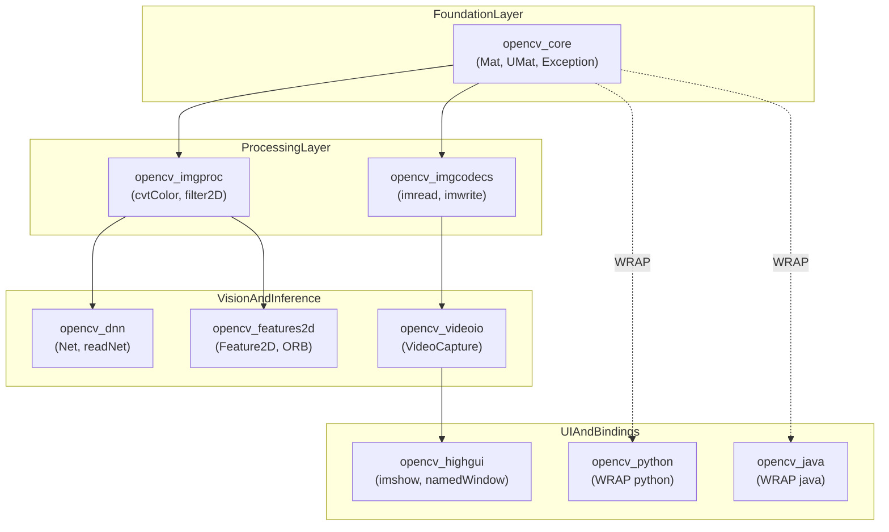
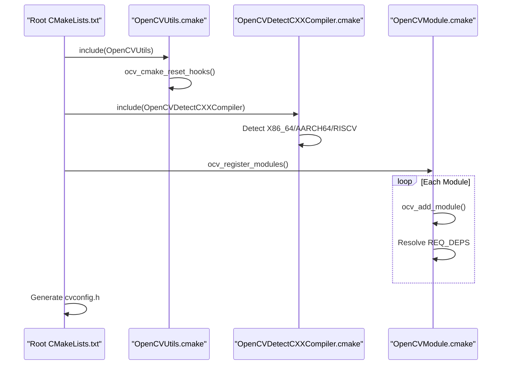

<!-- source: DeepWiki mcp.deepwiki.com · repo opencv/opencv · page 1 OpenCV Overview · fetched 2026-10-30 -->

# OpenCV Overview

Relevant source files

The following files were used as context for generating this wiki page:

- [3rdparty/fastcv/fastcv.cmake](3rdparty/fastcv/fastcv.cmake)
- [3rdparty/ippicv/CMakeLists.txt](3rdparty/ippicv/CMakeLists.txt)
- [CMakeLists.txt](CMakeLists.txt)
- [cmake/OpenCVCRTLinkage.cmake](cmake/OpenCVCRTLinkage.cmake)
- [cmake/OpenCVCompilerOptimizations.cmake](cmake/OpenCVCompilerOptimizations.cmake)
- [cmake/OpenCVCompilerOptions.cmake](cmake/OpenCVCompilerOptions.cmake)
- [cmake/OpenCVFindLibsGUI.cmake](cmake/OpenCVFindLibsGUI.cmake)
- [cmake/OpenCVFindLibsPerf.cmake](cmake/OpenCVFindLibsPerf.cmake)
- [cmake/OpenCVFindLibsVideo.cmake](cmake/OpenCVFindLibsVideo.cmake)
- [cmake/OpenCVModule.cmake](cmake/OpenCVModule.cmake)
- [cmake/OpenCVPCHSupport.cmake](cmake/OpenCVPCHSupport.cmake)
- [cmake/OpenCVUtils.cmake](cmake/OpenCVUtils.cmake)
- [cmake/templates/cvconfig.h.in](cmake/templates/cvconfig.h.in)
- [modules/core/CMakeLists.txt](modules/core/CMakeLists.txt)
- [modules/core/include/opencv2/core.hpp](modules/core/include/opencv2/core.hpp)
- [modules/core/include/opencv2/core/base.hpp](modules/core/include/opencv2/core/base.hpp)
- [modules/core/include/opencv2/core/core.hpp](modules/core/include/opencv2/core/core.hpp)
- [modules/core/include/opencv2/core/cv_cpu_dispatch.h](modules/core/include/opencv2/core/cv_cpu_dispatch.h)
- [modules/core/include/opencv2/core/cv_cpu_helper.h](modules/core/include/opencv2/core/cv_cpu_helper.h)
- [modules/core/include/opencv2/core/cvdef.h](modules/core/include/opencv2/core/cvdef.h)
- [modules/core/include/opencv2/core/matx.hpp](modules/core/include/opencv2/core/matx.hpp)
- [modules/core/include/opencv2/core/operations.hpp](modules/core/include/opencv2/core/operations.hpp)
- [modules/core/include/opencv2/core/private.hpp](modules/core/include/opencv2/core/private.hpp)
- [modules/core/include/opencv2/core/types.hpp](modules/core/include/opencv2/core/types.hpp)
- [modules/core/include/opencv2/core/utility.hpp](modules/core/include/opencv2/core/utility.hpp)
- [modules/core/include/opencv2/core/utils/buffer_area.private.hpp](modules/core/include/opencv2/core/utils/buffer_area.private.hpp)
- [modules/core/src/algorithm.cpp](modules/core/src/algorithm.cpp)
- [modules/core/src/buffer_area.cpp](modules/core/src/buffer_area.cpp)
- [modules/core/src/command_line_parser.cpp](modules/core/src/command_line_parser.cpp)
- [modules/core/src/precomp.hpp](modules/core/src/precomp.hpp)
- [modules/core/src/system.cpp](modules/core/src/system.cpp)
- [modules/core/test/test_operations.cpp](modules/core/test/test_operations.cpp)
- [modules/core/test/test_utils.cpp](modules/core/test/test_utils.cpp)
- [modules/highgui/CMakeLists.txt](modules/highgui/CMakeLists.txt)
- [modules/java/CMakeLists.txt](modules/java/CMakeLists.txt)
- [platforms/linux/riscv64-071-gcc.toolchain.cmake](platforms/linux/riscv64-071-gcc.toolchain.cmake)
- [samples/android/CMakeLists.txt](samples/android/CMakeLists.txt)
- [samples/android/color-blob-detection/CMakeLists.txt](samples/android/color-blob-detection/CMakeLists.txt)

OpenCV (Open Source Computer Vision Library) is a high-performance C++ library for real-time computer vision and image processing `[modules/core/include/opencv2/core.hpp:62-67]()`. It provides a modular framework for handling image data, mathematical computations, and hardware-accelerated inference.

For a detailed exploration of the source code organization, see [Repository Tour and Module Map](#1.1).

## Repository Layout and Versioning

The repository is organized into a core library, optional functional modules, and platform-specific build scripts. Version management is handled via CMake and propagated to core headers, with version detection from Git metadata if available `[CMakeLists.txt:123-132]()`.

| Directory | Contents |
|---|---|
| `modules/` | Functional modules (`core`, `imgproc`, `dnn`, etc.) `[modules/core/CMakeLists.txt:41]()`. |
| `cmake/` | Build infrastructure, dependency detection, and module macros `[cmake/OpenCVModule.cmake:1]()`. |
| `platforms/` | Platform-specific configurations (Android, iOS, etc.) `[CMakeLists.txt:94-99]()`. |
| `3rdparty/` | Bundled dependencies (zlib, libjpeg, libpng, etc.) `[CMakeLists.txt:148-164]()`. |
| `apps/` | Developer tools like annotation, interactive calibration, and visualization utilities. |

For a detailed tour of the top-level layout, directory contents, and the OpenCV 5.x module split (geometry/calib/stereo/ptcloud/features), see [Repository Tour and Module Map](#1.1).

Sources: `[CMakeLists.txt:1-132]()`, `[modules/core/CMakeLists.txt:1-41]()`, `[cmake/OpenCVModule.cmake:1-25]()`

## Module Architecture and Dependencies

OpenCV is structured as a collection of interdependent modules. Every module depends on `opencv_core`, which defines the fundamental `Mat` and `UMat` structures `[modules/core/include/opencv2/core.hpp:64-66]()`.

### Module Dependency Graph

The following diagram illustrates canonical dependencies between major modules and how they bridge from low-level data structures to high-level vision tasks.

**Code Entity Mapping:**
- `opencv_core`: Defined in `modules/core/CMakeLists.txt` `[modules/core/CMakeLists.txt:41]()`.
- `opencv_imgproc`: Image processing foundations.
- `opencv_highgui`: High-level GUI abstractions `[modules/highgui/CMakeLists.txt:1]()`.
- `ocv_add_module`: CMake macro in `cmake/OpenCVModule.cmake` `[cmake/OpenCVModule.cmake:124]()`.

Sources: `[modules/highgui/CMakeLists.txt:3-7]()`, `[cmake/OpenCVModule.cmake:124-127]()`, `[modules/core/CMakeLists.txt:41-43]()`

### Module Declaration via `ocv_add_module`

Modules are registered using the `ocv_add_module` macro `[cmake/OpenCVModule.cmake:124]()`. This macro handles dependency resolution, categorization, and binding generation:
- **Required Dependencies**: Modules that must be present for this module to build `[cmake/OpenCVModule.cmake:86]()`.
- **Optional Dependencies**: Modules that enhance functionality if present `[cmake/OpenCVModule.cmake:88]()`.
- **Wrappers**: Specifies which language bindings (Python, Java, JS, ObjC) should wrap this module `[cmake/OpenCVModule.cmake:93]()`.

Sources: `[cmake/OpenCVModule.cmake:77-117]()`, `[cmake/OpenCVModule.cmake:124-155]()`

## Build System Architecture

OpenCV uses a sophisticated CMake-based build system that manages cross-platform compilation, hardware optimization, and third-party library integration `[CMakeLists.txt:1-166]()`.

### Configuration Flow

The configuration process is split into two passes:
1. **Initial Pass**: Collects module information and descriptions `[cmake/OpenCVModule.cmake:130-155]()`.
2. **Target Creation**: Resolves dependencies and creates the actual CMake targets `[cmake/OpenCVModule.cmake:172-223]()`.

**System Initialization Diagram:**

Sources: `[CMakeLists.txt:42-52]()`, `[CMakeLists.txt:139]`, `[cmake/OpenCVModule.cmake:54-74]()`, `[cmake/OpenCVUtils.cmake:1-15]()`

For instructions on configuring, building, selecting toolchains, and running sanity checks, see [Getting Started: Configure, Build, and Sanity-Check](#1.2).

## Platform and Backend Support

OpenCV abstracts platform differences through backends, particularly for GUI, video input/output, and parallel execution.

### GUI Backends (`highgui`)
The `highgui` module selects a windowing backend based on target platform and available libraries `[modules/highgui/CMakeLists.txt:43-192]()`:
- **Wayland / GTK**: Linux graphical backends `[modules/highgui/CMakeLists.txt:55]()`, `[modules/highgui/CMakeLists.txt:165]()`.
- **Win32 UI**: Native Windows UI `[modules/highgui/CMakeLists.txt:152]()`.
- **Cocoa**: macOS native UI `[modules/highgui/CMakeLists.txt:145]()`.
- **Qt**: Cross-platform backend supporting Qt4, Qt5, and Qt6 `[modules/highgui/CMakeLists.txt:80-99]()`.

### Performance Libraries
OpenCV integrates several third-party libraries for acceleration and parallel processing:
- **TBB**: Intel Threading Building Blocks for parallel loops `[modules/core/CMakeLists.txt:51-53]()`.
- **IPP**: Intel Integrated Performance Primitives for low-level optimizations `[modules/core/CMakeLists.txt:64-81]()`.
- **CUDA**: NVIDIA GPU acceleration support via `opencv_cudev` and CUDA modules.
- **Eigen**: Linear algebra optimization backends.

Sources: `[modules/highgui/CMakeLists.txt:43-192]()`, `[modules/core/CMakeLists.txt:51-81]()`

## Documentation, Samples, and Developer Apps

OpenCV maintains comprehensive API documentation, extensive code samples, and developer utilities:
- **Documentation**: Generated via Doxygen from annotated C++ headers.
- **Samples**: Located in `samples/` and categorized by language and task domains.
- **Developer Apps**: Include tools for interactive camera calibration, pattern generation, and diagnostics.

For details on how documentation is produced, where tutorials and samples live, and developer-facing applications, see [Documentation, Samples, and Developer Apps](#1.3).

Sources: `[CMakeLists.txt:1-10]()`

## Navigation Guide

This wiki is structured to mirror the codebase's directory and module topology:
1. **Build System (Section 2)**: CMake configuration, module registration (`ocv_add_module`), and package generation.
2. **Core Module (Section 3)**: Fundamental data structures (`Mat`, `UMat`), SIMD universal intrinsics, and CPU dispatch.
3. **Functional Modules (Sections 4-10)**: `imgproc`, `dnn`, `features2d`, `videoio`, `highgui`, and geometric/3D modules.
4. **Language Bindings (Section 11)**: Code generation pipeline for Python, Java, JavaScript, and Objective-C/Swift.
5. **Testing & Infrastructure (Sections 12-18)**: Google Test integration (`ts`), GPU acceleration, and domain-specific tools.

---

