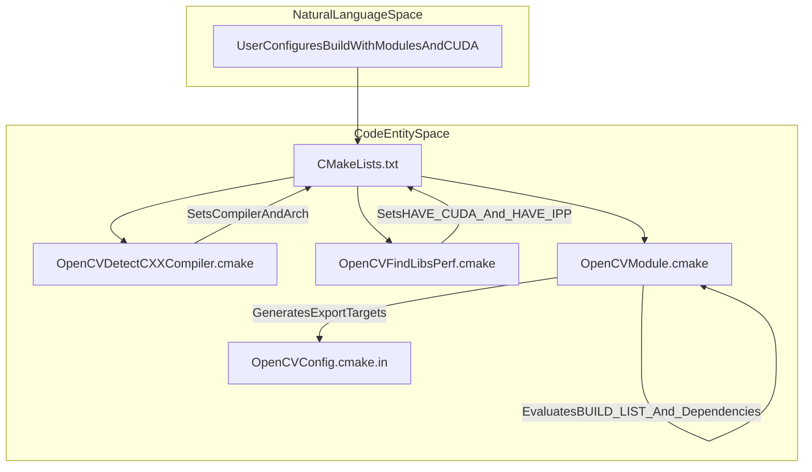
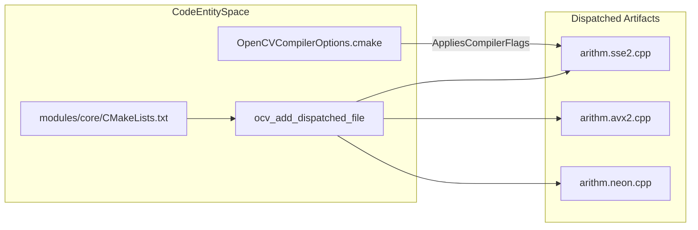

<!-- source: DeepWiki mcp.deepwiki.com · repo opencv/opencv · page 1.2 Getting Started: Configure, Build, and Sanity-Check · fetched 2026-10-30 -->

# Getting Started: Configure, Build, and Sanity-Check

<details>
<summary>Relevant source files</summary>

The following files were used as context for generating this wiki page:

- [3rdparty/fastcv/fastcv.cmake](3rdparty/fastcv/fastcv.cmake)
- [3rdparty/ippicv/CMakeLists.txt](3rdparty/ippicv/CMakeLists.txt)
- [CMakeLists.txt](CMakeLists.txt)
- [cmake/OpenCVCRTLinkage.cmake](cmake/OpenCVCRTLinkage.cmake)
- [cmake/OpenCVCompilerOptions.cmake](cmake/OpenCVCompilerOptions.cmake)
- [cmake/OpenCVDetectCXXCompiler.cmake](cmake/OpenCVDetectCXXCompiler.cmake)
- [cmake/OpenCVDownload.cmake](cmake/OpenCVDownload.cmake)
- [cmake/OpenCVFindIPP.cmake](cmake/OpenCVFindIPP.cmake)
- [cmake/OpenCVFindIPPIW.cmake](cmake/OpenCVFindIPPIW.cmake)
- [cmake/OpenCVFindLibsGUI.cmake](cmake/OpenCVFindLibsGUI.cmake)
- [cmake/OpenCVFindLibsPerf.cmake](cmake/OpenCVFindLibsPerf.cmake)
- [cmake/OpenCVFindLibsVideo.cmake](cmake/OpenCVFindLibsVideo.cmake)
- [cmake/OpenCVGenConfig.cmake](cmake/OpenCVGenConfig.cmake)
- [cmake/OpenCVInstallLayout.cmake](cmake/OpenCVInstallLayout.cmake)
- [cmake/OpenCVModule.cmake](cmake/OpenCVModule.cmake)
- [cmake/OpenCVPCHSupport.cmake](cmake/OpenCVPCHSupport.cmake)
- [cmake/OpenCVUtils.cmake](cmake/OpenCVUtils.cmake)
- [cmake/mirrors/custom.cmake](cmake/mirrors/custom.cmake)
- [cmake/mirrors/gitcode.cmake](cmake/mirrors/gitcode.cmake)
- [cmake/platforms/OpenCV-Android.cmake](cmake/platforms/OpenCV-Android.cmake)
- [cmake/platforms/OpenCV-Darwin.cmake](cmake/platforms/OpenCV-Darwin.cmake)
- [cmake/platforms/OpenCV-WinRT.cmake](cmake/platforms/OpenCV-WinRT.cmake)
- [cmake/platforms/OpenCV-WindowsCE.cmake](cmake/platforms/OpenCV-WindowsCE.cmake)
- [cmake/templates/OpenCVConfig-version.cmake.in](cmake/templates/OpenCVConfig-version.cmake.in)
- [cmake/templates/OpenCVConfig.cmake.in](cmake/templates/OpenCVConfig.cmake.in)
- [cmake/templates/OpenCVConfig.root-ANDROID.cmake.in](cmake/templates/OpenCVConfig.root-ANDROID.cmake.in)
- [cmake/templates/OpenCVConfig.root-WIN32.cmake.in](cmake/templates/OpenCVConfig.root-WIN32.cmake.in)
- [cmake/templates/cvconfig.h.in](cmake/templates/cvconfig.h.in)
- [doc/LICENSE_CHANGE_NOTICE.txt](doc/LICENSE_CHANGE_NOTICE.txt)
- [doc/py_tutorials/py_gui/py_image_display/py_image_display.markdown](doc/py_tutorials/py_gui/py_image_display/py_image_display.markdown)
- [doc/py_tutorials/py_gui/py_table_of_contents_gui.markdown](doc/py_tutorials/py_gui/py_table_of_contents_gui.markdown)
- [doc/py_tutorials/py_gui/py_video_display/py_video_display.markdown](doc/py_tutorials/py_gui/py_video_display/py_video_display.markdown)
- [doc/tutorials/core/univ_intrin/univ_intrin.markdown](doc/tutorials/core/univ_intrin/univ_intrin.markdown)
- [doc/tutorials/dnn/dnn_yolo/dnn_yolo.markdown](doc/tutorials/dnn/dnn_yolo/dnn_yolo.markdown)
- [doc/tutorials/introduction/android_binary_package/android_dnn_intro.markdown](doc/tutorials/introduction/android_binary_package/android_dnn_intro.markdown)
- [doc/tutorials/introduction/android_binary_package/android_ocl_intro.markdown](doc/tutorials/introduction/android_binary_package/android_ocl_intro.markdown)
- [doc/tutorials/introduction/building_tegra_cuda/building_tegra_cuda.markdown](doc/tutorials/introduction/building_tegra_cuda/building_tegra_cuda.markdown)
- [doc/tutorials/introduction/config_reference/config_reference.markdown](doc/tutorials/introduction/config_reference/config_reference.markdown)
- [doc/tutorials/introduction/crosscompilation/arm_crosscompile_with_cmake.markdown](doc/tutorials/introduction/crosscompilation/arm_crosscompile_with_cmake.markdown)
- [doc/tutorials/introduction/crosscompilation/crosscompile_with_multiarch.markdown](doc/tutorials/introduction/crosscompilation/crosscompile_with_multiarch.markdown)
- [doc/tutorials/introduction/desktop_java/java_dev_intro.markdown](doc/tutorials/introduction/desktop_java/java_dev_intro.markdown)
- [doc/tutorials/introduction/env_reference/env_reference.markdown](doc/tutorials/introduction/env_reference/env_reference.markdown)
- [doc/tutorials/introduction/java_eclipse/java_eclipse.markdown](doc/tutorials/introduction/java_eclipse/java_eclipse.markdown)
- [doc/tutorials/introduction/linux_eclipse/images/a10.png](doc/tutorials/introduction/linux_eclipse/images/a10.png)
- [doc/tutorials/introduction/linux_eclipse/linux_eclipse.markdown](doc/tutorials/introduction/linux_eclipse/linux_eclipse.markdown)
- [doc/tutorials/introduction/linux_gdb_pretty_printer/linux_gdb_pretty_printer.markdown](doc/tutorials/introduction/linux_gdb_pretty_printer/linux_gdb_pretty_printer.markdown)
- [doc/tutorials/introduction/linux_install/linux_install.markdown](doc/tutorials/introduction/linux_install/linux_install.markdown)
- [doc/tutorials/introduction/macos_install/macos_install.markdown](doc/tutorials/introduction/macos_install/macos_install.markdown)
- [doc/tutorials/introduction/oneapi_install/oneapi_install.markdown](doc/tutorials/introduction/oneapi_install/oneapi_install.markdown)
- [doc/tutorials/introduction/table_of_content_introduction.markdown](doc/tutorials/introduction/table_of_content_introduction.markdown)
- [doc/tutorials/introduction/transition_guide/transition_guide.markdown](doc/tutorials/introduction/transition_guide/transition_guide.markdown)
- [doc/tutorials/introduction/windows_msys2_vscode/window_install_opencv.markdown](doc/tutorials/introduction/windows_msys2_vscode/window_install_opencv.markdown)
- [doc/tutorials/introduction/windows_visual_studio_image_watch/windows_visual_studio_image_watch.markdown](doc/tutorials/introduction/windows_visual_studio_image_watch/windows_visual_studio_image_watch.markdown)
- [modules/core/CMakeLists.txt](modules/core/CMakeLists.txt)
- [modules/highgui/CMakeLists.txt](modules/highgui/CMakeLists.txt)
- [modules/java/CMakeLists.txt](modules/java/CMakeLists.txt)
- [samples/android/CMakeLists.txt](samples/android/CMakeLists.txt)
- [samples/android/color-blob-detection/CMakeLists.txt](samples/android/color-blob-detection/CMakeLists.txt)
- [samples/cpp/tutorial_code/introduction/display_image/display_image.cpp](samples/cpp/tutorial_code/introduction/display_image/display_image.cpp)
- [samples/data/HappyFish.jpg](samples/data/HappyFish.jpg)
- [samples/install/linux_quick_install.sh](samples/install/linux_quick_install.sh)
- [samples/install/linux_quick_install_contrib.sh](samples/install/linux_quick_install_contrib.sh)
- [samples/install/linux_verify.sh](samples/install/linux_verify.sh)
- [samples/sycl/CMakeLists.txt](samples/sycl/CMakeLists.txt)

</details>


## Purpose and Scope
This page provides a quick, technically rigorous path to configure, compile, and verify an OpenCV build from source. It outlines how the root build orchestration coordinates compiler detection, module registration, third-party libraries, and architecture-specific code dispatching, concluding with a minimal runtime verification snippet. For deep architectural details on the build system, refer to the **Build System** section.

Sources: [CMakeLists.txt:1-14](), [cmake/OpenCVModule.cmake:1-51]()

---

## Build Configuration and Options

OpenCV uses CMake as its primary build configuration engine. The bootstrap logic is defined in the root `CMakeLists.txt` [CMakeLists.txt:1-166](), which prevents in-source builds [CMakeLists.txt:8-14]() and invokes platform detection scripts like `cmake/OpenCVDetectCXXCompiler.cmake` [cmake/OpenCVDetectCXXCompiler.cmake:1-116]().

### Key Configuration Variables

Build behaviors can be tuned by passing `-D<OPTION>=<VALUE>` flags to CMake:

| Option | Description | Code Reference | Default |
| :--- | :--- | :--- | :--- |
| `CMAKE_BUILD_TYPE` | Build configuration (`Release` or `Debug`) | [CMakeLists.txt:56-61]() | `Release` |
| `BUILD_LIST` | Comma-separated list of modules to build | [CMakeLists.txt:145]() | All modules |
| `OPENCV_ENABLE_NONFREE` | Enables patented or restricted algorithms | [CMakeLists.txt:146]() | `OFF` |
| `BUILD_SHARED_LIBS` | Compile shared libraries vs static archives | [cmake/OpenCVDetectCXXCompiler.cmake:144-149]() | `ON` |
| `WITH_CUDA` | Enable NVIDIA GPU acceleration via CUDA SDK | [cmake/OpenCVFindLibsPerf.cmake:57-69]() | `OFF` |
| `WITH_IPP` | Enable Intel Integrated Performance Primitives | [cmake/OpenCVFindLibsPerf.cmake:11-39]criptor | `ON` (on x86) |

Sources: [CMakeLists.txt:56-146](), [cmake/OpenCVDetectCXXCompiler.cmake:144-149](), [cmake/OpenCVFindLibsPerf.cmake:11-69]()

---

## Module Selection and Discovery

OpenCV's modular architecture is orchestrated by `ocv_add_module` defined in `cmake/OpenCVModule.cmake` [cmake/OpenCVModule.cmake:124-145](). Each module declares its dependencies, which are evaluated during the initial CMake pass.

* **Required Dependencies**: If a required module dependency is missing, CMake automatically registers the dependent module into `OPENCV_MODULES_DISABLED_AUTO` [cmake/OpenCVModule.cmake:72]().
* **User Exclusion**: Modules can be explicitly omitted by setting `-DBUILD_opencv_<name>=OFF`.

Sources: [cmake/OpenCVModule.cmake:52-75](), [cmake/OpenCVModule.cmake:124-145]()

---

## Build Orchestration Data Flow

The following diagram bridges the natural language requirement space to the underlying CMake code entities involved in configuring a build.

### Build Configuration and Module Discovery Data Flow

Sources: [CMakeLists.txt:1-150](), [cmake/OpenCVDetectCXXCompiler.cmake:1-116](), [cmake/OpenCVModule.cmake:1-145](), [cmake/OpenCVFindLibsPerf.cmake:1-69]()

---

## Compiling and Installing the Library

Once configured, the build directory can be compiled using native build tools.

1. **Configure the Project**: Create a build directory and run CMake [CMakeLists.txt:4-14]().
   ```bash
   mkdir build && cd build
   cmake -D CMAKE_BUILD_TYPE=Release -D CMAKE_INSTALL_PREFIX=./install ..
   ```
2. **Compile the Binaries**: Build all enabled targets using parallel jobs.
   ```bash
   cmake --build . --config Release -j $(nproc)
   ```
3. **Install Artifacts**: Populate the installation prefix directory with headers and libraries [CMakeLists.txt:101-112]().
   ```bash
   cmake --install .
   ```

Sources: [CMakeLists.txt:4-14](), [CMakeLists.txt:101-112]()

---

## Architecture-Specific Optimizations and Dispatching

OpenCV supports dynamic and static dispatching of hardware-accelerated SIMD kernels (SSE2, AVX2, AVX-512, NEON, VSX, RVV) via macros such as `ocv_add_dispatched_file` [modules/core/CMakeLists.txt:3-21]().

### SIMD Dispatching Architecture

Sources: [modules/core/CMakeLists.txt:3-21](), [cmake/OpenCVCompilerOptions.cmake:1-161]()

---

## Sanity-Check: Minimal Runtime Verification

After building and installing OpenCV, verify correct linking and execution by writing a minimal program that exercises `opencv_core` and `opencv_highgui`.

### C++ Runtime Verification Code
```cpp
#include <opencv2/core.hpp>
#include <opencv2/highgui.hpp>
#include <iostream>

int main() {
    // Allocate a 100x100 matrix on the CPU via cv::Mat
    cv::Mat img(100, 100, CV_8UC3, cv::Scalar(0, 0, 255));
    if (img.empty()) {
        std::cerr << "Error: Matrix allocation failed." << std::endl;
        return -1;
    }
    std::cout << "OpenCV Build Sanity Check Passed. Version: " << CV_VERSION << std::endl;
    return 0;
}
```

### Downstream Integration via CMake
Downstream projects locate the built OpenCV installation using the generated configuration script `OpenCVConfig.cmake` [cmake/templates/OpenCVConfig.cmake.in:1-162]().

```cmake
find_package(OpenCV REQUIRED)
add_executable(sanity_check main.cpp)
target_link_libraries(sanity_check PRIVATE ${OpenCV_LIBS})
```

Sources: [modules/core/CMakeLists.txt:41-43](), [modules/highgui/CMakeLists.txt:1-7](), [cmake/templates/OpenCVConfig.cmake.in:1-162]()

---

