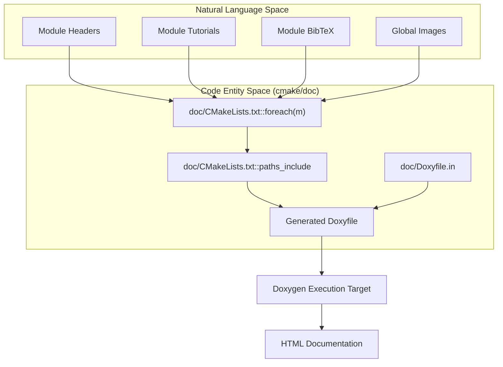
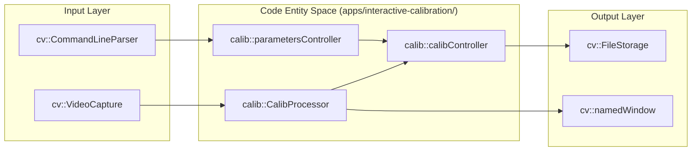

<!-- source: DeepWiki mcp.deepwiki.com · repo opencv/opencv · page 1.3 Documentation, Samples, and Developer Apps · fetched 2026-10-30 -->

# Documentation, Samples, and Developer Apps

Relevant source files

The following files were used as context for generating this wiki page:

- [apps/interactive-calibration/CMakeLists.txt](apps/interactive-calibration/CMakeLists.txt)
- [apps/interactive-calibration/calibCommon.hpp](apps/interactive-calibration/calibCommon.hpp)
- [apps/interactive-calibration/calibController.cpp](apps/interactive-calibration/calibController.cpp)
- [apps/interactive-calibration/calibController.hpp](apps/interactive-calibration/calibController.hpp)
- [apps/interactive-calibration/calibPipeline.cpp](apps/interactive-calibration/calibPipeline.cpp)
- [apps/interactive-calibration/calibPipeline.hpp](apps/interactive-calibration/calibPipeline.hpp)
- [apps/interactive-calibration/defaultConfig.xml](apps/interactive-calibration/defaultConfig.xml)
- [apps/interactive-calibration/frameProcessor.cpp](apps/interactive-calibration/frameProcessor.cpp)
- [apps/interactive-calibration/frameProcessor.hpp](apps/interactive-calibration/frameProcessor.hpp)
- [apps/interactive-calibration/main.cpp](apps/interactive-calibration/main.cpp)
- [apps/interactive-calibration/parametersController.cpp](apps/interactive-calibration/parametersController.cpp)
- [apps/interactive-calibration/parametersController.hpp](apps/interactive-calibration/parametersController.hpp)
- [apps/interactive-calibration/rotationConverters.cpp](apps/interactive-calibration/rotationConverters.cpp)
- [cmake/OpenCVDetectApacheAnt.cmake](cmake/OpenCVDetectApacheAnt.cmake)
- [cmake/OpenCVDetectVTK.cmake](cmake/OpenCVDetectVTK.cmake)
- [cmake/checks/vtk_test.cpp](cmake/checks/vtk_test.cpp)
- [doc/CMakeLists.txt](doc/CMakeLists.txt)
- [doc/Doxyfile.in](doc/Doxyfile.in)
- [doc/custom.css](doc/custom.css)
- [doc/doxygen-awesome.css](doc/doxygen-awesome.css)
- [doc/footer.html](doc/footer.html)
- [doc/header.html](doc/header.html)
- [doc/js_tutorials/js_imgproc/js_contours/js_contour_features/js_contour_features.markdown](doc/js_tutorials/js_imgproc/js_contours/js_contour_features/js_contour_features.markdown)
- [doc/js_tutorials/js_imgproc/js_contours/js_contour_properties/js_contour_properties.markdown](doc/js_tutorials/js_imgproc/js_contours/js_contour_properties/js_contour_properties.markdown)
- [doc/js_tutorials/js_imgproc/js_contours/js_contours_begin/js_contours_begin.markdown](doc/js_tutorials/js_imgproc/js_contours/js_contours_begin/js_contours_begin.markdown)
- [doc/js_tutorials/js_imgproc/js_contours/js_contours_hierarchy/js_contours_hierarchy.markdown](doc/js_tutorials/js_imgproc/js_contours/js_contours_hierarchy/js_contours_hierarchy.markdown)
- [doc/js_tutorials/js_imgproc/js_contours/js_contours_more_functions/js_contours_more_functions.markdown](doc/js_tutorials/js_imgproc/js_contours/js_contours_more_functions/js_contours_more_functions.markdown)
- [doc/mymath.js](doc/mymath.js)
- [doc/mymath.sty](doc/mymath.sty)
- [doc/py_tutorials/py_calib3d/py_calibration/py_calibration.markdown](doc/py_tutorials/py_calib3d/py_calibration/py_calibration.markdown)
- [doc/py_tutorials/py_calib3d/py_pose/py_pose.markdown](doc/py_tutorials/py_calib3d/py_pose/py_pose.markdown)
- [doc/py_tutorials/py_core/py_basic_ops/py_basic_ops.markdown](doc/py_tutorials/py_core/py_basic_ops/py_basic_ops.markdown)
- [doc/py_tutorials/py_core/py_image_arithmetics/py_image_arithmetics.markdown](doc/py_tutorials/py_core/py_image_arithmetics/py_image_arithmetics.markdown)
- [doc/py_tutorials/py_core/py_optimization/py_optimization.markdown](doc/py_tutorials/py_core/py_optimization/py_optimization.markdown)
- [doc/py_tutorials/py_imgproc/py_contours/py_contour_features/py_contour_features.markdown](doc/py_tutorials/py_imgproc/py_contours/py_contour_features/py_contour_features.markdown)
- [doc/py_tutorials/py_imgproc/py_contours/py_contour_properties/py_contour_properties.markdown](doc/py_tutorials/py_imgproc/py_contours/py_contour_properties/py_contour_properties.markdown)
- [doc/py_tutorials/py_imgproc/py_contours/py_contours_begin/py_contours_begin.markdown](doc/py_tutorials/py_imgproc/py_contours/py_contours_begin/py_contours_begin.markdown)
- [doc/py_tutorials/py_imgproc/py_contours/py_contours_hierarchy/py_contours_hierarchy.markdown](doc/py_tutorials/py_imgproc/py_contours/py_contours_hierarchy/py_contours_hierarchy.markdown)
- [doc/py_tutorials/py_imgproc/py_contours/py_contours_more_functions/py_contours_more_functions.markdown](doc/py_tutorials/py_imgproc/py_contours/py_contours_more_functions/py_contours_more_functions.markdown)
- [doc/py_tutorials/py_imgproc/py_histograms/py_2d_histogram/py_2d_histogram.markdown](doc/py_tutorials/py_imgproc/py_histograms/py_2d_histogram/py_2d_histogram.markdown)
- [doc/py_tutorials/py_imgproc/py_histograms/py_histogram_begins/py_histogram_begins.markdown](doc/py_tutorials/py_imgproc/py_histograms/py_histogram_begins/py_histogram_begins.markdown)
- [doc/py_tutorials/py_objdetect/py_table_of_contents_objdetect.markdown](doc/py_tutorials/py_objdetect/py_table_of_contents_objdetect.markdown)
- [doc/py_tutorials/py_photo/py_inpainting/py_inpainting.markdown](doc/py_tutorials/py_photo/py_inpainting/py_inpainting.markdown)
- [doc/py_tutorials/py_tutorials.markdown](doc/py_tutorials/py_tutorials.markdown)
- [doc/py_tutorials/py_video/py_bg_subtraction/py_bg_subtraction.markdown](doc/py_tutorials/py_video/py_bg_subtraction/py_bg_subtraction.markdown)
- [doc/py_tutorials/py_video/py_lucas_kanade/py_lucas_kanade.markdown](doc/py_tutorials/py_video/py_lucas_kanade/py_lucas_kanade.markdown)
- [doc/tools/add_signatures.py](doc/tools/add_signatures.py)
- [doc/tools/doxygen_scan.py](doc/tools/doxygen_scan.py)
- [doc/tools/html_functions.py](doc/tools/html_functions.py)
- [modules/core/include/opencv2/core/opengl.hpp](modules/core/include/opencv2/core/opengl.hpp)
- [modules/core/src/opengl.cpp](modules/core/src/opengl.cpp)
- [modules/java/jar/CMakeLists.txt](modules/java/jar/CMakeLists.txt)
- [modules/java/jar/MANIFEST.MF.in](modules/java/jar/MANIFEST.MF.in)
- [modules/java/jar/build.xml.in](modules/java/jar/build.xml.in)
- [modules/java/jar/list_java_sources.cmake](modules/java/jar/list_java_sources.cmake)
- [samples/CMakeLists.txt](samples/CMakeLists.txt)
- [samples/cpp/CMakeLists.txt](samples/cpp/CMakeLists.txt)
- [samples/gpu/CMakeLists.txt](samples/gpu/CMakeLists.txt)
- [samples/opengl/CMakeLists.txt](samples/opengl/CMakeLists.txt)
- [samples/opengl/opengl3_2.cpp](samples/opengl/opengl3_2.cpp)
- [samples/opengl/opengl_testdata_generator.cpp](samples/opengl/opengl_testdata_generator.cpp)

This section details the infrastructure surrounding the OpenCV codebase that facilitates user education, developer diagnostics, and automated documentation generation.

## Documentation Generation

OpenCV uses **Doxygen** as its primary engine for generating API reference documentation. The process is orchestrated via CMake, which gathers headers, tutorials, and samples from across the repository and contrib modules to build a unified documentation set.

### Doxygen Pipeline and Dependencies
The documentation build follows a specific dependency scheme to ensure that language-specific documentation (Java, Python) is integrated into the final C++ reference [doc/CMakeLists.txt:5-10]().

| Target | Description |
| :--- | :--- |
| `doxygen_cpp` | The core C++ API documentation. |
| `doxygen_python` | Python-specific wrappers and docstrings [doc/Doxyfile.in:41](). |
| `doxygen_javadoc` | Java documentation generated from source. |
| `opencv_docs` | The final aggregate target containing all generated HTML/XML. |

### Configuration and Discovery
The `doc/CMakeLists.txt` script dynamically discovers documentation assets by iterating through all enabled modules (`OPENCV_MODULES_MAIN` and `OPENCV_MODULES_EXTRA`) [doc/CMakeLists.txt:42]().

*   **Headers:** Collected from each module's `include/` directory [doc/CMakeLists.txt:56-59]().
*   **Markdown Tutorials:** Discovered in module-specific `tutorials/` folders [doc/CMakeLists.txt:83-86]().
*   **BibTeX References:** Module-specific bibliography files (e.g., `imgproc.bib`) are merged into the global reference list [doc/CMakeLists.txt:110-114]().
*   **Blacklist:** Certain modules like `ts` (testing) and `world` are excluded from the public documentation [doc/CMakeLists.txt:21-22]().

### Documentation Build Data Flow
The following diagram bridges the abstract documentation concepts (Natural Language Space) to the concrete build scripts and configuration templates (Code Entity Space).

**Documentation Assembly Flow**

Sources: [doc/CMakeLists.txt:32-129](), [doc/Doxyfile.in:137-149]()

## Samples System

The `samples/` directory contains demonstration code for various languages and specialized backends. Samples serve both as user tutorials and as functional tests for library features.

### Sample Categories
OpenCV categorizes samples based on the target language or technology stack [samples/CMakeLists.txt:23-49]():
*   **C++ (`samples/cpp`):** The primary collection of algorithmic demonstrations.
*   **Python (`samples/python`):** Scripting examples showing the `cv2` interface.
*   **Java (`samples/java`):** Android and desktop Java wrappers.
*   **Specialized Backends:** Dedicated folders for `gpu` (CUDA), `opencl`, `tapi` (Transparent API), `dnn`, and `sycl` [samples/CMakeLists.txt:25-33]().

### Build Mechanism
Samples are built using the `ocv_define_sample` macro, which handles target creation and dependency linking.
1.  **Dependency Checking:** The `samples/cpp/CMakeLists.txt` defines a list of required modules (e.g., `opencv_core`, `opencv_imgproc`, `opencv_videoio`) and verifies their availability via `ocv_check_dependencies` [samples/cpp/CMakeLists.txt:3-21]().
2.  **Standalone vs. Integrated:** Samples can be built as part of the main OpenCV build or as a standalone project using a pre-installed OpenCV via `find_package(OpenCV)` [samples/CMakeLists.txt:61-80]().
3.  **Special Links:** Samples involving 3D visualization link against **VTK** if `HAVE_VTK` is detected [samples/cpp/CMakeLists.txt:54-57](), [cmake/OpenCVDetectVTK.cmake:69]().

Sources: [samples/CMakeLists.txt:1-143](), [samples/cpp/CMakeLists.txt:1-79](), [samples/gpu/CMakeLists.txt:3-25]()

## Developer Apps

The `apps/` directory contains interactive tools designed for developers to perform calibration, generate diagnostic patterns, and inspect models.

### Interactive Calibration App
Located in `apps/interactive-calibration/`, this application provides a GUI-based workflow for camera calibration using various patterns.

**Key Components:**
*   **`calib::CalibProcessor`:** Handles the detection and parsing of calibration patterns such as Chessboards, Circles Grids, and ChArUco boards [apps/interactive-calibration/frameProcessor.cpp:59-145]().
*   **`calib::calibController`:** Manages the state of the calibration process, including flag tuning and minimum frame requirements [apps/interactive-calibration/main.cpp:142-143]().
*   **`calib::parametersController`:** Parses command-line arguments via `cv::CommandLineParser` and configuration files (`defaultConfig.xml`) to set up the calibration session [apps/interactive-calibration/parametersController.cpp:88-170]().

### Pattern Detection Implementation
The application supports multiple pattern types, each handled by specific detection logic within the `CalibProcessor`:
*   **Chessboard:** Uses `cv::findChessboardCorners` and `cv::cornerSubPix` [apps/interactive-calibration/frameProcessor.cpp:61-68]().
*   **ChArUco:** Integrates with the `objdetect` module's ArUco dictionary system [apps/interactive-calibration/frameProcessor.cpp:75-95]().
*   **Circles Grid:** Supports symmetric and asymmetric grids using `cv::findCirclesGrid` [apps/interactive-calibration/frameProcessor.cpp:103-121]().

**Interactive Calibration Architecture**

Sources: [apps/interactive-calibration/main.cpp:113-172](), [apps/interactive-calibration/frameProcessor.cpp:59-180](), [apps/interactive-calibration/parametersController.cpp:88-132]()

## Interoperability Tools

OpenCV provides specialized headers and samples for interoperability with external graphics and compute APIs.

### OpenGL Interoperability
OpenCV facilitates data sharing between `cv::Mat` and OpenGL textures/buffers.
*   **`cv::ogl::Buffer`:** A smart pointer for OpenGL buffer objects (Vertex, Pixel Pack/Unpack) [modules/core/include/opencv2/core/opengl.hpp:79-90]().
*   **CUDA Integration:** The library supports mapping OpenGL buffers directly to CUDA memory for zero-copy transfers [modules/core/src/opengl.cpp:143-156]().
*   **Hardware Abstraction:** The `cv::cuda::setGlDevice` function ensures the compute context is synchronized with the graphics context [modules/core/src/opengl.cpp:121-134]().

Sources: [modules/core/include/opencv2/core/opengl.hpp:53-155](), [modules/core/src/opengl.cpp:121-226](), [samples/opengl/CMakeLists.txt:9-33]()

---

