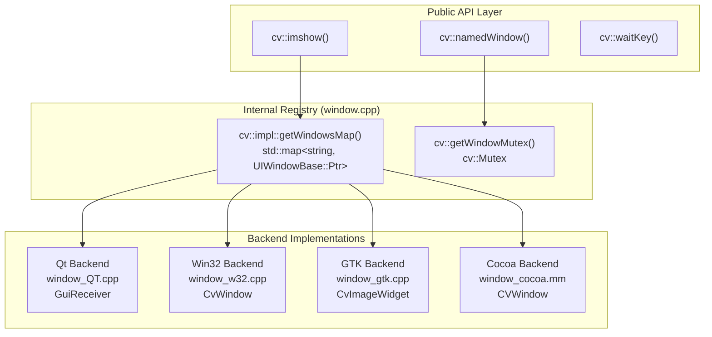
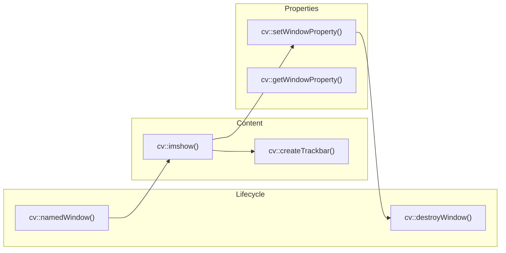

<!-- source: DeepWiki mcp.deepwiki.com · repo opencv/opencv · page 10 User Interfaces (highgui) · fetched 2026-10-30 -->

# User Interfaces (highgui)

Relevant source files

The following files were used as context for generating this wiki page:

- [modules/highgui/include/opencv2/highgui.hpp](modules/highgui/include/opencv2/highgui.hpp)
- [modules/highgui/include/opencv2/highgui/highgui.hpp](modules/highgui/include/opencv2/highgui/highgui.hpp)
- [modules/highgui/src/precomp.hpp](modules/highgui/src/precomp.hpp)
- [modules/highgui/src/window.cpp](modules/highgui/src/window.cpp)
- [modules/highgui/src/window_QT.cpp](modules/highgui/src/window_QT.cpp)
- [modules/highgui/src/window_QT.h](modules/highgui/src/window_QT.h)
- [modules/highgui/src/window_cocoa.mm](modules/highgui/src/window_cocoa.mm)
- [modules/highgui/src/window_gtk.cpp](modules/highgui/src/window_gtk.cpp)
- [modules/highgui/src/window_w32.cpp](modules/highgui/src/window_w32.cpp)

The `opencv_highgui` module provides platform-independent GUI functionality for creating windows, displaying images, and handling user interactions. It is designed for rapid prototyping and visualization, allowing developers to try functionality quickly without integrating a full-scale UI framework. For media file I/O, see [Image File I/O and Codec System](#7.1) and [Video Capture and Backend Architecture](#7.2).

## Module Architecture and Backend Abstraction

The `highgui` module utilizes a multi-backend architecture. A common API layer in `modules/highgui/src/window.cpp` dispatches calls to platform-specific implementations. These backends (Qt, Win32, GTK, Cocoa, etc.) are selected at build time based on available system libraries.

### Backend Selection and Dispatch Pattern

The diagram below illustrates how the high-level API connects to specific code entities across different backends.

**System Architecture: API to Backend Mapping**

Sources: [modules/highgui/src/window.cpp:56-91](), [modules/highgui/src/window_QT.cpp:101-125](), [modules/highgui/src/window_w32.cpp:181-235](), [modules/highgui/src/window_gtk.cpp:101-107](), [modules/highgui/src/window_cocoa.mm:109-132]()

The module handles the diversity of operating systems through the following backend-specific logic:

| Backend | Compile Flag | Primary Source | Window Handle Entity |
|---------|-------------|----------------|----------------------|
| **Qt** | `HAVE_QT` | [modules/highgui/src/window_QT.cpp:43]() | `GuiReceiver` (Dispatcher) |
| **Win32** | `HAVE_WIN32UI` | [modules/highgui/src/window_w32.cpp:44]() | `HWND` |
| **GTK** | `HAVE_GTK` | [modules/highgui/src/window_gtk.cpp:45]() | `GtkWidget*` |
| **Cocoa** | `HAVE_COCOA` | [modules/highgui/src/window_cocoa.mm:74]() | `NSWindow*` |

For details on how the module selects between these backends and the internal dispatch interface, see [Window Management and Multi-Backend GUI](#10.1).

Sources: [modules/highgui/src/window_QT.cpp:43](), [modules/highgui/src/window_w32.cpp:44](), [modules/highgui/src/window_gtk.cpp:45](), [modules/highgui/src/window_cocoa.mm:74]()

---

## Core API Functions and Window Lifecycle

### Window Management API

The `highgui` API provides a simple interface for window lifecycle management. Most functions require a `windowName` string to identify the target UI element.

**Code Entity Space: Windowing Operations**

Sources: [modules/highgui/src/window.cpp:190-760](), [modules/highgui/include/opencv2/highgui.hpp:142-163]()

### Window Flags and Properties

Window behavior is controlled through `cv::WindowFlags` and `cv::WindowPropertyFlags`.

| Constant | Value | Role |
|----------|-------|------|
| `WINDOW_NORMAL` | `0x00000000` | Allows manual resizing [modules/highgui/include/opencv2/highgui.hpp:143]() |
| `WINDOW_AUTOSIZE` | `0x00000001` | Size constrained by image [modules/highgui/include/opencv2/highgui.hpp:144]() |
| `WINDOW_OPENGL` | `0x00001000` | Enables OpenGL support [modules/highgui/include/opencv2/highgui.hpp:145]() |
| `WND_PROP_FULLSCREEN` | `0` | Property for fullscreen toggle [modules/highgui/include/opencv2/highgui.hpp:156]() |
| `WND_PROP_VISIBLE` | `4` | Property to check window existence [modules/highgui/include/opencv2/highgui.hpp:160]() |

For details on window creation and management, see [Window Management and Multi-Backend GUI](#10.1).

Sources: [modules/highgui/include/opencv2/highgui.hpp:103-125]()

---

## User Input Handling

Interactive elements are handled via event loops triggered by the user.

### Keyboard and Mouse Events
*   **Keyboard**: `cv::waitKey(delay)` is the primary mechanism for processing the GUI event queue. It returns the code of the pressed key or -1 if the delay expires [modules/highgui/src/window.cpp:657-674]().
*   **Mouse**: `cv::setMouseCallback(window, onMouse, param)` registers a callback to handle events like `EVENT_LBUTTONDOWN` or `EVENT_MOUSEMOVE` [modules/highgui/src/window.cpp:812-830]().

### Interactive Controls: Trackbars
Trackbars provide sliders for adjusting integer parameters. They are created via `cv::createTrackbar()` and can be linked to a variable or a callback function [modules/highgui/src/window.cpp:697-758]().

For detailed documentation on event handling, trackbars, and Qt-specific extensions (buttons, status bars), see [Event Handling and Interactive Elements](#10.2).

Sources: [modules/highgui/src/window.cpp:657-830]()

---

## Backend-Specific Implementations

*   **Qt Backend**: Implemented via `GuiReceiver` [modules/highgui/src/window_QT.h:117]() and `CvWindow`. It supports advanced features like `cv::displayStatusBar` [modules/highgui/src/window_QT.cpp:159]() and buttonbars [modules/highgui/src/window_QT.cpp:305]().
*   **Win32 Backend**: Uses a `CvWindow` struct [modules/highgui/src/window_w32.cpp:181]() that stores an `HWND` [modules/highgui/src/window_w32.cpp:199]() and processes messages via a standard Windows `WNDPROC`.
*   **GTK Backend**: Utilizes `CvImageWidget` [modules/highgui/src/window_gtk.cpp:101]() and interacts with the GTK main loop.
*   **Cocoa Backend**: Uses Objective-C classes `CVWindow` [modules/highgui/src/window_cocoa.mm:109]() and `CVView` [modules/highgui/src/window_cocoa.mm:84]().

For more information on backend selection and windowing internals, see [Backend Implementations: Qt, GTK, Win32, Cocoa, Wayland](#10.3).

Sources: [modules/highgui/src/window_QT.cpp](), [modules/highgui/src/window_w32.cpp](), [modules/highgui/src/window_gtk.cpp](), [modules/highgui/src/window_cocoa.mm]()

---

