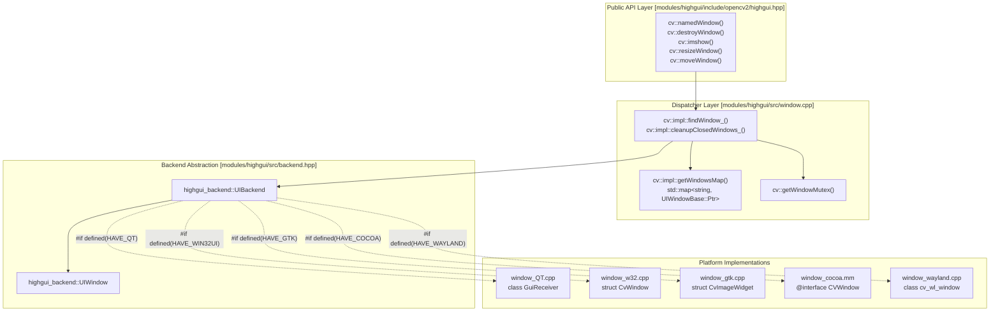
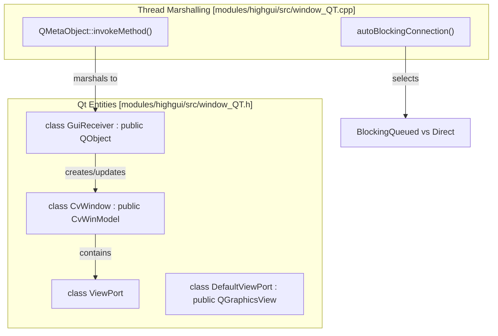

<!-- source: DeepWiki mcp.deepwiki.com · repo opencv/opencv · page 10.1 Window Management and Multi-Backend GUI · fetched 2026-10-30 -->

# Window Management and Multi-Backend GUI

<details>
<summary>Relevant source files</summary>

The following files were used as context for generating this wiki page:

- [modules/highgui/cmake/detect_wayland.cmake](modules/highgui/cmake/detect_wayland.cmake)
- [modules/highgui/include/opencv2/highgui.hpp](modules/highgui/include/opencv2/highgui.hpp)
- [modules/highgui/include/opencv2/highgui/highgui.hpp](modules/highgui/include/opencv2/highgui/highgui.hpp)
- [modules/highgui/src/precomp.hpp](modules/highgui/src/precomp.hpp)
- [modules/highgui/src/window.cpp](modules/highgui/src/window.cpp)
- [modules/highgui/src/window_QT.cpp](modules/highgui/src/window_QT.cpp)
- [modules/highgui/src/window_QT.h](modules/highgui/src/window_QT.h)
- [modules/highgui/src/window_cocoa.mm](modules/highgui/src/window_cocoa.mm)
- [modules/highgui/src/window_gtk.cpp](modules/highgui/src/window_gtk.cpp)
- [modules/highgui/src/window_w32.cpp](modules/highgui/src/window_w32.cpp)
- [modules/highgui/src/window_wayland.cpp](modules/highgui/src/window_wayland.cpp)
- [modules/highgui/test/test_gui.cpp](modules/highgui/test/test_gui.cpp)
- [modules/ptcloud/CMakeLists.txt](modules/ptcloud/CMakeLists.txt)
- [modules/ptcloud/include/opencv2/ptcloud.hpp](modules/ptcloud/include/opencv2/ptcloud.hpp)
- [modules/ptcloud/include/opencv2/ptcloud/viz3d.hpp](modules/ptcloud/include/opencv2/ptcloud/viz3d.hpp)
- [modules/ptcloud/src/viz3d/grid_ticks.hpp](modules/ptcloud/src/viz3d/grid_ticks.hpp)
- [modules/ptcloud/src/viz3d/viz3d.cpp](modules/ptcloud/src/viz3d/viz3d.cpp)
- [modules/ptcloud/src/viz3d/viz3d_private.hpp](modules/ptcloud/src/viz3d/viz3d_private.hpp)
- [modules/ptcloud/test/test_viz3d.cpp](modules/ptcloud/test/test_viz3d.cpp)
- [samples/data/rgbd-color.jpg](samples/data/rgbd-color.jpg)
- [samples/data/rgbd-depth.png](samples/data/rgbd-depth.png)

</details>


## Purpose and Scope

This document describes the window management system in OpenCV's `highgui` module, which provides a unified API for creating and managing GUI windows across multiple platform-specific backends. The system abstracts platform differences—specifically **Qt**, **Win32UI**, **GTK**, **Cocoa**, **Wayland**, and **Framebuffer**—behind a common interface, enabling cross-platform visualization code.

This page covers core window operations (`cv::namedWindow`, `cv::imshow`, `cv::destroyWindow`), build-time backend selection mechanisms, and the internal window backend dispatch interface. For information about event handling (mouse callbacks, trackbars, buttons), see [Event Handling and Interactive Elements](#10.2).

Sources: [modules/highgui/include/opencv2/highgui.hpp:54-91](), [modules/highgui/src/window.cpp:1-53]()

## Architecture Overview

The `highgui` module implements a **dispatcher pattern** that routes window operations to platform-specific backend implementations. This design allows the same client code to work on any supported platform without modification.

### Natural Language to Code Entity Space: HighGUI Dispatcher

The following diagram maps high-level GUI operations to the internal dispatcher and backend entities.

Title: HighGUI Backend Dispatching Flow


Sources: [modules/highgui/src/window.cpp:54-91](), [modules/highgui/src/precomp.hpp:90-152](), [modules/highgui/include/opencv2/highgui.hpp:104-165]()

### Backend Selection Mechanism

Backend selection occurs at **compile time** through CMake-generated preprocessor directives and at **runtime** through plugin loading (when enabled).

- **Compile-time Selection**: CMake detects available windowing libraries and defines preprocessor symbols such as `HAVE_QT`, `HAVE_WIN32UI`, `HAVE_GTK`, `HAVE_COCOA`, `HAVE_WAYLAND`, and `HAVE_FRAMEBUFFER` [modules/highgui/src/precomp.hpp:43-53]().
- **Plugin Mechanism**: If `OPENCV_HIGHGUI_WITHOUT_BUILTIN_BACKEND` is defined alongside `ENABLE_PLUGINS`, the system relies on `getCurrentUIBackend()` to load dynamic implementations [modules/highgui/src/window.cpp:182-188]().

Sources: [modules/highgui/src/window.cpp:182-188](), [modules/highgui/src/precomp.hpp:43-53]()

---

## Core Window Management Functions

### `cv::namedWindow`
Creates a window that can be used as a placeholder for images and trackbars. Windows are identified by their string names.
- **Parameters**: `const String& name`, `int flags = WINDOW_AUTOSIZE` [modules/highgui/include/opencv2/highgui.hpp:104-114]().
- **Behavior**: If a window with the specified name already exists, the function does nothing. Otherwise, it registers a new window in the global `WindowsMap` and invokes backend-specific creation logic.

### `cv::imshow`
Displays an image in the specified window.
- **Parameters**: `const String& name`, `InputArray mat` [modules/highgui/src/window.cpp:755-775]().
- **Behavior**: If the window does not exist (`findWindow_` returns null), `imshow` automatically calls `namedWindow(name)` before rendering the image. It converts or maps the `InputArray` into the backend's native surface representation (e.g., `write_mat_to_xrgb8888` for Wayland or texture updates for Qt/OpenGL).

### `cv::destroyWindow` / `cv::destroyAllWindows`
Destroys a specific window or all active windows.
- **Behavior**: Acquires the global window mutex (`cv::getWindowMutex()`), removes the window entry from the registry, and invokes backend cleanup routines to release OS-level resources and handles.

Sources: [modules/highgui/src/window.cpp:56-91](), [modules/highgui/include/opencv2/highgui.hpp:104-125]()

---

## Window Storage and Lifecycle

### Window Registry

Windows are tracked in a centralized registry protected by a global mutex. Each window is identified by its name string.

| Component | Type | Purpose |
|-----------|------|---------|
| `getWindowsMap()` | `std::map<std::string, UIWindowBase::Ptr>` | Maps window name to window object [modules/highgui/src/window.cpp:65-69]() |
| `getWindowMutex()` | `cv::Mutex` | Protects concurrent access to the registry [modules/highgui/src/window.cpp:56-60]() |
| `findWindow_()` | Helper function | Thread-safe window lookup [modules/highgui/src/window.cpp:71-91]() |
| `cleanupClosedWindows_()` | Cleanup function | Removes inactive windows from the registry [modules/highgui/src/window.cpp:95-114]() |

Sources: [modules/highgui/src/window.cpp:56-114]()

### Window Lifecycle State Machine

```mermaid
stateDiagram-v2
    [*] --> Created: cv::namedWindow()
    Created --> Active: cv::imshow()
    Active --> Active: cv::imshow() / resizeWindow()
    Active --> Hidden: User closes window
    Active --> Destroyed: cv::destroyWindow()
    Hidden --> Active: cv::imshow()
    Hidden --> Destroyed: Registry cleanup
    Destroyed --> [*]
    
    note right of Created
        Window handle exists;
        UIWindowBase::isActive() is true.
    end note
```

Sources: [modules/highgui/src/window.cpp:623-640](), [modules/highgui/src/window.cpp:755-775]()

---

## Backend Implementations

### Qt Backend Architecture

The Qt backend uses a **receiver-slot pattern** to bridge the OpenCV execution thread with the Qt main GUI thread.

Title: Qt Backend Thread Marshalling


- **Thread Safety**: `autoBlockingConnection()` selects `Qt::BlockingQueuedConnection` if the current thread is not the GUI thread [modules/highgui/src/window_QT.cpp:121-125]().
- **Multi-threading**: The `multiThreads` flag manages synchronization when calls originate from non-main threads [modules/highgui/src/window_QT.cpp:104-107]().
- **Receiver Slots**: `GuiReceiver` implements slots like `createWindow`, `showImage`, and `destroyWindow` to execute UI tasks on the main thread [modules/highgui/src/window_QT.h:131-165]().

Sources: [modules/highgui/src/window_QT.cpp:101-125](), [modules/highgui/src/window_QT.h:117-169]()

### Win32 Backend Architecture

The Win32 backend uses native Windows API calls and a custom message loop.

- **Window Structure**: `struct CvWindow` stores native handles `HWND hwnd` and device context `HDC dc` [modules/highgui/src/window_w32.cpp:181-235]().
- **Signature Validation**: Uses `CV_WINDOW_MAGIC_VAL` (0x00420042) to validate window pointers [modules/highgui/src/window_w32.cpp:184-197](), [modules/highgui/src/precomp.hpp:89]().
- **Memory Management**: Uses `std::enable_shared_from_this<CvWindow>` for lifecycle management [modules/highgui/src/window_w32.cpp:181-182]().

Sources: [modules/highgui/src/window_w32.cpp:181-235](), [modules/highgui/src/precomp.hpp:89-91]()

### GTK Backend Architecture

The GTK backend implements a custom widget `CvImageWidget` to handle image rendering within the GTK widget hierarchy.

- **Custom Widget**: `struct CvImageWidget` contains `original_image` and `scaled_image` matrices [modules/highgui/src/window_gtk.cpp:101-107]().
- **Type Registration**: `cvImageWidget_get_type()` registers the widget with the GObject system [modules/highgui/src/window_gtk.cpp:126]().
- **Scaling**: `cvImageWidgetSetImage` handles image updates, resizing `original_image` to `scaled_image` via `cv::resize` [modules/highgui/src/window_gtk.cpp:134-153]().

Sources: [modules/highgui/src/window_gtk.cpp:101-167]()

### Cocoa Backend Architecture

The Cocoa backend (macOS) uses Objective-C and the Cocoa framework.

- **Window Class**: `@interface CVWindow : NSWindow` manages the window and its interactive elements [modules/highgui/src/window_cocoa.mm:106-129]().
- **View Class**: `@interface CVView : NSView` handles drawing of `NSImage` surfaces [modules/highgui/src/window_cocoa.mm:81-86]().
- **Registry**: Uses a global `NSMutableDictionary *windows` dictionary to track active windows by name [modules/highgui/src/window_cocoa.mm:78]().

Sources: [modules/highgui/src/window_cocoa.mm:78-129](), [modules/highgui/src/window_cocoa.mm:151-161]()

### Wayland Backend Architecture

The Wayland backend (`window_wayland.cpp`) provides native Wayland display support without relying on GTK or Qt wrappers.

- **Display & Polling**: Uses `cv_wl_display` paired with an `epoller` class wrapping `epoll_create1` and `epoll_wait` to handle Wayland protocol events asynchronously [modules/highgui/src/window_wayland.cpp:157-239]().
- **Pixel Conversion**: `write_mat_to_xrgb8888` converts input `cv::Mat` instances (supporting various depths and channels) into `XRGB8888` shared memory buffers suitable for Wayland surface attachment [modules/highgui/src/window_wayland.cpp:87-155]().

Sources: [modules/highgui/src/window_wayland.cpp:87-239]()

### Framebuffer Backend Architecture

When configured for embedded or headless targets lacking a windowing server (`HAVE_FRAMEBUFFER`), `highgui` falls back to direct Linux framebuffer rendering (`/dev/fb*`), drawing pixel buffers directly to memory-mapped display hardware.

Sources: [modules/highgui/test/test_gui.cpp:66-72]()

---

## Synchronization and Mutexes

OpenCV HighGUI ensures thread safety across its backends through dedicated synchronization primitives:

1. **Global Window Mutex**: Returned by `cv::getWindowMutex()`, it protects the central `WindowsMap` registry [modules/highgui/src/window.cpp:56-60]().
2. **Qt Key Mutex**: `QMutex mutexKey` synchronizes keyboard event queues in the Qt backend [modules/highgui/src/window_QT.cpp:107]().
3. **Window Instance Mutex**: Each `CvWindow` structure in Win32 maintains its own `cv::Mutex` for thread-safe internal property updates [modules/highgui/src/window_w32.cpp:198]().

Sources: [modules/highgui/src/window.cpp:56-60](), [modules/highgui/src/window_QT.cpp:107](), [modules/highgui/src/window_w32.cpp:198]()

---

## Window Properties and Configuration

The `cv::setWindowProperty` and `cv::getWindowProperty` functions allow runtime modification of window behavior across backends.

| Property Flag | ID | Description |
| :--- | :--- | :--- |
| `WND_PROP_FULLSCREEN` | 0 | Toggle `WINDOW_NORMAL` or `WINDOW_FULLSCREEN` [modules/highgui/include/opencv2/highgui.hpp:118]() |
| `WND_PROP_AUTOSIZE` | 1 | Change `WINDOW_AUTOSIZE` status [modules/highgui/include/opencv2/highgui.hpp:119]() |
| `WND_PROP_ASPECT_RATIO` | 2 | Toggle `WINDOW_FREERATIO` or `WINDOW_KEEPRATIO` [modules/highgui/include/opencv2/highgui.hpp:120]() |
| `WND_PROP_OPENGL` | 3 | Enable or query OpenGL rendering support [modules/highgui/include/opencv2/highgui.hpp:121]() |
| `WND_PROP_VISIBLE` | 4 | Check if the window exists and is visible [modules/highgui/include/opencv2/highgui.hpp:122]() |
| `WND_PROP_TOPMOST` | 5 | Toggle "Always on Top" window layering [modules/highgui/include/opencv2/highgui.hpp:123]() |
| `WND_PROP_VSYNC` | 6 | Enable or disable vertical synchronization in OpenGL mode [modules/highgui/include/opencv2/highgui.hpp:124]() |

Sources: [modules/highgui/src/window.cpp:190-273](), [modules/highgui/include/opencv2/highgui.hpp:117-125]()

---

