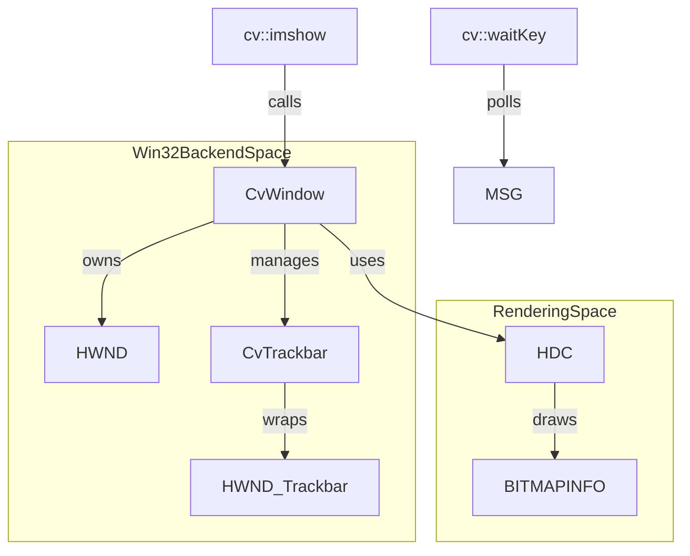
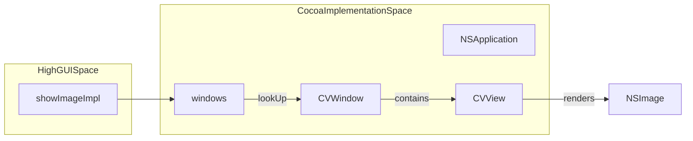

<!-- source: DeepWiki mcp.deepwiki.com · repo opencv/opencv · page 10.3 Backend Implementations: Qt, GTK, Win32, Cocoa, Wayland · fetched 2026-10-30 -->

# Backend Implementations: Qt, GTK, Win32, Cocoa, Wayland

Relevant source files

The following files were used as context for generating this wiki page:

- [modules/core/include/opencv2/core/opengl.hpp](modules/core/include/opencv2/core/opengl.hpp)
- [modules/core/src/opengl.cpp](modules/core/src/opengl.cpp)
- [modules/highgui/cmake/detect_wayland.cmake](modules/highgui/cmake/detect_wayland.cmake)
- [modules/highgui/include/opencv2/highgui.hpp](modules/highgui/include/opencv2/highgui.hpp)
- [modules/highgui/include/opencv2/highgui/highgui.hpp](modules/highgui/include/opencv2/highgui/highgui.hpp)
- [modules/highgui/src/precomp.hpp](modules/highgui/src/precomp.hpp)
- [modules/highgui/src/window.cpp](modules/highgui/src/window.cpp)
- [modules/highgui/src/window_QT.cpp](modules/highgui/src/window_QT.cpp)
- [modules/highgui/src/window_QT.h](modules/highgui/src/window_QT.h)
- [modules/highgui/src/window_cocoa.mm](modules/highgui/src/window_cocoa.mm)
- [modules/highgui/src/window_gtk.cpp](modules/highgui/src/window_gtk.cpp)
- [modules/highgui/src/window_w32.cpp](modules/highgui/src/window_w32.cpp)
- [modules/highgui/src/window_wayland.cpp](modules/highgui/src/window_wayland.cpp)
- [modules/highgui/test/test_gui.cpp](modules/highgui/test/test_gui.cpp)
- [modules/ptcloud/CMakeLists.txt](modules/ptcloud/CMakeLists.txt)
- [modules/ptcloud/include/opencv2/ptcloud.hpp](modules/ptcloud/include/opencv2/ptcloud.hpp)
- [modules/ptcloud/include/opencv2/ptcloud/viz3d.hpp](modules/ptcloud/include/opencv2/ptcloud/viz3d.hpp)
- [modules/ptcloud/src/viz3d/grid_ticks.hpp](modules/ptcloud/src/viz3d/grid_ticks.hpp)
- [modules/ptcloud/src/viz3d/viz3d.cpp](modules/ptcloud/src/viz3d/viz3d.cpp)
- [modules/ptcloud/src/viz3d/viz3d_private.hpp](modules/ptcloud/src/viz3d/viz3d_private.hpp)
- [modules/ptcloud/test/test_viz3d.cpp](modules/ptcloud/test/test_viz3d.cpp)
- [samples/CMakeLists.txt](samples/CMakeLists.txt)
- [samples/cpp/CMakeLists.txt](samples/cpp/CMakeLists.txt)
- [samples/data/rgbd-color.jpg](samples/data/rgbd-color.jpg)
- [samples/data/rgbd-depth.png](samples/data/rgbd-depth.png)
- [samples/gpu/CMakeLists.txt](samples/gpu/CMakeLists.txt)
- [samples/opengl/CMakeLists.txt](samples/opengl/CMakeLists.txt)
- [samples/opengl/opengl3_2.cpp](samples/opengl/opengl3_2.cpp)
- [samples/opengl/opengl_testdata_generator.cpp](samples/opengl/opengl_testdata_generator.cpp)

The `highgui` module provides a unified abstraction for window management and user interaction across disparate operating systems and GUI frameworks. This page details the internal implementation of these backends, their event loop integration, and rendering mechanisms.

## Backend Architecture Overview

OpenCV uses a dispatching mechanism in `modules/highgui/src/window.cpp` to route high-level API calls (like `cv::imshow` or `cv::namedWindow`) to specific backend implementations determined at compile-time.

### Data Flow and Dispatch
When a user calls a function like `cv::setWindowProperty`, the core logic attempts to locate the window in a global registry `getWindowsMap()` [modules/highgui/src/window.cpp:64-69](). If the window is managed by a modern plugin-based backend, it calls the virtual `setProperty` method on the `UIWindow` object [modules/highgui/src/window.cpp:196-202](). For legacy built-in backends, it uses a switch-case to call platform-specific functions like `cvSetModeWindow_QT` or `cvSetModeWindow_W32` [modules/highgui/src/window.cpp:225-231]().

### Natural Language to Code Entity Mapping: Window Management
| Concept | Code Entity (General) | Platform Specific (Example) |
| :--- | :--- | :--- |
| **Window Registry** | `getWindowsMap()` | `windows` (Cocoa NSDictionary) [modules/highgui/src/window_cocoa.mm:78-79]() |
| **Window Object** | `UIWindow` | `CvWindow` (Win32/GTK/Qt) [modules/highgui/src/window_w32.cpp:181-201](), [modules/highgui/src/window_QT.h:113-113]() |
| **Event Processing** | `cv::waitKey()` | `waitKeyImpl` [modules/highgui/src/precomp.hpp:100-100]() |
| **Image Rendering** | `cv::imshow()` | `cvImageWidgetSetImage` (GTK) [modules/highgui/src/window_gtk.cpp:135-153]() |

Sources: [modules/highgui/src/window.cpp:64-91](), [modules/highgui/src/window_w32.cpp:181-235](), [modules/highgui/src/window_cocoa.mm:78-129](), [modules/highgui/src/window_gtk.cpp:135-153]().

---

## Qt Backend Implementation

The Qt backend is the most feature-rich, providing a status bar, toolbar, and advanced control panels [modules/highgui/include/opencv2/highgui.hpp:71-80]().

### Threading and Event Loop
Qt requires the GUI to run on the main thread. OpenCV manages this using the `GuiReceiver` class, which acts as a bridge between the OpenCV calling thread and the Qt event loop [modules/highgui/src/window_QT.h:117-169]().
*   **Blocking Connections:** To ensure thread safety when calling Qt methods from non-GUI threads, OpenCV uses `autoBlockingConnection()`, which selects `Qt::BlockingQueuedConnection` if the caller is not the main thread [modules/highgui/src/window_QT.cpp:121-125]().
*   **Event Bridge:** Functions like `cv::addText` invoke methods on `guiMainThread` via `QMetaObject::invokeMethod` [modules/highgui/src/window_QT.cpp:141-150]().

### Rendering Pipeline
Qt windows use a `ViewPort` (derived from `QGraphicsView` or `QGLWidget`/`QOpenGLWidget`) to render images [modules/highgui/src/window_QT.h:114-115](). If OpenGL is enabled (`WINDOW_OPENGL`), the backend switches to a hardware-accelerated context [modules/highgui/src/window_QT.h:53-57]().

Sources: [modules/highgui/include/opencv2/highgui.hpp:71-80](), [modules/highgui/src/window_QT.h:53-57](), [modules/highgui/src/window_QT.h:114-169](), [modules/highgui/src/window_QT.cpp:121-150]().

---

## Win32 Backend Implementation

The Win32 backend (`window_w32.cpp`) directly interfaces with the Windows API (`user32.dll`, `gdi32.dll`).

### Window and Trackbar Structures
*   **CvWindow:** Encapsulates the `HWND`, `HDC`, and a toolbar structure containing a vector of `CvTrackbar` objects [modules/highgui/src/window_w32.cpp:181-235]().
*   **CvTrackbar:** Maps OpenCV trackbars to Win32 `TRACKBAR_CLASS` controls [modules/highgui/src/window_w32.cpp:150-178]().

### Event Loop Integration
Win32 uses a standard message pump. The `pollKey_W32` function handles message dispatching to maintain responsiveness during `waitKey` calls [modules/highgui/src/precomp.hpp:166]().

### Win32 Entity Relationship

Sources: [modules/highgui/src/window_w32.cpp:122-146](), [modules/highgui/src/window_w32.cpp:150-178](), [modules/highgui/src/window_w32.cpp:181-235](), [modules/highgui/src/precomp.hpp:166-166]().

---

## GTK Backend Implementation

The GTK backend (`window_gtk.cpp`) supports both GTK+ 2.x and 3.x [modules/highgui/src/window_gtk.cpp:57-65]().

### Custom Widget: CvImageWidget
OpenCV defines a custom GTK widget, `CvImageWidget`, to handle image display and scaling [modules/highgui/src/window_gtk.cpp:101-107]().
*   **Image Scaling:** The `cvImageWidgetSetImage` function handles the conversion of `cv::Mat` to a format GTK can display and performs `cv::resize` if the window flags require scaling [modules/highgui/src/window_gtk.cpp:134-153]().
*   **Realization:** The `cvImageWidget_realize` function sets up the `GdkWindow` and event masks for mouse and keyboard interaction [modules/highgui/src/window_gtk.cpp:169-204]().

Sources: [modules/highgui/src/window_gtk.cpp:57-65](), [modules/highgui/src/window_gtk.cpp:101-107](), [modules/highgui/src/window_gtk.cpp:134-153](), [modules/highgui/src/window_gtk.cpp:169-204]().

---

## Cocoa (macOS) Backend Implementation

The Cocoa backend (`window_cocoa.mm`) uses Objective-C and the AppKit framework.

### Architecture
*   **Registry:** A global `NSMutableDictionary *windows` stores `CVWindow` objects keyed by their name [modules/highgui/src/window_cocoa.mm:78-79]().
*   **CVView:** A custom `NSView` that holds the `NSImage` and handles the `drawRect` logic [modules/highgui/src/window_cocoa.mm:81-86]().
*   **Event Handling:** `CVWindow` overrides `cvMouseEvent` to translate Cocoa `NSEvent` objects into OpenCV `MouseEventTypes` [modules/highgui/src/window_cocoa.mm:126-127]().

### Cocoa Code Flow

Sources: [modules/highgui/src/window_cocoa.mm:71-129](), [modules/highgui/src/window_cocoa.mm:151-161]().

---

## Wayland Backend Implementation

The Wayland backend is a modern addition for Linux systems, often replacing GTK/X11 in newer distributions. It is primarily managed via a plugin or specific implementation in `window_wayland.cpp`.

*   **Capabilities:** Unlike other backends, the Wayland implementation currently has limitations regarding window coordinate retrieval. `verify_size` in tests specifically skips `getWindowImageRect` when the Wayland backend is active [modules/highgui/test/test_gui.cpp:54-59]().
*   **Detection:** Wayland support is detected via `detect_wayland.cmake` and relies on the Wayland client libraries.

Sources: [modules/highgui/test/test_gui.cpp:52-64](), [modules/highgui/cmake/detect_wayland.cmake]().

---

## OpenGL Rendering Bridges

Several backends support the `WINDOW_OPENGL` flag to allow direct OpenGL rendering into the window.

*   **Context Management:** `cv::setOpenGlContext` is implemented per-backend to make the window's rendering context current [modules/highgui/src/precomp.hpp:116]().
*   **Callbacks:** The backends store a `CvOpenGlDrawCallback` which is executed during the window's paint event [modules/highgui/src/precomp.hpp:114-115]().
*   **viz3d Integration:** The `ptcloud` module's `viz3d` component leverages these highgui OpenGL hooks to render 3D point clouds. It uses `setOpenGlDrawCallback` and `setMouseCallback` to inject its rendering engine into a highgui-managed window [modules/ptcloud/src/viz3d/viz3d.cpp:38-55]().

Sources: [modules/highgui/src/precomp.hpp:114-123](), [modules/ptcloud/src/viz3d/viz3d.cpp:17-65]().

---

