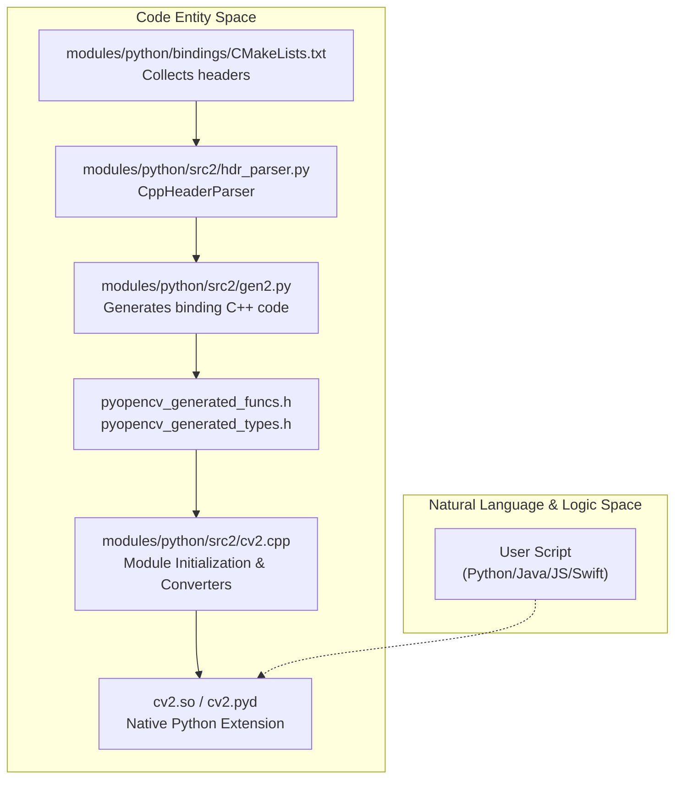

<!-- source: DeepWiki mcp.deepwiki.com · repo opencv/opencv · page 11 Language Bindings · fetched 2026-10-30 -->

# Language Bindings

Relevant source files

The following files were used as context for generating this wiki page:

- [cmake/OpenCVDetectPython.cmake](cmake/OpenCVDetectPython.cmake)
- [cmake/OpenCVGenSetupVars.cmake](cmake/OpenCVGenSetupVars.cmake)
- [modules/core/misc/python/package/utils/__init__.py](modules/core/misc/python/package/utils/__init__.py)
- [modules/dnn/misc/python/pyopencv_dnn.hpp](modules/dnn/misc/python/pyopencv_dnn.hpp)
- [modules/flann/misc/python/pyopencv_flann.hpp](modules/flann/misc/python/pyopencv_flann.hpp)
- [modules/python/CMakeLists.txt](modules/python/CMakeLists.txt)
- [modules/python/bindings/CMakeLists.txt](modules/python/bindings/CMakeLists.txt)
- [modules/python/common.cmake](modules/python/common.cmake)
- [modules/python/package/cv2/__init__.py](modules/python/package/cv2/__init__.py)
- [modules/python/package/extra_modules/misc/__init__.py](modules/python/package/extra_modules/misc/__init__.py)
- [modules/python/package/extra_modules/misc/version.py](modules/python/package/extra_modules/misc/version.py)
- [modules/python/package/template/config.py.in](modules/python/package/template/config.py.in)
- [modules/python/python3/CMakeLists.txt](modules/python/python3/CMakeLists.txt)
- [modules/python/python_loader.cmake](modules/python/python_loader.cmake)
- [modules/python/src2/cv2.cpp](modules/python/src2/cv2.cpp)
- [modules/python/src2/gen2.py](modules/python/src2/gen2.py)
- [modules/python/src2/hdr_parser.py](modules/python/src2/hdr_parser.py)
- [modules/python/src2/pycompat.hpp](modules/python/src2/pycompat.hpp)
- [modules/python/standalone.cmake](modules/python/standalone.cmake)

## Purpose and Scope

This page provides a high-level overview of how OpenCV exposes its C++ API to Python, Java, JavaScript, and Objective-C. OpenCV uses automated code generation toolchains to parse annotated C++ headers and generate runtime bindings, ensuring that language wrappers stay synchronized with the core C++ codebase.

For deep technical details on each language target, refer to the respective child pages:
- For Python bindings, generation scripts, and type conversions, see [Python Bindings and Code Generation](#11.1).
- For Java wrappers, JNI integration, and Android packaging, see [Java and Android Bindings](#11.2).
- For Emscripten-based WebAssembly compilation and JavaScript wrappers, see [JavaScript / WebAssembly Bindings (opencv.js)](#11.3).
- For Apple platform frameworks, Objective-C/Swift generator templates, and image conversions, see [Objective-C / Swift and Apple Framework Packaging](#11.4).

Sources: [modules/python/src2/hdr_parser.py:7-24](), [modules/python/bindings/CMakeLists.txt:1-76]()

---

## Common Design Principles

OpenCV maintains a unified architecture across languages through three primary phases:
1. **Header Annotation**: C++ headers use specialized macros (`CV_EXPORTS_W`, `CV_WRAP`, `CV_PROP`, `CV_OUT`) to mark classes, methods, and parameters intended for exposure. These macros evaluate to nothing during standard C++ compilation [modules/python/src2/hdr_parser.py:174-195]().
2. **Parsing and Code Generation**: Python-based parsers (`hdr_parser.py` and language-specific generators like `gen2.py`) inspect the headers, extract function signatures, and emit binding files (`pyopencv_generated_funcs.h`, etc.) [modules/python/src2/hdr_parser.py:7-24](), [modules/python/bindings/CMakeLists.txt:67-76]().
3. **Compilation and Loading**: The generated glue code is compiled into native extension modules or runtime libraries (`cv2.so`, `.pyd`, JNI libraries, or `.wasm`) loaded by the host language environment [modules/python/common.cmake:22-31]().

Sources: [modules/python/src2/hdr_parser.py:7-34](), [modules/python/bindings/CMakeLists.txt:67-76](), [modules/python/common.cmake:22-31]()

---

## Architecture Overview

The following diagram maps the logical user applications (Natural Language Space) to the concrete build and source entities (Code Entity Space) involved in generating and executing language bindings.

Diagram: Language Binding Pipeline Architecture

Sources: [modules/python/bindings/CMakeLists.txt:1-76](), [modules/python/src2/hdr_parser.py:7-34](), [modules/python/src2/gen2.py:1-10](), [modules/python/src2/cv2.cpp:1-126]()

---

## Python Bindings and Code Generation

The Python bindings are generated by `gen2.py` utilizing parsed header information from `hdr_parser.py` [modules/python/src2/hdr_parser.py:7-24](), [modules/python/src2/gen2.py:1-10](). The resulting files are included into `cv2.cpp`, which manages NumPy integration, exception handling, and custom type conversion via `PyOpenCV_Converter` templates [modules/python/src2/cv2.cpp:1-15](), [modules/python/src2/gen2.py:79-102]().

For detailed coverage of `hdr_parser.py`, `gen2.py`, type mappings, `cv2` package loading (`cv2/__init__.py`), typing stubs generation, and tests, see [Python Bindings and Code Generation](#11.1).

Sources: [modules/python/src2/cv2.cpp:1-15](), [modules/python/src2/gen2.py:1-102](), [modules/python/package/cv2/__init__.py:68-181]()

---

## Java and Android Bindings

Java and Android wrappers are produced by processing annotated headers through Java-specific generation scripts that create JNI (Java Native Interface) glue code and Java API classes such as `Mat.java` and `Converters.java`.

For details on the JNI translation layer, Android Studio/Gradle project integration, camera components, samples, and coverage testing (`check-tests.py`), see [Java and Android Bindings](#11.2).

Sources: [modules/python/src2/hdr_parser.py:7-24]()

---

## JavaScript / WebAssembly Bindings (opencv.js)

OpenCV exposes its functionality to JavaScript and Node.js environments by compiling C++ code into WebAssembly (Wasm) using Emscripten and `embind`. Whitelists and module configurations are controlled via configuration files like `opencv_js.config.py`.

For details on the Emscripten build configuration, wrapper generation, memory management, and JS test suites, see [JavaScript / WebAssembly Bindings (opencv.js)](#11.3).

Sources: [modules/python/src2/hdr_parser.py:7-24]()

---

## Objective-C / Swift and Apple Framework Packaging

Apple platforms are supported through packaging scripts such as `build_framework.py` and `build_xcframework.py`, alongside Objective-C generator templates that wrap core data structures (`Mat.mm`) and provide interoperability with Swift apps.

For information on framework packaging, Objective-C wrappers, and Xcode integration, see [Objective-C / Swift and Apple Framework Packaging](#11.4).

Sources: [modules/python/src2/hdr_parser.py:7-24]()

---

## Build System Integration

CMake orchestrates bindings generation across all supported target languages, locating interpreters, compilers, and SDK dependencies at configuration time.

| Component | Responsible File | Role |
|---|---|---|
| Python Detection | `cmake/OpenCVDetectPython.cmake` | Locates Python interpreter, libraries, and NumPy headers [cmake/OpenCVDetectPython.cmake:24-28]() |
| Python Build Integration | `modules/python/CMakeLists.txt` & `common.cmake` | Configures the `cv2` module target and links extension libraries [modules/python/CMakeLists.txt:4-16](), [modules/python/common.cmake:22-31]() |
| Bindings Generation Target | `modules/python/bindings/CMakeLists.txt` | Defines custom commands for running `gen2.py` and generating headers [modules/python/bindings/CMakeLists.txt:1-76]() |

Sources: [cmake/OpenCVDetectPython.cmake:24-28](), [modules/python/CMakeLists.txt:4-16](), [modules/python/common.cmake:22-31](), [modules/python/bindings/CMakeLists.txt:1-76]()

---

