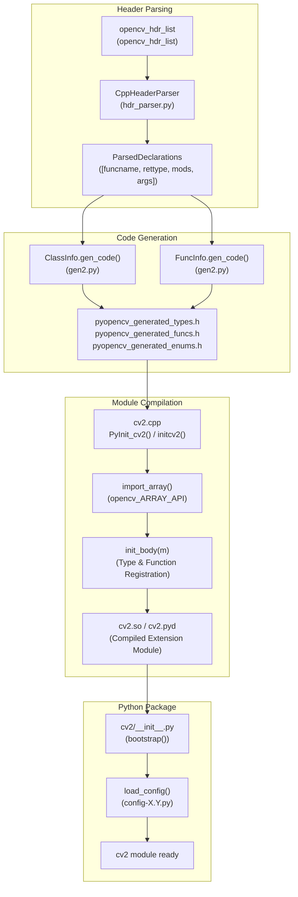
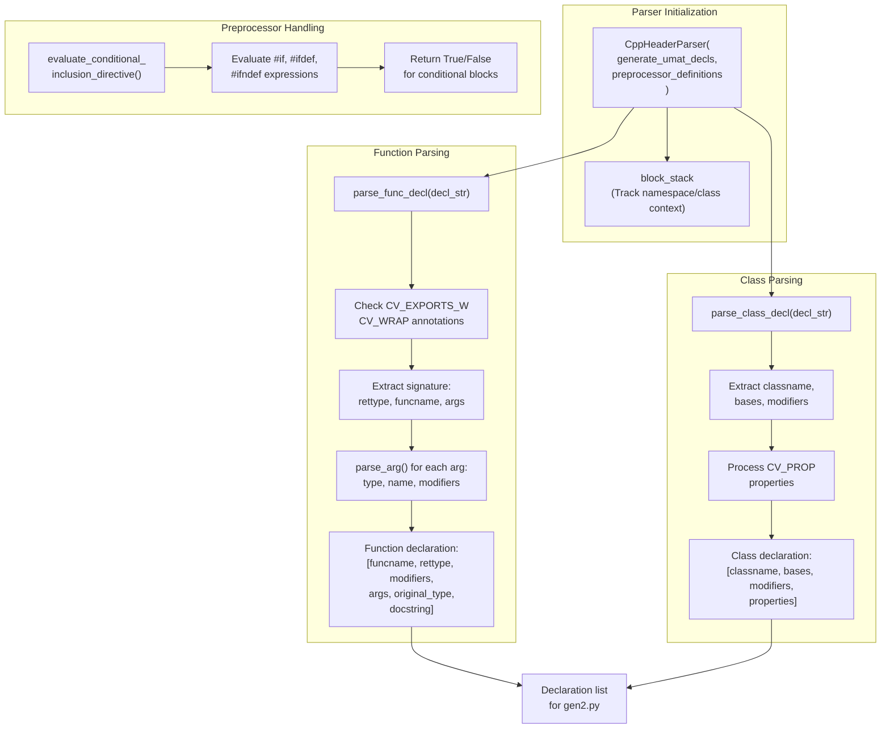
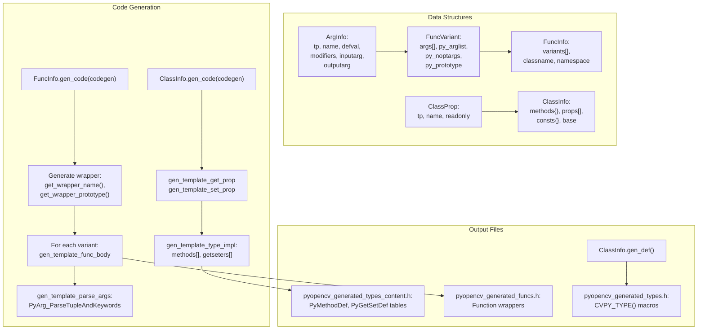
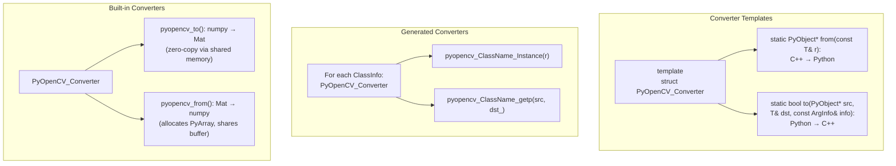
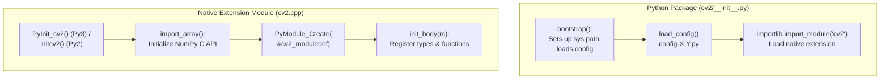
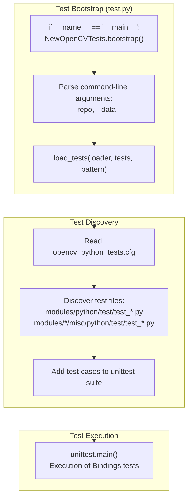

<!-- source: DeepWiki mcp.deepwiki.com · repo opencv/opencv · page 11.1 Python Bindings and Code Generation · fetched 2026-10-30 -->

# Python Bindings and Code Generation

Relevant source files

The following files were used as context for generating this wiki page:

- [cmake/OpenCVDetectPython.cmake](cmake/OpenCVDetectPython.cmake)
- [cmake/OpenCVGenSetupVars.cmake](cmake/OpenCVGenSetupVars.cmake)
- [doc/py_tutorials/py_bindings/py_bindings_basics/py_bindings_basics.markdown](doc/py_tutorials/py_bindings/py_bindings_basics/py_bindings_basics.markdown)
- [modules/core/include/opencv2/core/bindings_utils.hpp](modules/core/include/opencv2/core/bindings_utils.hpp)
- [modules/core/misc/objc/common/ByteVectorExt.swift](modules/core/misc/objc/common/ByteVectorExt.swift)
- [modules/core/misc/objc/test/CoreTest.swift](modules/core/misc/objc/test/CoreTest.swift)
- [modules/core/misc/python/package/mat_wrapper/__init__.py](modules/core/misc/python/package/mat_wrapper/__init__.py)
- [modules/core/misc/python/package/utils/__init__.py](modules/core/misc/python/package/utils/__init__.py)
- [modules/core/src/bindings_utils.cpp](modules/core/src/bindings_utils.cpp)
- [modules/dnn/misc/python/pyopencv_dnn.hpp](modules/dnn/misc/python/pyopencv_dnn.hpp)
- [modules/dnn/misc/python/test/test_onnx_conformance.py](modules/dnn/misc/python/test/test_onnx_conformance.py)
- [modules/features/misc/python/test/test_feature_homography.py](modules/features/misc/python/test/test_feature_homography.py)
- [modules/flann/misc/python/pyopencv_flann.hpp](modules/flann/misc/python/pyopencv_flann.hpp)
- [modules/imgcodecs/misc/objc/test/ImgcodecsTest.swift](modules/imgcodecs/misc/objc/test/ImgcodecsTest.swift)
- [modules/imgproc/include/opencv2/imgproc/bindings.hpp](modules/imgproc/include/opencv2/imgproc/bindings.hpp)
- [modules/imgproc/misc/objc/gen_dict.json](modules/imgproc/misc/objc/gen_dict.json)
- [modules/imgproc/misc/objc/test/ImgprocTest.swift](modules/imgproc/misc/objc/test/ImgprocTest.swift)
- [modules/objc/test/test/OpenCVTestCase.swift](modules/objc/test/test/OpenCVTestCase.swift)
- [modules/objdetect/misc/python/test/test_objdetect_aruco.py](modules/objdetect/misc/python/test/test_objdetect_aruco.py)
- [modules/python/CMakeLists.txt](modules/python/CMakeLists.txt)
- [modules/python/bindings/CMakeLists.txt](modules/python/bindings/CMakeLists.txt)
- [modules/python/common.cmake](modules/python/common.cmake)
- [modules/python/package/cv2/__init__.py](modules/python/package/cv2/__init__.py)
- [modules/python/package/extra_modules/misc/__init__.py](modules/python/package/extra_modules/misc/__init__.py)
- [modules/python/package/extra_modules/misc/version.py](modules/python/package/extra_modules/misc/version.py)
- [modules/python/package/template/config.py.in](modules/python/package/template/config.py.in)
- [modules/python/python3/CMakeLists.txt](modules/python/python3/CMakeLists.txt)
- [modules/python/python_loader.cmake](modules/python/python_loader.cmake)
- [modules/python/src2/copy_typings_stubs_on_success.py](modules/python/src2/copy_typings_stubs_on_success.py)
- [modules/python/src2/cv2.cpp](modules/python/src2/cv2.cpp)
- [modules/python/src2/cv2.hpp](modules/python/src2/cv2.hpp)
- [modules/python/src2/cv2_convert.cpp](modules/python/src2/cv2_convert.cpp)
- [modules/python/src2/cv2_convert.hpp](modules/python/src2/cv2_convert.hpp)
- [modules/python/src2/cv2_numpy.cpp](modules/python/src2/cv2_numpy.cpp)
- [modules/python/src2/cv2_util.cpp](modules/python/src2/cv2_util.cpp)
- [modules/python/src2/gen2.py](modules/python/src2/gen2.py)
- [modules/python/src2/hdr_parser.py](modules/python/src2/hdr_parser.py)
- [modules/python/src2/pycompat.hpp](modules/python/src2/pycompat.hpp)
- [modules/python/src2/typing_stubs_generation/__init__.py](modules/python/src2/typing_stubs_generation/__init__.py)
- [modules/python/src2/typing_stubs_generation/api_refinement.py](modules/python/src2/typing_stubs_generation/api_refinement.py)
- [modules/python/src2/typing_stubs_generation/ast_utils.py](modules/python/src2/typing_stubs_generation/ast_utils.py)
- [modules/python/src2/typing_stubs_generation/generation.py](modules/python/src2/typing_stubs_generation/generation.py)
- [modules/python/src2/typing_stubs_generation/nodes/__init__.py](modules/python/src2/typing_stubs_generation/nodes/__init__.py)
- [modules/python/src2/typing_stubs_generation/nodes/class_node.py](modules/python/src2/typing_stubs_generation/nodes/class_node.py)
- [modules/python/src2/typing_stubs_generation/nodes/constant_node.py](modules/python/src2/typing_stubs_generation/nodes/constant_node.py)
- [modules/python/src2/typing_stubs_generation/nodes/enumeration_node.py](modules/python/src2/typing_stubs_generation/nodes/enumeration_node.py)
- [modules/python/src2/typing_stubs_generation/nodes/function_node.py](modules/python/src2/typing_stubs_generation/nodes/function_node.py)
- [modules/python/src2/typing_stubs_generation/nodes/namespace_node.py](modules/python/src2/typing_stubs_generation/nodes/namespace_node.py)
- [modules/python/src2/typing_stubs_generation/nodes/node.py](modules/python/src2/typing_stubs_generation/nodes/node.py)
- [modules/python/src2/typing_stubs_generation/nodes/type_node.py](modules/python/src2/typing_stubs_generation/nodes/type_node.py)
- [modules/python/src2/typing_stubs_generation/predefined_types.py](modules/python/src2/typing_stubs_generation/predefined_types.py)
- [modules/python/src2/typing_stubs_generator.py](modules/python/src2/typing_stubs_generator.py)
- [modules/python/standalone.cmake](modules/python/standalone.cmake)
- [modules/python/test/test.py](modules/python/test/test.py)
- [modules/python/test/test_camshift.py](modules/python/test/test_camshift.py)
- [modules/python/test/test_dft.py](modules/python/test/test_dft.py)
- [modules/python/test/test_fitline.py](modules/python/test/test_fitline.py)
- [modules/python/test/test_fs_cache_dir.py](modules/python/test/test_fs_cache_dir.py)
- [modules/python/test/test_grabcut.py](modules/python/test/test_grabcut.py)
- [modules/python/test/test_houghcircles.py](modules/python/test/test_houghcircles.py)
- [modules/python/test/test_houghlines.py](modules/python/test/test_houghlines.py)
- [modules/python/test/test_kmeans.py](modules/python/test/test_kmeans.py)
- [modules/python/test/test_mat.py](modules/python/test/test_mat.py)
- [modules/python/test/test_misc.py](modules/python/test/test_misc.py)
- [modules/python/test/test_morphology.py](modules/python/test/test_morphology.py)
- [modules/python/test/test_mser.py](modules/python/test/test_mser.py)
- [modules/python/test/test_squares.py](modules/python/test/test_squares.py)
- [modules/python/test/test_texture_flow.py](modules/python/test/test_texture_flow.py)
- [modules/python/test/tests_common.py](modules/python/test/tests_common.py)
- [modules/python/test/tst_scene_render.py](modules/python/test/tst_scene_render.py)

This page documents the Python binding generation system that transforms C++ OpenCV APIs into Python-accessible bindings. The system consists of several integrated components: `hdr_parser.py` for parsing C++ headers, `gen2.py` for generating wrapper code, the `cv2.cpp` module initialization layer, the type conversion subsystem, the `cv2` package layout, the typing stubs generation system (`TypingStubsGenerator`), and the comprehensive Python test suite.

## Code Generation Pipeline

The binding generation process parses annotated C++ headers, generates native C++ wrapper code, and compiles it into a Python extension module linked with NumPy.

**Code Generation and Compilation Flow**

Sources: [modules/python/src2/hdr_parser.py:7-22](), [modules/python/src2/hdr_parser.py:174-205](), [modules/python/src2/gen2.py:281-448](), [modules/python/src2/gen2.py:749-875](), [modules/python/src2/cv2.cpp:3-15](), [modules/python/package/cv2/__init__.py:68-179]()

## Header Parser (`hdr_parser.py`)

The `CppHeaderParser` class extracts API declarations from C++ headers by examining functions, classes, and enums marked with OpenCV wrapper annotations such as `CV_EXPORTS_W`, `CV_WRAP`, `CV_PROP`, and `CV_OUT`.

**CppHeaderParser Declaration Extraction**

### Annotation Detection Table
| Annotation | Detection | Purpose |
|------------|-----------|---------|
| `CV_EXPORTS_W` | `"CV_EXPORTS_W" in decl_str` | Marks classes or functions for binding export |
| `CV_WRAP` | `"CV_WRAP" in decl_str` | Marks methods or inline functions for binding export |
| `CV_OUT` | `"CV_OUT" in arg_str` | Designates an argument as an output parameter |
| `CV_IN_OUT` | `"CV_IN_OUT" in arg_str` | Designates an argument as input/output |
| `CV_WRAP_AS` | `"CV_WRAP_AS" in decl_str` | Renames the exported Python function or method |

Key parser methods:
- **`parse_func_decl(decl_str, mat, docstring)`**: Parses function signatures with `CV_EXPORTS_W`/`CV_WRAP` annotations [modules/python/src2/hdr_parser.py:556-710]().
- **`parse_class_decl(decl_str)`**: Extracts class declarations marked with export macros [modules/python/src2/hdr_parser.py:411-442]().
- **`parse_arg(arg_str, argno)`**: Parses argument types and modifiers such as `/O` (output) and `/A` (array) [modules/python/src2/hdr_parser.py:226-387]().
- **`evaluate_conditional_inclusion_directive(directive, preprocessor_definitions)`**: Evaluates preprocessor conditionals (`#if`, `#ifdef`, `#ifndef`) during header parsing [modules/python/src2/hdr_parser.py:36-171]().

Sources: [modules/python/src2/hdr_parser.py:36-171](), [modules/python/src2/hdr_parser.py:174-205](), [modules/python/src2/hdr_parser.py:226-387](), [modules/python/src2/hdr_parser.py:411-442](), [modules/python/src2/hdr_parser.py:556-710]()

## Binding Generator (`gen2.py`)

The `gen2.py` script consumes the structured declarations produced by `hdr_parser.py` and emits C++ header files containing wrapper functions, method definitions, and type registration tables.

**gen2.py Core Classes and Generation Flow**

### Key Generator Classes
- **`ArgInfo`**: Represents function arguments with modifier flags (`inputarg`, `outputarg`) [modules/python/src2/gen2.py:457-541]().
- **`FuncVariant`**: Represents a single overload variant of a function or method [modules/python/src2/gen2.py:597-747]().
- **`FuncInfo`**: Aggregates all overload variants for a function and manages wrapper generation (`gen_code()`) [modules/python/src2/gen2.py:749-875]().
- **`ClassInfo`**: Represents a C++ class, generating `PyGetSetDef` property accessors and `PyMethodDef` binding tables [modules/python/src2/gen2.py:281-448]().

Sources: [modules/python/src2/gen2.py:281-448](), [modules/python/src2/gen2.py:457-541](), [modules/python/src2/gen2.py:597-747](), [modules/python/src2/gen2.py:749-875]()

## Type Conversion System

The type conversion system bridges Python objects and C++ data structures via specialized `PyOpenCV_Converter` template specializations.

**Type Converter Template Structure**

### `Mat` ↔ NumPy Integration
- **Python to C++ (`pyopencv_to`)**: Located in `cv2_convert.cpp`, this function validates incoming `PyArrayObject` pointers, checks writability for output arguments [modules/python/src2/cv2_convert.cpp:144-149](), handles depth casting [modules/python/src2/cv2_convert.cpp:151-169](), and wraps the array data into a `cv::Mat` without copying data when memory layout permits.
- **C++ to Python (`pyopencv_from`)**: Creates a NumPy `ndarray` wrapping the memory allocated by `cv::Mat`.

Sources: [modules/python/src2/cv2_convert.cpp:53-208](), [modules/python/src2/gen2.py:76-102](), [modules/python/src2/gen2.py:876-1043]()

## `cv2` Module Structure and Initialization

The native extension entry point resides in `cv2.cpp`, which initializes the module, registers custom types, and hooks into NumPy.

**cv2 Module Components**

Initialization steps in `cv2.cpp`:
1. **NumPy API Initialization**: Invokes `import_array()` to import NumPy C runtime symbols [modules/python/src2/cv2.cpp:3-14]().
2. **Type and Enum Registration**: Includes generated headers (`pyopencv_generated_types.h`, `pyopencv_generated_enums.h`) and initializes type objects [modules/python/src2/cv2.cpp:83-94]().
3. **Special Methods**: Registers internal hooks such as `_registerMatType`, `redirectError`, and GUI/DNN callback handlers in `special_methods` [modules/python/src2/cv2.cpp:112-126]().

Sources: [modules/python/src2/cv2.cpp:3-126](), [modules/python/package/cv2/__init__.py:68-179]()

## Typing Stubs Generation System (`TypingStubsGenerator`)

OpenCV generates Python type stubs (`.pyi`) via `TypingStubsGenerator` to support static type checkers (such as `mypy`) and IDE autocompletion.

**Typing Stubs Generation Workflow**
1. **AST Reconstruction**: Parses header declarations into an AST representation containing namespace, class, function, and enum nodes [modules/python/src2/typing_stubs_generation/generation.py:44-71]().
2. **Manual API Refinement**: Applies manual overrides and refinements for overloaded signatures and optional arguments in `api_refinement.py` [modules/python/src2/typing_stubs_generation/api_refinement.py:17-54]().
3. **Type Resolution**: Resolves type references across nested namespaces (`root.resolve_type_nodes()`) [modules/python/src2/typing_stubs_generation/generation.py:107]().
4. **Stub Emission**: Recursively generates module stubs (`__init__.pyi`) containing constants, enums, classes, and function overloads [modules/python/src2/typing_stubs_generation/generation.py:119-159]().

Sources: [modules/python/src2/typing_stubs_generation/api_refinement.py:17-54](), [modules/python/src2/typing_stubs_generation/generation.py:44-159]()

## Python Test Infrastructure

OpenCV includes a comprehensive Python test suite built on top of `unittest` and NumPy.

**Python Test Discovery and Execution**

- **Test Runner (`test.py`)**: Discovers and executes tests from core python test directories as well as module-specific directories (`modules/*/misc/python/test/`) [modules/python/test/test.py:27-57]().
- **Test Base (`tests_common.py`)**: Implements `NewOpenCVTests`, providing image downloading, test image caching, and helper assertions [modules/python/test/tests_common.py:22-118]().
- **Miscellaneous Tests (`test_misc.py`)**: Tests inheritance, exception propagation (`cv.error`), error redirection (`redirectError`), and overload resolution [modules/python/test/test_misc.py:132-196]().

Sources: [modules/python/test/test.py:27-60](), [modules/python/test/tests_common.py:22-101](), [modules/python/test/test_misc.py:132-196]()

## Build System Integration

CMake manages Python detection, binding generation, and library compilation.

1. **Python Detection**: `find_python` in `OpenCVDetectPython.cmake` locates the Python interpreter, development libraries, include paths, and NumPy headers [cmake/OpenCVDetectPython.cmake:24-28]().
2. **Module Configuration**: `modules/python/CMakeLists.txt` configures the binding targets and adds subdirectories [modules/python/CMakeLists.txt:4-32]().
3. **Compilation**: `modules/python/common.cmake` compiles `cv2.cpp`, `cv2_convert.cpp`, `cv2_numpy.cpp`, `cv2_util.cpp`, and generated headers into the shared extension module (`cv2.so` / `cv2.pyd`) [modules/python/common.cmake:22-31]().

Sources: [cmake/OpenCVDetectPython.cmake:24-28](), [modules/python/CMakeLists.txt:4-32](), [modules/python/common.cmake:22-31]()

---

