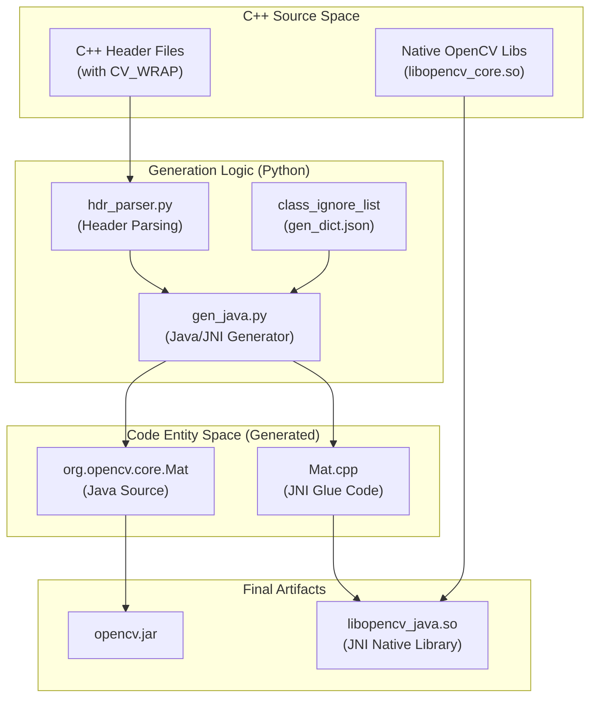
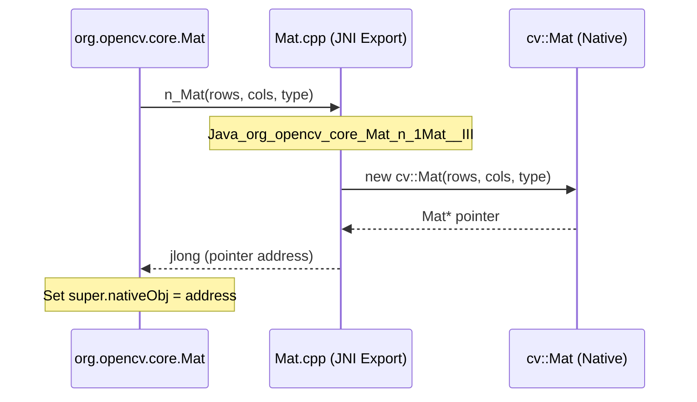

<!-- source: DeepWiki mcp.deepwiki.com · repo opencv/opencv · page 11.2 Java and Android Bindings · fetched 2026-10-30 -->

# Java and Android Bindings

Relevant source files

The following files were used as context for generating this wiki page:

- [cmake/android/android_gradle_projects.cmake](cmake/android/android_gradle_projects.cmake)
- [modules/core/misc/java/src/java/core+KeyPoint.java](modules/core/misc/java/src/java/core+KeyPoint.java)
- [modules/core/misc/java/src/java/core+Mat.java](modules/core/misc/java/src/java/core+Mat.java)
- [modules/core/misc/java/src/java/core+MatOfByte.java](modules/core/misc/java/src/java/core+MatOfByte.java)
- [modules/core/misc/java/test/MatOfByteTest.java](modules/core/misc/java/test/MatOfByteTest.java)
- [modules/core/misc/java/test/MatTest.java](modules/core/misc/java/test/MatTest.java)
- [modules/java/android_sdk/CMakeLists.txt](modules/java/android_sdk/CMakeLists.txt)
- [modules/java/android_sdk/build.gradle.in](modules/java/android_sdk/build.gradle.in)
- [modules/java/android_sdk/libcxx_helper/CMakeLists.txt](modules/java/android_sdk/libcxx_helper/CMakeLists.txt)
- [modules/java/android_sdk/libcxx_helper/dummy.cpp](modules/java/android_sdk/libcxx_helper/dummy.cpp)
- [modules/java/generator/gen_java.py](modules/java/generator/gen_java.py)
- [modules/java/generator/src/cpp/Mat.cpp](modules/java/generator/src/cpp/Mat.cpp)
- [modules/java/test/android_test/CMakeLists.txt](modules/java/test/android_test/CMakeLists.txt)
- [modules/java/test/android_test/build.gradle.in](modules/java/test/android_test/build.gradle.in)
- [modules/java/test/android_test/gradle.properties](modules/java/test/android_test/gradle.properties)
- [modules/java/test/android_test/settings.gradle](modules/java/test/android_test/settings.gradle)
- [modules/java/test/android_test/src/org/opencv/test/OpenCVTestCase.java](modules/java/test/android_test/src/org/opencv/test/OpenCVTestCase.java)
- [modules/java/test/android_test/src/org/opencv/test/OpenCVTestRunner.java](modules/java/test/android_test/src/org/opencv/test/OpenCVTestRunner.java)
- [modules/java/test/android_test/src/org/opencv/test/android/KotlinTest.kt](modules/java/test/android_test/src/org/opencv/test/android/KotlinTest.kt)
- [modules/java/test/android_test/src/org/opencv/test/android/UtilsTest.java](modules/java/test/android_test/src/org/opencv/test/android/UtilsTest.java)
- [modules/java/test/android_test/tests_module/build.gradle.in](modules/java/test/android_test/tests_module/build.gradle.in)
- [modules/java/test/pure_test/src/org/opencv/test/OpenCVTestCase.java](modules/java/test/pure_test/src/org/opencv/test/OpenCVTestCase.java)
- [platforms/android/build_aar.sh](platforms/android/build_aar.sh)
- [platforms/android/gradle-wrapper/gradle/wrapper/gradle-wrapper.properties.in](platforms/android/gradle-wrapper/gradle/wrapper/gradle-wrapper.properties.in)
- [platforms/android/ndk-22.config.py](platforms/android/ndk-22.config.py)
- [platforms/android/ndk-25.config.py](platforms/android/ndk-25.config.py)
- [samples/android/15-puzzle/build.gradle.in](samples/android/15-puzzle/build.gradle.in)
- [samples/android/15-puzzle/src/org/opencv/samples/puzzle15/Puzzle15Activity.java](samples/android/15-puzzle/src/org/opencv/samples/puzzle15/Puzzle15Activity.java)
- [samples/android/15-puzzle/src/org/opencv/samples/puzzle15/Puzzle15Processor.java](samples/android/15-puzzle/src/org/opencv/samples/puzzle15/Puzzle15Processor.java)
- [samples/android/build.gradle.in](samples/android/build.gradle.in)
- [samples/android/camera-calibration/CMakeLists.txt](samples/android/camera-calibration/CMakeLists.txt)
- [samples/android/camera-calibration/build.gradle.in](samples/android/camera-calibration/build.gradle.in)
- [samples/android/camera-calibration/res/drawable/icon.png](samples/android/camera-calibration/res/drawable/icon.png)
- [samples/android/camera-calibration/res/layout/camera_calibration_surface_view.xml](samples/android/camera-calibration/res/layout/camera_calibration_surface_view.xml)
- [samples/android/camera-calibration/res/menu/calibration.xml](samples/android/camera-calibration/res/menu/calibration.xml)
- [samples/android/camera-calibration/res/values/strings.xml](samples/android/camera-calibration/res/values/strings.xml)
- [samples/android/camera-calibration/src/org/opencv/samples/cameracalibration/CalibrationResult.java](samples/android/camera-calibration/src/org/opencv/samples/cameracalibration/CalibrationResult.java)
- [samples/android/camera-calibration/src/org/opencv/samples/cameracalibration/CameraCalibrator.java](samples/android/camera-calibration/src/org/opencv/samples/cameracalibration/CameraCalibrator.java)
- [samples/android/camera-calibration/src/org/opencv/samples/cameracalibration/OnCameraFrameRender.java](samples/android/camera-calibration/src/org/opencv/samples/cameracalibration/OnCameraFrameRender.java)
- [samples/android/color-blob-detection/build.gradle.in](samples/android/color-blob-detection/build.gradle.in)
- [samples/android/color-blob-detection/src/org/opencv/samples/colorblobdetect/ColorBlobDetectionActivity.java](samples/android/color-blob-detection/src/org/opencv/samples/colorblobdetect/ColorBlobDetectionActivity.java)
- [samples/android/face-detection/build.gradle.in](samples/android/face-detection/build.gradle.in)
- [samples/android/image-manipulations/build.gradle.in](samples/android/image-manipulations/build.gradle.in)
- [samples/android/image-manipulations/src/org/opencv/samples/imagemanipulations/ImageManipulationsActivity.java](samples/android/image-manipulations/src/org/opencv/samples/imagemanipulations/ImageManipulationsActivity.java)
- [samples/android/mobilenet-objdetect/build.gradle.in](samples/android/mobilenet-objdetect/build.gradle.in)
- [samples/android/tutorial-1-camerapreview/build.gradle.in](samples/android/tutorial-1-camerapreview/build.gradle.in)
- [samples/android/tutorial-2-mixedprocessing/build.gradle.in](samples/android/tutorial-2-mixedprocessing/build.gradle.in)
- [samples/android/tutorial-3-cameracontrol/build.gradle.in](samples/android/tutorial-3-cameracontrol/build.gradle.in)
- [samples/android/tutorial-4-opencl/build.gradle.in](samples/android/tutorial-4-opencl/build.gradle.in)

## Purpose and Scope

This document details the implementation of OpenCV's Java and Android bindings. It covers the code generation pipeline managed by `gen_java.py`, the JNI (Java Native Interface) bridge architecture, the design of core classes like `Mat.java`, the Android SDK packaging and Gradle integration, camera view components, Android samples, and test coverage auditing.

## Java/JNI Architecture Overview

OpenCV's Java bindings use JNI to bridge Java applications with native C++ libraries. The system is driven by a generator that processes C++ headers to produce both Java wrapper classes and C++ JNI "glue" code.

### Java Binding Pipeline

Sources: [modules/java/generator/gen_java.py:22-43](), [modules/core/misc/java/src/java/core+Mat.java:1-20]()

## JNI Code Generation System (`gen_java.py`)

The `gen_java.py` script is the core of the binding generation. It uses a `type_dict` dictionary to map C++ types to Java types, JNI signatures, and marshaling helpers.

### Type Mapping and Marshalling
The generator defines how primitive and complex types are translated across the boundary. It manages JNI types (`jni_type`), Java types (`j_type`), and intermediate JNI native types (`jn_type`).

| C++ Type | Java Type (`j_type`) | JNI Type (`jni_type`) | Marshalling Logic / Suffix |
| :--- | :--- | :--- | :--- |
| `bool` | `boolean` | `jboolean` | `suffix`: "Z" |
| `int` | `int` | `jint` | `suffix`: "I" |
| `string` | `String` | `jstring` | `GetStringUTFChars` / `ReleaseStringUTFChars` |
| `vector_string`| `List<String>` | `jobject` | `suffix`: "Ljava_util_List" |
| `byte[]` | `byte[]` | `jbyteArray` | `GetByteArrayElements` |

Sources: [modules/java/generator/gen_java.py:58-100]()

### Class and Constant Filtering
The generator uses `class_ignore_list` and `const_ignore_list` to skip specific symbols during wrapper generation [modules/java/generator/gen_java.py:41-50](). These lists are loaded from `gen_dict.json` configuration files defined for each module and its dependencies.

Sources: [modules/java/generator/gen_java.py:41-50]()

## Core Component Design

### Mat.java and Mat.cpp
The `Mat` class is the primary data structure for N-dimensional arrays. Its Java implementation consists of native method declarations (prefixed with `n_`) and wrapper methods that pass the `nativeObj` pointer to JNI [modules/core/misc/java/src/java/core+Mat.java:7-30](). The C++ implementation in `Mat.cpp` handles direct memory access via `ByteBuffer` and native `cv::Mat` construction [modules/java/generator/src/cpp/Mat.cpp:71-88]().

Sources: [modules/core/misc/java/src/java/core+Mat.java:27-30](), [modules/java/generator/src/cpp/Mat.cpp:122-139](), [modules/java/generator/src/cpp/Mat.cpp:58-63]()

### Exception Handling
The JNI layer includes a `throwJavaException` utility function. It catches C++ `cv::Exception`, maps it to the Java `org.opencv.core.CvException` class, and uses `env->ThrowNew` to propagate errors safely to the JVM runtime [modules/java/generator/src/cpp/Mat.cpp:13-33]().

Sources: [modules/java/generator/src/cpp/Mat.cpp:13-33]()

## Android-Specific Components

### Build System and Gradle Integration
OpenCV for Android integrates with Android Studio via generated Gradle projects. `cmake/android/android_gradle_projects.cmake` sets up Android Gradle Plugin versions, compile SDK versions (e.g., SDK 34), minimum SDK requirements, and ABI filters (`armeabi-v7a`, `arm64-v8a`, `x86`, `x86_64`) [cmake/android/android_gradle_projects.cmake:1-43](). Additionally, `modules/java/android_sdk/build.gradle.in` configures library packaging, prefab publishing, and native CMake builds [modules/java/android_sdk/build.gradle.in:91-152]().

Sources: [cmake/android/android_gradle_projects.cmake:1-43](), [modules/java/android_sdk/build.gradle.in:91-152](), [modules/java/android_sdk/CMakeLists.txt:1-52]()

### Android Samples and Camera Integration
OpenCV provides sample applications demonstrating camera integration, image manipulations, and calibration:
- **`ImageManipulationsActivity`**: Uses `CameraActivity` and `CvCameraViewListener2` to process frames through filters like Canny, Sobel, and Sepia [samples/android/image-manipulations/src/org/opencv/samples/imagemanipulations/ImageManipulationsActivity.java:29-49]().
- **`ColorBlobDetectionActivity`**: Captures touch events on the preview surface, converts regions to HSV via `Imgproc.cvtColor`, and tracks color blobs using contours [samples/android/color-blob-detection/src/org/opencv/samples/colorblobdetect/ColorBlobDetectionActivity.java:31-183]().
- **`CameraCalibrator`**: Integrates `Objdetect.findCirclesGrid`, `Calib.calibrateCamera`, and `Geometry.projectPoints` for camera intrinsic parameter estimation [samples/android/camera-calibration/src/org/opencv/samples/cameracalibration/CameraCalibrator.java:39-125]().

Sources: [samples/android/image-manipulations/src/org/opencv/samples/imagemanipulations/ImageManipulationsActivity.java:29-49](), [samples/android/color-blob-detection/src/org/opencv/samples/colorblobdetect/ColorBlobDetectionActivity.java:31-183](), [samples/android/camera-calibration/src/org/opencv/samples/cameracalibration/CameraCalibrator.java:39-125]()

## Test Coverage and Auditing

OpenCV maintains robust test suites to verify Java bindings correctness:
- **`MatTest`**: Validates `Mat` operations such as `adjustROI`, `assignTo`, `checkVector`, `clone`, and `convertTo` [modules/core/misc/java/test/MatTest.java:19-147]().
- **`OpenCVTestCase`**: Provides shared test fixtures, initializing native libraries with `System.loadLibrary(Core.NATIVE_LIBRARY_NAME)` and setting up reference matrices like `gray0`, `gray255`, and `rgbLena` [modules/java/test/pure_test/src/org/opencv/test/OpenCVTestCase.java:105-186]().

Sources: [modules/core/misc/java/test/MatTest.java:19-147](), [modules/java/test/pure_test/src/org/opencv/test/OpenCVTestCase.java:105-186]()

---

