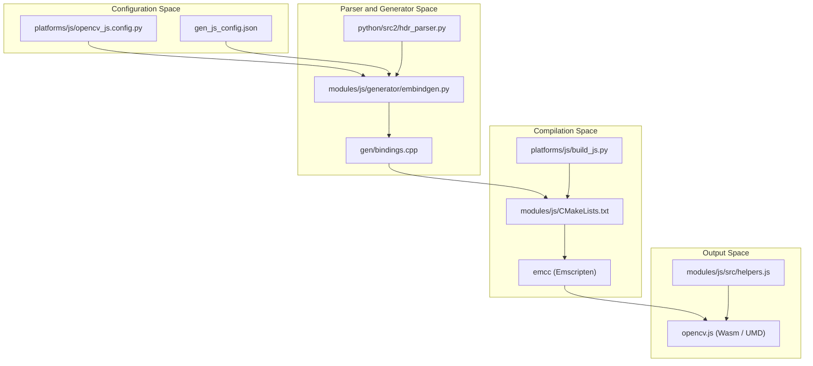
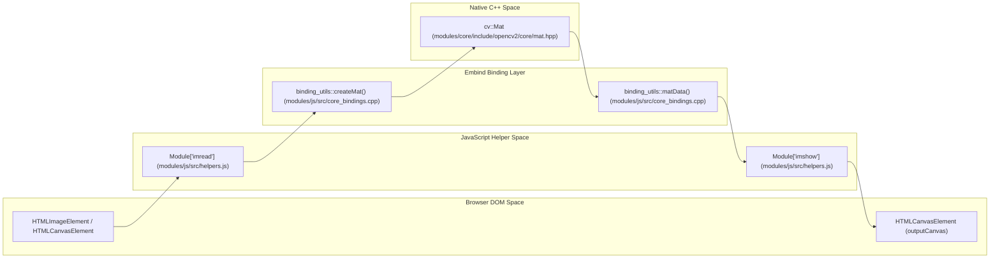

<!-- source: DeepWiki mcp.deepwiki.com · repo opencv/opencv · page 11.3 JavaScript / WebAssembly Bindings (opencv.js) · fetched 2026-10-30 -->

# JavaScript / WebAssembly Bindings (opencv.js)

<details>
<summary>Relevant source files</summary>

The following files were used as context for generating this wiki page:

- [cmake/OpenCVBindingsPreprocessorDefinitions.cmake](cmake/OpenCVBindingsPreprocessorDefinitions.cmake)
- [doc/js_tutorials/js_assets/js_image_classification.html](doc/js_tutorials/js_assets/js_image_classification.html)
- [doc/js_tutorials/js_assets/js_image_classification_model_info.json](doc/js_tutorials/js_assets/js_image_classification_model_info.json)
- [doc/js_tutorials/js_assets/js_image_classification_with_camera.html](doc/js_tutorials/js_assets/js_image_classification_with_camera.html)
- [doc/js_tutorials/js_assets/js_object_detection.html](doc/js_tutorials/js_assets/js_object_detection.html)
- [doc/js_tutorials/js_assets/js_object_detection_model_info.json](doc/js_tutorials/js_assets/js_object_detection_model_info.json)
- [doc/js_tutorials/js_assets/js_object_detection_with_camera.html](doc/js_tutorials/js_assets/js_object_detection_with_camera.html)
- [doc/js_tutorials/js_assets/js_setup_usage.html](doc/js_tutorials/js_assets/js_setup_usage.html)
- [doc/js_tutorials/js_assets/lena_yunet.jpg](doc/js_tutorials/js_assets/lena_yunet.jpg)
- [doc/js_tutorials/js_setup/js_nodejs/js_nodejs.markdown](doc/js_tutorials/js_setup/js_nodejs/js_nodejs.markdown)
- [doc/js_tutorials/js_setup/js_setup/js_setup.markdown](doc/js_tutorials/js_setup/js_setup/js_setup.markdown)
- [doc/js_tutorials/js_setup/js_table_of_contents_setup.markdown](doc/js_tutorials/js_setup/js_table_of_contents_setup.markdown)
- [doc/js_tutorials/js_setup/js_usage/js_usage.markdown](doc/js_tutorials/js_setup/js_usage/js_usage.markdown)
- [doc/tutorials/dnn/dnn_googlenet/dnn_googlenet.markdown](doc/tutorials/dnn/dnn_googlenet/dnn_googlenet.markdown)
- [doc/tutorials/imgproc/morph_lines_detection/morph_lines_detection.md](doc/tutorials/imgproc/morph_lines_detection/morph_lines_detection.md)
- [modules/js/CMakeLists.txt](modules/js/CMakeLists.txt)
- [modules/js/generator/CMakeLists.txt](modules/js/generator/CMakeLists.txt)
- [modules/js/generator/embindgen.py](modules/js/generator/embindgen.py)
- [modules/js/src/core_bindings.cpp](modules/js/src/core_bindings.cpp)
- [modules/js/src/helpers.js](modules/js/src/helpers.js)
- [modules/js/test/init_cv.js](modules/js/test/init_cv.js)
- [modules/js/test/package.json](modules/js/test/package.json)
- [modules/js/test/test_calib3d.js](modules/js/test/test_calib3d.js)
- [modules/js/test/test_core.js](modules/js/test/test_core.js)
- [modules/js/test/test_imgproc.js](modules/js/test/test_imgproc.js)
- [modules/js/test/test_mat.js](modules/js/test/test_mat.js)
- [modules/js/test/test_objdetect.js](modules/js/test/test_objdetect.js)
- [modules/js/test/test_photo.js](modules/js/test/test_photo.js)
- [modules/js/test/test_utils.js](modules/js/test/test_utils.js)
- [modules/js/test/test_video.js](modules/js/test/test_video.js)
- [modules/js/test/tests.html](modules/js/test/tests.html)
- [modules/js/test/tests.js](modules/js/test/tests.js)
- [modules/objc/generator/CMakeLists.txt](modules/objc/generator/CMakeLists.txt)
- [platforms/js/build_js.py](platforms/js/build_js.py)
- [platforms/js/opencv_js.config.py](platforms/js/opencv_js.config.py)
- [samples/dnn/README.md](samples/dnn/README.md)
- [samples/java/tutorial_code/ImgProc/morph_lines_detection/Morphology_3.java](samples/java/tutorial_code/ImgProc/morph_lines_detection/Morphology_3.java)
- [samples/python/tutorial_code/imgProc/morph_lines_detection/morph_lines_detection.py](samples/python/tutorial_code/imgProc/morph_lines_detection/morph_lines_detection.py)

</details>


OpenCV.js provides JavaScript bindings for the OpenCV library, enabling computer vision capabilities in web browsers and Node.js environments. The bindings are compiled to **WebAssembly (Wasm)** using the **Emscripten** toolchain, leveraging **Embind** to bridge C++ and JavaScript [platforms/js/build_js.py:10-15](), [modules/js/src/core_bindings.cpp:71-72]().

## Build System and Emscripten Integration

The build process is orchestrated by `platforms/js/build_js.py`, which configures CMake to use the Emscripten toolchain [platforms/js/build_js.py:65-75](). The build script configures various toggles for WebAssembly, threading, SIMD, and single-file bundling [platforms/js/build_js.py:181-196]().

### Key Build Configurations
*   **WebAssembly**: Enabled by default via `-s WASM=1` (`platforms/js/build_js.py:183-184`).
*   **Single File**: Bundles the `.wasm` binary as Base64 inside the `.js` output by default (`-s SINGLE_FILE=1`), which can be disabled via `--disable_single_file` to emit a standalone `.wasm` file [platforms/js/build_js.py:187-188]().
*   **Threading**: Configured via `--threads` passing `-DWITH_PTHREADS_PF=ON` [platforms/js/build_js.py:153-156]().
*   **SIMD**: Configured via `--simd` passing `-DCV_ENABLE_INTRINSICS=ON` [platforms/js/build_js.py:158-161]().

Link flags set in `modules/js/CMakeLists.txt` configure memory limits and module exports:
```cmake
set(EMSCRIPTEN_LINK_FLAGS "${EMSCRIPTEN_LINK_FLAGS} -s TOTAL_MEMORY=128MB -s WASM_MEM_MAX=1GB -s ALLOW_MEMORY_GROWTH=1")
set(EMSCRIPTEN_LINK_FLAGS "${EMSCRIPTEN_LINK_FLAGS} -s MODULARIZE=1")
set(EMSCRIPTEN_LINK_FLAGS "${EMSCRIPTEN_LINK_FLAGS} -s EXPORT_NAME=\"'cv'\"")
```
[modules/js/CMakeLists.txt:123-125]()

### Build Data Flow (Code Entity Space)
The following diagram maps the build and generation pipeline from configuration scripts to final execution artifacts.

**OpenCV.js Build Pipeline Architecture**

**Sources:** [platforms/js/build_js.py:81-179](), [modules/js/CMakeLists.txt:138-147](), [modules/js/generator/CMakeLists.txt:94-117]()

---

## Wrapper Generation and Whitelisting

OpenCV.js uses a whitelist-based selection mechanism to prevent bloating the WebAssembly binary with unused C++ APIs.

### Whitelist Configuration
The allowed modules, classes, and functions are declared in `platforms/js/opencv_js.config.py`. For example, core matrix operations, `imgproc` filters, and `objdetect` models are selectively enabled:
*   `core`: `absdiff`, `add`, `GEMM`, `Mat` [platforms/js/opencv_js.config.py:3-15]()
*   `imgproc`: `cvtColor`, `GaussianBlur`, `Canny`, `resize` [platforms/js/opencv_js.config.py:17-117]()
*   `objdetect`: `QRCodeDetector`, `aruco_ArucoDetector` [platforms/js/opencv_js.config.py:132-155]()

### Code Generation (`embindgen.py`)
During CMake configuration, `modules/js/generator/CMakeLists.txt` executes `embindgen.py` using `gen_js_config.json` and `opencv_js.config.py` to produce `bindings.cpp` [modules/js/generator/CMakeLists.txt:94-117](). Certain complex signatures (such as functions with output pointers or ambiguous references) are listed in `ignore_list` within `embindgen.py` [modules/js/generator/embindgen.py:83-95]().

Type mappings handled by `embindgen.py` include:
*   `InputArray` / `OutputArray` $\rightarrow$ `const cv::Mat&` / `cv::Mat&` [modules/js/generator/embindgen.py:142-146]()
*   `string` / `String` $\rightarrow$ `std::string` [modules/js/generator/embindgen.py:148-150]()

**Sources:** [platforms/js/opencv_js.config.py:1-176](), [modules/js/generator/embindgen.py:83-151](), [modules/js/generator/CMakeLists.txt:35-117]()

---

## Core Bindings and Manual Wrappers (`core_bindings.cpp` & `helpers.js`)

While most bindings are auto-generated, manual helper routines and memory management adapters are written in `modules/js/src/core_bindings.cpp` and augmented by `modules/js/src/helpers.js`.

### Memory Management and `memory_view`
Embind relies on `emscripten::memory_view` to share underlying Wasm heap buffers directly with JavaScript `TypedArray` views without memory copies:
```cpp
template<typename T>
emscripten::val matData(const cv::Mat& mat)
{
    return emscripten::val(emscripten::memory_view<T>((mat.total()*mat.elemSize())/sizeof(T),
                           (T*)mat.data));
}
```
[modules/js/src/core_bindings.cpp:125-130]()

Similar pointer-access helpers (`matPtr`) expose row-level and element-level pointers [modules/js/src/core_bindings.cpp:132-142]().

### JavaScript Utility Helpers (`helpers.js`)
`modules/js/src/helpers.js` defines high-level JavaScript wrappers for browser integrations such as `imread`, `imshow`, and `VideoCapture`:
*   `Module['imread']`: Pulls image pixel data from an `HTMLImageElement`, `HTMLCanvasElement`, or `OffscreenCanvas` via `getContext('2d')` and constructs a `cv.Mat` [modules/js/src/helpers.js:49-73]().
*   `Module['imshow']`: Converts a `cv.Mat` into an `ImageData` object and renders it onto an `HTMLCanvasElement` [modules/js/src/helpers.js:75-116]().
*   Geometry classes like `Point`, `Size`, `Rect`, and `Range` are injected directly into the `cv` module namespace [modules/js/src/helpers.js:148-184]().

### Data Flow (Natural Language to Code Entity Space)
The following diagram illustrates how browser-level DOM elements map through `helpers.js` and `core_bindings.cpp` down to native OpenCV C++ containers.

**Data Flow from Browser DOM to Native C++ Mat**

**Sources:** [modules/js/src/helpers.js:49-116](), [modules/js/src/core_bindings.cpp:125-147]()

---

## Testing Framework

OpenCV.js includes a QUnit-based test suite located under `modules/js/test/`. 

### Test Execution Options
1.  **Browser-based Testing**: Launching a local HTTP server in the build binary folder (`build_js/bin`) and navigating to `tests.html` runs all test scripts (e.g., `test_imgproc.js`, `test_objdetect.js`, `test_core.js`) inside the browser [doc/js_tutorials/js_setup/js_setup/js_setup.markdown:155-164]().
2.  **Headless Puppeteer Testing**: Continuous integration runs headless tests using Google Chrome via Puppeteer [doc/js_tutorials/js_setup/js_setup/js_setup.markdown:169-178]().

Test suites utilize assertions against expected buffer outputs, verifying correctness of operations like `applyColorMap`, `blendLinear`, and `QRCodeDetector` [modules/js/test/test_imgproc.js:73-105](), [modules/js/test/test_objdetect.js:77-117]().

**Sources:** [modules/js/CMakeLists.txt:148-162](), [modules/js/test/test_imgproc.js:71-105](), [doc/js_tutorials/js_setup/js_setup/js_setup.markdown:150-184]()

---

## Consumption Patterns (Browser vs. Node.js)

### Browser Consumption
In web pages, `opencv.js` is loaded synchronously or asynchronously via `<script>` tags [doc/js_tutorials/js_usage/js_usage.markdown:51-61](). Because Wasm compilation and initialization are asynchronous, consumers hook into `Module.onRuntimeInitialized` or await the `cv` promise before executing vision pipelines [doc/js_tutorials/js_usage/js_usage.markdown:122-134]().

```javascript
var Module = {
  onRuntimeInitialized() {
    console.log('OpenCV.js is ready.');
  }
};
```
[doc/js_tutorials/js_usage/js_usage.markdown:129-134]()

### Node.js Consumption
In Node.js environments, OpenCV.js can be imported as a CommonJS module:
```javascript
const cv = require('./opencv.js');
```
[modules/js/test/test_objdetect.js:71-74]()

Emscripten configures filesystem support (`FORCE_FILESYSTEM=1`) allowing test scripts and Node applications to read local image and model assets directly [modules/js/CMakeLists.txt:131]().

**Sources:** [modules/js/CMakeLists.txt:131](), [modules/js/test/test_objdetect.js:71-74](), [doc/js_tutorials/js_usage/js_usage.markdown:51-138]()

---

