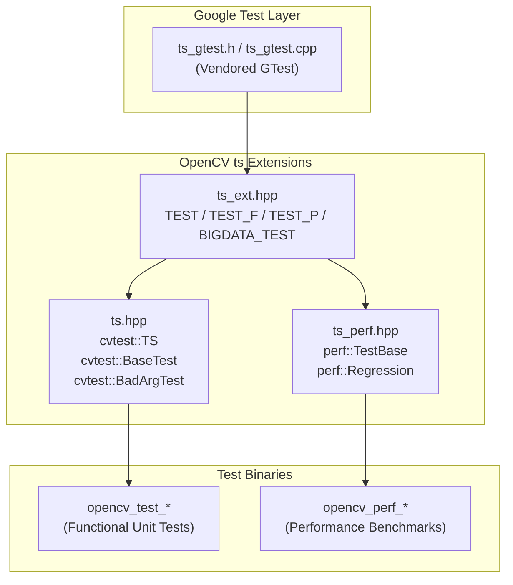

<!-- source: DeepWiki mcp.deepwiki.com · repo opencv/opencv · page 12 Testing Framework (ts) · fetched 2026-10-30 -->

# Testing Framework (ts)

Relevant source files

The following files were used as context for generating this wiki page:

- [modules/core/include/opencv2/core/check.hpp](modules/core/include/opencv2/core/check.hpp)
- [modules/core/src/check.cpp](modules/core/src/check.cpp)
- [modules/core/src/parallel.cpp](modules/core/src/parallel.cpp)
- [modules/core/test/test_misc.cpp](modules/core/test/test_misc.cpp)
- [modules/ts/CMakeLists.txt](modules/ts/CMakeLists.txt)
- [modules/ts/include/opencv2/ts.hpp](modules/ts/include/opencv2/ts.hpp)
- [modules/ts/include/opencv2/ts/cuda_test.hpp](modules/ts/include/opencv2/ts/cuda_test.hpp)
- [modules/ts/include/opencv2/ts/ts_ext.hpp](modules/ts/include/opencv2/ts/ts_ext.hpp)
- [modules/ts/include/opencv2/ts/ts_gtest.h](modules/ts/include/opencv2/ts/ts_gtest.h)
- [modules/ts/include/opencv2/ts/ts_perf.hpp](modules/ts/include/opencv2/ts/ts_perf.hpp)
- [modules/ts/src/cuda_test.cpp](modules/ts/src/cuda_test.cpp)
- [modules/ts/src/precomp.hpp](modules/ts/src/precomp.hpp)
- [modules/ts/src/ts.cpp](modules/ts/src/ts.cpp)
- [modules/ts/src/ts_arrtest.cpp](modules/ts/src/ts_arrtest.cpp)
- [modules/ts/src/ts_gtest.cpp](modules/ts/src/ts_gtest.cpp)
- [modules/ts/src/ts_perf.cpp](modules/ts/src/ts_perf.cpp)
- [modules/ts/src/ts_tags.cpp](modules/ts/src/ts_tags.cpp)
- [modules/ts/src/ts_tags.hpp](modules/ts/src/ts_tags.hpp)

## Purpose and Scope

The `ts` module is OpenCV's internal testing library [modules/ts/CMakeLists.txt:1-20](). It provides a unified testing infrastructure built on top of a vendored Google Test framework, extending it with OpenCV-specific test fixtures, macros, assertion utilities, and a performance benchmarking subsystem [modules/ts/include/opencv2/ts.hpp:128]().

This page acts as a parent overview of the OpenCV testing framework. For deeper technical details on specific subsystems, consult the child pages:
- Performance benchmarking and regression baselines: [Performance Testing with perf::TestBase](#12.1)
- Unit testing structure, array comparisons, and OpenCL/CUDA test helpers: [Unit Testing and OpenCL Test Utilities](#12.2)
- Test execution runners, reporting scripts, and CI workflows: [Test Runners, Reporting, and CI Workflows](#12.3)

Sources: [modules/ts/CMakeLists.txt](), [modules/ts/include/opencv2/ts.hpp]()

---

## Module Layout and Build Configuration

The `ts` module is built as a static library (`OPENCV_MODULE_TYPE STATIC`) and is explicitly excluded from `opencv_world` packages [modules/ts/CMakeLists.txt:7-8](). It is designed strictly for test executables (`opencv_test_*` and `opencv_perf_*`) and is never shipped to end-users.

**Build Dependencies** declared in `modules/ts/CMakeLists.txt`:
- `opencv_core` [modules/ts/CMakeLists.txt:19]() — provides `cv::Mat`, random number generators (`cv::RNG`), `cv::FileStorage`, and error management.
- `opencv_imgproc` [modules/ts/CMakeLists.txt:19]() — supplies reference image processing algorithms used by test verification utilities.
- `opencv_imgcodecs` [modules/ts/CMakeLists.txt:19]() — handles loading test imagery from data directories.
- `opencv_videoio` [modules/ts/CMakeLists.txt:19]() — manages video capture streams required by integration tests.
- `opencv_highgui` [modules/ts/CMakeLists.txt:19]() — provides window and visualization stubs.

Sources: [modules/ts/CMakeLists.txt]()

---

## Architecture Overview

The testing framework links Google Test with OpenCV utility classes, separating functional unit tests from performance benchmarks.

Title: "OpenCV Testing Framework Architecture"

Sources: [modules/ts/include/opencv2/ts.hpp](), [modules/ts/include/opencv2/ts/ts_perf.hpp](), [modules/ts/include/opencv2/ts/ts_ext.hpp]()

---

## Core Infrastructure (`cvtest::TS`)

The process-wide test singleton `cvtest::TS::ptr()` coordinates test execution state [modules/ts/src/ts.cpp:130-142](). It manages:
- **Random Number Generation**: Controls the global test seed (`param_seed`) to ensure reproducible test scenarios [modules/ts/src/ts.cpp:142]().
- **Error Routing**: Intercepts `cv::Exception` and maps failures to diagnostic error codes (`TS::FailureCode`) such as `FAIL_MISMATCH`, `FAIL_BAD_ACCURACY`, or `FAIL_ARITHM_EXCEPTION` [modules/ts/src/ts.cpp:517-541]().
- **Exception Translators**: Registers platform-specific signal handlers for segmentation faults and floating-point exceptions on POSIX and Windows systems [modules/ts/src/ts.cpp:162-210]().

Sources: [modules/ts/src/ts.cpp]()

---

## Summary of Child Pages

### Performance Testing with perf::TestBase (`#12.1`)
For details on performance benchmarking, see [Performance Testing with perf::TestBase](#12.1). This covers:
- The `perf::TestBase` class and parameterized `PERF_TEST_P` macros [modules/ts/include/opencv2/ts/ts_perf.hpp:374-498]().
- Warmup phases, timing loops (`startTimer()`, `stopTimer()`, `next()`), and outlier removal [modules/ts/src/ts_perf.cpp:947-1002]().
- Regression baselines and XML result storage for cross-run performance comparisons.

Sources: [modules/ts/include/opencv2/ts/ts_perf.hpp](), [modules/ts/src/ts_perf.cpp]()

### Unit Testing and OpenCL Test Utilities (`#12.2`)
For details on functional testing, see [Unit Testing and OpenCL Test Utilities](#12.2). This covers:
- The Google Test wrapper macros in `ts_ext.hpp` [modules/ts/include/opencv2/ts/ts_ext.hpp:72-211]().
- The OpenCL test layer (`cvtest::ocl`) for validating GPU execution against CPU references.
- Array comparison assertions (`EXPECT_MAT_NEAR`, `EXPECT_MAT_SIMILAR`) and CUDA testing helpers (`cuda_test.hpp`) [modules/ts/include/opencv2/ts/cuda_test.hpp:43-166]().

Sources: [modules/ts/include/opencv2/ts/ts_ext.hpp](), [modules/ts/include/opencv2/ts/cuda_test.hpp]()

### Test Runners, Reporting, and CI Workflows (`#12.3`)
For details on test orchestration, see [Test Runners, Reporting, and CI Workflows](#12.3). This covers:
- Python runner scripts (`run.py`, `summary.py`) used locally and in continuous integration pipelines.
- GitHub Actions workflow integrations (`.github/workflows`) and artifact collection.
- Code quality checks (pylint, flake8) and handling common test failure modes.

Sources: [modules/ts/CMakeLists.txt]()

---

