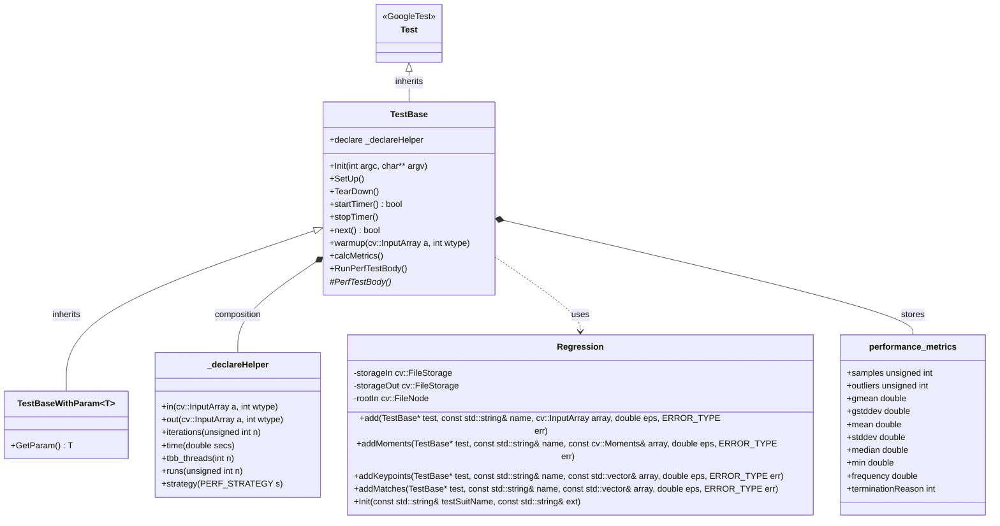
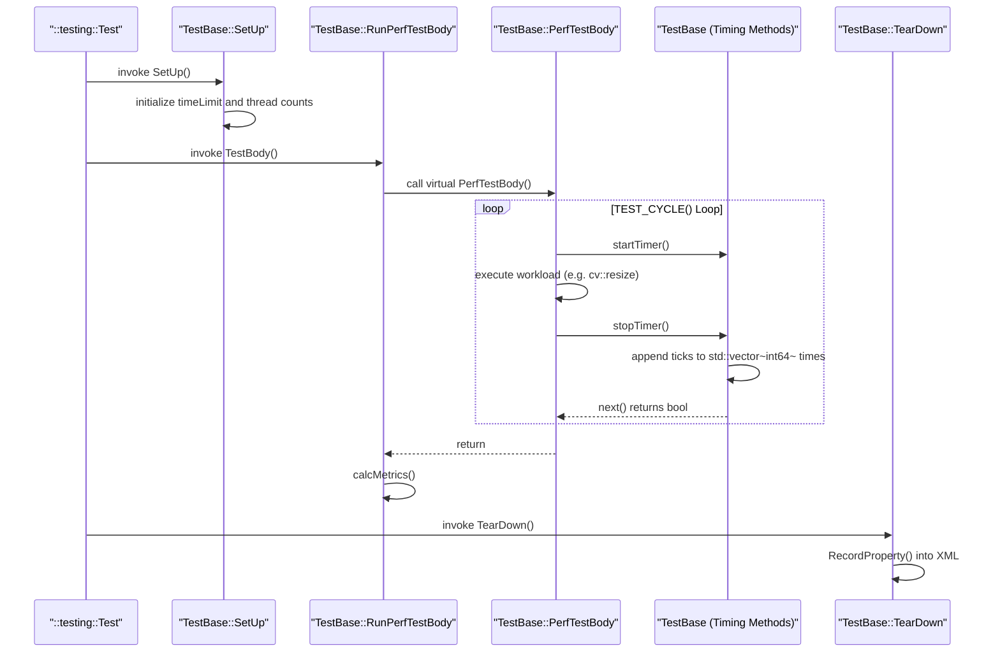
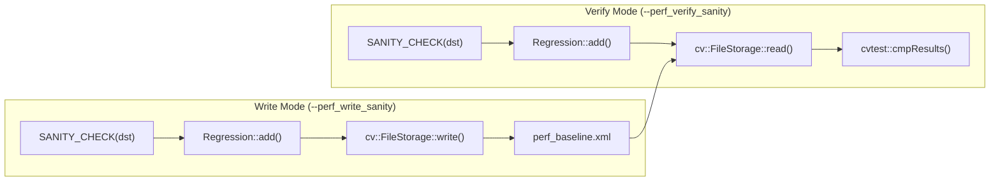

<!-- source: DeepWiki mcp.deepwiki.com · repo opencv/opencv · page 12.1 Performance Testing with perf::TestBase · fetched 2026-10-30 -->

# Performance Testing with perf::TestBase

<details>
<summary>Relevant source files</summary>

The following files were used as context for generating this wiki page:

- [modules/core/include/opencv2/core/check.hpp](modules/core/include/opencv2/core/check.hpp)
- [modules/core/misc/java/test/CoreTest.java](modules/core/misc/java/test/CoreTest.java)
- [modules/core/perf/perf_stat.cpp](modules/core/perf/perf_stat.cpp)
- [modules/core/src/check.cpp](modules/core/src/check.cpp)
- [modules/core/src/parallel.cpp](modules/core/src/parallel.cpp)
- [modules/core/test/test_misc.cpp](modules/core/test/test_misc.cpp)
- [modules/dnn/src/layers/crop_and_resize_layer.cpp](modules/dnn/src/layers/crop_and_resize_layer.cpp)
- [modules/java/check-tests.py](modules/java/check-tests.py)
- [modules/java/test/pure_test/build.xml](modules/java/test/pure_test/build.xml)
- [modules/ts/CMakeLists.txt](modules/ts/CMakeLists.txt)
- [modules/ts/include/opencv2/ts.hpp](modules/ts/include/opencv2/ts.hpp)
- [modules/ts/include/opencv2/ts/cuda_test.hpp](modules/ts/include/opencv2/ts/cuda_test.hpp)
- [modules/ts/include/opencv2/ts/ts_ext.hpp](modules/ts/include/opencv2/ts/ts_ext.hpp)
- [modules/ts/include/opencv2/ts/ts_gtest.h](modules/ts/include/opencv2/ts/ts_gtest.h)
- [modules/ts/include/opencv2/ts/ts_perf.hpp](modules/ts/include/opencv2/ts/ts_perf.hpp)
- [modules/ts/misc/chart.py](modules/ts/misc/chart.py)
- [modules/ts/misc/color.py](modules/ts/misc/color.py)
- [modules/ts/misc/concatlogs.py](modules/ts/misc/concatlogs.py)
- [modules/ts/misc/perf_tests_timing.py](modules/ts/misc/perf_tests_timing.py)
- [modules/ts/misc/report.py](modules/ts/misc/report.py)
- [modules/ts/misc/run.py](modules/ts/misc/run.py)
- [modules/ts/misc/run_android.py](modules/ts/misc/run_android.py)
- [modules/ts/misc/run_long.py](modules/ts/misc/run_long.py)
- [modules/ts/misc/run_suite.py](modules/ts/misc/run_suite.py)
- [modules/ts/misc/run_utils.py](modules/ts/misc/run_utils.py)
- [modules/ts/misc/summary.py](modules/ts/misc/summary.py)
- [modules/ts/misc/table_formatter.py](modules/ts/misc/table_formatter.py)
- [modules/ts/misc/testlog_parser.py](modules/ts/misc/testlog_parser.py)
- [modules/ts/misc/trace_profiler.py](modules/ts/misc/trace_profiler.py)
- [modules/ts/misc/xls-report.py](modules/ts/misc/xls-report.py)
- [modules/ts/src/cuda_test.cpp](modules/ts/src/cuda_test.cpp)
- [modules/ts/src/precomp.hpp](modules/ts/src/precomp.hpp)
- [modules/ts/src/ts.cpp](modules/ts/src/ts.cpp)
- [modules/ts/src/ts_arrtest.cpp](modules/ts/src/ts_arrtest.cpp)
- [modules/ts/src/ts_gtest.cpp](modules/ts/src/ts_gtest.cpp)
- [modules/ts/src/ts_perf.cpp](modules/ts/src/ts_perf.cpp)
- [modules/ts/src/ts_tags.cpp](modules/ts/src/ts_tags.cpp)
- [modules/ts/src/ts_tags.hpp](modules/ts/src/ts_tags.hpp)
- [platforms/apple/cv_build_utils.py](platforms/apple/cv_build_utils.py)
- [samples/dnn/tf_text_graph_common.py](samples/dnn/tf_text_graph_common.py)
- [samples/dnn/tf_text_graph_efficientdet.py](samples/dnn/tf_text_graph_efficientdet.py)
- [samples/dnn/tf_text_graph_faster_rcnn.py](samples/dnn/tf_text_graph_faster_rcnn.py)
- [samples/dnn/tf_text_graph_mask_rcnn.py](samples/dnn/tf_text_graph_mask_rcnn.py)
- [samples/dnn/tf_text_graph_ssd.py](samples/dnn/tf_text_graph_ssd.py)

</details>


## Purpose and Scope

This page documents the performance testing framework in the `modules/ts` module, specifically the `perf::TestBase` class and the surrounding infrastructure for writing, running, and comparing micro-benchmarks. It covers test declaration macros, the timing loop, input/output declaration, regression baseline management, statistical metrics, and command-line controls.

The performance testing system is built on top of Google Test but provides a specialized measurement loop and data management system to ensure statistical stability and regression tracking.

Sources: [modules/ts/include/opencv2/ts/ts_perf.hpp:31-41](), [modules/ts/src/ts_perf.cpp:25-140]()

---

## Architecture Overview

The performance testing infrastructure lives in the `perf` namespace and is declared in `modules/ts/include/opencv2/ts/ts_perf.hpp` with implementation in `modules/ts/src/ts_perf.cpp`.

**Key relationships among the major types (Bridging Natural Language Space to Code Entity Space):**

Title: Performance Testing Class Hierarchy

Sources: [modules/ts/include/opencv2/ts/ts_perf.hpp:41-41](), [modules/ts/include/opencv2/ts/ts_perf.hpp:374-498](), [modules/ts/src/ts_perf.cpp:130-660]()

---

## Test Declaration Macros

Three macros cover the common test patterns. All of them define a class whose `PerfTestBody()` method contains the user code.

| Macro | Intended Use |
|---|---|
| `PERF_TEST(suite, name)` | Simple one-off performance test, no fixture or parameters [modules/ts/include/opencv2/ts/ts_perf.hpp:553-563]() |
| `PERF_TEST_F(fixture, name)` | Performance test on a user-defined fixture subclassing `TestBase` [modules/ts/include/opencv2/ts/ts_perf.hpp:565-575]() |
| `PERF_TEST_P(fixture, name, values)` | Parameterized test; also instantiates the parameter set inline [modules/ts/include/opencv2/ts/ts_perf.hpp:577-594]() |
| `PERF_TEST_P_(fixture, name)` | Parameterized test without inline instantiation; pair with `INSTANTIATE_TEST_CASE_P` [modules/ts/include/opencv2/ts/ts_perf.hpp:596-608]() |

`PERF_TEST_P` is the most common pattern. The fixture is typically a `typedef` of `TestBaseWithParam<T>` for some parameter tuple `T`.

Sources: [modules/ts/include/opencv2/ts/ts_perf.hpp:553-640]()

---

## Writing a Parameterized Performance Test

A typical test follows this structure:

```cpp
typedef perf::TestBaseWithParam<cv::Size> MyTest;

PERF_TEST_P(MyTest, ResizeLinear,
    ::testing::Values(perf::szVGA, perf::sz720p, perf::sz1080p))
{
    cv::Size sz = GetParam();
    cv::Mat src(sz, CV_8UC3);
    cv::Mat dst;

    declare.in(src).out(dst);

    TEST_CYCLE() cv::resize(src, dst, cv::Size(), 0.5, 0.5);

    SANITY_CHECK(dst);
}
```

Key elements:

- **`GetParam()`** — retrieves the current parameter value via `testing::WithParamInterface` [modules/ts/include/opencv2/ts.hpp:145-145]().
- **`declare.in(src).out(dst)`** — registers arrays so the framework can compute data sizes and apply warm-up [modules/ts/include/opencv2/ts/ts_perf.hpp:462-466]().
- **`TEST_CYCLE()`** — drives the timing loop by calling `startTimer()`, `next()`, and `stopTimer()` on each pass [modules/ts/include/opencv2/ts/ts_perf.hpp:215-219]().
- **`SANITY_CHECK(dst)`** — registers output for regression comparison [modules/ts/include/opencv2/ts/ts_perf.hpp:174-174]().

Sources: [modules/ts/include/opencv2/ts/ts_perf.hpp:462-496](), [modules/ts/include/opencv2/ts/ts_perf.hpp:215-219]()

---

## Predefined Size Constants

`ts_perf.hpp` declares a standard set of `cv::Size` constants for use as test parameters:

| Constant | Resolution |
|---|---|
| `szQVGA` | 320 × 240 [modules/ts/include/opencv2/ts/ts_perf.hpp:46-46]() |
| `szVGA` | 640 × 480 [modules/ts/include/opencv2/ts/ts_perf.hpp:47-47]() |
| `szSVGA` | 800 × 600 [modules/ts/include/opencv2/ts/ts_perf.hpp:48-48]() |
| `szXGA` | 1024 × 768 [modules/ts/include/opencv2/ts/ts_perf.hpp:49-49]() |
| `sz720p` | 1280 × 720 [modules/ts/include/opencv2/ts/ts_perf.hpp:56-56]() |
| `sz1080p` | 1920 × 1080 [modules/ts/include/opencv2/ts/ts_perf.hpp:57-57]() |
| `sz2160p` | 3840 × 2160 (4K) [modules/ts/include/opencv2/ts/ts_perf.hpp:59-59]() |

Convenience macros like `SZ_ALL_HD` and `SZ_TYPICAL` expand to `::testing::Values(...)` expressions [modules/ts/include/opencv2/ts/ts_perf.hpp:75-78]().

Sources: [modules/ts/include/opencv2/ts/ts_perf.hpp:46-83]()

---

## Test Lifecycle

The test execution flow bridges natural language runner events to specific methods on `TestBase`.

Title: Performance Test Execution Flow


Sources: [modules/ts/src/ts_perf.cpp:942-1200](), [modules/ts/include/opencv2/ts/ts_perf.hpp:396-421]()

---

## Timing Loop Control

`startTimer()`, `stopTimer()`, and `next()` are the three methods that control the measurement loop.

- **`startTimer()`** — records the current tick count into `lastTime`. Returns `true` [modules/ts/src/ts_perf.cpp:1152-1157]().
- **`stopTimer()`** — computes elapsed ticks since `startTimer()` and appends the value to the internal `times` vector [modules/ts/src/ts_perf.cpp:1159-1165]().
- **`next()`** — determines whether to continue iterating. Returns `false` when either the accumulated wall time exceeds `timeLimit` or the iteration count exceeds `nIters` [modules/ts/src/ts_perf.cpp:1167-1185]().

The `TEST_CYCLE()` macro composes these into a `for` loop [modules/ts/include/opencv2/ts/ts_perf.hpp:215-219]():

```cpp
#define TEST_CYCLE() for(;startTimer(), next();stopTimer())
```

Sources: [modules/ts/include/opencv2/ts/ts_perf.hpp:402-404](), [modules/ts/src/ts_perf.cpp:1152-1185]()

---

## Input/Output Declaration

`TestBase::_declareHelper` is accessed via the public member `declare` [modules/ts/include/opencv2/ts/ts_perf.hpp:415-415](). It chains calls to register arrays and configure the test:

| Method | Effect |
|---|---|
| `declare.in(a, wtype)` | Register array `a` as input; apply warm-up [modules/ts/include/opencv2/ts/ts_perf.hpp:462-466]() |
| `declare.out(a, wtype)` | Register array `a` as output; apply warm-up [modules/ts/include/opencv2/ts/ts_perf.hpp:468-472]() |
| `declare.time(secs)` | Override the default time limit for this test [modules/ts/include/opencv2/ts/ts_perf.hpp:478-478]() |
| `declare.iterations(n)` | Cap the number of timing samples [modules/ts/include/opencv2/ts/ts_perf.hpp:477-477]() |
| `declare.strategy(s)` | Set the convergence strategy [modules/ts/include/opencv2/ts/ts_perf.hpp:481-481]() |

Warm-up types include `WARMUP_READ`, `WARMUP_WRITE`, and `WARMUP_RNG` [modules/ts/include/opencv2/ts/ts_perf.hpp:221-228](). Warm-up ensures that caches and page tables are in a representative state before timing starts.

Sources: [modules/ts/include/opencv2/ts/ts_perf.hpp:462-488](), [modules/ts/src/ts_perf.cpp:1300-1450]()

---

## Regression Baseline Management

The `Regression` class handles sanity checking: recording output values from a reference run and verifying them on subsequent runs. The macros `SANITY_CHECK` and variants delegate to `Regression::add()` [modules/ts/src/ts_perf.cpp:136-140]().

Title: Regression Data Flow


For each `cv::Mat`, the class records and verifies the min/max values, the last element, and two elements at randomly selected positions [modules/ts/src/ts_perf.cpp:136-180]().

Sources: [modules/ts/include/opencv2/ts/ts_perf.hpp:174-219](), [modules/ts/src/ts_perf.cpp:130-635]()

---

## Performance Metrics and XML Storage

After the timing loop, `calcMetrics()` computes a `performance_metrics` struct from the collected `times` vector [modules/ts/src/ts_perf.cpp:638-660]().

| Metric | Calculation / Description |
|---|---|
| `gmean` | Geometric mean of timing samples [modules/ts/include/opencv2/ts/ts_perf.hpp:240-240]() |
| `median` | 50th percentile of samples [modules/ts/include/opencv2/ts/ts_perf.hpp:243-243]() |
| `min` | Minimum execution time recorded [modules/ts/include/opencv2/ts/ts_perf.hpp:244-244]() |
| `outliers` | Number of samples discarded based on `param_max_outliers` [modules/ts/include/opencv2/ts/ts_perf.hpp:239-239]() |

Results are stored in XML format via Google Test's `RecordProperty` mechanism [modules/ts/src/ts.cpp:88-88]().

Sources: [modules/ts/include/opencv2/ts/ts_perf.hpp:232-259](), [modules/ts/src/ts_perf.cpp:638-660](), [modules/ts/src/ts.cpp:83-95]()

---

## Command-Line Parameters

`TestBase::Init()` parses command-line arguments to control the testing environment [modules/ts/src/ts_perf.cpp:947-1070]().

| Flag | Default | Description |
|---|---|---|
| `--perf_time_limit` | 3.0 s | Wall time per test [modules/ts/src/ts_perf.cpp:1034-1034]() |
| `--perf_min_samples` | 10 | Minimum timing samples [modules/ts/src/ts_perf.cpp:1030-1030]() |
| `--perf_write_sanity` | false | Record baseline regression data [modules/ts/src/ts_perf.cpp:1036-1036]() |
| `--perf_verify_sanity` | false | Fail if baseline data is missing [modules/ts/src/ts_perf.cpp:1037-1037]() |
| `--perf_threads` | -1 | Worker thread count for `parallel_for_` [modules/ts/src/ts_perf.cpp:1057-1057]() |

Sources: [modules/ts/src/ts_perf.cpp:947-1070]()

---

