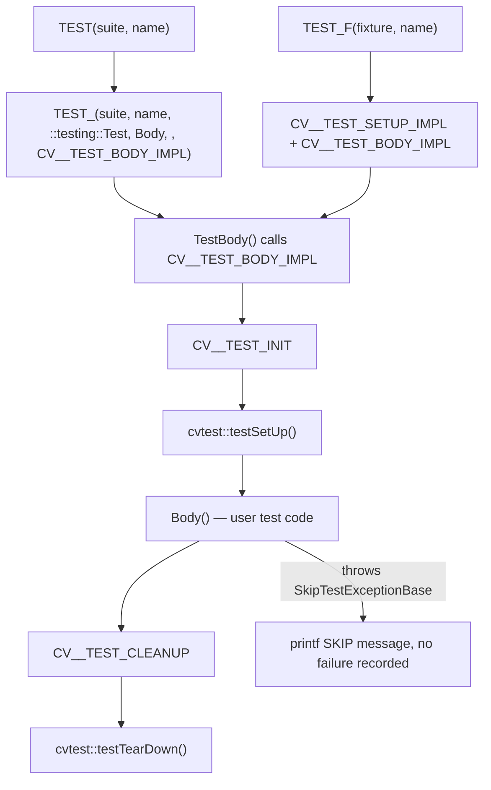
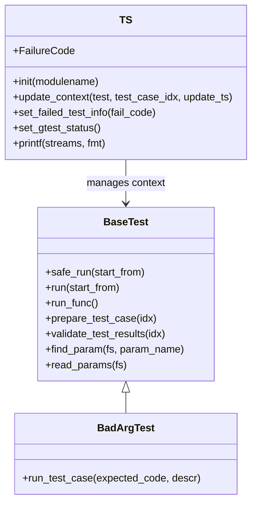
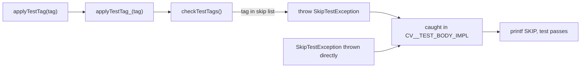
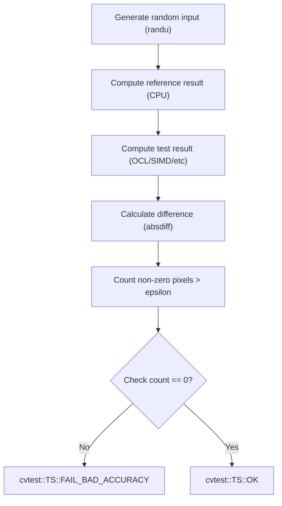
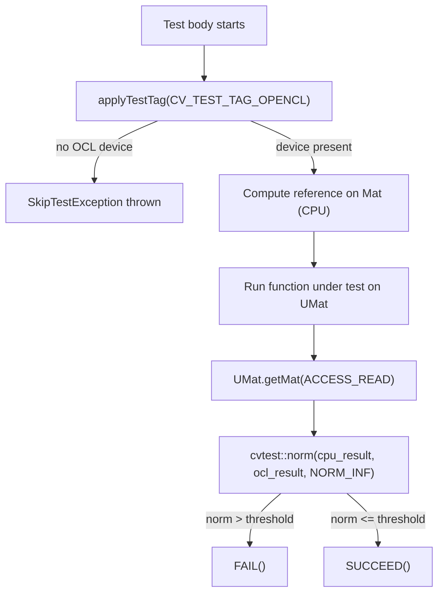
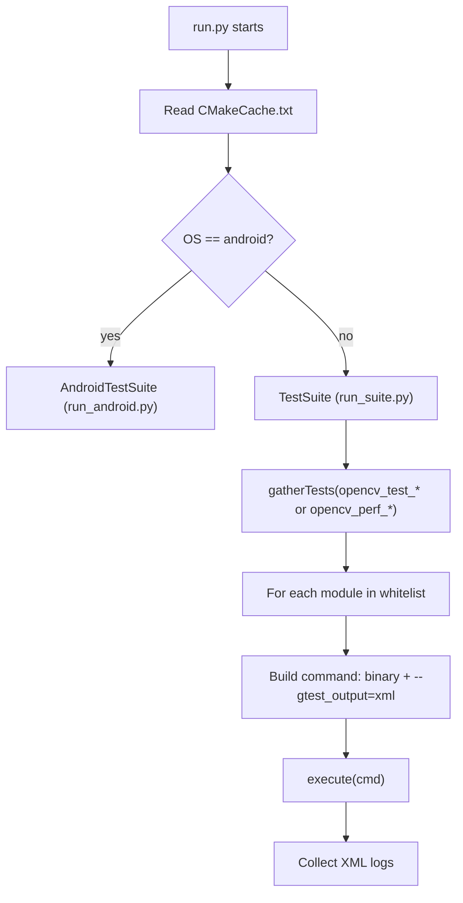
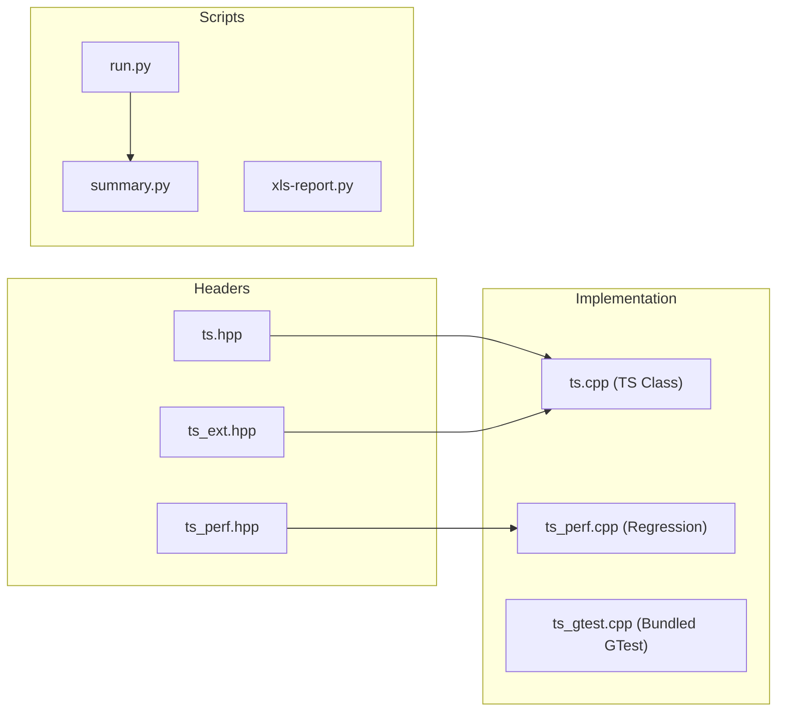

<!-- source: DeepWiki mcp.deepwiki.com · repo opencv/opencv · page 12.2 Unit Testing and OpenCL Test Utilities · fetched 2026-10-30 -->

# Unit Testing and OpenCL Test Utilities

Relevant source files

The following files were used as context for generating this wiki page:

- [modules/core/include/opencv2/core/check.hpp](modules/core/include/opencv2/core/check.hpp)
- [modules/core/include/opencv2/core/mat.hpp](modules/core/include/opencv2/core/mat.hpp)
- [modules/core/include/opencv2/core/mat.inl.hpp](modules/core/include/opencv2/core/mat.inl.hpp)
- [modules/core/include/opencv2/core/ocl.hpp](modules/core/include/opencv2/core/ocl.hpp)
- [modules/core/perf/perf_arithm.cpp](modules/core/perf/perf_arithm.cpp)
- [modules/core/src/arithm.cpp](modules/core/src/arithm.cpp)
- [modules/core/src/check.cpp](modules/core/src/check.cpp)
- [modules/core/src/copy.cpp](modules/core/src/copy.cpp)
- [modules/core/src/matrix.cpp](modules/core/src/matrix.cpp)
- [modules/core/src/matrix_transform.cpp](modules/core/src/matrix_transform.cpp)
- [modules/core/src/matrix_wrap.cpp](modules/core/src/matrix_wrap.cpp)
- [modules/core/src/ocl.cpp](modules/core/src/ocl.cpp)
- [modules/core/src/ocl_disabled.impl.hpp](modules/core/src/ocl_disabled.impl.hpp)
- [modules/core/src/opencl/flip.cl](modules/core/src/opencl/flip.cl)
- [modules/core/src/opencl/gemm.cl](modules/core/src/opencl/gemm.cl)
- [modules/core/src/opencl/transpose.cl](modules/core/src/opencl/transpose.cl)
- [modules/core/src/parallel.cpp](modules/core/src/parallel.cpp)
- [modules/core/src/rand.cpp](modules/core/src/rand.cpp)
- [modules/core/src/umatrix.cpp](modules/core/src/umatrix.cpp)
- [modules/core/test/ocl/test_opencl.cpp](modules/core/test/ocl/test_opencl.cpp)
- [modules/core/test/test_arithm.cpp](modules/core/test/test_arithm.cpp)
- [modules/core/test/test_mat.cpp](modules/core/test/test_mat.cpp)
- [modules/core/test/test_misc.cpp](modules/core/test/test_misc.cpp)
- [modules/core/test/test_precomp.hpp](modules/core/test/test_precomp.hpp)
- [modules/core/test/test_rand.cpp](modules/core/test/test_rand.cpp)
- [modules/core/test/test_umat.cpp](modules/core/test/test_umat.cpp)
- [modules/imgproc/perf/opencl/perf_color.cpp](modules/imgproc/perf/opencl/perf_color.cpp)
- [modules/imgproc/perf/opencl/perf_imgwarp.cpp](modules/imgproc/perf/opencl/perf_imgwarp.cpp)
- [modules/imgproc/perf/opencl/perf_moments.cpp](modules/imgproc/perf/opencl/perf_moments.cpp)
- [modules/imgproc/perf/opencl/perf_pyramid.cpp](modules/imgproc/perf/opencl/perf_pyramid.cpp)
- [modules/imgproc/perf/perf_remap.cpp](modules/imgproc/perf/perf_remap.cpp)
- [modules/imgproc/src/color.cpp](modules/imgproc/src/color.cpp)
- [modules/imgproc/src/imgwarp.cpp](modules/imgproc/src/imgwarp.cpp)
- [modules/imgproc/src/opencl/remap.cl](modules/imgproc/src/opencl/remap.cl)
- [modules/imgproc/src/opencl/resize.cl](modules/imgproc/src/opencl/resize.cl)
- [modules/imgproc/src/opencl/warp_affine.cl](modules/imgproc/src/opencl/warp_affine.cl)
- [modules/imgproc/src/opencl/warp_perspective.cl](modules/imgproc/src/opencl/warp_perspective.cl)
- [modules/imgproc/src/opencl/warp_transform.cl](modules/imgproc/src/opencl/warp_transform.cl)
- [modules/imgproc/src/warp_common.hpp](modules/imgproc/src/warp_common.hpp)
- [modules/imgproc/src/warp_common.scalar.hpp](modules/imgproc/src/warp_common.scalar.hpp)
- [modules/imgproc/src/warp_common.vector.hpp](modules/imgproc/src/warp_common.vector.hpp)
- [modules/imgproc/src/warp_kernels.simd.hpp](modules/imgproc/src/warp_kernels.simd.hpp)
- [modules/imgproc/test/ocl/test_color.cpp](modules/imgproc/test/ocl/test_color.cpp)
- [modules/imgproc/test/ocl/test_warp.cpp](modules/imgproc/test/ocl/test_warp.cpp)
- [modules/imgproc/test/test_imgwarp.cpp](modules/imgproc/test/test_imgwarp.cpp)
- [modules/imgproc/test/test_imgwarp_strict.cpp](modules/imgproc/test/test_imgwarp_strict.cpp)
- [modules/ts/CMakeLists.txt](modules/ts/CMakeLists.txt)
- [modules/ts/include/opencv2/ts.hpp](modules/ts/include/opencv2/ts.hpp)
- [modules/ts/include/opencv2/ts/cuda_test.hpp](modules/ts/include/opencv2/ts/cuda_test.hpp)
- [modules/ts/include/opencv2/ts/ocl_test.hpp](modules/ts/include/opencv2/ts/ocl_test.hpp)
- [modules/ts/include/opencv2/ts/ts_ext.hpp](modules/ts/include/opencv2/ts/ts_ext.hpp)
- [modules/ts/include/opencv2/ts/ts_gtest.h](modules/ts/include/opencv2/ts/ts_gtest.h)
- [modules/ts/include/opencv2/ts/ts_perf.hpp](modules/ts/include/opencv2/ts/ts_perf.hpp)
- [modules/ts/src/cuda_test.cpp](modules/ts/src/cuda_test.cpp)
- [modules/ts/src/ocl_test.cpp](modules/ts/src/ocl_test.cpp)
- [modules/ts/src/precomp.hpp](modules/ts/src/precomp.hpp)
- [modules/ts/src/ts.cpp](modules/ts/src/ts.cpp)
- [modules/ts/src/ts_arrtest.cpp](modules/ts/src/ts_arrtest.cpp)
- [modules/ts/src/ts_func.cpp](modules/ts/src/ts_func.cpp)
- [modules/ts/src/ts_gtest.cpp](modules/ts/src/ts_gtest.cpp)
- [modules/ts/src/ts_perf.cpp](modules/ts/src/ts_perf.cpp)
- [modules/ts/src/ts_tags.cpp](modules/ts/src/ts_tags.cpp)
- [modules/ts/src/ts_tags.hpp](modules/ts/src/ts_tags.hpp)

## Purpose and Scope

This page documents the unit testing infrastructure in OpenCV's `ts` module (`modules/ts/`), covering the Google Test integration layer, custom test fixture macros, array comparison utilities, OpenCL-specific testing patterns, and the `run.py` test runner script.

For performance-oriented testing with timing loops and regression baselines, see [Performance Testing with perf::TestBase](#12.1). For OpenCL device management and the transparent execution model that tests validate, see [OpenCL Acceleration and Transparent GPU Execution](#3.2).

---

## Module Structure

The `ts` module is compiled as a static library and is **not** included in `opencv_world`. It declares itself with `OPENCV_MODULE_TYPE STATIC` and depends on `opencv_core`, `opencv_imgproc`, `opencv_imgcodecs`, `opencv_videoio`, and `opencv_highgui`.

**Module layout:**

| File | Role |
|---|---|
| `modules/ts/include/opencv2/ts.hpp` | Primary header: includes gtest, declares `TS`, `BaseTest`, utility functions, test tags |
| `modules/ts/include/opencv2/ts/ts_ext.hpp` | Macro overrides for `TEST`, `TEST_F`, `TEST_P`; skip-on-construction support |
| `modules/ts/include/opencv2/ts/ts_gtest.h` | Bundled Google Test header (single-header form) |
| `modules/ts/src/ts_gtest.cpp` | Bundled Google Test implementation |
| `modules/ts/src/ts.cpp` | `TS`, `BaseTest`, `BadArgTest`; OpenCL info recording; signal handlers |
| `modules/ts/src/ts_perf.cpp` | `perf::TestBase`, `Regression` (performance layer) |
| `modules/ts/misc/run.py` | Cross-platform test runner and collector |

Sources: [modules/ts/include/opencv2/ts.hpp:1-50](), [modules/ts/src/ts.cpp:1-130](), [modules/ts/include/opencv2/ts/ts_ext.hpp:8-23](), [modules/ts/src/ts_perf.cpp:1-30]()

---

## Google Test Integration

OpenCV bundles a fixed version of Google Test rather than requiring it as an external dependency. The bundled copy is exposed as:

- `modules/ts/include/opencv2/ts/ts_gtest.h` — public API [modules/ts/include/opencv2/ts/ts_gtest.h:52-150]()
- `modules/ts/src/ts_gtest.cpp` — all implementation translation units concatenated [modules/ts/src/ts_gtest.cpp:30-40]()

[modules/ts/include/opencv2/ts.hpp:101-134]() configures GTest preprocessor flags before including `ts_gtest.h`, notably:
- Disabling GTest's macro aliases (`GTEST_DONT_DEFINE_FAIL 0` etc.) since OpenCV redefines them.
- Setting C++11 tuple detection (`GTEST_LANG_CXX11`, `GTEST_HAS_TR1_TUPLE`, `GTEST_HAS_COMBINE`).

**Test macro chain diagram:**

Title: "OpenCV GTest Macro Expansion and Execution Flow"

Sources: [modules/ts/include/opencv2/ts/ts_ext.hpp:32-110](), [modules/ts/include/opencv2/ts/ts_ext.hpp:138-173]()

---

## Custom Test Macros (`ts_ext.hpp`)

`ts_ext.hpp` replaces the standard GTest `TEST`, `TEST_F`, and `TEST_P` macros with versions that add:

1. **Skip-at-construction**: If `SetUp()` throws `SkipTestExceptionBase`, `setUpSkipped = true` is set and `TestBody()` returns immediately without calling `Body()`. [modules/ts/include/opencv2/ts/ts_ext.hpp:52-60]()
2. **Namespace enforcement**: `CV__TEST_NAMESPACE_CHECK` enforces that test code lives in the `opencv_test` namespace during OpenCV internal builds. [modules/ts/include/opencv2/ts/ts_ext.hpp:26-30]()
3. **Lifecycle hooks**: `cvtest::testSetUp()` and `cvtest::testTearDown()` are called around each test body. [modules/ts/include/opencv2/ts/ts_ext.hpp:32-37]()

**Key macros:**

| Macro | Defined in | Purpose |
|---|---|---|
| `TEST(suite, name)` | `ts_ext.hpp:110` | Replaces gtest `TEST`; adds skip and lifecycle support |
| `TEST_F(fixture, name)` | `ts_ext.hpp:138` | Replaces gtest `TEST_F` |
| `TEST_(...)` | `ts_ext.hpp:73` | Internal generic form used by `TEST` and perf macros |
| `PARAM_TEST_CASE(name, ...)` | `ts.hpp:144` | Shorthand for `struct name : testing::TestWithParam<tuple<...>>` |
| `GET_PARAM(k)` | `ts.hpp:145` | `testing::get<k>(GetParam())` |
| `BIGDATA_TEST(suite, name)` | `ts_ext.hpp:131` | Skipped automatically on 32-bit builds |

Sources: [modules/ts/include/opencv2/ts/ts_ext.hpp:32-135](), [modules/ts/include/opencv2/ts.hpp:144-145]()

---

## `TS` and `BaseTest` Classes

The `TS` class manages the test system state, including error codes and context. `BaseTest` provides the foundation for legacy-style tests.

Title: "Test System Core Class Relationships"

Sources: [modules/ts/src/ts.cpp:163-198](), [modules/ts/src/ts.cpp:287-338](), [modules/core/test/test_mat.cpp:17-27]()

---

## Test Skip Mechanism

Tests can be skipped gracefully by throwing `cvtest::SkipTestException` or by calling `cvtest::applyTestTag`.

Title: "Test Tag and Skip Exception Data Flow"

Sources: [modules/ts/include/opencv2/ts.hpp:189-218](), [modules/ts/src/ts.cpp:130-142]()

**Predefined test tags** (from `ts.hpp`):

| Tag constant | String | Meaning |
|---|---|---|
| `CV_TEST_TAG_MEMORY_512MB` | `"mem_512mb"` | Requires 200–512 MB memory |
| `CV_TEST_TAG_MEMORY_2GB` | `"mem_2gb"` | Requires 1–2 GB; disabled on 32-bit by default |
| `CV_TEST_TAG_LONG` | `"long"` | 5+ seconds on desktop |
| `CV_TEST_TAG_DEBUG_VERYLONG` | `"debug_verylong"` | 40+ seconds in debug |
| `CV_TEST_TAG_OPENCL` | `"opencl"` | Requires OpenCL device |

Sources: [modules/ts/include/opencv2/ts.hpp:59-90]()

---

## Array Comparison and Validation

OpenCV provides specific macros and utilities for comparing results, particularly when validating GPU results against CPU references.

### Comparison Macros
- `EXPECT_MAT_NEAR(a, b, threshold)`: Asserts that two `Mat` or `UMat` objects are similar within a tolerance [modules/core/test/test_umat.cpp:127-128]().
- `CV_Assert()`: Used extensively in tests to validate internal state and parameters [modules/core/src/matrix.cpp:65-70]().

### Accuracy Testing Logic
Tests typically follow a pattern of generating random data, executing the operation, and comparing against a reference implementation.

Title: "Accuracy Validation Pattern"

Sources: [modules/core/test/test_mat.cpp:149-180](), [modules/ts/src/ts_perf.cpp:95-118]()

---

## OpenCL Test Utilities

### Device Information Recording
When `HAVE_OPENCL` is defined, `modules/ts/src/ts.cpp` records OpenCL platform and device properties into the GTest XML output via `::testing::Test::RecordProperty`. [modules/ts/src/ts.cpp:82-95]()

### Result Validation logic
OpenCL tests leverage `UMat` and `ocl::haveOpenCL()` to verify transparent execution.

Title: "OpenCL Result Validation Logic"

Sources: [modules/ts/src/ts.cpp:82-102](), [modules/core/test/test_umat.cpp:186-192](), [modules/core/src/ocl.cpp:54-58]()

---

## The `run.py` Test Runner

`modules/ts/misc/run.py` is the primary script for orchestrating test execution.

**Invocation modes:**

| Flag | Effect |
|---|---|
| `-a` / `--accuracy` | Run accuracy/unit tests [modules/ts/misc/run.py:65]() |
| `-t MODULES` | Restrict to specific modules [modules/ts/misc/run.py:63]() |
| `--check` | Shorthand for sample-limited performance check [modules/ts/misc/run.py:66]() |
| `--android` | Run tests on connected Android device [modules/ts/misc/run.py:84]() |

Title: "run.py Execution and Discovery Pipeline"

Sources: [modules/ts/misc/run.py:58-135](), [modules/ts/misc/run_suite.py:12-60]()

---

## Key Code Entity Map

Title: "Unit Testing Infrastructure Component Map"

Sources: [modules/ts/include/opencv2/ts.hpp:1-50](), [modules/ts/include/opencv2/ts/ts_ext.hpp:1-37](), [modules/ts/src/ts.cpp:127-142](), [modules/ts/misc/run.py:1-45](), [modules/ts/src/ts_perf.cpp:130-140]()

---

