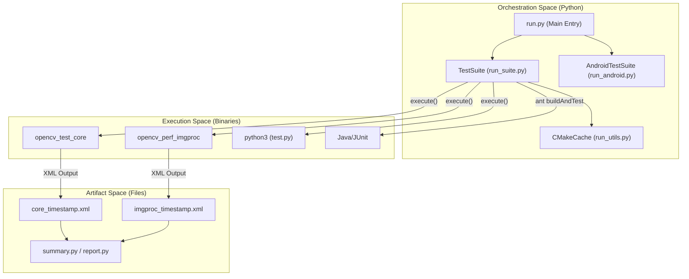
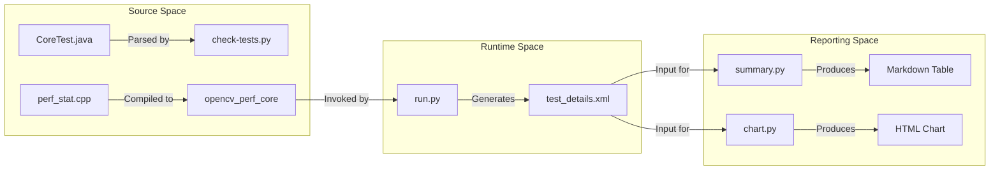

<!-- source: DeepWiki mcp.deepwiki.com · repo opencv/opencv · page 12.3 Test Runners, Reporting, and CI Workflows · fetched 2026-10-30 -->

# Test Runners, Reporting, and CI Workflows

Relevant source files

The following files were used as context for generating this wiki page:

- [.github/workflows/PR-5.x.yaml](.github/workflows/PR-5.x.yaml)
- [cmake/FindFlake8.cmake](cmake/FindFlake8.cmake)
- [cmake/FindPylint.cmake](cmake/FindPylint.cmake)
- [cmake/OpenCVPylint.cmake](cmake/OpenCVPylint.cmake)
- [cmake/templates/opencv_run_all_tests_android.sh.in](cmake/templates/opencv_run_all_tests_android.sh.in)
- [cmake/templates/opencv_run_all_tests_unix.sh.in](cmake/templates/opencv_run_all_tests_unix.sh.in)
- [cmake/templates/pylint.cmake.in](cmake/templates/pylint.cmake.in)
- [doc/tutorials/introduction/documenting_opencv/documentation_tutorial.markdown](doc/tutorials/introduction/documenting_opencv/documentation_tutorial.markdown)
- [hal/carotene/include/carotene/types.hpp](hal/carotene/include/carotene/types.hpp)
- [modules/core/misc/java/test/CoreTest.java](modules/core/misc/java/test/CoreTest.java)
- [modules/core/perf/perf_gemm.cpp](modules/core/perf/perf_gemm.cpp)
- [modules/core/perf/perf_stat.cpp](modules/core/perf/perf_stat.cpp)
- [modules/core/test/test_allocator.cpp](modules/core/test/test_allocator.cpp)
- [modules/dnn/perf/perf_utils.cpp](modules/dnn/perf/perf_utils.cpp)
- [modules/dnn/src/dnn_utils.cpp](modules/dnn/src/dnn_utils.cpp)
- [modules/dnn/src/layers/crop_and_resize_layer.cpp](modules/dnn/src/layers/crop_and_resize_layer.cpp)
- [modules/features/3rdparty/annoy/annoylib.h](modules/features/3rdparty/annoy/annoylib.h)
- [modules/features/src/annoy.cpp](modules/features/src/annoy.cpp)
- [modules/java/check-tests.py](modules/java/check-tests.py)
- [modules/java/test/pure_test/build.xml](modules/java/test/pure_test/build.xml)
- [modules/objdetect/src/aruco/apriltag/unionfind.hpp](modules/objdetect/src/aruco/apriltag/unionfind.hpp)
- [modules/photo/src/ccm/ccm.cpp](modules/photo/src/ccm/ccm.cpp)
- [modules/photo/src/ccm/color.hpp](modules/photo/src/ccm/color.hpp)
- [modules/photo/src/ccm/colorspace.hpp](modules/photo/src/ccm/colorspace.hpp)
- [modules/photo/src/ccm/illumobserver.hpp](modules/photo/src/ccm/illumobserver.hpp)
- [modules/photo/src/ccm/linearize.hpp](modules/photo/src/ccm/linearize.hpp)
- [modules/photo/src/ccm/operations.hpp](modules/photo/src/ccm/operations.hpp)
- [modules/ts/misc/chart.py](modules/ts/misc/chart.py)
- [modules/ts/misc/color.py](modules/ts/misc/color.py)
- [modules/ts/misc/concatlogs.py](modules/ts/misc/concatlogs.py)
- [modules/ts/misc/perf_tests_timing.py](modules/ts/misc/perf_tests_timing.py)
- [modules/ts/misc/report.py](modules/ts/misc/report.py)
- [modules/ts/misc/run.py](modules/ts/misc/run.py)
- [modules/ts/misc/run_android.py](modules/ts/misc/run_android.py)
- [modules/ts/misc/run_long.py](modules/ts/misc/run_long.py)
- [modules/ts/misc/run_suite.py](modules/ts/misc/run_suite.py)
- [modules/ts/misc/run_utils.py](modules/ts/misc/run_utils.py)
- [modules/ts/misc/summary.py](modules/ts/misc/summary.py)
- [modules/ts/misc/table_formatter.py](modules/ts/misc/table_formatter.py)
- [modules/ts/misc/testlog_parser.py](modules/ts/misc/testlog_parser.py)
- [modules/ts/misc/trace_profiler.py](modules/ts/misc/trace_profiler.py)
- [modules/ts/misc/xls-report.py](modules/ts/misc/xls-report.py)
- [platforms/apple/cv_build_utils.py](platforms/apple/cv_build_utils.py)
- [platforms/scripts/pylintrc](platforms/scripts/pylintrc)
- [samples/dnn/tf_text_graph_common.py](samples/dnn/tf_text_graph_common.py)
- [samples/dnn/tf_text_graph_efficientdet.py](samples/dnn/tf_text_graph_efficientdet.py)
- [samples/dnn/tf_text_graph_faster_rcnn.py](samples/dnn/tf_text_graph_faster_rcnn.py)
- [samples/dnn/tf_text_graph_mask_rcnn.py](samples/dnn/tf_text_graph_mask_rcnn.py)
- [samples/dnn/tf_text_graph_ssd.py](samples/dnn/tf_text_graph_ssd.py)

The OpenCV testing infrastructure provides a unified abstraction layer for executing accuracy and performance tests across diverse environments, including local development machines, remote Android devices, and Continuous Integration (CI) pipelines. The system is primarily driven by Python-based orchestration scripts that manage test discovery, environment configuration, and results aggregation.

## Test Runner Architecture

The core of the testing infrastructure is `run.py`, a versatile wrapper around Google Test (gtest) executables. It handles the complexities of binary discovery, platform-specific execution, and artifact collection.

### Key Components and Data Flow

The runner interacts with the `TestSuite` class to manage the lifecycle of a test run, including environment setup and log generation.

**Test Runner Logic Flow**

*Sources: [modules/ts/misc/run.py:40-46](), [modules/ts/misc/run_suite.py:12-18](), [modules/ts/misc/run_suite.py:114-143]()*

### The `run.py` Script
`run.py` serves as the primary entry point for CI and developers. It supports:
*   **Module Selection**: Using `-t` (tests) and `-b` (blacklist) to filter which OpenCV modules are executed [modules/ts/misc/run.py:63-64]().
*   **Test Mode**: Toggling between accuracy (`-a`) and performance tests [modules/ts/misc/run.py:65]().
*   **Environment Wrapping**: Supporting `valgrind` for memory debugging, `qemu` for cross-architecture emulation, and `adb` for Android execution [modules/ts/misc/run.py:76-89]().
*   **Binding Tests**: Specialized paths for testing Java (via Ant) and Python bindings [modules/ts/misc/run.py:13](), [modules/ts/misc/run_suite.py:117-143]().

### Test Discovery and Aliasing
The `TestSuite` class in `run_suite.py` implements a flexible aliasing system. It allows users to refer to tests by their full path, binary name, or a shortened module alias (e.g., `opencv_test_core` vs `core`) [modules/ts/misc/run_suite.py:38-60](). The `gatherTests` function uses the `CMakeCache` to find executables in the build directory [modules/ts/misc/run_suite.py:17]().

*Sources: [modules/ts/misc/run.py](), [modules/ts/misc/run_suite.py]()*

## Performance Reporting and Analytics

OpenCV generates detailed XML logs containing timing metrics, hardware properties, and test parameters. Several utilities parse these logs to generate human-readable reports.

### Summary and Comparison
`summary.py` is the primary tool for comparing two or more performance runs. It calculates the geometric mean of execution times and produces "x-factor" speedup comparisons [modules/ts/misc/summary.py:8-33]().

| Feature | Description | Code Entity |
| :--- | :--- | :--- |
| **Log Parsing** | Converts GTest XML to Python objects | `testlog_parser.py` [modules/ts/misc/testlog_parser.py:201-213]() |
| **Metric Extraction** | Retrieves `gmean`, `median`, `min`, `stddev` | `TestInfo.get()` [modules/ts/misc/testlog_parser.py:89-120]() |
| **Table Formatting** | Generates Markdown, HTML, or Text tables | `table_formatter.py` [modules/ts/misc/table_formatter.py:32-50]() |
| **XLS Generation** | Creates multi-sheet Excel reports | `xls-report.py` [modules/ts/misc/xls-report.py:110-128]() |

### Regression Tracking
The `summary.py` script includes a `--regressions` flag to highlight performance drops between a reference and current build [modules/ts/misc/summary.py:75](). It uses `testlog_parser.py` to normalize metrics against the CPU frequency recorded in the XML [modules/ts/misc/testlog_parser.py:109-119]().

*Sources: [modules/ts/misc/summary.py](), [modules/ts/misc/xls-report.py](), [modules/ts/misc/testlog_parser.py](), [modules/ts/misc/table_formatter.py]() *

## CI Workflows (GitHub Actions)

OpenCV uses GitHub Actions to orchestrate builds and tests across a matrix of platforms. The primary entry point for pull requests is `.github/workflows/PR-5.x.yaml`.

### Workflow Structure
The CI configuration delegates to specialized reusable workflows hosted in the `opencv/ci-gha-workflow` repository.

**CI Execution Matrix**
| Job Name | Purpose | Source |
| :--- | :--- | :--- |
| `Linux` | Standard x64 GCC build and test | [.github/workflows/PR-5.x.yaml:9-10]() |
| `Linux-no-HAL` | Validates build without hardware acceleration | [.github/workflows/PR-5.x.yaml:14-15]() |
| `Ubuntu2004-x64-CUDA` | GPU-specific tests (triggered by `category: dnn` label) | [.github/workflows/PR-5.x.yaml:34-36]() |
| `macOS-ARM64` | Apple Silicon validation | [.github/workflows/PR-5.x.yaml:43-44]() |
| `Android` | Cross-compilation and device emulation tests | [.github/workflows/PR-5.x.yaml:55-56]() |
| `Linux-RISC-V-Clang` | Validation for RISC-V architecture | [.github/workflows/PR-5.x.yaml:61-62]() |

### Code Quality Checks: Pylint and Flake8
OpenCV enforces Python style guides across its tooling and binding scripts using `pylint` and `flake8`. CMake integration via `cmake/FindPylint.cmake`, `cmake/FindFlake8.cmake`, and `cmake/OpenCVPylint.cmake` ensures that Python contributions satisfy static analysis checks during configuration and build phases.

### Failure Modes and Debugging
1.  **Valgrind Timeouts**: Long-running tests (e.g., `dnn` models) often exceed CI time limits under Valgrind. `run_long.py` defines a blacklist and custom filters to manage these [modules/ts/misc/run_long.py:9-23]().
2.  **Java Coverage Gaps**: `check-tests.py` is used to audit the Java API against the C++ source to ensure all public methods have corresponding JUnit tests [modules/java/check-tests.py:53-62]().
3.  **Trace Dumps**: When tests fail or hang, `run.py` can be invoked with `--trace` to enable `OPENCV_TRACE`, which dumps execution highlights to a text file via `trace_profiler.py` [modules/ts/misc/run.py:93-94](), [modules/ts/misc/run_suite.py:148-150]().

*Sources: [.github/workflows/PR-5.x.yaml](), [cmake/FindPylint.cmake](), [cmake/FindFlake8.cmake](), [cmake/OpenCVPylint.cmake](), [modules/java/check-tests.py]() *

## Data Flow: From Source to Report

**Code to Artifact Association**

*Sources: [modules/java/check-tests.py:19-32](), [modules/ts/misc/run.py:1-15](), [modules/ts/misc/summary.py:1-10](), [modules/ts/misc/chart.py:1-12]()*

*Sources: [modules/ts/misc/run.py](), [modules/ts/misc/run_suite.py](), [modules/ts/misc/testlog_parser.py](), [modules/ts/misc/summary.py](), [.github/workflows/PR-5.x.yaml]()*

---

