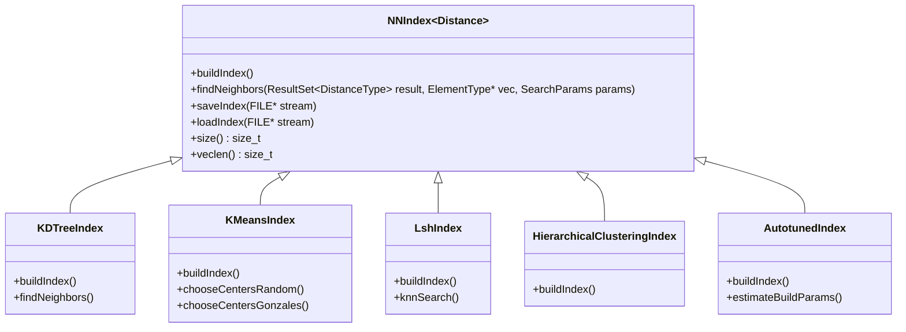
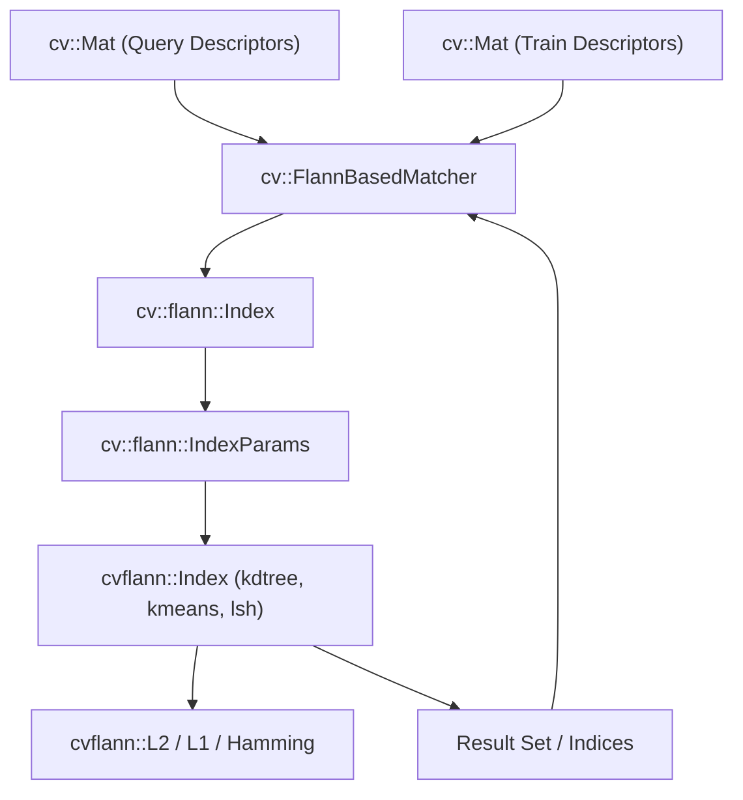

<!-- source: DeepWiki mcp.deepwiki.com · repo opencv/opencv · page 13 Nearest Neighbor Search (FLANN) · fetched 2026-10-30 -->

# Nearest Neighbor Search (FLANN)

Relevant source files

The following files were used as context for generating this wiki page:

- [cmake/checks/cpu_neon.cpp](cmake/checks/cpu_neon.cpp)
- [cmake/checks/cpu_vsx_asm.cpp](cmake/checks/cpu_vsx_asm.cpp)
- [modules/core/include/opencv2/core/affine.hpp](modules/core/include/opencv2/core/affine.hpp)
- [modules/core/include/opencv2/core/fast_math.hpp](modules/core/include/opencv2/core/fast_math.hpp)
- [modules/core/include/opencv2/core/vsx_utils.hpp](modules/core/include/opencv2/core/vsx_utils.hpp)
- [modules/flann/include/opencv2/flann.hpp](modules/flann/include/opencv2/flann.hpp)
- [modules/flann/include/opencv2/flann/all_indices.h](modules/flann/include/opencv2/flann/all_indices.h)
- [modules/flann/include/opencv2/flann/autotuned_index.h](modules/flann/include/opencv2/flann/autotuned_index.h)
- [modules/flann/include/opencv2/flann/composite_index.h](modules/flann/include/opencv2/flann/composite_index.h)
- [modules/flann/include/opencv2/flann/config.h](modules/flann/include/opencv2/flann/config.h)
- [modules/flann/include/opencv2/flann/defines.h](modules/flann/include/opencv2/flann/defines.h)
- [modules/flann/include/opencv2/flann/dist.h](modules/flann/include/opencv2/flann/dist.h)
- [modules/flann/include/opencv2/flann/flann_base.hpp](modules/flann/include/opencv2/flann/flann_base.hpp)
- [modules/flann/include/opencv2/flann/general.h](modules/flann/include/opencv2/flann/general.h)
- [modules/flann/include/opencv2/flann/ground_truth.h](modules/flann/include/opencv2/flann/ground_truth.h)
- [modules/flann/include/opencv2/flann/hierarchical_clustering_index.h](modules/flann/include/opencv2/flann/hierarchical_clustering_index.h)
- [modules/flann/include/opencv2/flann/index_testing.h](modules/flann/include/opencv2/flann/index_testing.h)
- [modules/flann/include/opencv2/flann/kdtree_index.h](modules/flann/include/opencv2/flann/kdtree_index.h)
- [modules/flann/include/opencv2/flann/kdtree_single_index.h](modules/flann/include/opencv2/flann/kdtree_single_index.h)
- [modules/flann/include/opencv2/flann/kmeans_index.h](modules/flann/include/opencv2/flann/kmeans_index.h)
- [modules/flann/include/opencv2/flann/linear_index.h](modules/flann/include/opencv2/flann/linear_index.h)
- [modules/flann/include/opencv2/flann/logger.h](modules/flann/include/opencv2/flann/logger.h)
- [modules/flann/include/opencv2/flann/lsh_index.h](modules/flann/include/opencv2/flann/lsh_index.h)
- [modules/flann/include/opencv2/flann/lsh_table.h](modules/flann/include/opencv2/flann/lsh_table.h)
- [modules/flann/include/opencv2/flann/miniflann.hpp](modules/flann/include/opencv2/flann/miniflann.hpp)
- [modules/flann/include/opencv2/flann/nn_index.h](modules/flann/include/opencv2/flann/nn_index.h)
- [modules/flann/include/opencv2/flann/object_factory.h](modules/flann/include/opencv2/flann/object_factory.h)
- [modules/flann/include/opencv2/flann/random.h](modules/flann/include/opencv2/flann/random.h)
- [modules/flann/include/opencv2/flann/sampling.h](modules/flann/include/opencv2/flann/sampling.h)
- [modules/flann/include/opencv2/flann/saving.h](modules/flann/include/opencv2/flann/saving.h)
- [modules/flann/src/flann.cpp](modules/flann/src/flann.cpp)
- [modules/flann/src/miniflann.cpp](modules/flann/src/miniflann.cpp)
- [modules/flann/src/precomp.hpp](modules/flann/src/precomp.hpp)
- [modules/flann/test/test_radius_search.cpp](modules/flann/test/test_radius_search.cpp)
- [modules/objdetect/src/chessboard.cpp](modules/objdetect/src/chessboard.cpp)

## Purpose and Scope

The `opencv_flann` module provides high-performance algorithms for fast approximate nearest neighbor (ANN) search in multi-dimensional spaces and large datasets [modules/flann/include/opencv2/flann.hpp:51-57](). FLANN (Fast Library for Approximate Nearest Neighbors) serves as a critical infrastructure component for feature matching in `features2d` (such as `FlannBasedMatcher`), clustering, and high-dimensional data indexing.

In OpenCV 5.x, traditional machine learning algorithms have moved out of the main repository, but performance benchmarks and nearest neighbor facilities remain tightly integrated with FLANN and consumer modules.

This page provides a high-level architectural overview of the `opencv_flann` module:
- For deep dives into index implementations (kd-tree, kmeans, LSH, autotuned) and search algorithms, see [FLANN Index Structures and Search Algorithms](#13.1).
- For details on the `miniflann` C++ wrapper (`cv::flann::Index`), distance metrics, and integration with `features2d`, see [miniflann API, Distance Metrics, and Consumers](#13.2).

---

## Module Layout and Core Abstractions

The FLANN module bridges a templated C++ core library (`cvflann` namespace) with OpenCV's standard matrix types and public API (`cv::flann` namespace) [modules/flann/include/opencv2/flann.hpp:46-63](). 

| Header / Source File | Role / Primary Entities |
|---|---|
| `modules/flann/include/opencv2/flann.hpp` | Main entry point exposing distance functors and namespaces [modules/flann/include/opencv2/flann.hpp:46-49]() |
| `modules/flann/include/opencv2/flann/miniflann.hpp` | OpenCV wrapper API (`cv::flann::Index`, `IndexParams`, `SearchParams`) |
| `modules/flann/src/miniflann.cpp` | Implementation of parameter wrappers and OpenCV matrix converters [modules/flann/src/miniflann.cpp:23-240]() |
| `modules/flann/include/opencv2/flann/nn_index.h` | Base abstract index class `NNIndex` |
| `modules/flann/include/opencv2/flann/dist.h` | Distance functors (`L2_Simple`, `L2`, `L1`, `Hamming`, etc.) [modules/flann/include/opencv2/flann/dist.h:205-225]() |

Sources: [modules/flann/include/opencv2/flann.hpp:46-49](), [modules/flann/include/opencv2/flann/dist.h:205-225](), [modules/flann/src/miniflann.cpp:23-240]()

---

## FLANN Architecture and Index Hierarchy

The underlying search structures are built around the abstract base class `cvflann::NNIndex`, specialized by distance metrics and index strategies [modules/flann/include/opencv2/flann/kdtree_index.h:74-76]().

**FLANN Entity Hierarchy:**

Sources: [modules/flann/include/opencv2/flann/kdtree_index.h:74-79](), [modules/flann/include/opencv2/flann/kmeans_index.h:88-94](), [modules/flann/include/opencv2/flann/lsh_index.h:83-88](), [modules/flann/include/opencv2/flann/hierarchical_clustering_index.h:80-86](), [modules/flann/include/opencv2/flann/autotuned_index.h:72-78]()

---

## Consumer Integration and Data Flow

Higher-level modules such as `features2d` interact with FLANN through `cv::flann::Index` and parameter structures like `cv::flann::IndexParams` and `cv::flann::SearchParams`.

**FLANN Consumer Flow:**

Sources: [modules/flann/include/opencv2/flann.hpp:90-156](), [modules/flann/src/miniflann.cpp:23-240]()

---

## Child Pages

- [FLANN Index Structures and Search Algorithms](#13.1) — Document the index implementations: kd-tree, kmeans/hierarchical clustering, LSH tables, composite, linear and autotuned indices, plus result sets, parameter handling and the flann_base facade.
- [miniflann API, Distance Metrics, and Consumers](#13.2) — Explain the OpenCV-facing miniflann wrapper (`cv::flann::Index`, `IndexParams`, `SearchParams`), the distance functors (`L2`, `L1`, `Hamming`, etc.), and how features2d matchers consume FLANN.

---

