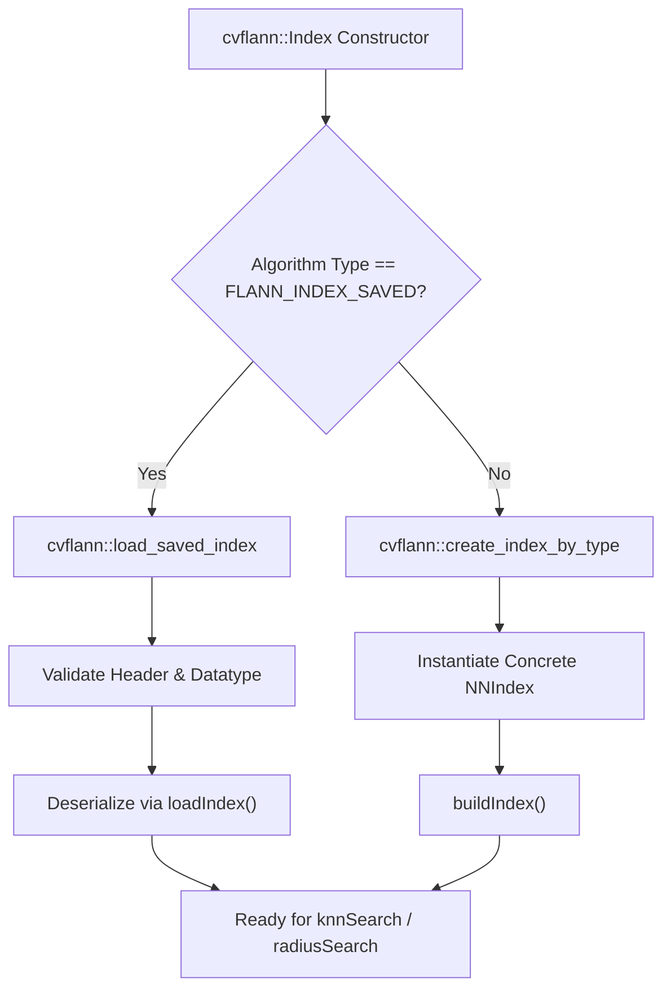
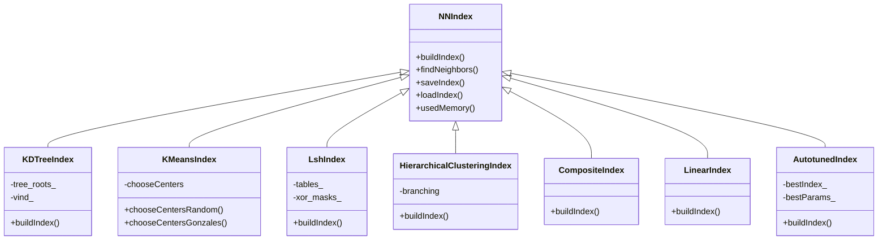
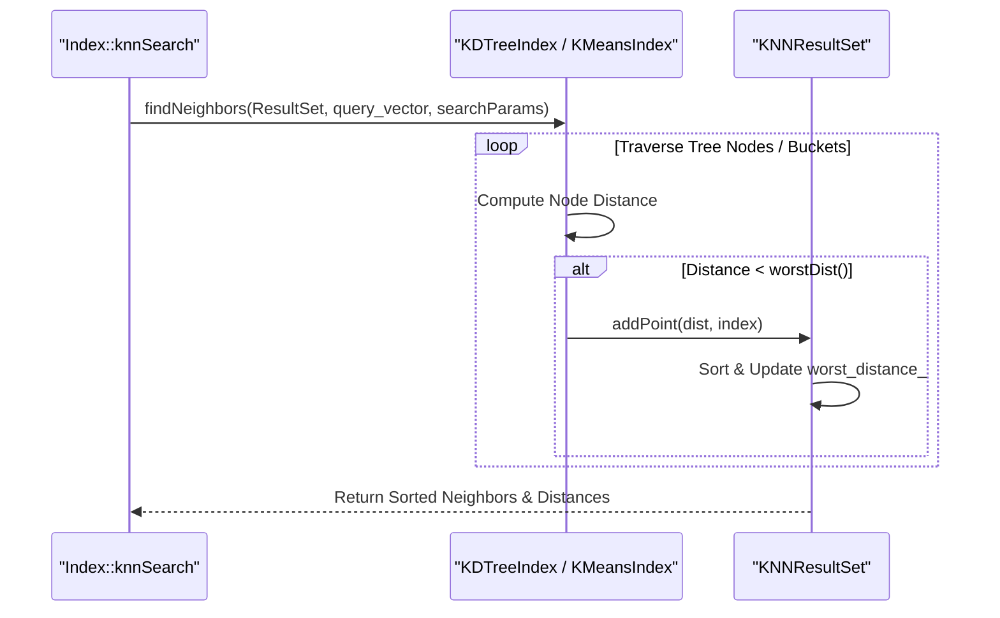

<!-- source: DeepWiki mcp.deepwiki.com · repo opencv/opencv · page 13.1 FLANN Index Structures and Search Algorithms · fetched 2026-10-30 -->

# FLANN Index Structures and Search Algorithms

Relevant source files

The following files were used as context for generating this wiki page:

- [doc/DoxygenLayout.xml](doc/DoxygenLayout.xml)
- [doc/opencv-logo-small.png](doc/opencv-logo-small.png)
- [modules/flann/include/opencv2/flann/allocator.h](modules/flann/include/opencv2/flann/allocator.h)
- [modules/flann/include/opencv2/flann/any.h](modules/flann/include/opencv2/flann/any.h)
- [modules/flann/include/opencv2/flann/autotuned_index.h](modules/flann/include/opencv2/flann/autotuned_index.h)
- [modules/flann/include/opencv2/flann/composite_index.h](modules/flann/include/opencv2/flann/composite_index.h)
- [modules/flann/include/opencv2/flann/config.h](modules/flann/include/opencv2/flann/config.h)
- [modules/flann/include/opencv2/flann/dynamic_bitset.h](modules/flann/include/opencv2/flann/dynamic_bitset.h)
- [modules/flann/include/opencv2/flann/flann_base.hpp](modules/flann/include/opencv2/flann/flann_base.hpp)
- [modules/flann/include/opencv2/flann/general.h](modules/flann/include/opencv2/flann/general.h)
- [modules/flann/include/opencv2/flann/ground_truth.h](modules/flann/include/opencv2/flann/ground_truth.h)
- [modules/flann/include/opencv2/flann/hierarchical_clustering_index.h](modules/flann/include/opencv2/flann/hierarchical_clustering_index.h)
- [modules/flann/include/opencv2/flann/index_testing.h](modules/flann/include/opencv2/flann/index_testing.h)
- [modules/flann/include/opencv2/flann/kdtree_index.h](modules/flann/include/opencv2/flann/kdtree_index.h)
- [modules/flann/include/opencv2/flann/kdtree_single_index.h](modules/flann/include/opencv2/flann/kdtree_single_index.h)
- [modules/flann/include/opencv2/flann/kmeans_index.h](modules/flann/include/opencv2/flann/kmeans_index.h)
- [modules/flann/include/opencv2/flann/linear_index.h](modules/flann/include/opencv2/flann/linear_index.h)
- [modules/flann/include/opencv2/flann/logger.h](modules/flann/include/opencv2/flann/logger.h)
- [modules/flann/include/opencv2/flann/lsh_index.h](modules/flann/include/opencv2/flann/lsh_index.h)
- [modules/flann/include/opencv2/flann/lsh_table.h](modules/flann/include/opencv2/flann/lsh_table.h)
- [modules/flann/include/opencv2/flann/matrix.h](modules/flann/include/opencv2/flann/matrix.h)
- [modules/flann/include/opencv2/flann/nn_index.h](modules/flann/include/opencv2/flann/nn_index.h)
- [modules/flann/include/opencv2/flann/object_factory.h](modules/flann/include/opencv2/flann/object_factory.h)
- [modules/flann/include/opencv2/flann/params.h](modules/flann/include/opencv2/flann/params.h)
- [modules/flann/include/opencv2/flann/random.h](modules/flann/include/opencv2/flann/random.h)
- [modules/flann/include/opencv2/flann/result_set.h](modules/flann/include/opencv2/flann/result_set.h)
- [modules/flann/include/opencv2/flann/sampling.h](modules/flann/include/opencv2/flann/sampling.h)
- [modules/flann/include/opencv2/flann/saving.h](modules/flann/include/opencv2/flann/saving.h)
- [modules/flann/include/opencv2/flann/timer.h](modules/flann/include/opencv2/flann/timer.h)
- [modules/flann/src/flann.cpp](modules/flann/src/flann.cpp)
- [modules/flann/src/precomp.hpp](modules/flann/src/precomp.hpp)
- [modules/objdetect/src/chessboard.cpp](modules/objdetect/src/chessboard.cpp)

## Purpose and Scope
This page documents the internal index implementations, parameter handling mechanisms, result sets, and the core facade of the `opencv_flann` module. The FLANN (Fast Library for Approximate Nearest Neighbors) module provides high-performance approximate nearest neighbor (ANN) search algorithms, which are crucial for feature matching in `features2d` and clustering applications.

---

## Architecture and Core Facade (`flann_base.hpp`)

The `cvflann::Index` template class serves as the primary C++ entry point and facade for building, saving, loading, and querying nearest-neighbor indices. It wraps underlying algorithm-specific index implementations derived from `cvflann::NNIndex`.

### Core Facade Classes and Functions

| Class / Function | File Path | Role |
|---|---|---|
| `cvflann::Index<Distance>` | `modules/flann/include/opencv2/flann/flann_base.hpp:115-135` | Main facade managing index creation, loading, saving, and search dispatch. |
| `cvflann::FILEScopeGuard` | `modules/flann/include/opencv2/flann/flann_base.hpp:48-61` | RAII guard ensuring safe closure of file streams during index loading. |
| `cvflann::load_saved_index` | `modules/flann/include/opencv2/flann/flann_base.hpp:87-112` | Factory function validating headers and deserializing saved indices from disk. |
| `cvflann::SavedIndexParams` | `modules/flann/include/opencv2/flann/flann_base.hpp:78-85` | Parameter structure for loading a pre-saved index from a file. |

Diagram: FLANN Facade Data Flow

Sources: `modules/flann/include/opencv2/flann/flann_base.hpp:48-135`

---

## Parameter Handling and Dynamic Types (`any.h`)

FLANN uses a flexible parameter passing mechanism built on top of `cvflann::any` and `cvflann::IndexParams` to support heterogeneous configuration options (integers, floats, strings, enums) across different index types.

### Key Parameter Classes

| Class / Component | File Path | Role |
|---|---|---|
| `cvflann::any` | `modules/flann/include/opencv2/flann/any.h:205-232` | Type-erased container supporting polymorphic storage of algorithm configuration parameters. |
| `cvflann::anyimpl::bad_any_cast` | `modules/flann/include/opencv2/flann/any.h:31-46` | Exception thrown when an invalid type retrieval is attempted on an `any` object. |
| `cvflann::IndexParams` | `modules/flann/include/opencv2/flann/params.h` | Dictionary-like container mapping parameter names (strings) to `any` values. |

Sources: `modules/flann/include/opencv2/flann/any.h:31-232`

---

## Index Implementations

The `opencv_flann` module provides several specialized index structures optimized for different data distributions and query constraints.

### 1. KD-Tree and Single KD-Tree Indices

Randomized kd-trees build multiple randomized binary trees by splitting dimensions along the feature variance.

*   `cvflann::KDTreeIndexParams`: Configures multi-tree randomized kd-tree search (`modules/flann/include/opencv2/flann/kdtree_index.h:58-65`).
*   `cvflann::KDTreeIndex<Distance>`: Implements multi-tree randomized kd-tree construction and Best-Bin-First (BBF) traversal (`modules/flann/include/opencv2/flann/kdtree_index.h:74-110`).
*   `cvflann::KDTreeSingleIndexParams` & `cvflann::KDTreeSingleIndex<Distance>`: Single kd-tree variant optimized for low-dimensional data or leaf-based storage with optional reordering (`modules/flann/include/opencv2/flann/kdtree_single_index.h:51-101`).

Sources: `modules/flann/include/opencv2/flann/kdtree_index.h:58-151`, `modules/flann/include/opencv2/flann/kdtree_single_index.h:51-134`

### 2. KMeans and Hierarchical Clustering Indices

Hierarchical k-means clustering builds a tree by recursively partitioning data points using k-means clustering at each node.

*   `cvflann::KMeansIndexParams`: Configures branching factor, iteration limit, initialization method (`FLANN_CENTERS_RANDOM`, `FLANN_CENTERS_GONZALES`, `FLANN_CENTERS_KMEANSPP`), and `cb_index` (`modules/flann/include/opencv2/flann/kmeans_index.h:61-79`).
*   `cvflann::KMeansIndex<Distance>`: Implements hierarchical k-means tree construction and priority-queue based search (`modules/flann/include/opencv2/flann/kmeans_index.h:88-148`).
*   `cvflann::HierarchicalClusteringIndexParams` & `cvflann::HierarchicalClusteringIndex<Distance>`: Generalized hierarchical clustering index variant (`modules/flann/include/opencv2/flann/hierarchical_clustering_index.h:55-137`).

Sources: `modules/flann/include/opencv2/flann/kmeans_index.h:61-148`, `modules/flann/include/opencv2/flann/hierarchical_clustering_index.h:55-137`

### 3. LSH (Locality-Sensitive Hashing) Tables

LSH indexes hash points into bucket tables using random projection bits, enabling sub-linear approximate nearest neighbor search for high-dimensional binary or continuous features.

*   `cvflann::LshIndexParams`: Configures `table_number`, `key_size`, and `multi_probe_level` (`modules/flann/include/opencv2/flann/lsh_index.h:62-74`).
*   `cvflann::LshIndex<Distance>`: Manages multiple `lsh::LshTable` instances and multi-probe query routing (`modules/flann/include/opencv2/flann/lsh_index.h:83-125`).
*   `cvflann::lsh::LshTable<ElementType>`: Implements bucket storage and bit-mask hash computations (`modules/flann/include/opencv2/flann/lsh_table.h:137-186`).
*   `cvflann::lsh::LshStats`: Computes bucket distribution statistics and histograms (`modules/flann/include/opencv2/flann/lsh_table.h:89-102`).

Sources: `modules/flann/include/opencv2/flann/lsh_index.h:62-125`, `modules/flann/include/opencv2/flann/lsh_table.h:89-186`

### 4. Composite, Linear, and Autotuned Indices

*   **Composite Index**: Combines randomized kd-trees and hierarchical k-means trees to handle diverse dataset topologies effectively (`modules/flann/include/opencv2/flann/composite_index.h`).
*   **Linear Index**: Performs brute-force linear search over the dataset, serving as a baseline for accuracy benchmarking (`modules/flann/include/opencv2/flann/linear_index.h`).
*   **Autotuned Index**: Automatically determines the optimal index type and build parameters based on dataset sampling and target precision requirements.
  *   `cvflann::AutotunedIndexParams`: Configures `target_precision`, `build_weight`, `memory_weight`, and `sample_fraction` (`modules/flann/include/opencv2/flann/autotuned_index.h:55-69`).
  *   `cvflann::AutotunedIndex<Distance>`: Samples the dataset, evaluates multiple index configurations against ground truth, and builds the optimal index (`modules/flann/include/opencv2/flann/autotuned_index.h:72-123`).

Sources: `modules/flann/include/opencv2/flann/autotuned_index.h:55-123`

Diagram: FLANN Index Class Hierarchy to Code Entities

Sources: `modules/flann/include/opencv2/flann/nn_index.h`, `modules/flann/include/opencv2/flann/kdtree_index.h:74-76`, `modules/flann/include/opencv2/flann/kmeans_index.h:88-90`, `modules/flann/include/opencv2/flann/lsh_index.h:83-84`, `modules/flann/include/opencv2/flann/hierarchical_clustering_index.h:80-82`, `modules/flann/include/opencv2/flann/composite_index.h`, `modules/flann/include/opencv2/flann/linear_index.h`, `modules/flann/include/opencv2/flann/autotuned_index.h:72-74`

---

## Result Sets and Search Traversal (`result_set.h`)

Query execution relies on abstract result sets (`cvflann::ResultSet`) to accumulate and filter nearest neighbors during tree or table traversal.

### Key Result Set Classes

| Class / Structure | File Path | Role |
|---|---|---|
| `cvflann::ResultSet<DistanceType>` | `modules/flann/include/opencv2/flann/result_set.h:70-82` | Abstract interface defining `addPoint`, `full()`, and `worstDist()`. |
| `cvflann::KNNResultSet<DistanceType>` | `modules/flann/include/opencv2/flann/result_set.h:156-228` | Maintains unique $k$-nearest neighbors sorted by distance in a bounded priority queue. |
| `cvflann::KNNSimpleResultSet<DistanceType>` | `modules/flann/include/opencv2/flann/result_set.h:89-151` | Faster non-unique $k$-nearest neighbor result set for algorithms guaranteeing unique insertions. |
| `cvflann::BranchStruct<T, DistanceType>` | `modules/flann/include/opencv2/flann/result_set.h:54-67` | Branching record holding resume nodes and minimum distance bounds during tree traversal. |

Sources: `modules/flann/include/opencv2/flann/result_set.h:54-228`

Diagram: Query Search and Result Accumulation Flow

Sources: `modules/flann/include/opencv2/flann/kdtree_index.h:219-224`, `modules/flann/include/opencv2/flann/result_set.h:156-228`

---

## Summary of Key Entities

| Entity Name | Code Location | Primary Role |
|---|---|---|
| `cvflann::Index` | `modules/flann/include/opencv2/flann/flann_base.hpp:115` | Main C++ facade for index creation, persistence, and queries. |
| `cvflann::any` | `modules/flann/include/opencv2/flann/any.h:205` | Type-erased container for heterogeneous parameter passing. |
| `cvflann::NNIndex` | `modules/flann/include/opencv2/flann/nn_index.h` | Abstract base class for all approximate nearest-neighbor index types. |
| `cvflann::KNNResultSet` | `modules/flann/include/opencv2/flann/result_set.h:156` | Bounded priority queue ensuring unique $k$-nearest neighbor collection. |
| `cvflann::StartStopTimer` | `modules/flann/include/opencv2/flann/timer.h:48` | Utility class for timing index build and search operations. |

Sources: `modules/flann/include/opencv2/flann/flann_base.hpp:115-135`, `modules/flann/include/opencv2/flann/any.h:205-232`, `modules/flann/include/opencv2/flann/result_set.h:156-228`, `modules/flann/include/opencv2/flann/timer.h:48-93`

---

