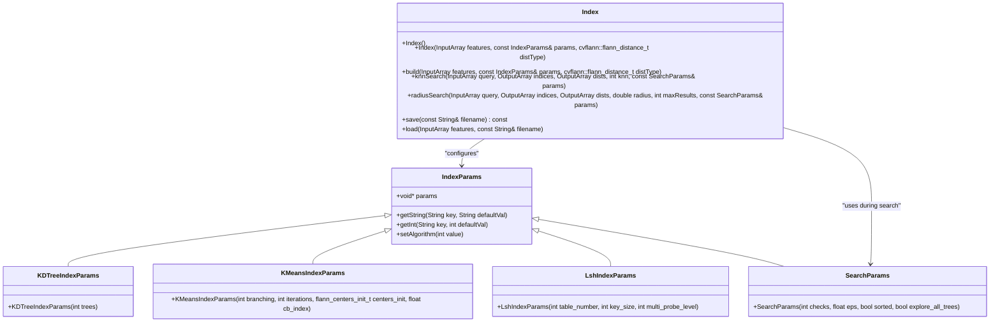
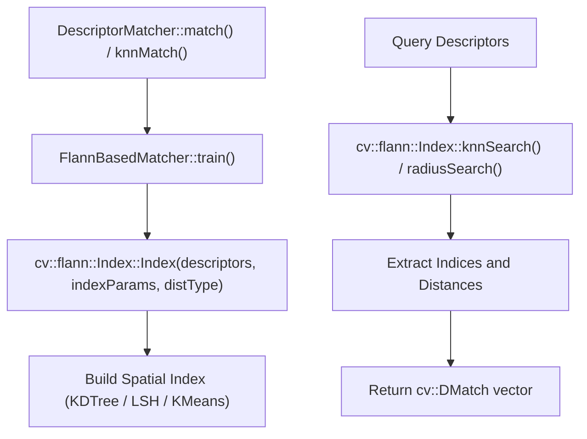

<!-- source: DeepWiki mcp.deepwiki.com · repo opencv/opencv · page 13.2 miniflann API, Distance Metrics, and Consumers · fetched 2026-10-30 -->

# miniflann API, Distance Metrics, and Consumers

Relevant source files

The following files were used as context for generating this wiki page:

- [cmake/checks/cpu_neon.cpp](cmake/checks/cpu_neon.cpp)
- [cmake/checks/cpu_vsx_asm.cpp](cmake/checks/cpu_vsx_asm.cpp)
- [doc/opencv.bib](doc/opencv.bib)
- [modules/core/include/opencv2/core/affine.hpp](modules/core/include/opencv2/core/affine.hpp)
- [modules/core/include/opencv2/core/fast_math.hpp](modules/core/include/opencv2/core/fast_math.hpp)
- [modules/core/include/opencv2/core/vsx_utils.hpp](modules/core/include/opencv2/core/vsx_utils.hpp)
- [modules/dnn/src/layers/topk2_layer.cpp](modules/dnn/src/layers/topk2_layer.cpp)
- [modules/features/include/opencv2/features.hpp](modules/features/include/opencv2/features.hpp)
- [modules/features/src/aliked_context.hpp](modules/features/src/aliked_context.hpp)
- [modules/features/src/feature2d_aliked.cpp](modules/features/src/feature2d_aliked.cpp)
- [modules/features/src/feature2d_xfeat.cpp](modules/features/src/feature2d_xfeat.cpp)
- [modules/features/src/matchers.cpp](modules/features/src/matchers.cpp)
- [modules/features/src/matchers_lightglue.cpp](modules/features/src/matchers_lightglue.cpp)
- [modules/features/src/precomp.hpp](modules/features/src/precomp.hpp)
- [modules/features/test/test_aliked_lightglue.cpp](modules/features/test/test_aliked_lightglue.cpp)
- [modules/features/test/test_main.cpp](modules/features/test/test_main.cpp)
- [modules/features/test/test_matchers_algorithmic.cpp](modules/features/test/test_matchers_algorithmic.cpp)
- [modules/features/test/test_xfeat.cpp](modules/features/test/test_xfeat.cpp)
- [modules/flann/include/opencv2/flann.hpp](modules/flann/include/opencv2/flann.hpp)
- [modules/flann/include/opencv2/flann/all_indices.h](modules/flann/include/opencv2/flann/all_indices.h)
- [modules/flann/include/opencv2/flann/defines.h](modules/flann/include/opencv2/flann/defines.h)
- [modules/flann/include/opencv2/flann/dist.h](modules/flann/include/opencv2/flann/dist.h)
- [modules/flann/include/opencv2/flann/miniflann.hpp](modules/flann/include/opencv2/flann/miniflann.hpp)
- [modules/flann/src/miniflann.cpp](modules/flann/src/miniflann.cpp)
- [modules/flann/test/test_radius_search.cpp](modules/flann/test/test_radius_search.cpp)
- [modules/geometry/doc/geometry.bib](modules/geometry/doc/geometry.bib)
- [modules/imgproc/include/opencv2/imgproc.hpp](modules/imgproc/include/opencv2/imgproc.hpp)
- [modules/imgproc/src/lsd.cpp](modules/imgproc/src/lsd.cpp)
- [modules/imgproc/test/test_lsd.cpp](modules/imgproc/test/test_lsd.cpp)
- [modules/objdetect/doc/objdetect.bib](modules/objdetect/doc/objdetect.bib)
- [samples/cpp/aliked_lightglue.cpp](samples/cpp/aliked_lightglue.cpp)

This page details OpenCV’s interface wrapper for the Fast Library for Approximate Nearest Neighbors (`miniflann`), the available distance metrics and functors, and how external modules like `features2d` consume FLANN indices for efficient descriptor matching and nearest neighbor searches.

---

## 1. The OpenCV-Facing `miniflann` Wrapper (`Index`, `IndexParams`, `SearchParams`)

The `miniflann` module provides a simplified, OpenCV-native C++ wrapper around the underlying `cvflann` template library. This allows users to construct spatial indices, perform $k$-NN and radius searches, and serialize indices using standard OpenCV types (`Mat`, `InputArray`, `OutputArray`, `String`).

The core classes exposed in `opencv2/flann/miniflann.hpp` include:
- `cv::flann::Index`: The main index container class supporting construction, searching (`knnSearch`, `radiusSearch`), saving, and loading [modules/flann/include/opencv2/flann/miniflann.hpp:150-170]().
- `cv::flann::IndexParams`: Base parameter container wrapping underlying FLANN index configuration maps [modules/flann/include/opencv2/flann/miniflann.hpp:71-98]().
- Concrete parameter subclasses: `KDTreeIndexParams`, `LinearIndexParams`, `CompositeIndexParams`, `AutotunedIndexParams`, `HierarchicalClusteringIndexParams`, `KMeansIndexParams`, `LshIndexParams`, and `SavedIndexParams` [modules/flann/include/opencv2/flann/miniflann.hpp:100-142]().
- `cv::flann::SearchParams`: Configuration structure controlling search precision, checks count, and approximation limits (`checks`, `eps`, `sorted`) [modules/flann/include/opencv2/flann/miniflann.hpp:144-148]().

### Diagram: miniflann Wrapper Architecture

Sources: `modules/flann/include/opencv2/flann/miniflann.hpp:71-177]()`, `modules/flann/src/miniflann.cpp:1-240]()`

---

## 2. Distance Metrics and Functors (`L2`, `L1`, `Hamming`, etc.)

FLANN relies on distance functors to evaluate the dissimilarity between feature vectors during index construction and traversal. OpenCV exposes these functors under the `cv::flann` namespace [modules/flann/include/opencv2/flann.hpp:89-104]().

### Available Distance Functors

| Functor Class | Description | KD-Tree Compatible |
|---|---|---|
| `cv::flann::L2_Simple` | Simple unrolled squared Euclidean distance for low-dimensional data | Yes (`True`) [modules/flann/include/opencv2/flann/dist.h:206-210]() |
| `cv::flann::L2` | Optimized squared Euclidean distance | Yes |
| `cv::flann::L1` | Optimized Manhattan (absolute difference) distance | Yes |
| `cv::flann::MinkowskiDistance` | Highly optimized loop-unrolled Minkowski distance | Yes |
| `cv::flann::MaxDistance` | Maximum component-wise distance (Chebyshev) | No |
| `cv::flann::Hamming` / `HammingLUT` / `Hamming2` | Hamming distance for binary descriptors (e.g., ORB) using popcount or LUT | No |
| `cv::flann::DNAmming` variants | Adaptation for DNA/RNA sequence comparison | No |
| `cv::flann::HistIntersectionDistance` | Histogram intersection distance | No |
| `cv::flann::HellingerDistance` | Hellinger distance for probability distributions | No |
| `cv::flann::ChiSquareDistance` | Chi-square distance | No |
| `cv::flann::KL_Divergence` | Kullback-Leibler divergence | No |

### Custom Distance Functor Requirements
A valid distance functor must define:
1. `operator()(Iterator1 a, Iterator2 b, size_t size)`: Computes and returns the distance metric type (`ResultType`).
2. `accum_dist(const U& a, const V& b, int)`: Component-wise distance accumulator required for KD-tree compatible metrics [modules/flann/include/opencv2/flann.hpp:153-156]().
3. Typedefs: `ElementType`, `ResultType`, `is_kdtree_distance`, and `is_vector_space_distance`.

Sources: `modules/flann/include/opencv2/flann/dist.h:1-229]()`, `modules/flann/include/opencv2/flann.hpp:75-158]()`

---

## 3. Consumers of FLANN: `features2d` Matchers and Performance Tests

The primary consumer of `miniflann` within OpenCV is the `features2d` module, specifically through `cv::FlannBasedMatcher`, which handles approximate nearest neighbor matching for high-dimensional feature descriptors (such as SIFT).

### Data Flow for Descriptor Matching via FLANN

### Integration Points
- **`features2d` Module**: `FlannBasedMatcher` wraps `cv::flann::Index` to provide standard descriptor matching interfaces compatible with `BFMatcher`.
- **Performance Testing (`ts`)**: Benchmarks and regression tests use `miniflann` structures to validate spatial search throughput and precision across various index types and metric spaces.

Sources: `modules/features/include/opencv2/features.hpp:45-52](), modules/features/src/matchers.cpp:1-200]()`

---

