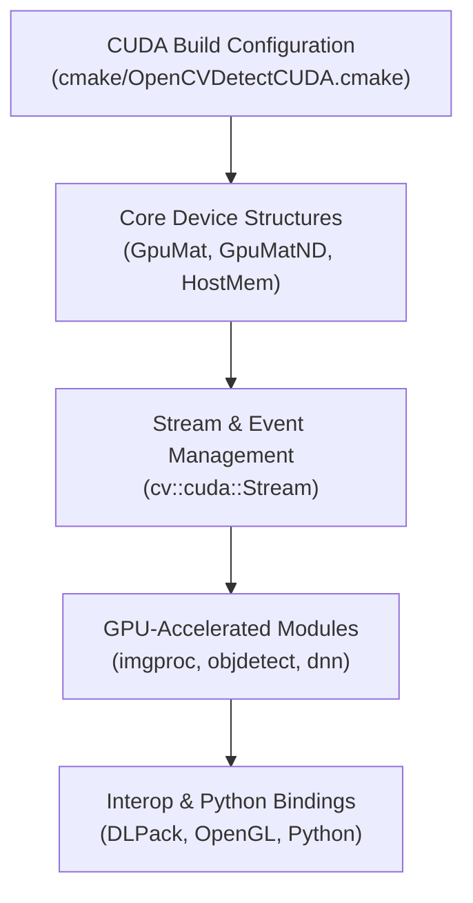

<!-- source: DeepWiki mcp.deepwiki.com · repo opencv/opencv · page 14 CUDA and GPU Acceleration · fetched 2026-10-30 -->

# CUDA and GPU Acceleration

Relevant source files

The following files were used as context for generating this wiki page:

- [3rdparty/dlpack/LICENSE](3rdparty/dlpack/LICENSE)
- [3rdparty/dlpack/include/dlpack/dlpack.h](3rdparty/dlpack/include/dlpack/dlpack.h)
- [cmake/FindCUDA.cmake](cmake/FindCUDA.cmake)
- [cmake/FindCUDA/make2cmake.cmake](cmake/FindCUDA/make2cmake.cmake)
- [cmake/FindCUDA/parse_cubin.cmake](cmake/FindCUDA/parse_cubin.cmake)
- [cmake/FindCUDA/run_nvcc.cmake](cmake/FindCUDA/run_nvcc.cmake)
- [cmake/FindCUDNNJIT.cmake](cmake/FindCUDNNJIT.cmake)
- [cmake/OpenCVDetectCUDA.cmake](cmake/OpenCVDetectCUDA.cmake)
- [cmake/OpenCVDetectCUDALanguage.cmake](cmake/OpenCVDetectCUDALanguage.cmake)
- [cmake/OpenCVDetectCUDAUtils.cmake](cmake/OpenCVDetectCUDAUtils.cmake)
- [cmake/OpenCVDetectDLPack.cmake](cmake/OpenCVDetectDLPack.cmake)
- [cmake/OpenCVMinDepVersions.cmake](cmake/OpenCVMinDepVersions.cmake)
- [modules/core/cmake/parallel/detect_openmp.cmake](modules/core/cmake/parallel/detect_openmp.cmake)
- [modules/core/include/opencv2/core/cuda.hpp](modules/core/include/opencv2/core/cuda.hpp)
- [modules/core/include/opencv2/core/cuda.inl.hpp](modules/core/include/opencv2/core/cuda.inl.hpp)
- [modules/core/include/opencv2/core/cuda/utility.hpp](modules/core/include/opencv2/core/cuda/utility.hpp)
- [modules/core/include/opencv2/core/private.cuda.hpp](modules/core/include/opencv2/core/private.cuda.hpp)
- [modules/core/misc/python/pyopencv_core.hpp](modules/core/misc/python/pyopencv_core.hpp)
- [modules/core/misc/python/pyopencv_cuda.hpp](modules/core/misc/python/pyopencv_cuda.hpp)
- [modules/core/src/cuda/gpu_mat.cu](modules/core/src/cuda/gpu_mat.cu)
- [modules/core/src/cuda/gpu_mat_nd.cu](modules/core/src/cuda/gpu_mat_nd.cu)
- [modules/core/src/cuda_gpu_mat.cpp](modules/core/src/cuda_gpu_mat.cpp)
- [modules/core/src/cuda_gpu_mat_nd.cpp](modules/core/src/cuda_gpu_mat_nd.cpp)
- [modules/core/src/cuda_host_mem.cpp](modules/core/src/cuda_host_mem.cpp)
- [modules/core/src/cuda_stream.cpp](modules/core/src/cuda_stream.cpp)
- [modules/core/test/test_cuda.cpp](modules/core/test/test_cuda.cpp)
- [modules/dnn/cmake/hooks/INIT_MODULE_SOURCES_opencv_dnn.cmake](modules/dnn/cmake/hooks/INIT_MODULE_SOURCES_opencv_dnn.cmake)
- [modules/dnn/src/cuda4dnn/csl/cublas.hpp](modules/dnn/src/cuda4dnn/csl/cublas.hpp)
- [modules/dnn/src/cuda4dnn/csl/cudnn/cudnn.hpp](modules/dnn/src/cuda4dnn/csl/cudnn/cudnn.hpp)
- [modules/dnn/src/cuda4dnn/csl/stream.hpp](modules/dnn/src/cuda4dnn/csl/stream.hpp)
- [modules/python/test/test_cuda.py](modules/python/test/test_cuda.py)

## Purpose and Scope

This page provides a high-level overview of OpenCV's CUDA support infrastructure. OpenCV includes extensive GPU-accelerated algorithms that operate directly on device memory, bypassing host-to-device transfer overhead where possible. The core architecture relies on specialized device containers, asynchronous stream management, pluggable allocators, and modular build-time integration with the CUDA Toolkit and optional libraries like cuDNN.

This is a parent page. For deep technical details, refer to the child pages covering data structures, interoperability, and build configuration.

Sources: [cmake/OpenCVDetectCUDA.cmake:1-125](), [modules/core/include/opencv2/core/cuda.hpp:54-150]()

---

## 14.1. GpuMat and CUDA Runtime Integration

The foundational data structure for GPU memory in OpenCV is `cv::cuda::GpuMat`, which mimics the host-side `cv::Mat` interface with necessary adaptations for device memory constraints (such as hardware-aligned row pitches via `cudaMallocPitch`). Alongside `GpuMat`, the runtime integration layer covers N-dimensional `GpuMatND` tensors, asynchronous CUDA streams and events, host-locked memory management (`cv::cuda::HostMem`), and memory pools to eliminate allocation overhead during continuous execution loops. 

Additionally, OpenCV integrates zero-copy tensor exchange via DLPack and exposes core CUDA structures through Python bindings, enabling seamless interoperability with deep learning frameworks and scripting environments.

For details, see [GpuMat and CUDA Runtime Integration](#14.1).

Sources: [modules/core/include/opencv2/core/cuda.hpp:74-150](), [modules/core/src/cuda/gpu_mat.cu:107-141](), [modules/python/test/test_cuda.py:22-58]()

---

## 14.2. GPU-Accelerated Samples and Interop

OpenCV provides reference sample applications demonstrating multi-GPU pipelines, stereo matching, and high-performance throughput using custom CUDA code or Thrust algorithms. Furthermore, the library supports graphics and video interop bridges, allowing direct sharing of GPU surfaces with external APIs such as DirectX, OpenGL, and VA-Intel without redundant memory copies.

For details, see [GPU-Accelerated Samples and Interop](#14.2).

Sources: [modules/core/src/cuda/gpu_mat.cu:61-104]()

---

## 14.3. CUDA Build Options, Dependencies, and Common Pitfalls

CUDA compilation in OpenCV is orchestrated by CMake helper scripts that probe the local environment for the CUDA Toolkit, cuDNN, cuFFT, cuBLAS, and the NVIDIA Video Codec SDK. Developers can customize GPU target architectures (`CUDA_ARCH_BIN`, `CUDA_ARCH_PTX`) and enable optimizations like fast math. Understanding how CUDA source files (`.cu`) are organized and how to resolve common linking or runtime version mismatches is essential for successful compilation.

For details, see [CUDA Build Options, Dependencies, and Common Pitfalls](#14.3).

Sources: [cmake/OpenCVDetectCUDA.cmake:1-125](), [cmake/OpenCVMinDepVersions.cmake:5-7]()

---

