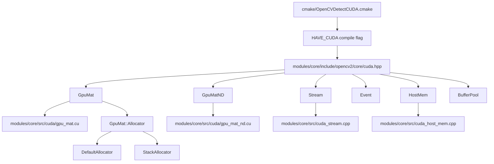
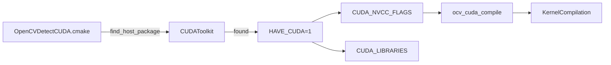
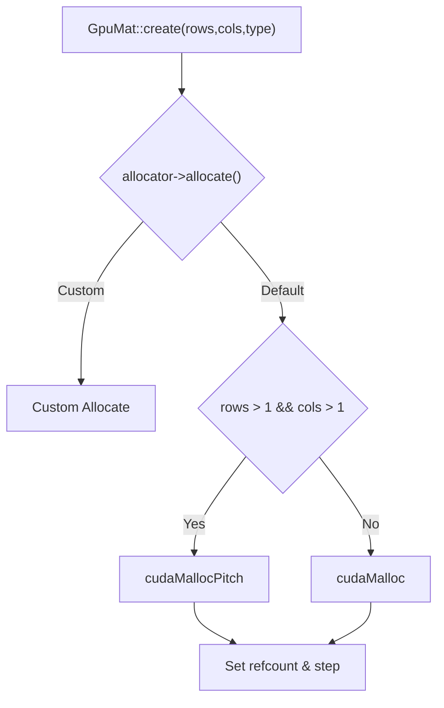
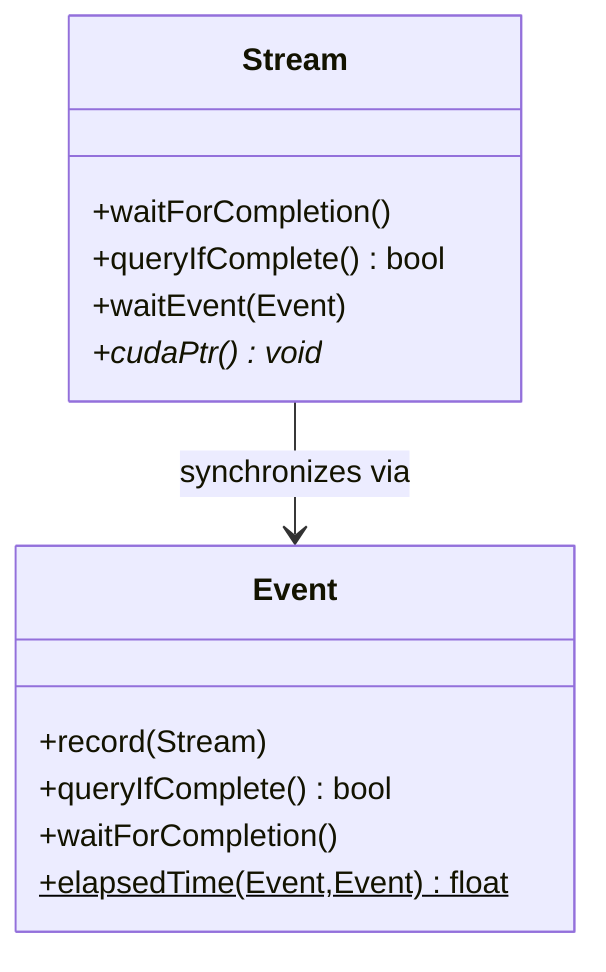
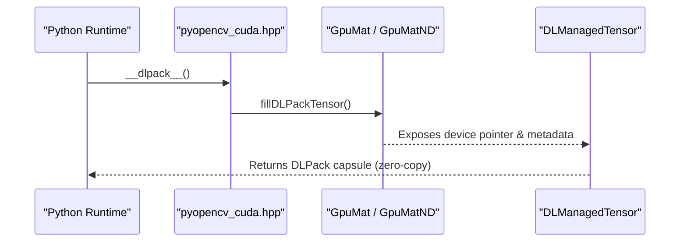

<!-- source: DeepWiki mcp.deepwiki.com · repo opencv/opencv · page 14.1 GpuMat and CUDA Runtime Integration · fetched 2026-10-30 -->

# GpuMat and CUDA Runtime Integration

Relevant source files

The following files were used as context for generating this wiki page:

- [3rdparty/dlpack/LICENSE](3rdparty/dlpack/LICENSE)
- [3rdparty/dlpack/include/dlpack/dlpack.h](3rdparty/dlpack/include/dlpack/dlpack.h)
- [cmake/OpenCVDetectDLPack.cmake](cmake/OpenCVDetectDLPack.cmake)
- [modules/core/include/opencv2/core/cuda.hpp](modules/core/include/opencv2/core/cuda.hpp)
- [modules/core/include/opencv2/core/cuda.inl.hpp](modules/core/include/opencv2/core/cuda.inl.hpp)
- [modules/core/include/opencv2/core/cuda/utility.hpp](modules/core/include/opencv2/core/cuda/utility.hpp)
- [modules/core/include/opencv2/core/private.cuda.hpp](modules/core/include/opencv2/core/private.cuda.hpp)
- [modules/core/misc/python/pyopencv_core.hpp](modules/core/misc/python/pyopencv_core.hpp)
- [modules/core/misc/python/pyopencv_cuda.hpp](modules/core/misc/python/pyopencv_cuda.hpp)
- [modules/core/src/cuda/gpu_mat.cu](modules/core/src/cuda/gpu_mat.cu)
- [modules/core/src/cuda/gpu_mat_nd.cu](modules/core/src/cuda/gpu_mat_nd.cu)
- [modules/core/src/cuda_gpu_mat.cpp](modules/core/src/cuda_gpu_mat.cpp)
- [modules/core/src/cuda_gpu_mat_nd.cpp](modules/core/src/cuda_gpu_mat_nd.cpp)
- [modules/core/src/cuda_host_mem.cpp](modules/core/src/cuda_host_mem.cpp)
- [modules/core/src/cuda_stream.cpp](modules/core/src/cuda_stream.cpp)
- [modules/core/test/test_cuda.cpp](modules/core/test/test_cuda.cpp)
- [modules/python/test/test_cuda.py](modules/python/test/test_cuda.py)

This page documents the GPU memory management layer in OpenCV: the `GpuMat` and `GpuMatND` classes, CUDA stream and event abstractions, host-side pinned memory management, the buffer pool system, DLPack tensor interoperability, and Python CUDA bindings. For GPU-accelerated image processing algorithms built on top of these primitives, see [GPU-Accelerated Samples and Interop](#14.2). For the analogous OpenCL/CPU transparent acceleration path, see [OpenCL Acceleration and Transparent GPU Execution](#3.2).

---

## Architecture Overview

OpenCV's CUDA integration is split across three layers: CMake build detection, the C++ runtime API in `opencv_core`, and GPU kernel implementations in `opencv_cudev`/`opencv_cuda*` modules.

**Figure: CUDA integration layers**

Sources: [cmake/OpenCVDetectCUDA.cmake:1-148](), [modules/core/include/opencv2/core/cuda.hpp:65-148](), [modules/core/src/cuda/gpu_mat.cu:107-141](), [modules/core/src/cuda_stream.cpp:266-338]()

---

## Build-Time CUDA Detection (`OpenCVDetectCUDA.cmake`)

The file `cmake/OpenCVDetectCUDA.cmake` is the entry point for enabling CUDA support. It configures compiler settings, dependencies, and code generation flags for NVIDIA devices [cmake/OpenCVDetectCUDA.cmake:1-148]().

- Locates the CUDA Toolkit using CMake's detection mechanism [cmake/OpenCVDetectCUDA.cmake:21-36]().
- Defines `HAVE_CUDA` when a valid toolkit is found [cmake/OpenCVDetectCUDA.cmake:43]().
- Configures optional modules such as cuFFT, cuBLAS, cuDNN, and NVIDIA Video Codec SDK [cmake/OpenCVDetectCUDA.cmake:50-80]().
- Selects target architectures via `ocv_set_cuda_arch_bin_and_ptx` [cmake/OpenCVDetectCUDA.cmake:91-118]().

The minimum required CUDA runtime version is enforced in `modules/core/include/opencv2/core/private.cuda.hpp` as `CUDART_MINIMUM_REQUIRED_VERSION 6050` [modules/core/include/opencv2/core/private.cuda.hpp:80-84]().

**Figure: CUDA detection and flag propagation**

Sources: [cmake/OpenCVDetectCUDA.cmake:1-190](), [modules/core/include/opencv2/core/private.cuda.hpp:59-86]()

---

## `GpuMat`: Primary GPU Matrix Class

`GpuMat` is the 2D GPU memory container declared in `modules/core/include/opencv2/core/cuda.hpp` [modules/core/include/opencv2/core/cuda.hpp:105-148](). It mirrors the `Mat` API with specific limitations:
- **2D only**: No arbitrary-dimension support [modules/core/include/opencv2/core/cuda.hpp:78-80]().
- **Pitched memory**: `isContinuous()` is typically `false` because rows are aligned to hardware pitch boundaries using `cudaMallocPitch` [modules/core/src/cuda/gpu_mat.cu:114-121]().
- **No expression templates**: Matrix operators trigger direct memory allocation and execution [modules/core/include/opencv2/core/cuda.hpp:82-85]().
- **Blocking vs Non-blocking**: Asynchronous functions accept a `Stream` argument [modules/core/include/opencv2/core/cuda.hpp:94-103]().

### Memory Layout Fields

| Field | Type | Description |
|---|---|---|
| `data` | `uchar*` | Pointer to device memory [modules/core/include/opencv2/core/cuda.hpp:105-148]() |
| `step` | `size_t` | Row stride in bytes including padding [modules/core/src/cuda/gpu_mat.cu:114-121]() |
| `rows`, `cols` | `int` | Dimensions of the matrix [modules/core/include/opencv2/core/cuda.hpp:105-148]() |
| `flags` | `int` | Matrix type and continuity flags [modules/core/src/cuda_gpu_mat.cpp:49-54]() |
| `refcount` | `int*` | Host-side reference counter pointer [modules/core/src/cuda/gpu_mat.cu:127]() |

### Allocator Interface

`GpuMat::Allocator` is a virtual interface defining custom allocation strategies [modules/core/include/opencv2/core/cuda.hpp:108-116](). The default allocator (`DefaultAllocator`) uses `cudaMallocPitch` for 2D matrices and `cudaMalloc` for single-row or single-column matrices [modules/core/src/cuda/gpu_mat.cu:107-130]().

**Figure: `GpuMat` allocation flow**

Sources: [modules/core/include/opencv2/core/cuda.hpp:105-116](), [modules/core/src/cuda/gpu_mat.cu:107-130](), [modules/core/src/cuda/gpu_mat.cu:163-202]()

---

## `GpuMatND`: N-Dimensional GPU Array

`GpuMatND` supports multi-dimensional tensors on the GPU [modules/core/include/opencv2/core/cuda.hpp:394-581](). Unlike `GpuMat`, it uses `std::shared_ptr<GpuData>` to manage device memory lifetime [modules/core/include/opencv2/core/cuda.hpp:568](). 

`GpuData` wraps raw device allocations, invoking `cudaMalloc` on construction and `cudaFree` on destruction [modules/core/include/opencv2/core/cuda.hpp:379-392](), [modules/core/src/cuda/gpu_mat_nd.cu:19-28](). `GpuMatND::createGpuMatHeader()` provides a zero-copy 2D `GpuMat` view for effectively two-dimensional slices [modules/core/src/cuda_gpu_mat_nd.cpp:49-84]().

Sources: [modules/core/include/opencv2/core/cuda.hpp:379-581](), [modules/core/src/cuda/gpu_mat_nd.cu:19-28](), [modules/core/src/cuda_gpu_mat_nd.cpp:49-119]()

---

## CUDA Stream and Event Management

### `Stream`

`Stream` encapsulates `cudaStream_t` via `Stream::Impl` [modules/core/src/cuda_stream.cpp:287-338](). It allows asynchronous execution of memory transfers and kernel launches. Key methods include:
- `waitForCompletion()`: Synchronizes the host with the stream via `cudaStreamSynchronize` [modules/core/src/cuda_stream.cpp:495-502]().
- `queryIfComplete()`: Checks execution status via `cudaStreamQuery` [modules/core/src/cuda_stream.cpp:504-511]().
- `waitEvent()`: Coordinates streams using `cudaStreamWaitEvent` [modules/core/src/cuda_stream.cpp:513-520]().

### `Event`

`Event` wraps `cudaEvent_t` for timing and synchronization points [modules/core/src/cuda_stream.cpp:802-815](). It supports recording milestones in streams (`record()`), checking completion (`queryIfComplete()`), and measuring elapsed time (`elapsedTime()`) [modules/core/src/cuda_stream.cpp:846-878]().

**Figure: Stream and Event architecture**

Sources: [modules/core/src/cuda_stream.cpp:287-878](), [modules/core/include/opencv2/core/cuda.hpp:880-1100]()

---

## Host Memory (`HostMem`)

`HostMem` manages CPU-side memory allocation using CUDA runtime host allocators to optimize host-device transfers [modules/core/include/opencv2/core/cuda.hpp:798-900](). Supported allocation types (`AllocType`) include:
- `PAGE_LOCKED`: Standard pinned memory (`cudaHostAllocDefault`) [modules/core/include/opencv2/core/cuda.hpp:786-793](), [modules/core/src/cuda_host_mem.cpp:136-150]().
- `SHARED`: Mapped pinned memory for zero-copy device access (`cudaHostAllocMapped`) [modules/core/include/opencv2/core/cuda.hpp:786-793](), [modules/core/src/cuda_host_mem.cpp:136-150]().
- `WRITE_COMBINED`: Write-combined memory optimized for CPU-to-GPU streaming (`cudaHostAllocWriteCombined`) [modules/core/include/opencv2/core/cuda.hpp:786-793](), [modules/core/src/cuda_host_mem.cpp:136-150]().

Sources: [modules/core/include/opencv2/core/cuda.hpp:783-900](), [modules/core/src/cuda_host_mem.cpp:54-163]()

---

## DLPack Tensor Interoperability and Python Bindings

OpenCV integrates DLPack to allow zero-copy tensor exchange between `GpuMat`/`GpuMatND` and deep learning frameworks like PyTorch or CuPy [modules/core/misc/python/pyopencv_core.hpp:1-210](), [modules/core/misc/python/pyopencv_cuda.hpp:40-151](). 

### Python Bindings

The Python interface exposes CUDA capabilities through `cv.cuda_GpuMat`, `cv.cuda_GpuMatND`, `cv.cuda_Stream`, and `cv.cuda_Event` [modules/python/test/test_cuda.py:16-53](). Methods like `upload()`, `download()`, `convertTo()`, and `__dlpack__` enable seamless integration within Python pipelines [modules/python/test/test_cuda.py:22-107]().

**Figure: DLPack and Python CUDA Integration**

Sources: [modules/python/test/test_cuda.py:1-167](), [modules/core/misc/python/pyopencv_core.hpp:1-210](), [modules/core/misc/python/pyopencv_cuda.hpp:1-195]()

---

