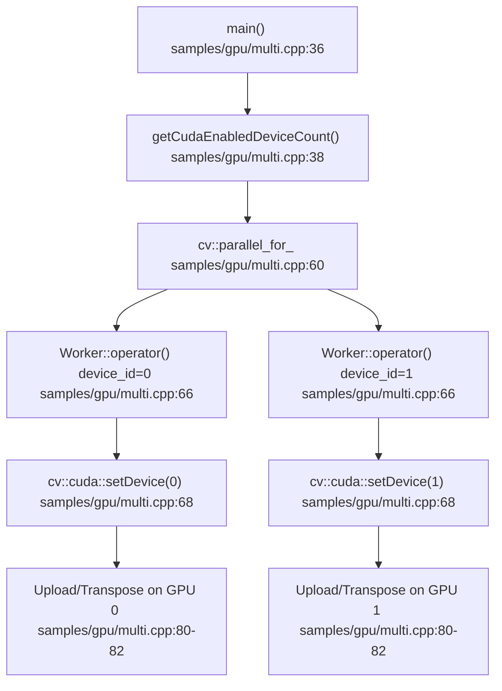
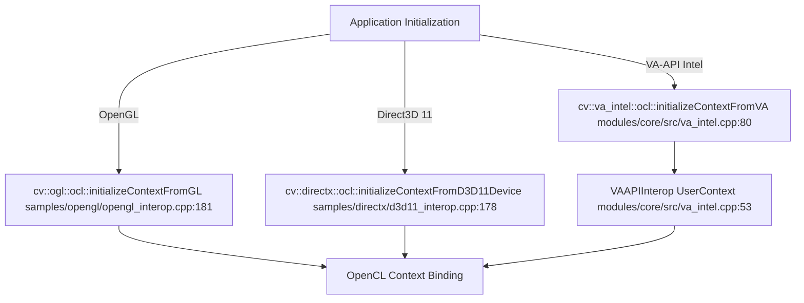
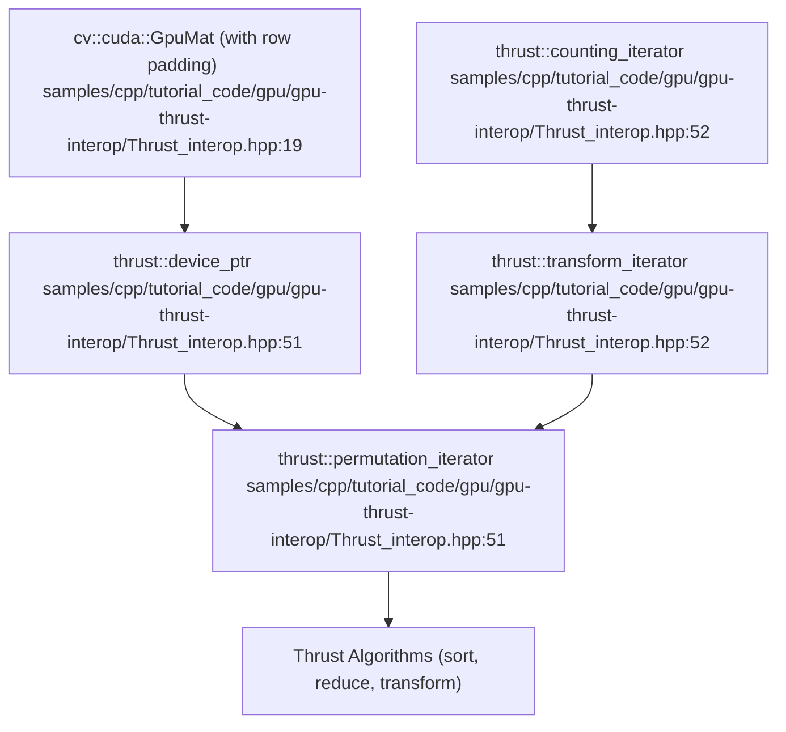

<!-- source: DeepWiki mcp.deepwiki.com · repo opencv/opencv · page 14.2 GPU-Accelerated Samples and Interop · fetched 2026-10-30 -->

# GPU-Accelerated Samples and Interop

Relevant source files

The following files were used as context for generating this wiki page:

- [.gitignore](.gitignore)
- [doc/py_tutorials/py_calib3d/py_depthmap/py_depthmap.markdown](doc/py_tutorials/py_calib3d/py_depthmap/py_depthmap.markdown)
- [doc/tutorials/gpu/gpu-thrust-interop/gpu_thrust_interop.markdown](doc/tutorials/gpu/gpu-thrust-interop/gpu_thrust_interop.markdown)
- [doc/tutorials/gpu/table_of_content_gpu.markdown](doc/tutorials/gpu/table_of_content_gpu.markdown)
- [doc/tutorials/introduction/linux_gcc_cmake/linux_gcc_cmake.markdown](doc/tutorials/introduction/linux_gcc_cmake/linux_gcc_cmake.markdown)
- [doc/tutorials/ios/table_of_content_ios.markdown](doc/tutorials/ios/table_of_content_ios.markdown)
- [modules/core/include/opencv2/core/directx.hpp](modules/core/include/opencv2/core/directx.hpp)
- [modules/core/src/directx.cpp](modules/core/src/directx.cpp)
- [modules/core/src/opencl/cvtclr_dx.cl](modules/core/src/opencl/cvtclr_dx.cl)
- [modules/core/src/va_intel.cpp](modules/core/src/va_intel.cpp)
- [platforms/android/build-tests/test_cmake_build.py](platforms/android/build-tests/test_cmake_build.py)
- [samples/CMakeLists.example.in](samples/CMakeLists.example.in)
- [samples/cpp/example_cmake/CMakeLists.txt](samples/cpp/example_cmake/CMakeLists.txt)
- [samples/cpp/example_cmake/example.cpp](samples/cpp/example_cmake/example.cpp)
- [samples/cpp/tutorial_code/gpu/gpu-thrust-interop/CMakeLists.txt](samples/cpp/tutorial_code/gpu/gpu-thrust-interop/CMakeLists.txt)
- [samples/cpp/tutorial_code/gpu/gpu-thrust-interop/Thrust_interop.hpp](samples/cpp/tutorial_code/gpu/gpu-thrust-interop/Thrust_interop.hpp)
- [samples/cpp/tutorial_code/gpu/gpu-thrust-interop/main.cu](samples/cpp/tutorial_code/gpu/gpu-thrust-interop/main.cu)
- [samples/directx/d3d10_interop.cpp](samples/directx/d3d10_interop.cpp)
- [samples/directx/d3d11_interop.cpp](samples/directx/d3d11_interop.cpp)
- [samples/directx/d3d9_interop.cpp](samples/directx/d3d9_interop.cpp)
- [samples/directx/d3d9ex_interop.cpp](samples/directx/d3d9ex_interop.cpp)
- [samples/directx/d3dsample.hpp](samples/directx/d3dsample.hpp)
- [samples/directx/winapp.hpp](samples/directx/winapp.hpp)
- [samples/gpu/multi.cpp](samples/gpu/multi.cpp)
- [samples/gpu/stereo_match.cpp](samples/gpu/stereo_match.cpp)
- [samples/gpu/stereo_multi.cpp](samples/gpu/stereo_multi.cpp)
- [samples/hal/README.md](samples/hal/README.md)
- [samples/hal/c_hal/CMakeLists.txt](samples/hal/c_hal/CMakeLists.txt)
- [samples/hal/c_hal/config.cmake](samples/hal/c_hal/config.cmake)
- [samples/hal/c_hal/impl.c](samples/hal/c_hal/impl.c)
- [samples/hal/c_hal/impl.h](samples/hal/c_hal/impl.h)
- [samples/hal/slow_hal/CMakeLists.txt](samples/hal/slow_hal/CMakeLists.txt)
- [samples/hal/slow_hal/config.cmake](samples/hal/slow_hal/config.cmake)
- [samples/hal/slow_hal/impl.cpp](samples/hal/slow_hal/impl.cpp)
- [samples/hal/slow_hal/impl.hpp](samples/hal/slow_hal/impl.hpp)
- [samples/opengl/opengl_interop.cpp](samples/opengl/opengl_interop.cpp)
- [samples/opengl/winapp.hpp](samples/opengl/winapp.hpp)

## Purpose and Scope

This page covers OpenCV's GPU sample programs (multi-GPU processing, stereo matching), interoperability APIs bridging graphics and media surfaces (DirectX, OpenGL, VA-Intel) with OpenCL/CUDA execution contexts, and the Thrust interoperability tutorial code. These components demonstrate how OpenCV surfaces (`cv::UMat` and `cv::cuda::GpuMat`) integrate with external GPU graphics pipelines, native hardware decoders, and parallel template libraries.

---

## GPU Sample Programs

OpenCV provides reference samples in `samples/gpu/` demonstrating multi-GPU distribution [samples/gpu/multi.cpp:1-3](), tiled multi-GPU stereo matching [samples/gpu/stereo_multi.cpp:1-3](), and interactive single-GPU stereo matching algorithms (`BM`, `BP`, `CSBP`) [samples/gpu/stereo_match.cpp:24-34]().

### Multi-GPU Independent Tasks (`multi.cpp`)

The `multi.cpp` sample illustrates how to perform independent tasks across multiple CUDA devices concurrently using OpenCV's parallel execution infrastructure [samples/gpu/multi.cpp:1-3]().

- **Device Enumeration**: It queries available devices via `getCudaEnabledDeviceCount()` and validates device compatibility using `cv::cuda::DeviceInfo::isCompatible()` [samples/gpu/multi.cpp:38-55]().
- **Thread Dispatch**: It wraps worker tasks in a `cv::ParallelLoopBody` subclass (`Worker`) and launches them via `cv::parallel_for_` [samples/gpu/multi.cpp:27-34](), [samples/gpu/multi.cpp:58-60]().
- **Context Switching**: Each worker thread explicitly binds to its assigned GPU via `cv::cuda::setDevice(device_id)` before allocating `cv::cuda::GpuMat` structures or invoking CUDA arithmetic functions [samples/gpu/multi.cpp:66-82]().

**Multi-GPU Execution Flow**

Sources: [samples/gpu/multi.cpp:36-93]()

### Stereo Matching and Multi-GPU Stereo (`stereo_match.cpp`, `stereo_multi.cpp`)

- **Single-GPU Interactive Stereo (`stereo_match.cpp`)**: Implements an interactive application using `cuda::StereoBM`, `cuda::StereoBeliefPropagation`, and `cuda::StereoConstantSpaceBP` [samples/gpu/stereo_match.cpp:69-71](). Frames are uploaded to `GpuMat`, processed on the device, downloaded to host `Mat`, and rendered with live frames-per-second (FPS) metrics [samples/gpu/stereo_match.cpp:169-215]().
- **Multi-GPU Segmented Stereo (`stereo_multi.cpp`)**: Demonstrates working on a single large frame by splitting input rows across two GPUs [samples/gpu/stereo_multi.cpp:1-3](). To prevent boundary artifacts where stereo block matching cannot compute valid disparity, row ranges include a 32-pixel overlap/padding [samples/gpu/stereo_multi.cpp:222-225](). OS-specific threads (`Thread` wrapper for `CreateThread` on Windows or `pthread_create` on Linux) manage separate execution streams and contexts [samples/gpu/stereo_multi.cpp:28-115]().

Sources: [samples/gpu/stereo_match.cpp:1-236](), [samples/gpu/stereo_multi.cpp:1-247]()

---

## Graphics API and Media Interoperability

OpenCV core provides bridge modules (`opencv2/core/opengl.hpp`, `opencv2/core/directx.hpp`, and `va_intel.cpp`) enabling zero-copy or direct surface sharing between OpenCV `UMat` structures and external graphics/media APIs.

### OpenGL Interoperability (`opengl_interop.cpp`)

The OpenGL sample pipeline (`opengl_interop.cpp`) demonstrates mapping OpenCV `UMat` or `cv::ogl::Texture2D`/`cv::ogl::Buffer` objects to render video frames via OpenGL [samples/opengl/opengl_interop.cpp:1-7]().

- **Context Initialization**: `cv::ogl::ocl::initializeContextFromGL()` binds OpenCV's OpenCL execution context directly to the active OpenGL context [samples/opengl/opengl_interop.cpp:181-181]().
- **Data Flow**: Video frames read via `cv::VideoCapture` are converted to RGBA and copied into OpenGL texture buffers (`texture.copyFrom`) or pixel unpack buffers (`buffer.copyFrom`) before filtering functions like `cv::blur` execute on OpenCL surfaces [samples/opengl/opengl_interop.cpp:191-202]().

Sources: [samples/opengl/opengl_interop.cpp:30-189]()

### DirectX Interoperability (`directx.cpp`, `d3d11_interop.cpp`)

OpenCV supports DirectX (Direct3D 9, 10, 11) surface sharing with OpenCL via `cv::directx` [modules/core/src/directx.cpp:62-63](), [samples/directx/d3d11_interop.cpp:1-6]().

- **DXGI Format Mapping**: `cv::directx::getTypeFromDXGI_FORMAT` translates DirectX surface pixel formats (`DXGI_FORMAT`) into OpenCV matrix types (e.g., `DXGI_FORMAT_R8G8B8A8_UNORM` maps to `CV_8UC4`) [modules/core/src/directx.cpp:64-165]().
- **Context Creation**: `cv::directx::ocl::initializeContextFromD3D11Device` initializes an OpenCL context from an existing `ID3D11Device*` [samples/directx/d3d11_interop.cpp:178-178]().
- **Surface Conversion**: Functions like `cv::directx::convertFromDirect3DSurface9` and `cv::directx::convertToDirect3DSurface9` wrap DirectX surfaces into `cv::UMat` instances for transparent GPU acceleration [samples/directx/d3d9_interop.cpp:190-200]().

Sources: [modules/core/src/directx.cpp:64-165](), [samples/directx/d3d11_interop.cpp:21-185](), [samples/directx/d3d9_interop.cpp:22-218]()

### VA-Intel Interoperability (`va_intel.cpp`)

Linux VA-API [modules/core/src/va_intel.cpp:12-16]() and Intel OpenCL media sharing extensions (`cl_intel_va_api_media_sharing`) are integrated via `cv::va_intel::ocl::initializeContextFromVA` [modules/core/src/va_intel.cpp:53-80]().

- **Extension Querying**: The internal `VAAPIInterop` user context queries platform function pointers dynamically, including `clCreateFromVA_APIMediaSurfaceINTEL`, `clEnqueueAcquireVA_APIMediaSurfacesINTEL`, and `clEnqueueReleaseVA_APIMediaSurfacesINTEL` [modules/core/src/va_intel.cpp:53-74]().
- **Context Binding**: It queries device IDs from the VA display adapter (`clGetDeviceIDsFromVA_APIMediaAdapterINTEL`) and constructs an OpenCL context using `CL_CONTEXT_VA_API_DISPLAY_INTEL` properties [modules/core/src/va_intel.cpp:128-146]().

Sources: [modules/core/src/va_intel.cpp:12-174]()

**Interoperability and Context Initialization**

Sources: [samples/opengl/opengl_interop.cpp:156-189](), [samples/directx/d3d11_interop.cpp:32-185](), [modules/core/src/va_intel.cpp:53-174]()

---

## CUDA and Thrust Interoperability (`Thrust_interop.hpp`)

The OpenCV tutorial code for CUDA and Thrust interoperability (`samples/cpp/tutorial_code/gpu/gpu-thrust-interop/Thrust_interop.hpp`) demonstrates how to wrap `cv::cuda::GpuMat` device pointers with Thrust iterators for custom GPU algorithms [samples/cpp/tutorial_code/gpu/gpu-thrust-interop/Thrust_interop.hpp:1-33]().

- **Stride Handling (`step_functor`)**: Because `GpuMat` rows can include padding bytes (pitch/stride), a custom unary function `step_functor` maps linear index coordinates `x` to exact 2D memory offsets taking into account `mat.cols`, `mat.step`, and channel count [samples/cpp/tutorial_code/gpu/gpu-thrust-interop/Thrust_interop.hpp:13-33]().
- **Iterators (`GpuMatBeginItr`, `GpuMatEndItr`)**: Combines `thrust::device_ptr`, `thrust::transform_iterator`, and `thrust::permutation_iterator` to produce standard STL-compatible iterators pointing to the beginning and end of a `GpuMat` channel or multi-channel matrix [samples/cpp/tutorial_code/gpu/gpu-thrust-interop/Thrust_interop.hpp:41-73]().

**Thrust Interoperability Data Flow**

Sources: [samples/cpp/tutorial_code/gpu/gpu-thrust-interop/Thrust_interop.hpp:1-73]()

---

