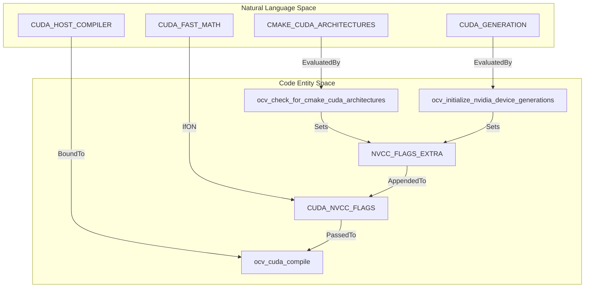
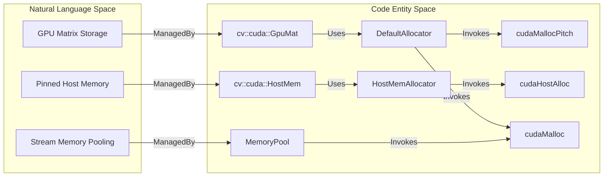

<!-- source: DeepWiki mcp.deepwiki.com · repo opencv/opencv · page 14.3 CUDA Build Options, Dependencies, and Common Pitfalls · fetched 2026-10-30 -->

# CUDA Build Options, Dependencies, and Common Pitfalls

Relevant source files

The following files were used as context for generating this wiki page:

- [3rdparty/dlpack/LICENSE](3rdparty/dlpack/LICENSE)
- [3rdparty/dlpack/include/dlpack/dlpack.h](3rdparty/dlpack/include/dlpack/dlpack.h)
- [cmake/FindCUDA.cmake](cmake/FindCUDA.cmake)
- [cmake/FindCUDA/make2cmake.cmake](cmake/FindCUDA/make2cmake.cmake)
- [cmake/FindCUDA/parse_cubin.cmake](cmake/FindCUDA/parse_cubin.cmake)
- [cmake/FindCUDA/run_nvcc.cmake](cmake/FindCUDA/run_nvcc.cmake)
- [cmake/FindCUDNNJIT.cmake](cmake/FindCUDNNJIT.cmake)
- [cmake/OpenCVDetectCUDA.cmake](cmake/OpenCVDetectCUDA.cmake)
- [cmake/OpenCVDetectCUDALanguage.cmake](cmake/OpenCVDetectCUDALanguage.cmake)
- [cmake/OpenCVDetectCUDAUtils.cmake](cmake/OpenCVDetectCUDAUtils.cmake)
- [cmake/OpenCVDetectDLPack.cmake](cmake/OpenCVDetectDLPack.cmake)
- [cmake/OpenCVMinDepVersions.cmake](cmake/OpenCVMinDepVersions.cmake)
- [modules/core/cmake/parallel/detect_openmp.cmake](modules/core/cmake/parallel/detect_openmp.cmake)
- [modules/core/include/opencv2/core/cuda.hpp](modules/core/include/opencv2/core/cuda.hpp)
- [modules/core/include/opencv2/core/cuda.inl.hpp](modules/core/include/opencv2/core/cuda.inl.hpp)
- [modules/core/include/opencv2/core/cuda/utility.hpp](modules/core/include/opencv2/core/cuda/utility.hpp)
- [modules/core/include/opencv2/core/private.cuda.hpp](modules/core/include/opencv2/core/private.cuda.hpp)
- [modules/core/misc/python/pyopencv_core.hpp](modules/core/misc/python/pyopencv_core.hpp)
- [modules/core/misc/python/pyopencv_cuda.hpp](modules/core/misc/python/pyopencv_cuda.hpp)
- [modules/core/src/cuda/gpu_mat.cu](modules/core/src/cuda/gpu_mat.cu)
- [modules/core/src/cuda/gpu_mat_nd.cu](modules/core/src/cuda/gpu_mat_nd.cu)
- [modules/core/src/cuda_gpu_mat.cpp](modules/core/src/cuda_gpu_mat.cpp)
- [modules/core/src/cuda_gpu_mat_nd.cpp](modules/core/src/cuda_gpu_mat_nd.cpp)
- [modules/core/src/cuda_host_mem.cpp](modules/core/src/cuda_host_mem.cpp)
- [modules/core/src/cuda_stream.cpp](modules/core/src/cuda_stream.cpp)
- [modules/core/test/test_cuda.cpp](modules/core/test/test_cuda.cpp)
- [modules/dnn/cmake/hooks/INIT_MODULE_SOURCES_opencv_dnn.cmake](modules/dnn/cmake/hooks/INIT_MODULE_SOURCES_opencv_dnn.cmake)
- [modules/dnn/src/cuda4dnn/csl/cublas.hpp](modules/dnn/src/cuda4dnn/csl/cublas.hpp)
- [modules/dnn/src/cuda4dnn/csl/cudnn/cudnn.hpp](modules/dnn/src/cuda4dnn/csl/cudnn/cudnn.hpp)
- [modules/dnn/src/cuda4dnn/csl/stream.hpp](modules/dnn/src/cuda4dnn/csl/stream.hpp)
- [modules/python/test/test_cuda.py](modules/python/test/test_cuda.py)

This page provides a technical overview of the OpenCV CUDA build pipeline, covering CMake configuration flags, dependency detection for cuDNN and NVIDIA Video Codec SDK, the organization of GPU-accelerated memory and runtime code within the library, and diagnostics for common build, link, and runtime issues.

## CUDA Dependency Detection and CMake Configuration

OpenCV manages CUDA detection through `cmake/OpenCVDetectCUDA.cmake` [cmake/OpenCVDetectCUDA.cmake:1-285](). The build system restricts CUDA compilation depending on the host platform and compiler; for instance, non-MSVC Windows compilers and Clang on certain platforms bypass CUDA detection [cmake/OpenCVDetectCUDA.cmake:1-9](). 

The minimum required versions for dependencies are defined in `cmake/OpenCVMinDepVersions.cmake`:
*   **CUDA Toolkit**: Version 6.5 [cmake/OpenCVMinDepVersions.cmake:5]()
*   **cuDNN**: Version 7.5 [cmake/OpenCVMinDepVersions.cmake:6]()
*   **cuDNN JIT**: Version 9.0 [cmake/OpenCVMinDepVersions.cmake:7]()

When `WITH_CUDNN` is active, the build system invokes `find_host_package(CUDNN)` [cmake/OpenCVDetectCUDA.cmake:58-66](). If `WITH_CUDNNJIT` is specified and standard cuDNN is absent, it attempts to locate `CUDNNJIT` [cmake/OpenCVDetectCUDA.cmake:68-80](). 

Hardware-accelerated video decoding (`NVCUVID`) and encoding (`NVCUVENC`) are verified via `ocv_check_for_nvidia_video_codec_sdk` in `cmake/OpenCVDetectCUDAUtils.cmake`, which checks for headers like `nvcuvid.h` and `nvEncodeAPI.h` within the toolkit directories [cmake/OpenCVDetectCUDAUtils.cmake:1-59]().

Sources: [cmake/OpenCVDetectCUDA.cmake:1-80](), [cmake/OpenCVMinDepVersions.cmake:1-9](), [cmake/OpenCVDetectCUDAUtils.cmake:1-59]()

---

## Build Configuration and Architecture Mapping

Target GPU architectures are controlled via CMake variables that translate into `nvcc` compilation flags. OpenCV supports prioritization via `CMAKE_CUDA_ARCHITECTURES`, `CUDA_GENERATION`, and explicit `CUDA_ARCH_BIN` / `CUDA_ARCH_PTX` lists [cmake/OpenCVDetectCUDAUtils.cmake:61-127]().

### Architecture Generations Mapping
| Generation | Compute Capabilities | Source Reference |
| :--- | :--- | :--- |
| **Maxwell** | `5.0`, `5.2` | [cmake/OpenCVDetectCUDAUtils.cmake:105]() |
| **Pascal** | `6.0`, `6.1` | [cmake/OpenCVDetectCUDAUtils.cmake:106]() |
| **Volta** | `7.0` | [cmake/OpenCVDetectCUDAUtils.cmake:107]() |
| **Turing** | `7.5` | [cmake/OpenCVDetectCUDAUtils.cmake:108]() |
| **Ampere** | `8.0`, `8.6` | [cmake/OpenCVDetectCUDAUtils.cmake:109]() |
| **Lovelace** | `8.9` | [cmake/OpenCVDetectCUDAUtils.cmake:110]() |
| **Hopper** | `9.0` | [cmake/OpenCVDetectCUDAUtils.cmake:111]() |
| **Blackwell** | `10.0`, `10.3`, `11.0`, `12.0`, `12.1` | [cmake/OpenCVDetectCUDAUtils.cmake:112]() |

### Code Entity Mapping: CMake Flag Translation Pipeline
The following diagram links high-level user configuration parameters to internal CMake variables and `nvcc` compiler arguments.

Sources: [cmake/OpenCVDetectCUDA.cmake:91-143](), [cmake/OpenCVDetectCUDAUtils.cmake:61-127]()

---

## Organization of CUDA Code and Memory Management

CUDA functionality spans foundational data structures, memory pools, and accelerated modules. 

### `GpuMat` and Memory Allocation
`cv::cuda::GpuMat` provides a reference-counted container for 2D GPU memory mirroring the interface of `cv::Mat` [modules/core/include/opencv2/core/cuda.hpp:74-105](). 
*   `DefaultAllocator` implements `GpuMat::Allocator` using `cudaMallocPitch` for 2D matrices to ensure row alignment, or `cudaMalloc` for single-row/column continuous matrices [modules/core/src/cuda/gpu_mat.cu:107-130]().
*   `HostMem` manages pinned host memory via `HostMemAllocator`, wrapping `cudaHostAlloc` with support for `PAGE_LOCKED`, `SHARED`, and `WRITE_COMBINED` allocation types [modules/core/src/cuda_host_mem.cpp:54-163]().
*   `MemoryPool` in `modules/core/src/cuda_stream.cpp` handles device memory stacks to minimize synchronization overhead during asynchronous stream operations [modules/core/src/cuda_stream.cpp:115-236]().

### Code Entity Mapping: GPU Memory Allocation Architecture
The following diagram illustrates how user-facing memory classes interface with CUDA runtime allocation primitives.

Sources: [modules/core/include/opencv2/core/cuda.hpp:74-105](), [modules/core/src/cuda/gpu_mat.cu:107-130](), [modules/core/src/cuda_host_mem.cpp:54-130](), [modules/core/src/cuda_stream.cpp:115-195]()

---

## Common Build, Link, and Runtime Issues & Diagnostics

### 1. Architecture Mismatch (`GpuApiCallError`)
*   **Cause**: The compiled binary's target architecture (`sm_XX`) does not match the execution device's compute capability.
*   **Diagnostics & Fix**: Verify `CUDA_ARCH_BIN` matches the physical GPU capability. Reconfigure CMake with `-DCUDA_GENERATION=Auto` to query the local device architecture automatically [cmake/OpenCVDetectCUDAUtils.cmake:113-116]().

### 2. Missing Runtime DLLs / Shared Libraries
*   **Cause**: The CUDA runtime (`cudart`), NPP (`npp*`), or math libraries (`cufft`, `cublas`) cannot be located by the loader.
*   **Diagnostics & Fix**: On Windows, enable `CUDA_ENABLE_DELAYLOAD` or ensure the CUDA toolkit `bin` directory is present in the system `PATH` [cmake/OpenCVDetectCUDA.cmake:145](). On Linux, ensure `/usr/local/cuda/lib64` is linked via `ldconfig`.

### 3. Compiler Compatibility and C++ Standard Enforcement
*   **Cause**: Host compiler mismatch or unsupported C++ standard flags passed to `nvcc`.
*   **Diagnostics & Fix**: Visual Studio is strictly required as the host compiler on Windows when compiling CUDA code [cmake/OpenCVDetectCUDA.cmake:1-4](). OpenCV automatically assigns the C++ standard based on the detected CUDA version within `ocv_cuda_compile`:
    *   CUDA < 11.0: `--std=c++11` [cmake/OpenCVDetectCUDA.cmake:171-174]()
    *   CUDA < 12.8: `--std=c++14` [cmake/OpenCVDetectCUDA.cmake:176-177]()
    *   CUDA >= 12.8: `--std=c++17` [cmake/OpenCVDetectCUDA.cmake:178-180]()

### 4. cuDNN and NPP Deprecation Conflicts
*   **Cause**: Removal of legacy modules (e.g., `nppicom` in CUDA 11.0+) causes link failures [cmake/OpenCVDetectCUDA.cmake:44-48]().
*   **Diagnostics & Fix**: Ensure OpenCV version matches the CUDA toolkit release; OpenCV automatically filters out deprecated libraries during detection [cmake/OpenCVDetectCUDA.cmake:44-48]().

Sources: [cmake/OpenCVDetectCUDA.cmake:1-189](), [cmake/OpenCVDetectCUDAUtils.cmake:113-116]()

---

