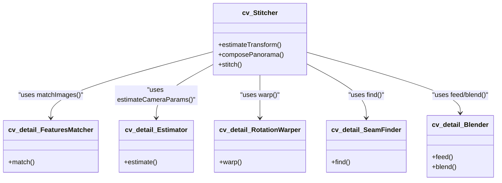

<!-- source: DeepWiki mcp.deepwiki.com · repo opencv/opencv · page 15 Image Stitching · fetched 2026-10-30 -->

# Image Stitching

Relevant source files

The following files were used as context for generating this wiki page:

- [modules/stitching/CMakeLists.txt](modules/stitching/CMakeLists.txt)
- [modules/stitching/include/opencv2/stitching.hpp](modules/stitching/include/opencv2/stitching.hpp)
- [modules/stitching/include/opencv2/stitching/detail/autocalib.hpp](modules/stitching/include/opencv2/stitching/detail/autocalib.hpp)
- [modules/stitching/include/opencv2/stitching/detail/blenders.hpp](modules/stitching/include/opencv2/stitching/detail/blenders.hpp)
- [modules/stitching/include/opencv2/stitching/detail/camera.hpp](modules/stitching/include/opencv2/stitching/detail/camera.hpp)
- [modules/stitching/include/opencv2/stitching/detail/matchers.hpp](modules/stitching/include/opencv2/stitching/detail/matchers.hpp)
- [modules/stitching/include/opencv2/stitching/detail/motion_estimators.hpp](modules/stitching/include/opencv2/stitching/detail/motion_estimators.hpp)
- [modules/stitching/include/opencv2/stitching/detail/seam_finders.hpp](modules/stitching/include/opencv2/stitching/detail/seam_finders.hpp)
- [modules/stitching/include/opencv2/stitching/detail/util_inl.hpp](modules/stitching/include/opencv2/stitching/detail/util_inl.hpp)
- [modules/stitching/include/opencv2/stitching/detail/warpers.hpp](modules/stitching/include/opencv2/stitching/detail/warpers.hpp)
- [modules/stitching/include/opencv2/stitching/detail/warpers_inl.hpp](modules/stitching/include/opencv2/stitching/detail/warpers_inl.hpp)
- [modules/stitching/include/opencv2/stitching/warpers.hpp](modules/stitching/include/opencv2/stitching/warpers.hpp)
- [modules/stitching/misc/python/test/test_stitching.py](modules/stitching/misc/python/test/test_stitching.py)
- [modules/stitching/src/blenders.cpp](modules/stitching/src/blenders.cpp)
- [modules/stitching/src/matchers.cpp](modules/stitching/src/matchers.cpp)
- [modules/stitching/src/motion_estimators.cpp](modules/stitching/src/motion_estimators.cpp)
- [modules/stitching/src/opencl/warpers.cl](modules/stitching/src/opencl/warpers.cl)
- [modules/stitching/src/precomp.hpp](modules/stitching/src/precomp.hpp)
- [modules/stitching/src/seam_finders.cpp](modules/stitching/src/seam_finders.cpp)
- [modules/stitching/src/stitcher.cpp](modules/stitching/src/stitcher.cpp)
- [modules/stitching/src/warpers.cpp](modules/stitching/src/warpers.cpp)
- [samples/cpp/stitching_detailed.cpp](samples/cpp/stitching_detailed.cpp)

## Purpose and Scope

This wiki page provides a high-level overview of the `opencv_stitching` module, which composites multiple overlapping images into seamless panoramas. It introduces the `cv::Stitcher` class, supported operating modes, and the overarching stitching pipeline architecture. 

As a parent page, this document summarizes high-level concepts and links to detailed child pages:
- For a step-by-step breakdown of the execution flow, see [Panorama Stitching Pipeline](#15.1).
- For lower-level customization using individual building blocks, see [Stitching Detail API: Matchers, Warpers, Seam Finders, Blenders](#15.2).

Sources: [modules/stitching/include/opencv2/stitching.hpp:62-105]()

---

## Module Layout and Dependencies

The stitching module resides in `modules/stitching/` and depends explicitly on core infrastructure and geometric modules (`opencv_imgproc`, `opencv_features`, `opencv_geometry`, `opencv_flann`) [modules/stitching/CMakeLists.txt:11-13](). GPU acceleration paths are conditionally linked when CUDA modules such as `opencv_cudafeatures2d` and `opencv_cudawarping` are available [modules/stitching/CMakeLists.txt:12]().

The public interface is exposed via the top-level header:
- `modules/stitching/include/opencv2/stitching.hpp` — declares `cv::Stitcher` and includes underlying detail headers [modules/stitching/include/opencv2/stitching.hpp:43-56]().

Sources: [modules/stitching/CMakeLists.txt:11-13](), [modules/stitching/include/opencv2/stitching.hpp:43-56]()

---

## The `Stitcher` Class and Modes

`cv::Stitcher` serves as the primary high-level orchestrator. It manages resolution scaling, component configurations, and executes the complete pipeline via `stitch()` or its two-phase decomposition (`estimateTransform()` and `composePanorama()`) [modules/stitching/src/stitcher.cpp:96-120]().

### Operating Modes

The `cv::Stitcher::create()` factory method accepts a `cv::Stitcher::Mode` to initialize preset configurations [modules/stitching/src/stitcher.cpp:47-93]():
- `PANORAMA`: Configured for perspective-transform photo panoramas, utilizing `cv::detail::HomographyBasedEstimator`, `cv::detail::BundleAdjusterRay`, and `SphericalWarper` [modules/stitching/src/stitcher.cpp:65-76]().
- `SCANS`: Configured for affine transformations (scans/flat objects), utilizing `cv::detail::AffineBasedEstimator`, `cv::detail::BundleAdjusterAffinePartial`, and `AffineWarper` [modules/stitching/src/stitcher.cpp:78-85]().

Sources: [modules/stitching/src/stitcher.cpp:47-93](), [modules/stitching/include/opencv2/stitching.hpp:155-170]()

### Resolution Scales

To balance speed and quality, the pipeline operates across three resolution tiers configured through `setRegistrationResol()`, `setSeamEstimationResol()`, and `setCompositingResol()` [modules/stitching/src/stitcher.cpp:51-53]():
- **Registration Resolution**: Defaults to `0.6` Mpx for fast feature detection and matching [modules/stitching/src/stitcher.cpp:51]().
- **Seam Estimation Resolution**: Defaults to `0.1` Mpx for efficient seam optimization [modules/stitching/src/stitcher.cpp:52]().
- **Compositing Resolution**: Defaults to `ORIG_RESOL` (`-1.0`) to render the final panorama at full source resolution [modules/stitching/src/stitcher.cpp:53](), [modules/stitching/include/opencv2/stitching.hpp:145]().

Sources: [modules/stitching/src/stitcher.cpp:51-64](), [modules/stitching/include/opencv2/stitching.hpp:138-146]()

---

## Pipeline Architecture Overview

The following diagram bridges the high-level stitching pipeline stages to their corresponding C++ code entities and classes in the codebase.

Title: Diagram: Stitching Pipeline and Code Entities

Sources: [modules/stitching/src/stitcher.cpp:96-192](), [modules/stitching/include/opencv2/stitching.hpp:138-170]()

---

## Summary of Pipeline Stages

1. **Feature Detection and Matching**: Computes keypoints and descriptors (`cv::detail::ImageFeatures`) using `cv::detail::computeImageFeatures()` and matches them via `cv::detail::FeaturesMatcher` implementations [modules/stitching/include/opencv2/stitching/detail/matchers.hpp:58-77,117-122](). For details, see [Panorama Stitching Pipeline](#15.1).
2. **Motion Estimation**: Estimates camera focal lengths and rotations using `cv::detail::HomographyBasedEstimator` or `AffineBasedEstimator`, followed by bundle adjustment (`cv::detail::BundleAdjusterBase`) and wave correction [modules/stitching/src/motion_estimators.cpp:126-192](). For details, see [Panorama Stitching Pipeline](#15.1).
3. **Image Warping**: Projects images onto common surfaces (sphere, cylinder, plane) using `cv::detail::RotationWarper` subclasses [modules/stitching/include/opencv2/stitching/detail/warpers.hpp:59-130](). For details, see [Panorama Stitching Pipeline](#15.1).
4. **Exposure Compensation and Seam Finding**: Corrects illumination discrepancies via `cv::detail::ExposureCompensator` and computes optimal seam boundaries using `cv::detail::SeamFinder` subclasses [modules/stitching/src/seam_finders.hpp:58-72](). For details, see [Panorama Stitching Pipeline](#15.1).
5. **Multi-Band Blending**: Composites the warped and seam-masked images using frequency-domain blending via `cv::detail::Blender` [modules/stitching/src/blenders.cpp:68-77](). For details, see [Panorama Stitching Pipeline](#15.1).

Sources: [modules/stitching/src/stitcher.cpp](), [modules/stitching/include/opencv2/stitching/detail/matchers.hpp](), [modules/stitching/src/motion_estimators.cpp](), [modules/stitching/include/opencv2/stitching/detail/warpers.hpp](), [modules/stitching/include/opencv2/stitching/detail/seam_finders.hpp](), [modules/stitching/src/blenders.cpp]()

---

## Data Flow Structures

The diagram below maps data containers passed between pipeline phases to their respective code structures.

Title: Diagram: Data Flow Structures Across Pipeline Classes

Sources: [modules/stitching/src/stitcher.cpp:96-192](), [modules/stitching/include/opencv2/stitching/detail/matchers.hpp:58-114]()

---

## Related Child Pages

- [Panorama Stitching Pipeline](#15.1) — Detailed coverage of the full pipeline managed by `cv::Stitcher`.
- [Stitching Detail API: Matchers, Warpers, Seam Finders, Blenders](#15.2) — Customizing stitching pipelines without `cv::Stitcher`.

---

