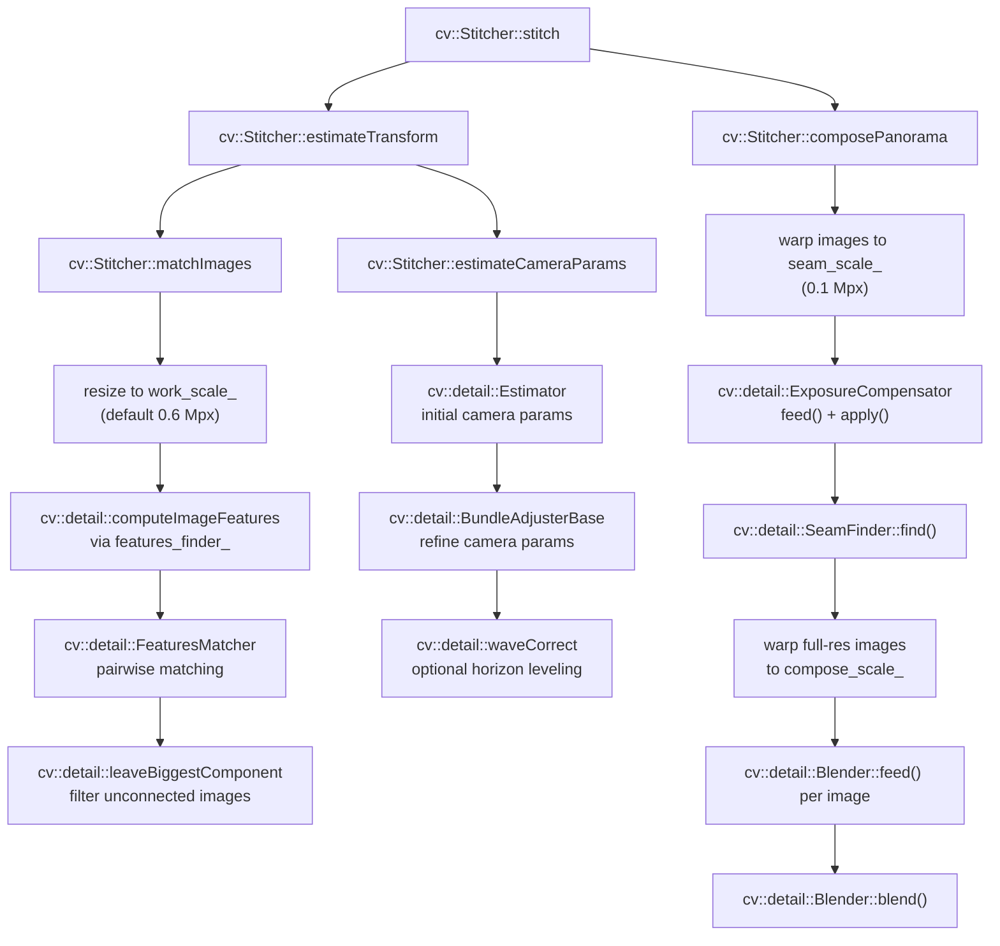
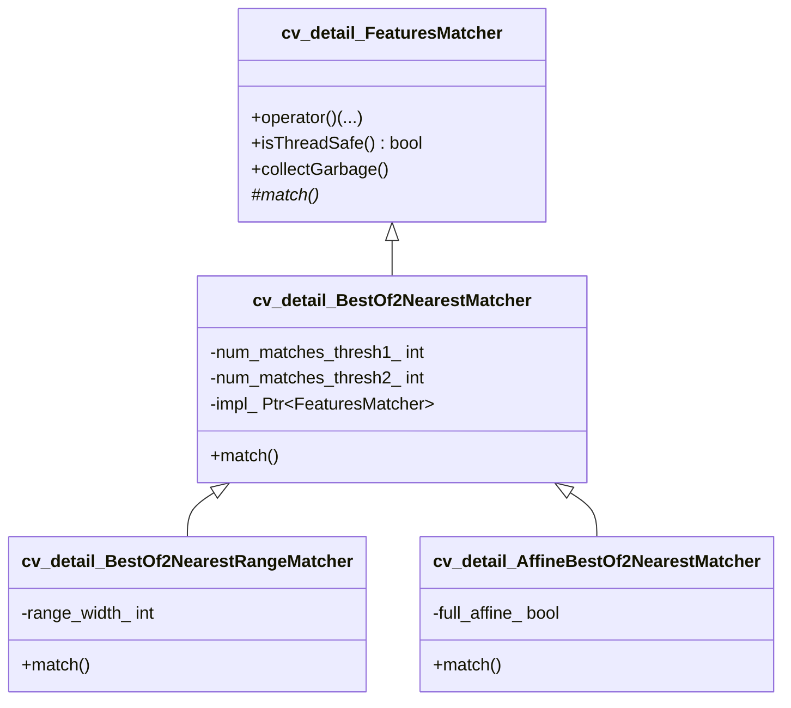
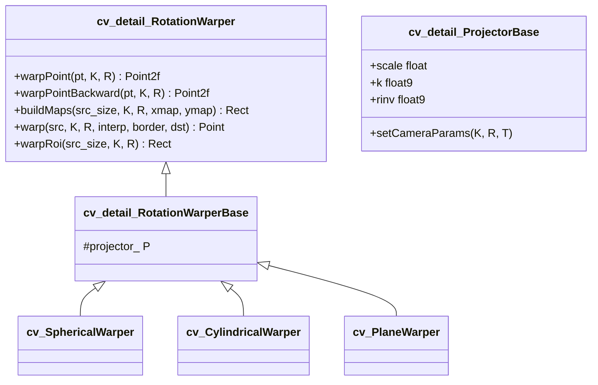

<!-- source: DeepWiki mcp.deepwiki.com · repo opencv/opencv · page 15.1 Panorama Stitching Pipeline · fetched 2026-10-30 -->

# Panorama Stitching Pipeline

<details>
<summary>Relevant source files</summary>

The following files were used as context for generating this wiki page:

- [modules/stitching/CMakeLists.txt](modules/stitching/CMakeLists.txt)
- [modules/stitching/include/opencv2/stitching.hpp](modules/stitching/include/opencv2/stitching.hpp)
- [modules/stitching/include/opencv2/stitching/detail/autocalib.hpp](modules/stitching/include/opencv2/stitching/detail/autocalib.hpp)
- [modules/stitching/include/opencv2/stitching/detail/blenders.hpp](modules/stitching/include/opencv2/stitching/detail/blenders.hpp)
- [modules/stitching/include/opencv2/stitching/detail/camera.hpp](modules/stitching/include/opencv2/stitching/detail/camera.hpp)
- [modules/stitching/include/opencv2/stitching/detail/matchers.hpp](modules/stitching/include/opencv2/stitching/detail/matchers.hpp)
- [modules/stitching/include/opencv2/stitching/detail/motion_estimators.hpp](modules/stitching/include/opencv2/stitching/detail/motion_estimators.hpp)
- [modules/stitching/include/opencv2/stitching/detail/seam_finders.hpp](modules/stitching/include/opencv2/stitching/detail/seam_finders.hpp)
- [modules/stitching/include/opencv2/stitching/detail/util_inl.hpp](modules/stitching/include/opencv2/stitching/detail/util_inl.hpp)
- [modules/stitching/include/opencv2/stitching/detail/warpers.hpp](modules/stitching/include/opencv2/stitching/detail/warpers.hpp)
- [modules/stitching/include/opencv2/stitching/detail/warpers_inl.hpp](modules/stitching/include/opencv2/stitching/detail/warpers_inl.hpp)
- [modules/stitching/include/opencv2/stitching/warpers.hpp](modules/stitching/include/opencv2/stitching/warpers.hpp)
- [modules/stitching/misc/python/test/test_stitching.py](modules/stitching/misc/python/test/test_stitching.py)
- [modules/stitching/src/blenders.cpp](modules/stitching/src/blenders.cpp)
- [modules/stitching/src/matchers.cpp](modules/stitching/src/matchers.cpp)
- [modules/stitching/src/motion_estimators.cpp](modules/stitching/src/motion_estimators.cpp)
- [modules/stitching/src/opencl/warpers.cl](modules/stitching/src/opencl/warpers.cl)
- [modules/stitching/src/precomp.hpp](modules/stitching/src/precomp.hpp)
- [modules/stitching/src/seam_finders.cpp](modules/stitching/src/seam_finders.cpp)
- [modules/stitching/src/stitcher.cpp](modules/stitching/src/stitcher.cpp)
- [modules/stitching/src/warpers.cpp](modules/stitching/src/warpers.cpp)
- [samples/cpp/stitching_detailed.cpp](samples/cpp/stitching_detailed.cpp)

</details>


## Purpose and Scope

This page documents the internal mechanics of `opencv_stitching`, the module responsible for compositing multiple images into seamless panoramas. It covers the `cv::Stitcher` class and every subordinate component: feature matching via `cv::detail::BestOf2NearestMatcher`, motion estimation, bundle adjustment, image warping through `cv::detail::RotationWarper` projections, exposure compensation, seam finding, and multi-band blending.

For context on how feature detectors and descriptor matchers work in general, see [Feature Detection and Matching (features2d)](#6). For geometric transform primitives (homography, affine), see [Camera Calibration and 3D Vision (calib3d)](#8).

Sources: [modules/stitching/include/opencv2/stitching.hpp:62-105]()

---

## Module Layout and Dependencies

The stitching module lives under `modules/stitching/`. Its mandatory dependencies are `opencv_imgproc`, `opencv_features`, `opencv_geometry`, and `opencv_flann`. Optional GPU acceleration requires `opencv_cudaarithm`, `opencv_cudawarping`, `opencv_cudafeatures2d`, `opencv_cudalegacy`, and `opencv_cudaimgproc`.

Sources: [modules/stitching/CMakeLists.txt:1-17]()

The public API is declared in `modules/stitching/include/opencv2/stitching.hpp`. All pipeline building blocks live in `cv::detail` and are declared in the `detail/` sub-directory of the include tree.

Sources: [modules/stitching/include/opencv2/stitching.hpp:43-56]()

---

## High-Level Pipeline and Code Flow

The `cv::Stitcher` class is the single entry point for end-to-end stitching. It owns references to every pluggable component and invokes them in a fixed order. The `stitch()` method is a thin wrapper that calls `estimateTransform()` followed by `composePanorama()`.


Sources: [modules/stitching/src/stitcher.cpp:96-120](), [modules/stitching/include/opencv2/stitching.hpp:124-154]()

---

## The `Stitcher` Class and Configuration Modes

`cv::Stitcher` is created via the static factory `cv::Stitcher::create(Mode mode)`. Two modes are predefined:

| Mode | Matcher | Estimator | Bundle Adjuster | Warper | Exposure Comp | Wave Correct |
|------|---------|-----------|-----------------|--------|---------------|--------------|
| `PANORAMA` | `cv::detail::BestOf2NearestMatcher` | `cv::detail::HomographyBasedEstimator` | `cv::detail::BundleAdjusterRay` | `cv::SphericalWarper` | `cv::detail::BlocksGainCompensator` | `WAVE_CORRECT_HORIZ` |
| `SCANS` | `cv::detail::AffineBestOf2NearestMatcher` | `cv::detail::AffineBasedEstimator` | `cv::detail::BundleAdjusterAffinePartial` | `cv::AffineWarper` | `cv::detail::NoExposureCompensator` | disabled |

Both modes use `cv::detail::GraphCutSeamFinder` and `cv::detail::MultiBandBlender` as defaults.

Sources: [modules/stitching/src/stitcher.cpp:47-93]()

### Resolution Scales

The pipeline operates at three distinct resolutions, controlled by separate parameters:

| Parameter | Setter | Default | Purpose |
|-----------|--------|---------|---------|
| `registr_resol_` | `setRegistrationResol()` | 0.6 Mpx | Feature detection and matching |
| `seam_est_resol_` | `setSeamEstimationResol()` | 0.1 Mpx | Seam estimation pass |
| `compose_resol_` | `setCompositingResol()` | `ORIG_RESOL` (-1) | Final composition (original) |

The work scale is derived as `work_scale = min(1.0, sqrt(registr_resol * 1e6 / image_area))`. Each image is independently resized before feature detection.

Sources: [modules/stitching/src/stitcher.cpp:51-53](), [modules/stitching/src/stitcher.cpp:60-64]()

---

## Stage 1: Feature Detection

`Stitcher::matchImages()` calls `cv::detail::computeImageFeatures()`, which wraps any `cv::Feature2D` implementation. Features are detected on scaled-down copies.

`ImageFeatures` is the data container that travels through the pipeline:
```cpp
struct ImageFeatures
{
    int img_idx;
    Size img_size;
    std::vector<KeyPoint> keypoints;
    UMat descriptors;
};
```
Sources: [modules/stitching/include/opencv2/stitching/detail/matchers.hpp:58-65](), [modules/stitching/src/matchers.cpp:282-315]()

The default feature finder is `cv::ORB::create()`. SURF (from `opencv_xfeatures2d`) and AKAZE are common alternatives.

Sources: [modules/stitching/src/stitcher.cpp:57](), [samples/cpp/stitching_detailed.cpp:48-52]()

---

## Stage 2: Feature Matching

### Matcher Class Hierarchy


Sources: [modules/stitching/include/opencv2/stitching/detail/matchers.hpp:117-270]()

### `BestOf2NearestMatcher` Logic

For each image pair, `cv::detail::BestOf2NearestMatcher` performs:
1. **Bidirectional kNN matching** — finds the two nearest descriptors in each direction. LSH is used for binary descriptors (`CV_8U`).
2. **Ratio test** — a match is kept if `distance[0] < (1 - match_conf) * distance[1]`.
3. **Homography estimation via RANSAC** — `findHomography()` is called on matched points. Requires at least `num_matches_thresh1_` matches.
4. **Inlier-based confidence** — confidence is `num_inliers / (8 + 0.3 * total_matches)`.
5. **Refinement pass** — if inliers ≥ `num_matches_thresh2_`, homography is recomputed on inlier points only.

`MatchesInfo` holds the result for each pair:
```cpp
struct MatchesInfo
{
    int src_img_idx;
    int dst_img_idx;
    std::vector<DMatch> matches;
    std::vector<uchar> inliers_mask;
    int num_inliers;
    Mat H;
    double confidence;
};
```
Sources: [modules/stitching/include/opencv2/stitching/detail/matchers.hpp:99-114](), [modules/stitching/src/matchers.cpp:149-190]()

---

## Stage 3: Camera Parameter Estimation

`cv::detail::HomographyBasedEstimator` recovers per-camera rotation and focal length:
1. Calls `estimateFocal()` to derive per-image focal lengths from pairwise homographies.
2. Builds a maximum spanning tree over the match graph using `findMaxSpanningTree()`.
3. Walks the tree breadth-first, chaining `R = K_from.inv() * H.inv() * K_to` via the `CalcRotation` functor.

Sources: [modules/stitching/src/motion_estimators.cpp:126-188]()

---

## Stage 4: Bundle Adjustment

Bundle adjustment refines all camera parameters simultaneously by minimizing a cost function.

| Class | Parameters per Camera | Cost Function |
|-------|-----------------------|--------------|
| `cv::detail::BundleAdjusterReproj` | 7 (focal, ppx, ppy, aspect, rvec×3) | 2D reprojection distance |
| `cv::detail::BundleAdjusterRay` | 4 (focal, rvec×3) | Angular ray distance on unit sphere |
| `cv::detail::BundleAdjusterAffine` | 6 (full 2×3 affine) | 2D point difference |
| `cv::detail::BundleAdjusterAffinePartial` | 4 (partial affine) | 2D point difference |

`cv::detail::BundleAdjusterRay` is the default for `PANORAMA` mode.

Sources: [modules/stitching/src/stitcher.cpp:73](), [modules/stitching/src/motion_estimators.cpp:515-651]()

---

## Stage 5: Image Warping

### Warper Architecture


Sources: [modules/stitching/include/opencv2/stitching/detail/warpers.hpp:57-188]()

Each warper is parameterized by a `ProjectorBase` derived class (e.g., `PlaneProjector`) that implements coordinate transformations. The template `RotationWarperBase<P>` uses these to build projection maps via `buildMaps()`.

Sources: [modules/stitching/include/opencv2/stitching/detail/warpers.hpp:131-179]()

---

## Stage 6: Exposure Compensation

Exposure compensation equalizes brightness across overlapping regions.

`cv::detail::GainCompensator` finds a scalar gain per image. `cv::detail::BlocksGainCompensator` (default for `PANORAMA`) divides each image into blocks, estimates per-block gains, and smooths them via filtering iterations.

Sources: [modules/stitching/src/stitcher.cpp:75](), [modules/stitching/src/exposure_compensate.cpp:83-113]()

---

## Stage 7: Seam Finding

Seam finding determines the optimal boundary between overlapping images to hide transition artifacts.

| Seam Finder | Algorithm |
|-------------|-----------|
| `cv::detail::VoronoiSeamFinder` | Distance transform; seam follows equidistant boundary. |
| `cv::detail::DpSeamFinder` | Dynamic programming; minimizes color or color+gradient cost. |
| `cv::detail::GraphCutSeamFinder` | Min-cut on a graph weighted by color difference (`COST_COLOR`). |

Sources: [modules/stitching/src/stitcher.cpp:55](), [modules/stitching/src/seam_finders.cpp:98-213]()

---

## Stage 8: Blending

The blender composites all warped images into the final output.

`cv::detail::MultiBandBlender` (default) performs Laplacian pyramid blending:
1. Each source image is decomposed into a Laplacian pyramid.
2. The per-image mask is decomposed into a Gaussian pyramid.
3. Pyramids are accumulated weighted by the Gaussian weight pyramid.
4. The combined pyramid is collapsed into the final image.

GPU acceleration for blending is supported through CUDA code paths which call kernels like `addSrcWeightGpu16S`.

Sources: [modules/stitching/src/blenders.cpp:46-61](), [modules/stitching/src/blenders.cpp:216-600]()

---

